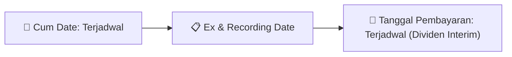

# Ikhtisar Akhir Pekan (Weekend Digest) - 2026-08-31

📅 **2026-08-31 (Weekend Digest)**

## 1. Radar Pasar & Sentimen Akhir Pekan (Executive Weekend Dashboard)
> [!NOTE]
> Terdeteksi sebanyak **392 pengumuman baru** dari 131 emiten pantauan pada (2026-08-31).

| Metric | Jumlah | Status Radar |
| :--- | :---: | :--- |
| **🟢 Sentimen Bullish / Positif** | `11` | [[Dividen Interim]], [[Mandatory Tender Offer]], Kinerja Positif |
| **⚪ Sentimen Netral / Routine** | `228` | [[Tanggapan Penjelasan Bursa]], [[RUPS]], [[Pendaftaran Unit]] |
| **🔴 Sentimen Bearish / Alert** | `7` | Sengketa Hukum, Defisit / Gugatan (Nihil hari ini) |
| **📄 [[Laporan Keuangan]] Baru** | `53` | Memicu Analisis Keuangan Otomatis |

> [!IMPORTANT]
> **Ditemukan Laporan Keuangan Baru Hari Ini:**
> - **CYBR**: FinancialStatement-2026-II-CYBR ([Buka PDF](file:///g:/My Drive/Model2/reports/raw/CYBR/20260831_CYBR_FinancialStatement-2026-II-CYBR.pdf))
- **CYBR**: FinancialStatement-2026-II-CYBR. ([Buka PDF](file:///g:/My Drive/Model2/reports/raw/CYBR/20260831_CYBR_FinancialStatement-2026-II-CYBR.xlsx))
- **DEWI**: FinancialStatement-2026-II-DEWI ([Buka PDF](file:///g:/My Drive/Model2/reports/raw/DEWI/20260831_DEWI_FinancialStatement-2026-II-DEWI.pdf))
- **DEWI**: FinancialStatement-2026-II-DEWI. ([Buka PDF](file:///g:/My Drive/Model2/reports/raw/DEWI/20260831_DEWI_FinancialStatement-2026-II-DEWI.xlsx))
- **JSMR**: FinancialStatement-2026-II-JSMR ([Buka PDF](file:///g:/My Drive/Model2/reports/raw/JSMR/20260831_JSMR_FinancialStatement-2026-II-JSMR.pdf))
- **JSMR**: FinancialStatement-2026-II-JSMR. ([Buka PDF](file:///g:/My Drive/Model2/reports/raw/JSMR/20260831_JSMR_FinancialStatement-2026-II-JSMR.xlsx))
- **JECX**: FinancialStatement-2026-II-JECX ([Buka PDF](file:///g:/My Drive/Model2/reports/raw/JECX/20260831_JECX_FinancialStatement-2026-II-JECX.pdf))
- **JECX**: FinancialStatement-2026-II-JECX. ([Buka PDF](file:///g:/My Drive/Model2/reports/raw/JECX/20260831_JECX_FinancialStatement-2026-II-JECX.xlsx))
- **JECX**: FS Q2 2026 ([Buka PDF](file:///g:/My Drive/Model2/reports/raw/JECX/20260831_JECX_JECX_FS Q2 2026.pdf))
- **JECX**: SPD FS Q2 2026 ([Buka PDF](file:///g:/My Drive/Model2/reports/raw/JECX/20260831_JECX_JECX_SPD FS Q2 2026.pdf))
- **MITI**: FinancialStatement-2026-II-MITI ([Buka PDF](file:///g:/My Drive/Model2/reports/raw/MITI/20260831_MITI_FinancialStatement-2026-II-MITI.pdf))
- **MITI**: FinancialStatement-2026-II-MITI. ([Buka PDF](file:///g:/My Drive/Model2/reports/raw/MITI/20260831_MITI_FinancialStatement-2026-II-MITI.xlsx))
- **MITI**: FS PT Mitra Investindo Tbk  Juni 2026 ([Buka PDF](file:///g:/My Drive/Model2/reports/raw/MITI/20260831_MITI_FS PT Mitra Investindo Tbk  Juni 2026.pdf))
- **BKDP**: FinancialStatement-2026-II-BKDP ([Buka PDF](file:///g:/My Drive/Model2/reports/raw/BKDP/20260831_BKDP_FinancialStatement-2026-II-BKDP.pdf))
- **BKDP**: BKDP - Surat Pengantar Laporan Keuangan ([Buka PDF](file:///g:/My Drive/Model2/reports/raw/BKDP/20260831_BKDP_BKDP - Surat Pengantar Laporan Keuangan.pdf))
- **BKDP**: FinancialStatement-2026-II-BKDP. ([Buka PDF](file:///g:/My Drive/Model2/reports/raw/BKDP/20260831_BKDP_FinancialStatement-2026-II-BKDP.xlsx))
- **BKDP**: SPD Laporan Keuangan Q2 - BKDP ([Buka PDF](file:///g:/My Drive/Model2/reports/raw/BKDP/20260831_BKDP_SPD Laporan Keuangan Q2 - BKDP.pdf))
- **SSMS**: FinancialStatement-2026-II-SSMS ([Buka PDF](file:///g:/My Drive/Model2/reports/raw/SSMS/20260831_SSMS_FinancialStatement-2026-II-SSMS.pdf))
- **SSMS**: FinancialStatement-2026-II-SSMS. ([Buka PDF](file:///g:/My Drive/Model2/reports/raw/SSMS/20260831_SSMS_FinancialStatement-2026-II-SSMS.xlsx))
- **UNTD**: FinancialStatement-2026-II-UNTD ([Buka PDF](file:///g:/My Drive/Model2/reports/raw/UNTD/20260831_UNTD_FinancialStatement-2026-II-UNTD.pdf))
- **UNTD**: FinancialStatement-2026-II-UNTD. ([Buka PDF](file:///g:/My Drive/Model2/reports/raw/UNTD/20260831_UNTD_FinancialStatement-2026-II-UNTD.xlsx))
- **ANTM**: FinancialStatement-2026-II-ANTM ([Buka PDF](file:///g:/My Drive/Model2/reports/raw/ANTM/20260828_ANTM_FinancialStatement-2026-II-ANTM.pdf))
- **ANTM**: ANTAM FS 30 Juni 2026 ([Buka PDF](file:///g:/My Drive/Model2/reports/raw/ANTM/20260828_ANTM_ANTAM FS 30 Juni 2026.pdf))
- **ANTM**: FinancialStatement-2026-II-ANTM. ([Buka PDF](file:///g:/My Drive/Model2/reports/raw/ANTM/20260828_ANTM_FinancialStatement-2026-II-ANTM.xlsx))
- **CASH**: FinancialStatement-2026-II-CASH ([Buka PDF](file:///g:/My Drive/Model2/reports/raw/CASH/20260828_CASH_FinancialStatement-2026-II-CASH.pdf))
- **CASH**: FinancialStatement-2026-II-CASH. ([Buka PDF](file:///g:/My Drive/Model2/reports/raw/CASH/20260828_CASH_FinancialStatement-2026-II-CASH.xlsx))
- **WIKA**: FinancialStatement-2026-II-WIKA ([Buka PDF](file:///g:/My Drive/Model2/reports/raw/WIKA/20260828_WIKA_FinancialStatement-2026-II-WIKA.pdf))
- **WIKA**: FinancialStatement-2026-II-WIKA. ([Buka PDF](file:///g:/My Drive/Model2/reports/raw/WIKA/20260828_WIKA_FinancialStatement-2026-II-WIKA.xlsx))
- **PEHA**: FinancialStatement-2026-II-PEHA ([Buka PDF](file:///g:/My Drive/Model2/reports/raw/PEHA/20260830_PEHA_FinancialStatement-2026-II-PEHA.pdf))
- **PEHA**: FinancialStatement-2026-II-PEHA. ([Buka PDF](file:///g:/My Drive/Model2/reports/raw/PEHA/20260830_PEHA_FinancialStatement-2026-II-PEHA.xlsx))
- **PEHA**: FS Reviu PT Phapros Tbk 30 Jun 2026 ([Buka PDF](file:///g:/My Drive/Model2/reports/raw/PEHA/20260830_PEHA_FS Reviu PT Phapros Tbk 30 Jun 2026.pdf))
- **CRAB**: FinancialStatement-2026-II-CRAB ([Buka PDF](file:///g:/My Drive/Model2/reports/raw/CRAB/20260830_CRAB_FinancialStatement-2026-II-CRAB.pdf))
- **CRAB**: FinancialStatement-2026-II-CRAB. ([Buka PDF](file:///g:/My Drive/Model2/reports/raw/CRAB/20260830_CRAB_FinancialStatement-2026-II-CRAB.xlsx))
- **CRAB**: FinancialStatement-2026-I-CRAB ([Buka PDF](file:///g:/My Drive/Model2/reports/raw/CRAB/20260830_CRAB_FinancialStatement-2026-I-CRAB.pdf))
- **CRAB**: FinancialStatement-2026-I-CRAB. ([Buka PDF](file:///g:/My Drive/Model2/reports/raw/CRAB/20260830_CRAB_FinancialStatement-2026-I-CRAB.xlsx))
- **SQMI**: FinancialStatement-2026-II-SQMI ([Buka PDF](file:///g:/My Drive/Model2/reports/raw/SQMI/20260830_SQMI_FinancialStatement-2026-II-SQMI.pdf))
- **SQMI**: FinancialStatement-2026-II-SQMI. ([Buka PDF](file:///g:/My Drive/Model2/reports/raw/SQMI/20260830_SQMI_FinancialStatement-2026-II-SQMI.xlsx))
- **SQMI**: SQMI FS 2026 Q2 30 Jun ([Buka PDF](file:///g:/My Drive/Model2/reports/raw/SQMI/20260830_SQMI_SQMI FS 2026 Q2 30 Jun.pdf))
- **OILS**: FinancialStatement-2026-II-OILS ([Buka PDF](file:///g:/My Drive/Model2/reports/raw/OILS/20260829_OILS_FinancialStatement-2026-II-OILS.pdf))
- **OILS**: FinancialStatement-2026-II-OILS. ([Buka PDF](file:///g:/My Drive/Model2/reports/raw/OILS/20260829_OILS_FinancialStatement-2026-II-OILS.xlsx))
- **HELI**: FinancialStatement-2026-II-HELI ([Buka PDF](file:///g:/My Drive/Model2/reports/raw/HELI/20260829_HELI_FinancialStatement-2026-II-HELI.pdf))
- **HELI**: Final Limited Review Laporan Keuangan 30 Juni 2026 ([Buka PDF](file:///g:/My Drive/Model2/reports/raw/HELI/20260829_HELI_Final Limited Review Laporan Keuangan 30 Juni 2026.pdf))
- **HELI**: FinancialStatement-2026-II-HELI. ([Buka PDF](file:///g:/My Drive/Model2/reports/raw/HELI/20260829_HELI_FinancialStatement-2026-II-HELI.xlsx))
- **HELI**: Penyampaian Laporan Keuangan 30 Juni 2026 ([Buka PDF](file:///g:/My Drive/Model2/reports/raw/HELI/20260829_HELI_Penyampaian Laporan Keuangan 30 Juni 2026.pdf))
- **SMMA**: FinancialStatement-2026-II-SMMA ([Buka PDF](file:///g:/My Drive/Model2/reports/raw/SMMA/20260829_SMMA_FinancialStatement-2026-II-SMMA.pdf))
- **SMMA**: FinancialStatement-2026-II-SMMA. ([Buka PDF](file:///g:/My Drive/Model2/reports/raw/SMMA/20260829_SMMA_FinancialStatement-2026-II-SMMA.xlsx))
- **SMMA**: FS SMMA 30 June 2026 ([Buka PDF](file:///g:/My Drive/Model2/reports/raw/SMMA/20260829_SMMA_FS SMMA 30 June 2026.pdf))
- **SMMA**: FS SMMA 30 Juni 26 ([Buka PDF](file:///g:/My Drive/Model2/reports/raw/SMMA/20260829_SMMA_FS SMMA 30 Juni 26.pdf))
- **CRAB**: FinancialStatement-2025-Tahunan-CRAB ([Buka PDF](file:///g:/My Drive/Model2/reports/raw/CRAB/20260829_CRAB_FinancialStatement-2025-Tahunan-CRAB.pdf))
- **CRAB**: FinancialStatement-2025-Tahunan-CRAB. ([Buka PDF](file:///g:/My Drive/Model2/reports/raw/CRAB/20260829_CRAB_FinancialStatement-2025-Tahunan-CRAB.xlsx))
- **ADRO**: FinancialStatement-2026-II-ADRO ([Buka PDF](file:///g:/My Drive/Model2/reports/raw/ADRO/20260829_ADRO_FinancialStatement-2026-II-ADRO.pdf))
- **ADRO**: FinancialStatement-2026-II-ADRO. ([Buka PDF](file:///g:/My Drive/Model2/reports/raw/ADRO/20260829_ADRO_FinancialStatement-2026-II-ADRO.xlsx))
- **ADRO**: FS Alamtri Resources Indonesia 30 June 2026 ([Buka PDF](file:///g:/My Drive/Model2/reports/raw/ADRO/20260829_ADRO_FS Alamtri Resources Indonesia 30 June 2026.pdf))
> 
> *Tugas Swarm Agent:* Lakukan analisis laporan keuangan mendalam per emiten secara terpisah untuk berkas-berkas di atas.

---

## 2. Sorotan Utama & Watchlist Strategis (Strategic Watchlist)
#### 💰 Watchlist Dividen & Distribution
- **[[BQ]]**: Periode Buku Dividen = 2025
- **[[BQ]]**: Total Nilai Dividen = IDR 793.468.300.000
- **[[BQ]]**: Dividen Per Saham = IDR 100
- **[[BQ]]**: Tanggal Cum Dividen Pasar Reguler dan Negosiasi = 03 September 2026
- **[[BQ]]**: Tanggal Ex Dividen Pasar Reguler dan Negosiasi = 04 September 2026
- **[[BQ]]**: Tanggal Cum Dividen Pasar Tunai = 07 September 2026

#### 🎯 Watchlist Penawaran Tender Wajib (MTO) & Strategis
- **[[BCIC]]**: Pengendali = [[Tidak]]
- **[[BCIC]]**: Pengendali = [[Tidak]]
- **[[LIFE]]**: Pemegang Saham Pengendali = [[Mitsui Sumitomo Insurance Co., Ltd, memiliki 80% saham LIFE]]
- **[[LIFE]]**: Rencana Pemegang Saham Pengendali = [[Tidak memiliki rencana untuk membeli atau menjual saham LIFE]]
- **[[DEWI]]**: Pemegang saham pengendali = [[Individual WNI]]
- **[[JSMR]]**: Pemegang Saham Pengendali = [[Pemerintah Indonesia (Indonesian Government)]]

#### 📈 Watchlist Konversi Waran & Potensi Dilusi
- **[[BQ]]**: Underlying Waran Terstruktur = PT Cisarua Mountain Dairy Tbk (CMRY)
- **[[BQ]]**: Kode Waran Terstruktur = CMRYBQCZ6A
- **[[BQ]]**: Penerbit Waran Terstruktur = PT Korea Investment And Sekuritas Indonesia
- **[[CYBR]]**: Nama Waran = CYBR-W
- **[[CYBR]]**: Jumlah Waran yang Dikonversi = 300
- **[[CYBR]]**: Sisa Waran Setelah Konversi = 424.083.999

#### 👥 Watchlist Transaksi Orang Dalam & Kepemilikan Saham (Insider / Repo Moves)
- **[[ASII]]**: Waktu Pelaporan = 31-08-2026 01:21
- **[[BCIC]]**: Nama Pelapor = RITSUO FUKADAI
- **[[BCIC]]**: Jabatan = Direksi
- **[[BCIC]]**: Kewarganegaraan = WNI
- **[[BCIC]]**: Emiten = BCIC - BANK JTRUST INDONESIA Tbk, PT
- **[[BCIC]]**: Nomor Laporan = LK/31082026/0011/1
- **[[BCIC]]**: Jumlah Saham Sebelum Transaksi = 154.300,00 Unit
- **[[BCIC]]**: Hak Suara Sebelum Transaksi = 0,001%

---

## 3. Matriks Pengumuman Pasar (Announcements Intelligence Table)
| Emiten | Sentimen | Jenis Pengumuman | Judul Pengumuman | Berkas |
| :--- | :---: | :--- | :--- | :--- |
| **[[ASII]]** | ⚪ NEUTRAL | Aksi Korporasi | Laporan Informasi dan Fakta Material | [Utama](file:///g:/My%20Drive/Model2/reports/raw/ASII/20260831_ASII_20260831_ASII_Laporan Informasi dan Fakta Material_32143556.pdf) |
| **[[BQ]]** | 🟢 BULLISH | Aksi Korporasi | BQ BQ Keterbukaan Informasi | [Utama](file:///g:/My%20Drive/Model2/reports/raw/BQ/20260831_BQ_20260831_BQ_Keterbukaan Informasi_32143645.pdf) · [Lamp 1](file:///g:/My%20Drive/Model2/reports/raw/BQ/20260831_BQ_20260831_BQ_Keterbukaan Informasi_32143645_lamp1.pdf) |
| **[[PIPA]]** | ⚪ NEUTRAL | Aksi Korporasi | Tanggapan atas Permintaan Penjelasan Bursa | [Utama](file:///g:/My%20Drive/Model2/reports/raw/PIPA/20260831_PIPA_20260831_PIPA_Tanggapan atas Permintaan Penjelasan Bursa_32143674.pdf) · [Lamp 1](file:///g:/My%20Drive/Model2/reports/raw/PIPA/20260831_PIPA_20260831_PIPA_Tanggapan atas Permintaan Penjelasan Bursa_32143674_lamp1.pdf) |
| **[[BCIC]]** | ⚪ NEUTRAL | Kepemilikan Saham (Insider) | LK-31082026-2178-00 | [Utama](file:///g:/My%20Drive/Model2/reports/raw/BCIC/20260831_BCIC_LK-31082026-2178-00.pdf) |
| **[[BCIC]]** | ⚪ NEUTRAL | Kepemilikan Saham (Insider) | LK-31082026-4638-00 | [Utama](file:///g:/My%20Drive/Model2/reports/raw/BCIC/20260831_BCIC_LK-31082026-4638-00.pdf) |
| **[[BCIC]]** | ⚪ NEUTRAL | Kepemilikan Saham (Insider) | LK-31082026-8596-00 | [Utama](file:///g:/My%20Drive/Model2/reports/raw/BCIC/20260831_BCIC_LK-31082026-8596-00.pdf) |
| **[[AGRS]]** | ⚪ NEUTRAL | Aksi Korporasi | Laporan Informasi dan Fakta Material | [Utama](file:///g:/My%20Drive/Model2/reports/raw/AGRS/20260831_AGRS_20260831_AGRS_Laporan Informasi dan Fakta Material_32143579.pdf) |
| **[[MUTU]]** | ⚪ NEUTRAL | Aksi Korporasi | Tanggapan atas Permintaan Penjelasan Bursa | [Utama](file:///g:/My%20Drive/Model2/reports/raw/MUTU/20260831_MUTU_20260831_MUTU_Tanggapan atas Permintaan Penjelasan Bursa_32143643.pdf) · [Lamp 1](file:///g:/My%20Drive/Model2/reports/raw/MUTU/20260831_MUTU_20260831_MUTU_Tanggapan atas Permintaan Penjelasan Bursa_32143643_lamp1.pdf) |
| **[[CYBR]]** | ⚪ NEUTRAL | Kepemilikan Saham (Insider) | LK-31082026-6619-00 | [Utama](file:///g:/My%20Drive/Model2/reports/raw/CYBR/20260831_CYBR_LK-31082026-6619-00.pdf) |
| **[[CYBR]]** | ⚪ NEUTRAL | Laporan Keuangan | FinancialStatement-2026-II-CYBR | [Utama](file:///g:/My%20Drive/Model2/reports/raw/CYBR/20260831_CYBR_FinancialStatement-2026-II-CYBR.pdf) |
| **[[CYBR]]** | 🟢 BULLISH | Aksi Korporasi | CYBR - Checklist OJK 30 Juni 2026 | [Utama](file:///g:/My%20Drive/Model2/reports/raw/CYBR/20260831_CYBR_CYBR - Checklist OJK 30 Juni 2026.pdf) |
| **[[CYBR]]** | ⚪ NEUTRAL | Aksi Korporasi | CYBR - Report Reviu as of June 30 2026 | [Utama](file:///g:/My%20Drive/Model2/reports/raw/CYBR/20260831_CYBR_CYBR - Report Reviu as of June 30 2026.pdf) |
| **[[CYBR]]** | ⚪ NEUTRAL | Aksi Korporasi | CYBR - Surat Pengantar Lap Keu 30 Juni 2026 | [Utama](file:///g:/My%20Drive/Model2/reports/raw/CYBR/20260831_CYBR_CYBR - Surat Pengantar Lap Keu 30 Juni 2026.pdf) |
| **[[CYBR]]** | ⚪ NEUTRAL | Laporan Keuangan | FinancialStatement-2026-II-CYBR. | [Utama](file:///g:/My%20Drive/Model2/reports/raw/CYBR/20260831_CYBR_FinancialStatement-2026-II-CYBR.xlsx) |
| **[[CYBR]]** | ⚪ NEUTRAL | Kepemilikan Saham (Insider) | LK-28082026-9370-00 | [Utama](file:///g:/My%20Drive/Model2/reports/raw/CYBR/20260828_CYBR_LK-28082026-9370-00.pdf) |
| **[[CYBR]]** | ⚪ NEUTRAL | Aksi Korporasi | Pencatatan Saham Tambahan dari Konversi | [Utama](file:///g:/My%20Drive/Model2/reports/raw/CYBR/20260828_CYBR_20260828_CYBR_Pencatatan Saham Tambahan dari Konversi_32133323.pdf) |
| **[[AGRO]]** | ⚪ NEUTRAL | RUPS | Pengumuman RUPS | [Utama](file:///g:/My%20Drive/Model2/reports/raw/AGRO/20260831_AGRO_20260831_AGRO_Pengumuman RUPS_32143655.pdf) · [Lamp 2](file:///g:/My%20Drive/Model2/reports/raw/AGRO/20260831_AGRO_20260831_AGRO_Pengumuman RUPS_32143655_lamp2.pdf) · [Lamp 1](file:///g:/My%20Drive/Model2/reports/raw/AGRO/20260831_AGRO_20260831_AGRO_Pengumuman RUPS_32143655_lamp1.pdf) |
| **[[DMAS]]** | ⚪ NEUTRAL | RUPS | Pemanggilan RUPS | [Utama](file:///g:/My%20Drive/Model2/reports/raw/DMAS/20260831_DMAS_20260828_DMAS_Pemanggilan RUPS_32133339.pdf) |
| **[[KDTN]]** | ⚪ NEUTRAL | Kepemilikan Saham (Insider) | LK-31082026-9888-00 | [Utama](file:///g:/My%20Drive/Model2/reports/raw/KDTN/20260831_KDTN_LK-31082026-9888-00.pdf) |
| **[[KDTN]]** | ⚪ NEUTRAL | Kepemilikan Saham (Insider) | LK-28082026-0528-00 | [Utama](file:///g:/My%20Drive/Model2/reports/raw/KDTN/20260828_KDTN_LK-28082026-0528-00.pdf) |
| **[[KDTN]]** | ⚪ NEUTRAL | Kepemilikan Saham (Insider) | LK-28082026-1587-00 | [Utama](file:///g:/My%20Drive/Model2/reports/raw/KDTN/20260828_KDTN_LK-28082026-1587-00.pdf) |
| **[[TMPO]]** | ⚪ NEUTRAL | Public Expose | Public Expose | [Utama](file:///g:/My%20Drive/Model2/reports/raw/TMPO/20260831_TMPO_20260831_TMPO_Public Expose_32143686.pdf) |
| **[[LIFE]]** | ⚪ NEUTRAL | Aksi Korporasi | Tanggapan atas Permintaan Penjelasan Bursa | [Utama](file:///g:/My%20Drive/Model2/reports/raw/LIFE/20260831_LIFE_20260831_LIFE_Tanggapan atas Permintaan Penjelasan Bursa_32143595.pdf) · [Lamp 1](file:///g:/My%20Drive/Model2/reports/raw/LIFE/20260831_LIFE_20260831_LIFE_Tanggapan atas Permintaan Penjelasan Bursa_32143595_lamp1.pdf) |
| **[[DEWI]]** | ⚪ NEUTRAL | Laporan Keuangan | FinancialStatement-2026-II-DEWI | [Utama](file:///g:/My%20Drive/Model2/reports/raw/DEWI/20260831_DEWI_FinancialStatement-2026-II-DEWI.pdf) |
| **[[DEWI]]** | ⚪ NEUTRAL | Laporan Keuangan | FinancialStatement-2026-II-DEWI. | [Utama](file:///g:/My%20Drive/Model2/reports/raw/DEWI/20260831_DEWI_FinancialStatement-2026-II-DEWI.xlsx) |
| **[[DEWI]]** | ⚪ NEUTRAL | Aksi Korporasi | LKTT DEWI 2026 | [Utama](file:///g:/My%20Drive/Model2/reports/raw/DEWI/20260831_DEWI_LKTT DEWI 2026.pdf) |
| **[[DEWI]]** | 🟢 BULLISH | Aksi Korporasi | Surat Penjelasan Perubahan Liabiltas | [Utama](file:///g:/My%20Drive/Model2/reports/raw/DEWI/20260831_DEWI_Surat Penjelasan Perubahan Liabiltas.pdf) |
| **[[DEWI]]** | ⚪ NEUTRAL | Aksi Korporasi | Surat Pernyataan Direksi LKTT DEWI 2026 | [Utama](file:///g:/My%20Drive/Model2/reports/raw/DEWI/20260831_DEWI_Surat Pernyataan Direksi LKTT DEWI 2026.pdf) |
| **[[DEWI]]** | ⚪ NEUTRAL | Kepemilikan Saham (Insider) | LK-PT DSF Tbk 30 Juni 2026 (Reviu Final 31082026) | [Utama](file:///g:/My%20Drive/Model2/reports/raw/DEWI/20260831_DEWI_LK-PT DSF Tbk 30 Juni 2026 (Reviu Final 31082026).pdf) |
| **[[AKPI]]** | ⚪ NEUTRAL | Kepemilikan Saham (Insider) | LK-31082026-3041-00 | [Utama](file:///g:/My%20Drive/Model2/reports/raw/AKPI/20260831_AKPI_LK-31082026-3041-00.pdf) |
| **[[AKPI]]** | 🔴 BEARISH | Kepemilikan Saham (Insider) | LK-31082026-3898-00 | [Utama](file:///g:/My%20Drive/Model2/reports/raw/AKPI/20260831_AKPI_LK-31082026-3898-00.pdf) |
| **[[AKPI]]** | ⚪ NEUTRAL | Kepemilikan Saham (Insider) | LK-31082026-3864-00 | [Utama](file:///g:/My%20Drive/Model2/reports/raw/AKPI/20260831_AKPI_LK-31082026-3864-00.pdf) |
| **[[JSMR]]** | ⚪ NEUTRAL | Laporan Keuangan | FinancialStatement-2026-II-JSMR | [Utama](file:///g:/My%20Drive/Model2/reports/raw/JSMR/20260831_JSMR_FinancialStatement-2026-II-JSMR.pdf) |
| **[[JSMR]]** | ⚪ NEUTRAL | Aksi Korporasi | AB.KU.14.06.333 | [Utama](file:///g:/My%20Drive/Model2/reports/raw/JSMR/20260831_JSMR_AB.KU.14.06.333.pdf) |
| **[[JSMR]]** | ⚪ NEUTRAL | Laporan Keuangan | FinancialStatement-2026-II-JSMR. | [Utama](file:///g:/My%20Drive/Model2/reports/raw/JSMR/20260831_JSMR_FinancialStatement-2026-II-JSMR.xlsx) |
| **[[JSMR]]** | ⚪ NEUTRAL | Aksi Korporasi | PT Jasa Marga (Persero) Tbk LR 30 Juni 2026 6406 | [Utama](file:///g:/My%20Drive/Model2/reports/raw/JSMR/20260831_JSMR_PT Jasa Marga (Persero) Tbk LR 30 Juni 2026_6406.pdf) |
| **[[PTPP]]** | ⚪ NEUTRAL | Aksi Korporasi | Laporan Informasi dan Fakta Material | [Utama](file:///g:/My%20Drive/Model2/reports/raw/PTPP/20260831_PTPP_20260831_PTPP_Laporan Informasi dan Fakta Material_32143681.pdf) · [Lamp 1](file:///g:/My%20Drive/Model2/reports/raw/PTPP/20260831_PTPP_20260831_PTPP_Laporan Informasi dan Fakta Material_32143681_lamp1.pdf) |
| **[[SONA]]** | ⚪ NEUTRAL | Aksi Korporasi | Tanggapan atas Permintaan Penjelasan Bursa | [Utama](file:///g:/My%20Drive/Model2/reports/raw/SONA/20260831_SONA_20260831_SONA_Tanggapan atas Permintaan Penjelasan Bursa_32143641.pdf) |
| **[[JECX]]** | ⚪ NEUTRAL | Laporan Keuangan | FinancialStatement-2026-II-JECX | [Utama](file:///g:/My%20Drive/Model2/reports/raw/JECX/20260831_JECX_FinancialStatement-2026-II-JECX.pdf) |
| **[[JECX]]** | ⚪ NEUTRAL | Laporan Keuangan | FinancialStatement-2026-II-JECX. | [Utama](file:///g:/My%20Drive/Model2/reports/raw/JECX/20260831_JECX_FinancialStatement-2026-II-JECX.xlsx) |
| **[[JECX]]** | ⚪ NEUTRAL | Laporan Keuangan | FS Q2 2026 | [Utama](file:///g:/My%20Drive/Model2/reports/raw/JECX/20260831_JECX_JECX_FS Q2 2026.pdf) |
| **[[JECX]]** | ⚪ NEUTRAL | Laporan Keuangan | SPD FS Q2 2026 | [Utama](file:///g:/My%20Drive/Model2/reports/raw/JECX/20260831_JECX_JECX_SPD FS Q2 2026.pdf) |
| **[[BRMS]]** | ⚪ NEUTRAL | Aksi Korporasi | Tanggapan atas Permintaan Penjelasan Bursa | [Utama](file:///g:/My%20Drive/Model2/reports/raw/BRMS/20260831_BRMS_20260831_BRMS_Tanggapan atas Permintaan Penjelasan Bursa_32143626.pdf) |
| **[[TEBE]]** | ⚪ NEUTRAL | RUPS | Ringkasan RisalahRisalah RUPS | [Utama](file:///g:/My%20Drive/Model2/reports/raw/TEBE/20260831_TEBE_20260828_TEBE_Ringkasan RisalahRisalah RUPS_32133346.pdf) |
| **[[EURO]]** | ⚪ NEUTRAL | Aksi Korporasi | Tanggapan atas Permintaan Penjelasan Bursa | [Utama](file:///g:/My%20Drive/Model2/reports/raw/EURO/20260831_EURO_20260831_EURO_Tanggapan atas Permintaan Penjelasan Bursa_32143687.pdf) · [Lamp 1](file:///g:/My%20Drive/Model2/reports/raw/EURO/20260831_EURO_20260831_EURO_Tanggapan atas Permintaan Penjelasan Bursa_32143687_lamp1.pdf) |
| **[[POLU]]** | ⚪ NEUTRAL | Aksi Korporasi | Tanggapan atas Permintaan Penjelasan Bursa | [Utama](file:///g:/My%20Drive/Model2/reports/raw/POLU/20260831_POLU_20260831_POLU_Tanggapan atas Permintaan Penjelasan Bursa_32143608.pdf) |
| **[[PPGD]]** | ⚪ NEUTRAL | Aksi Korporasi | Laporan Informasi dan Fakta Material | [Utama](file:///g:/My%20Drive/Model2/reports/raw/PPGD/20260831_PPGD_20260831_PPGD_Laporan Informasi dan Fakta Material_32143701.pdf) |
| **[[MITI]]** | ⚪ NEUTRAL | Laporan Keuangan | FinancialStatement-2026-II-MITI | [Utama](file:///g:/My%20Drive/Model2/reports/raw/MITI/20260831_MITI_FinancialStatement-2026-II-MITI.pdf) |
| **[[MITI]]** | ⚪ NEUTRAL | Laporan Keuangan | FinancialStatement-2026-II-MITI. | [Utama](file:///g:/My%20Drive/Model2/reports/raw/MITI/20260831_MITI_FinancialStatement-2026-II-MITI.xlsx) |
| **[[MITI]]** | ⚪ NEUTRAL | Laporan Keuangan | FS PT Mitra Investindo Tbk  Juni 2026 | [Utama](file:///g:/My%20Drive/Model2/reports/raw/MITI/20260831_MITI_FS PT Mitra Investindo Tbk  Juni 2026.pdf) |
| **[[MITI]]** | ⚪ NEUTRAL | Aksi Korporasi | MITI Juni 26 - Surat Pernyataan Direksi | [Utama](file:///g:/My%20Drive/Model2/reports/raw/MITI/20260831_MITI_MITI Juni 26 - Surat Pernyataan Direksi.pdf) |
| **[[MITI]]** | ⚪ NEUTRAL | Aksi Korporasi | MITI Penyampaian LKTT Limited Reviu 2026 | [Utama](file:///g:/My%20Drive/Model2/reports/raw/MITI/20260831_MITI_MITI Penyampaian LKTT Limited Reviu 2026.pdf) |
| **[[MITI]]** | 🟢 BULLISH | Aksi Korporasi | OJK Checklist MITI - 30 Juni 2026 | [Utama](file:///g:/My%20Drive/Model2/reports/raw/MITI/20260831_MITI_OJK Checklist MITI - 30 Juni 2026.pdf) |
| **[[BMAS]]** | ⚪ NEUTRAL | Aksi Korporasi | Laporan Informasi dan Fakta Material | [Utama](file:///g:/My%20Drive/Model2/reports/raw/BMAS/20260831_BMAS_20260831_BMAS_Laporan Informasi dan Fakta Material_32143627.pdf) · [Lamp 1](file:///g:/My%20Drive/Model2/reports/raw/BMAS/20260831_BMAS_20260831_BMAS_Laporan Informasi dan Fakta Material_32143627_lamp1.pdf) |
| **[[BMAS]]** | ⚪ NEUTRAL | RUPS | Ringkasan RisalahRisalah RUPS | [Utama](file:///g:/My%20Drive/Model2/reports/raw/BMAS/20260831_BMAS_20260828_BMAS_Ringkasan RisalahRisalah RUPS_32133474.pdf) · [Lamp 2](file:///g:/My%20Drive/Model2/reports/raw/BMAS/20260831_BMAS_20260828_BMAS_Ringkasan RisalahRisalah RUPS_32133474_lamp2.pdf) |
| **[[BWPT]]** | 🟢 BULLISH | Public Expose | Public Expose | [Utama](file:///g:/My%20Drive/Model2/reports/raw/BWPT/20260831_BWPT_20260831_BWPT_Public Expose_32143618.pdf) · [Lamp 3](file:///g:/My%20Drive/Model2/reports/raw/BWPT/20260831_BWPT_20260831_BWPT_Public Expose_32143618_lamp3.pdf) |
| **[[BKDP]]** | ⚪ NEUTRAL | Laporan Keuangan | FinancialStatement-2026-II-BKDP | [Utama](file:///g:/My%20Drive/Model2/reports/raw/BKDP/20260831_BKDP_FinancialStatement-2026-II-BKDP.pdf) |
| **[[BKDP]]** | ⚪ NEUTRAL | Aksi Korporasi | 7. LKT BDP CONSOLIDATED 30 JUNI 2026 | [Utama](file:///g:/My%20Drive/Model2/reports/raw/BKDP/20260831_BKDP_7. LKT BDP CONSOLIDATED 30 JUNI 2026.pdf) |
| **[[BKDP]]** | ⚪ NEUTRAL | Laporan Keuangan | BKDP - Surat Pengantar Laporan Keuangan | [Utama](file:///g:/My%20Drive/Model2/reports/raw/BKDP/20260831_BKDP_BKDP - Surat Pengantar Laporan Keuangan.pdf) |
| **[[BKDP]]** | ⚪ NEUTRAL | Laporan Keuangan | FinancialStatement-2026-II-BKDP. | [Utama](file:///g:/My%20Drive/Model2/reports/raw/BKDP/20260831_BKDP_FinancialStatement-2026-II-BKDP.xlsx) |
| **[[BKDP]]** | ⚪ NEUTRAL | Laporan Keuangan | SPD Laporan Keuangan Q2 - BKDP | [Utama](file:///g:/My%20Drive/Model2/reports/raw/BKDP/20260831_BKDP_SPD Laporan Keuangan Q2 - BKDP.pdf) |
| **[[SWAT]]** | ⚪ NEUTRAL | Public Expose | Public Expose | [Utama](file:///g:/My%20Drive/Model2/reports/raw/SWAT/20260831_SWAT_20260831_SWAT_Public Expose_32143633.pdf) |
| **[[SOLA]]** | ⚪ NEUTRAL | Aksi Korporasi | Tanggapan atas Permintaan Penjelasan Bursa | [Utama](file:///g:/My%20Drive/Model2/reports/raw/SOLA/20260831_SOLA_20260831_SOLA_Tanggapan atas Permintaan Penjelasan Bursa_32143699.pdf) · [Lamp 1](file:///g:/My%20Drive/Model2/reports/raw/SOLA/20260831_SOLA_20260831_SOLA_Tanggapan atas Permintaan Penjelasan Bursa_32143699_lamp1.pdf) |
| **[[CITA]]** | ⚪ NEUTRAL | RUPS | Ringkasan RisalahRisalah RUPS | [Utama](file:///g:/My%20Drive/Model2/reports/raw/CITA/20260831_CITA_20260831_CITA_Ringkasan RisalahRisalah RUPS_32143602.pdf) · [Lamp 1](file:///g:/My%20Drive/Model2/reports/raw/CITA/20260831_CITA_20260831_CITA_Ringkasan RisalahRisalah RUPS_32143602_lamp1.pdf) |
| **[[GEMA]]** | ⚪ NEUTRAL | Aksi Korporasi | Laporan Informasi dan Fakta Material | [Utama](file:///g:/My%20Drive/Model2/reports/raw/GEMA/20260831_GEMA_20260831_GEMA_Laporan Informasi dan Fakta Material_32143648.pdf) |
| **[[APEX]]** | ⚪ NEUTRAL | RUPS | Pengumuman RUPS | [Utama](file:///g:/My%20Drive/Model2/reports/raw/APEX/20260831_APEX_20260831_APEX_Pengumuman RUPS_32143623.pdf) · [Lamp 3](file:///g:/My%20Drive/Model2/reports/raw/APEX/20260831_APEX_20260831_APEX_Pengumuman RUPS_32143623_lamp3.pdf) · [Lamp 2](file:///g:/My%20Drive/Model2/reports/raw/APEX/20260831_APEX_20260831_APEX_Pengumuman RUPS_32143623_lamp2.pdf) · [Lamp 4](file:///g:/My%20Drive/Model2/reports/raw/APEX/20260831_APEX_20260831_APEX_Pengumuman RUPS_32143623_lamp4.pdf) |
| **[[SSMS]]** | ⚪ NEUTRAL | Laporan Keuangan | FinancialStatement-2026-II-SSMS | [Utama](file:///g:/My%20Drive/Model2/reports/raw/SSMS/20260831_SSMS_FinancialStatement-2026-II-SSMS.pdf) |
| **[[SSMS]]** | ⚪ NEUTRAL | Laporan Keuangan | FinancialStatement-2026-II-SSMS. | [Utama](file:///g:/My%20Drive/Model2/reports/raw/SSMS/20260831_SSMS_FinancialStatement-2026-II-SSMS.xlsx) |
| **[[SSMS]]** | ⚪ NEUTRAL | Aksi Korporasi | Sawit Sumbermas Sarana Tbk Billingual 30 jun 2026 | [Utama](file:///g:/My%20Drive/Model2/reports/raw/SSMS/20260831_SSMS_Sawit Sumbermas Sarana_Tbk_Billingual_30_jun_2026.pdf) |
| **[[SSMS]]** | ⚪ NEUTRAL | Aksi Korporasi | June 30 2026 OJK Checklist | [Utama](file:///g:/My%20Drive/Model2/reports/raw/SSMS/20260831_SSMS_SSMS_June 30 2026_OJK Checklist.pdf) |
| **[[AUTO]]** | ⚪ NEUTRAL | Aksi Korporasi | Laporan Informasi dan Fakta Material | [Utama](file:///g:/My%20Drive/Model2/reports/raw/AUTO/20260831_AUTO_20260831_AUTO_Laporan Informasi dan Fakta Material_32143605.pdf) |
| **[[INKP]]** | ⚪ NEUTRAL | Aksi Korporasi | Laporan Informasi dan Fakta Material | [Utama](file:///g:/My%20Drive/Model2/reports/raw/INKP/20260831_INKP_20260828_INKP_Laporan Informasi dan Fakta Material_32133344.pdf) · [Lamp 2](file:///g:/My%20Drive/Model2/reports/raw/INKP/20260831_INKP_20260828_INKP_Laporan Informasi dan Fakta Material_32133344_lamp2.pdf) |
| **[[GWSA]]** | ⚪ NEUTRAL | Aksi Korporasi | Tanggapan atas Permintaan Penjelasan Bursa | [Utama](file:///g:/My%20Drive/Model2/reports/raw/GWSA/20260831_GWSA_20260831_GWSA_Tanggapan atas Permintaan Penjelasan Bursa_32143591.pdf) |
| **[[ADMF]]** | ⚪ NEUTRAL | Aksi Korporasi | Laporan Informasi dan Fakta Material | [Utama](file:///g:/My%20Drive/Model2/reports/raw/ADMF/20260831_ADMF_20260831_ADMF_Laporan Informasi dan Fakta Material_32143553.pdf) · [Lamp 2](file:///g:/My%20Drive/Model2/reports/raw/ADMF/20260831_ADMF_20260831_ADMF_Laporan Informasi dan Fakta Material_32143553_lamp2.pdf) · [Lamp 1](file:///g:/My%20Drive/Model2/reports/raw/ADMF/20260831_ADMF_20260831_ADMF_Laporan Informasi dan Fakta Material_32143553_lamp1.pdf) |
| **[[CSMI]]** | ⚪ NEUTRAL | Public Expose | Public Expose | [Utama](file:///g:/My%20Drive/Model2/reports/raw/CSMI/20260831_CSMI_20260831_CSMI_Public Expose_32143638.pdf) · [Lamp 1](file:///g:/My%20Drive/Model2/reports/raw/CSMI/20260831_CSMI_20260831_CSMI_Public Expose_32143638_lamp1.pdf) |
| **[[ENRG]]** | ⚪ NEUTRAL | Kepemilikan Saham (Insider) | LK-31082026-7358-00 | [Utama](file:///g:/My%20Drive/Model2/reports/raw/ENRG/20260831_ENRG_LK-31082026-7358-00.pdf) |
| **[[YPAS]]** | ⚪ NEUTRAL | Public Expose | Public Expose | [Utama](file:///g:/My%20Drive/Model2/reports/raw/YPAS/20260831_YPAS_20260820_YPAS_Public Expose_32121667.pdf) · [Lamp 1](file:///g:/My%20Drive/Model2/reports/raw/YPAS/20260831_YPAS_20260820_YPAS_Public Expose_32121667_lamp1.pdf) · [Lamp 2](file:///g:/My%20Drive/Model2/reports/raw/YPAS/20260831_YPAS_20260820_YPAS_Public Expose_32121667_lamp2.pdf) |
| **[[DILD]]** | ⚪ NEUTRAL | Kepemilikan Saham (Insider) | LK-31082026-2499-00 | [Utama](file:///g:/My%20Drive/Model2/reports/raw/DILD/20260831_DILD_LK-31082026-2499-00.pdf) |
| **[[JSKY]]** | 🔴 BEARISH | Aksi Korporasi | Laporan Informasi dan Fakta Material | [Utama](file:///g:/My%20Drive/Model2/reports/raw/JSKY/20260831_JSKY_20260831_JSKY_Laporan Informasi dan Fakta Material_32143597.pdf) |
| **[[AKKU]]** | 🔴 BEARISH | Aksi Korporasi | Laporan Informasi dan Fakta Material | [Utama](file:///g:/My%20Drive/Model2/reports/raw/AKKU/20260831_AKKU_20260831_AKKU_Laporan Informasi dan Fakta Material_32143708.pdf) · [Lamp 1](file:///g:/My%20Drive/Model2/reports/raw/AKKU/20260831_AKKU_20260831_AKKU_Laporan Informasi dan Fakta Material_32143710_lamp1.pdf) · [Lamp 1](file:///g:/My%20Drive/Model2/reports/raw/AKKU/20260831_AKKU_20260831_AKKU_Laporan Informasi dan Fakta Material_32143708_lamp1.pdf) |
| **[[TNCA]]** | ⚪ NEUTRAL | Aksi Korporasi | Laporan Informasi dan Fakta Material | [Utama](file:///g:/My%20Drive/Model2/reports/raw/TNCA/20260831_TNCA_20260831_TNCA_Laporan Informasi dan Fakta Material_32143654.pdf) |
| **[[UNTD]]** | ⚪ NEUTRAL | Laporan Keuangan | FinancialStatement-2026-II-UNTD | [Utama](file:///g:/My%20Drive/Model2/reports/raw/UNTD/20260831_UNTD_FinancialStatement-2026-II-UNTD.pdf) |
| **[[UNTD]]** | ⚪ NEUTRAL | Aksi Korporasi | Final Report TDI Juni 2026 | [Utama](file:///g:/My%20Drive/Model2/reports/raw/UNTD/20260831_UNTD_Final Report TDI Juni 2026.pdf) |
| **[[UNTD]]** | ⚪ NEUTRAL | Laporan Keuangan | FinancialStatement-2026-II-UNTD. | [Utama](file:///g:/My%20Drive/Model2/reports/raw/UNTD/20260831_UNTD_FinancialStatement-2026-II-UNTD.xlsx) |
| **[[UNTD]]** | ⚪ NEUTRAL | Aksi Korporasi | SPD LKR Q2 2026 TDI | [Utama](file:///g:/My%20Drive/Model2/reports/raw/UNTD/20260831_UNTD_SPD LKR Q2 2026 TDI.pdf) |
| **[[SURI]]** | ⚪ NEUTRAL | Kepemilikan Saham (Insider) | LK-31082026-7096-00 | [Utama](file:///g:/My%20Drive/Model2/reports/raw/SURI/20260831_SURI_LK-31082026-7096-00.pdf) |
| **[[CTBN]]** | ⚪ NEUTRAL | Aksi Korporasi | Laporan Informasi dan Fakta Material | [Utama](file:///g:/My%20Drive/Model2/reports/raw/CTBN/20260831_CTBN_20260831_CTBN_Laporan Informasi dan Fakta Material_32143738.pdf) · [Lamp 1](file:///g:/My%20Drive/Model2/reports/raw/CTBN/20260831_CTBN_20260831_CTBN_Laporan Informasi dan Fakta Material_32143738_lamp1.pdf) |
| **[[FUTR]]** | ⚪ NEUTRAL | Aksi Korporasi | Laporan Informasi dan Fakta Material | [Utama](file:///g:/My%20Drive/Model2/reports/raw/FUTR/20260828_FUTR_20260828_FUTR_Laporan Informasi dan Fakta Material_32133441.pdf) |
| **[[DR]]** | 🟢 BULLISH | Aksi Korporasi | DR DR Keterbukaan Informasi | [Utama](file:///g:/My%20Drive/Model2/reports/raw/DR/20260828_DR_20260828_DR_Keterbukaan Informasi_32133399.pdf) · [Lamp 1](file:///g:/My%20Drive/Model2/reports/raw/DR/20260828_DR_20260827_DR_Keterbukaan Informasi_32132943_lamp1.pdf) · [Lamp 1](file:///g:/My%20Drive/Model2/reports/raw/DR/20260828_DR_20260828_DR_Keterbukaan Informasi_32133399_lamp1.pdf) |
| **[[ANTM]]** | ⚪ NEUTRAL | Aksi Korporasi | Laporan Informasi dan Fakta Material | [Utama](file:///g:/My%20Drive/Model2/reports/raw/ANTM/20260828_ANTM_20260828_ANTM_Laporan Informasi dan Fakta Material_32133536.pdf) · [Lamp 1](file:///g:/My%20Drive/Model2/reports/raw/ANTM/20260828_ANTM_20260828_ANTM_Laporan Informasi dan Fakta Material_32133536_lamp1.pdf) · [Lamp 2](file:///g:/My%20Drive/Model2/reports/raw/ANTM/20260828_ANTM_20260828_ANTM_Laporan Informasi dan Fakta Material_32133536_lamp2.pdf) |
| **[[ANTM]]** | ⚪ NEUTRAL | Laporan Keuangan | FinancialStatement-2026-II-ANTM | [Utama](file:///g:/My%20Drive/Model2/reports/raw/ANTM/20260828_ANTM_FinancialStatement-2026-II-ANTM.pdf) |
| **[[ANTM]]** | ⚪ NEUTRAL | Aksi Korporasi | 5152 - OJK - Penyampaian LK 1H26 | [Utama](file:///g:/My%20Drive/Model2/reports/raw/ANTM/20260828_ANTM_5152 - OJK - Penyampaian LK 1H26.pdf) |
| **[[ANTM]]** | ⚪ NEUTRAL | Aksi Korporasi | 5153 - IDX - Penyampaian LK 1H26 | [Utama](file:///g:/My%20Drive/Model2/reports/raw/ANTM/20260828_ANTM_5153 - IDX - Penyampaian LK 1H26.pdf) |
| **[[ANTM]]** | ⚪ NEUTRAL | Laporan Keuangan | ANTAM FS 30 Juni 2026 | [Utama](file:///g:/My%20Drive/Model2/reports/raw/ANTM/20260828_ANTM_ANTAM FS 30 Juni 2026.pdf) |
| **[[ANTM]]** | ⚪ NEUTRAL | Laporan Keuangan | FinancialStatement-2026-II-ANTM. | [Utama](file:///g:/My%20Drive/Model2/reports/raw/ANTM/20260828_ANTM_FinancialStatement-2026-II-ANTM.xlsx) |
| **[[INET]]** | ⚪ NEUTRAL | Aksi Korporasi | Pencatatan Saham Tambahan dari Konversi | [Utama](file:///g:/My%20Drive/Model2/reports/raw/INET/20260828_INET_20260828_INET_Pencatatan Saham Tambahan dari Konversi_32133317.pdf) |
| **[[ZP]]** | 🟢 BULLISH | Dividen | ZP ZP Keterbukaan Informasi | [Utama](file:///g:/My%20Drive/Model2/reports/raw/ZP/20260828_ZP_20260828_ZP_Keterbukaan Informasi_32133314.pdf) · [Lamp 1](file:///g:/My%20Drive/Model2/reports/raw/ZP/20260828_ZP_20260828_ZP_Keterbukaan Informasi_32133381_lamp1.pdf) · [Lamp 1](file:///g:/My%20Drive/Model2/reports/raw/ZP/20260828_ZP_20260828_ZP_Keterbukaan Informasi_32133314_lamp1.pdf) |
| **[[IMPC]]** | ⚪ NEUTRAL | Kepemilikan Saham (Insider) | LK-28082026-2265-00 | [Utama](file:///g:/My%20Drive/Model2/reports/raw/IMPC/20260828_IMPC_LK-28082026-2265-00.pdf) |
| **[[DOSS]]** | ⚪ NEUTRAL | Aksi Korporasi | Tanggapan atas Permintaan Penjelasan Bursa | [Utama](file:///g:/My%20Drive/Model2/reports/raw/DOSS/20260828_DOSS_20241106_DOSS_Tanggapan atas Permintaan Penjelasan Bursa_31754091.pdf) |
| **[[RUIS]]** | ⚪ NEUTRAL | Public Expose | Public Expose | [Utama](file:///g:/My%20Drive/Model2/reports/raw/RUIS/20260828_RUIS_20260828_RUIS_Public Expose_32133540.pdf) · [Lamp 1](file:///g:/My%20Drive/Model2/reports/raw/RUIS/20260828_RUIS_20260828_RUIS_Public Expose_32133540_lamp1.pdf) |
| **[[CASH]]** | ⚪ NEUTRAL | Laporan Keuangan | FinancialStatement-2026-II-CASH | [Utama](file:///g:/My%20Drive/Model2/reports/raw/CASH/20260828_CASH_FinancialStatement-2026-II-CASH.pdf) |
| **[[CASH]]** | ⚪ NEUTRAL | Aksi Korporasi | Checklist Q2 2026 - CASH Limited Review | [Utama](file:///g:/My%20Drive/Model2/reports/raw/CASH/20260828_CASH_Checklist Q2 2026 - CASH Limited Review.pdf) |
| **[[CASH]]** | ⚪ NEUTRAL | Aksi Korporasi | Covlet Checklist Q2 2026 260828 | [Utama](file:///g:/My%20Drive/Model2/reports/raw/CASH/20260828_CASH_Covlet Checklist Q2 2026 260828.pdf) |
| **[[CASH]]** | ⚪ NEUTRAL | Laporan Keuangan | FinancialStatement-2026-II-CASH. | [Utama](file:///g:/My%20Drive/Model2/reports/raw/CASH/20260828_CASH_FinancialStatement-2026-II-CASH.xlsx) |
| **[[CASH]]** | ⚪ NEUTRAL | Aksi Korporasi | Report LKTT Limited Review CASH 2026 | [Utama](file:///g:/My%20Drive/Model2/reports/raw/CASH/20260828_CASH_Report LKTT Limited Review CASH 2026.pdf) |
| **[[CASH]]** | ⚪ NEUTRAL | Aksi Korporasi | SPD Konsolidasian CASH 30 Juni 2026 2708 | [Utama](file:///g:/My%20Drive/Model2/reports/raw/CASH/20260828_CASH_SPD Konsolidasian CASH 30 Juni 2026_2708.pdf) |
| **[[CASH]]** | ⚪ NEUTRAL | Aksi Korporasi | Covlet Q2 2026 | [Utama](file:///g:/My%20Drive/Model2/reports/raw/CASH/20260828_CASH_Covlet Q2 2026_260828.pdf) |
| **[[WINR]]** | 🔴 BEARISH | Kepemilikan Saham (Insider) | LK-28082026-6334-00 | [Utama](file:///g:/My%20Drive/Model2/reports/raw/WINR/20260828_WINR_LK-28082026-6334-00.pdf) |
| **[[WINR]]** | ⚪ NEUTRAL | Kepemilikan Saham (Insider) | LK-30082026-0878-00 | [Utama](file:///g:/My%20Drive/Model2/reports/raw/WINR/20260830_WINR_LK-30082026-0878-00.pdf) |
| **[[WINR]]** | ⚪ NEUTRAL | Kepemilikan Saham (Insider) | LK-29082026-4241-00 | [Utama](file:///g:/My%20Drive/Model2/reports/raw/WINR/20260829_WINR_LK-29082026-4241-00.pdf) |
| **[[DJPU]]** | ⚪ NEUTRAL | Aksi Korporasi | Pengumuman Pencatatan Awal Obligasi dan Sukuk | [Utama](file:///g:/My%20Drive/Model2/reports/raw/DJPU/20260828_DJPU_20260828_DJPU_Pengumuman Pencatatan Awal Obligasi dan Sukuk_32133490.pdf) · [Lamp 1](file:///g:/My%20Drive/Model2/reports/raw/DJPU/20260828_DJPU_20260828_DJPU_Pengumuman Pencatatan Awal Obligasi dan Sukuk_32133490_lamp1.pdf) · [Lamp 2](file:///g:/My%20Drive/Model2/reports/raw/DJPU/20260828_DJPU_20260828_DJPU_Pengumuman Pencatatan Awal Obligasi dan Sukuk_32133490_lamp2.pdf) |
| **[[DJPU]]** | ⚪ NEUTRAL | Aksi Korporasi | Pengumuman Jatuh Tempo Obligasi dan Sukuk | [Utama](file:///g:/My%20Drive/Model2/reports/raw/DJPU/20260828_DJPU_20260828_DJPU_Pengumuman Jatuh Tempo Obligasi dan Sukuk_32133283.pdf) |
| **[[PACK]]** | ⚪ NEUTRAL | Aksi Korporasi | Pencatatan Saham Tambahan dari Konversi | [Utama](file:///g:/My%20Drive/Model2/reports/raw/PACK/20260828_PACK_20260828_PACK_Pencatatan Saham Tambahan dari Konversi_32133288.pdf) |
| **[[PJHB]]** | ⚪ NEUTRAL | Aksi Korporasi | Pencatatan Saham Tambahan dari Konversi | [Utama](file:///g:/My%20Drive/Model2/reports/raw/PJHB/20260828_PJHB_20260828_PJHB_Pencatatan Saham Tambahan dari Konversi_32133266.pdf) |
| **[[MANG]]** | ⚪ NEUTRAL | Aksi Korporasi | Pencatatan Saham Tambahan dari Konversi | [Utama](file:///g:/My%20Drive/Model2/reports/raw/MANG/20260828_MANG_20260828_MANG_Pencatatan Saham Tambahan dari Konversi_32133237.pdf) · [Lamp 1](file:///g:/My%20Drive/Model2/reports/raw/MANG/20260828_MANG_20260828_MANG_Pencatatan Saham Tambahan dari Konversi_32133237_lamp1.pdf) |
| **[[WIKA]]** | ⚪ NEUTRAL | Laporan Keuangan | FinancialStatement-2026-II-WIKA | [Utama](file:///g:/My%20Drive/Model2/reports/raw/WIKA/20260828_WIKA_FinancialStatement-2026-II-WIKA.pdf) |
| **[[WIKA]]** | ⚪ NEUTRAL | Aksi Korporasi | Final Report Reviu Interim PT WIKA 30 Juni 2026 | [Utama](file:///g:/My%20Drive/Model2/reports/raw/WIKA/20260828_WIKA_Final Report Reviu Interim PT WIKA 30 Juni 2026_.pdf) |
| **[[WIKA]]** | ⚪ NEUTRAL | Laporan Keuangan | FinancialStatement-2026-II-WIKA. | [Utama](file:///g:/My%20Drive/Model2/reports/raw/WIKA/20260828_WIKA_FinancialStatement-2026-II-WIKA.xlsx) |
| **[[WIKA]]** | ⚪ NEUTRAL | Aksi Korporasi | Penyampaian LK Limited Review Q2 - OJK signed | [Utama](file:///g:/My%20Drive/Model2/reports/raw/WIKA/20260828_WIKA_Penyampaian LK Limited Review Q2 - OJK_signed.pdf) |
| **[[ALKA]]** | ⚪ NEUTRAL | Aksi Korporasi | Tanggapan atas Permintaan Penjelasan Bursa | [Utama](file:///g:/My%20Drive/Model2/reports/raw/ALKA/20260828_ALKA_20260828_ALKA_Tanggapan atas Permintaan Penjelasan Bursa_32133335.pdf) |
| **[[TOWR]]** | ⚪ NEUTRAL | Kepemilikan Saham (Insider) | LK-28082026-3437-00 | [Utama](file:///g:/My%20Drive/Model2/reports/raw/TOWR/20260828_TOWR_LK-28082026-3437-00.pdf) |
| **[[TOWR]]** | ⚪ NEUTRAL | Kepemilikan Saham (Insider) | LK-28082026-0679-00 | [Utama](file:///g:/My%20Drive/Model2/reports/raw/TOWR/20260828_TOWR_LK-28082026-0679-00.pdf) |
| **[[TOWR]]** | ⚪ NEUTRAL | Kepemilikan Saham (Insider) | LK-28082026-7745-00 | [Utama](file:///g:/My%20Drive/Model2/reports/raw/TOWR/20260828_TOWR_LK-28082026-7745-00.pdf) |
| **[[TOWR]]** | ⚪ NEUTRAL | Kepemilikan Saham (Insider) | LK-28082026-5211-00 | [Utama](file:///g:/My%20Drive/Model2/reports/raw/TOWR/20260828_TOWR_LK-28082026-5211-00.pdf) |
| **[[TOWR]]** | ⚪ NEUTRAL | Kepemilikan Saham (Insider) | LK-28082026-0895-00 | [Utama](file:///g:/My%20Drive/Model2/reports/raw/TOWR/20260828_TOWR_LK-28082026-0895-00.pdf) |
| **[[TOWR]]** | ⚪ NEUTRAL | Kepemilikan Saham (Insider) | LK-28082026-7898-00 | [Utama](file:///g:/My%20Drive/Model2/reports/raw/TOWR/20260828_TOWR_LK-28082026-7898-00.pdf) |
| **[[TOWR]]** | ⚪ NEUTRAL | Kepemilikan Saham (Insider) | LK-28082026-8543-00 | [Utama](file:///g:/My%20Drive/Model2/reports/raw/TOWR/20260828_TOWR_LK-28082026-8543-00.pdf) |
| **[[TOWR]]** | ⚪ NEUTRAL | Aksi Korporasi | Laporan Informasi dan Fakta Material | [Utama](file:///g:/My%20Drive/Model2/reports/raw/TOWR/20260830_TOWR_20260830_TOWR_Laporan Informasi dan Fakta Material_32143547.pdf) · [Lamp 1](file:///g:/My%20Drive/Model2/reports/raw/TOWR/20260830_TOWR_20260830_TOWR_Laporan Informasi dan Fakta Material_32143547_lamp1.pdf) |
| **[[WGSH]]** | ⚪ NEUTRAL | Aksi Korporasi | Laporan Informasi dan Fakta Material | [Utama](file:///g:/My%20Drive/Model2/reports/raw/WGSH/20260828_WGSH_20260828_WGSH_Laporan Informasi dan Fakta Material_32133239.pdf) · [Lamp 1](file:///g:/My%20Drive/Model2/reports/raw/WGSH/20260828_WGSH_20260828_WGSH_Laporan Informasi dan Fakta Material_32133239_lamp1.pdf) |
| **[[LUCY]]** | ⚪ NEUTRAL | Kepemilikan Saham (Insider) | LK-28082026-0926-00 | [Utama](file:///g:/My%20Drive/Model2/reports/raw/LUCY/20260828_LUCY_LK-28082026-0926-00.pdf) |
| **[[PYFA]]** | ⚪ NEUTRAL | Aksi Korporasi | Pencatatan Saham Tambahan dari Konversi | [Utama](file:///g:/My%20Drive/Model2/reports/raw/PYFA/20260828_PYFA_20260828_PYFA_Pencatatan Saham Tambahan dari Konversi_32133320.pdf) |
| **[[PGEO]]** | ⚪ NEUTRAL | Aksi Korporasi | Pencatatan Saham Tambahan dari Konversi | [Utama](file:///g:/My%20Drive/Model2/reports/raw/PGEO/20260828_PGEO_20260828_PGEO_Pencatatan Saham Tambahan dari Konversi_32133271.pdf) |
| **[[NICE]]** | ⚪ NEUTRAL | RUPS | Ringkasan RisalahRisalah RUPS | [Utama](file:///g:/My%20Drive/Model2/reports/raw/NICE/20260828_NICE_20260828_NICE_Ringkasan RisalahRisalah RUPS_32133343.pdf) |
| **[[FAST]]** | ⚪ NEUTRAL | Aksi Korporasi | Laporan Informasi dan Fakta Material | [Utama](file:///g:/My%20Drive/Model2/reports/raw/FAST/20260828_FAST_20260828_FAST_Laporan Informasi dan Fakta Material_32133347.pdf) · [Lamp 2](file:///g:/My%20Drive/Model2/reports/raw/FAST/20260828_FAST_20260828_FAST_Laporan Informasi dan Fakta Material_32133347_lamp2.pdf) · [Lamp 1](file:///g:/My%20Drive/Model2/reports/raw/FAST/20260828_FAST_20260828_FAST_Laporan Informasi dan Fakta Material_32133347_lamp1.pdf) |
| **[[SMMA]]** | ⚪ NEUTRAL | Aksi Korporasi | Laporan Informasi dan Fakta Material | [Utama](file:///g:/My%20Drive/Model2/reports/raw/SMMA/20260828_SMMA_20260828_SMMA_Laporan Informasi dan Fakta Material_32133321.pdf) |
| **[[SMMA]]** | ⚪ NEUTRAL | Laporan Keuangan | FinancialStatement-2026-II-SMMA | [Utama](file:///g:/My%20Drive/Model2/reports/raw/SMMA/20260829_SMMA_FinancialStatement-2026-II-SMMA.pdf) |
| **[[SMMA]]** | ⚪ NEUTRAL | Laporan Keuangan | FinancialStatement-2026-II-SMMA. | [Utama](file:///g:/My%20Drive/Model2/reports/raw/SMMA/20260829_SMMA_FinancialStatement-2026-II-SMMA.xlsx) |
| **[[SMMA]]** | ⚪ NEUTRAL | Laporan Keuangan | FS SMMA 30 June 2026 | [Utama](file:///g:/My%20Drive/Model2/reports/raw/SMMA/20260829_SMMA_FS SMMA 30 June 2026.pdf) |
| **[[SMMA]]** | ⚪ NEUTRAL | Aksi Korporasi | SPD SMMA Juni 2026 | [Utama](file:///g:/My%20Drive/Model2/reports/raw/SMMA/20260829_SMMA_SPD SMMA Juni 2026.pdf) |
| **[[SMMA]]** | ⚪ NEUTRAL | Aksi Korporasi | CHECKLIST PENGUNGKAPAN SMMA Jun 26 | [Utama](file:///g:/My%20Drive/Model2/reports/raw/SMMA/20260829_SMMA_CHECKLIST_PENGUNGKAPAN SMMA_Jun_26.pdf) |
| **[[SMMA]]** | ⚪ NEUTRAL | Laporan Keuangan | FS SMMA 30 Juni 26 | [Utama](file:///g:/My%20Drive/Model2/reports/raw/SMMA/20260829_SMMA_FS SMMA 30 Juni 26.pdf) |
| **[[HGII]]** | ⚪ NEUTRAL | Kepemilikan Saham (Insider) | LK-28082026-4459-00 | [Utama](file:///g:/My%20Drive/Model2/reports/raw/HGII/20260828_HGII_LK-28082026-4459-00.pdf) |
| **[[BFIN]]** | ⚪ NEUTRAL | Aksi Korporasi | Pembayaran KuponBagi HasilIjarahPokok | [Utama](file:///g:/My%20Drive/Model2/reports/raw/BFIN/20260828_BFIN_20260828_BFIN_Pembayaran KuponBagi HasilIjarahPokok_32133234.pdf) |
| **[[ELIT]]** | ⚪ NEUTRAL | Aksi Korporasi | Tanggapan atas Permintaan Penjelasan Bursa | [Utama](file:///g:/My%20Drive/Model2/reports/raw/ELIT/20260828_ELIT_20260828_ELIT_Tanggapan atas Permintaan Penjelasan Bursa_32133279.pdf) · [Lamp 1](file:///g:/My%20Drive/Model2/reports/raw/ELIT/20260828_ELIT_20260828_ELIT_Tanggapan atas Permintaan Penjelasan Bursa_32133279_lamp1.pdf) |
| **[[ELIT]]** | ⚪ NEUTRAL | RUPS | Ringkasan RisalahRisalah RUPS | [Utama](file:///g:/My%20Drive/Model2/reports/raw/ELIT/20260828_ELIT_20260828_ELIT_Ringkasan RisalahRisalah RUPS_32133241.pdf) · [Lamp 2](file:///g:/My%20Drive/Model2/reports/raw/ELIT/20260828_ELIT_20260828_ELIT_Ringkasan RisalahRisalah RUPS_32133241_lamp2.pdf) |
| **[[PRDA]]** | 🟢 BULLISH | Buyback | Laporan Informasi dan Fakta Material | [Utama](file:///g:/My%20Drive/Model2/reports/raw/PRDA/20260828_PRDA_20260828_PRDA_Laporan Informasi dan Fakta Material_32133348.pdf) · [Lamp 1](file:///g:/My%20Drive/Model2/reports/raw/PRDA/20260828_PRDA_20260828_PRDA_Laporan Informasi dan Fakta Material_32133348_lamp1.pdf) |
| **[[SINI]]** | ⚪ NEUTRAL | Aksi Korporasi | Laporan Informasi dan Fakta Material | [Utama](file:///g:/My%20Drive/Model2/reports/raw/SINI/20260828_SINI_20260828_SINI_Laporan Informasi dan Fakta Material_32133287.pdf) · [Lamp 2](file:///g:/My%20Drive/Model2/reports/raw/SINI/20260828_SINI_20260828_SINI_Laporan Informasi dan Fakta Material_32133300_lamp2.pdf) · [Lamp 2](file:///g:/My%20Drive/Model2/reports/raw/SINI/20260828_SINI_20260828_SINI_Laporan Informasi dan Fakta Material_32133287_lamp2.pdf) |
| **[[GOTO]]** | ⚪ NEUTRAL | Aksi Korporasi | Laporan Informasi dan Fakta Material | [Utama](file:///g:/My%20Drive/Model2/reports/raw/GOTO/20260828_GOTO_20260828_GOTO_Laporan Informasi dan Fakta Material_32133417.pdf) · [Lamp 1](file:///g:/My%20Drive/Model2/reports/raw/GOTO/20260828_GOTO_20260828_GOTO_Laporan Informasi dan Fakta Material_32133417_lamp1.pdf) |
| **[[TPIA]]** | ⚪ NEUTRAL | Aksi Korporasi | Laporan Informasi dan Fakta Material | [Utama](file:///g:/My%20Drive/Model2/reports/raw/TPIA/20260828_TPIA_20260828_TPIA_Laporan Informasi dan Fakta Material_32133219.pdf) · [Lamp 1](file:///g:/My%20Drive/Model2/reports/raw/TPIA/20260828_TPIA_20260828_TPIA_Laporan Informasi dan Fakta Material_32133219_lamp1.pdf) · [Lamp 2](file:///g:/My%20Drive/Model2/reports/raw/TPIA/20260828_TPIA_20260828_TPIA_Laporan Informasi dan Fakta Material_32133219_lamp2.pdf) |
| **[[PNGO]]** | 🟢 BULLISH | Aksi Korporasi | Laporan Informasi dan Fakta Material | [Utama](file:///g:/My%20Drive/Model2/reports/raw/PNGO/20260828_PNGO_20260828_PNGO_Laporan Informasi dan Fakta Material_32133255.pdf) |
| **[[RATU]]** | ⚪ NEUTRAL | Aksi Korporasi | Tanggapan atas Permintaan Penjelasan Bursa | [Utama](file:///g:/My%20Drive/Model2/reports/raw/RATU/20260828_RATU_20260828_RATU_Tanggapan atas Permintaan Penjelasan Bursa_32133392.pdf) · [Lamp 1](file:///g:/My%20Drive/Model2/reports/raw/RATU/20260828_RATU_20260828_RATU_Tanggapan atas Permintaan Penjelasan Bursa_32133392_lamp1.pdf) |
| **[[HATM]]** | ⚪ NEUTRAL | Aksi Korporasi | Keterbukaan Informasi terkait Aksi Korporasi | [Utama](file:///g:/My%20Drive/Model2/reports/raw/HATM/20260828_HATM_20260828_HATM_Keterbukaan Informasi terkait Aksi Korporasi_32133361.pdf) · [Lamp 1](file:///g:/My%20Drive/Model2/reports/raw/HATM/20260828_HATM_20260828_HATM_Keterbukaan Informasi terkait Aksi Korporasi_32133361_lamp1.pdf) |
| **[[HATM]]** | ⚪ NEUTRAL | Aksi Korporasi | Laporan Informasi dan Fakta Material | [Utama](file:///g:/My%20Drive/Model2/reports/raw/HATM/20260828_HATM_20260828_HATM_Laporan Informasi dan Fakta Material_32133247.pdf) |
| **[[TGKA]]** | ⚪ NEUTRAL | Aksi Korporasi | Pengumuman Bursa | [Utama](file:///g:/My%20Drive/Model2/reports/raw/TGKA/20260828_TGKA_20260827_TGKA_Pengumuman Bursa_32132942.pdf) · [Lamp 1](file:///g:/My%20Drive/Model2/reports/raw/TGKA/20260828_TGKA_20260827_TGKA_Pengumuman Bursa_32132942_lamp1.pdf) |
| **[[NAIK]]** | ⚪ NEUTRAL | Aksi Korporasi | Tanggapan atas Permintaan Penjelasan Bursa | [Utama](file:///g:/My%20Drive/Model2/reports/raw/NAIK/20260828_NAIK_20260828_NAIK_Tanggapan atas Permintaan Penjelasan Bursa_32133265.pdf) |
| **[[AGAR]]** | 🔴 BEARISH | Aksi Korporasi | Tanggapan atas Permintaan Penjelasan Bursa | [Utama](file:///g:/My%20Drive/Model2/reports/raw/AGAR/20260828_AGAR_20260828_AGAR_Tanggapan atas Permintaan Penjelasan Bursa_32133425.pdf) · [Lamp 4](file:///g:/My%20Drive/Model2/reports/raw/AGAR/20260828_AGAR_20260828_AGAR_Tanggapan atas Permintaan Penjelasan Bursa_32133425_lamp4.pdf) · [Lamp 3](file:///g:/My%20Drive/Model2/reports/raw/AGAR/20260828_AGAR_20260828_AGAR_Tanggapan atas Permintaan Penjelasan Bursa_32133425_lamp3.pdf) |
| **[[CHIP]]** | ⚪ NEUTRAL | Aksi Korporasi | ESG2025-CHIP | [Utama](file:///g:/My%20Drive/Model2/reports/raw/CHIP/20260828_CHIP_ESG2025-CHIP.pdf) |
| **[[CHIP]]** | 🟢 BULLISH | Dividen | AnnualReport2025-CHIP-att1 | [Utama](file:///g:/My%20Drive/Model2/reports/raw/CHIP/20260828_CHIP_AnnualReport2025-CHIP-att1.pdf) |
| **[[CHIP]]** | ⚪ NEUTRAL | Aksi Korporasi | AnnualReport2025-CHIP-att2 | [Utama](file:///g:/My%20Drive/Model2/reports/raw/CHIP/20260828_CHIP_AnnualReport2025-CHIP-att2.pdf) |
| **[[CHIP]]** | ⚪ NEUTRAL | Aksi Korporasi | AnnualReport2025-CHIP-att3 | [Utama](file:///g:/My%20Drive/Model2/reports/raw/CHIP/20260828_CHIP_AnnualReport2025-CHIP-att3.pdf) |
| **[[GOOD]]** | ⚪ NEUTRAL | Kepemilikan Saham (Insider) | LK-28082026-8596-00 | [Utama](file:///g:/My%20Drive/Model2/reports/raw/GOOD/20260828_GOOD_LK-28082026-8596-00.pdf) |
| **[[DPUM]]** | ⚪ NEUTRAL | Aksi Korporasi | Laporan Informasi dan Fakta Material | [Utama](file:///g:/My%20Drive/Model2/reports/raw/DPUM/20260828_DPUM_20260828_DPUM_Laporan Informasi dan Fakta Material_32133511.pdf) · [Lamp 1](file:///g:/My%20Drive/Model2/reports/raw/DPUM/20260828_DPUM_20260828_DPUM_Laporan Informasi dan Fakta Material_32133511_lamp1.pdf) · [Lamp 2](file:///g:/My%20Drive/Model2/reports/raw/DPUM/20260828_DPUM_20260828_DPUM_Laporan Informasi dan Fakta Material_32133511_lamp2.pdf) · [Lamp 3](file:///g:/My%20Drive/Model2/reports/raw/DPUM/20260828_DPUM_20260828_DPUM_Laporan Informasi dan Fakta Material_32133511_lamp3.pdf) |
| **[[AWAN]]** | ⚪ NEUTRAL | Aksi Korporasi | Laporan Informasi dan Fakta Material | [Utama](file:///g:/My%20Drive/Model2/reports/raw/AWAN/20260828_AWAN_20260827_AWAN_Laporan Informasi dan Fakta Material_32133182.pdf) · [Lamp 1](file:///g:/My%20Drive/Model2/reports/raw/AWAN/20260828_AWAN_20260827_AWAN_Laporan Informasi dan Fakta Material_32133182_lamp1.pdf) |
| **[[MAYA]]** | ⚪ NEUTRAL | RUPS | Pemanggilan RUPS | [Utama](file:///g:/My%20Drive/Model2/reports/raw/MAYA/20260828_MAYA_20260828_MAYA_Pemanggilan RUPS_32133208.pdf) · [Lamp 1](file:///g:/My%20Drive/Model2/reports/raw/MAYA/20260828_MAYA_20260828_MAYA_Pemanggilan RUPS_32133208_lamp1.pdf) |
| **[[GTBO]]** | ⚪ NEUTRAL | Aksi Korporasi | Laporan Informasi dan Fakta Material | [Utama](file:///g:/My%20Drive/Model2/reports/raw/GTBO/20260828_GTBO_20260828_GTBO_Laporan Informasi dan Fakta Material_32133475.pdf) · [Lamp 1](file:///g:/My%20Drive/Model2/reports/raw/GTBO/20260828_GTBO_20260828_GTBO_Laporan Informasi dan Fakta Material_32133475_lamp1.pdf) |
| **[[UANG]]** | ⚪ NEUTRAL | RUPS | Pengumuman RUPS | [Utama](file:///g:/My%20Drive/Model2/reports/raw/UANG/20260828_UANG_20260828_UANG_Pengumuman RUPS_32133533.pdf) |
| **[[SAFE]]** | ⚪ NEUTRAL | Aksi Korporasi | Tanggapan atas Permintaan Penjelasan Bursa | [Utama](file:///g:/My%20Drive/Model2/reports/raw/SAFE/20260828_SAFE_20260828_SAFE_Tanggapan atas Permintaan Penjelasan Bursa_32133282.pdf) |
| **[[ADHI]]** | ⚪ NEUTRAL | Aksi Korporasi | Laporan Hasil Pemeringkatan | [Utama](file:///g:/My%20Drive/Model2/reports/raw/ADHI/20260828_ADHI_20260828_ADHI_Laporan Hasil Pemeringkatan_32133407.pdf) |
| **[[ADHI]]** | ⚪ NEUTRAL | RUPS | Pemberitahuan RencanaPenyampaian PanggilanHasil RUPORUPSURUP EBA-SP | [Utama](file:///g:/My%20Drive/Model2/reports/raw/ADHI/20260828_ADHI_20260828_ADHI_Pemberitahuan RencanaPenyampaian PanggilanHasil RUPORUPSURUP EBA-SP_32133267.pdf) · [Lamp 1](file:///g:/My%20Drive/Model2/reports/raw/ADHI/20260828_ADHI_20260828_ADHI_Pemberitahuan RencanaPenyampaian PanggilanHasil RUPORUPSURUP EBA-SP_32133267_lamp1.pdf) |
| **[[TOBA]]** | 🔴 BEARISH | Aksi Korporasi | Laporan Informasi dan Fakta Material | [Utama](file:///g:/My%20Drive/Model2/reports/raw/TOBA/20260828_TOBA_20260828_TOBA_Laporan Informasi dan Fakta Material_32133310.pdf) · [Lamp 2](file:///g:/My%20Drive/Model2/reports/raw/TOBA/20260828_TOBA_20260828_TOBA_Laporan Informasi dan Fakta Material_32133310_lamp2.pdf) · [Lamp 1](file:///g:/My%20Drive/Model2/reports/raw/TOBA/20260828_TOBA_20260828_TOBA_Laporan Informasi dan Fakta Material_32133310_lamp1.pdf) |
| **[[VKTR]]** | ⚪ NEUTRAL | Kepemilikan Saham (Insider) | LK-28082026-3861-00 | [Utama](file:///g:/My%20Drive/Model2/reports/raw/VKTR/20260828_VKTR_LK-28082026-3861-00.pdf) |
| **[[PTRO]]** | ⚪ NEUTRAL | Aksi Korporasi | Laporan Informasi dan Fakta Material | [Utama](file:///g:/My%20Drive/Model2/reports/raw/PTRO/20260828_PTRO_20260828_PTRO_Laporan Informasi dan Fakta Material_32133198.pdf) · [Lamp 1](file:///g:/My%20Drive/Model2/reports/raw/PTRO/20260828_PTRO_20260828_PTRO_Laporan Informasi dan Fakta Material_32133198_lamp1.pdf) |
| **[[AVIA]]** | ⚪ NEUTRAL | Aksi Korporasi | Laporan Informasi dan Fakta Material | [Utama](file:///g:/My%20Drive/Model2/reports/raw/AVIA/20260828_AVIA_20260827_AVIA_Laporan Informasi dan Fakta Material_32133033.pdf) |
| **[[IATA]]** | ⚪ NEUTRAL | RUPS | Pemberitahuan RencanaPenyampaian PanggilanHasil RUPORUPSURUP EBA-SP | [Utama](file:///g:/My%20Drive/Model2/reports/raw/IATA/20260828_IATA_20260828_IATA_Pemberitahuan RencanaPenyampaian PanggilanHasil RUPORUPSURUP EBA-SP_32133503.pdf) · [Lamp 1](file:///g:/My%20Drive/Model2/reports/raw/IATA/20260828_IATA_20260828_IATA_Pemberitahuan RencanaPenyampaian PanggilanHasil RUPORUPSURUP EBA-SP_32133508_lamp1.pdf) |
| **[[RICY]]** | ⚪ NEUTRAL | Public Expose | Public Expose | [Utama](file:///g:/My%20Drive/Model2/reports/raw/RICY/20260828_RICY_20260827_RICY_Public Expose_32133059.pdf) · [Lamp 2](file:///g:/My%20Drive/Model2/reports/raw/RICY/20260828_RICY_20260827_RICY_Public Expose_32133059_lamp2.pdf) · [Lamp 1](file:///g:/My%20Drive/Model2/reports/raw/RICY/20260828_RICY_20260827_RICY_Public Expose_32133059_lamp1.pdf) |
| **[[POST]]** | ⚪ NEUTRAL | Aksi Korporasi | Laporan Informasi dan Fakta Material | [Utama](file:///g:/My%20Drive/Model2/reports/raw/POST/20260828_POST_20260828_POST_Laporan Informasi dan Fakta Material_32133496.pdf) |
| **[[JARR]]** | ⚪ NEUTRAL | RUPS | Pemanggilan RUPS | [Utama](file:///g:/My%20Drive/Model2/reports/raw/JARR/20260828_JARR_20260828_JARR_Pemanggilan RUPS_32133295.pdf) · [Lamp 1](file:///g:/My%20Drive/Model2/reports/raw/JARR/20260828_JARR_20260828_JARR_Pemanggilan RUPS_32133285_lamp1.pdf) · [Lamp 1](file:///g:/My%20Drive/Model2/reports/raw/JARR/20260828_JARR_20260828_JARR_Pemanggilan RUPS_32133295_lamp1.pdf) |
| **[[KOTA]]** | ⚪ NEUTRAL | Aksi Korporasi | Laporan Informasi dan Fakta Material | [Utama](file:///g:/My%20Drive/Model2/reports/raw/KOTA/20260828_KOTA_20260828_KOTA_Laporan Informasi dan Fakta Material_32133484.pdf) · [Lamp 2](file:///g:/My%20Drive/Model2/reports/raw/KOTA/20260828_KOTA_20260828_KOTA_Laporan Informasi dan Fakta Material_32133484_lamp2.pdf) · [Lamp 6](file:///g:/My%20Drive/Model2/reports/raw/KOTA/20260828_KOTA_20260828_KOTA_Laporan Informasi dan Fakta Material_32133484_lamp6.pdf) · [Lamp 8](file:///g:/My%20Drive/Model2/reports/raw/KOTA/20260828_KOTA_20260828_KOTA_Laporan Informasi dan Fakta Material_32133484_lamp8.pdf) · [Lamp 5](file:///g:/My%20Drive/Model2/reports/raw/KOTA/20260828_KOTA_20260828_KOTA_Laporan Informasi dan Fakta Material_32133484_lamp5.pdf) · [Lamp 3](file:///g:/My%20Drive/Model2/reports/raw/KOTA/20260828_KOTA_20260828_KOTA_Laporan Informasi dan Fakta Material_32133484_lamp3.pdf) · [Lamp 7](file:///g:/My%20Drive/Model2/reports/raw/KOTA/20260828_KOTA_20260828_KOTA_Laporan Informasi dan Fakta Material_32133484_lamp7.pdf) · [Lamp 1](file:///g:/My%20Drive/Model2/reports/raw/KOTA/20260828_KOTA_20260828_KOTA_Laporan Informasi dan Fakta Material_32133484_lamp1.pdf) · [Lamp 4](file:///g:/My%20Drive/Model2/reports/raw/KOTA/20260828_KOTA_20260828_KOTA_Laporan Informasi dan Fakta Material_32133484_lamp4.pdf) |
| **[[KOTA]]** | ⚪ NEUTRAL | RUPS | Pengumuman RUPS | [Utama](file:///g:/My%20Drive/Model2/reports/raw/KOTA/20260828_KOTA_20260828_KOTA_Pengumuman RUPS_32133420.pdf) · [Lamp 1](file:///g:/My%20Drive/Model2/reports/raw/KOTA/20260828_KOTA_20260828_KOTA_Pengumuman RUPS_32133420_lamp1.pdf) |
| **[[PGUN]]** | ⚪ NEUTRAL | RUPS | Pemanggilan RUPS | [Utama](file:///g:/My%20Drive/Model2/reports/raw/PGUN/20260828_PGUN_20260828_PGUN_Pemanggilan RUPS_32133281.pdf) · [Lamp 1](file:///g:/My%20Drive/Model2/reports/raw/PGUN/20260828_PGUN_20260828_PGUN_Pemanggilan RUPS_32133293_lamp1.pdf) · [Lamp 1](file:///g:/My%20Drive/Model2/reports/raw/PGUN/20260828_PGUN_20260828_PGUN_Pemanggilan RUPS_32133281_lamp1.pdf) |
| **[[REFI]]** | ⚪ NEUTRAL | Aksi Korporasi | Laporan Informasi dan Fakta Material | [Utama](file:///g:/My%20Drive/Model2/reports/raw/REFI/20260828_REFI_20260828_REFI_Laporan Informasi dan Fakta Material_32133529.pdf) · [Lamp 1](file:///g:/My%20Drive/Model2/reports/raw/REFI/20260828_REFI_20260828_REFI_Laporan Informasi dan Fakta Material_32133530_lamp1.pdf) |
| **[[ALL]]** | ⚪ NEUTRAL | Aksi Korporasi | Pemantauan Khusus | [Utama](file:///g:/My%20Drive/Model2/reports/raw/ALL/20260828__20260828_Pemantauan Khusus_32133389.pdf) |
| **[[ASLI]]** | ⚪ NEUTRAL | Aksi Korporasi | Tanggapan atas Permintaan Penjelasan Bursa | [Utama](file:///g:/My%20Drive/Model2/reports/raw/ASLI/20260828_ASLI_20260828_ASLI_Tanggapan atas Permintaan Penjelasan Bursa_32133405.pdf) · [Lamp 1](file:///g:/My%20Drive/Model2/reports/raw/ASLI/20260828_ASLI_20260828_ASLI_Tanggapan atas Permintaan Penjelasan Bursa_32133405_lamp1.pdf) |
| **[[R-ABFII]]** | ⚪ NEUTRAL | Aksi Korporasi | R-ABFII R-ABFII Pencatatan AwalTambahan ETF | [Utama](file:///g:/My%20Drive/Model2/reports/raw/R-ABFII/20260828_R-ABFII_20260828_R-ABFII_Pencatatan AwalTambahan ETF_32133303.pdf) |
| **[[NAYZ]]** | ⚪ NEUTRAL | Kepemilikan Saham (Insider) | LK-28082026-0309-00 | [Utama](file:///g:/My%20Drive/Model2/reports/raw/NAYZ/20260828_NAYZ_LK-28082026-0309-00.pdf) |
| **[[ARTI]]** | ⚪ NEUTRAL | Aksi Korporasi | ESG2025-ARTI | [Utama](file:///g:/My%20Drive/Model2/reports/raw/ARTI/20260828_ARTI_ESG2025-ARTI.pdf) |
| **[[ARTI]]** | ⚪ NEUTRAL | Aksi Korporasi | AnnualReport2025-ARTI-att1 | [Utama](file:///g:/My%20Drive/Model2/reports/raw/ARTI/20260828_ARTI_AnnualReport2025-ARTI-att1.pdf) |
| **[[ARTI]]** | ⚪ NEUTRAL | Aksi Korporasi | AnnualReport2025-ARTI-att2 | [Utama](file:///g:/My%20Drive/Model2/reports/raw/ARTI/20260828_ARTI_AnnualReport2025-ARTI-att2.pdf) |
| **[[KLBF]]** | ⚪ NEUTRAL | Public Expose | Public Expose | [Utama](file:///g:/My%20Drive/Model2/reports/raw/KLBF/20260828_KLBF_20260828_KLBF_Public Expose_32133382.pdf) |
| **[[NZIA]]** | ⚪ NEUTRAL | Aksi Korporasi | Tanggapan atas Permintaan Penjelasan Bursa | [Utama](file:///g:/My%20Drive/Model2/reports/raw/NZIA/20260828_NZIA_20260828_NZIA_Tanggapan atas Permintaan Penjelasan Bursa_32133270.pdf) |
| **[[PART]]** | ⚪ NEUTRAL | Aksi Korporasi | Laporan Informasi dan Fakta Material | [Utama](file:///g:/My%20Drive/Model2/reports/raw/PART/20260828_PART_20260828_PART_Laporan Informasi dan Fakta Material_32133199.pdf) |
| **[[BEBS]]** | ⚪ NEUTRAL | Aksi Korporasi | Tanggapan atas Permintaan Penjelasan Bursa | [Utama](file:///g:/My%20Drive/Model2/reports/raw/BEBS/20260828_BEBS_20260828_BEBS_Tanggapan atas Permintaan Penjelasan Bursa_32133187.pdf) · [Lamp 1](file:///g:/My%20Drive/Model2/reports/raw/BEBS/20260828_BEBS_20260828_BEBS_Tanggapan atas Permintaan Penjelasan Bursa_32133187_lamp1.pdf) |
| **[[PGAS]]** | ⚪ NEUTRAL | Kepemilikan Saham (Insider) | LK-28082026-1208-00 | [Utama](file:///g:/My%20Drive/Model2/reports/raw/PGAS/20260828_PGAS_LK-28082026-1208-00.pdf) |
| **[[FIFA]]** | 🔴 BEARISH | Aksi Korporasi | Laporan Informasi dan Fakta Material | [Utama](file:///g:/My%20Drive/Model2/reports/raw/FIFA/20260828_FIFA_20260828_FIFA_Laporan Informasi dan Fakta Material_32133365.pdf) · [Lamp 1](file:///g:/My%20Drive/Model2/reports/raw/FIFA/20260828_FIFA_20260828_FIFA_Laporan Informasi dan Fakta Material_32133365_lamp1.pdf) |
| **[[FIFA]]** | ⚪ NEUTRAL | Aksi Korporasi | Laporan Hasil Pemeringkatan | [Utama](file:///g:/My%20Drive/Model2/reports/raw/FIFA/20260828_FIFA_20260828_FIFA_Laporan Hasil Pemeringkatan_32133376.pdf) · [Lamp 1](file:///g:/My%20Drive/Model2/reports/raw/FIFA/20260828_FIFA_20260828_FIFA_Laporan Hasil Pemeringkatan_32133376_lamp1.pdf) |
| **[[SMLE]]** | ⚪ NEUTRAL | Public Expose | Public Expose | [Utama](file:///g:/My%20Drive/Model2/reports/raw/SMLE/20260828_SMLE_20260828_SMLE_Public Expose_32133373.pdf) |
| **[[AGII]]** | ⚪ NEUTRAL | Aksi Korporasi | Laporan Informasi dan Fakta Material | [Utama](file:///g:/My%20Drive/Model2/reports/raw/AGII/20260828_AGII_20260828_AGII_Laporan Informasi dan Fakta Material_32133235.pdf) · [Lamp 1](file:///g:/My%20Drive/Model2/reports/raw/AGII/20260828_AGII_20260828_AGII_Laporan Informasi dan Fakta Material_32133235_lamp1.pdf) |
| **[[TUFI]]** | ⚪ NEUTRAL | Aksi Korporasi | Laporan Informasi dan Fakta Material | [Utama](file:///g:/My%20Drive/Model2/reports/raw/TUFI/20260828_TUFI_20260828_TUFI_Laporan Informasi dan Fakta Material_32133253.pdf) |
| **[[ATIC]]** | ⚪ NEUTRAL | Kepemilikan Saham (Insider) | LK-28082026-5483-00 | [Utama](file:///g:/My%20Drive/Model2/reports/raw/ATIC/20260828_ATIC_LK-28082026-5483-00.pdf) |
| **[[AREA]]** | ⚪ NEUTRAL | Aksi Korporasi | Tanggapan atas Permintaan Penjelasan Bursa | [Utama](file:///g:/My%20Drive/Model2/reports/raw/AREA/20260828_AREA_20260828_AREA_Tanggapan atas Permintaan Penjelasan Bursa_32133534.pdf) |
| **[[RMKO]]** | ⚪ NEUTRAL | Aksi Korporasi | Tanggapan atas Permintaan Penjelasan Bursa | [Utama](file:///g:/My%20Drive/Model2/reports/raw/RMKO/20260828_RMKO_20260828_RMKO_Tanggapan atas Permintaan Penjelasan Bursa_32133507.pdf) · [Lamp 1](file:///g:/My%20Drive/Model2/reports/raw/RMKO/20260828_RMKO_20260828_RMKO_Tanggapan atas Permintaan Penjelasan Bursa_32133507_lamp1.pdf) |
| **[[VICI]]** | ⚪ NEUTRAL | Aksi Korporasi | Tanggapan atas Permintaan Penjelasan Bursa | [Utama](file:///g:/My%20Drive/Model2/reports/raw/VICI/20260828_VICI_20260828_VICI_Tanggapan atas Permintaan Penjelasan Bursa_32133307.pdf) |
| **[[ROCK]]** | ⚪ NEUTRAL | Aksi Korporasi | Tanggapan atas Permintaan Penjelasan Bursa | [Utama](file:///g:/My%20Drive/Model2/reports/raw/ROCK/20260828_ROCK_20260828_ROCK_Tanggapan atas Permintaan Penjelasan Bursa_32133422.pdf) |
| **[[HEXA]]** | ⚪ NEUTRAL | RUPS | Pemanggilan RUPS | [Utama](file:///g:/My%20Drive/Model2/reports/raw/HEXA/20260830_HEXA_20260830_HEXA_Pemanggilan RUPS_32143549.pdf) · [Lamp 2](file:///g:/My%20Drive/Model2/reports/raw/HEXA/20260830_HEXA_20260830_HEXA_Pemanggilan RUPS_32143549_lamp2.pdf) |
| **[[PEHA]]** | ⚪ NEUTRAL | Laporan Keuangan | FinancialStatement-2026-II-PEHA | [Utama](file:///g:/My%20Drive/Model2/reports/raw/PEHA/20260830_PEHA_FinancialStatement-2026-II-PEHA.pdf) |
| **[[PEHA]]** | ⚪ NEUTRAL | Aksi Korporasi | Disclosure Checklist 30 Jun 2026 PEHA | [Utama](file:///g:/My%20Drive/Model2/reports/raw/PEHA/20260830_PEHA_Disclosure Checklist 30 Jun 2026 PEHA.pdf) |
| **[[PEHA]]** | ⚪ NEUTRAL | Laporan Keuangan | FinancialStatement-2026-II-PEHA. | [Utama](file:///g:/My%20Drive/Model2/reports/raw/PEHA/20260830_PEHA_FinancialStatement-2026-II-PEHA.xlsx) |
| **[[PEHA]]** | ⚪ NEUTRAL | Laporan Keuangan | FS Reviu PT Phapros Tbk 30 Jun 2026 | [Utama](file:///g:/My%20Drive/Model2/reports/raw/PEHA/20260830_PEHA_FS Reviu PT Phapros Tbk 30 Jun 2026.pdf) |
| **[[PEHA]]** | ⚪ NEUTRAL | Aksi Korporasi | Surat Pengantar LK Interim Kuartal II 2026 Phapros | [Utama](file:///g:/My%20Drive/Model2/reports/raw/PEHA/20260830_PEHA_Surat Pengantar LK Interim Kuartal II 2026 Phapros.pdf) |
| **[[CRAB]]** | ⚪ NEUTRAL | Laporan Keuangan | FinancialStatement-2026-II-CRAB | [Utama](file:///g:/My%20Drive/Model2/reports/raw/CRAB/20260830_CRAB_FinancialStatement-2026-II-CRAB.pdf) |
| **[[CRAB]]** | ⚪ NEUTRAL | Aksi Korporasi | 024. Surat Pengantar LK 30 Juni 2026 | [Utama](file:///g:/My%20Drive/Model2/reports/raw/CRAB/20260830_CRAB_024. Surat Pengantar LK 30 Juni 2026.pdf) |
| **[[CRAB]]** | ⚪ NEUTRAL | Laporan Keuangan | FinancialStatement-2026-II-CRAB. | [Utama](file:///g:/My%20Drive/Model2/reports/raw/CRAB/20260830_CRAB_FinancialStatement-2026-II-CRAB.xlsx) |
| **[[CRAB]]** | ⚪ NEUTRAL | Aksi Korporasi | lap keu Crab 30 Juni 26 | [Utama](file:///g:/My%20Drive/Model2/reports/raw/CRAB/20260830_CRAB_lap keu Crab 30 Juni 26.pdf) |
| **[[CRAB]]** | ⚪ NEUTRAL | Aksi Korporasi | SPD 30 Juni 2026 | [Utama](file:///g:/My%20Drive/Model2/reports/raw/CRAB/20260830_CRAB_SPD 30 Juni 2026.pdf) |
| **[[CRAB]]** | ⚪ NEUTRAL | Aksi Korporasi | surat penjelasan perubahan aset 30 Juni 2026 | [Utama](file:///g:/My%20Drive/Model2/reports/raw/CRAB/20260830_CRAB_surat penjelasan perubahan aset 30 Juni 2026.pdf) |
| **[[CRAB]]** | 🟢 BULLISH | Laporan Keuangan | FinancialStatement-2026-I-CRAB | [Utama](file:///g:/My%20Drive/Model2/reports/raw/CRAB/20260830_CRAB_FinancialStatement-2026-I-CRAB.pdf) |
| **[[CRAB]]** | ⚪ NEUTRAL | Aksi Korporasi | 023. Surat Pengantar LK 31 Maret 2026 | [Utama](file:///g:/My%20Drive/Model2/reports/raw/CRAB/20260830_CRAB_023. Surat Pengantar LK 31 Maret 2026.pdf) |
| **[[CRAB]]** | ⚪ NEUTRAL | Laporan Keuangan | FinancialStatement-2026-I-CRAB. | [Utama](file:///g:/My%20Drive/Model2/reports/raw/CRAB/20260830_CRAB_FinancialStatement-2026-I-CRAB.xlsx) |
| **[[CRAB]]** | ⚪ NEUTRAL | Aksi Korporasi | lap keu Crab 31 Maret 2026 | [Utama](file:///g:/My%20Drive/Model2/reports/raw/CRAB/20260830_CRAB_lap keu Crab 31 Maret 2026.pdf) |
| **[[CRAB]]** | ⚪ NEUTRAL | Aksi Korporasi | SPD 31 mar 2026 | [Utama](file:///g:/My%20Drive/Model2/reports/raw/CRAB/20260830_CRAB_SPD 31 mar 2026.pdf) |
| **[[CRAB]]** | ⚪ NEUTRAL | Aksi Korporasi | surat penjelasan perubahan aset  31 maret 2026 | [Utama](file:///g:/My%20Drive/Model2/reports/raw/CRAB/20260830_CRAB_surat penjelasan perubahan aset  31 maret 2026.pdf) |
| **[[CRAB]]** | ⚪ NEUTRAL | Laporan Keuangan | FinancialStatement-2025-Tahunan-CRAB | [Utama](file:///g:/My%20Drive/Model2/reports/raw/CRAB/20260829_CRAB_FinancialStatement-2025-Tahunan-CRAB.pdf) |
| **[[CRAB]]** | ⚪ NEUTRAL | Aksi Korporasi | 022. surat pengantar LK Des 2025 | [Utama](file:///g:/My%20Drive/Model2/reports/raw/CRAB/20260829_CRAB_022. surat pengantar LK Des 2025.pdf) |
| **[[CRAB]]** | ⚪ NEUTRAL | Laporan Keuangan | FinancialStatement-2025-Tahunan-CRAB. | [Utama](file:///g:/My%20Drive/Model2/reports/raw/CRAB/20260829_CRAB_FinancialStatement-2025-Tahunan-CRAB.xlsx) |
| **[[CRAB]]** | ⚪ NEUTRAL | Aksi Korporasi | Lap Audit Crab Dec 31 2025 | [Utama](file:///g:/My%20Drive/Model2/reports/raw/CRAB/20260829_CRAB_Lap Audit Crab Dec 31 2025.pdf) |
| **[[CRAB]]** | ⚪ NEUTRAL | Aksi Korporasi | SPD 31 des 2025 | [Utama](file:///g:/My%20Drive/Model2/reports/raw/CRAB/20260829_CRAB_SPD 31 des 2025.pdf) |
| **[[CRAB]]** | ⚪ NEUTRAL | Aksi Korporasi | surat penjelasan perubahan aset  31 des 2025 | [Utama](file:///g:/My%20Drive/Model2/reports/raw/CRAB/20260829_CRAB_surat penjelasan perubahan aset  31 des 2025.pdf) |
| **[[SQMI]]** | ⚪ NEUTRAL | Laporan Keuangan | FinancialStatement-2026-II-SQMI | [Utama](file:///g:/My%20Drive/Model2/reports/raw/SQMI/20260830_SQMI_FinancialStatement-2026-II-SQMI.pdf) |
| **[[SQMI]]** | ⚪ NEUTRAL | Laporan Keuangan | FinancialStatement-2026-II-SQMI. | [Utama](file:///g:/My%20Drive/Model2/reports/raw/SQMI/20260830_SQMI_FinancialStatement-2026-II-SQMI.xlsx) |
| **[[SQMI]]** | ⚪ NEUTRAL | Laporan Keuangan | SQMI FS 2026 Q2 30 Jun | [Utama](file:///g:/My%20Drive/Model2/reports/raw/SQMI/20260830_SQMI_SQMI FS 2026 Q2 30 Jun.pdf) |
| **[[OILS]]** | ⚪ NEUTRAL | Laporan Keuangan | FinancialStatement-2026-II-OILS | [Utama](file:///g:/My%20Drive/Model2/reports/raw/OILS/20260829_OILS_FinancialStatement-2026-II-OILS.pdf) |
| **[[OILS]]** | ⚪ NEUTRAL | Laporan Keuangan | FinancialStatement-2026-II-OILS. | [Utama](file:///g:/My%20Drive/Model2/reports/raw/OILS/20260829_OILS_FinancialStatement-2026-II-OILS.xlsx) |
| **[[OILS]]** | ⚪ NEUTRAL | Aksi Korporasi | LK Q2 PT IOP 2026 | [Utama](file:///g:/My%20Drive/Model2/reports/raw/OILS/20260829_OILS_LK Q2 PT IOP 2026.pdf) |
| **[[OILS]]** | ⚪ NEUTRAL | Aksi Korporasi | Penjelasan atas perubahan Aset dan Liabilitas Q2 | [Utama](file:///g:/My%20Drive/Model2/reports/raw/OILS/20260829_OILS_Penjelasan atas perubahan Aset dan Liabilitas Q2.pdf) |
| **[[OILS]]** | ⚪ NEUTRAL | Aksi Korporasi | SURAT PERNYATAAN DIREKSI PT. INDO OIL PERKASA TBK | [Utama](file:///g:/My%20Drive/Model2/reports/raw/OILS/20260829_OILS_SURAT PERNYATAAN DIREKSI PT. INDO OIL PERKASA TBK.pdf) |
| **[[TAPG]]** | ⚪ NEUTRAL | Kepemilikan Saham (Insider) | LK-29082026-4500-00 | [Utama](file:///g:/My%20Drive/Model2/reports/raw/TAPG/20260829_TAPG_LK-29082026-4500-00.pdf) |
| **[[HELI]]** | ⚪ NEUTRAL | Laporan Keuangan | FinancialStatement-2026-II-HELI | [Utama](file:///g:/My%20Drive/Model2/reports/raw/HELI/20260829_HELI_FinancialStatement-2026-II-HELI.pdf) |
| **[[HELI]]** | ⚪ NEUTRAL | Aksi Korporasi | Checklist Bapepam 06-2026 - Jati | [Utama](file:///g:/My%20Drive/Model2/reports/raw/HELI/20260829_HELI_Checklist Bapepam 06-2026 - Jati.pdf) |
| **[[HELI]]** | ⚪ NEUTRAL | Laporan Keuangan | Final Limited Review Laporan Keuangan 30 Juni 2026 | [Utama](file:///g:/My%20Drive/Model2/reports/raw/HELI/20260829_HELI_Final Limited Review Laporan Keuangan 30 Juni 2026.pdf) |
| **[[HELI]]** | ⚪ NEUTRAL | Laporan Keuangan | FinancialStatement-2026-II-HELI. | [Utama](file:///g:/My%20Drive/Model2/reports/raw/HELI/20260829_HELI_FinancialStatement-2026-II-HELI.xlsx) |
| **[[HELI]]** | ⚪ NEUTRAL | Laporan Keuangan | Penyampaian Laporan Keuangan 30 Juni 2026 | [Utama](file:///g:/My%20Drive/Model2/reports/raw/HELI/20260829_HELI_Penyampaian Laporan Keuangan 30 Juni 2026.pdf) |
| **[[ADRO]]** | ⚪ NEUTRAL | Laporan Keuangan | FinancialStatement-2026-II-ADRO | [Utama](file:///g:/My%20Drive/Model2/reports/raw/ADRO/20260829_ADRO_FinancialStatement-2026-II-ADRO.pdf) |
| **[[ADRO]]** | ⚪ NEUTRAL | Aksi Korporasi | Penjelasan atas Perubahan | [Utama](file:///g:/My%20Drive/Model2/reports/raw/ADRO/20260829_ADRO_ADRO_Penjelasan atas Perubahan.pdf) |
| **[[ADRO]]** | ⚪ NEUTRAL | Laporan Keuangan | FinancialStatement-2026-II-ADRO. | [Utama](file:///g:/My%20Drive/Model2/reports/raw/ADRO/20260829_ADRO_FinancialStatement-2026-II-ADRO.xlsx) |
| **[[ADRO]]** | ⚪ NEUTRAL | Laporan Keuangan | FS Alamtri Resources Indonesia 30 June 2026 | [Utama](file:///g:/My%20Drive/Model2/reports/raw/ADRO/20260829_ADRO_FS Alamtri Resources Indonesia 30 June 2026.pdf) |
| **[[ADRO]]** | ⚪ NEUTRAL | Aksi Korporasi | OJK Checklist ADRO 0626 | [Utama](file:///g:/My%20Drive/Model2/reports/raw/ADRO/20260829_ADRO_OJK Checklist ADRO 0626.pdf) |

---

## 4. Detail Informasi per Emiten (Grouped by Emiten)
### 🔵 [[ASII]]
- **[Aksi Korporasi]** [Laporan Informasi dan Fakta Material](file:///g:/My%20Drive/Model2/reports/raw/ASII/20260831_ASII_20260831_ASII_Laporan Informasi dan Fakta Material_32143556.pdf)
  - 📌 *Deskripsi*: Astra International Tbk menyampaikan Laporan Informasi atau Fakta Material mengenai pengajuan tawaran untuk pembelian efek perusahaan lain, yaitu penawaran tender sukarela, dengan tanggal kejadian 31 Agustus 2026. Rincian transaksi tercantum dalam lampiran ASII - Penawaran Tender Sukarela.pdf.
  - 📊 **Fakta Material**:
    - **Referensi Surat**: Leg/SRT-1182/AI/2026
    - **Nama Emiten**: Astra International Tbk
    - **Bidang Usaha**: Perdagangan Umum
    - **Telepon**: (021) 508 43 888
    - **Faksimili**: (021) 6530-4957
    - **Email**: corporate.secretary@ai.astra.co.id
    - **Tanggal Kejadian**: 31 Agustus 2026
    - **Jenis Informasi atau Fakta Material**: Pengajuan tawaran untuk pembelian Efek perusahaan lain
    - **Lampiran**: ASII - Penawaran Tender Sukarela.pdf
    - **Nama Pengirim**: Astra International Tbk
    - **Nama Kontak**: Gita Tiffany Boer
    - **Waktu Pelaporan**: 31-08-2026 01:21

### 🔵 [[BQ]]
- **[Aksi Korporasi]** [BQ BQ Keterbukaan Informasi](file:///g:/My%20Drive/Model2/reports/raw/BQ/20260831_BQ_20260831_BQ_Keterbukaan Informasi_32143645.pdf) *(Attachment: [Lamp 1](file:///g:/My%20Drive/Model2/reports/raw/BQ/20260831_BQ_20260831_BQ_Keterbukaan Informasi_32143645_lamp1.pdf))*
  - 📌 *Deskripsi*: Pengumuman penyesuaian syarat dan ketentuan Waran Terstruktur CMRYBQCZ6A atas aksi korporasi dividen tunai PT Cisarua Mountain Dairy Tbk (CMRY) untuk periode buku 2025. Total dividen Rp793.468.300.000 atau Rp100 per saham, dengan cum dividen reguler/negosiasi 3 September 2026, ex dividen 4 September 2026, recording date 7 September 2026, dan pembayaran 18 September 2026. Rasio pelaksanaan dan harga pelaksanaan waran akan disesuaikan.
  - 📊 **Fakta Material**:
    - **Underlying Waran Terstruktur**: PT Cisarua Mountain Dairy Tbk (CMRY)
    - **Kode Waran Terstruktur**: CMRYBQCZ6A
    - **Penerbit Waran Terstruktur**: PT Korea Investment And Sekuritas Indonesia
    - **Jenis Aksi Korporasi**: Dividen Tunai
    - **Periode Buku Dividen**: 2025
    - **Total Nilai Dividen**: IDR 793.468.300.000
    - **Dividen Per Saham**: IDR 100
    - **Tanggal Cum Dividen Pasar Reguler dan Negosiasi**: 03 September 2026
    - **Tanggal Ex Dividen Pasar Reguler dan Negosiasi**: 04 September 2026
    - **Tanggal Cum Dividen Pasar Tunai**: 07 September 2026
    - **Tanggal Ex Dividen Pasar Tunai**: 08 September 2026
    - **Tanggal Daftar Pemegang Saham (Recording Date)**: 07 September 2026 pukul 16:00
    - **Tanggal Pembayaran Dividen**: 18 September 2026
    - **Penyesuaian Rasio Pelaksanaan**: Disesuaikan berdasarkan rumus (P-D)/P x E
    - **Penyesuaian Harga Pelaksanaan**: Disesuaikan berdasarkan rumus (P-D)/P x X

### 🔵 [[PIPA]]
- **[Aksi Korporasi]** [Tanggapan atas Permintaan Penjelasan Bursa](file:///g:/My%20Drive/Model2/reports/raw/PIPA/20260831_PIPA_20260831_PIPA_Tanggapan atas Permintaan Penjelasan Bursa_32143674.pdf) *(Attachment: [Lamp 1](file:///g:/My%20Drive/Model2/reports/raw/PIPA/20260831_PIPA_20260831_PIPA_Tanggapan atas Permintaan Penjelasan Bursa_32143674_lamp1.pdf))*
  - 📌 *Deskripsi*: Perseroan menyampaikan jawaban atas permintaan penjelasan BEI terkait rencana akuisisi perusahaan target di bidang pengolahan gas alam. Nilai transaksi masih dalam pembahasan dan tingkat materialitas akan dihitung setelah CSPA difinalisasi. Perseroan menegaskan tidak terdapat hubungan afiliasi dengan perusahaan target. Jika akuisisi menyebabkan perubahan kegiatan usaha utama, Perseroan akan menyusun studi kelayakan dan meminta persetujuan RUPSLB.
  - 📊 **Fakta Material**:
    - **Perkiraan total nilai transaksi akuisisi**: Masih dalam tahap pembahasan dan komputasi rinci bersama tim penilai/lawan transaksi
    - **Perhitungan tingkat materialitas transaksi**: Akan dilakukan setelah Conditional Share Purchase Agreement (CSPA) difinalisasi dan ditandatangani, mengacu pada POJK No. 17/POJK.04/2020
    - **Hubungan afiliasi dengan Perusahaan Target**: Tidak terdapat hubungan afiliasi antara Perusahaan Target dengan Perseroan, Direksi, Dewan Komisaris, maupun Pemegang Saham Pengendali PT Morris Capital Indonesia
    - **Sifat transaksi**: Transaksi non-afiliasi secara independen (arm's length transaction)
    - **Bidang usaha Perseroan saat ini**: Manufaktur dan distribusi material bahan bangunan berbahan dasar PVC
    - **Bidang usaha Perusahaan Target**: Pengolahan gas alam
    - **Rencana jika terjadi perubahan kegiatan usaha utama**: Menyusun Studi Kelayakan dari Penilai Independen dan meminta persetujuan Pemegang Saham melalui RUPSLB sesuai POJK No. 17/POJK.04/2020
    - **Kesiapan operasional Perusahaan Target**: Operasional bisnis pengolahan gas alam telah berjalan, memiliki tim manajemen operasional, tenaga ahli teknis, serta perizinan sektoral energi dan migas yang lengkap dan sah
    - **Rencana pasca-akuisisi terhadap manajemen target**: Mempertahankan serta memperkuat jajaran manajemen dan tenaga ahli teknis eksisting Perusahaan Target

### 🔵 [[BCIC]]
- **[Kepemilikan Saham (Insider)]** [LK-31082026-2178-00](file:///g:/My%20Drive/Model2/reports/raw/BCIC/20260831_BCIC_LK-31082026-2178-00.pdf)
  - 📌 *Deskripsi*: Laporan kepemilikan saham BCIC oleh Ritsuo Fukadai selaku Direksi. Terjadi pembelian 3.600 lembar saham biasa pada 26 Agustus 2026 dengan harga Rp130 per lembar, sehingga kepemilikan naik dari 154.300 menjadi 157.900 unit.
  - 📊 **Fakta Material**:
    - **Nama Pelapor**: RITSUO FUKADAI
    - **Jabatan**: Direksi
    - **Kewarganegaraan**: WNI
    - **Emiten**: BCIC - BANK JTRUST INDONESIA Tbk, PT
    - **Nomor Laporan**: LK/31082026/0011/1
    - **Jumlah Saham Sebelum Transaksi**: 154.300,00 Unit
    - **Hak Suara Sebelum Transaksi**: 0,001%
    - **Jumlah Saham Setelah Transaksi**: 157.900,00 Unit
    - **Hak Suara Setelah Transaksi**: 0,001%
    - **Jenis Transaksi**: Repurchase Agreement
    - **Sifat Transaksi**: Pembelian
    - **Status Kepemilikan**: Tidak Langsung
    - **Jumlah Saham Transaksi**: 3.600,00 Unit
    - **Klasifikasi Saham**: Saham Biasa
    - **Harga Transaksi**: Rp130,00
    - **Tanggal Transaksi**: 2026-08-26
    - **Tujuan Transaksi**: Investasi
- **[Kepemilikan Saham (Insider)]** [LK-31082026-4638-00](file:///g:/My%20Drive/Model2/reports/raw/BCIC/20260831_BCIC_LK-31082026-4638-00.pdf)
  - 📌 *Deskripsi*: Laporan kepemilikan saham oleh Helmi Arif Hidayat, Direksi BCIC, yang melakukan pembelian 76.600 saham biasa pada 26 Agustus 2026 dengan harga Rp130 per saham.
  - 📊 **Fakta Material**:
    - **Nama Pelapor**: Helmi Arif Hidayat
    - **Jabatan**: Direksi
    - **Jumlah Saham Sebelum Transaksi**: 3.237.500 unit
    - **Hak Suara Sebelum Transaksi**: 0,018%
    - **Jumlah Saham Setelah Transaksi**: 3.314.100 unit
    - **Hak Suara Setelah Transaksi**: 0,018%
    - **Nomor Laporan**: LK/31082026/0010/1
    - **Jenis Transaksi**: Repurchase Agreement
    - **Status Kepemilikan**: Langsung
    - **Jumlah Saham Dibeli**: 76.600 unit
    - **Klasifikasi Saham**: Saham Biasa
    - **Harga Transaksi**: Rp 130
    - **Tanggal Transaksi**: 2026-08-26
    - **Tujuan Transaksi**: Investasi
    - **Pengendali**: Tidak
- **[Kepemilikan Saham (Insider)]** [LK-31082026-8596-00](file:///g:/My%20Drive/Model2/reports/raw/BCIC/20260831_BCIC_LK-31082026-8596-00.pdf)
  - 📌 *Deskripsi*: Laporan kepemilikan saham oleh FELIX ISTYONO HARTADI T, SH selaku Direksi BCIC, melaporkan peningkatan kepemilikan dari 1.581.300 menjadi 1.619.500 unit saham biasa melalui transaksi Repurchase Agreement pada 26 Agustus 2026 dengan harga Rp130 per saham.
  - 📊 **Fakta Material**:
    - **Nama Pelapor**: FELIX ISTYONO HARTADI T, SH
    - **Jabatan**: Direksi
    - **Kewarganegaraan**: WNI
    - **Emiten**: BCIC - BANK JTRUST INDONESIA Tbk, PT
    - **Nomor Laporan**: LK/31082026/0009/1
    - **Jumlah Saham Sebelum Transaksi**: 1.581.300 unit
    - **Hak Suara Sebelum Transaksi**: 0,009%
    - **Jumlah Saham Setelah Transaksi**: 1.619.500 unit
    - **Hak Suara Setelah Transaksi**: 0,009%
    - **Jenis Transaksi**: Repurchase Agreement
    - **Status Kepemilikan**: Langsung
    - **Jumlah Saham Transaksi**: 38.200 unit
    - **Klasifikasi Saham**: Saham Biasa
    - **Harga Transaksi**: Rp130,00
    - **Tanggal Transaksi**: 2026-08-26
    - **Tujuan Transaksi**: Investasi
    - **Pengendali**: Tidak

### 🔵 [[AGRS]]
- **[Aksi Korporasi]** [Laporan Informasi dan Fakta Material](file:///g:/My%20Drive/Model2/reports/raw/AGRS/20260831_AGRS_20260831_AGRS_Laporan Informasi dan Fakta Material_32143579.pdf)
  - 📌 *Deskripsi*: PT Bank IBK Indonesia Tbk. (AGRS) menyampaikan laporan informasi atau fakta material mengenai pengunduran diri anggota direksi pada tanggal 31 Agustus 2026. Detail identitas direksi yang mengundurkan diri serta dampak terhadap kegiatan operasional, hukum, kondisi keuangan, atau kelangsungan usaha tidak tercantum dalam dokumen yang tersedia.
  - 📊 **Fakta Material**:
    - **Jenis Informasi atau Fakta Material**: Pengunduran Diri Anggota Direksi
    - **Tanggal Kejadian**: 2026-08-31
    - **Nama Emiten**: PT Bank IBK Indonesia Tbk.
    - **Bidang Usaha**: Perbankan

### 🔵 [[MUTU]]
- **[Aksi Korporasi]** [Tanggapan atas Permintaan Penjelasan Bursa](file:///g:/My%20Drive/Model2/reports/raw/MUTU/20260831_MUTU_20260831_MUTU_Tanggapan atas Permintaan Penjelasan Bursa_32143643.pdf) *(Attachment: [Lamp 1](file:///g:/My%20Drive/Model2/reports/raw/MUTU/20260831_MUTU_20260831_MUTU_Tanggapan atas Permintaan Penjelasan Bursa_32143643_lamp1.pdf))*
  - 📌 *Deskripsi*: PT Mutuagung Lestari Tbk menyampaikan tanggapan atas surat BEI Nomor S-11103/BEI.PP3/08-2026 tanggal 28 Agustus 2026 mengenai volatilitas transaksi efek pada 26 Agustus 2026. Perseroan menyatakan tidak terdapat informasi atau fakta material yang belum diungkapkan, tidak terdapat aktivitas pemegang saham tertentu, belum ada rencana aksi korporasi dalam 3 bulan mendatang, tidak ada informasi material lain yang mempengaruhi harga efek, dan pemegang saham utama belum memiliki rencana terkait kepemilikan sahamnya.
  - 📊 **Fakta Material**:
    - **Nomor Surat Perseroan**: 3228.84/EXT-MUTU/VIII/2026
    - **Tanggal Surat Perseroan**: 31 Agustus 2026
    - **Nomor Surat BEI yang Direspons**: S-11103/BEI.PP3/08-2026
    - **Tanggal Surat BEI**: 28 Agustus 2026
    - **Tanggal Fluktuasi Transaksi Efek**: 26 Agustus 2026
    - **Jawaban Pertanyaan 1**: Tidak ada tambahan informasi atau fakta material lain yang wajib diungkapkan berdasarkan POJK Nomor 31/POJK.04/2015
    - **Jawaban Pertanyaan 2**: Tidak ada informasi atau fakta material yang dapat berdampak pada nilai efek atau keputusan investasi pemodal sebagaimana diatur pada poin III.2.1 dan IV.2.1 Peraturan Bursa Nomor I-E
    - **Jawaban Pertanyaan 3**: Tidak ada aktivitas dari Pemegang Saham tertentu sebagaimana diatur dalam POJK Nomor 4 Tahun 2024
    - **Jawaban Pertanyaan 4**: Belum memiliki rencana tindakan korporasi dalam waktu dekat, termasuk yang berakibat terhadap pencatatan saham, setidaknya dalam 3 bulan mendatang
    - **Jawaban Pertanyaan 5**: Tidak ada informasi, fakta, atau kejadian material lain yang berpotensi mempengaruhi harga efek dan keberlangsungan usaha yang belum diumumkan ke publik
    - **Jawaban Pertanyaan 6**: Pemegang Saham utama belum memiliki rencana terkait kepemilikan sahamnya pada Perseroan

### 🔵 [[CYBR]]
- **[Kepemilikan Saham (Insider)]** [LK-31082026-6619-00](file:///g:/My%20Drive/Model2/reports/raw/CYBR/20260831_CYBR_LK-31082026-6619-00.pdf)
  - 📌 *Deskripsi*: Laporan perubahan kepemilikan saham insider CYBR.
  - 📊 **Fakta Material**:
    - **Nama Insider**: PATRICK RUDOLF DANNACHER
- **[Laporan Keuangan]** [FinancialStatement-2026-II-CYBR](file:///g:/My%20Drive/Model2/reports/raw/CYBR/20260831_CYBR_FinancialStatement-2026-II-CYBR.pdf)
  - 📌 *Deskripsi*: PT ITSEC Asia Tbk (CYBR) menyampaikan laporan keuangan interim untuk periode 6 bulan yang berakhir 30 Juni 2026, yang ditelaah secara terbatas oleh KAP Morhan Dan Rekan. Laporan mencakup entitas grup dengan 4 anak perusahaan yang seluruhnya beroperasi di bidang IT services dan pendidikan IT.
  - 📊 **Fakta Material**:
    - **Periode Laporan**: 6 Bulan yang berakhir 30/06/2026
    - **Tanggal Awal Periode Berjalan**: 2026-01-01
    - **Tanggal Akhir Periode Berjalan**: 2026-06-30
    - **Tanggal Akhir Tahun Sebelumnya**: 2025-12-31
    - **Mata Uang Pelaporan**: Rupiah / IDR
    - **Jenis Laporan**: Ditelaah secara Terbatas / Limited Review
    - **Auditor Tahun Berjalan**: KAP Morhan Dan Rekan
    - **Nama Partner Audit**: Morhan Tirtonadi
    - **Tanggal Laporan Auditor**: 2026-08-28
    - **Daftar Anak Perusahaan**: ITSEC Services Asia Pte. Ltd (Singapore, 100%); ITSEC Australia Pty. Ltd (Australia, 100%); PT ITSEC Cyber Academy (Indonesia, 99%); ITSEC Cyber Solutions Africa Ltd (Mauritius, 100%)
- **[Aksi Korporasi]** [CYBR - Checklist OJK 30 Juni 2026](file:///g:/My%20Drive/Model2/reports/raw/CYBR/20260831_CYBR_CYBR - Checklist OJK 30 Juni 2026.pdf)
  - 📌 *Deskripsi*: Dokumen merupakan Checklist Pengungkapan Laporan Keuangan PT ITSEC Asia Tbk untuk periode 30 Juni 2026. Laporan keuangan menunjukkan pendapatan sebesar Rp201,16 miliar, laba bersih Rp34,35 miliar, total aset Rp485,42 miliar, dan total ekuitas Rp312,42 miliar.
  - 📊 **Fakta Material**:
    - **Nama Emiten**: PT ITSEC Asia Tbk
    - **Bidang Usaha**: Technology / IT Service and Consulting
    - **Periode Laporan Keuangan**: 30 Juni 2026
    - **Kantor Akuntan Publik**: KAP MORHAN DAN REKAN
    - **Nama Partner Audit**: Morhan Tirtonadi
    - **Opini Akuntan**: Wajar Tanpa Pengecualian
    - **Pendapatan (30 Juni 2026)**: 201.164.952.522
    - **Laba Bruto (30 Juni 2026)**: 71.592.470.961
    - **Laba Usaha/Operasional (30 Juni 2026)**: 34.346.626.969
    - **EBITDA (30 Juni 2026)**: 18.271.814.369
    - **Laba Bersih Tahun Berjalan (30 Juni 2026)**: 34.346.626.969
    - **Laba Komprehensif (30 Juni 2026)**: 32.814.547.609
    - **Laba Bersih per Saham Dasar (30 Juni 2026)**: 5,06
    - **Laba per Saham Dilusian (30 Juni 2026)**: 4,98
    - **Jumlah Aset (30 Juni 2026)**: 485.422.600.182
    - **Jumlah Liabilitas (30 Juni 2026)**: 173.002.836.835
    - **Jumlah Ekuitas (30 Juni 2026)**: 312.419.763.347
    - **ROA (30 Juni 2026)**: 7,08
    - **ROE (30 Juni 2026)**: 10,99
    - **EBITDA terhadap Pendapatan (30 Juni 2026)**: 9,08
- **[Aksi Korporasi]** [CYBR - Report Reviu as of June 30 2026](file:///g:/My%20Drive/Model2/reports/raw/CYBR/20260831_CYBR_CYBR - Report Reviu as of June 30 2026.pdf)
  - 📌 *Deskripsi*: Laporan reviu atas laporan keuangan konsolidasian interim PT ITSEC Asia Tbk dan entitas anak untuk periode enam bulan yang berakhir 30 Juni 2026. Auditor independen Morhan & Rekan menyimpulkan tidak terdapat hal yang menjadi perhatian atas kewajaran penyajian laporan keuangan sesuai Standar Akuntansi Keuangan di Indonesia.
  - 📊 **Fakta Material**:
    - **Nama Entitas Induk**: PT ITSEC Asia Tbk
    - **Tanggal Laporan Posisi Keuangan Konsolidasian Interim**: 30 Juni 2026
    - **Periode Laporan**: Enam bulan yang berakhir 30 Juni 2026
    - **Auditor Independen**: Morhan & Rekan
    - **Nomor Izin Auditor**: 696/KM.1/2013
    - **Nomor Laporan Reviu**: MR/L-014/26
    - **Standar Reviu**: Standar Perikatan Reviu 2410 (Revisi 2023)
    - **Kesimpulan Reviu**: Tidak terdapat hal yang menjadi perhatian; laporan keuangan konsolidasian interim disajikan secara wajar dalam semua hal yang material sesuai Standar Akuntansi Keuangan di Indonesia
    - **Mata Uang Pelaporan**: Rupiah Indonesia
- **[Aksi Korporasi]** [CYBR - Surat Pengantar Lap Keu 30 Juni 2026](file:///g:/My%20Drive/Model2/reports/raw/CYBR/20260831_CYBR_CYBR - Surat Pengantar Lap Keu 30 Juni 2026.pdf)
  - 📌 *Deskripsi*: Teks mentah dokumen tidak tersedia, sehingga tidak ada informasi yang dapat diekstrak.
- **[Laporan Keuangan]** [FinancialStatement-2026-II-CYBR.](file:///g:/My%20Drive/Model2/reports/raw/CYBR/20260831_CYBR_FinancialStatement-2026-II-CYBR.xlsx)
  - 📌 *Deskripsi*: Catatan atas laporan keuangan memuat rincian utang bank berdasarkan tingkat likuiditas, termasuk informasi jatuh tempo, suku bunga, dan nilai dalam berbagai mata uang asing, dengan kreditur Bank Central Asia Tbk.
  - 📊 **Fakta Material**:
    - **Kreditur**: Bank Central Asia Tbk
    - **Mata uang utang bank**: IDR, AUD, CAD, CNY, EUR, HKD, GBP, JPY, SGD, THB
    - **Komponen catatan utang bank**: Utang bank berdasarkan tingkat likuiditas, nilai dalam mata uang asing; Jatuh tempo utang bank; Bunga
- **[Kepemilikan Saham (Insider)]** [LK-28082026-9370-00](file:///g:/My%20Drive/Model2/reports/raw/CYBR/20260828_CYBR_LK-28082026-9370-00.pdf)
  - 📌 *Deskripsi*: Laporan perubahan kepemilikan saham insider CYBR.
  - 📊 **Fakta Material**:
    - **Nama Insider**: MB INVESTMENT MANAGEMENT PTE.LTD.
    - **Jabatan**: Tidak
- **[Aksi Korporasi]** [Pencatatan Saham Tambahan dari Konversi](file:///g:/My%20Drive/Model2/reports/raw/CYBR/20260828_CYBR_20260828_CYBR_Pencatatan Saham Tambahan dari Konversi_32133323.pdf)
  - 📌 *Deskripsi*: Bursa Efek Indonesia mengumumkan pencatatan saham tambahan PT ITSEC Asia Tbk. (CYBR) hasil konversi Waran Seri I (CYBR-W) di Papan Pengembangan, dengan total saham setelah konversi menjadi 13.483.800.205 saham dan tanggal pencatatan serta perdagangan efektif pada 31 Agustus 2026.
  - 📊 **Fakta Material**:
    - **Nama Waran**: CYBR-W
    - **Jumlah Waran yang Dikonversi**: 300
    - **Sisa Waran Setelah Konversi**: 424.083.999
    - **Jumlah Saham Hasil Konversi**: 300
    - **Total Saham Setelah Konversi**: 13.483.800.205
    - **Tanggal Pencatatan dan Perdagangan**: 2026-08-31
    - **Papan Pencatatan**: Pengembangan

### 🔵 [[AGRO]]
- **[RUPS]** [Pengumuman RUPS](file:///g:/My%20Drive/Model2/reports/raw/AGRO/20260831_AGRO_20260831_AGRO_Pengumuman RUPS_32143655.pdf) *(Attachment: [Lamp 2](file:///g:/My%20Drive/Model2/reports/raw/AGRO/20260831_AGRO_20260831_AGRO_Pengumuman RUPS_32143655_lamp2.pdf) · [Lamp 1](file:///g:/My%20Drive/Model2/reports/raw/AGRO/20260831_AGRO_20260831_AGRO_Pengumuman RUPS_32143655_lamp1.pdf))*
  - 📌 *Deskripsi*: PT Bank Raya Indonesia Tbk (AGRO) mengumumkan rencana penyelenggaraan Rapat Umum Pemegang Saham Luar Biasa (RUPSLB) yang akan diselenggarakan pada hari Rabu, 7 Oktober 2026 pukul 14:00 WIB di Menara BRILiaN Lantai 19, Jakarta. Tanggal pencatatan pemegang saham yang berhak hadir adalah 14 September 2026.
  - 📊 **Fakta Material**:
    - **Nomor Surat**: B.355/DIR.02/CSC/08/2026
    - **Merujuk Surat**: B.342/DIR.01.02/CSC/08/2026
    - **Lokasi RUPS**: Menara BRILiaN Lantai 19, JL Gatot Subroto No.177A, Menteng Dalam, Tebet
    - **Tanggal Daftar Pemegang Saham (DPS)**: 2026-09-14
    - **Hari/Tanggal RUPS**: Rabu, 2026-10-07
    - **Waktu RUPS**: 14:00
    - **Nama Pengirim**: Ajeng Putri Hapsari
    - **Jabatan Pengirim**: Kepala Divisi
    - **Tanggal Pengumuman**: 2026-08-31
    - **Lampiran**: B 355 Surat Pengantar Pengumuman RUPSLB Bank Raya.pdf, Pengumuman RUPSLB 2026 Bank Raya.pdf

### 🔵 [[DMAS]]
- **[RUPS]** [Pemanggilan RUPS](file:///g:/My%20Drive/Model2/reports/raw/DMAS/20260831_DMAS_20260828_DMAS_Pemanggilan RUPS_32133339.pdf)
  - 📌 *Deskripsi*: PT Puradelta Lestari Tbk. menyampaikan pemanggilan Rapat Umum Pemegang Saham Luar Biasa (RUPSLB) yang akan diselenggarakan pada 22 September 2026 pukul 14:00 di Le Premier Hotel Kota Deltamas, Cikarang Pusat, Kabupaten Bekasi. Agenda tunggal RUPSLB adalah Perubahan Susunan Direksi Perseroan. Recording date ditetapkan pada 28 Agustus 2026.
  - 📊 **Fakta Material**:
    - **Jenis Rapat**: Rapat Umum Pemegang Saham Luar Biasa (RUPSLB)
    - **Tanggal RUPS**: 22 September 2026
    - **Waktu RUPS**: 14:00
    - **Lokasi RUPS**: Le Premier Hotel Kota Deltamas Commercial Lot Sektor 1 no 6, Cikarang Pusat, Kabupaten Bekasi Jawa Barat 17815, Indonesia
    - **Recording Date**: 28 Agustus 2026
    - **Agenda RUPS**: Perubahan Susunan Direksi Perseroan
    - **Nomor Surat Pemanggilan**: 045/DMAS/IR-CS/VIII/2026
    - **Tanggal Surat Pemanggilan**: 31 Agustus 2026
    - **Surat Pemberitahuan Sebelumnya**: 041/DMAS/IR-CS/VIII/2026 tanggal 14 Agustus 2026
    - **Nama Emiten**: PT Puradelta Lestari Tbk.
    - **Kode Emiten**: DMAS

### 🔵 [[KDTN]]
- **[Kepemilikan Saham (Insider)]** [LK-31082026-9888-00](file:///g:/My%20Drive/Model2/reports/raw/KDTN/20260831_KDTN_LK-31082026-9888-00.pdf)
  - 📌 *Deskripsi*: Laporan perubahan kepemilikan saham oleh PUTRASAKTI MANDIRI pada PT Puri Sentul Permai Tbk (KDTN) dengan transaksi Repurchase Agreement, menjual 5.200.000 saham biasa pada harga Rp358 per saham pada 28 Agustus 2026, sehingga kepemilikan turun dari 415.200.000 unit (33,21%) menjadi 410.000.000 unit (32,80%).
  - 📊 **Fakta Material**:
    - **Nama Pemilik**: PUTRASAKTI MANDIRI
    - **Jabatan**: Tidak
    - **Kewarganegaraan**: WNI
    - **Jumlah Saham Sebelum Transaksi**: 415.200.000,00 Unit
    - **Hak Suara Sebelum Transaksi**: 33,21%
    - **Jumlah Saham Setelah Transaksi**: 410.000.000,00 Unit
    - **Hak Suara Setelah Transaksi**: 32,80%
    - **Nomor Laporan**: LK/31082026/0001/1
    - **Jenis Transaksi**: Repurchase Agreement
    - **Status Kepemilikan**: Langsung
    - **Jumlah Saham Transaksi**: 5.200.000,00 Unit
    - **Klasifikasi Saham**: Saham Biasa
    - **Harga Transaksi**: 358,00
    - **Tanggal Transaksi**: 28-Agu-2026
    - **Tujuan Transaksi**: Restrukturisasi Kepemilikan Saham dalam Kelompok Usaha
- **[Kepemilikan Saham (Insider)]** [LK-28082026-0528-00](file:///g:/My%20Drive/Model2/reports/raw/KDTN/20260828_KDTN_LK-28082026-0528-00.pdf)
  - 📌 *Deskripsi*: Putrasakti Mandiri melaporkan penjualan 4.800.000 lembar saham KDTN pada 27 Agustus 2026 dengan harga Rp349 per saham melalui transaksi Repurchase Agreement, sehingga kepemilikan turun dari 420.000.000 unit (33,59%) menjadi 415.200.000 unit (33,21%).
  - 📊 **Fakta Material**:
    - **Nama Pelapor**: PUTRASAKTI MANDIRI
    - **Emiten**: KDTN - PURI SENTUL PERMAI Tbk, PT
    - **Nomor Laporan**: LK/28082026/0003/1
    - **Tanggal Pelaporan**: 2026-08-28
    - **Jenis Transaksi**: Repurchase Agreement
    - **Status Kepemilikan**: Langsung
    - **Aksi Transaksi**: Penjualan
    - **Jumlah Saham Sebelum Transaksi**: 420.000.000 unit
    - **Hak Suara Sebelum Transaksi**: 33,59%
    - **Jumlah Saham Setelah Transaksi**: 415.200.000 unit
    - **Hak Suara Setelah Transaksi**: 33,21%
    - **Jumlah Saham Transaksi**: 4.800.000 unit
    - **Klasifikasi Saham**: Saham Biasa
    - **Harga Transaksi**: Rp349,00
    - **Tanggal Transaksi**: 2026-08-27
    - **Tujuan Transaksi**: Restrukturisasi Kepemilikan saham dalam kelompok usaha
    - **Kewarganegaraan**: WNI
- **[Kepemilikan Saham (Insider)]** [LK-28082026-1587-00](file:///g:/My%20Drive/Model2/reports/raw/KDTN/20260828_KDTN_LK-28082026-1587-00.pdf)
  - 📌 *Deskripsi*: Laporan perubahan kepemilikan saham PT Puri Sentul Permai Tbk (KDTN) oleh Putrasakti Mandiri selaku pemegang saham pengendali. Terjadi penjualan 3.500.000 lembar saham biasa pada 26 Agustus 2026 dengan harga Rp359,00 per saham, sehingga kepemilikan turun dari 423.500.000 unit (33,88%) menjadi 420.000.000 unit (33,59%). Tujuan transaksi adalah restrukturisasi kepemilikan saham dalam kelompok usaha.
  - 📊 **Fakta Material**:
    - **Nama Pelapor**: PUTRASAKTI MANDIRI
    - **Kewarganegaraan**: WNI
    - **Hubungan dengan Emiten**: Bukan Anggota Direksi/Dewan Komisaris
    - **Nomor Laporan**: LK/28082026/0002/1
    - **Jumlah Saham Sebelum Transaksi**: 423.500.000 unit
    - **Hak Suara Sebelum Transaksi**: 33,88%
    - **Jumlah Saham Setelah Transaksi**: 420.000.000 unit
    - **Hak Suara Setelah Transaksi**: 33,59%
    - **Jenis Transaksi**: Repurchase Agreement
    - **Arah Transaksi**: Penjualan
    - **Status Kepemilikan**: Langsung
    - **Jumlah Saham Transaksi**: 3.500.000 unit
    - **Klasifikasi Saham**: Saham Biasa
    - **Harga Transaksi**: Rp359,00 per saham
    - **Tanggal Transaksi**: 2026-08-26
    - **Tujuan Transaksi**: Restrukturisasi kepemilikan saham dalam kelompok usaha

### 🔵 [[TMPO]]
- **[Public Expose]** [Public Expose](file:///g:/My%20Drive/Model2/reports/raw/TMPO/20260831_TMPO_20260831_TMPO_Public Expose_32143686.pdf)
  - 📌 *Deskripsi*: Tempo Inti Media Tbk mengumumkan rencana penyelenggaraan Public Expose Insidentil yang akan dilaksanakan pada 2 September 2026 pukul 14:00 di Gedung Tempo, Jakarta, dengan latar belakang permintaan OJK dan referensi surat Peng-SPT-00155/BEI.WAS/08-2026.
  - 📊 **Fakta Material**:
    - **Latar Belakang Pelaksanaan**: Permintaan Otoritas Jasa Keuangan (OJK)
    - **Referensi Surat**: Peng-SPT-00155/BEI.WAS/08-2026
    - **Tempat**: Gedung Tempo, Jl. Palmerah Barat No.8 Jakarta 12210
    - **Hari/Tanggal**: 02 September 2026
    - **Waktu**: 14:00
    - **Agenda**: 1. Pembukaan, 2. Paparan, 3. Tanya Jawab, 4. Penutup
    - **Nama Pengirim**: Yudianto Sri Wicaksono
    - **Jabatan**: Corporate Legal
    - **Telepon**: 021-536-3790/530 6392
    - **Fax**: (021) 536 - 2025/7206995
    - **Tanggal dan Waktu Pelaporan**: 31-08-2026 15:09

### 🔵 [[LIFE]]
- **[Aksi Korporasi]** [Tanggapan atas Permintaan Penjelasan Bursa](file:///g:/My%20Drive/Model2/reports/raw/LIFE/20260831_LIFE_20260831_LIFE_Tanggapan atas Permintaan Penjelasan Bursa_32143595.pdf) *(Attachment: [Lamp 1](file:///g:/My%20Drive/Model2/reports/raw/LIFE/20260831_LIFE_20260831_LIFE_Tanggapan atas Permintaan Penjelasan Bursa_32143595_lamp1.pdf))*
  - 📌 *Deskripsi*: PT MSIG Life Insurance Indonesia Tbk menyampaikan tanggapan atas permintaan penjelasan BEI terkait volatilitas transaksi efek LIFE. Perseroan menyatakan tidak memiliki informasi atau fakta material yang mempengaruhi nilai atau harga efek, tidak terdapat aktivitas pemegang saham tertentu, dan tidak ada rencana aksi korporasi yang berdampak pada pencatatan saham dalam 3 bulan mendatang, kecuali proses spin-off Unit Usaha Syariah yang sedang dalam tahap pengajuan izin pengalihan portofolio kepada PT MSIG Sharia Life Insurance Indonesia. Pemegang saham pengendali, Mitsui Sumitomo Insurance Co., Ltd, tidak memiliki rencana membeli atau menjual saham LIFE.
  - 📊 **Fakta Material**:
    - **Nomor Surat Tanggapan**: 053/MSL-CSEC/VIII/2026
    - **Nomor Surat Permintaan Penjelasan BEI**: S-11097/BEI.PP3/08-2026
    - **Informasi atau Fakta Material yang Mempengaruhi Nilai Efek**: Tidak ada
    - **Informasi atau Fakta Material yang Mempengaruhi Harga Efek**: Tidak ada
    - **Aktivitas Pemegang Saham Tertentu**: Tidak terdapat perubahan kepemilikan saham maupun aktivitas menjaminkan saham
    - **Rencana Aksi Korporasi 3 Bulan Mendatang**: Tidak ada rencana aksi korporasi yang berakibat terhadap pencatatan saham Perseroan di Bursa
    - **Proses Spin-off Unit Usaha Syariah**: Perseroan sedang dalam tahap pengajuan izin kepada OJK untuk mengalihkan portofolio Unit Usaha Syariah kepada PT MSIG Sharia Life Insurance Indonesia; proses tidak berakibat terhadap pencatatan saham Perseroan di Bursa
    - **Pemegang Saham Pengendali**: Mitsui Sumitomo Insurance Co., Ltd, memiliki 80% saham LIFE
    - **Rencana Pemegang Saham Pengendali**: Tidak memiliki rencana untuk membeli atau menjual saham LIFE
    - **Informasi atau Kejadian Penting Lainnya yang Material**: Tidak ada

### 🔵 [[DEWI]]
- **[Laporan Keuangan]** [FinancialStatement-2026-II-DEWI](file:///g:/My%20Drive/Model2/reports/raw/DEWI/20260831_DEWI_FinancialStatement-2026-II-DEWI.pdf)
  - 📌 *Deskripsi*: PT Dewi Shri Farmindo Tbk menyampaikan laporan keuangan interim untuk periode 6 bulan yang berakhir 30 Juni 2026, ditelaah secara terbatas dengan opini wajar tanpa modifikasian oleh KAP Jojo Sunarjo Rekan. Per 30 Juni 2026, kas dan setara kas tercatat Rp6,63 miliar dan dana yang dibatasi penggunaannya lancar Rp10,50 miliar.
  - 📊 **Fakta Material**:
    - **Nama entitas**: PT Dewi Shri Farmindo Tbk
    - **Kode entitas**: DEWI
    - **Nomor identifikasi entitas**: AB103
    - **Sektor**: D. Consumer Non-Cyclicals
    - **Subsektor**: D2. Food & Beverage
    - **Industri**: D23. Agricultural Products
    - **Subindustri**: D231. Fish, Meat, & Poultry
    - **Pemegang saham pengendali**: Individual WNI
    - **Jenis entitas**: Local Company - Indonesia Jurisdiction
    - **Jenis efek yang dicatatkan**: Saham / Stock
    - **Jenis papan perdagangan**: Pengembangan / Development
    - **Jenis laporan keuangan**: Entitas grup / Group entity
    - **Periode penyampaian laporan keuangan**: Kuartal II / Second Quarter
    - **Tanggal Surat Pernyataan Direksi**: 2026-08-27
    - **Tanggal awal periode berjalan**: 2026-01-01
    - **Tanggal akhir periode berjalan**: 2026-06-30
    - **Tanggal akhir tahun sebelumnya**: 2025-12-31
    - **Tanggal awal periode sebelumnya**: 2025-01-01
    - **Tanggal akhir periode sebelumnya**: 2025-06-30
    - **Mata uang pelaporan**: Rupiah / IDR
    - **Pembulatan penyajian laporan keuangan**: Satuan Penuh / Full Amount
    - **Jenis laporan atas laporan keuangan**: Ditelaah secara Terbatas / Limited Review
    - **Jenis opini auditor**: Wajar Tanpa Modifikasian / Unqualified
    - **Hal Audit Utama**: Tidak / No
    - **Tanggal laporan audit atau hasil review**: 2026-08-27
    - **Auditor tahun berjalan**: KAP Jojo Sunarjo Rekan
    - **Nama partner audit tahun berjalan**: Mario Zulfa Nasution
    - **Auditor tahun sebelumnya**: KAP Ramdany
    - **Nama partner audit tahun sebelumnya**: Ramdany
    - **Kepatuhan POJK No. 75/POJK.04/2017**: Ya / Yes
    - **Kepatuhan POJK No. 13/POJK.03/2017**: Ya / Yes
    - **Kas dan setara kas per 30 Juni 2026**: 6,627,034,080
    - **Kas dan setara kas per 31 Desember 2025**: 14,442,135,031
    - **Dana yang dibatasi penggunaannya lancar per 30 Juni 2026**: 10,500,000,000
    - **Dana yang dibatasi penggunaannya lancar per 31 Desember 2025**: 4,500,000,000
- **[Laporan Keuangan]** [FinancialStatement-2026-II-DEWI.](file:///g:/My%20Drive/Model2/reports/raw/DEWI/20260831_DEWI_FinancialStatement-2026-II-DEWI.xlsx)
  - 📌 *Deskripsi*: Catatan atas laporan keuangan DEWI per 31 Agustus 2026 mengungkapkan rincian utang bank berdasarkan tingkat likuiditas, termasuk pinjaman dari Bank Central Asia Tbk dalam berbagai mata uang.
  - 📊 **Fakta Material**:
    - **Jenis catatan**: Utang bank berdasarkan tingkat likuiditas
    - **Bank pemberi pinjaman**: Bank Central Asia Tbk
    - **Mata uang utang bank**: IDR, AUD, CAD, CNY, EUR, HKD, GBP, JPY, SGD, THB
    - **Periode laporan**: 2026-08-31
- **[Aksi Korporasi]** [LKTT DEWI 2026](file:///g:/My%20Drive/Model2/reports/raw/DEWI/20260831_DEWI_LKTT DEWI 2026.pdf)
  - 📌 *Deskripsi*: Dokumen merupakan laporan keuangan interim PT Dewi Shri Farmindo Tbk untuk periode enam bulan yang berakhir 30 Juni 2026 (tidak diaudit) dan 2025 (tidak diaudit), serta laporan posisi keuangan per 30 Juni 2026 (tidak diaudit) dan 31 Desember 2025 (audit).
  - 📊 **Fakta Material**:
    - **Nama Emiten**: PT Dewi Shri Farmindo Tbk
    - **Jenis Laporan**: Laporan Keuangan Interim
    - **Periode Berjalan**: Enam bulan berakhir 30 Juni 2026
    - **Periode Komparatif**: Enam bulan berakhir 30 Juni 2025
    - **Tanggal Laporan Posisi Keuangan**: 30 Juni 2026 (tidak diaudit) dan 31 Desember 2025 (audit)
    - **Status Audit Periode Berjalan**: Tidak Diaudit
    - **Status Audit Periode Komparatif**: Tidak Diaudit
    - **Status Audit Laporan Posisi Keuangan 31 Desember 2025**: Audit
- **[Aksi Korporasi]** [Surat Penjelasan Perubahan Liabiltas](file:///g:/My%20Drive/Model2/reports/raw/DEWI/20260831_DEWI_Surat Penjelasan Perubahan Liabiltas.pdf)
  - 📌 *Deskripsi*: PT Dewi Shri Farmindo Tbk menyampaikan penjelasan atas kenaikan total liabilitas sebesar 64,40% per 30 Juni 2026 dibandingkan 31 Desember 2025, terutama disebabkan oleh kenaikan utang bank jangka pendek sebesar 509,43% dari Rp4,55 miliar menjadi Rp27,76 miliar, sementara utang bank jangka panjang turun 100% menjadi Rp0. Kenaikan liabilitas ini merupakan bagian dari strategi pendanaan untuk mendukung peningkatan aktivitas operasional dan ekspansi usaha, tercermin dari peningkatan penjualan 44,88% dan laba bersih 42,61% dibandingkan kuartal I 2025.
  - 📊 **Fakta Material**:
    - **Total Liabilitas per 30 Juni 2026**: Rp 31.919.975.817
    - **Total Liabilitas per 31 Desember 2025**: Rp 19.416.146.195
    - **Persentase Kenaikan Total Liabilitas**: 64,40%
    - **Utang Bank Jangka Pendek per 30 Juni 2026**: Rp27,76 miliar
    - **Utang Bank Jangka Pendek per 31 Desember 2025**: Rp4,55 miliar
    - **Persentase Kenaikan Utang Bank Jangka Pendek**: 509,43%
    - **Utang Bank Jangka Panjang per 30 Juni 2026**: Rp0
    - **Utang Bank Jangka Panjang per 31 Desember 2025**: Rp10,62 miliar
    - **Persentase Penurunan Utang Bank Jangka Panjang**: 100%
    - **Peningkatan Penjualan**: 44,88%
    - **Peningkatan Laba Bersih**: 42,61%
    - **Periode Pembanding Kinerja**: Kuartal I 2025
    - **Direktur Utama**: Aditiya Fajar Junus
- **[Aksi Korporasi]** [Surat Pernyataan Direksi LKTT DEWI 2026](file:///g:/My%20Drive/Model2/reports/raw/DEWI/20260831_DEWI_Surat Pernyataan Direksi LKTT DEWI 2026.pdf)
  - 📌 *Deskripsi*: Teks mentah dokumen tidak tersedia sehingga tidak ada informasi yang dapat diekstraksi.
- **[Kepemilikan Saham (Insider)]** [LK-PT DSF Tbk 30 Juni 2026 (Reviu Final 31082026)](file:///g:/My%20Drive/Model2/reports/raw/DEWI/20260831_DEWI_LK-PT DSF Tbk 30 Juni 2026 (Reviu Final 31082026).pdf)
  - 📌 *Deskripsi*: Dokumen merupakan laporan keuangan interim PT Dewi Shri Farmindo Tbk per 30 Juni 2026 (tidak diaudit) dan 31 Desember 2025 (audit) untuk periode enam bulan yang berakhir 30 Juni 2026 dan 2025. Halaman yang tersedia hanya memuat halaman judul dan daftar isi, tanpa data keuangan spesifik.

### 🔵 [[AKPI]]
- **[Kepemilikan Saham (Insider)]** [LK-31082026-3041-00](file:///g:/My%20Drive/Model2/reports/raw/AKPI/20260831_AKPI_LK-31082026-3041-00.pdf)
  - 📌 *Deskripsi*: Henry Liem, Dewan Komisaris AKPI, melaporkan penjualan tidak langsung saham AKPI pada 28 Agustus 2026, sehingga kepemilikannya turun dari 10.076.859 unit (1,6459%) menjadi 9.714.259 unit (1,5867%).
  - 📊 **Fakta Material**:
    - **Nama Pelapor**: HENRY LIEM
    - **Jabatan**: Dewan Komisaris
    - **Emiten**: AKPI - ARGHA KARYA PRIMA INDUSTRY Tbk, PT
    - **Nomor Laporan**: LK/31082026/0005/1
    - **Jumlah Saham Sebelum Transaksi**: 10.076.859,00 Unit
    - **Hak Suara Sebelum Transaksi**: 1,6459%
    - **Jumlah Saham Setelah Transaksi**: 9.714.259,00 Unit
    - **Hak Suara Setelah Transaksi**: 1,5867%
    - **Tanggal Transaksi**: 2026-08-28
    - **Jenis Transaksi**: Penjualan Tidak Langsung
    - **Rincian Penjualan**: 161.900 unit @ Rp500; 100.700 unit @ Rp505; 100.000 unit @ Rp498
- **[Kepemilikan Saham (Insider)]** [LK-31082026-3898-00](file:///g:/My%20Drive/Model2/reports/raw/AKPI/20260831_AKPI_LK-31082026-3898-00.pdf)
  - 📌 *Deskripsi*: Laporan kepemilikan saham oleh Henry Liem selaku Dewan Komisaris AKPI. Terjadi penurunan kepemilikan dari 10.421.559 unit (1,7022%) menjadi 10.076.859 unit (1,6459%) melalui empat transaksi penjualan tidak langsung pada 27 Agustus 2026.
  - 📊 **Fakta Material**:
    - **Nama Pelapor**: HENRY LIEM
    - **Jabatan**: Dewan Komisaris
    - **Emiten**: AKPI - ARGHA KARYA PRIMA INDUSTRY Tbk, PT
    - **Jumlah Saham Sebelum Transaksi**: 10.421.559,00 Unit
    - **Hak Suara Sebelum Transaksi**: 1,7022%
    - **Jumlah Saham Setelah Transaksi**: 10.076.859,00 Unit
    - **Hak Suara Setelah Transaksi**: 1,6459%
    - **Nomor Laporan**: LK/31082026/0004/1
    - **Tanggal Transaksi**: 27-Agu-2026
    - **Transaksi 1**: Penjualan Tidak Langsung 14.000 saham biasa @ Rp500,00
    - **Transaksi 2**: Penjualan Tidak Langsung 12.100 saham biasa @ Rp510,00
    - **Transaksi 3**: Penjualan Tidak Langsung 68.600 saham biasa @ Rp505,00
    - **Transaksi 4**: Penjualan Tidak Langsung 250.000 saham biasa @ Rp498,00
- **[Kepemilikan Saham (Insider)]** [LK-31082026-3864-00](file:///g:/My%20Drive/Model2/reports/raw/AKPI/20260831_AKPI_LK-31082026-3864-00.pdf)
  - 📌 *Deskripsi*: Henry Liem, Dewan Komisaris AKPI, melaporkan penjualan saham tidak langsung pada 26 Agustus 2026 sebanyak 317.900 lembar melalui tiga transaksi, sehingga kepemilikan sahamnya turun dari 10.739.459 unit menjadi 10.421.559 unit atau hak suara dari 1,7541% menjadi 1,7022%.
  - 📊 **Fakta Material**:
    - **Nama Pelapor**: HENRY LIEM
    - **Jabatan**: Dewan Komisaris
    - **Kewarganegaraan**: WNI
    - **Nomor Laporan**: LK/31082026/0003/1
    - **Jumlah Saham Sebelum Transaksi**: 10.739.459,00 Unit
    - **Hak Suara Sebelum Transaksi**: 1,7541%
    - **Jumlah Saham Setelah Transaksi**: 10.421.559,00 Unit
    - **Hak Suara Setelah Transaksi**: 1,7022%
    - **Status Kepemilikan**: Tidak Langsung
    - **Tanggal Transaksi**: 26 Agustus 2026
    - **Tujuan Transaksi**: Jual saham
    - **Rincian Transaksi 1**: 18.900 unit Saham Biasa pada harga Rp500,00
    - **Rincian Transaksi 2**: 200.000 unit Saham Biasa pada harga Rp505,00
    - **Rincian Transaksi 3**: 99.000 unit Saham Biasa pada harga Rp498,00

### 🔵 [[JSMR]]
- **[Laporan Keuangan]** [FinancialStatement-2026-II-JSMR](file:///g:/My%20Drive/Model2/reports/raw/JSMR/20260831_JSMR_FinancialStatement-2026-II-JSMR.pdf)
  - 📌 *Deskripsi*: PT Jasa Marga Tbk (JSMR) menyampaikan laporan keuangan interim untuk periode 6 bulan yang berakhir 30 Juni 2026 yang ditelaah secara terbatas. Laporan mencakup informasi umum entitas grup dengan pemegang saham pengendali Pemerintah Indonesia, standar akuntansi PSAK, mata uang pelaporan Rupiah, serta daftar 17 anak perusahaan beserta rincian kegiatan usaha, lokasi, tahun komersil, status operasi, jumlah aset, dan persentase kepemilikan. Anak perusahaan dengan aset terbesar adalah PT Jasamarga Transjawa Tol (JTT) sebesar Rp63.000.209 juta dengan kepemilikan 65,0%.
  - 📊 **Fakta Material**:
    - **Periode Laporan**: 6 Bulan berakhir 30/06/2026
    - **Tanggal Surat Pernyataan Direksi**: 27 Agustus 2026
    - **Mata Uang Pelaporan**: Rupiah / IDR
    - **Standar Akuntansi**: PSAK
    - **Pemegang Saham Pengendali**: Pemerintah Indonesia (Indonesian Government)
    - **Jenis Efek Tercatat**: Saham dan Obligasi / Stock and Bond
    - **Jenis Entitas**: Entitas grup / Group entity
    - **Anak Perusahaan dengan Aset Terbesar**: PT Jasamarga Transjawa Tol (JTT) - Rp63.000.209 juta, kepemilikan 65,0%
    - **Anak Perusahaan dengan Kepemilikan Tertinggi**: PT Jasamarga Tollroad Operator (JMTO) - 99,98%
    - **Status Operasi Anak Perusahaan**: Beberapa beroperasi penuh/sebagian, beberapa tahap konstruksi/pengembangan
- **[Aksi Korporasi]** [AB.KU.14.06.333](file:///g:/My%20Drive/Model2/reports/raw/JSMR/20260831_JSMR_AB.KU.14.06.333.pdf)
  - 📌 *Deskripsi*: PT Jasa Marga (Persero) Tbk menyampaikan Laporan Keuangan Konsolidasian per 30 Juni 2026 (Reviu Terbatas) kepada Otoritas Jasa Keuangan (OJK) sesuai dengan POJK 14/POJK.04/2022, yang telah diunggah pada website perusahaan.
  - 📊 **Fakta Material**:
    - **Nomor Surat**: AB.KU.14.06.333
    - **Tanggal Surat**: 31 Agustus 2026
    - **Perihal**: Penyampaian Laporan Keuangan Konsolidasian 30 Juni 2026 (Reviu Terbatas)
    - **Periode Laporan Keuangan**: 30 Juni 2026
    - **Jenis Laporan**: Konsolidasian, Reviu Terbatas
    - **Dasar Peraturan**: POJK 14/POJK.04/2022
    - **Penandatangan**: Trias Andriyanto, Chief Administration Officer
    - **Penerima**: Kepala Eksekutif Pengawas Pasar Modal OJK
    - **Status Pengiriman**: Telah diunggah pada website
- **[Laporan Keuangan]** [FinancialStatement-2026-II-JSMR.](file:///g:/My%20Drive/Model2/reports/raw/JSMR/20260831_JSMR_FinancialStatement-2026-II-JSMR.xlsx)
  - 📌 *Deskripsi*: Catatan atas laporan keuangan JSMR mengenai utang bank berdasarkan tingkat likuiditas, mencakup informasi jatuh tempo dan bunga, dengan referensi Bank Central Asia Tbk dan berbagai mata uang.
  - 📊 **Fakta Material**:
    - **Jenis catatan**: Utang bank berdasarkan tingkat likuiditas
    - **Bank terkait**: Bank Central Asia Tbk
    - **Mata uang yang tercakup**: IDR, AUD, CAD, CNY, EUR, HKD, GBP, JPY, SGD, THB
- **[Aksi Korporasi]** [PT Jasa Marga (Persero) Tbk LR 30 Juni 2026 6406](file:///g:/My%20Drive/Model2/reports/raw/JSMR/20260831_JSMR_PT Jasa Marga (Persero) Tbk LR 30 Juni 2026_6406.pdf)
  - 📌 *Deskripsi*: Dokumen merupakan Laporan Keuangan Konsolidasian Interim PT Jasa Marga (Persero) Tbk dan Entitas Anak untuk periode 6 bulan yang berakhir 30 Juni 2026 (tidak diaudit) serta posisi keuangan per 31 Desember 2025.
  - 📊 **Fakta Material**:
    - **Jenis Laporan**: Laporan Keuangan Konsolidasian Interim
    - **Status Audit**: Tidak Diaudit
    - **Periode Laporan**: 6 bulan yang berakhir 30 Juni 2026 dan 2025
    - **Tanggal Posisi Keuangan**: 30 Juni 2026 dan 31 Desember 2025

### 🔵 [[PTPP]]
- **[Aksi Korporasi]** [Laporan Informasi dan Fakta Material](file:///g:/My%20Drive/Model2/reports/raw/PTPP/20260831_PTPP_20260831_PTPP_Laporan Informasi dan Fakta Material_32143681.pdf) *(Attachment: [Lamp 1](file:///g:/My%20Drive/Model2/reports/raw/PTPP/20260831_PTPP_20260831_PTPP_Laporan Informasi dan Fakta Material_32143681_lamp1.pdf))*
  - 📌 *Deskripsi*: PT PP (Persero) Tbk memperoleh kontrak pembangunan Jalan Hauling Batubara Stage III di Kabupaten Musi Banyuasin, Sumatera Selatan senilai Rp970 miliar. Kontrak ditandatangani pada 5 Agustus 2026 dengan skema Design and Build melalui KSO dengan porsi PTPP 65% dan masa pelaksanaan konstruksi 540 hari kalender.
  - 📊 **Fakta Material**:
    - **Nama Proyek**: Pembangunan Jalan Hauling Batubara Stage III
    - **Nilai Kontrak**: Rp970 miliar
    - **Lokasi Proyek**: Kabupaten Musi Banyuasin, Provinsi Sumatera Selatan
    - **Tanggal Penandatanganan Kontrak**: 5 Agustus 2026
    - **Skema Kontrak**: Design and Build
    - **Masa Pelaksanaan Konstruksi**: 540 hari kalender
    - **Panjang Jalan Hauling**: 52 km
    - **Lingkup Pekerjaan Struktur Pendukung**: Overpass, box culvert, dan box underpass
    - **Teknologi Konstruksi yang Digunakan**: Drone, LiDAR, digitalisasi inspeksi QHSE, monitoring logistik berbasis barcode, Real-Time Working Progress, All-in-One Project Dashboard, BIM, AR, dan VR

### 🔵 [[SONA]]
- **[Aksi Korporasi]** [Tanggapan atas Permintaan Penjelasan Bursa](file:///g:/My%20Drive/Model2/reports/raw/SONA/20260831_SONA_20260831_SONA_Tanggapan atas Permintaan Penjelasan Bursa_32143641.pdf)
  - 📌 *Deskripsi*: Sona Topas Tourism Industry Tbk menyampaikan tanggapan atas permintaan penjelasan Bursa Efek Indonesia melalui surat No. 057/STTI-VIII/2026 yang ditandatangani oleh Budi Setiawan pada 31 Agustus 2026 pukul 15:08.
  - 📊 **Fakta Material**:
    - **Nomor Surat**: 057/STTI-VIII/2026
    - **Nama Pengirim**: Budi Setiawan
    - **Jabatan Pengirim**: Sona Topas Tourism Industry Tbk
    - **Tanggal dan Waktu Penyampaian**: 31-08-2026 15:08
    - **Perihal**: Penjelasan atas Permintaan Penjelasan Bursa

### 🔵 [[JECX]]
- **[Laporan Keuangan]** [FinancialStatement-2026-II-JECX](file:///g:/My%20Drive/Model2/reports/raw/JECX/20260831_JECX_FinancialStatement-2026-II-JECX.pdf)
  - 📌 *Deskripsi*: Siaran pers kinerja keuangan & update bisnis JECX (Anak Perusahaan Pers) Periode 2026.
- **[Laporan Keuangan]** [FinancialStatement-2026-II-JECX.](file:///g:/My%20Drive/Model2/reports/raw/JECX/20260831_JECX_FinancialStatement-2026-II-JECX.xlsx)
  - 📌 *Deskripsi*: Dokumen merupakan catatan atas laporan keuangan JECX yang memuat rincian utang bank berdasarkan tingkat likuiditas, termasuk informasi jatuh tempo, bunga, dan mata uang asing. Teridentifikasi Bank Central Asia Tbk sebagai salah satu kreditur.
  - 📊 **Fakta Material**:
    - **Bank Kreditur**: Bank Central Asia Tbk
    - **Mata Uang yang Dicakup**: IDR, AUD, CAD, CNY, EUR, HKD, GBP, JPY, SGD, THB
    - **Komponen Catatan**: Utang bank berdasarkan tingkat likuiditas, jatuh tempo, bunga
    - **Periode Laporan**: 2026-II
- **[Laporan Keuangan]** [FS Q2 2026](file:///g:/My%20Drive/Model2/reports/raw/JECX/20260831_JECX_JECX_FS Q2 2026.pdf)
  - 📌 *Deskripsi*: Laporan keuangan konsolidasian PT Nitrasanata Dharma Tbk dan entitas anak untuk periode enam bulan yang berakhir pada 30 Juni 2026, direviu oleh akuntan publik independen sesuai Standar Perikatan Reviu 2400 dan disusun berdasarkan Standar Akuntansi Keuangan di Indonesia.
  - 📊 **Fakta Material**:
    - **Nama Entitas**: PT Nitrasanata Dharma Tbk dan entitas anak
    - **Jenis Laporan**: Laporan Keuangan Konsolidasian
    - **Tanggal Posisi Keuangan**: 30 Juni 2026
    - **Periode Pelaporan**: Enam bulan yang berakhir pada 30 Juni 2026
    - **Standar Akuntansi**: Standar Akuntansi Keuangan di Indonesia
    - **Standar Reviu**: SPR 2400 - Perikatan Reviu atas Laporan Keuangan Historis
    - **Jenis Penugasan Akuntan Publik**: Laporan Reviu Akuntan Publik Independen
- **[Laporan Keuangan]** [SPD FS Q2 2026](file:///g:/My%20Drive/Model2/reports/raw/JECX/20260831_JECX_JECX_SPD FS Q2 2026.pdf)
  - 📌 *Deskripsi*: Dokumen tidak dapat diekstrak karena teks mentah tidak tersedia.

### 🔵 [[BRMS]]
- **[Aksi Korporasi]** [Tanggapan atas Permintaan Penjelasan Bursa](file:///g:/My%20Drive/Model2/reports/raw/BRMS/20260831_BRMS_20260831_BRMS_Tanggapan atas Permintaan Penjelasan Bursa_32143626.pdf)
  - 📌 *Deskripsi*: BRMS menyampaikan tanggapan atas permintaan penjelasan BEI terkait volatilitas transaksi efek. Perseroan menyatakan tidak mengetahui adanya informasi atau fakta material yang dapat mempengaruhi nilai efek atau keputusan investasi, tidak mengetahui aktivitas pemegang saham tertentu, belum memiliki rencana tindakan korporasi dalam waktu dekat, serta tidak terdapat rencana perubahan kepemilikan saham oleh pemegang saham utama.
  - 📊 **Fakta Material**:
    - **Referensi Surat Permintaan Penjelasan BEI**: S-11129/BEI.PP1/08-2026
    - **Nomor Surat Perseroan**: 105/BRM-Corsec/VIII/2026
    - **Pengetahuan atas Informasi/Fakta Material sesuai POJK 31/POJK.04/2015**: Tidak ada
    - **Pengetahuan atas Informasi/Fakta Material sesuai Peraturan I-E BEI**: Tidak ada
    - **Aktivitas Pemegang Saham Tertentu**: Tidak diketahui
    - **Rencana Tindakan Korporasi dalam Waktu Dekat**: Belum ada
    - **Informasi/Fakta/Kejadian Penting Lainnya yang Material**: Tidak ada
    - **Rencana Pemegang Saham Utama/Pengendali terkait Kepemilikan**: Tidak ada
    - **Perubahan Kepemilikan Saham oleh Pemegang Saham Utama**: Tidak terdapat
    - **Nama Pengirim**: Muhammad Sulthon

### 🔵 [[TEBE]]
- **[RUPS]** [Ringkasan RisalahRisalah RUPS](file:///g:/My%20Drive/Model2/reports/raw/TEBE/20260831_TEBE_20260828_TEBE_Ringkasan RisalahRisalah RUPS_32133346.pdf)
  - 📌 *Deskripsi*: RUPS Luar Biasa PT Dana Brata Luhur Tbk. pada 27 Agustus 2026 memenuhi kuorum (77,8% saham hadir) dan menyetujui perubahan alamat perseroan serta perubahan Anggaran Dasar Pasal 3 terkait penyesuaian KBLI 2025.
  - 📊 **Fakta Material**:
    - **Tanggal RUPS Luar Biasa**: 27 Agustus 2026
    - **Kuorum Kehadiran**: 999.754.581 saham (77,8%)
    - **Agenda 1**: Persetujuan Perubahan Alamat Perseroan
    - **Hasil Voting Agenda 1**: Setuju 999.339.581 (99,96%), Tidak Setuju 0 (0%), Abstain 415.000 (0,04%)
    - **Alamat Lama**: Treasury Tower Lantai 15, Suite H, Kawasan District 8, Jalan Jenderal Sudirman Kavling 52-53 lot 28, Kelurahan Senayan, Kecamatan Kebayoran Baru, Kota Administrasi Jakarta Selatan, 12190
    - **Agenda 2**: Persetujuan Perubahan Anggaran Dasar Perseroan
    - **Pasal Anggaran Dasar yang Diubah**: Pasal 3 tentang Maksud dan Tujuan serta Kegiatan Usaha
    - **Dasar Penyesuaian KBLI**: Peraturan Badan Pusat Statistik Nomor 7 Tahun 2025
    - **Hasil Voting Agenda 2**: Setuju 999.339.581 (99,96%), Tidak Setuju 0 (0%), Abstain 415.000 (0,04%)
    - **Penerima Kuasa**: Direksi Perseroan

### 🔵 [[EURO]]
- **[Aksi Korporasi]** [Tanggapan atas Permintaan Penjelasan Bursa](file:///g:/My%20Drive/Model2/reports/raw/EURO/20260831_EURO_20260831_EURO_Tanggapan atas Permintaan Penjelasan Bursa_32143687.pdf) *(Attachment: [Lamp 1](file:///g:/My%20Drive/Model2/reports/raw/EURO/20260831_EURO_20260831_EURO_Tanggapan atas Permintaan Penjelasan Bursa_32143687_lamp1.pdf))*
  - 📌 *Deskripsi*: PT Estee Gold Feet Tbk (EURO) menyampaikan tanggapan atas permintaan penjelasan Bursa Efek Indonesia terkait rencana Penambahan Modal Dengan Hak Memesan Efek Terlebih Dahulu (PMHMETD). Perseroan berencana menerbitkan saham baru maksimal 2 miliar saham atau setara 78,47% dari jumlah saham beredar untuk mendukung modal kerja dan peningkatan kapasitas usaha. Pemegang saham yang tidak melaksanakan HMETD berpotensi mengalami dilusi hingga 43,97%. Rincian struktur PMHMETD, pembeli siaga, potensi investor strategis, perubahan pengendalian, dan rasio HMETD masih dalam finalisasi dan akan diungkapkan dalam keterbukaan informasi saat pendaftaran ke OJK.
  - 📊 **Fakta Material**:
    - **Jumlah maksimum saham baru**: 2.000.000.000 saham
    - **Persentase dari jumlah saham beredar saat ini**: 78,47%
    - **Potensi dilusi maksimum bagi pemegang saham yang tidak melaksanakan HMETD**: 43,97%
    - **Tujuan penerbitan saham baru**: Mendukung kebutuhan modal kerja dan peningkatan kapasitas usaha
    - **Status rencana PMHMETD**: Masih dalam finalisasi; informasi lengkap akan disampaikan saat pendaftaran ke OJK
    - **Pembeli siaga**: Belum ditentukan; masih finalisasi
    - **Potensi investor strategis atau pemegang saham baru signifikan**: Belum ditentukan; masih finalisasi
    - **Perubahan pengendalian setelah PMHMETD**: Belum ditentukan; masih finalisasi, namun pengendali diyakini mendukung
    - **Perkiraan rasio PMHMETD**: Belum ditentukan; masih finalisasi
    - **Penandatangan surat**: Marianti Hidayat, Direktur Utama
    - **Nomor surat**: 037/ST-EGF/VIII/2026

### 🔵 [[POLU]]
- **[Aksi Korporasi]** [Tanggapan atas Permintaan Penjelasan Bursa](file:///g:/My%20Drive/Model2/reports/raw/POLU/20260831_POLU_20260831_POLU_Tanggapan atas Permintaan Penjelasan Bursa_32143608.pdf)
  - 📌 *Deskripsi*: PT Golden Flower Tbk (POLU) menyampaikan tanggapan atas permintaan penjelasan Bursa Efek Indonesia terkait volatilitas transaksi efek. Perseroan menyatakan tidak memiliki informasi atau fakta material, tidak mengetahui aktivitas pemegang saham tertentu, belum memiliki rencana tindakan korporasi dalam waktu dekat, dan belum ada rencana dari pemegang saham utama terkait kepemilikan sahamnya.
  - 📊 **Fakta Material**:
    - **Nomor Surat Permintaan Penjelasan BEI**: S-11104/BEI.PP3/08-2026
    - **Tanggal Surat Permintaan Penjelasan BEI**: 28 Agustus 2026
    - **Tanggal Penyampaian Tanggapan**: 31 Agustus 2026
    - **Pernyataan Informasi atau Fakta Material berdasarkan POJK 31/2015**: Tidak memiliki informasi atau fakta material yang perlu dilakukan keterbukaan informasi
    - **Pernyataan Informasi berdasarkan Peraturan Nomor I-E BEI**: Tidak mengetahui adanya informasi yang dapat mempengaruhi nilai efek Perusahaan
    - **Aktivitas Pemegang Saham Tertentu**: Tidak mengetahui adanya aktivitas dari pemegang saham tertentu
    - **Rencana Tindakan Korporasi dalam 3 Bulan Mendatang**: Belum memiliki rencana untuk melakukan tindakan korporasi dalam waktu dekat
    - **Informasi atau Fakta Material Lainnya**: Tidak ada informasi/fakta/kejadian penting lainnya yang material
    - **Rencana Pemegang Saham Utama terkait Kepemilikan Saham**: Belum ada rencana apapun dari pemegang saham utama terkait kepemilikan sahamnya di Perseroan

### 🔵 [[PPGD]]
- **[Aksi Korporasi]** [Laporan Informasi dan Fakta Material](file:///g:/My%20Drive/Model2/reports/raw/PPGD/20260831_PPGD_20260831_PPGD_Laporan Informasi dan Fakta Material_32143701.pdf)
  - 📌 *Deskripsi*: PT Pegadaian (Persero) menyampaikan laporan kesiapan perusahaan untuk pembayaran Obligasi Berkelanjutan VI Pegadaian Tahap IV Tahun 2025 Seri A dan Sukuk Mudharabah Berwawasan Sosial Berkelanjutan I Pegadaian Tahap III Tahun 2025 Seri A pada tanggal 31 Agustus 2026.
  - 📊 **Fakta Material**:
    - **Nama Emiten**: PT Pegadaian (Persero)
    - **Kode Emiten**: PPGD
    - **Bidang Usaha**: Jasa Keuangan Non Bank
    - **Telepon**: (021) 3155550
    - **Faksimili**: (021) 3914221
    - **Email**: sekper.pusat@pegadaian.co.id
    - **Tanggal Kejadian**: 31 Agustus 2026
    - **Jenis Informasi atau Fakta Material**: Kesiapan Perusahaan untuk Pembayaran Obligasi Berkelanjutan VI Pegadaian Tahap IV Tahun 2025 Seri A dan Sukuk Mudharabah Berwawasan Sosial Berkelanjutan I Pegadaian Tahap III Tahun 2025 Seri A
    - **Nomor Surat**: 1842/00013.00/2026
    - **Nama Pengirim**: Dwi Hadi Atmaka
    - **Tanggal dan Waktu Pelaporan**: 31-08-2026 15:39
    - **Lampiran**: Kesiapan Bayar Obligasi Sukuk Sosial_31082026.pdf

### 🔵 [[MITI]]
- **[Laporan Keuangan]** [FinancialStatement-2026-II-MITI](file:///g:/My%20Drive/Model2/reports/raw/MITI/20260831_MITI_FinancialStatement-2026-II-MITI.pdf)
  - 📌 *Deskripsi*: PT Mitra Investindo Tbk (MITI) menyampaikan Laporan Keuangan Interim (Koreksi) untuk periode 6 bulan yang berakhir 30 Juni 2026. Laporan keuangan konsolidasian mencakup 5 entitas anak. Hasil reviu terbatas oleh KAP Paul Hadiwinata, Hidajat, Arsono, Retno, Palilingan Rekan menyatakan laporan keuangan menyajikan secara wajar dalam semua hal yang material sesuai Standar Akuntansi Keuangan di Indonesia.
  - 📊 **Fakta Material**:
    - **Nama Emiten**: Mitra Investindo Tbk
    - **Kode Emiten**: MITI
    - **Jenis Laporan**: Penyampaian Laporan Keuangan Interim (KOREKSI)
    - **Periode Laporan**: 6 Bulan berakhir 30/06/2026
    - **Tanggal Surat Pernyataan Direksi**: 2026-08-28
    - **Mata Uang Pelaporan**: Rupiah / IDR
    - **Standar Akuntansi**: PSAK
    - **Jenis Laporan atas Laporan Keuangan**: Ditelaah secara Terbatas / Limited Review
    - **Hasil Review**: Tidak terdapat hal yang menjadi perhatian; laporan keuangan konsolidasian interim menyajikan secara wajar dalam semua hal yang material
    - **Auditor Tahun Berjalan**: KAP Paul Hadiwinata, Hidajat, Arsono, Retno, Palilingan Rekan
    - **Partner Audit Tahun Berjalan**: Indra Yagi Oktoriansyah
    - **Auditor Tahun Sebelumnya**: KAP Paul Hadiwinata, Hidajat, Arsono, Retno, Palilingan Rekan
    - **Partner Audit Tahun Sebelumnya**: Hansen Bunardi Wijoyo
    - **Anak Perusahaan - PT Ketapang Prima Resources**: Aset 9.998.567.053 IDR; Kepemilikan 59.9%; Status Belum beroperasi
    - **Anak Perusahaan - PT Wasesa Line**: Aset 101.254.173.419 IDR; Kepemilikan 99.81%; Status Operasi
    - **Anak Perusahaan - PT Karya Abdi Luhur**: Aset 87.460.592.027 IDR; Kepemilikan 70.0%; Status Operasi
    - **Anak Perusahaan - PT Pelayaran Karana Line**: Aset 134.179.053.924 IDR; Kepemilikan 99.0%; Status Operasi
    - **Anak Perusahaan - PT Nusantara Bina Silika**: Aset 25.075.792.775 IDR; Kepemilikan 60.0%; Status Belum beroperasi
- **[Laporan Keuangan]** [FinancialStatement-2026-II-MITI.](file:///g:/My%20Drive/Model2/reports/raw/MITI/20260831_MITI_FinancialStatement-2026-II-MITI.xlsx)
  - 📌 *Deskripsi*: Dokumen hanya memuat judul catatan dan label kolom tanpa nilai angka atau informasi material yang dapat diekstrak.
- **[Laporan Keuangan]** [FS PT Mitra Investindo Tbk  Juni 2026](file:///g:/My%20Drive/Model2/reports/raw/MITI/20260831_MITI_FS PT Mitra Investindo Tbk  Juni 2026.pdf)
  - 📌 *Deskripsi*: Laporan keuangan konsolidasian interim PT Mitra Investindo Tbk dan entitas anak untuk periode enam bulan yang berakhir pada tanggal 30 Juni 2026, disertai laporan reviu informasi keuangan konsolidasian interim.
  - 📊 **Fakta Material**:
    - **Periode Pelaporan**: Enam bulan yang berakhir 30 Juni 2026
- **[Aksi Korporasi]** [MITI Juni 26 - Surat Pernyataan Direksi](file:///g:/My%20Drive/Model2/reports/raw/MITI/20260831_MITI_MITI Juni 26 - Surat Pernyataan Direksi.pdf)
  - 📌 *Deskripsi*: Tidak dapat diekstrak karena teks dokumen kosong/tidak tersedia.
- **[Aksi Korporasi]** [MITI Penyampaian LKTT Limited Reviu 2026](file:///g:/My%20Drive/Model2/reports/raw/MITI/20260831_MITI_MITI Penyampaian LKTT Limited Reviu 2026.pdf)
  - 📌 *Deskripsi*: Tidak dapat mengekstrak informasi karena teks dokumen tidak tersedia.
- **[Aksi Korporasi]** [OJK Checklist MITI - 30 Juni 2026](file:///g:/My%20Drive/Model2/reports/raw/MITI/20260831_MITI_OJK Checklist MITI - 30 Juni 2026.pdf)
  - 📌 *Deskripsi*: Dokumen checklist pengungkapan laporan keuangan PT Mitra Investindo Tbk dan entitas anak untuk periode yang berakhir 30 Juni 2026. Perusahaan membukukan pendapatan Rp104,23 miliar, laba bersih Rp5,86 miliar, total aset Rp584,22 miliar, dan ekuitas Rp517,33 miliar.
  - 📊 **Fakta Material**:
    - **Nama Emiten**: PT Mitra Investindo Tbk dan entitas anak
    - **Bidang Usaha**: Transportasi pengangkutan laut (Pelayaran) melalui penyertaan pada entitas anak
    - **Periode Laporan Keuangan**: 30 Juni 2026 dan 30 Juni 2025
    - **Kantor Akuntan Publik**: KAP Paul Hadiwinata, Hidajat, Arsono, Retno, Palilingan & Rekan
    - **Partner Audit**: Indra Yagi Oktoriansyah, S.E., Ak., CA, CPA
    - **Pendapatan 30-06-2026**: Rp104.234.346.639
    - **Pendapatan 30-06-2025**: Rp120.000.720.286
    - **Laba Bruto 30-06-2026**: Rp32.062.556.197
    - **Laba Usaha 30-06-2026**: Rp5.514.070.664
    - **EBITDA 30-06-2026**: Rp14.495.550.807
    - **Laba Bersih Tahun Berjalan 30-06-2026**: Rp5.859.981.812
    - **Laba Komprehensif 30-06-2026**: Rp5.859.981.812
    - **Laba per Saham Dasar 30-06-2026**: 1,04
    - **Jumlah Aset 30-06-2026**: Rp584.222.113.611
    - **Jumlah Liabilitas 30-06-2026**: Rp66.894.690.317
    - **Jumlah Ekuitas 30-06-2026**: Rp517.327.423.294
    - **Modal Disetor 30-06-2026**: Rp241.526.330.150
    - **Saldo Laba 30-06-2026**: Rp67.301.034.183
    - **Rasio Lancar 30-06-2026**: 692,96%
    - **ROA 30-06-2026**: 1,00%
    - **ROE 30-06-2026**: 1,13%
    - **EBITDA terhadap Pendapatan 30-06-2026**: 13,91%

### 🔵 [[BMAS]]
- **[Aksi Korporasi]** [Laporan Informasi dan Fakta Material](file:///g:/My%20Drive/Model2/reports/raw/BMAS/20260831_BMAS_20260831_BMAS_Laporan Informasi dan Fakta Material_32143627.pdf) *(Attachment: [Lamp 1](file:///g:/My%20Drive/Model2/reports/raw/BMAS/20260831_BMAS_20260831_BMAS_Laporan Informasi dan Fakta Material_32143627_lamp1.pdf))*
  - 📌 *Deskripsi*: PT Bank Kasikorn Indonesia Tbk (KBank Indonesia) resmi beroperasi penuh di Indonesia pada 31 Agustus 2026, didukung oleh kapabilitas finansial regional KASIKORNBANK PCL dan peringkat AA+(idn) dari Fitch Ratings Indonesia. Perseroan menargetkan portofolio pinjaman lebih dari Rp40 triliun pada 2030.
  - 📊 **Fakta Material**:
    - **Nama Entitas**: PT BANK KASIKORN INDONESIA TBK (KBank Indonesia)
    - **Status Operasional**: Mulai resmi beroperasi penuh di Indonesia
    - **Tanggal Peluncuran**: 31 Agustus 2026
    - **Lokasi Kantor Pusat**: Pacific Century Place, SCBD, Jakarta
    - **Peringkat Fitch Ratings Indonesia**: AA+(idn) dengan prospek stabil
    - **Tanggal Peringkat Fitch**: 17 Juli 2026
    - **Peringkat Sebelumnya**: AA(idn)
    - **Target Portofolio Pinjaman 2030**: Lebih dari Rp40 triliun
    - **Pemegang Saham Pengendali**: KASIKORNBANK PCL (KBank)
    - **Proyeksi Ekonomi Indonesia 2050**: Ekonomi terbesar keempat di dunia
    - **Jaringan Regional**: Thailand, Tiongkok, Vietnam, dan pasar utama lainnya serta AEC+3
    - **Direktur Utama**: Kasemsri Charoensiddhi
    - **Komisaris Utama**: Chat Luangarpa
- **[RUPS]** [Ringkasan RisalahRisalah RUPS](file:///g:/My%20Drive/Model2/reports/raw/BMAS/20260831_BMAS_20260828_BMAS_Ringkasan RisalahRisalah RUPS_32133474.pdf) *(Attachment: [Lamp 2](file:///g:/My%20Drive/Model2/reports/raw/BMAS/20260831_BMAS_20260828_BMAS_Ringkasan RisalahRisalah RUPS_32133474_lamp2.pdf))*
  - 📌 *Deskripsi*: RUPSLB BMAS diselenggarakan pada Kamis, 27 Agustus 2026 pukul 08.44-09.07 WIB di Gedung Pacific Century Place, dipimpin oleh Rony Teja Sukmana selaku Komisaris Independen. Kehadiran saham mencapai 89,48% dari total saham dengan hak suara sehingga kuorum terpenuhi. Agenda mencakup persetujuan PMHMETD IV dan perubahan anggaran dasar; mata acara pertama disetujui.
  - 📊 **Fakta Material**:
    - **Hari/Tanggal RUPSLB**: Kamis, 27 Agustus 2026
    - **Waktu Pelaksanaan**: 08.44 - 09.07 WIB
    - **Tempat Pelaksanaan**: Gedung Pacific Century Place
    - **Pimpinan Rapat**: Rony Teja Sukmana (Komisaris Independen)
    - **Agenda 1**: Persetujuan rencana Penambahan Modal dengan HMETD IV
    - **Agenda 2**: Persetujuan Perubahan Anggaran Dasar Perseroan
    - **Kuorum Kehadiran Saham**: 16.199.153.307 saham (89,48% dari 18.102.662.304 saham)
    - **Kuorum Keputusan Agenda 1**: Lebih dari 1/2 bagian dari seluruh saham dengan hak suara yang hadir
    - **Kuorum Keputusan Agenda 2**: Lebih dari 2/3 bagian dari seluruh saham dengan hak suara yang hadir
    - **Hasil Mata Acara Pertama**: Menyetujui penambahan modal Perseroan dengan HMETD IV

### 🔵 [[BWPT]]
- **[Public Expose]** [Public Expose](file:///g:/My%20Drive/Model2/reports/raw/BWPT/20260831_BWPT_20260831_BWPT_Public Expose_32143618.pdf) *(Attachment: [Lamp 3](file:///g:/My%20Drive/Model2/reports/raw/BWPT/20260831_BWPT_20260831_BWPT_Public Expose_32143618_lamp3.pdf))*
  - 📌 *Deskripsi*: Public Expose BWPT membahas alokasi capex, rencana pembangunan KCP, antisipasi El Nino, rencana dividen, dinamika harga pupuk dan solar, program Plasma Mandiri, serta prospek peringkat kredit.
  - 📊 **Fakta Material**:
    - **Alokasi Capex tahunan**: 3%-5% dari total pendapatan tahunan atau sekitar Rp300 miliar per tahun
    - **Estimasi investasi pembangunan KCP**: Sekitar Rp100 miliar
    - **Target mulai operasi KCP**: Q1 2027
    - **Harga solar saat ini**: Sekitar Rp23.000/liter
    - **Target penambahan Plasma Mandiri per tahun**: Sekitar 5.000 Ha
    - **Target luas Plasma Mandiri pada 2030**: Sekitar 40.000 Ha
    - **Peringkat kredit PEFINDO**: A- (dipertahankan selama tiga tahun)
    - **Peringkat kredit PT Kredit Rating Indonesia (KRI)**: A dengan outlook Stabil
    - **Rencana pembagian dividen**: Sedang dikaji, belum ada keputusan besaran dan waktu

### 🔵 [[BKDP]]
- **[Laporan Keuangan]** [FinancialStatement-2026-II-BKDP](file:///g:/My%20Drive/Model2/reports/raw/BKDP/20260831_BKDP_FinancialStatement-2026-II-BKDP.pdf)
  - 📌 *Deskripsi*: Bukit Darmo Property Tbk (BKDP) menyampaikan laporan keuangan interim untuk periode 6 bulan yang berakhir 30 Juni 2026, ditelaah secara terbatas oleh KAP Andi Ruswandi Wisnu Rekan dengan partner Arum Meliana. Laporan merupakan entitas tunggal dengan mata uang Rupiah, tercatat di papan Pemantauan Khusus, dan memiliki anak perusahaan PT Sentra Multi Unggul dengan kepemilikan 99,2% yang belum aktif.
  - 📊 **Fakta Material**:
    - **Nama Emiten**: Bukit Darmo Property Tbk
    - **Kode Emiten**: BKDP
    - **Nomor Identifikasi Entitas**: AA481
    - **Industri Utama**: Properti / Property
    - **Sektor**: H. Properties & Real Estate
    - **Subsektor**: H1. Properties & Real Estate
    - **Industri**: H11. Real Estate Management & Development
    - **Subindustri**: H111. Real Estate Development & Management
    - **Jenis Entitas**: Local Company - Indonesia Jurisdiction
    - **Jenis Efek**: Saham / Stock
    - **Papan Perdagangan**: Pemantauan Khusus / Watchlist
    - **Jenis Laporan Keuangan**: Entitas tunggal / Single entity
    - **Periode Penyampaian Laporan Keuangan**: Kuartal II / Second Quarter
    - **Tanggal Surat Pernyataan Direksi**: 2026-08-31
    - **Periode Berjalan**: 2026-01-01 sampai 2026-06-30
    - **Periode Sebelumnya**: 2025-01-01 sampai 2025-06-30
    - **Tanggal Akhir Tahun Sebelumnya**: 2025-12-31
    - **Tanggal Akhir 2 Tahun Sebelumnya**: 2024-12-31
    - **Mata Uang Pelaporan**: Rupiah / IDR
    - **Pembulatan Penyajian**: Satuan Penuh / Full Amount
    - **Jenis Laporan atas Laporan Keuangan**: Ditelaah secara Terbatas / Limited Review
    - **Tanggal Laporan Auditor atau Hasil Review**: 2026-08-31
    - **Auditor Tahun Berjalan**: KAP Andi Ruswandi Wisnu Rekan
    - **Partner Audit Tahun Berjalan**: Arum Meliana
    - **Auditor Tahun Sebelumnya**: KAP Andi Ruswandi Wisnu Rekan
    - **Partner Audit Tahun Sebelumnya**: Arum Meliana
    - **Kepatuhan POJK 75/POJK.04/2017**: Ya / Yes
    - **Kepatuhan POJK 13/POJK.03/2017**: Ya / Yes
    - **Anak Perusahaan**: PT. Sentra Multi Unggul dan Anak Perusahaan
    - **Kegiatan Usaha Anak Perusahaan**: Pembangunan dan Jasa konstruksi
    - **Lokasi Anak Perusahaan**: Surabaya
    - **Status Operasi Anak Perusahaan**: Belum Aktif
    - **Jumlah Aset Anak Perusahaan**: 280.193.017 IDR
    - **Persentase Kepemilikan Anak Perusahaan**: 99.2%
    - **Nomor Surat Penyampaian**: 29/BDP/CORSEC/VIII/2026
- **[Aksi Korporasi]** [7. LKT BDP CONSOLIDATED 30 JUNI 2026](file:///g:/My%20Drive/Model2/reports/raw/BKDP/20260831_BKDP_7. LKT BDP CONSOLIDATED 30 JUNI 2026.pdf)
  - 📌 *Deskripsi*: Laporan keuangan konsolidasian interim PT Bukit Darmo Property Tbk dan entitas anak untuk periode enam bulan yang berakhir 30 Juni 2026, disertai surat pernyataan direksi tentang tanggung jawab atas laporan keuangan.
  - 📊 **Fakta Material**:
    - **Periode Laporan**: 6 bulan yang berakhir 30 Juni 2026
    - **Tanggal Laporan Posisi Keuangan**: 30 Juni 2026
    - **Direktur Utama**: Hendro Sumampow
    - **Direktur**: Rasenda Chandra
    - **Tanggal Surat Pernyataan Direksi**: 31 Agustus 2026
    - **Standar Akuntansi**: Standar Akuntansi Keuangan di Indonesia
- **[Laporan Keuangan]** [BKDP - Surat Pengantar Laporan Keuangan](file:///g:/My%20Drive/Model2/reports/raw/BKDP/20260831_BKDP_BKDP - Surat Pengantar Laporan Keuangan.pdf)
  - 📌 *Deskripsi*: Dokumen tidak menyediakan teks mentah untuk diekstraksi.
- **[Laporan Keuangan]** [FinancialStatement-2026-II-BKDP.](file:///g:/My%20Drive/Model2/reports/raw/BKDP/20260831_BKDP_FinancialStatement-2026-II-BKDP.xlsx)
  - 📌 *Deskripsi*: Catatan atas laporan keuangan BKDP per 31 Agustus 2026 mengungkapkan utang bank berdasarkan tingkat likuiditas dengan denominasi multi mata uang dan menyebut Bank Central Asia Tbk sebagai salah satu pemberi pinjaman.
  - 📊 **Fakta Material**:
    - **Bank pemberi pinjaman**: Bank Central Asia Tbk
    - **Mata uang utang bank**: IDR, AUD, CAD, CNY, EUR, HKD, GBP, JPY, SGD, THB
    - **Komponen catatan**: Utang bank berdasarkan tingkat likuiditas, nilai dalam mata uang asing
- **[Laporan Keuangan]** [SPD Laporan Keuangan Q2 - BKDP](file:///g:/My%20Drive/Model2/reports/raw/BKDP/20260831_BKDP_SPD Laporan Keuangan Q2 - BKDP.pdf)
  - 📌 *Deskripsi*: Surat pernyataan Direksi PT Bukit Darmo Property Tbk tentang tanggung jawab atas laporan keuangan konsolidasian interim tanggal 30 Juni 2026 dan 31 Desember 2025 serta untuk periode enam bulan yang berakhir 30 Juni 2026 dan 2025, ditandatangani oleh Direktur Utama Hendro Sumampow dan Direktur Brasada Chandra pada 31 Agustus 2026.
  - 📊 **Fakta Material**:
    - **Periode Laporan Keuangan**: 30 Juni 2026 dan 31 Desember 2025 (posisi keuangan) serta periode enam bulan yang berakhir 30 Juni 2026 dan 2025
    - **Tanggal Pernyataan Direksi**: 31 Agustus 2026
    - **Direktur Utama**: Hendro Sumampow
    - **Direktur**: Brasada Chandra
    - **Alamat Kantor**: Bukit Darmo Boulevard, Office Park II B-2 No.01, Surabaya

### 🔵 [[SWAT]]
- **[Public Expose]** [Public Expose](file:///g:/My%20Drive/Model2/reports/raw/SWAT/20260831_SWAT_20260831_SWAT_Public Expose_32143633.pdf)
  - 📌 *Deskripsi*: PT Sriwahana Adityakarta Tbk (SWAT) mengumumkan rencana Public Expose Tahunan untuk tahun buku 2025 yang akan diselenggarakan pada 11 September 2026 pukul 11:00 di Hotel ASTON Solo Tengah.
  - 📊 **Fakta Material**:
    - **Nomor Surat**: 0005/FIN/SWAT/VIII/2026
    - **Tahun Buku**: 2025
    - **Tempat**: Hotel ASTON Solo Tengah
    - **Hari/Tanggal**: 11 September 2026
    - **Waktu**: 11:00
    - **Agenda**: Public Expose Schedule
    - **Nama Pengirim**: Yudi Artanto
    - **Telepon**: (62-271) 7687222, 7687170, 7687180
    - **Fax**: (62-271) 7687178
    - **Tanggal Pelaporan**: 2026-08-31 05:55

### 🔵 [[SOLA]]
- **[Aksi Korporasi]** [Tanggapan atas Permintaan Penjelasan Bursa](file:///g:/My%20Drive/Model2/reports/raw/SOLA/20260831_SOLA_20260831_SOLA_Tanggapan atas Permintaan Penjelasan Bursa_32143699.pdf) *(Attachment: [Lamp 1](file:///g:/My%20Drive/Model2/reports/raw/SOLA/20260831_SOLA_20260831_SOLA_Tanggapan atas Permintaan Penjelasan Bursa_32143699_lamp1.pdf))*
  - 📌 *Deskripsi*: PT Xolare RCR Energy Tbk (SOLA) menyampaikan tanggapan atas permintaan penjelasan Bursa Efek Indonesia terkait penggunaan dana sebesar Rp10.267.393.500 kepada PT Xolabit Bitumen Industri (XBI) untuk pengadaan mesin. Seluruh mesin telah dilunasi dan selesai diproduksi, siap dikirim dari China ke Indonesia dengan target ETD 12 September 2026 dan tiba di lokasi pabrik XBI pada September 2026. Instalasi, commissioning, dan pengujian operasional direncanakan bertahap hingga Q1 2027.
  - 📊 **Fakta Material**:
    - **Nomor Surat BEI**: S-11084/BEI.PP2/08-2026
    - **Tanggal Surat BEI**: 2026-08-27
    - **Nilai Penggunaan Dana**: Rp10.267.393.500
    - **Penerima Dana**: PT Xolabit Bitumen Industri (XBI)
    - **Tujuan Penggunaan Dana**: Pengadaan mesin
    - **Status Mesin Membrane Production Line (1 Set)**: Pembayaran lunas, selesai diproduksi, siap dikirim dari China ke Indonesia
    - **Status Mesin Asphalt Modifying Unit (3 Set)**: Pembayaran lunas, selesai diproduksi, siap dikirim dari China ke Indonesia
    - **Status Mesin Cooling Unit (1 Set)**: Pembayaran lunas, selesai diproduksi, siap dikirim dari China ke Indonesia
    - **Status Mesin Thermal Oil Boiler (1 Set)**: Pembayaran lunas, selesai diproduksi, siap dikirim dari China ke Indonesia
    - **Status Mesin Asphalt Storage Tank (1 Set)**: Pembayaran lunas, selesai diproduksi, siap dikirim dari China ke Indonesia
    - **Status Mesin Water Storage Tank (1 Set)**: Pembayaran lunas, selesai diproduksi, siap dikirim dari China ke Indonesia
    - **Status Mesin Silo for Filler (1 Set)**: Pembayaran lunas, selesai diproduksi, siap dikirim dari China ke Indonesia
    - **Target ETD Pengiriman**: 12 September 2026
    - **Target Kedatangan Mesin di Lokasi Pabrik XBI**: September 2026
    - **Target Mulai Digunakan untuk Produksi**: Q1 2027
    - **Nomor Perjanjian dengan PT Chae Julang Perkasa**: KK.001/XBI-CJP/V/2023
    - **Tanggal Perjanjian dengan PT Chae Julang Perkasa**: 2023-05-03
    - **Kesesuaian Penyesuaian Jadwal dengan Perjanjian**: Telah mendapatkan konfirmasi dari PT Chae Julang Perkasa
    - **Dampak Penyesuaian Jadwal Pengiriman**: Tidak mengubah jenis, jumlah, spesifikasi, nilai maupun peruntukan mesin

### 🔵 [[CITA]]
- **[RUPS]** [Ringkasan RisalahRisalah RUPS](file:///g:/My%20Drive/Model2/reports/raw/CITA/20260831_CITA_20260831_CITA_Ringkasan RisalahRisalah RUPS_32143602.pdf) *(Attachment: [Lamp 1](file:///g:/My%20Drive/Model2/reports/raw/CITA/20260831_CITA_20260831_CITA_Ringkasan RisalahRisalah RUPS_32143602_lamp1.pdf))*
  - 📌 *Deskripsi*: Ringkasan Risalah RUPS Luar Biasa PT CITA MINERAL INVESTINDO Tbk yang diselenggarakan pada 28 Agustus 2026. Rapat dihadiri pemegang saham yang mewakili 92,13% dari total saham dengan hak suara. Satu-satunya mata acara, yaitu penyesuaian Pasal 3 Anggaran Dasar terkait KBLI 2025, disetujui dengan suara bulat (100% setuju).
  - 📊 **Fakta Material**:
    - **Tanggal Rapat**: 28 Agustus 2026
    - **Waktu Rapat**: 14:17 - 14:25 WIB
    - **Nama Perseroan**: PT CITA MINERAL INVESTINDO Tbk
    - **Notaris**: Leolin Jayayanti, SH., M.Kn
    - **Jumlah Saham Hadir**: 3.648.843.454 saham
    - **Persentase Kehadiran**: 92,13%
    - **Total Saham Dikeluarkan**: 3.950.361.250 saham
    - **Dewan Komisaris yang Hadir**: Komisaris Independen: Darjoto Setyawan
    - **Direksi yang Hadir**: Direktur Utama: Harry Kesuma Tanoto; Direktur: Yusak Lumba Pardede
    - **Mata Acara Tunggal**: Penyesuaian Pasal 3 Anggaran Dasar tentang Maksud dan Tujuan serta Kegiatan Usaha untuk disesuaikan dengan KBLI 2025
    - **Hasil Voting Setuju**: 3.648.843.454 suara (100%)
    - **Hasil Voting Tidak Setuju**: 0 suara (0%)
    - **Hasil Voting Abstain**: 0 suara (0%)
    - **Keputusan Rapat**: Menyetujui penyesuaian Pasal 3 Anggaran Dasar; memberikan wewenang kepada Direksi untuk tindak lanjut

### 🔵 [[GEMA]]
- **[Aksi Korporasi]** [Laporan Informasi dan Fakta Material](file:///g:/My%20Drive/Model2/reports/raw/GEMA/20260831_GEMA_20260831_GEMA_Laporan Informasi dan Fakta Material_32143648.pdf)
  - 📌 *Deskripsi*: Perseroan menyampaikan berita duka atas wafatnya Bapak Bambang Permantoro selaku Komisaris Independen pada Sabtu, 29 Agustus 2026. Perseroan memberikan apresiasi atas dedikasi dan kontribusi beliau. Dampak terhadap kegiatan operasional, hukum, kondisi keuangan, atau kelangsungan usaha tidak diuraikan.
  - 📊 **Fakta Material**:
    - **Nama Emiten**: Gema Grahasarana Tbk
    - **Kode Emiten**: GEMA
    - **Jenis Informasi atau Fakta Material**: Berita Duka atas Wafatnya Komisaris Independen Perseroan
    - **Nama Komisaris Independen**: Bambang Permantoro
    - **Tanggal Wafat**: 29 Agustus 2026
    - **Nama Pengirim**: Ferlina Sutandi
    - **Tanggal Pelaporan**: 31 Agustus 2026

### 🔵 [[APEX]]
- **[RUPS]** [Pengumuman RUPS](file:///g:/My%20Drive/Model2/reports/raw/APEX/20260831_APEX_20260831_APEX_Pengumuman RUPS_32143623.pdf) *(Attachment: [Lamp 3](file:///g:/My%20Drive/Model2/reports/raw/APEX/20260831_APEX_20260831_APEX_Pengumuman RUPS_32143623_lamp3.pdf) · [Lamp 2](file:///g:/My%20Drive/Model2/reports/raw/APEX/20260831_APEX_20260831_APEX_Pengumuman RUPS_32143623_lamp2.pdf) · [Lamp 4](file:///g:/My%20Drive/Model2/reports/raw/APEX/20260831_APEX_20260831_APEX_Pengumuman RUPS_32143623_lamp4.pdf))*
  - 📌 *Deskripsi*: PT Apexindo Pratama Duta Tbk berencana melakukan Penambahan Modal Tanpa Hak Memesan Efek Terlebih Dahulu (PMTHMETD) dengan menerbitkan 218.090.317 saham biasa Seri B pada harga pelaksanaan Rp325 per saham. Penerbitan saham baru ini setara 5,79% dari modal ditempatkan dan disetor penuh setelah PMTHMETD dan akan meminta persetujuan pemegang saham dalam RUPSLB pada 7 Oktober 2026.
  - 📊 **Fakta Material**:
    - **Jenis Aksi Korporasi**: Penambahan Modal Tanpa Hak Memesan Efek Terlebih Dahulu (PMTHMETD)
    - **Jumlah Saham Baru**: 218.090.317 lembar saham biasa Seri B
    - **Nilai Nominal per Saham**: Rp325,00
    - **Harga Pelaksanaan per Saham**: Rp325,00
    - **Persentase Terhadap Modal Ditempatkan dan Disetor Penuh Setelah PMTHMETD**: 5,79%
    - **Dilusi Kepemilikan Pemegang Saham Lama**: 5,79%
    - **Tanggal RUPSLB**: 7 Oktober 2026
    - **Tanggal Publikasi Informasi Kepada Pemegang Saham**: 31 Agustus 2026
    - **Tanggal Conditional Share Issuance Agreement (CSIA)**: 11 Agustus 2026
    - **Kreditur Sindikasi Asing**: HSBC Bank PLC dan The Hongkong and Shanghai Banking Corporation Limited
    - **Fasilitas Terkait**: USD35.000.000 Term Facility Agreement, semula tanggal 28 Oktober 2013

### 🔵 [[SSMS]]
- **[Laporan Keuangan]** [FinancialStatement-2026-II-SSMS](file:///g:/My%20Drive/Model2/reports/raw/SSMS/20260831_SSMS_FinancialStatement-2026-II-SSMS.pdf)
  - 📌 *Deskripsi*: PT Sawit Sumbermas Sarana Tbk. (SSMS) menyampaikan laporan keuangan interim untuk periode 6 bulan yang berakhir 30 Juni 2026, yang ditelaah secara terbatas oleh KAP Purwanto Susanti dan Surja. Laporan mencakup entitas grup dengan mata uang Rupiah dan periode berjalan 1 Januari - 30 Juni 2026. Perusahaan memiliki 6 anak perusahaan utama di bidang perkebunan, pabrik kelapa sawit, perdagangan, dan jasa pendukung.
  - 📊 **Fakta Material**:
    - **Periode Laporan Keuangan**: 6 Bulan yang berakhir 30/06/2026
    - **Tanggal Awal Periode Berjalan**: 01/01/2026
    - **Tanggal Akhir Periode Berjalan**: 30/06/2026
    - **Mata Uang Pelaporan**: Rupiah / IDR
    - **Jenis Laporan**: Ditelaah secara Terbatas / Limited Review
    - **Tanggal Laporan Auditor/Review**: 2026-08-26
    - **Auditor Tahun Berjalan**: KAP Purwanto Susanti dan Surja
    - **Partner Audit Tahun Berjalan**: Daniel
    - **Lama Tahun Penugasan Partner Audit**: 2 tahun
    - **Auditor Tahun Sebelumnya**: KAP Purwanto Susanti dan Surja
    - **Partner Audit Tahun Sebelumnya**: Agung Purwanto
    - **Tanggal Surat Pernyataan Direksi**: 2026-08-28
    - **Anak Perusahaan dengan Aset Terbesar**: PT Kalimantan Sawit Abadi - 6.105.358 JUTAAN IDR (99.0%)
    - **Anak Perusahaan dengan Kepemilikan 100%**: SSMS Plantation Holding Pte. Ltd; Sawit Sumbermas International Pte. Ltd
- **[Laporan Keuangan]** [FinancialStatement-2026-II-SSMS.](file:///g:/My%20Drive/Model2/reports/raw/SSMS/20260831_SSMS_FinancialStatement-2026-II-SSMS.xlsx)
  - 📌 *Deskripsi*: Catatan atas laporan keuangan mengungkapkan utang bank berdasarkan tingkat likuiditas dengan informasi bunga dan mata uang, serta menyebut Bank Central Asia Tbk sebagai salah satu kreditur.
  - 📊 **Fakta Material**:
    - **Kreditur utang bank**: Bank Central Asia Tbk
    - **Mata uang utang bank**: IDR, AUD, CAD, CNY, EUR, HKD, GBP, JPY, SGD, THB
- **[Aksi Korporasi]** [Sawit Sumbermas Sarana Tbk Billingual 30 jun 2026](file:///g:/My%20Drive/Model2/reports/raw/SSMS/20260831_SSMS_Sawit Sumbermas Sarana_Tbk_Billingual_30_jun_2026.pdf)
  - 📌 *Deskripsi*: Laporan keuangan konsolidasian interim yang tidak diaudit PT Sawit Sumbermas Sarana Tbk dan entitas anak per 30 Juni 2026 dan untuk periode enam bulan yang berakhir pada tanggal tersebut, direviu oleh KAP Purwanto Susanti dan Surja.
  - 📊 **Fakta Material**:
    - **Nama Emiten**: PT Sawit Sumbermas Sarana Tbk
    - **Kode Emiten**: SSMS
    - **Jenis Laporan**: Laporan Keuangan Konsolidasian Interim Tidak Diaudit
    - **Tanggal Laporan Posisi Keuangan**: 30 Juni 2026
    - **Periode Laporan**: Enam bulan yang berakhir 30 Juni 2026
    - **Standar Akuntansi**: Standar Akuntansi Keuangan di Indonesia
    - **Auditor**: KAP Purwanto Susanti dan Surja
    - **Nomor Laporan Auditor**: 00439/2.1505/JL.0/01/1814-2/1/VIII/2026
    - **Tanggal Laporan Auditor**: Agustus 2026
    - **Sifat Laporan**: Direviu, bukan diaudit
- **[Aksi Korporasi]** [June 30 2026 OJK Checklist](file:///g:/My%20Drive/Model2/reports/raw/SSMS/20260831_SSMS_SSMS_June 30 2026_OJK Checklist.pdf)
  - 📌 *Deskripsi*: Dokumen tidak menyediakan teks mentah untuk diekstraksi.

### 🔵 [[AUTO]]
- **[Aksi Korporasi]** [Laporan Informasi dan Fakta Material](file:///g:/My%20Drive/Model2/reports/raw/AUTO/20260831_AUTO_20260831_AUTO_Laporan Informasi dan Fakta Material_32143605.pdf)
  - 📌 *Deskripsi*: PT Astra Otoparts Tbk (AUTO) melaporkan bahwa PT Astra International Tbk (ASII) mengumumkan Pernyataan Penawaran Tender Sukarela atas saham AUTO pada 31 Agustus 2026. ASII bermaksud membeli hingga 238.442.293 saham AUTO atau sekitar 4,947% modal ditempatkan dan disetor pada harga Rp3.600 per saham, sehingga kepemilikan ASII dapat meningkat dari 80% menjadi maksimal 84,947%. Pelaksanaan tender memerlukan pernyataan efektif dari OJK dan tidak memiliki dampak material terhadap kegiatan operasional, hukum, kondisi keuangan, atau kelangsungan usaha Perseroan.
  - 📊 **Fakta Material**:
    - **Tanggal Kejadian**: 31 Agustus 2026
    - **Pihak Pengakuisisi**: PT Astra International Tbk (ASII)
    - **Jenis Aksi Korporasi**: Penawaran Tender Sukarela atas saham AUTO
    - **Media Pengumuman**: Investor Daily dan Bisnis Indonesia
    - **Regulasi**: Peraturan OJK No. 54/POJK.04/2015 tentang Penawaran Tender Sukarela
    - **Jumlah Saham Maksimum yang Akan Dibeli**: 238.442.293 saham
    - **Persentase Modal Ditempatkan dan Disetor**: sekitar 4,947%
    - **Harga Penawaran Tender Sukarela per Saham**: Rp 3.600
    - **Kepemilikan ASII Maksimal Setelah Tender**: 84,947%
    - **Syarat Pelaksanaan**: Memperoleh pernyataan efektif dari OJK
    - **Dampak terhadap Emiten**: Tidak memiliki dampak material terhadap kegiatan operasional, hukum, kondisi keuangan, atau kelangsungan usaha Perseroan

### 🔵 [[INKP]]
- **[Aksi Korporasi]** [Laporan Informasi dan Fakta Material](file:///g:/My%20Drive/Model2/reports/raw/INKP/20260831_INKP_20260828_INKP_Laporan Informasi dan Fakta Material_32133344.pdf) *(Attachment: [Lamp 2](file:///g:/My%20Drive/Model2/reports/raw/INKP/20260831_INKP_20260828_INKP_Laporan Informasi dan Fakta Material_32133344_lamp2.pdf))*
  - 📌 *Deskripsi*: Perseroan menyampaikan Informasi Tambahan Ringkas atas Penawaran Umum Berkelanjutan Obligasi Berkelanjutan VI dan Sukuk Mudharabah Berkelanjutan V. Dalam Obligasi VI Tahap III Tahun 2026, Perseroan akan menerbitkan obligasi dengan jumlah pokok maksimal Rp2.000.000.000.000, terdiri dari Seri A sebesar Rp1.376.725.000.000 dengan bunga 10,00% tenor 3 tahun dan Seri B sebesar Rp214.170.000.000 dengan bunga 10,50% tenor 5 tahun, serta sisa Rp409.105.000.000 dengan kesanggupan terbaik. Untuk Sukuk Mudharabah V, Tahap I Tahun 2026 telah diterbitkan sebesar Rp811.105.000.000.
  - 📊 **Fakta Material**:
    - **Target dana Penawaran Umum Berkelanjutan Obligasi Berkelanjutan VI**: Rp10.000.000.000.000
    - **Obligasi Berkelanjutan VI Tahap I Tahun 2026**: Rp628.095.000.000
    - **Obligasi Berkelanjutan VI Tahap II Tahun 2026**: Rp2.275.960.000.000
    - **Obligasi Berkelanjutan VI Tahap III Tahun 2026 jumlah pokok maksimal**: Rp2.000.000.000.000
    - **Jumlah dijamin secara Kesanggupan Penuh (Full Commitment) Tahap III**: Rp1.590.895.000.000
    - **Obligasi Seri A jumlah pokok**: Rp1.376.725.000.000
    - **Obligasi Seri A tingkat bunga tetap**: 10,00% per tahun
    - **Obligasi Seri A jangka waktu**: 3 tahun
    - **Obligasi Seri A jatuh tempo**: 3 September 2029
    - **Obligasi Seri B jumlah pokok**: Rp214.170.000.000
    - **Obligasi Seri B tingkat bunga tetap**: 10,50% per tahun
    - **Obligasi Seri B jangka waktu**: 5 tahun
    - **Obligasi Seri B jatuh tempo**: 3 September 2031
    - **Sisa pokok obligasi dengan Kesanggupan Terbaik (Best Effort)**: Rp409.105.000.000
    - **Pembayaran bunga obligasi pertama**: 3 Desember 2026
    - **Frekuensi pembayaran bunga obligasi**: Setiap 3 bulan sejak Tanggal Emisi
    - **Target dana Penawaran Umum Berkelanjutan Sukuk Mudharabah Berkelanjutan V**: Rp10.000.000.000.000
    - **Sukuk Mudharabah Berkelanjutan V Tahap I Tahun 2026**: Rp811.105.000.000

### 🔵 [[GWSA]]
- **[Aksi Korporasi]** [Tanggapan atas Permintaan Penjelasan Bursa](file:///g:/My%20Drive/Model2/reports/raw/GWSA/20260831_GWSA_20260831_GWSA_Tanggapan atas Permintaan Penjelasan Bursa_32143591.pdf)
  - 📌 *Deskripsi*: PT Greenwood Sejahtera Tbk (GWSA) menyampaikan tanggapan atas surat BEI No. S-11124/BEI.PP2/08-2026 perihal permintaan penjelasan volatilitas transaksi efek. Perseroan menyatakan tidak mengetahui adanya informasi/fakta material yang mempengaruhi nilai/harga efek, tidak mengetahui aktivitas pemegang saham tertentu, tidak memiliki rencana aksi korporasi dalam 3 bulan ke depan, tidak ada informasi material lain yang belum diungkapkan, dan tidak ada rencana pemegang saham utama terkait kepemilikan sahamnya.
  - 📊 **Fakta Material**:
    - **Nomor Surat Permintaan Penjelasan BEI**: S-11124/BEI.PP2/08-2026
    - **Pengetahuan atas informasi/fakta material berdasarkan POJK 31/POJK.04/2015**: Tidak mengetahui
    - **Pengetahuan atas informasi/fakta material berdasarkan Peraturan BEI No. I-E (Kep-00087/BEI/12-2025)**: Tidak mengetahui
    - **Pengetahuan atas aktivitas pemegang saham tertentu**: Tidak mengetahui
    - **Rencana tindakan korporasi dalam waktu dekat (3 bulan)**: Tidak memiliki
    - **Informasi/fakta/kejadian penting material lain yang belum diungkapkan**: Tidak ada
    - **Rencana pemegang saham utama terkait kepemilikan saham**: Tidak ada

### 🔵 [[ADMF]]
- **[Aksi Korporasi]** [Laporan Informasi dan Fakta Material](file:///g:/My%20Drive/Model2/reports/raw/ADMF/20260831_ADMF_20260831_ADMF_Laporan Informasi dan Fakta Material_32143553.pdf) *(Attachment: [Lamp 2](file:///g:/My%20Drive/Model2/reports/raw/ADMF/20260831_ADMF_20260831_ADMF_Laporan Informasi dan Fakta Material_32143553_lamp2.pdf) · [Lamp 1](file:///g:/My%20Drive/Model2/reports/raw/ADMF/20260831_ADMF_20260831_ADMF_Laporan Informasi dan Fakta Material_32143553_lamp1.pdf))*
  - 📌 *Deskripsi*: PT Adira Dinamika Multi Finance Tbk menerima surat pengunduran diri Ibu Theresia Adriana Widjaja dari jabatannya sebagai Komisaris Perseroan tertanggal 28 Agustus 2026. Keputusan atas pengunduran diri tersebut akan dilaksanakan dalam Rapat Umum Pemegang Saham (RUPS) sesuai ketentuan POJK 33/2014 dan Anggaran Dasar Perseroan.
  - 📊 **Fakta Material**:
    - **Nama Komisaris yang Mengundurkan Diri**: Theresia Adriana Widjaja
    - **Jabatan**: Komisaris
    - **Tanggal Surat Pengunduran Diri**: 2026-08-28
    - **Mekanisme Persetujuan**: Rapat Umum Pemegang Saham (RUPS)
    - **Dasar Hukum**: Pasal 9 POJK 33/2014, Pasal 8 ayat 3 POJK 33/2014, Anggaran Dasar Pasal 14 ayat 6
    - **Nama Pengirim Laporan**: Veronika Dyah Puspitaningrum
    - **Tanggal Pelaporan**: 2026-08-31

### 🔵 [[CSMI]]
- **[Public Expose]** [Public Expose](file:///g:/My%20Drive/Model2/reports/raw/CSMI/20260831_CSMI_20260831_CSMI_Public Expose_32143638.pdf) *(Attachment: [Lamp 1](file:///g:/My%20Drive/Model2/reports/raw/CSMI/20260831_CSMI_20260831_CSMI_Public Expose_32143638_lamp1.pdf))*
  - 📌 *Deskripsi*: Public Expose CSMI membahas strategi pengembangan NWS Chicken, respons terhadap kondisi ekonomi dan kenaikan bahan baku ayam, keyakinan bersaing di industri ayam goreng, serta kebutuhan dukungan untuk menjaga momentum pemulihan kinerja Perseroan.
  - 📊 **Fakta Material**:
    - **Alternatif format ekspansi NWS Chicken**: Food truck, booth, dan bentuk penjualan dengan investasi lebih ringan dipertimbangkan
    - **Arah ekspansi gerai**: Tidak harus selalu berupa pembukaan gerai konvensional dengan struktur biaya besar
    - **Aspek evaluasi format penjualan baru**: Potensi penjualan, kebutuhan investasi, biaya sewa, operasional, logistik, perizinan, serta kualitas produk dan pelayanan
    - **Strategi pemulihan kinerja**: Tidak hanya bergantung pada peningkatan penjualan, tetapi juga disiplin pengelolaan biaya dan efisiensi operasional
    - **Respons terhadap kenaikan harga bahan baku ayam**: Mengevaluasi strategi pengadaan, komposisi produk, efisiensi penggunaan bahan baku, dan kebijakan harga
    - **Sikap terhadap kebijakan pajak**: Mengikuti ketentuan yang berlaku dan memperhitungkan dampaknya terhadap struktur biaya serta konsumsi masyarakat
    - **Dasar keyakinan pengembangan NWS Chicken**: Pengalaman panjang Perseroan di industri restoran cepat saji, khususnya kategori ayam goreng
    - **Pendekatan ekspansi NWS Chicken**: Evaluasi performa outlet yang sudah berjalan terlebih dahulu, kemudian replikasi secara bertahap
    - **Pandangan terhadap persaingan**: Persaingan berasal dari brand besar, waralaba asing, dan UMKM lokal dengan harga sangat kompetitif
    - **Dukungan yang dibutuhkan untuk menjaga momentum pemulihan**: Penguatan operasional dan disiplin biaya agar pertumbuhan pendapatan berdampak lebih baik terhadap profitabilitas

### 🔵 [[ENRG]]
- **[Kepemilikan Saham (Insider)]** [LK-31082026-7358-00](file:///g:/My%20Drive/Model2/reports/raw/ENRG/20260831_ENRG_LK-31082026-7358-00.pdf)
  - 📌 *Deskripsi*: Maybank Sekuritas Indonesia melaporkan perubahan kepemilikan saham ENRG (Energi Mega Persada Tbk) melalui transaksi repurchase agreement pada 28 Agustus 2026, dengan kepemilikan tidak langsung melalui PT Gelombang Seismic Indonesia bertambah 337.500.000 saham biasa, sehingga total kepemilikan naik dari 1.917.966.000 unit (7,22%) menjadi 2.255.466.000 unit (8,49%).
  - 📊 **Fakta Material**:
    - **Nama Pelapor**: MAYBANK SEKURITAS INDONESIA
    - **Nama Emiten**: ENRG - ENERGI MEGA PERSADA Tbk, PT
    - **Tanggal Pelaporan**: 31 Agustus 2026
    - **Nomor Laporan**: LK/31082026/0002/1
    - **Jenis Transaksi**: Repurchase Agreement
    - **Status Kepemilikan**: Tidak Langsung
    - **Nama Pemilik Langsung**: PT. Gelombang Seismic Indonesia
    - **Jumlah Saham Sebelum Transaksi**: 1.917.966.000,00 Unit
    - **Hak Suara Sebelum Transaksi**: 7,22%
    - **Jumlah Saham Setelah Transaksi**: 2.255.466.000,00 Unit
    - **Hak Suara Setelah Transaksi**: 8,49%
    - **Jumlah Saham Transaksi**: 337.500.000,00 Unit
    - **Klasifikasi Saham**: Saham Biasa
    - **Tanggal Transaksi**: 28-Agu-2026
    - **Tujuan Transaksi**: Transaksi Repo Baru
    - **Kewarganegaraan Pelapor**: WNI
    - **Pengendali**: Tidak

### 🔵 [[YPAS]]
- **[Public Expose]** [Public Expose](file:///g:/My%20Drive/Model2/reports/raw/YPAS/20260831_YPAS_20260820_YPAS_Public Expose_32121667.pdf) *(Attachment: [Lamp 1](file:///g:/My%20Drive/Model2/reports/raw/YPAS/20260831_YPAS_20260820_YPAS_Public Expose_32121667_lamp1.pdf) · [Lamp 2](file:///g:/My%20Drive/Model2/reports/raw/YPAS/20260831_YPAS_20260820_YPAS_Public Expose_32121667_lamp2.pdf))*
  - 📌 *Deskripsi*: PT Yanaprima Hastapersada Tbk menyelenggarakan Public Expose Insidentil pada 28 Agustus 2026 melalui Zoom Meeting. Perseroan memaparkan kinerja keuangan semester I 2026, strategi ekspansi ke pasar pangan, serta menjawab pertanyaan investor terkait kinerja keuangan, aktivitas saham tidak biasa, dan rencana free float.
  - 📊 **Fakta Material**:
    - **Hari/Tanggal Public Expose**: Jumat, 28 Agustus 2026
    - **Waktu Pelaksanaan**: 10.00 - 10.28 WIB
    - **Tempat Pelaksanaan**: Zoom Meeting
    - **Perwakilan Perseroan**: Rinawati (Direktur Keuangan), Bernard (Manager Marketing), Linda Budinata (Manager Keuangan), Lukas Lucky (Sekretaris Perseroan), Martha Juniarti (Manajemen), Tri Indah (Manajemen)
    - **Jumlah Peserta Online**: 13 peserta terdiri dari wartawan, investor, dan publik
    - **Agenda Public Expose**: Perkembangan kinerja dan operasional terkini, ringkasan laporan keuangan Q2 30 Juni 2026, rencana usaha, dan informasi material lainnya
    - **Pertumbuhan Penjualan Bersih Semester I 2026**: 14,3%
    - **Pertumbuhan Laba Bruto Semester I 2026**: 254,7%
    - **Pertumbuhan Laba Tahun Berjalan Semester I 2026**: 530%
    - **Kenaikan Ekspor**: sekitar 159%
    - **Realisasi Laba terhadap Target**: 283% di atas target
    - **Kenaikan Liabilitas Jangka Pendek**: 25,9%
    - **Penyebab Utama Kinerja Keuangan**: Gejolak geopolitik Timur Tengah pada Maret 2026 menyebabkan pasokan bahan baku terbatas; Perseroan memanfaatkan momentum untuk memenuhi kebutuhan lokal dan ekspor
    - **Rencana Usaha Pangan**: Masuk ke pasar pangan seperti beras, gula, tepung, dan pakan ternak mengikuti regulasi pemerintah termasuk program MBG
    - **Kebijakan Harga Jual Lokal dan Ekspor**: Harga ditentukan sama berdasarkan kenaikan bahan baku dan standar permintaan konsumen
    - **Tanggapan atas Unusually Market Activity**: Kenaikan harga saham YPAS merupakan mekanisme pasar dan Perseroan tidak mengetahui penyebabnya
    - **Rencana Transaksi Pemegang Saham Pengendali**: Belum ada rencana transaksi tahun ini; berencana mengurangi kepemilikan saham pada 2029 untuk memenuhi ketentuan free float minimal 15%

### 🔵 [[DILD]]
- **[Kepemilikan Saham (Insider)]** [LK-31082026-2499-00](file:///g:/My%20Drive/Model2/reports/raw/DILD/20260831_DILD_LK-31082026-2499-00.pdf)
  - 📌 *Deskripsi*: Laporan perubahan kepemilikan saham insider DILD.
  - 📊 **Fakta Material**:
    - **Nama Insider**: BANK OF SINGAPORE LIMITED
    - **Jabatan**: Tidak

### 🔵 [[JSKY]]
- **[Aksi Korporasi]** [Laporan Informasi dan Fakta Material](file:///g:/My%20Drive/Model2/reports/raw/JSKY/20260831_JSKY_20260831_JSKY_Laporan Informasi dan Fakta Material_32143597.pdf)
  - 📌 *Deskripsi*: PT Sky Energy Indonesia Tbk menyampaikan perkembangan realisasi rencana pemulihan kondisi penyebab suspensi, termasuk penyelesaian kewajiban berdasarkan Putusan Homologasi melalui mekanisme Cessie yang masih dalam tahap negosiasi dengan calon investor, serta rencana penyelesaian Laporan Keuangan Tahun Buku 2023-2025. Suspensi perdagangan saham masih tetap berlaku.
  - 📊 **Fakta Material**:
    - **Nama Emiten**: PT Sky Energy Indonesia Tbk
    - **Kode Emiten**: JSKY
    - **Tanggal Kejadian**: 31 Agustus 2026
    - **Jenis Informasi atau Fakta Material**: Realisasi Rencana Pemulihan Kondisi Penyebab Suspensi
    - **Bidang Usaha**: Industri mesin pembangkit listrik
    - **Status Penyelesaian Kewajiban Putusan Homologasi melalui Cessie**: Tahap negosiasi dengan calon investor
    - **Rencana Penyelesaian Laporan Keuangan**: Laporan Keuangan Tahun Buku 2023-2025
    - **Status Suspensi Perdagangan Saham**: Masih tetap berlaku
    - **Nama Pengirim**: Yusuf Woro Widhi Firmanto

### 🔵 [[AKKU]]
- **[Aksi Korporasi]** [Laporan Informasi dan Fakta Material](file:///g:/My%20Drive/Model2/reports/raw/AKKU/20260831_AKKU_20260831_AKKU_Laporan Informasi dan Fakta Material_32143708.pdf) *(Attachment: [Lamp 1](file:///g:/My%20Drive/Model2/reports/raw/AKKU/20260831_AKKU_20260831_AKKU_Laporan Informasi dan Fakta Material_32143710_lamp1.pdf) · [Lamp 1](file:///g:/My%20Drive/Model2/reports/raw/AKKU/20260831_AKKU_20260831_AKKU_Laporan Informasi dan Fakta Material_32143708_lamp1.pdf))*
  - 📌 *Deskripsi*: PT Anugerah Kagum Karya Utama Tbk menyampaikan penjelasan atas opini Wajar Dengan Pengecualian dari KAP Irfan Waluyo & Rekan untuk laporan keuangan 30 Juni 2026 karena auditor belum memperoleh bukti cukup atas piutang non-usaha dan uang muka. Perseroan mencatat rugi periode enam bulan Rp2,55 miliar dan akumulasi kerugian Rp304,41 miliar, serta masih terkena suspensi oleh Bursa.
  - 📊 **Fakta Material**:
    - **Nama Emiten**: PT Anugerah Kagum Karya Utama Tbk
    - **Kode Emiten**: AKKU
    - **Nomor Surat**: 008/AKKU-KI/VIII/2026
    - **Tanggal Kejadian**: 18 Agustus 2026
    - **Jenis Informasi atau Fakta Material**: Penjelasan terkait pemberian opini Wajar Dengan Pengecualian oleh Kantor Akuntan Publik Irfan Waluyo & Rekan
    - **Kantor Akuntan Publik**: Irfan Waluyo & Rekan
    - **Periode Laporan Keuangan**: 30 Juni 2026
    - **Opini Audit**: Wajar Dengan Pengecualian
    - **Alasan Opini Wajar Dengan Pengecualian**: Auditor belum mendapatkan bukti yang cukup untuk akun piutang non-usaha dan uang muka yang memerlukan penyesuaian
    - **Rugi periode enam bulan berakhir 30 Juni 2026**: Rp2.551.182.601
    - **Akumulasi kerugian**: Rp304.408.446.343
    - **Dampak terhadap kegiatan operasional**: Tidak terdapat pengaruh terhadap kegiatan operasional Perseroan
    - **Dampak terhadap aspek hukum**: Tidak terdapat dampak terhadap aspek hukum
    - **Dampak terhadap aspek keuangan**: Tidak terdapat dampak terhadap aspek keuangan
    - **Dampak terhadap kelangsungan usaha**: Perseroan saat ini masih terkena suspensi oleh Bursa
    - **Nama Pengirim**: Irwan Suryadi
    - **Tanggal Pelaporan**: 31 Agustus 2026

### 🔵 [[TNCA]]
- **[Aksi Korporasi]** [Laporan Informasi dan Fakta Material](file:///g:/My%20Drive/Model2/reports/raw/TNCA/20260831_TNCA_20260831_TNCA_Laporan Informasi dan Fakta Material_32143654.pdf)
  - 📌 *Deskripsi*: PT Trimuda Nuansa Citra Tbk (TNCA) menyampaikan laporan informasi atau fakta material mengenai pengunduran diri Bapak Ari Widiatmoko selaku Direktur Perseroan efektif tanggal 31 Agustus 2026. Perseroan telah menerima surat pengunduran diri dan akan menindaklanjuti sesuai Anggaran Dasar dan peraturan yang berlaku.
  - 📊 **Fakta Material**:
    - **Nama Direktur yang Mengundurkan Diri**: Ari Widiatmoko
    - **Jabatan Direktur**: Direktur Perseroan
    - **Tanggal Pengunduran Diri**: 31 Agustus 2026
    - **Dampak terhadap Kegiatan Operasional, Hukum, Kondisi Keuangan, atau Kelangsungan Usaha**: Tidak disebutkan
    - **Nama Pengirim**: Felicia Fanny
    - **Jabatan Pengirim**: Tidak disebutkan
    - **Nomor Surat Pelaporan**: 052/GED-CORSEC/SD/VIII/2026

### 🔵 [[UNTD]]
- **[Laporan Keuangan]** [FinancialStatement-2026-II-UNTD](file:///g:/My%20Drive/Model2/reports/raw/UNTD/20260831_UNTD_FinancialStatement-2026-II-UNTD.pdf)
  - 📌 *Deskripsi*: PT Terang Dunia Internusa Tbk. menyampaikan laporan keuangan interim untuk periode 6 bulan yang berakhir 30 Juni 2026, ditelaah secara terbatas oleh KAP Tjahjadi Tamara.
  - 📊 **Fakta Material**:
    - **Periode Laporan**: 6 bulan berakhir 30 Juni 2026
    - **Kas dan Setara Kas per 30 Juni 2026**: Rp 147,835,315,993
    - **Kas dan Setara Kas per 31 Desember 2025**: Rp 167,180,334,738
    - **Auditor**: KAP Tjahjadi Tamara, Partner: Henry Gunawan Tjahjadi
    - **Tanggal Laporan Auditor**: 2026-08-28
    - **Jenis Laporan**: Ditelaah secara Terbatas
    - **Mata Uang Pelaporan**: Rupiah
    - **Standar Akuntansi**: PSAK
    - **Industri**: Sport Equipment & Hobbies Goods
    - **Jenis Entitas**: Entitas Tunggal
- **[Aksi Korporasi]** [Final Report TDI Juni 2026](file:///g:/My%20Drive/Model2/reports/raw/UNTD/20260831_UNTD_Final Report TDI Juni 2026.pdf)
  - 📌 *Deskripsi*: Dokumen merupakan laporan keuangan interim PT Terang Dunia Internusa Tbk dengan laporan atas reviu informasi keuangan interim untuk periode enam bulan yang berakhir 30 Juni 2026, disajikan dalam mata uang Rupiah Indonesia.
  - 📊 **Fakta Material**:
    - **Jenis Dokumen**: Laporan Keuangan Interim dengan Laporan atas Reviu Informasi Keuangan Interim
    - **Tanggal Laporan**: 30 Juni 2026
    - **Periode Pelaporan**: Enam bulan yang berakhir 30 Juni 2026
    - **Mata Uang Pelaporan**: Rupiah Indonesia
- **[Laporan Keuangan]** [FinancialStatement-2026-II-UNTD.](file:///g:/My%20Drive/Model2/reports/raw/UNTD/20260831_UNTD_FinancialStatement-2026-II-UNTD.xlsx)
  - 📌 *Deskripsi*: Dokumen laporan keuangan UNTD untuk periode yang berakhir 31 Agustus 2026. Bagian catatan atas laporan keuangan menyajikan utang bank berdasarkan tingkat likuiditas, mencakup informasi jatuh tempo, bunga, dan denominasi mata uang asing.
  - 📊 **Fakta Material**:
    - **Komponen catatan utang bank**: Utang bank berdasarkan tingkat likuiditas, nilai dalam mata uang asing; Jatuh tempo utang bank; Bunga
    - **Bank pemberi pinjaman**: Bank Central Asia Tbk
    - **Mata uang utang bank**: IDR, AUD, CAD, CNY, EUR, HKD, GBP, JPY, SGD, THB
- **[Aksi Korporasi]** [SPD LKR Q2 2026 TDI](file:///g:/My%20Drive/Model2/reports/raw/UNTD/20260831_UNTD_SPD LKR Q2 2026 TDI.pdf)
  - 📌 *Deskripsi*: Teks mentah dokumen tidak tersedia untuk diekstraksi; tidak ada fakta material yang dapat diidentifikasi.

### 🔵 [[SURI]]
- **[Kepemilikan Saham (Insider)]** [LK-31082026-7096-00](file:///g:/My%20Drive/Model2/reports/raw/SURI/20260831_SURI_LK-31082026-7096-00.pdf)
  - 📌 *Deskripsi*: Hansen Jap melaporkan perubahan kepemilikan saham PT Maja Agung Latexindo Tbk (SURI) per 31 Agustus 2026. Kepemilikan bertambah dari 5.447.375.200 unit atau 85,99% hak suara menjadi 5.450.517.100 unit atau 86,05% hak suara melalui dua transaksi pembelian tidak langsung pada 26 Agustus 2026.
  - 📊 **Fakta Material**:
    - **Nama Pelapor**: HANSEN JAP
    - **Anggota Direksi/Dewan Komisaris**: Tidak
    - **Kewarganegaraan**: WNI
    - **Nama Emiten**: PT Maja Agung Latexindo Tbk
    - **Jumlah Saham Sebelum Transaksi**: 5.447.375.200 unit
    - **Hak Suara Sebelum Transaksi**: 85,99%
    - **Jumlah Saham Setelah Transaksi**: 5.450.517.100 unit
    - **Hak Suara Setelah Transaksi**: 86,05%
    - **Nomor Laporan**: LK/31082026/0007/1
    - **Jenis Transaksi**: Repurchase Agreement
    - **Status Kepemilikan**: Pemilik Langsung
    - **Transaksi 1**: Pembelian Tidak Langsung 1.500 unit Saham Biasa harga Rp81 tanggal 26-Agu-2026 tujuan pembelian saham
    - **Transaksi 2**: Pembelian Tidak Langsung 3.140.400 unit Saham Biasa harga Rp80 tanggal 26-Agu-2026 tujuan pembelian saham

### 🔵 [[CTBN]]
- **[Aksi Korporasi]** [Laporan Informasi dan Fakta Material](file:///g:/My%20Drive/Model2/reports/raw/CTBN/20260831_CTBN_20260831_CTBN_Laporan Informasi dan Fakta Material_32143738.pdf) *(Attachment: [Lamp 1](file:///g:/My%20Drive/Model2/reports/raw/CTBN/20260831_CTBN_20260831_CTBN_Laporan Informasi dan Fakta Material_32143738_lamp1.pdf))*
  - 📌 *Deskripsi*: PT Citra Tubindo Tbk (CTBN) mengumumkan pengunduran diri Ibu Susi Yulianti dari jabatannya selaku Direktur Perseroan efektif tanggal 31 Agustus 2026. Perseroan akan menggelar RUPS dalam waktu paling lambat 90 hari kalender untuk menindaklanjuti pengunduran diri tersebut sesuai POJK 33/2014.
  - 📊 **Fakta Material**:
    - **Nama Emiten**: PT Citra Tubindo Tbk
    - **Bidang Usaha**: Metal and Alied Products
    - **Tanggal Kejadian**: 31 Agustus 2026
    - **Jenis Informasi**: Pengunduran Diri Anggota Direksi
    - **Nama Direktur yang Mengundurkan Diri**: Susi Yulianti
    - **Jabatan Direktur**: Direktur
    - **Tanggal Penerimaan Surat Pengunduran Diri**: 31 Agustus 2026
    - **Kewajiban RUPS**: Paling lambat 90 hari kalender sejak diterimanya surat pengunduran diri
    - **Dampak terhadap Operasional/Hukum/Keuangan/Kelangsungan Usaha**: Tidak ada
    - **Nama Pengirim**: Fanny Astri Anggira
    - **Lampiran**: CTBN_KI - resignation Susi Yulianti.pdf

### 🔵 [[FUTR]]
- **[Aksi Korporasi]** [Laporan Informasi dan Fakta Material](file:///g:/My%20Drive/Model2/reports/raw/FUTR/20260828_FUTR_20260828_FUTR_Laporan Informasi dan Fakta Material_32133441.pdf)
  - 📌 *Deskripsi*: Perubahan struktur kepemilikan PT Aurora Dhana Nusantara (Ardhantara), pemegang saham pengendali FUTR, mengakibatkan perubahan UBO dari 2 menjadi 1. Geremy Gandhi Mansukhani tidak lagi memiliki pengendalian tidak langsung, sedangkan Dana Wijaya tetap sebagai UBO. Kepemilikan Ardhantara atas FUTR tetap 45,00% dan tidak ada dampak material terhadap operasional atau keuangan Perseroan.
  - 📊 **Fakta Material**:
    - **Pemegang Saham Pengendali**: PT Aurora Dhana Nusantara (Ardhantara)
    - **Kepemilikan Saham Pengendali**: 2.985.998.000 saham (45,00%)
    - **Tanggal Perubahan Komposisi Pemegang Saham Ardhantara**: 5 Mei 2026
    - **Dasar Hukum Perubahan**: Akta Pernyataan Keputusan Sirkuler No. 13, Akta Jual Beli Saham No. 14, 15, 16 tanggal 5 Mei 2026
    - **Notaris**: Bambang Ariawan, S.H., di Kota Bogor
    - **Pencatatan Kemenkumham**: Surat No. AHU-AH.01.09-0315122 tanggal 9 Juni 2026
    - **UBO Sebelum Transaksi**: 2 UBO: Geremy Gandhi Mansukhani (melalui PT Raka Energi Mandiri) dan Dana Wijaya (melalui PT Amartya Inti Investama)
    - **UBO Setelah Transaksi**: 1 UBO: Dana Wijaya (melalui PT Amartya Inti Investama)
    - **Perubahan UBO**: Dari 2 menjadi 1; Geremy Gandhi Mansukhani tidak lagi memiliki pengendalian tidak langsung
    - **Pengendali Perseroan**: Tidak ada perubahan; tidak ada pengendali baru
    - **Kepemilikan Ardhantara atas FUTR setelah transaksi**: Tetap 2.985.998.000 saham (45,00%)
    - **Dampak terhadap operasional/hukum/keuangan/kelangsungan usaha**: Tidak berdampak material

### 🔵 [[DR]]
- **[Aksi Korporasi]** [DR DR Keterbukaan Informasi](file:///g:/My%20Drive/Model2/reports/raw/DR/20260828_DR_20260828_DR_Keterbukaan Informasi_32133399.pdf) *(Attachment: [Lamp 1](file:///g:/My%20Drive/Model2/reports/raw/DR/20260828_DR_20260827_DR_Keterbukaan Informasi_32132943_lamp1.pdf) · [Lamp 1](file:///g:/My%20Drive/Model2/reports/raw/DR/20260828_DR_20260828_DR_Keterbukaan Informasi_32133399_lamp1.pdf))*
  - 📌 *Deskripsi*: Pengumuman penyesuaian syarat dan ketentuan Waran Terstruktur dengan underlying CMRY sehubungan rencana dividen tunai CMRY untuk tahun buku 2026. Total dividen Rp793.468.300.000, dividen per saham Rp100, dengan jadwal cum/ex dividen dan pembayaran pada 18 September 2026. Rasio pelaksanaan dan harga pelaksanaan Waran Terstruktur CMRY akan disesuaikan berdasarkan formula yang ditetapkan.
  - 📊 **Fakta Material**:
    - **Underlying Waran Terstruktur**: CMRY (PT Cisarua Mountain Dairy Tbk)
    - **Penerbit Waran Terstruktur**: PT RHB Sekuritas Indonesia
    - **Periode Tahun Buku Dividen**: 2026
    - **Total Nilai Dividen**: IDR 793.468.300.000
    - **Dividen Per Saham**: IDR 100
    - **Efek Bersifat Ekuitas Selain Saham yang Dapat Dikonversi Menjadi Saham**: Tidak
    - **Tanggal Efektif**: 2026-08-26
    - **Tanggal Cum Dividen Pasar Reguler dan Pasar Negosiasi**: 2026-09-03
    - **Tanggal Ex Dividen Pasar Reguler dan Pasar Negosiasi**: 2026-09-04
    - **Tanggal Cum Dividen Pasar Tunai**: 2026-09-07
    - **Tanggal Ex Dividen Pasar Tunai**: 2026-09-08
    - **Tanggal Daftar Pemegang Saham (Recording Date)**: 2026-09-07 16:00
    - **Tanggal Pembayaran Dividen**: 2026-09-18
    - **Formula Penyesuaian Rasio Pelaksanaan**: E x (P - D) / P
    - **Formula Penyesuaian Harga Pelaksanaan**: X x (P - D) / P

### 🔵 [[ANTM]]
- **[Aksi Korporasi]** [Laporan Informasi dan Fakta Material](file:///g:/My%20Drive/Model2/reports/raw/ANTM/20260828_ANTM_20260828_ANTM_Laporan Informasi dan Fakta Material_32133536.pdf) *(Attachment: [Lamp 1](file:///g:/My%20Drive/Model2/reports/raw/ANTM/20260828_ANTM_20260828_ANTM_Laporan Informasi dan Fakta Material_32133536_lamp1.pdf) · [Lamp 2](file:///g:/My%20Drive/Model2/reports/raw/ANTM/20260828_ANTM_20260828_ANTM_Laporan Informasi dan Fakta Material_32133536_lamp2.pdf))*
  - 📌 *Deskripsi*: ANTM mencatat laba periode berjalan Rp6,91 triliun pada 1H26, tumbuh 34% YoY, didukung penguatan kinerja operasional dan disiplin pengelolaan modal kerja. EBITDA naik 35% menjadi Rp9,62 triliun, penjualan bersih naik 6% menjadi Rp62,71 triliun, dengan emas sebagai kontributor utama 80% penjualan.
  - 📊 **Fakta Material**:
    - **Laba periode berjalan 1H26**: Rp6,91 triliun (tumbuh 34% YoY dari Rp5,14 triliun pada 1H25)
    - **EBITDA 1H26**: Rp9,62 triliun (tumbuh 35% YoY dari Rp7,11 triliun pada 1H25)
    - **Laba kotor 1H26**: Rp10,85 triliun (tumbuh 32% YoY dari Rp8,24 triliun pada 1H25)
    - **Laba usaha 1H26**: Rp8,44 triliun (tumbuh 38% YoY dari Rp6,14 triliun pada 1H25)
    - **Penghasilan lain-lain 1H26**: Rp559,37 miliar (tumbuh 41% YoY dari Rp395,42 miliar pada 1H25)
    - **Laba bersih per saham dasar 1H26**: Rp265,85 (tumbuh 36% YoY dari Rp195,43 pada 1H25)
    - **Total aset 1H26**: Rp61,27 triliun (tumbuh 27% YoY dari Rp48,38 triliun pada 1H25)
    - **Ekuitas 1H26**: Rp38,53 triliun (tumbuh 14% YoY dari Rp33,71 triliun pada 1H25)
    - **Kas dan setara kas 1H26**: Rp9,23 triliun
    - **Penjualan bersih 1H26**: Rp62,71 triliun (tumbuh 6% YoY dari Rp59,02 triliun pada 1H25)
    - **Penjualan domestik 1H26**: Rp60,15 triliun (96% dari total penjualan bersih)
    - **Penjualan emas 1H26**: Rp50,39 triliun (tumbuh 1% YoY dari Rp49,68 triliun pada 1H25)
    - **Volume penjualan emas 1H26**: 18.080 kg (581.286 troy oz)
    - **Produksi emas dari tambang 1H26**: 433 kg (13.921 troy oz)
    - **Direktur Utama**: Untung Budiharto
- **[Laporan Keuangan]** [FinancialStatement-2026-II-ANTM](file:///g:/My%20Drive/Model2/reports/raw/ANTM/20260828_ANTM_FinancialStatement-2026-II-ANTM.pdf)
  - 📌 *Deskripsi*: Laporan keuangan interim PT ANTAM (Persero) Tbk untuk periode 6 bulan yang berakhir 30 Juni 2026, disampaikan dalam mata uang Rupiah dengan standar PSAK. Entitas merupakan grup dengan pemegang saham pengendali Pemerintah Indonesia, tercatat di Papan Utama dengan efek saham dan obligasi, serta memiliki 19 anak perusahaan yang dilaporkan.
  - 📊 **Fakta Material**:
    - **Nama Entitas**: PT ANTAM (Persero) Tbk
    - **Kode Entitas**: ANTM
    - **Periode Laporan**: Kuartal II / 6 Bulan
    - **Tanggal Awal Periode Berjalan**: 2026-01-01
    - **Tanggal Akhir Periode Berjalan**: 2026-06-30
    - **Tanggal Akhir Tahun Sebelumnya**: 2025-12-31
    - **Tanggal Awal Periode Sebelumnya**: 2025-01-01
    - **Tanggal Akhir Periode Sebelumnya**: 2025-06-30
    - **Mata Uang Pelaporan**: Rupiah / IDR
    - **Standar Akuntansi**: PSAK
    - **Pemegang Saham Pengendali**: Indonesian Government
    - **Jenis Efek Tercatat**: Saham dan Obligasi / Stock and Bond
    - **Papan Pencatatan**: Utama / Main
    - **Jenis Entitas**: Local Company - Indonesia Jurisdiction
    - **Status Entitas**: Entitas grup / Group entity
    - **Sektor**: B. Basic Materials
    - **Subsektor**: B1. Basic Materials
    - **Industri**: B14. Metals & Minerals
    - **Subindustri**: B146. Diversified Metals & Minerals
- **[Aksi Korporasi]** [5152 - OJK - Penyampaian LK 1H26](file:///g:/My%20Drive/Model2/reports/raw/ANTM/20260828_ANTM_5152 - OJK - Penyampaian LK 1H26.pdf)
  - 📌 *Deskripsi*: PT ANTAM (Persero) Tbk menyampaikan Laporan Keuangan Konsolidasian Interim untuk periode enam bulan yang berakhir 30 Juni 2026 kepada OJK, sesuai POJK No. 14/POJK.04/2022 dan Peraturan BEI Nomor I-E.
  - 📊 **Fakta Material**:
    - **Nomor Surat**: 5152/692/DCS/2026
    - **Tanggal Surat**: 28 Agustus 2026
    - **Periode Laporan Keuangan**: Enam bulan yang berakhir 30 Juni 2026
    - **Jenis Laporan**: Laporan Keuangan Konsolidasian Interim
    - **Status Review**: Direviu oleh Akuntan Publik
    - **Metode Penyampaian**: Sarana Pelaporan Elektronik
- **[Aksi Korporasi]** [5153 - IDX - Penyampaian LK 1H26](file:///g:/My%20Drive/Model2/reports/raw/ANTM/20260828_ANTM_5153 - IDX - Penyampaian LK 1H26.pdf)
  - 📌 *Deskripsi*: PT ANTAM (Persero) Tbk menyampaikan Laporan Keuangan Konsolidasian Interim untuk tanggal dan periode enam bulan yang berakhir 30 Juni 2026 yang direviu oleh Akuntan Publik kepada PT Bursa Efek Indonesia melalui Sarana Pelaporan Elektronik.
  - 📊 **Fakta Material**:
    - **Nomor Surat**: 5153/692/DCS/2026
    - **Tanggal Surat**: 28 Agustus 2026
    - **Perihal**: Penyampaian Laporan Keuangan Konsolidasian Interim PT ANTAM (Persero) Tbk dan Entitas Anak untuk Tanggal dan Periode Enam Bulan yang Berakhir 30 Juni 2026
    - **Periode Laporan**: Enam bulan yang berakhir 30 Juni 2026
    - **Jenis Laporan**: Laporan Keuangan Konsolidasian Interim
    - **Status Review**: Direviu oleh Akuntan Publik
    - **Dasar Regulasi**: POJK No. 14/POJK.04/2022 dan Kep-00087/BEI/12-2025
    - **Media Penyampaian**: Sarana Pelaporan Elektronik
    - **Jumlah Dokumen**: 1 (satu) Dokumen
- **[Laporan Keuangan]** [ANTAM FS 30 Juni 2026](file:///g:/My%20Drive/Model2/reports/raw/ANTM/20260828_ANTM_ANTAM FS 30 Juni 2026.pdf)
  - 📌 *Deskripsi*: Laporan keuangan konsolidasian interim PT ANTAM (Persero) Tbk dan entitas anak untuk periode enam bulan yang berakhir 30 Juni 2026, direviu sesuai Standar Perikatan Reviu 2410 oleh auditor independen.
  - 📊 **Fakta Material**:
    - **Jenis Dokumen**: Laporan Keuangan Konsolidasian Interim
    - **Tanggal Posisi Keuangan**: 30 Juni 2026
    - **Periode Pelaporan**: Enam bulan yang berakhir 30 Juni 2026
    - **Standar Akuntansi**: Standar Akuntansi Keuangan di Indonesia
    - **Standar Reviu**: Standar Perikatan Reviu 2410
    - **Nomor Laporan Reviu**: 00447/2.1505/JL.0/02/1833-2/1/VIII/2026
    - **Entitas yang Direviu**: PT ANTAM (Persero) Tbk dan entitas anak
- **[Laporan Keuangan]** [FinancialStatement-2026-II-ANTM.](file:///g:/My%20Drive/Model2/reports/raw/ANTM/20260828_ANTM_FinancialStatement-2026-II-ANTM.xlsx)
  - 📌 *Deskripsi*: Dokumen merupakan catatan atas laporan keuangan terkait utang bank berdasarkan tingkat likuiditas, namun teks yang tersedia hanya memuat judul dan daftar mata uang tanpa angka atau rincian nilai, sehingga tidak ada fakta material yang dapat diekstrak.

### 🔵 [[INET]]
- **[Aksi Korporasi]** [Pencatatan Saham Tambahan dari Konversi](file:///g:/My%20Drive/Model2/reports/raw/INET/20260828_INET_20260828_INET_Pencatatan Saham Tambahan dari Konversi_32133317.pdf)
  - 📌 *Deskripsi*: Pengumuman bursa pencatatan saham tambahan dari konversi Waran INET-W2. Sebanyak 34.079 waran dikonversi menjadi 34.079 saham, sehingga total saham setelah konversi menjadi 22.375.972.343 saham. Pencatatan dan perdagangan saham hasil konversi efektif pada 31 Agustus 2026.
  - 📊 **Fakta Material**:
    - **Nama Waran**: INET-W2
    - **Jumlah Waran yang Dikonversi**: 34.079
    - **Jumlah Saham Hasil Konversi**: 34.079
    - **Total Saham Setelah Konversi**: 22.375.972.343
    - **Sisa Waran**: 2.298.754.246
    - **Tanggal Pencatatan dan Perdagangan**: 31 Agustus 2026

### 🔵 [[ZP]]
- **[Dividen]** [ZP ZP Keterbukaan Informasi](file:///g:/My%20Drive/Model2/reports/raw/ZP/20260828_ZP_20260828_ZP_Keterbukaan Informasi_32133314.pdf) *(Attachment: [Lamp 1](file:///g:/My%20Drive/Model2/reports/raw/ZP/20260828_ZP_20260828_ZP_Keterbukaan Informasi_32133381_lamp1.pdf) · [Lamp 1](file:///g:/My%20Drive/Model2/reports/raw/ZP/20260828_ZP_20260828_ZP_Keterbukaan Informasi_32133314_lamp1.pdf))*
  - 📌 *Deskripsi*: PT Maybank Sekuritas Indonesia menyampaikan bahwa tidak ada penyesuaian pada waran terstruktur BBCAZPCZ6A dan BBCAZPCH7A sehubungan dengan Dividen Tunai, sesuai Bagian 3.8 Prospektus tertanggal 11 April 2025 dan Term Sheet terkait.
  - 📊 **Fakta Material**:
    - **Nomor Surat**: 048/ECD-MSI/VIII/2026
    - **Penerbit**: PT Maybank Sekuritas Indonesia
    - **Kode Waran Terstruktur**: BBCAZPCZ6A dan BBCAZPCH7A
    - **Dasar Hukum**: Bagian 3.8 Prospektus tertanggal 11 April 2025 dan Term Sheet BBCAZPCZ6A dan BBCAZPCH7A
    - **Keputusan**: Tidak ada penyesuaian
    - **Pemicu**: Dividen Tunai
    - **Nama Pengirim**: Stefany Chew
    - **Jabatan Pengirim**: Equity & Commodity Derivatives
    - **Tanggal dan Waktu Pelaporan**: 28-08-2026 16:18
    - **Telepon**: 8066 8500
    - **Fax**: 8066 8501
    - **Situs**: waran.maybank.com

### 🔵 [[IMPC]]
- **[Kepemilikan Saham (Insider)]** [LK-28082026-2265-00](file:///g:/My%20Drive/Model2/reports/raw/IMPC/20260828_IMPC_LK-28082026-2265-00.pdf)
  - 📌 *Deskripsi*: Tunggal Jaya Investama melaporkan kepemilikan saham IMPC per 28 Agustus 2026, dengan peningkatan kepemilikan dari 21.060.836.994 unit atau 38,36% hak suara menjadi 21.072.312.894 unit atau 38,38% hak suara melalui pembelian tidak langsung pada 26 dan 27 Agustus 2026.
  - 📊 **Fakta Material**:
    - **Nama Pelapor**: TUNGGAL JAYA INVESTAMA
    - **Anggota Direksi/Dewan Komisaris**: Tidak
    - **Kewarganegaraan**: WNI
    - **Emiten**: IMPC - IMPACK PRATAMA INDUSTRI Tbk, PT
    - **Jumlah Saham Sebelum Transaksi**: 21.060.836.994 Unit
    - **Hak Suara Sebelum Transaksi**: 38,36%
    - **Jumlah Saham Setelah Transaksi**: 21.072.312.894 Unit
    - **Hak Suara Setelah Transaksi**: 38,38%
    - **Nomor Laporan**: LK/28082026/0010/1
    - **Jenis Transaksi**: Repurchase Agreement
    - **Status Kepemilikan**: Pemilik Langsung
    - **Tanggal Transaksi 1**: 2026-08-26
    - **Jumlah Saham Transaksi 1**: 4.400.000 Unit
    - **Klasifikasi Saham Transaksi 1**: Saham Biasa
    - **Harga Transaksi 1**: Rp1.342,00
    - **Tujuan Transaksi 1**: Investasi
    - **Tanggal Transaksi 2**: 2026-08-27
    - **Jumlah Saham Transaksi 2**: 7.075.900 Unit
    - **Klasifikasi Saham Transaksi 2**: Saham Biasa
    - **Harga Transaksi 2**: Rp1.432,00
    - **Tujuan Transaksi 2**: Investasi
    - **Pengendali**: Tidak

### 🔵 [[DOSS]]
- **[Aksi Korporasi]** [Tanggapan atas Permintaan Penjelasan Bursa](file:///g:/My%20Drive/Model2/reports/raw/DOSS/20260828_DOSS_20241106_DOSS_Tanggapan atas Permintaan Penjelasan Bursa_31754091.pdf)
  - 📌 *Deskripsi*: PT Global Sukses Digital Tbk (DOSS) menyampaikan tanggapan atas permintaan penjelasan Bursa Efek Indonesia terkait volatilitas transaksi efek. Perseroan menyatakan tidak mengetahui adanya informasi atau fakta material yang dapat mempengaruhi nilai efek, tidak ada informasi material yang belum diungkapkan, tidak mengetahui aktivitas pemegang saham tertentu, serta belum memiliki rencana tindakan korporasi dalam waktu dekat.
  - 📊 **Fakta Material**:
    - **Nomor surat permintaan penjelasan BEI**: S-11600/BEI.PP3/11-2024
    - **Pengetahuan atas informasi/fakta material berdasarkan POJK 31/POJK.04/2015**: Tidak mengetahui
    - **Pengetahuan atas informasi/fakta material berdasarkan Peraturan I-E BEI**: Tidak mengetahui
    - **Informasi/fakta/kejadian penting material yang belum diungkapkan**: Tidak ada
    - **Aktivitas pemegang saham tertentu**: Tidak mengetahui
    - **Rencana tindakan korporasi dalam 3 bulan mendatang**: Belum memiliki rencana
    - **Rencana pemegang saham utama terkait kepemilikan saham**: Belum ada rencana

### 🔵 [[RUIS]]
- **[Public Expose]** [Public Expose](file:///g:/My%20Drive/Model2/reports/raw/RUIS/20260828_RUIS_20260828_RUIS_Public Expose_32133540.pdf) *(Attachment: [Lamp 1](file:///g:/My%20Drive/Model2/reports/raw/RUIS/20260828_RUIS_20260828_RUIS_Public Expose_32133540_lamp1.pdf))*
  - 📌 *Deskripsi*: PT Radiant Utama Interinsco Tbk menyampaikan rencana Public Expose tahun 2026 kepada PT Bursa Efek Indonesia, termasuk partisipasi pada Public Expose Live 2026 dalam rangka 49 tahun diaktifkannya kembali pasar modal Indonesia.
  - 📊 **Fakta Material**:
    - **Nomor Surat**: 0056.RUI/CEO-LC-/VIII/2026
    - **Tanggal Surat**: 28 Agustus 2026
    - **Perihal**: Penyampaian Rencana Public Expose Tahun 2026
    - **Nama Acara**: Public Expose Live 2026 (Pubex Live 2026)
    - **Rangka Acara**: 49 Tahun Diaktifkannya Kembali Pasar Modal Indonesia
    - **Referensi Surat BEI**: S-Und-10042/BEI.PLP/07-2026 tanggal 29 Juli 2026
    - **Referensi Surat Elektronik BEI**: 10 Juli 2026
    - **Kewajiban Public Expose**: Paling kurang 1 kali dalam setahun
    - **Batas Penyampaian Rencana Public Expose**: Paling lambat 10 Hari Bursa sebelum penyelenggaraan

### 🔵 [[CASH]]
- **[Laporan Keuangan]** [FinancialStatement-2026-II-CASH](file:///g:/My%20Drive/Model2/reports/raw/CASH/20260828_CASH_FinancialStatement-2026-II-CASH.pdf)
  - 📌 *Deskripsi*: PT Cashlez Worldwide Indonesia Tbk menyampaikan laporan keuangan interim kuartal II yang ditelaah secara terbatas untuk periode 6 bulan berakhir 30 Juni 2026. Entitas grup memiliki anak perusahaan PT Softorb Technology Indonesia dengan kepemilikan 51% dan total aset Rp91,19 miliar.
  - 📊 **Fakta Material**:
    - **Periode Laporan**: 6 Bulan yang berakhir 30/06/2026
    - **Jenis Laporan**: Ditelaah Secara Terbatas
    - **Anak Perusahaan**: PT Softorb Technology Indonesia
    - **Kegiatan Usaha Anak Perusahaan**: Perdagangan besar, Informasi teknologi dan lainnya
    - **Lokasi Anak Perusahaan**: Jakarta
    - **Tahun Komersil Anak Perusahaan**: 2004
    - **Status Operasi Anak Perusahaan**: Aktif
    - **Jumlah Aset Anak Perusahaan**: 91.191.611.359 IDR
    - **Persentase Kepemilikan Anak Perusahaan**: 51.0%
    - **Sektor**: Technology
    - **Subsektor**: Software & IT Services
    - **Industri**: Online Applications & Services
    - **Papan Pencatatan**: Akselerasi
    - **Pemegang Saham Pengendali**: Individual WNI
    - **Mata Uang Pelaporan**: Rupiah / IDR
    - **Auditor Tahun Berjalan**: KAP Paul Hadiwinata, Hidajat, Arsono, Retno, Palilingan Rekan
    - **Partner Audit**: Heri Setianto
    - **Tanggal Laporan Review**: 2026-08-27
- **[Aksi Korporasi]** [Checklist Q2 2026 - CASH Limited Review](file:///g:/My%20Drive/Model2/reports/raw/CASH/20260828_CASH_Checklist Q2 2026 - CASH Limited Review.pdf)
  - 📌 *Deskripsi*: Pencatatan saham tambahan hasil konversi waran CASH.
- **[Aksi Korporasi]** [Covlet Checklist Q2 2026 260828](file:///g:/My%20Drive/Model2/reports/raw/CASH/20260828_CASH_Covlet Checklist Q2 2026 260828.pdf)
  - 📌 *Deskripsi*: PT Cashlez Worldwide Indonesia Tbk menyampaikan Checklist Pengungkapan Laporan Keuangan Konsolidasian Perusahaan dan Entitas Anak untuk periode yang berakhir pada 30 Juni 2026 kepada OJK.
  - 📊 **Fakta Material**:
    - **Nomor Surat**: 350/SK/CSC-CWI/VIII/2026
    - **Tanggal Surat**: 28 Agustus 2026
    - **Periode Laporan Keuangan**: 30 Juni 2026
    - **Regulasi Rujukan**: POJK Nomor 14/POJK.04/2022
    - **Penandatangan**: Willy Chandry, Presiden Direktur
- **[Laporan Keuangan]** [FinancialStatement-2026-II-CASH.](file:///g:/My%20Drive/Model2/reports/raw/CASH/20260828_CASH_FinancialStatement-2026-II-CASH.xlsx)
  - 📌 *Deskripsi*: Catatan atas laporan keuangan terkait utang bank berdasarkan tingkat likuiditas, mencakup informasi jatuh tempo dan bunga, dengan mata uang asing yang teridentifikasi serta bank kreditur Bank Central Asia Tbk.
  - 📊 **Fakta Material**:
    - **Bank kreditur**: Bank Central Asia Tbk
    - **Mata uang pinjaman bank**: IDR, AUD, CAD, CNY, EUR, HKD, GBP, JPY, SGD, THB
    - **Jenis catatan**: Utang bank berdasarkan tingkat likuiditas
- **[Aksi Korporasi]** [Report LKTT Limited Review CASH 2026](file:///g:/My%20Drive/Model2/reports/raw/CASH/20260828_CASH_Report LKTT Limited Review CASH 2026.pdf)
  - 📌 *Deskripsi*: Dokumen merupakan laporan reviu atas laporan keuangan konsolidasian interim PT Cashlez Worldwide Indonesia Tbk dan entitas anak untuk periode enam bulan yang berakhir 30 Juni 2026, dengan posisi keuangan per 30 Juni 2026 dan 31 Desember 2025. Reviu dilakukan oleh PKF Paul Hadiwinata, Hidajat, Arsono, Retno, Palilingan & Rekan.
  - 📊 **Fakta Material**:
    - **Nama Entitas**: PT Cashlez Worldwide Indonesia Tbk
    - **Jenis Dokumen**: Laporan Keuangan Konsolidasian Interim
    - **Tanggal Laporan Posisi Keuangan**: 30 Juni 2026
    - **Tanggal Komparatif Posisi Keuangan**: 31 Desember 2025
    - **Periode Laporan Laba Rugi**: Enam bulan berakhir 30 Juni 2026 dan 2025
    - **Auditor**: PKF Paul Hadiwinata, Hidajat, Arsono, Retno, Palilingan & Rekan
    - **Nomor Laporan Auditor**: No. PH HAR P-AL/203/HS/DN/2026
    - **Jenis Penugasan Auditor**: Reviu atas informasi keuangan konsolidasian interim
    - **Standar Akuntansi**: Standar Akuntansi Keuangan di Indonesia
- **[Aksi Korporasi]** [SPD Konsolidasian CASH 30 Juni 2026 2708](file:///g:/My%20Drive/Model2/reports/raw/CASH/20260828_CASH_SPD Konsolidasian CASH 30 Juni 2026_2708.pdf)
  - 📌 *Deskripsi*: Tidak dapat mengekstrak informasi karena teks mentah dokumen tidak tersedia.
- **[Aksi Korporasi]** [Covlet Q2 2026](file:///g:/My%20Drive/Model2/reports/raw/CASH/20260828_CASH_Covlet Q2 2026_260828.pdf)
  - 📌 *Deskripsi*: PT Cashlez Worldwide Indonesia Tbk menyampaikan Laporan Keuangan Konsolidasian Perseroan dan Entitas Anak untuk periode yang berakhir pada 30 Juni 2026 kepada OJK, sesuai kewajiban pelaporan berkala emiten atau perusahaan publik.
  - 📊 **Fakta Material**:
    - **Nomor Surat**: 351/SK/CSC-CWI/VIII/2026
    - **Tanggal Surat**: 28 Agustus 2026
    - **Periode Laporan Keuangan**: 30 Juni 2026
    - **Peraturan Terkait**: POJK Nomor 14/POJK.04/2022
    - **Penandatangan**: Willy Chandry, Presiden Direktur
    - **Alamat Perseroan**: Luminary Tower, Lantai 69, Jakarta

### 🔵 [[WINR]]
- **[Kepemilikan Saham (Insider)]** [LK-28082026-6334-00](file:///g:/My%20Drive/Model2/reports/raw/WINR/20260828_WINR_LK-28082026-6334-00.pdf)
  - 📌 *Deskripsi*: Laporan perubahan kepemilikan saham WINR oleh Pemenang Nusantara Internasional. Terjadi penurunan kepemilikan dari 2.625.294.000 unit (50,15%) menjadi 2.600.644.300 unit (49,68%) akibat transaksi penjualan 24.649.700 saham biasa pada 19 Agustus 2026 dengan harga Rp24,00 per saham untuk menambah saham free float.
  - 📊 **Fakta Material**:
    - **Nama Pelapor**: PEMENANG NUSANTARA INTERNASIONAL
    - **Anggota Direksi/Dewan Komisaris**: Tidak
    - **Kewarganegaraan**: WNI
    - **Nama Emiten**: WINR - WINNER NUSANTARA JAYA Tbk, PT
    - **Jumlah Saham Sebelum Transaksi**: 2.625.294.000 unit
    - **Hak Suara Sebelum Transaksi**: 50,15%
    - **Jumlah Saham Setelah Transaksi**: 2.600.644.300 unit
    - **Hak Suara Setelah Transaksi**: 49,68%
    - **Nomor Laporan**: LK/28082026/0018/1
    - **Jenis Transaksi**: Repurchase Agreement
    - **Status Kepemilikan**: Langsung
    - **Jumlah Saham Ditransaksikan**: 24.649.700 unit
    - **Klasifikasi Saham**: Saham Biasa
    - **Harga Transaksi**: Rp24,00
    - **Tanggal Transaksi**: 2026-08-19
    - **Tujuan Transaksi**: Menambah Saham Free Float
- **[Kepemilikan Saham (Insider)]** [LK-30082026-0878-00](file:///g:/My%20Drive/Model2/reports/raw/WINR/20260830_WINR_LK-30082026-0878-00.pdf)
  - 📌 *Deskripsi*: Pemenang Nusantara Internasional melaporkan perubahan kepemilikan saham WINR berupa penjualan 16.251.800 lembar saham biasa pada 21 Agustus 2026 dengan harga Rp22, sehingga kepemilikan turun dari 2.584.152.200 unit (49,36%) menjadi 2.567.900.400 unit (49,05%).
  - 📊 **Fakta Material**:
    - **Nama Pelapor**: PEMENANG NUSANTARA INTERNASIONAL
    - **Emiten**: WINR - WINNER NUSANTARA JAYA Tbk, PT
    - **Tanggal Pelaporan**: 30 Agustus 2026
    - **Nomor Laporan**: LK/30082026/0001/1
    - **Jumlah Saham Sebelum Transaksi**: 2.584.152.200 unit
    - **Hak Suara Sebelum Transaksi**: 49,36%
    - **Jumlah Saham Setelah Transaksi**: 2.567.900.400 unit
    - **Hak Suara Setelah Transaksi**: 49,05%
    - **Jenis Transaksi**: Repurchase Agreement
    - **Status Kepemilikan**: Penjualan
    - **Nama Pemilik**: Tidak Langsung
    - **Jumlah Saham Transaksi**: 16.251.800 unit
    - **Klasifikasi Saham**: Saham Biasa
    - **Harga Transaksi**: Rp22,00
    - **Tanggal Transaksi**: 21 Agustus 2026
    - **Tujuan Transaksi**: Menambah Saham Free Float
- **[Kepemilikan Saham (Insider)]** [LK-29082026-4241-00](file:///g:/My%20Drive/Model2/reports/raw/WINR/20260829_WINR_LK-29082026-4241-00.pdf)
  - 📌 *Deskripsi*: Laporan perubahan kepemilikan saham insider WINR.
  - 📊 **Fakta Material**:
    - **Nama Insider**: PEMENANG NUSANTARA INTERNASIONAL
    - **Jabatan**: Tidak

### 🔵 [[DJPU]]
- **[Aksi Korporasi]** [Pengumuman Pencatatan Awal Obligasi dan Sukuk](file:///g:/My%20Drive/Model2/reports/raw/DJPU/20260828_DJPU_20260828_DJPU_Pengumuman Pencatatan Awal Obligasi dan Sukuk_32133490.pdf) *(Attachment: [Lamp 1](file:///g:/My%20Drive/Model2/reports/raw/DJPU/20260828_DJPU_20260828_DJPU_Pengumuman Pencatatan Awal Obligasi dan Sukuk_32133490_lamp1.pdf) · [Lamp 2](file:///g:/My%20Drive/Model2/reports/raw/DJPU/20260828_DJPU_20260828_DJPU_Pengumuman Pencatatan Awal Obligasi dan Sukuk_32133490_lamp2.pdf))*
  - 📌 *Deskripsi*: Bursa Efek Indonesia mengumumkan pencatatan awal tiga seri Surat Berharga Negara pada 28 Agustus 2026, terdiri dari debt switch untuk seri VR0039, FR0076, dan FR0089.
  - 📊 **Fakta Material**:
    - **Tanggal Pencatatan Efektif**: 28 Agustus 2026
    - **Seri VR0039 - Jenis Pencatatan**: DEBTSWITCH KURANG
    - **Seri VR0039 - Nilai Emisi**: 4.245.000 juta
    - **Seri VR0039 - Tanggal Terbit**: 28 Agustus 2020
    - **Seri VR0039 - Tanggal Jatuh Tempo**: 28 Agustus 2026
    - **Seri FR0076 - Jenis Pencatatan**: DEBTSWITCH TAMBAH
    - **Seri FR0076 - Nilai Emisi**: 2.145.000 juta
    - **Seri FR0076 - Tanggal Terbit**: 22 September 2017
    - **Seri FR0076 - Tanggal Jatuh Tempo**: 15 Mei 2048
    - **Seri FR0076 - Nilai Total**: 111.036.833 juta
    - **Seri FR0089 - Jenis Pencatatan**: DEBTSWITCH TAMBAH
    - **Seri FR0089 - Nilai Emisi**: 2.100.000 juta
    - **Seri FR0089 - Tanggal Terbit**: 07 Januari 2021
    - **Seri FR0089 - Tanggal Jatuh Tempo**: 15 Agustus 2051
    - **Seri FR0089 - Nilai Total**: 113.266.394 juta
- **[Aksi Korporasi]** [Pengumuman Jatuh Tempo Obligasi dan Sukuk](file:///g:/My%20Drive/Model2/reports/raw/DJPU/20260828_DJPU_20260828_DJPU_Pengumuman Jatuh Tempo Obligasi dan Sukuk_32133283.pdf)
  - 📌 *Deskripsi*: Bursa Efek Indonesia mengumumkan bahwa Surat Perbendaharaan Negara seri SPN03260831 akan delisting dan tidak dapat diperdagangkan lagi mulai tanggal 31 Agustus 2026 karena jatuh tempo.
  - 📊 **Fakta Material**:
    - **Kode Seri SBN**: SPN03260831
    - **Nama Seri SBN**: SURAT PERBENDAHARAAN NEGARA SERI SPN03260831
    - **Nilai Seri Total SBN**: 1,000,000,000,000
    - **Tanggal Terbit**: 2026-06-02
    - **Tanggal Jatuh Tempo**: 2026-08-31
    - **Tanggal Pengumuman**: 2026-08-28
    - **Pihak Pengumum**: PT Bursa Efek Indonesia
    - **Penandatangan 1**: Pande Made Kusuma Ari A, Kadiv Pengaturan & Operasional Perdagangan
    - **Penandatangan 2**: Lidia M. Panjaitan, Kadiv Penilaian Perusahaan 3

### 🔵 [[PACK]]
- **[Aksi Korporasi]** [Pencatatan Saham Tambahan dari Konversi](file:///g:/My%20Drive/Model2/reports/raw/PACK/20260828_PACK_20260828_PACK_Pencatatan Saham Tambahan dari Konversi_32133288.pdf)
  - 📌 *Deskripsi*: Informasi dan fakta material PACK: PT Abadi Nusantara Hijau Investama Tbk (PACK) PENGUMUMAN BURSA Pencatatan Saham Papan Pencatatan Akselerasi Dengan ini Bursa mengumumkan sebagai berikut: Obligasi Wajib Konversi Sisa Obligasi Wajib Konversi 31 Agustus 2026 Jumlah Saham Setelah Pencatatan Saham Hasil Pelaksanaan Obligasi Wajib Konversi 34.106.128.771 78.209.573 Tanggal Pencatatan Penambahan Saham 239.300 PT. Bursa Efek Indonesia Pande Made Kusuma Ari A Kadiv Pengaturan & Operasional Perdagangan PT Bursa Efek Indonesia PH Kepala D
  - 📊 **Fakta Material**:
    - **Uraian Kejadian**: PT Abadi Nusantara Hijau Investama Tbk (PACK) PENGUMUMAN BURSA Pencatatan Saham Papan Pencatatan Akselerasi Dengan ini Bursa mengumumkan sebagai berikut: Obligasi Wajib Konversi Sisa Obligasi Wajib Konversi 31 Agustus 2026 Jumlah Saham Setelah Pencatatan Saham Hasil Pelaksanaan Obligasi Wajib Konversi 34.106.128.771 78.209.573 Tanggal Pencatatan Penambahan Saham 239.300 PT. Bursa Efek Indonesia Pande Made Kusuma Ari A Kadiv Pengaturan & Operasional Perdagangan PT Bursa Efek Indonesia PH Kepala D

### 🔵 [[PJHB]]
- **[Aksi Korporasi]** [Pencatatan Saham Tambahan dari Konversi](file:///g:/My%20Drive/Model2/reports/raw/PJHB/20260828_PJHB_20260828_PJHB_Pencatatan Saham Tambahan dari Konversi_32133266.pdf)
  - 📌 *Deskripsi*: Bursa Efek Indonesia mengumumkan pencatatan saham tambahan PT Pelayaran Jaya Hidup Baru Tbk (PJHB) di Papan Pengembangan dari konversi waran. Sebanyak 11.843 waran dikonversi menjadi 1.920.894.468 saham baru, dengan sisa waran 239.105.532.
  - 📊 **Fakta Material**:
    - **Nama Waran**: PJHB - W
    - **Jumlah Waran yang Dikonversi**: 11.843
    - **Jumlah Saham Hasil Konversi**: 1.920.894.468
    - **Sisa Waran**: 239.105.532
    - **Tanggal Pencatatan dan Perdagangan**: 2026-08-31
    - **Papan Pencatatan**: Pengembangan

### 🔵 [[MANG]]
- **[Aksi Korporasi]** [Pencatatan Saham Tambahan dari Konversi](file:///g:/My%20Drive/Model2/reports/raw/MANG/20260828_MANG_20260828_MANG_Pencatatan Saham Tambahan dari Konversi_32133237.pdf) *(Attachment: [Lamp 1](file:///g:/My%20Drive/Model2/reports/raw/MANG/20260828_MANG_20260828_MANG_Pencatatan Saham Tambahan dari Konversi_32133237_lamp1.pdf))*
  - 📌 *Deskripsi*: PT Manggung Polahraya Tbk menyampaikan pelaksanaan Waran Seri I sebanyak 1 waran menjadi 1 saham baru pada 27 Agustus 2026 dan penerbitan saham pada 28 Agustus 2026. Setelah pelaksanaan, sisa Waran Seri I menjadi 228.644.275 dan total saham menjadi 3.812.605.725.
  - 📊 **Fakta Material**:
    - **Tanggal Pelaksanaan Waran Seri I**: 27 Agustus 2026
    - **Tanggal Penerbitan Saham Baru**: 28 Agustus 2026
    - **Sisa Waran Seri I Sebelum Pelaksanaan**: 228.644.276
    - **Sisa Waran Seri I Setelah Pelaksanaan**: 228.644.275
    - **Total Saham Sebelum Pelaksanaan**: 3.812.605.724
    - **Total Saham Setelah Pelaksanaan**: 3.812.605.725

### 🔵 [[WIKA]]
- **[Laporan Keuangan]** [FinancialStatement-2026-II-WIKA](file:///g:/My%20Drive/Model2/reports/raw/WIKA/20260828_WIKA_FinancialStatement-2026-II-WIKA.pdf)
  - 📌 *Deskripsi*: Siaran pers kinerja keuangan & update bisnis WIKA (Anak Perusahaan Pers) Periode 2026.
- **[Aksi Korporasi]** [Final Report Reviu Interim PT WIKA 30 Juni 2026](file:///g:/My%20Drive/Model2/reports/raw/WIKA/20260828_WIKA_Final Report Reviu Interim PT WIKA 30 Juni 2026_.pdf)
  - 📌 *Deskripsi*: Laporan keuangan konsolidasian interim PT Wijaya Karya (Persero) Tbk dan entitas anak untuk periode enam bulan yang berakhir 30 Juni 2026 dan 2025, serta posisi keuangan konsolidasian per 30 Juni 2026 dan 31 Desember 2025.
  - 📊 **Fakta Material**:
    - **Jenis Laporan**: Laporan Keuangan Konsolidasian Interim
    - **Periode Pelaporan**: 6 bulan berakhir 30 Juni 2026 dan 2025
    - **Tanggal Posisi Keuangan**: 30 Juni 2026 dan 31 Desember 2025
- **[Laporan Keuangan]** [FinancialStatement-2026-II-WIKA.](file:///g:/My%20Drive/Model2/reports/raw/WIKA/20260828_WIKA_FinancialStatement-2026-II-WIKA.xlsx)
  - 📌 *Deskripsi*: Catatan atas laporan keuangan WIKA terkait utang bank berdasarkan tingkat likuiditas, mencakup informasi jatuh tempo, bunga, dan denominasi mata uang asing, dengan referensi Bank Central Asia Tbk.
  - 📊 **Fakta Material**:
    - **Komponen catatan utang bank**: Utang bank berdasarkan tingkat likuiditas, nilai dalam mata uang asing; Jatuh tempo utang bank; Bunga
    - **Bank terkait**: Bank Central Asia Tbk
    - **Mata uang utang bank**: IDR, AUD, CAD, CNY, EUR, HKD, GBP, JPY, SGD, THB
- **[Aksi Korporasi]** [Penyampaian LK Limited Review Q2 - OJK signed](file:///g:/My%20Drive/Model2/reports/raw/WIKA/20260828_WIKA_Penyampaian LK Limited Review Q2 - OJK_signed.pdf)
  - 📌 *Deskripsi*: PT Wijaya Karya (Persero) Tbk menyampaikan Laporan Keuangan Konsolidasian per 30 Juni 2026 (Limited Review) kepada OJK RI sesuai dengan peraturan yang berlaku.
  - 📊 **Fakta Material**:
    - **Nomor Surat**: SE.01.00/A.CORSEC.00280/2026
    - **Tanggal Surat**: 28 Agustus 2026
    - **Periode Laporan**: 30 Juni 2026
    - **Jenis Laporan**: Limited Review
    - **Penerima**: Otoritas Jasa Keuangan Republik Indonesia

### 🔵 [[ALKA]]
- **[Aksi Korporasi]** [Tanggapan atas Permintaan Penjelasan Bursa](file:///g:/My%20Drive/Model2/reports/raw/ALKA/20260828_ALKA_20260828_ALKA_Tanggapan atas Permintaan Penjelasan Bursa_32133335.pdf)
  - 📌 *Deskripsi*: Perseroan menyampaikan tanggapan atas permintaan penjelasan Bursa Efek Indonesia dengan merujuk pada dokumen permintaan penjelasan terlampir. Tidak terdapat penjelasan substantif dalam dokumen ini selain informasi administratif pengirim dan lampiran.
  - 📊 **Fakta Material**:
    - **Nomor Surat**: 2742/AI/STdr/VIII/2026
    - **Nama Pengirim**: Fendra Hartanto
    - **Telepon**: (021)460-88-55
    - **Tanggal dan Waktu**: 28-08-2026 14:42
    - **Lampiran**: BEI - Penjelasan ALKA 2742.pdf

### 🔵 [[TOWR]]
- **[Kepemilikan Saham (Insider)]** [LK-28082026-3437-00](file:///g:/My%20Drive/Model2/reports/raw/TOWR/20260828_TOWR_LK-28082026-3437-00.pdf)
  - 📌 *Deskripsi*: Eko Santoso Hadiprodjo, Direksi TOWR, melaporkan peningkatan kepemilikan saham dari 10.630.000 unit (0,018%) menjadi 43.670.000 unit (0,074%) melalui pelaksanaan MESOP atas 33.040.000 saham biasa pada 26 Agustus 2026 dengan harga Rp345.
  - 📊 **Fakta Material**:
    - **Nama Pelapor**: EKO SANTOSO HADIPRODJO
    - **Jabatan**: Direksi
    - **Kewarganegaraan**: WNI
    - **Nomor Laporan**: LK/28082026/0011/1
    - **Jumlah Saham Sebelum Transaksi**: 10.630.000 unit
    - **Hak Suara Sebelum Transaksi**: 0,018%
    - **Jumlah Saham Setelah Transaksi**: 43.670.000 unit
    - **Hak Suara Setelah Transaksi**: 0,074%
    - **Jumlah Saham Transaksi**: 33.040.000 unit
    - **Klasifikasi Saham**: Saham Biasa
    - **Harga**: Rp345,00
    - **Tanggal Transaksi**: 26-Agu-2026
    - **Tujuan Transaksi**: Pelaksanaan MESOP
    - **Jenis Transaksi**: Repurchase Agreement
    - **Status Kepemilikan**: Langsung
- **[Kepemilikan Saham (Insider)]** [LK-28082026-0679-00](file:///g:/My%20Drive/Model2/reports/raw/TOWR/20260828_TOWR_LK-28082026-0679-00.pdf)
  - 📌 *Deskripsi*: Laporan kepemilikan saham oleh ANITA ANWAR selaku Direksi PT Sarana Menara Nusantara Tbk. Kepemilikan saham meningkat dari 5.126.600 unit menjadi 32.166.600 unit setelah pelaksanaan MESOP sebanyak 27.040.000 saham biasa pada 28 Agustus 2026 dengan harga Rp345 per saham.
  - 📊 **Fakta Material**:
    - **Nama Pelapor**: ANITA ANWAR
    - **Jabatan**: Direksi
    - **Kewarganegaraan**: WNI
    - **Nama Emiten**: PT Sarana Menara Nusantara Tbk
    - **Nomor Laporan**: LK/28082026/0005/1
    - **Jumlah Saham Sebelum Transaksi**: 5.126.600 unit
    - **Hak Suara Sebelum Transaksi**: 0,0086%
    - **Jumlah Saham Setelah Transaksi**: 32.166.600 unit
    - **Hak Suara Setelah Transaksi**: 0,0544%
    - **Jumlah Saham Transaksi**: 27.040.000 unit
    - **Klasifikasi Saham**: Saham Biasa
    - **Harga Pelaksanaan**: Rp345
    - **Tanggal Transaksi**: 2026-08-28
    - **Tujuan Transaksi**: Pelaksanaan MESOP
- **[Kepemilikan Saham (Insider)]** [LK-28082026-7745-00](file:///g:/My%20Drive/Model2/reports/raw/TOWR/20260828_TOWR_LK-28082026-7745-00.pdf)
  - 📌 *Deskripsi*: Laporan perubahan kepemilikan saham insider TOWR.
  - 📊 **Fakta Material**:
    - **Nama Insider**: FERDINANDUS AMING SANTOSO
- **[Kepemilikan Saham (Insider)]** [LK-28082026-5211-00](file:///g:/My%20Drive/Model2/reports/raw/TOWR/20260828_TOWR_LK-28082026-5211-00.pdf)
  - 📌 *Deskripsi*: Kenny Harjo, Dewan Komisaris TOWR, melaporkan peningkatan kepemilikan saham dari 1.591.000 unit (0,0026%) menjadi 7.861.000 unit (0,0133%) setelah transaksi 26 Agustus 2026 berupa pelaksanaan MESOP atas 6.270.000 saham biasa pada harga Rp345.
  - 📊 **Fakta Material**:
    - **Nama Pelapor**: Kenny Harjo
    - **Jabatan**: Dewan Komisaris
    - **Jumlah Saham Sebelum Transaksi**: 1.591.000 unit
    - **Hak Suara Sebelum Transaksi**: 0,0026%
    - **Jumlah Saham Setelah Transaksi**: 7.861.000 unit
    - **Hak Suara Setelah Transaksi**: 0,0133%
    - **Jenis Transaksi**: Repurchase Agreement
    - **Status Kepemilikan**: Langsung
    - **Jumlah Saham Transaksi**: 6.270.000 unit
    - **Klasifikasi Saham**: Saham Biasa
    - **Harga Transaksi**: Rp345,00
    - **Tanggal Transaksi**: 2026-08-26
    - **Tujuan Transaksi**: Pelaksanaan MESOP
- **[Kepemilikan Saham (Insider)]** [LK-28082026-0895-00](file:///g:/My%20Drive/Model2/reports/raw/TOWR/20260828_TOWR_LK-28082026-0895-00.pdf)
  - 📌 *Deskripsi*: Indra Gunawan, Direksi TOWR, melaporkan peningkatan kepemilikan saham dari 7.800.490 unit menjadi 40.840.490 unit melalui pelaksanaan MESOP atas 33.040.000 saham biasa pada 26 Agustus 2026 dengan harga Rp345 per saham.
  - 📊 **Fakta Material**:
    - **Nama Pelapor**: INDRA GUNAWAN
    - **Jabatan**: Direksi
    - **Emiten**: TOWR - SARANA MENARA NUSANTARA Tbk, PT
    - **Nomor Laporan**: LK/28082026/0016/1
    - **Jumlah Saham Sebelum Transaksi**: 7.800.490,00 Unit
    - **Hak Suara Sebelum Transaksi**: 0,0132%
    - **Jumlah Saham Setelah Transaksi**: 40.840.490,00 Unit
    - **Hak Suara Setelah Transaksi**: 0,0691%
    - **Jumlah Saham Transaksi**: 33.040.000,00 Unit
    - **Klasifikasi Saham**: Saham Biasa
    - **Harga**: Rp345,00
    - **Tanggal Transaksi**: 2026-08-26
    - **Tujuan Transaksi**: Pelaksanaan MESOP
    - **Jenis Transaksi**: Repurchase Agreement
    - **Status Kepemilikan**: Langsung
    - **Keterangan Pengendali**: Tidak
- **[Kepemilikan Saham (Insider)]** [LK-28082026-7898-00](file:///g:/My%20Drive/Model2/reports/raw/TOWR/20260828_TOWR_LK-28082026-7898-00.pdf)
  - 📌 *Deskripsi*: Laporan kepemilikan saham oleh Anita Anwar, Direksi TOWR, yang melaporkan peningkatan kepemilikan dari 5.126.600 unit menjadi 32.166.600 unit setelah transaksi 27.040.000 saham biasa pada 26 Agustus 2026 dengan harga Rp345 terkait pelaksanaan MESOP.
  - 📊 **Fakta Material**:
    - **Nama Pelapor**: ANITA ANWAR
    - **Jabatan**: Direksi
    - **Emiten**: TOWR - SARANA MENARA NUSANTARA Tbk, PT
    - **Nomor Laporan**: LK/28082026/0015/1
    - **Jumlah Saham Sebelum Transaksi**: 5.126.600,00 Unit
    - **Hak Suara Sebelum Transaksi**: 0,0086%
    - **Jumlah Saham Setelah Transaksi**: 32.166.600,00 Unit
    - **Hak Suara Setelah Transaksi**: 0,0544%
    - **Jumlah Saham Transaksi**: 27.040.000,00 Unit
    - **Klasifikasi Saham**: Saham Biasa
    - **Harga Transaksi**: Rp345,00
    - **Tanggal Transaksi**: 26-Agu-2026
    - **Jenis Transaksi**: Repurchase Agreement
    - **Tujuan Transaksi**: Koreksi - Pelaksanaan MESOP
    - **Status Kepemilikan**: Tidak Langsung
- **[Kepemilikan Saham (Insider)]** [LK-28082026-8543-00](file:///g:/My%20Drive/Model2/reports/raw/TOWR/20260828_TOWR_LK-28082026-8543-00.pdf)
  - 📌 *Deskripsi*: Laporan kepemilikan saham oleh Ario Wibisono selaku Dewan Komisaris PT Sarana Menara Nusantara Tbk (TOWR). Kepemilikan bertambah dari 243.246.800 unit menjadi 249.516.800 unit saham biasa melalui pelaksanaan MESOP pada 26 Agustus 2026 dengan harga Rp345 per saham.
  - 📊 **Fakta Material**:
    - **Nama Pelapor**: ARIO WIBISONO
    - **Jabatan**: Dewan Komisaris
    - **Emiten**: TOWR - SARANA MENARA NUSANTARA Tbk, PT
    - **Jumlah Saham Sebelum Transaksi**: 243.246.800,00 Unit
    - **Hak Suara Sebelum Transaksi**: 0,4115%
    - **Jumlah Saham Setelah Transaksi**: 249.516.800,00 Unit
    - **Hak Suara Setelah Transaksi**: 0,4222%
    - **Jumlah Saham Transaksi**: 6.270.000,00 Unit
    - **Klasifikasi Saham**: Saham Biasa
    - **Harga Transaksi**: Rp345,00
    - **Tanggal Transaksi**: 2026-08-26
    - **Tujuan Transaksi**: Pelaksanaan MESOP
- **[Aksi Korporasi]** [Laporan Informasi dan Fakta Material](file:///g:/My%20Drive/Model2/reports/raw/TOWR/20260830_TOWR_20260830_TOWR_Laporan Informasi dan Fakta Material_32143547.pdf) *(Attachment: [Lamp 1](file:///g:/My%20Drive/Model2/reports/raw/TOWR/20260830_TOWR_20260830_TOWR_Laporan Informasi dan Fakta Material_32143547_lamp1.pdf))*
  - 📌 *Deskripsi*: Sarana Menara Nusantara Tbk menyampaikan laporan informasi atau fakta material atas penandatanganan Amendemen Keempat Perjanjian Kredit antara Protelindo dan Iforte selaku peminjam dengan PT Bank UOB Indonesia selaku pemberi pinjaman pada 28 Agustus 2026, memperpanjang jangka waktu fasilitas hingga 28 Agustus 2027.
  - 📊 **Fakta Material**:
    - **Tanggal Kejadian**: 28 Agustus 2026
    - **Jenis Informasi atau Fakta Material**: Penandatanganan Amendemen Perjanjian Kredit antara Protelindo, Iforte dan PT Bank UOB Indonesia
    - **Perjanjian Kredit Awal**: 23 Februari 2021
    - **Jumlah Pokok Maksimum Fasilitas**: Rp1.300.000.000.000
    - **Perpanjangan Jangka Waktu Fasilitas**: Sampai dengan 28 Agustus 2027
    - **Tanggung Jawab Para Peminjam**: Protelindo dan Iforte bertanggung jawab secara tanggung renteng
    - **Klasifikasi Transaksi Afiliasi**: Pasal 6 ayat (1) huruf b angka 2, huruf d, dan huruf e POJK 42
    - **Status Transaksi**: Bukan transaksi benturan kepentingan dan bukan transaksi material
    - **Dampak terhadap Emiten**: Tidak memiliki dampak material negatif terhadap kegiatan operasional, hukum, kondisi keuangan, atau kelangsungan usaha

### 🔵 [[WGSH]]
- **[Aksi Korporasi]** [Laporan Informasi dan Fakta Material](file:///g:/My%20Drive/Model2/reports/raw/WGSH/20260828_WGSH_20260828_WGSH_Laporan Informasi dan Fakta Material_32133239.pdf) *(Attachment: [Lamp 1](file:///g:/My%20Drive/Model2/reports/raw/WGSH/20260828_WGSH_20260828_WGSH_Laporan Informasi dan Fakta Material_32133239_lamp1.pdf))*
  - 📌 *Deskripsi*: PT Wira Global Solusi Tbk menyampaikan bahwa perusahaan portofolionya, PT Ayo Kreasi Teknologi (AKSI), yang 20% sahamnya dimiliki WGSH, telah memenangkan proyek pengembangan Terminal Operating System (TOS) untuk fasilitas ekspor dan impor kendaraan di salah satu pelabuhan di Jawa Barat. Perangkat lunak TOS milik AKSI menjadi inti solusi digitalisasi dan integrasi operasional terminal kendaraan.
  - 📊 **Fakta Material**:
    - **Nama Emiten**: PT Wira Global Solusi Tbk
    - **Bidang Usaha Utama**: Aktivitas Perusahaan Holding dan Teknologi Informasi
    - **Tanggal Kejadian**: 27 Agustus 2026
    - **Jenis Informasi**: Keterlibatan Perusahaan Portofolio Perseroan dalam Pengembangan Terminal Operating System untuk Fasilitas Ekspor dan Impor Kendaraan
    - **Perusahaan Portofolio**: PT Ayo Kreasi Teknologi (AKSI)
    - **Proyek**: Pengembangan Terminal Operating System (TOS) untuk fasilitas ekspor dan impor kendaraan
    - **Lokasi Proyek**: Salah satu pelabuhan di Jawa Barat
    - **Inti Solusi**: Perangkat lunak Terminal Operating System milik AKSI
    - **Cakupan Sistem**: Digitalisasi dan integrasi proses operasional terminal kendaraan, termasuk pengelolaan dan pelacakan kendaraan, aktivitas terminal, pelaporan operasional, pengelolaan dokumen, serta integrasi dengan sistem eksternal
    - **Bentuk Komersialisasi**: Komersialisasi hak cipta aktiva perangkat lunak milik AKSI
    - **Nomor Surat**: 04/SK-WIRA/VIII-28/2026
    - **Tanggal Surat**: 28 Agustus 2026

### 🔵 [[LUCY]]
- **[Kepemilikan Saham (Insider)]** [LK-28082026-0926-00](file:///g:/My%20Drive/Model2/reports/raw/LUCY/20260828_LUCY_LK-28082026-0926-00.pdf)
  - 📌 *Deskripsi*: HP Capital Resources melaporkan perubahan kepemilikan saham LUCY (PT Lima Dua Lima Tiga Tbk) berupa penjualan tidak langsung pada 26-27 Agustus 2026, sehingga kepemilikan turun dari 339.917.884 unit (22,44%) menjadi 74.789.584 unit (4,94%). Transaksi dilakukan dengan tujuan capital gain.
  - 📊 **Fakta Material**:
    - **Nama Pelapor**: HP CAPITAL RESOURCES
    - **Emiten**: LUCY - LIMA DUA LIMA TIGA Tbk, PT
    - **Anggota Direksi/Dewan Komisaris**: Tidak
    - **Kewarganegaraan**: WNI
    - **Nomor Laporan**: LK/28082026/0004/1
    - **Jumlah Saham Sebelum Transaksi**: 339.917.884,00 Unit
    - **Hak Suara Sebelum Transaksi**: 22,44%
    - **Jumlah Saham Setelah Transaksi**: 74.789.584,00 Unit
    - **Hak Suara Setelah Transaksi**: 4,94%
    - **Status Kepemilikan**: Tidak Langsung
    - **Transaksi 1 Tanggal**: 26-Agu-2026
    - **Transaksi 1 Jumlah Saham**: 40.000.000,00 Saham Biasa
    - **Transaksi 1 Harga**: Rp 326,00
    - **Transaksi 1 Tujuan**: Capital Gain
    - **Transaksi 2 Tanggal**: 27-Agu-2026
    - **Transaksi 2 Jumlah Saham**: 225.128.300,00 Saham Biasa
    - **Transaksi 2 Harga**: Rp 319,00
    - **Transaksi 2 Tujuan**: Capital Gain
    - **Keterangan Pengendali**: Tidak

### 🔵 [[PYFA]]
- **[Aksi Korporasi]** [Pencatatan Saham Tambahan dari Konversi](file:///g:/My%20Drive/Model2/reports/raw/PYFA/20260828_PYFA_20260828_PYFA_Pencatatan Saham Tambahan dari Konversi_32133320.pdf)
  - 📌 *Deskripsi*: Bursa mengumumkan pencatatan saham tambahan PT Pyridam Farma Tbk (PYFA) yang berasal dari konversi Waran PYFA-W. Pencatatan dan perdagangan saham hasil konversi akan dilakukan pada 31 Agustus 2026.
  - 📊 **Fakta Material**:
    - **Nama Waran**: PYFA-W
    - **Jumlah Saham Hasil Konversi**: 11.236.750.738
    - **Sisa Waran**: 178,288,761
    - **Tanggal Pencatatan dan Perdagangan**: 31 Agustus 2026

### 🔵 [[PGEO]]
- **[Aksi Korporasi]** [Pencatatan Saham Tambahan dari Konversi](file:///g:/My%20Drive/Model2/reports/raw/PGEO/20260828_PGEO_20260828_PGEO_Pencatatan Saham Tambahan dari Konversi_32133271.pdf)
  - 📌 *Deskripsi*: Bursa Efek Indonesia mengumumkan pencatatan saham tambahan PT Pertamina Geothermal Energy Tbk (PGEO) dari konversi ESOP/MSOP Tahap I dan Tahap III pada 31 Agustus 2026. Tahap I mencatatkan 708.733 saham, dan Tahap III mencatatkan 325.022 saham, sehingga jumlah saham beredar setelah pencatatan menjadi 41.907.620.589.
  - 📊 **Fakta Material**:
    - **Tahap I - Jumlah Saham**: 708,733
    - **Tahap I - Tanggal Pencatatan**: 2026-08-31
    - **Tahap I - Jumlah Saham Setelah Pencatatan**: 41,907,295,567
    - **Tahap I - Sisa ESOP/MSOP**: 42,309,470
    - **Tahap III - Jumlah Saham**: 325,022
    - **Tahap III - Tanggal Pencatatan**: 2026-08-31
    - **Tahap III - Jumlah Saham Setelah Pencatatan**: 41,907,620,589
    - **Tahap III - Sisa ESOP/MSOP**: 21,255,853

### 🔵 [[NICE]]
- **[RUPS]** [Ringkasan RisalahRisalah RUPS](file:///g:/My%20Drive/Model2/reports/raw/NICE/20260828_NICE_20260828_NICE_Ringkasan RisalahRisalah RUPS_32133343.pdf)
  - 📌 *Deskripsi*: PT Adhi Kartiko Pratama Tbk menyelenggarakan RUPS Luar Biasa pada 26 Agustus 2026 dengan kuorum 89,67%. RUPS menyetujui perubahan susunan Direksi dan perubahan Pasal 3 Anggaran Dasar terkait penyesuaian KBLI 2025.
  - 📊 **Fakta Material**:
    - **Jenis Rapat**: Rapat Umum Pemegang Saham Luar Biasa
    - **Tanggal RUPS**: 26 Agustus 2026
    - **Kuorum Kehadiran**: 5.453.544.900 saham atau 89,67% dari seluruh saham dengan hak suara sah
    - **Agenda 1 - Persetujuan perubahan susunan anggota Direksi**: Setuju
    - **Agenda 1 - Suara Setuju**: 5.453.544.700 saham (99,999%)
    - **Agenda 1 - Suara Tidak Setuju**: 0 saham (0%)
    - **Agenda 1 - Suara Abstain**: 200 saham (0,001%)
    - **Direksi Diberhentikan**: Kookhyun Chae, Seungyeon Lee, Niwat Boonyad
    - **Direktur Baru Diangkat**: Jeongwoo Lee, Suhan Kim, Kasidis Niamsiri
    - **Masa Jabatan Direksi Baru**: Efektif sejak ditutupnya Rapat sampai dengan ditutupnya RUPST tahun 2028
    - **Susunan Direksi**: Direktur Utama: Chang Pyo Hong; Wakil Direktur Utama: Jungchul Shin; Direktur: Jeongwoo Lee, Choi Min, Suhan Kim, Yeon Ho Choi, Soomin Lee, Kasidis Niamsiri
    - **Susunan Dewan Komisaris**: Komisaris Utama: Sang Moo Lee; Komisaris Independen: Pintarso Adijanto; Komisaris: Stevano Rizki Adranacus
    - **Agenda 2 - Persetujuan perubahan Pasal 3 Anggaran Dasar**: Setuju
    - **Agenda 2 - Suara Setuju**: 5.453.544.900 saham (100%)
    - **Agenda 2 - Suara Tidak Setuju**: 0 saham (0%)
    - **Agenda 2 - Suara Abstain**: 0 saham (0%)
    - **Perubahan Pasal 3 Anggaran Dasar**: Penyesuaian Maksud dan Tujuan serta Kegiatan Usaha dengan Klasifikasi Baku Lapangan Usaha Indonesia 2025 (KBLI 2025)

### 🔵 [[FAST]]
- **[Aksi Korporasi]** [Laporan Informasi dan Fakta Material](file:///g:/My%20Drive/Model2/reports/raw/FAST/20260828_FAST_20260828_FAST_Laporan Informasi dan Fakta Material_32133347.pdf) *(Attachment: [Lamp 2](file:///g:/My%20Drive/Model2/reports/raw/FAST/20260828_FAST_20260828_FAST_Laporan Informasi dan Fakta Material_32133347_lamp2.pdf) · [Lamp 1](file:///g:/My%20Drive/Model2/reports/raw/FAST/20260828_FAST_20260828_FAST_Laporan Informasi dan Fakta Material_32133347_lamp1.pdf))*
  - 📌 *Deskripsi*: PT Fast Food Indonesia Tbk menerima surat pengunduran diri dari Bapak Dalimin Juwono selaku Direktur I pada tanggal 27 Agustus 2026. Perseroan akan menyelenggarakan Rapat Umum Pemegang Saham Luar Biasa (RUPSLB) untuk menindaklanjuti pengunduran diri tersebut. Tidak terdapat dampak material terhadap kegiatan operasional, hukum, kondisi keuangan, atau kelangsungan usaha Perseroan.
  - 📊 **Fakta Material**:
    - **Tanggal Kejadian**: 27 Agustus 2026
    - **Jenis Informasi atau Fakta Material**: Pengunduran diri anggota Direksi PT Fast Food Indonesia Tbk
    - **Nama Direktur yang Mengundurkan Diri**: Dalimin Juwono
    - **Jabatan Direktur**: Direktur I
    - **Tanggal Penerimaan Surat Pengunduran Diri**: 27 Agustus 2026
    - **Rencana Tindak Lanjut**: Menyelenggarakan Rapat Umum Pemegang Saham Luar Biasa (RUPSLB)
    - **Dampak Terhadap Operasional, Hukum, Keuangan, atau Kelangsungan Usaha**: Tidak terdapat dampak material

### 🔵 [[SMMA]]
- **[Aksi Korporasi]** [Laporan Informasi dan Fakta Material](file:///g:/My%20Drive/Model2/reports/raw/SMMA/20260828_SMMA_20260828_SMMA_Laporan Informasi dan Fakta Material_32133321.pdf)
  - 📌 *Deskripsi*: PT Sinar Mas Multiartha Tbk menyampaikan keterbukaan informasi bahwa pada 28 Agustus 2026 telah melakukan penyertaan modal/investasi pada PT Asuransi Jiwa Generali Indonesia Syariah sebesar Rp2.825.000 untuk 1 lembar saham atau 0,01% kepemilikan. Transaksi tidak melebihi 20% ekuitas sehingga tidak bersifat material dan tidak memiliki dampak terhadap kegiatan operasional, hukum, kondisi keuangan, atau kelangsungan usaha.
  - 📊 **Fakta Material**:
    - **Nama Perusahaan Target Investasi**: PT Asuransi Jiwa Generali Indonesia Syariah
    - **Nilai Penyertaan Modal/Investasi**: Rp2.825.000
    - **Jumlah Saham**: 1 lembar saham
    - **Persentase Kepemilikan**: 0,01%
    - **Tanggal Transaksi**: 28 Agustus 2026
    - **Sifat Transaksi**: Tidak material karena tidak melebihi 20% ekuitas Perusahaan
    - **Dampak Terhadap Operasional, Hukum, Keuangan, atau Kelangsungan Usaha**: Tidak ada
- **[Laporan Keuangan]** [FinancialStatement-2026-II-SMMA](file:///g:/My%20Drive/Model2/reports/raw/SMMA/20260829_SMMA_FinancialStatement-2026-II-SMMA.pdf)
  - 📌 *Deskripsi*: Informasi dan fakta material SMMA: Perseroan dengan ini menyampaikan laporan keuangan untuk periode 6 Bulan yang berakhir pada 30/06/2026 dengan ikhtisar sebagai berikut : Informasi mengenai anak perusahaan Perseroan sebagai berikut : Sinar Mas Multiartha Tbk bertanggung jawab penuh atas informasi tertera di dalam dokumen ini. 146A/SMMA/VIII/2026 Nama Emiten PT Sinar Mas Multiartha Tbk SMMA Penyampaian Laporan Keuangan Interim (KOREKSI) [1000000] General information Informasi umum General information 30 June 2026 Informasi umum G
  - 📊 **Fakta Material**:
    - **Uraian Kejadian**: Perseroan dengan ini menyampaikan laporan keuangan untuk periode 6 Bulan yang berakhir pada 30/06/2026 dengan ikhtisar sebagai berikut : Informasi mengenai anak perusahaan Perseroan sebagai berikut : Sinar Mas Multiartha Tbk bertanggung jawab penuh atas informasi tertera di dalam dokumen ini. 146A/SMMA/VIII/2026 Nama Emiten PT Sinar Mas Multiartha Tbk SMMA Penyampaian Laporan Keuangan Interim (KOREKSI) [1000000] General information Informasi umum General information 30 June 2026 Informasi umum G
- **[Laporan Keuangan]** [FinancialStatement-2026-II-SMMA.](file:///g:/My%20Drive/Model2/reports/raw/SMMA/20260829_SMMA_FinancialStatement-2026-II-SMMA.xlsx)
  - 📌 *Deskripsi*: Laporan keuangan SMMA mencakup catatan atas laporan keuangan terkait utang bank berdasarkan tingkat likuiditas, termasuk informasi mata uang asing dan bank pemberi pinjaman (Bank Central Asia Tbk).
  - 📊 **Fakta Material**:
    - **Bank pemberi pinjaman**: Bank Central Asia Tbk
    - **Mata uang utang bank**: IDR, AUD, CAD, CNY, EUR, HKD, GBP, JPY, SGD, THB
    - **Jenis catatan**: Utang bank berdasarkan tingkat likuiditas
- **[Laporan Keuangan]** [FS SMMA 30 June 2026](file:///g:/My%20Drive/Model2/reports/raw/SMMA/20260829_SMMA_FS SMMA 30 June 2026.pdf)
  - 📌 *Deskripsi*: Laporan keuangan konsolidasian PT Sinar Mas Multiartha Tbk dan entitas anak per 30 Juni 2026 dan 31 Desember 2025 serta untuk periode enam bulan yang berakhir 30 Juni 2026 dan 2025. Angka disajikan dalam jutaan rupiah.
  - 📊 **Fakta Material**:
    - **Kas dan bank - bersih per 30 Juni 2026**: 10,736,405
    - **Investasi jangka pendek - bersih per 30 Juni 2026**: 76,625,806
    - **Efek-efek yang dibeli dengan janji jual kembali per 30 Juni 2026**: 1,561,723
    - **Piutang pembiayaan multiguna - bersih per 30 Juni 2026**: 1,054,818
    - **Piutang sewa pembiayaan - bersih per 30 Juni 2026**: 753,715
    - **Piutang pembiayaan modal kerja skema anjak piutang - bersih per 30 Juni 2026**: 1,084,120
    - **Kredit yang diberikan - bersih per 30 Juni 2026**: 13,740,082
    - **Tagihan akseptasi - bersih per 30 Juni 2026**: 129,214
    - **Aset ijarah - nilai tercatat per 30 Juni 2026**: 1,123,153
    - **Piutang transaksi efek - pihak ketiga per 30 Juni 2026**: 609,439
    - **Piutang lain-lain - bersih per 30 Juni 2026**: 2,420,376
    - **Aset kontrak - imbal jasa penjaminan ditangguhkan per 30 Juni 2026**: 1,886,553
- **[Aksi Korporasi]** [SPD SMMA Juni 2026](file:///g:/My%20Drive/Model2/reports/raw/SMMA/20260829_SMMA_SPD SMMA Juni 2026.pdf)
  - 📌 *Deskripsi*: Tidak ada teks mentah yang tersedia untuk diekstrak.
- **[Aksi Korporasi]** [CHECKLIST PENGUNGKAPAN SMMA Jun 26](file:///g:/My%20Drive/Model2/reports/raw/SMMA/20260829_SMMA_CHECKLIST_PENGUNGKAPAN SMMA_Jun_26.pdf)
  - 📌 *Deskripsi*: Pencatatan saham tambahan hasil konversi waran SMMA.
- **[Laporan Keuangan]** [FS SMMA 30 Juni 26](file:///g:/My%20Drive/Model2/reports/raw/SMMA/20260829_SMMA_FS SMMA 30 Juni 26.pdf)
  - 📌 *Deskripsi*: Siaran pers kinerja keuangan & update bisnis SMMA Periode 2026.

### 🔵 [[HGII]]
- **[Kepemilikan Saham (Insider)]** [LK-28082026-4459-00](file:///g:/My%20Drive/Model2/reports/raw/HGII/20260828_HGII_LK-28082026-4459-00.pdf)
  - 📌 *Deskripsi*: ROBIN SUNYOTO, Direksi HGII, melaporkan pembelian tidak langsung 300.000 lembar saham HGII pada 20-27 Agustus 2026 dengan harga Rp122-126, sehingga kepemilikan naik dari 15.750.000 menjadi 16.050.000 unit dengan hak suara tetap 24%.
  - 📊 **Fakta Material**:
    - **Nama Pelapor**: ROBIN SUNYOTO
    - **Jabatan**: Direksi
    - **Emiten**: HGII - HERO GLOBAL INVESTMENT Tbk, PT
    - **Nomor Laporan**: LK/28082026/0009/1
    - **Jumlah Saham Sebelum Transaksi**: 15.750.000 unit
    - **Jumlah Saham Setelah Transaksi**: 16.050.000 unit
    - **Hak Suara Sebelum Transaksi**: 24,00%
    - **Hak Suara Setelah Transaksi**: 24,00%
    - **Total Penambahan Saham**: 300.000 unit
    - **Status Kepemilikan**: Tidak Langsung
    - **Pengendali**: Tidak
    - **Rincian Transaksi 20-Agu-2026**: 127.200 unit @ Rp122,00 - Pembelian Tidak Langsung
    - **Rincian Transaksi 21-Agu-2026**: 112.800 unit @ Rp123,00 - Pembelian Tidak Langsung
    - **Rincian Transaksi 26-Agu-2026**: 10.000 unit @ Rp126,00 - Pembelian Tidak Langsung
    - **Rincian Transaksi 27-Agu-2026**: 50.000 unit @ Rp126,00 - Pembelian Tidak Langsung

### 🔵 [[BFIN]]
- **[Aksi Korporasi]** [Pembayaran KuponBagi HasilIjarahPokok](file:///g:/My%20Drive/Model2/reports/raw/BFIN/20260828_BFIN_20260828_BFIN_Pembayaran KuponBagi HasilIjarahPokok_32133234.pdf)
  - 📌 *Deskripsi*: BFI Finance Indonesia Tbk mengumumkan pelunasan pokok Obligasi Berkelanjutan VI Tahap I Tahun 2024 Seri B senilai Rp200.000.000.000 dengan tingkat bunga 6,80% yang akan dibayarkan pada 25 September 2026.
  - 📊 **Fakta Material**:
    - **Nama Obligasi**: Obligasi Berkelanjutan VI BFI Finance Indonesia Tahap I Tahun 2024 Seri B
    - **Tipe**: Pelunasan Pokok
    - **Tingkat Bunga / Bagi Hasil / Ijarah**: 6,80%
    - **Mata Uang**: IDR
    - **Nilai Nominal**: 200,000,000,000
    - **Tanggal Pembayaran**: 2026-09-25
    - **Nama Pengirim**: BFI Finance Indonesia Tbk
    - **Nama Pejabat**: Budi Darwan Munthe
    - **Tanggal Pelaporan**: 2026-08-28

### 🔵 [[ELIT]]
- **[Aksi Korporasi]** [Tanggapan atas Permintaan Penjelasan Bursa](file:///g:/My%20Drive/Model2/reports/raw/ELIT/20260828_ELIT_20260828_ELIT_Tanggapan atas Permintaan Penjelasan Bursa_32133279.pdf) *(Attachment: [Lamp 1](file:///g:/My%20Drive/Model2/reports/raw/ELIT/20260828_ELIT_20260828_ELIT_Tanggapan atas Permintaan Penjelasan Bursa_32133279_lamp1.pdf))*
  - 📌 *Deskripsi*: Perseroan menyampaikan jawaban atas permintaan penjelasan BEI terkait volatilitas transaksi efek pada 21 Agustus 2026. Perseroan menyatakan tidak memiliki informasi atau fakta material yang belum diungkapkan, tidak mengetahui aktivitas pemegang saham tertentu yang belum dilaporkan, dan telah rutin menyampaikan laporan bulanan registrasi pemegang efek.
  - 📊 **Fakta Material**:
    - **Nomor Surat Perseroan**: 483/SK/ELI-CRSC/VIII/2026
    - **Tanggal Surat Perseroan**: 28 Agustus 2026
    - **Nomor Surat BEI**: S-10961/BEI.PP1/08-2026
    - **Tanggal Surat BEI**: 26 Agustus 2026
    - **Tanggal Pemantauan Volatilitas Transaksi Efek oleh BEI**: 21 Agustus 2026
    - **Jawaban Pertanyaan 1**: Tidak memiliki informasi atau fakta material yang dapat mempengaruhi nilai efek perusahaan atau keputusan investasi pemodal berdasarkan POJK Nomor 31/POJK.04/2015
    - **Jawaban Pertanyaan 2**: Tidak mengetahui adanya informasi atau fakta material yang dapat mempengaruhi nilai efek Perseroan dan/atau keputusan investasi pemodal berdasarkan ketentuan III.2.1 Peraturan Nomor I-E Kep-00087/BEI/12-2025
    - **Jawaban Pertanyaan 3**: Tidak mengetahui adanya aktivitas pemegang saham tertentu yang belum dilaporkan sesuai POJK Nomor 4 Tahun 2024; Perseroan rutin menyampaikan Laporan Bulanan Registrasi Pemegang Efek kepada OJK, BEI, dan publik
- **[RUPS]** [Ringkasan RisalahRisalah RUPS](file:///g:/My%20Drive/Model2/reports/raw/ELIT/20260828_ELIT_20260828_ELIT_Ringkasan RisalahRisalah RUPS_32133241.pdf) *(Attachment: [Lamp 2](file:///g:/My%20Drive/Model2/reports/raw/ELIT/20260828_ELIT_20260828_ELIT_Ringkasan RisalahRisalah RUPS_32133241_lamp2.pdf))*
  - 📌 *Deskripsi*: RUPS Luar Biasa PT Data Sinergitama Jaya Tbk (ELIT) diselenggarakan pada 26 Agustus 2026 dengan kuorum 71,29%. Rapat menyetujui pengangkatan Sandiaga Salahuddin Uno dan Meidyah Indreswari sebagai Komisaris Perseroan untuk masa jabatan 5 tahun hingga RUPS Tahunan ke-5 tahun 2031, serta menyetujui perubahan Pasal 3 Anggaran Dasar Perseroan dalam rangka penyesuaian dengan KBLI 2025.
  - 📊 **Fakta Material**:
    - **Tanggal RUPSLB**: 26 Agustus 2026
    - **Kuorum Kehadiran**: 71,29% (1.440.085.212 saham dari seluruh saham dengan hak suara yang sah)
    - **Agenda 1**: Perubahan Susunan Pengurus
    - **Hasil Agenda 1**: Setuju
    - **Rincian Suara Agenda 1**: Setuju 1.440.082.412 saham (71,29%), Tidak Setuju 300 saham (0%), Abstain 2.500 saham (0%)
    - **Agenda 2**: Persetujuan atas perubahan dan/atau penyesuaian Pasal 3 Anggaran Dasar Perseroan dalam rangka penyelarasan dengan Klasifikasi Baku Lapangan Usaha Indonesia (KBLI) 2025
    - **Hasil Agenda 2**: Setuju
    - **Rincian Suara Agenda 2**: Setuju 1.440.085.212 saham (71,29%), Tidak Setuju 0 saham (0%), Abstain 0 saham (0%)
    - **Komisaris Baru 1**: Sandiaga Salahuddin Uno - Komisaris, masa jabatan 5 tahun sejak 26 Agustus 2026 sampai RUPS Tahunan ke-5 tahun 2031
    - **Komisaris Baru 2**: Meidyah Indreswari - Komisaris, masa jabatan 5 tahun sejak 26 Agustus 2026 sampai RUPS Tahunan ke-5 tahun 2031

### 🔵 [[PRDA]]
- **[Buyback]** [Laporan Informasi dan Fakta Material](file:///g:/My%20Drive/Model2/reports/raw/PRDA/20260828_PRDA_20260828_PRDA_Laporan Informasi dan Fakta Material_32133348.pdf) *(Attachment: [Lamp 1](file:///g:/My%20Drive/Model2/reports/raw/PRDA/20260828_PRDA_20260828_PRDA_Laporan Informasi dan Fakta Material_32133348_lamp1.pdf))*
  - 📌 *Deskripsi*: PT Prodia Widyahusada Tbk menyampaikan laporan pelaksanaan pembelian kembali saham per 28 Agustus 2026. Total saham yang dibeli kembali selama periode 20-28 Agustus 2026 adalah 3.300.000 lembar dengan sisa biaya buyback Rp141.556.154.904.
  - 📊 **Fakta Material**:
    - **Tanggal Laporan**: 28 Agustus 2026
    - **Nomor Surat**: 105/CORSEC/EKS/VIII/2026
    - **Dasar Regulasi**: POJK No. 13 Tahun 2023 Pasal 12 ayat (1)
    - **Tanggal Keterbukaan Informasi Rencana Buyback**: 19 Agustus 2026
    - **Total Saham Dibeli Kembali (20-28 Agustus 2026)**: 3.300.000 lembar
    - **Sisa Biaya Pembelian Kembali Saham per 28 Agustus 2026**: Rp141.556.154.904
    - **Persentase Kumulatif Saham Dibeli Kembali**: 0,34%
    - **Harga Rata-rata Pembelian Kembali 28 Agustus 2026**: Rp2.591
    - **Rincian Transaksi 20 Agustus 2026**: 595.900 lembar @ Rp2.548, 0,06%
    - **Rincian Transaksi 21 Agustus 2026**: 187.900 lembar @ Rp2.552, 0,02%
    - **Rincian Transaksi 24 Agustus 2026**: 136.200 lembar @ Rp2.482, 0,01%
    - **Rincian Transaksi 26 Agustus 2026**: 388.200 lembar @ Rp2.474, 0,04%
    - **Rincian Transaksi 27 Agustus 2026**: 660.100 lembar @ Rp2.553, 0,07%
    - **Rincian Transaksi 28 Agustus 2026**: 1.331.700 lembar @ Rp2.591, 0,14%

### 🔵 [[SINI]]
- **[Aksi Korporasi]** [Laporan Informasi dan Fakta Material](file:///g:/My%20Drive/Model2/reports/raw/SINI/20260828_SINI_20260828_SINI_Laporan Informasi dan Fakta Material_32133287.pdf) *(Attachment: [Lamp 2](file:///g:/My%20Drive/Model2/reports/raw/SINI/20260828_SINI_20260828_SINI_Laporan Informasi dan Fakta Material_32133300_lamp2.pdf) · [Lamp 2](file:///g:/My%20Drive/Model2/reports/raw/SINI/20260828_SINI_20260828_SINI_Laporan Informasi dan Fakta Material_32133287_lamp2.pdf))*
  - 📌 *Deskripsi*: Laporan posisi keuangan konsolidasian interim PT Singaraja Putra Tbk dan entitas anak per 31 Juli 2026 menunjukkan total aset sebesar Rp6,56 triliun, meningkat signifikan dari Rp1,57 triliun pada 31 Desember 2025, terutama didorong oleh kenaikan aset pertambangan, kas dan bank, serta deposito berjangka.
  - 📊 **Fakta Material**:
    - **Total Aset (31 Juli 2026)**: 6,555,180,000,105
    - **Total Aset (31 Desember 2025)**: 1,569,197,460,365
    - **Total Aset Lancar (31 Juli 2026)**: 2,481,023,900,912
    - **Total Aset Lancar (31 Desember 2025)**: 687,763,151,181
    - **Total Aset Tidak Lancar (31 Juli 2026)**: 4,074,156,099,193
    - **Total Aset Tidak Lancar (31 Desember 2025)**: 881,434,309,184
    - **Kas dan Bank (31 Juli 2026)**: 355,990,316,223
    - **Deposito Berjangka (31 Juli 2026)**: 1,210,748,000,000
    - **Piutang Usaha Pihak Ketiga (31 Juli 2026)**: 63,766,717,536
    - **Persediaan Neto (31 Juli 2026)**: 181,049,160,158
    - **Aset Tetap Neto (31 Juli 2026)**: 393,948,439,602
    - **Aset Pertambangan Neto (31 Juli 2026)**: 2,936,960,236,472
    - **Jaminan Reklamasi dan Pasca Tambang (31 Juli 2026)**: 161,933,781,936

### 🔵 [[GOTO]]
- **[Aksi Korporasi]** [Laporan Informasi dan Fakta Material](file:///g:/My%20Drive/Model2/reports/raw/GOTO/20260828_GOTO_20260828_GOTO_Laporan Informasi dan Fakta Material_32133417.pdf) *(Attachment: [Lamp 1](file:///g:/My%20Drive/Model2/reports/raw/GOTO/20260828_GOTO_20260828_GOTO_Laporan Informasi dan Fakta Material_32133417_lamp1.pdf))*
  - 📌 *Deskripsi*: PT GoTo Gojek Tokopedia Tbk menyampaikan keterbukaan informasi bahwa Perseroan telah menerima surat pengunduran diri Catherine Hindra Sutjahyo dari jabatan Wakil Direktur Utama dengan alasan pribadi/keluarga. Perseroan akan meminta persetujuan pemegang saham melalui Rapat Umum Pemegang Saham Luar Biasa yang akan dilaksanakan pada 14 Oktober 2026.
  - 📊 **Fakta Material**:
    - **Nama Emiten**: PT GoTo Gojek Tokopedia Tbk
    - **Tanggal Kejadian**: 28 Agustus 2026
    - **Jenis Informasi**: Pengunduran diri anggota Direksi Perseroan
    - **Nama Direksi yang Mengundurkan Diri**: Catherine Hindra Sutjahyo
    - **Jabatan Direksi yang Mengundurkan Diri**: Wakil Direktur Utama
    - **Alasan Pengunduran Diri**: Alasan pribadi/keluarga
    - **Tanggal RUPSLB Persetujuan Pengunduran Diri**: 14 Oktober 2026
    - **Agenda RUPSLB**: Persetujuan atas pengunduran diri anggota Direksi
    - **Dasar Regulasi**: POJK 33/2014, POJK 15/2020, dan Anggaran Dasar Perseroan

### 🔵 [[TPIA]]
- **[Aksi Korporasi]** [Laporan Informasi dan Fakta Material](file:///g:/My%20Drive/Model2/reports/raw/TPIA/20260828_TPIA_20260828_TPIA_Laporan Informasi dan Fakta Material_32133219.pdf) *(Attachment: [Lamp 1](file:///g:/My%20Drive/Model2/reports/raw/TPIA/20260828_TPIA_20260828_TPIA_Laporan Informasi dan Fakta Material_32133219_lamp1.pdf) · [Lamp 2](file:///g:/My%20Drive/Model2/reports/raw/TPIA/20260828_TPIA_20260828_TPIA_Laporan Informasi dan Fakta Material_32133219_lamp2.pdf))*
  - 📌 *Deskripsi*: Aster, bagian dari Chandra Asri Group, mengumumkan kesepakatan untuk mengakuisisi kepemilikan strategis di Changi Airport Fuel Hydrant Installation Pte. Ltd. (CAFHI), menandai masuknya Aster ke pasar bahan bakar penerbangan di Singapura. Transaksi ini masih bergantung pada persetujuan yang diperlukan dan pemenuhan kondisi penutupan yang lazim.
  - 📊 **Fakta Material**:
    - **Pihak Pengakuisisi**: Aster
    - **Target Akuisisi**: Changi Airport Fuel Hydrant Installation Pte. Ltd. (CAFHI)
    - **Bentuk Transaksi**: Akuisisi kepemilikan strategis dan menjadi pemegang saham
    - **Lokasi Operasi Target**: Singapore Changi Airport
    - **Status Transaksi**: Menunggu persetujuan yang diperlukan dan pemenuhan kondisi penutupan
    - **Tanggal Pengumuman**: 28 Agustus 2026
    - **Kapasitas Refinery Aster**: Lebih dari 300.000 barel per hari
    - **Kapasitas Naphtha Cracker Aster**: 1,1 juta ton per tahun di Pulau Bukom
    - **Kapasitas Aset Kimia Hilir Aster**: Sekitar 2,5 juta ton per tahun di Pulau Jurong
    - **Inisiatif SAF dengan Aether Fuels**: Pengembangan fasilitas SAF generasi berikutnya di Pulau Bukom
    - **Inisiatif SAF dengan Keppel**: Kajian fasilitas SAF ethanol-to-jet skala komersial di Pulau Jurong
    - **Akuisisi Lain yang Diusulkan**: Cycle & Carriage

### 🔵 [[PNGO]]
- **[Aksi Korporasi]** [Laporan Informasi dan Fakta Material](file:///g:/My%20Drive/Model2/reports/raw/PNGO/20260828_PNGO_20260828_PNGO_Laporan Informasi dan Fakta Material_32133255.pdf)
  - 📌 *Deskripsi*: PT AEP Pinago Plantations Tbk (PNGO) melaporkan hasil penawaran tender wajib oleh pengendali baru PT AEP NUSANTARA HOLDINGS. Dari maksimum 13.585.100 saham atau 1,74% modal disetor, sebanyak 9.484.700 saham atau 1,21% dibayar kepada 20 pihak. Kepemilikan AEPNH naik dari 98,26% menjadi 99,48%, sedangkan porsi masyarakat di bawah 5% turun menjadi 0,52%.
  - 📊 **Fakta Material**:
    - **Pengendali Baru**: PT AEP NUSANTARA HOLDINGS (AEPNH)
    - **Jumlah Maksimum Saham MTO**: 13.585.100 saham (1,74% dari modal disetor penuh)
    - **Periode Penawaran**: 16 Juli 2026 - 14 Agustus 2026
    - **Tanggal Penyelesaian Transaksi MTO**: 21 Agustus 2026
    - **Jumlah Pihak yang Mengikuti MTO**: 20 Pihak
    - **Jumlah Saham yang Dibayar**: 9.484.700 saham (1,21% dari modal disetor)
    - **Komposisi Pemegang Saham Sebelum MTO - AEPNH**: 767.664.900 saham (98,26%)
    - **Komposisi Pemegang Saham Sebelum MTO - Masyarakat di bawah 5%**: 13.585.100 saham (1,74%)
    - **Komposisi Pemegang Saham Setelah MTO - AEPNH**: 777.149.600 saham (99,48%)
    - **Komposisi Pemegang Saham Setelah MTO - Masyarakat di bawah 5%**: 4.100.400 saham (0,52%)
    - **Dampak Terhadap Operasional, Hukum, Keuangan, atau Kelangsungan Usaha**: Tidak ada dampak

### 🔵 [[RATU]]
- **[Aksi Korporasi]** [Tanggapan atas Permintaan Penjelasan Bursa](file:///g:/My%20Drive/Model2/reports/raw/RATU/20260828_RATU_20260828_RATU_Tanggapan atas Permintaan Penjelasan Bursa_32133392.pdf) *(Attachment: [Lamp 1](file:///g:/My%20Drive/Model2/reports/raw/RATU/20260828_RATU_20260828_RATU_Tanggapan atas Permintaan Penjelasan Bursa_32133392_lamp1.pdf))*
  - 📌 *Deskripsi*: PT Raharja Energi Cepu Tbk menyampaikan tanggapan atas permintaan penjelasan Bursa terkait rencana Penambahan Modal Tanpa Memberikan Hak Memesan Efek Terlebih Dahulu (PMTHMETD). Seluruh dana hasil PMTHMETD akan digunakan untuk modal kerja serta pengembangan kegiatan usaha Perseroan dan grup Perseroan, namun nilai, persentase, dan timeline penggunaan dana belum dapat ditentukan.
  - 📊 **Fakta Material**:
    - **Nama Perseroan**: PT Raharja Energi Cepu Tbk
    - **Jenis Aksi Korporasi**: Penambahan Modal Tanpa Memberikan Hak Memesan Efek Terlebih Dahulu (PMTHMETD)
    - **Tanggal Surat Tanggapan**: 28 Agustus 2026
    - **Tanggal Surat Permintaan Penjelasan Bursa**: 27 Agustus 2026
    - **Tanggal Keterbukaan Informasi Awal**: 30 Juli 2026
    - **Tanggal Tambahan Keterbukaan Informasi**: 7 Agustus 2026
    - **Rencana Penggunaan Dana**: Modal kerja serta pengembangan kegiatan usaha Perseroan dan grup Perseroan
    - **Bentuk Penggunaan Dana untuk Pengembangan Usaha**: Pembelian aset, pembelian saham, pemberian pinjaman, dan/atau bentuk transaksi lain yang dianggap sesuai
    - **Nilai Penggunaan Dana**: Belum dapat ditentukan
    - **Persentase Penggunaan Dana**: Belum dapat ditentukan
    - **Timeline Penggunaan Dana**: Dalam jangka waktu 2 tahun sejak RUPSLB, mengikuti realisasi PMTHMETD
    - **Jangka Waktu Pelaksanaan PMTHMETD**: 2 tahun sejak RUPSLB sesuai Pasal 8C ayat (1) huruf a POJK No. 14/2019
    - **Penentuan Harga Pelaksanaan**: Rata-rata harga penutupan saham selama 25 Hari Bursa berturut-turut di pasar reguler sebelum tanggal permohonan pencatatan Saham Baru
    - **Pembiayaan Jasa Profesional dari Dana PMTHMETD**: Tidak terdapat jasa profesional yang akan dibiayai dari dana hasil PMTHMETD
    - **Bidang Usaha Perseroan**: Perusahaan induk di sektor minyak dan gas bumi
    - **Tembusan Surat**: Otoritas Jasa Keuangan (OJK)
    - **Kewajiban Pengungkapan Realisasi Penggunaan Dana**: Akan diungkapkan kepada pemegang saham, OJK, dan Bursa sesuai Pasal 43B POJK No. 14/2019

### 🔵 [[HATM]]
- **[Aksi Korporasi]** [Keterbukaan Informasi terkait Aksi Korporasi](file:///g:/My%20Drive/Model2/reports/raw/HATM/20260828_HATM_20260828_HATM_Keterbukaan Informasi terkait Aksi Korporasi_32133361.pdf) *(Attachment: [Lamp 1](file:///g:/My%20Drive/Model2/reports/raw/HATM/20260828_HATM_20260828_HATM_Keterbukaan Informasi terkait Aksi Korporasi_32133361_lamp1.pdf))*
  - 📌 *Deskripsi*: PT Habco Trans Maritima Tbk mengumumkan rencana Penambahan Modal Tanpa Hak Memesan Efek Terlebih Dahulu (PMTHMETD) yang telah disetujui dalam RUPSLB pada 21 Agustus 2026, dengan ringkasan risalah RUPSLB diumumkan pada 24 Agustus 2026.
  - 📊 **Fakta Material**:
    - **Jenis Aksi Korporasi**: PMTHMETD
    - **Tanggal Penerbitan Keterbukaan Informasi**: 28 Agustus 2026
    - **Tanggal RUPSLB**: 21 Agustus 2026
    - **Tanggal Pengumuman Ringkasan Risalah RUPSLB**: 24 Agustus 2026
    - **Biro Administrasi Efek**: PT Bima Registra
    - **Dasar Regulasi**: POJK No. 14/POJK.04/2019 tentang Perubahan atas POJK No. 32/POJK.04/2015
    - **Kegiatan Usaha Utama**: Angkutan Laut Dalam Negeri untuk Barang Umum
    - **Kantor Pusat**: Kel Tangkerang Utara, Kec Bukit Raya, Pekanbaru, Riau 28289
- **[Aksi Korporasi]** [Laporan Informasi dan Fakta Material](file:///g:/My%20Drive/Model2/reports/raw/HATM/20260828_HATM_20260828_HATM_Laporan Informasi dan Fakta Material_32133247.pdf)
  - 📌 *Deskripsi*: PT Habco Trans Maritima Tbk berencana melakukan Penambahan Modal Tanpa Hak Memesan Efek Terlebih Dahulu (PMTHMETD) untuk memperkuat struktur permodalan dan memperoleh tambahan dana.
  - 📊 **Fakta Material**:
    - **Jumlah saham PMTHMETD**: 640.000.000 saham
    - **Persentase terhadap jumlah saham ditempatkan dan disetor penuh**: 7,37%
    - **Harga pelaksanaan saham PMTHMETD**: Rp500
    - **Dampak terhadap keuangan**: Meningkatkan aset lancar berupa kas dan setara kas, total aset, dan total ekuitas

### 🔵 [[TGKA]]
- **[Aksi Korporasi]** [Pengumuman Bursa](file:///g:/My%20Drive/Model2/reports/raw/TGKA/20260828_TGKA_20260827_TGKA_Pengumuman Bursa_32132942.pdf) *(Attachment: [Lamp 1](file:///g:/My%20Drive/Model2/reports/raw/TGKA/20260828_TGKA_20260827_TGKA_Pengumuman Bursa_32132942_lamp1.pdf))*
  - 📌 *Deskripsi*: PT EDI Indonesia Divisi Biro Administrasi Efek mengumumkan laporan kehilangan surat kolektif saham PT Tigaraksa Satria Tbk atas nama HANAFI. Apabila tidak ada keberatan dalam 14 hari sejak pengumuman, akan diterbitkan surat kolektif saham pengganti.
  - 📊 **Fakta Material**:
    - **Nomor Surat**: IND/CPSB/6/2026
    - **Tanggal Pengumuman**: 27 Agustus 2026
    - **Pihak Pelapor Kehilangan**: PT EDI Indonesia Divisi Biro Administrasi Efek
    - **Nama Pemilik Saham**: HANAFI
    - **Alamat Pemilik Saham**: Komp. Tugu Permai B 7/21 Tugu Utara Kec. Koja
    - **Nomor SKS**: 29514
    - **Nomor Seri Awal**: 18289101
    - **Nomor Seri Akhir**: 18289600
    - **Denom**: 500
    - **Nominal**: 1000
    - **Batas Waktu Keberatan**: 14 hari sejak pengumuman
    - **Tindak Lanjut Jika Tidak Ada Keberatan**: PT EDI Indonesia Divisi Biro Administrasi Efek akan menerbitkan surat kolektif saham pengganti

### 🔵 [[NAIK]]
- **[Aksi Korporasi]** [Tanggapan atas Permintaan Penjelasan Bursa](file:///g:/My%20Drive/Model2/reports/raw/NAIK/20260828_NAIK_20260828_NAIK_Tanggapan atas Permintaan Penjelasan Bursa_32133265.pdf)
  - 📌 *Deskripsi*: PT Adiwarna Anugerah Abadi Tbk (NAIK) menyampaikan tanggapan atas permintaan penjelasan Bursa Efek Indonesia terkait volatilitas transaksi efek. Perseroan menyatakan tidak mengetahui adanya informasi atau fakta material yang mempengaruhi nilai/harga efek, tidak mengetahui aktivitas pemegang saham tertentu, belum memiliki rencana aksi korporasi dalam 3 bulan mendatang, tidak terdapat informasi material yang belum diungkapkan, dan tidak ada rencana pemegang saham utama mengubah kepemilikan sahamnya.
  - 📊 **Fakta Material**:
    - **Nomor surat permintaan penjelasan BEI**: S-11039/BEI.PP3/08-2026
    - **Tanggal surat permintaan penjelasan BEI**: 2026-08-26
    - **Pengetahuan atas informasi/fakta material yang mempengaruhi nilai efek atau keputusan investasi pemodal**: Tidak mengetahui
    - **Pengetahuan atas informasi/fakta material yang mempengaruhi harga efek dan/atau keputusan investasi pemodal sesuai Peraturan I-E BEI**: Tidak mengetahui
    - **Pengetahuan atas aktivitas pemegang saham tertentu atau perubahan kepemilikan/jamiman saham**: Tidak mengetahui
    - **Rencana tindakan korporasi dalam waktu dekat termasuk yang berdampak pada pencatatan saham dalam 3 bulan mendatang**: Belum memiliki rencana
    - **Informasi/fakta/kejadian penting material lain yang belum diungkapkan kepada publik**: Tidak ada
    - **Rencana pemegang saham utama terkait kepemilikan sahamnya di Perseroan**: Tidak terdapat rencana perubahan kepemilikan saham

### 🔵 [[AGAR]]
- **[Aksi Korporasi]** [Tanggapan atas Permintaan Penjelasan Bursa](file:///g:/My%20Drive/Model2/reports/raw/AGAR/20260828_AGAR_20260828_AGAR_Tanggapan atas Permintaan Penjelasan Bursa_32133425.pdf) *(Attachment: [Lamp 4](file:///g:/My%20Drive/Model2/reports/raw/AGAR/20260828_AGAR_20260828_AGAR_Tanggapan atas Permintaan Penjelasan Bursa_32133425_lamp4.pdf) · [Lamp 3](file:///g:/My%20Drive/Model2/reports/raw/AGAR/20260828_AGAR_20260828_AGAR_Tanggapan atas Permintaan Penjelasan Bursa_32133425_lamp3.pdf))*
  - 📌 *Deskripsi*: Perseroan menyampaikan tanggapan atas permintaan penjelasan BEI terkait rencana pengambilalihan oleh Bapak Suprajitno Sutomo, peningkatan penjualan dan laba per 30 Juni 2026, keberlanjutan hubungan dengan pelanggan utama, penurunan arus kas operasi, serta konfirmasi tidak terdapat fakta material lain yang belum diungkapkan.
  - 📊 **Fakta Material**:
    - **Nomor surat BEI**: S-10979/BEI.PP1/08-2026 tanggal 24 Agustus 2026
    - **Nomor surat Perseroan**: 013R/ASM/VIII/2026
    - **Rencana pengambilalihan oleh**: Bapak Suprajitno Sutomo
    - **Tanggal keterbukaan informasi rencana pengambilalihan**: 21 Juli 2026
    - **Status negosiasi pengambilalihan**: Masih tahap penjajakan dan pembahasan awal pokok-pokok rencana program dan skema kolaborasi dalam bentuk Term Sheet
    - **Target waktu pelaksanaan pengambilalihan**: Tidak diketahui, bergantung hasil negosiasi antara calon pengendali baru dengan pemegang saham penjual
    - **Rencana pembelian tambahan saham minimal 60 juta saham**: Perseroan tidak mengetahui perkembangannya
    - **Peningkatan penjualan per 30 Juni 2026**: 59,5% YoY
    - **Faktor utama peningkatan penjualan**: Kenaikan purchase order pelanggan akibat kebutuhan bahan baku rumput laut sejalan dengan lonjakan permintaan global
    - **Laba per 30 Juni 2026**: Rp1,02 miliar
    - **Rugi per 30 Juni 2025**: Rp4,07 miliar
    - **Penjualan kepada Greenwich Technology Development Ltd per 30 Juni 2026**: Rp107,73 miliar atau sekitar 75,9% dari total penjualan
    - **Piutang kepada Greenwich Technology Development Ltd per 30 Juni 2026**: Rp34,30 miliar
    - **Penurunan arus kas operasi per 30 Juni 2026**: 57,3% dari Rp27,26 miliar menjadi Rp11,65 miliar
    - **Pembayaran kepada pemasok per 30 Juni 2026**: Naik dari Rp61,86 miliar menjadi Rp114,63 miliar
    - **Strategi perbaikan cash conversion cycle**: Percepatan penagihan piutang, pengelolaan termin pembayaran pelanggan dan pemasok, serta optimalisasi pengelolaan modal kerja
    - **Informasi atau fakta material lain yang belum diungkapkan**: Tidak terdapat

### 🔵 [[CHIP]]
- **[Aksi Korporasi]** [ESG2025-CHIP](file:///g:/My%20Drive/Model2/reports/raw/CHIP/20260828_CHIP_ESG2025-CHIP.pdf)
  - 📌 *Deskripsi*: Siaran pers kinerja keuangan & update bisnis CHIP (Anak Perusahaan yang) Periode 2026.
- **[Dividen]** [AnnualReport2025-CHIP-att1](file:///g:/My%20Drive/Model2/reports/raw/CHIP/20260828_CHIP_AnnualReport2025-CHIP-att1.pdf)
  - 📌 *Deskripsi*: PT Pelita Teknologi Global Tbk menerbitkan Laporan Tahunan dan Laporan Keberlanjutan 2025 yang menyoroti penguatan ekosistem digital tepercaya, investasi mesin modern, serta penerapan manajemen risiko dan standar mutu/keamanan data untuk mendukung ekspansi pasar dan kemitraan strategis.
  - 📊 **Fakta Material**:
    - **Nama Perseroan**: PT Pelita Teknologi Global Tbk
    - **Bidang Usaha**: Konsultasi dan perancangan Internet of Things (IoT) serta industri Kartu Cerdas (Smart Card)
    - **Periode Laporan**: 2025
    - **Dasar Penyusunan Laporan**: POJK No. 29/POJK.04/2016, POJK No. 51/POJK.03/2017, SEOJK No. 16/SEOJK.04/2021
    - **Fokus Strategis 2025**: Penguatan kapasitas dan kualitas produksi melalui investasi mesin dan sistem pendukung modern, aman, dan efisien
    - **Tema Laporan**: Driving Trusted Digital Ecosystems for Sustainable Value

- **[Aksi Korporasi]** [AnnualReport2025-CHIP-att2](file:///g:/My%20Drive/Model2/reports/raw/CHIP/20260828_CHIP_AnnualReport2025-CHIP-att2.pdf)
  - 📌 *Deskripsi*: PT Pelita Teknologi Global Tbk menyampaikan Laporan Tahunan, Keberlanjutan, dan ESG untuk tahun buku 2025 kepada Otoritas Jasa Keuangan melalui surat tertanggal 28 April 2026.
  - 📊 **Fakta Material**:
    - **Nomor Surat**: 019/CHIP-CORSEC/IV/2026
    - **Perihal**: Penyampaian Laporan Tahunan, Keberlanjutan, dan ESG, Tahun Buku 2025
    - **Tahun Buku**: 2025
    - **Tanggal Surat**: 28 April 2026
    - **Nama Emiten**: PT Pelita Teknologi Global Tbk
    - **Penerima Surat**: Ketua Eksekutif Pasar Modal Otoritas Jasa Keuangan (OJK)
    - **Penandatangan**: Mulyo Suseno
- **[Aksi Korporasi]** [AnnualReport2025-CHIP-att3](file:///g:/My%20Drive/Model2/reports/raw/CHIP/20260828_CHIP_AnnualReport2025-CHIP-att3.pdf)
  - 📌 *Deskripsi*: PT Pelita Teknologi Global Tbk menyampaikan koreksi atas penyampaian Laporan Tahunan, Keberlanjutan, dan ESG Tahun Buku 2025 yang sebelumnya disampaikan melalui surat No. 019/CHIP-CORSEC/IV/2026 tanggal 28 April 2026.
  - 📊 **Fakta Material**:
    - **Nomor Surat Koreksi**: 081/CHIP-CORSEC/VIII/2026
    - **Nomor Surat Sebelumnya**: 019/CHIP-CORSEC/IV/2026
    - **Tanggal Surat Sebelumnya**: 2026-04-28
    - **Jenis Dokumen Dikoreksi**: Laporan Tahunan, Keberlanjutan, dan ESG
    - **Tahun Buku**: 2025
    - **Tanggal Penyampaian Koreksi**: 2026-08-28
    - **Nama Emiten**: PT Pelita Teknologi Global Tbk

### 🔵 [[GOOD]]
- **[Kepemilikan Saham (Insider)]** [LK-28082026-8596-00](file:///g:/My%20Drive/Model2/reports/raw/GOOD/20260828_GOOD_LK-28082026-8596-00.pdf)
  - 📌 *Deskripsi*: Sudhamek Agoeng Waspodo S, Dewan Komisaris GOOD, melaporkan perubahan kepemilikan saham tidak langsung melalui pembelian 9.608.495 saham biasa pada 27 Agustus 2026 dengan harga Rp400 per saham. Kepemilikan meningkat dari 3.266.574.497 unit (8,85%) menjadi 3.276.182.992 unit (8,88%). Tujuan transaksi investasi.
  - 📊 **Fakta Material**:
    - **Nama Pelapor**: SUDHAMEK AGOENG WASPODO S
    - **Jabatan**: Dewan Komisaris
    - **Kewarganegaraan**: WNI
    - **Emiten**: GOOD - GARUDAFOOD PUTRA PUTRI JAYA Tbk, PT
    - **Nomor Laporan**: LK/28082026/0006/1
    - **Jumlah Saham Sebelum Transaksi**: 3.266.574.497 Unit
    - **Hak Suara Sebelum Transaksi**: 8,85%
    - **Jumlah Saham Setelah Transaksi**: 3.276.182.992 Unit
    - **Hak Suara Setelah Transaksi**: 8,88%
    - **Jenis Transaksi**: Pembelian
    - **Status Kepemilikan**: Tidak Langsung
    - **Jumlah Saham Transaksi**: 9.608.495 Unit
    - **Klasifikasi Saham**: Saham Biasa
    - **Harga Transaksi**: Rp 400
    - **Tanggal Transaksi**: 2026-08-27
    - **Tujuan Transaksi**: Investasi

### 🔵 [[DPUM]]
- **[Aksi Korporasi]** [Laporan Informasi dan Fakta Material](file:///g:/My%20Drive/Model2/reports/raw/DPUM/20260828_DPUM_20260828_DPUM_Laporan Informasi dan Fakta Material_32133511.pdf) *(Attachment: [Lamp 1](file:///g:/My%20Drive/Model2/reports/raw/DPUM/20260828_DPUM_20260828_DPUM_Laporan Informasi dan Fakta Material_32133511_lamp1.pdf) · [Lamp 2](file:///g:/My%20Drive/Model2/reports/raw/DPUM/20260828_DPUM_20260828_DPUM_Laporan Informasi dan Fakta Material_32133511_lamp2.pdf) · [Lamp 3](file:///g:/My%20Drive/Model2/reports/raw/DPUM/20260828_DPUM_20260828_DPUM_Laporan Informasi dan Fakta Material_32133511_lamp3.pdf))*
  - 📌 *Deskripsi*: PT Dua Putra Utama Makmur Tbk menyampaikan tindak lanjut rencana pelaksanaan Penawaran Tender Wajib oleh PT Rama Indonesia selaku pengendali baru. Pelaksanaan tender wajib ditunda karena kebutuhan pendanaan mendesak pasca insiden kebakaran pabrik pada Juni 2026, dengan jadwal terbaru periode tender 24 September 2026 sampai 23 Oktober 2026 dan penyelesaian transaksi 9 November 2026.
  - 📊 **Fakta Material**:
    - **Nama Emiten**: PT Dua Putra Utama Makmur Tbk
    - **Bidang Usaha Utama**: Industri, perikanan dan perdagangan
    - **Jenis Informasi**: Tindak Lanjut atas Rencana Pelaksanaan Penawaran Tender Wajib atas Saham PT Dua Putra Utama Makmur Tbk
    - **Pengendali Baru**: PT Rama Indonesia
    - **Surat PT Rama Indonesia Terkini**: No. S/038/RI-FIN-VIII-2026 tanggal 28 Agustus 2026
    - **Surat Penundaan Sebelumnya**: No. S/027/RI-FIN/VII/2026 tanggal 30 Juli 2026
    - **Pertemuan dengan OJK**: 12 Agustus 2026
    - **Alasan Penundaan**: Penyesuaian prioritas penggunaan dana akibat kebutuhan pendanaan mendesak pasca insiden kebakaran fasilitas pabrik pada Juni 2026
    - **Awal Periode Penawaran Tender Wajib**: 24 September 2026
    - **Akhir Periode Penawaran Tender Wajib**: 23 Oktober 2026
    - **Penyelesaian Transaksi dan Pembayaran**: 9 November 2026
    - **Dampak terhadap Kegiatan Operasional, Hukum, Kondisi Keuangan, atau Kelangsungan Usaha**: Tidak menimbulkan dampak negatif material secara langsung

### 🔵 [[AWAN]]
- **[Aksi Korporasi]** [Laporan Informasi dan Fakta Material](file:///g:/My%20Drive/Model2/reports/raw/AWAN/20260828_AWAN_20260827_AWAN_Laporan Informasi dan Fakta Material_32133182.pdf) *(Attachment: [Lamp 1](file:///g:/My%20Drive/Model2/reports/raw/AWAN/20260828_AWAN_20260827_AWAN_Laporan Informasi dan Fakta Material_32133182_lamp1.pdf))*
  - 📌 *Deskripsi*: PT Era Digital Media Tbk (AWAN) menyampaikan keterbukaan informasi mengenai pendirian entitas anak baru bernama PT Era Global Data pada 27 Agustus 2026, dengan modal dasar Rp1 miliar dan modal ditempatkan Rp250 juta. Perseroan memegang 99,6% saham entitas anak tersebut.
  - 📊 **Fakta Material**:
    - **Tanggal Kejadian**: 27 Agustus 2026
    - **Jenis Informasi atau Fakta Material**: Pendirian Entitas Anak Perusahaan
    - **Nama Entitas Anak**: PT ERA GLOBAL DATA
    - **Tempat Kedudukan Entitas Anak**: Jakarta Pusat
    - **Bidang Usaha Entitas Anak**: Aktivitas Pengolahan Data, Aktivitas Penyediaan Infrastruktur Komputasi, Hosting, Aktivitas Konsultansi dan Manajemen Keamanan Siber, Aktivitas Konsultansi Komputer dan Manajemen Fasilitas Komputer Lainnya, Aktivitas Jasa Teknologi Informasi dan Komputer Lainnya, Aktivitas Real Estat (Bangunan dan Lahan) Nonhunian, Perdagangan Besar Komputer dan Perlengkapan Komputer
    - **Modal Dasar**: Rp1.000.000.000 (1.000 saham)
    - **Modal Ditempatkan dan Disetor**: Rp250.000.000 (250 lembar saham)
    - **Kepemilikan Saham Perseroan**: 99,6% (249 lembar saham, nilai nominal Rp249.000.000)
    - **Kepemilikan Saham Shaanee P Harjani**: 0,4% (1 lembar saham, nilai nominal Rp1.000.000)
    - **Komisaris Entitas Anak**: Stephanie Angelina Rosa Abraham
    - **Direktur Utama Entitas Anak**: Shaanee P Harjani
    - **Akta Pendirian**: No. 274 Tanggal 27 Agustus 2026, Notaris GUFI LAURA PATRICIA, S.H., M.KN., Jakarta Pusat
    - **Surat Keputusan Kemenkumham**: No. AHU-0069160.AH.01.01. TAHUN 2026
    - **Dampak terhadap Perseroan**: Memperluas jangkauan pasar dan memperkuat kinerja Perseroan

### 🔵 [[MAYA]]
- **[RUPS]** [Pemanggilan RUPS](file:///g:/My%20Drive/Model2/reports/raw/MAYA/20260828_MAYA_20260828_MAYA_Pemanggilan RUPS_32133208.pdf) *(Attachment: [Lamp 1](file:///g:/My%20Drive/Model2/reports/raw/MAYA/20260828_MAYA_20260828_MAYA_Pemanggilan RUPS_32133208_lamp1.pdf))*
  - 📌 *Deskripsi*: PT Bank Mayapada Internasional Tbk menyampaikan pemanggilan Rapat Umum Pemegang Saham Luar Biasa yang akan diselenggarakan pada 24 September 2026 pukul 14:00 di Mayapada Tower 2, Jakarta, dengan agenda persetujuan perubahan susunan anggota Direksi dan Dewan Komisaris Perseroan.
  - 📊 **Fakta Material**:
    - **Nomor Surat Pemanggilan**: 329/DIR/VIII/2026
    - **Rujukan Surat Pemberitahuan**: 319/DIR/VIII/2026 tanggal 13 Agustus 2026
    - **Jenis RUPS**: Rapat Umum Pemegang Saham Luar Biasa
    - **Hari/Tanggal RUPS**: 24 September 2026
    - **Waktu RUPS**: 14:00
    - **Lokasi RUPS**: Mayapada Tower 2, lantai 9, Jl. Jend. Sudirman Kav.27, Jakarta 12920
    - **Recording Date**: 27 Agustus 2026
    - **Agenda RUPS**: Persetujuan perubahan susunan anggota Direksi dan Dewan Komisaris Perseroan
    - **Nama Pengirim**: Kriss Budi Utomo
    - **Tanggal dan Waktu Pelaporan**: 28-08-2026 10:30

### 🔵 [[GTBO]]
- **[Aksi Korporasi]** [Laporan Informasi dan Fakta Material](file:///g:/My%20Drive/Model2/reports/raw/GTBO/20260828_GTBO_20260828_GTBO_Laporan Informasi dan Fakta Material_32133475.pdf) *(Attachment: [Lamp 1](file:///g:/My%20Drive/Model2/reports/raw/GTBO/20260828_GTBO_20260828_GTBO_Laporan Informasi dan Fakta Material_32133475_lamp1.pdf))*
  - 📌 *Deskripsi*: Garda Tujuh Buana Tbk menyampaikan laporan informasi atau fakta material mengenai perubahan alamat kantor. Perubahan alamat kantor tidak memiliki dampak terhadap kegiatan operasional, hukum, kondisi keuangan, atau kelangsungan usaha perusahaan.
  - 📊 **Fakta Material**:
    - **Jenis Informasi atau Fakta Material**: Perubahan Alamat Kantor
    - **Alamat Baru**: Menara Hijau Building, Lantai 5, Suite 501A, Jl. MT Haryono Kav.33, Jakarta 12770
    - **Dampak terhadap Operasional, Hukum, Keuangan, atau Kelangsungan Usaha**: tidak ada
    - **Nama Pengirim**: Octavianus Wenas
    - **Jabatan Pengirim**: Direktur
    - **Bidang Usaha**: Pertambangan Batubara (Coal Mining)

### 🔵 [[UANG]]
- **[RUPS]** [Pengumuman RUPS](file:///g:/My%20Drive/Model2/reports/raw/UANG/20260828_UANG_20260828_UANG_Pengumuman RUPS_32133533.pdf)
  - 📌 *Deskripsi*: PT Pakuan Tbk mengumumkan perubahan jadwal Rapat Umum Pemegang Saham Luar Biasa menjadi Jumat, 25 September 2026 pukul 10:00 WIB di Club House Shila Sawangan, Depok, dengan tanggal Daftar Pemegang Saham yang berhak hadir pada 2 September 2026.
  - 📊 **Fakta Material**:
    - **Jenis Rapat**: Rapat Umum Pemegang Saham Luar Biasa
    - **Nomor Surat Referensi**: 053/DIR-LGL/PAKUAN/VIII/2026
    - **Nomor Surat Pemberitahuan**: 054/DIR-LGL/PAKUAN/VIII/2026
    - **Tanggal Daftar Pemegang Saham (DPS)**: 02 September 2026
    - **Lokasi RUPS**: Club House Shila Sawangan, Jl. Golf No.7, Sawangan, Kec. Sawangan, Kota Depok
    - **Hari/Tanggal RUPS**: Jumat, 25 September 2026
    - **Waktu RUPS**: 10:00 WIB
    - **Nama Pengirim**: PT Pakuan Tbk
    - **Nama Pejabat**: Asa Nisi Siahaan
    - **Tanggal Pelaporan**: 28-08-2026

### 🔵 [[SAFE]]
- **[Aksi Korporasi]** [Tanggapan atas Permintaan Penjelasan Bursa](file:///g:/My%20Drive/Model2/reports/raw/SAFE/20260828_SAFE_20260828_SAFE_Tanggapan atas Permintaan Penjelasan Bursa_32133282.pdf)
  - 📌 *Deskripsi*: PT Steady Safe Tbk menyampaikan tanggapan atas surat BEI No. S-11041/BEI.PP2/08-2026 tertanggal 26 Agustus 2026 mengenai volatilitas transaksi efek. Perseroan menyatakan tidak mengetahui adanya informasi/fakta material, tidak memiliki rencana aksi korporasi dalam 3 bulan ke depan, tidak mengetahui aktivitas pemegang saham tertentu, dan pemegang saham utama belum memiliki rencana atas kepemilikan sahamnya.
  - 📊 **Fakta Material**:
    - **Nomor Surat BEI**: S-11041/BEI.PP2/08-2026
    - **Tanggal Surat BEI**: 2026-08-26
    - **Nomor Surat Perseroan**: 121/SS/Dir-CS/VIII/2026
    - **Tanggal Penyampaian Tanggapan**: 2026-08-28
    - **Pengetahuan atas informasi/fakta material**: Tidak mengetahui
    - **Rencana aksi korporasi dalam 3 bulan mendatang**: Tidak memiliki
    - **Aktivitas pemegang saham tertentu**: Tidak mengetahui
    - **Rencana pemegang saham utama atas kepemilikan saham**: Belum memiliki rencana
    - **Informasi/fakta/kejadian penting lain yang material**: Tidak ada

### 🔵 [[ADHI]]
- **[Aksi Korporasi]** [Laporan Hasil Pemeringkatan](file:///g:/My%20Drive/Model2/reports/raw/ADHI/20260828_ADHI_20260828_ADHI_Laporan Hasil Pemeringkatan_32133407.pdf)
  - 📌 *Deskripsi*: PT Adhi Karya (Persero) Tbk. melaporkan hasil pemeringkatan efek oleh PEFINDO yang menurunkan rating menjadi idCCC dengan outlook CreditWatch, berlaku 24 Agustus 2026 hingga 24 November 2026.
  - 📊 **Fakta Material**:
    - **Lembaga Pemeringkat**: PEFINDO
    - **Rating**: idCCC
    - **Outlook**: CreditWatch
    - **Periode Rating**: 24 Agustus 2026 - 24 November 2026
    - **Tanggal Hasil Pemeringkatan Efek**: 24 Agustus 2026
    - **Tanggal Terima Hasil Pemeringkatan oleh Emiten**: 27 Agustus 2026
    - **Tanggal Penerbitan Publikasi**: 28 Agustus 2026
    - **Nomor Surat Hasil Pemeringkatan**: RC-1110/PEF-DIR/VIII/2026 dan RC-1111/PEF-DIR/VIII/2026
    - **Obligasi Berkelanjutan III Tahap III Tahun 2022 Seri B - Jumlah Pokok**: 667.500.000
    - **Obligasi Berkelanjutan III Tahap III Tahun 2022 Seri B - Jatuh Tempo**: 24-May-27
    - **Obligasi Berkelanjutan III Tahap III Tahun 2022 Seri C - Jumlah Pokok**: 1.796.300.000
    - **Obligasi Berkelanjutan III Tahap III Tahun 2022 Seri C - Jatuh Tempo**: 24-May-29
    - **Obligasi Berkelanjutan IV Tahap I Tahun 2024 - Jumlah Pokok**: 102.715.000
    - **Obligasi Berkelanjutan IV Tahap I Tahun 2024 - Jatuh Tempo**: 09-Jul-27
- **[RUPS]** [Pemberitahuan RencanaPenyampaian PanggilanHasil RUPORUPSURUP EBA-SP](file:///g:/My%20Drive/Model2/reports/raw/ADHI/20260828_ADHI_20260828_ADHI_Pemberitahuan RencanaPenyampaian PanggilanHasil RUPORUPSURUP EBA-SP_32133267.pdf) *(Attachment: [Lamp 1](file:///g:/My%20Drive/Model2/reports/raw/ADHI/20260828_ADHI_20260828_ADHI_Pemberitahuan RencanaPenyampaian PanggilanHasil RUPORUPSURUP EBA-SP_32133267_lamp1.pdf))*
  - 📌 *Deskripsi*: Panggilan Rapat Umum Pemegang Obligasi (RUPO) untuk Obligasi Berkelanjutan III Adhi Karya Tahap III Tahun 2022 yang akan diselenggarakan pada 11 September 2026. Agenda meliputi perubahan jatuh tempo, perubahan tingkat bunga, dan pengesampingan pelanggaran pembayaran bunga ke-17.
  - 📊 **Fakta Material**:
    - **Nama Obligasi**: Obligasi Berkelanjutan III Adhi Karya Tahap III Tahun 2022
    - **Tanggal RUPO**: 11 September 2026
    - **Waktu RUPO**: 14.00 WIB
    - **Tempat RUPO**: ADHI Tower Lantai 16
    - **Agenda 1**: Persetujuan perubahan jatuh tempo obligasi
    - **Agenda 2**: Persetujuan perubahan tingkat bunga obligasi
    - **Agenda 3**: Persetujuan pengesampingan pelanggaran atas tidak dipenuhinya kewajiban pembayaran Bunga ke-17
    - **Kuorum Kehadiran**: 3/4 dari jumlah obligasi yang masih belum dilunasi
    - **Kuorum Keputusan**: 3/4 dari jumlah obligasi yang hadir
    - **Permintaan RUPO**: Atas permintaan PT Adhi Karya (Persero) Tbk selaku Emiten
    - **Wali Amanat**: PT Bank Mega Tbk
    - **Tanggal Panggilan**: 28 Agustus 2026

### 🔵 [[TOBA]]
- **[Aksi Korporasi]** [Laporan Informasi dan Fakta Material](file:///g:/My%20Drive/Model2/reports/raw/TOBA/20260828_TOBA_20260828_TOBA_Laporan Informasi dan Fakta Material_32133310.pdf) *(Attachment: [Lamp 2](file:///g:/My%20Drive/Model2/reports/raw/TOBA/20260828_TOBA_20260828_TOBA_Laporan Informasi dan Fakta Material_32133310_lamp2.pdf) · [Lamp 1](file:///g:/My%20Drive/Model2/reports/raw/TOBA/20260828_TOBA_20260828_TOBA_Laporan Informasi dan Fakta Material_32133310_lamp1.pdf))*
  - 📌 *Deskripsi*: PT TBS Energi Utama Tbk (TOBA) melaporkan kinerja semester I 2026 yang menunjukkan transformasi portofolio ke infrastruktur berkelanjutan. Laba kotor konsolidasian naik lebih dari dua kali lipat menjadi US$28,2 juta, arus kas operasi berbalik positif menjadi US$14,6 juta, dan rugi bersih menyusut lebih dari 83% YoY. Bisnis non-batubara, terutama pengelolaan limbah dan ekosistem kendaraan listrik, kini menyumbang 66,5% pendapatan konsolidasian, melampaui kontribusi batubara sebesar 31,4%.
  - 📊 **Fakta Material**:
    - **Periode Pelaporan**: Semester I 2026 (H1-2026)
    - **Pendapatan Konsolidasian**: US$173,0 juta
    - **Laba Kotor Konsolidasian**: US$28,2 juta (naik dari US$13,9 juta pada H1-2025)
    - **Marjin Laba Kotor**: 16,3% (naik dari 8,1% YoY)
    - **EBITDA Konsolidasian**: Naik 23,7% YoY
    - **Arus Kas Operasi**: US$14,6 juta (berbalik dari negatif US$31,6 juta)
    - **Rugi Bersih**: Menyusut lebih dari 83% YoY
    - **Kontribusi Bisnis Non-Batubara terhadap Pendapatan**: 66,5%
    - **Kontribusi Batubara terhadap Pendapatan**: 31,4%
    - **Pendapatan Segmen Pengelolaan Limbah**: US$105,9 juta (naik 77,8% YoY dari US$59,6 juta)
    - **Pendapatan Segmen Ekosistem Kendaraan Listrik Electrum**: US$9,1 juta (naik 184% YoY)
    - **Posisi Kas**: US$94,7 juta per 30 Juni 2026
    - **Pinjaman Bank Jangka Pendek**: Turun 30,9% YoY
    - **Total Liabilitas Jangka Pendek**: Turun 13,5% YoY
    - **Refinancing Obligasi Rupiah 2026**: US$27,5 juta dialihkan dari jatuh tempo dekat melalui PUB II dan PUB III
    - **Net Debt to EBITDA**: 5,4x (dari 5,6x pada FY2025)
    - **Total Aset**: Turun 3,6% YoY

### 🔵 [[VKTR]]
- **[Kepemilikan Saham (Insider)]** [LK-28082026-3861-00](file:///g:/My%20Drive/Model2/reports/raw/VKTR/20260828_VKTR_LK-28082026-3861-00.pdf)
  - 📌 *Deskripsi*: Laporan kepemilikan saham VKTR oleh Bakrie Metal Industries per 28 Agustus 2026, melaporkan penambahan 3.000.000.000 lembar saham biasa melalui transaksi Repurchase Agreement pada 21 Agustus 2026 dengan harga Rp100, sehingga kepemilikan naik dari 6.214.036.759 unit (14,20%) menjadi 9.214.036.759 unit (21,06%).
  - 📊 **Fakta Material**:
    - **Nama Pelapor (SID)**: BAKRIE METAL INDUSTRIES
    - **Emiten**: VKTR - VKTR TEKNOLOGI MOBILITAS Tbk, PT
    - **Nomor Laporan**: LK/28082026/0008/1
    - **Tanggal Pelaporan**: 2026-08-28
    - **Jumlah Saham Sebelum Transaksi**: 6.214.036.759 Unit
    - **Hak Suara Sebelum Transaksi**: 14,20%
    - **Jumlah Saham Setelah Transaksi**: 9.214.036.759 Unit
    - **Hak Suara Setelah Transaksi**: 21,06%
    - **Jenis Transaksi**: Repurchase Agreement
    - **Status Kepemilikan**: Langsung
    - **Jumlah Saham Transaksi**: 3.000.000.000 Unit
    - **Klasifikasi Saham**: Saham Biasa
    - **Harga Transaksi**: Rp100,00
    - **Tanggal Transaksi**: 2026-08-21
    - **Tujuan Transaksi**: Investasi
    - **Kewarganegaraan**: WNI
    - **Anggota Direksi/Dewan Komisaris**: Tidak

### 🔵 [[PTRO]]
- **[Aksi Korporasi]** [Laporan Informasi dan Fakta Material](file:///g:/My%20Drive/Model2/reports/raw/PTRO/20260828_PTRO_20260828_PTRO_Laporan Informasi dan Fakta Material_32133198.pdf) *(Attachment: [Lamp 1](file:///g:/My%20Drive/Model2/reports/raw/PTRO/20260828_PTRO_20260828_PTRO_Laporan Informasi dan Fakta Material_32133198_lamp1.pdf))*
  - 📌 *Deskripsi*: PT Petrosea Tbk mengumumkan program TJSL PetroDigitAll yang memberikan pelatihan literasi digital kepada sekitar 140 peserta di enam provinsi sejak awal tahun 2026, sebagai bagian dari komitmen perusahaan di bidang pendidikan dan pemberdayaan masyarakat.
  - 📊 **Fakta Material**:
    - **Nama Program**: PetroDigitAll
    - **Jumlah Peserta**: sekitar 140 peserta
    - **Cakupan Wilayah**: Sumatera Selatan, Kalimantan Tengah, Kalimantan Timur, Sulawesi Selatan, Sulawesi Tenggara, dan Papua Tengah
    - **Periode Pelaksanaan**: sejak awal tahun 2026
    - **Materi Pelatihan**: keterampilan dasar komputer, penggunaan perangkat digital, dan pemanfaatan teknologi secara produktif
    - **Pilar TJSL**: pendidikan
    - **Direktur Legal & Communications**: Meinar Kusumastuti
    - **Direktur Human Capital & General Services**: Bita Budiariani
    - **Entitas Anak**: Hafar, HBS, dan Scan-Bilt
    - **Pengendali Perusahaan**: PT Kreasi Jasa Persada yang dimiliki sepenuhnya oleh PT Petrindo Jaya Kreasi Tbk
    - **Tahun Pencatatan di Bursa Efek Indonesia**: 1990

### 🔵 [[AVIA]]
- **[Aksi Korporasi]** [Laporan Informasi dan Fakta Material](file:///g:/My%20Drive/Model2/reports/raw/AVIA/20260828_AVIA_20260827_AVIA_Laporan Informasi dan Fakta Material_32133033.pdf)
  - 📌 *Deskripsi*: PT Avia Avian Tbk mengumumkan perubahan susunan anggota Komite Good Corporate Governance (GCG) efektif sejak 17 Agustus 2026 sampai dengan 16 Agustus 2029. Susunan baru: Ketua Lukas Rusli, Anggota Eko Hajar Prakoeswo, dan Anggota Beelinda Yapri.
  - 📊 **Fakta Material**:
    - **Masa jabatan anggota Komite GCG sebelumnya berakhir**: 16 Agustus 2026
    - **Ketua Komite GCG baru**: Lukas Rusli
    - **Anggota Komite GCG baru 1**: Eko Hajar Prakoeswo
    - **Anggota Komite GCG baru 2**: Beelinda Yapri
    - **Masa berlaku susunan baru**: 17 Agustus 2026 - 16 Agustus 2029

### 🔵 [[IATA]]
- **[RUPS]** [Pemberitahuan RencanaPenyampaian PanggilanHasil RUPORUPSURUP EBA-SP](file:///g:/My%20Drive/Model2/reports/raw/IATA/20260828_IATA_20260828_IATA_Pemberitahuan RencanaPenyampaian PanggilanHasil RUPORUPSURUP EBA-SP_32133503.pdf) *(Attachment: [Lamp 1](file:///g:/My%20Drive/Model2/reports/raw/IATA/20260828_IATA_20260828_IATA_Pemberitahuan RencanaPenyampaian PanggilanHasil RUPORUPSURUP EBA-SP_32133508_lamp1.pdf))*
  - 📌 *Deskripsi*: PT Karya Pacific Energy Tbk menyampaikan hasil Rapat Umum Pemegang Obligasi (RUPO) Obligasi Berkelanjutan I MNC Energy Investments yang diselenggarakan pada 27 Agustus 2026. RUPO dihadiri oleh pemegang obligasi yang mewakili 92,96% kuorum dan menyetujui seluruh agenda, termasuk waiver atas ketentuan Pasal 7.3 huruf c dan Pasal 7.3 huruf k angka (iii) Perjanjian Perwaliamanatan serta pemberian kuasa kepada Wali Amanat untuk menandatangani perubahan Perjanjian Perwaliamanatan.
  - 📊 **Fakta Material**:
    - **Nama Emiten**: PT Karya Pacific Energy Tbk
    - **Kode Emiten**: IATA
    - **Referensi Surat**: 241-OJKBEI/IATA-CSL/VIII/2026
    - **Jenis Rapat**: Rapat Umum Pemegang Obligasi (RUPO)
    - **Nama Emisi**: Obligasi Berkelanjutan I MNC Energy Investments
    - **Tanggal RUPO**: 27 Agustus 2026
    - **Waktu RUPO**: 13:49
    - **Tempat RUPO**: iNews Tower Lantai 3, MNC Center, Jalan Kebon Sirih 17-19, Jakarta Pusat 10340
    - **Jumlah Obligasi yang Hadir**: 232.395.000.000
    - **Kuorum Kehadiran**: 92,96%
    - **Agenda 1a**: Persetujuan atas permohonan waiver/pengesampingan ketentuan dan perubahan Pasal 7.3 huruf c Perjanjian Perwaliamanatan terkait Pemegang Saham Utama Perseroan selama jangka waktu Obligasi
    - **Agenda 1b**: Persetujuan atas permohonan waiver/pengesampingan ketentuan Pasal 7.3 huruf k angka (iii) Perjanjian Perwaliamanatan terkait kewajiban Emiten untuk menyerahkan akta-akta dan/atau dokumen-dokumen keputusan Rapat Umum Pemegang Saham Emiten atas setiap perubahan Anggaran Dasar dan/atau perubahan pemegang saham utama Emiten
    - **Hasil Keputusan 1**: Menyetujui permohonan waiver/pengesampingan ketentuan dan perubahan Pasal 7.3 huruf c Perjanjian Perwaliamanatan terkait Pemegang Saham Utama Perseroan selama jangka waktu Obligasi
    - **Hasil Keputusan 2**: Menyetujui permohonan waiver/pengesampingan ketentuan Pasal 7.3 huruf k angka (iii) Perjanjian Perwaliamanatan terkait kewajiban Emiten untuk menyerahkan akta-akta dan/atau dokumen-dokumen keputusan Rapat Umum Pemegang Saham Emiten atas setiap perubahan Anggaran Dasar dan/atau perubahan pemegang saham utama Emiten
    - **Hasil Keputusan 3**: Memberikan kuasa kepada Wali Amanat untuk bersama-sama dengan Emiten membuat dan/atau menandatangani perubahan Perjanjian Perwaliamanatan dalam suatu akta tersendiri di hadapan Notaris, serta melakukan segala tindakan yang diperlukan sehubungan dengan pelaksanaan keputusan Rapat
    - **Tanggal Pelaporan**: 28 Agustus 2026 19:49
    - **Nama Pengirim**: Andi Tenri Dala Fajar

### 🔵 [[RICY]]
- **[Public Expose]** [Public Expose](file:///g:/My%20Drive/Model2/reports/raw/RICY/20260828_RICY_20260827_RICY_Public Expose_32133059.pdf) *(Attachment: [Lamp 2](file:///g:/My%20Drive/Model2/reports/raw/RICY/20260828_RICY_20260827_RICY_Public Expose_32133059_lamp2.pdf) · [Lamp 1](file:///g:/My%20Drive/Model2/reports/raw/RICY/20260828_RICY_20260827_RICY_Public Expose_32133059_lamp1.pdf))*
  - 📌 *Deskripsi*: PT Ricky Putra Globalindo Tbk menyampaikan koreksi atas penyampaian materi Public Expose Tahunan melalui surat nomor 0045/RPG/CDR/VIII/2026, mengoreksi surat sebelumnya nomor 0044/RPG/CDR/VIII/2026 tanggal 27 Agustus 2026. Materi Public Expose dilampirkan dalam dua berkas.
  - 📊 **Fakta Material**:
    - **Nomor Surat Koreksi**: 0045/RPG/CDR/VIII/2026
    - **Mengoreksi Surat Nomor**: 0044/RPG/CDR/VIII/2026 tanggal 27 Agustus 2026
    - **Rujukan Rencana Public Expose Tahunan**: Surat No. 0034/RPG/CDR/VII/2026 tanggal 02 September 2026
    - **Lampiran Materi Public Expose**: Public_Expose_RICY_FY2025.pdf dan Materi PE.pdf
    - **Nama Pengirim**: Tirtaheru Citra
    - **Jabatan Pengirim**: Direktur
    - **Telepon**: (021) 634-37-35 (Direct) 634-23-30, 632-77-70 (24 Lines)
    - **Tanggal dan Waktu Pelaporan**: 28-08-2026 15:32

### 🔵 [[POST]]
- **[Aksi Korporasi]** [Laporan Informasi dan Fakta Material](file:///g:/My%20Drive/Model2/reports/raw/POST/20260828_POST_20260828_POST_Laporan Informasi dan Fakta Material_32133496.pdf)
  - 📌 *Deskripsi*: PT Pos Indonesia (Persero) menyampaikan bahwa perseroan tidak dapat melaksanakan kewajiban pembayaran bunga Sukuk Ijarah Berkelanjutan I Pos Indonesia Tahap II Tahun 2025 Seri A-C ke-5 sebesar Rp11.656.250.000,00 karena kondisi kas dan likuiditas yang belum memungkinkan, serta telah mengajukan permohonan penundaan pembayaran.
  - 📊 **Fakta Material**:
    - **Nama Emiten**: PT Pos Indonesia (Persero)
    - **Kode Emiten**: POST
    - **Jenis Informasi atau Fakta Material**: Pembayaran bunga Sukuk Ijarah Berkelanjutan I Pos Indonesia Tahap II Tahun 2025 Seri A-C ke-5
    - **Tanggal Kejadian**: 27 Agustus 2026
    - **Jumlah Kewajiban Pembayaran Bunga**: Rp11.656.250.000,00
    - **Penyebab Tidak Dapat Membayar**: Kondisi kas dan likuiditas Perseroan belum memungkinkan
    - **Tindakan Perseroan**: Mengirim surat permohonan penundaan pembayaran bunga
    - **Seri Sukuk**: SIPOST01ACN2, SIPOST01BCN2, SIPOST01CCN2
    - **Tanggal Seharusnya Pembayaran**: 28 Agustus 2026
    - **Nama Pengirim**: Iwan Gunawan

### 🔵 [[JARR]]
- **[RUPS]** [Pemanggilan RUPS](file:///g:/My%20Drive/Model2/reports/raw/JARR/20260828_JARR_20260828_JARR_Pemanggilan RUPS_32133295.pdf) *(Attachment: [Lamp 1](file:///g:/My%20Drive/Model2/reports/raw/JARR/20260828_JARR_20260828_JARR_Pemanggilan RUPS_32133285_lamp1.pdf) · [Lamp 1](file:///g:/My%20Drive/Model2/reports/raw/JARR/20260828_JARR_20260828_JARR_Pemanggilan RUPS_32133295_lamp1.pdf))*
  - 📌 *Deskripsi*: PT Jhonlin Agro Raya Tbk menyampaikan koreksi atas pemanggilan Rapat Umum Pemegang Saham Luar Biasa yang akan diselenggarakan secara online pada 21 September 2026 pukul 11:00 melalui fasilitas Electronic General yang disediakan PT Kustodian Sentral Efek, dengan recording date 27 Agustus 2026 dan agenda persetujuan penyesuaian KBLI Tahun 2025.
  - 📊 **Fakta Material**:
    - **Jenis Rapat**: Rapat Umum Pemegang Saham Luar Biasa
    - **Sifat Pengumuman**: Koreksi atas Pemanggilan RUPS Luar Biasa
    - **Nomor Surat Koreksi**: 086A/EXT-CORSEC/JARR/VIII/2026
    - **Nomor Surat yang Dikoreksi**: 086/EXT-CORSEC/JARR/VIII/2026
    - **Referensi Surat Pemberitahuan RUPS**: 082/EXT-CORSEC/JARR/VIII/2026 tanggal 13 Agustus 2026
    - **Tanggal RUPS**: 2026-09-21
    - **Waktu RUPS**: 11:00
    - **Lokasi/Pelaksanaan RUPS**: Online melalui fasilitas Electronic General yang disediakan oleh PT Kustodian Sentral Efek; e-Proxy dan e-Voting
    - **Recording Date**: 2026-08-27
    - **Agenda RUPS Luar Biasa**: 1. Persetujuan Penyesuaian KBLI Tahun 2025
    - **Nama Pengirim**: Temmy Iskandar
    - **Jabatan Pengirim**: Direktur
    - **Tanggal dan Waktu Pelaporan**: 2026-08-28 13:29

### 🔵 [[KOTA]]
- **[Aksi Korporasi]** [Laporan Informasi dan Fakta Material](file:///g:/My%20Drive/Model2/reports/raw/KOTA/20260828_KOTA_20260828_KOTA_Laporan Informasi dan Fakta Material_32133484.pdf) *(Attachment: [Lamp 2](file:///g:/My%20Drive/Model2/reports/raw/KOTA/20260828_KOTA_20260828_KOTA_Laporan Informasi dan Fakta Material_32133484_lamp2.pdf) · [Lamp 6](file:///g:/My%20Drive/Model2/reports/raw/KOTA/20260828_KOTA_20260828_KOTA_Laporan Informasi dan Fakta Material_32133484_lamp6.pdf) · [Lamp 8](file:///g:/My%20Drive/Model2/reports/raw/KOTA/20260828_KOTA_20260828_KOTA_Laporan Informasi dan Fakta Material_32133484_lamp8.pdf) · [Lamp 5](file:///g:/My%20Drive/Model2/reports/raw/KOTA/20260828_KOTA_20260828_KOTA_Laporan Informasi dan Fakta Material_32133484_lamp5.pdf) · [Lamp 3](file:///g:/My%20Drive/Model2/reports/raw/KOTA/20260828_KOTA_20260828_KOTA_Laporan Informasi dan Fakta Material_32133484_lamp3.pdf) · [Lamp 7](file:///g:/My%20Drive/Model2/reports/raw/KOTA/20260828_KOTA_20260828_KOTA_Laporan Informasi dan Fakta Material_32133484_lamp7.pdf) · [Lamp 1](file:///g:/My%20Drive/Model2/reports/raw/KOTA/20260828_KOTA_20260828_KOTA_Laporan Informasi dan Fakta Material_32133484_lamp1.pdf) · [Lamp 4](file:///g:/My%20Drive/Model2/reports/raw/KOTA/20260828_KOTA_20260828_KOTA_Laporan Informasi dan Fakta Material_32133484_lamp4.pdf))*
  - 📌 *Deskripsi*: PT DMS Propertindo Tbk berencana melakukan PMHMETD I sebanyak-banyaknya 100 miliar saham baru seri B atau 90,46% dari modal ditempatkan dan disetor penuh setelah PMHMETD I, dengan nilai nominal Rp25 per saham. Dana hasil PMHMETD I sebesar Rp4,4 triliun akan digunakan untuk mengakuisisi 99,99% saham PT Art Design Indonesia dan PT Mandirinusa Graha Perkasa dari PT Michel Energi, serta sisa dana untuk kebutuhan Perseroan. Perseroan juga akan mengubah penggunaan dana hasil IPO yang efektif pada 19 Juli 2019.
  - 📊 **Fakta Material**:
    - **Nama Perseroan**: PT DMS Propertindo Tbk
    - **Tanggal Keterbukaan Informasi**: 28 Agustus 2026
    - **Jenis Aksi Korporasi**: PMHMETD I, Transaksi Material, dan Perubahan Penggunaan Dana IPO
    - **Jumlah Saham Baru Maksimal PMHMETD I**: 100.000.000.000 lembar saham seri B
    - **Persentase Saham Baru terhadap Modal Ditempatkan dan Disetor Penuh Setelah PMHMETD I**: 90,46%
    - **Nilai Nominal Saham Baru**: Rp25
    - **Perubahan Pengendali**: Tidak terjadi perubahan pengendali
    - **Batas Waktu Pelaksanaan PMHMETD I**: Paling lambat 12 bulan sejak tanggal RUPSLB yang menyetujui rencana PMHMETD I
    - **Total Dana PMHMETD I untuk Transaksi Pengambilalihan**: Rp4.400.000.000.000
    - **Target Akuisisi 1**: PT Art Design Indonesia (ADI)
    - **Penjual Saham ADI**: PT Michel Energi
    - **Jumlah Saham ADI yang Dibeli**: 1.206.272 lembar saham atau 99,99%
    - **Nilai Transaksi ADI**: Rp1.200.000.000.000
    - **Target Akuisisi 2**: PT Mandirinusa Graha Perkasa (MGP)
    - **Penjual Saham MGP**: PT Michel Energi
    - **Jumlah Saham MGP yang Dibeli**: 6.413.296 lembar saham atau 99,99%
    - **Nilai Transaksi MGP**: Rp3.200.000.000.000
    - **Tanggal Efektif Penawaran Umum Perdana Saham**: 19 Juli 2019
- **[RUPS]** [Pengumuman RUPS](file:///g:/My%20Drive/Model2/reports/raw/KOTA/20260828_KOTA_20260828_KOTA_Pengumuman RUPS_32133420.pdf) *(Attachment: [Lamp 1](file:///g:/My%20Drive/Model2/reports/raw/KOTA/20260828_KOTA_20260828_KOTA_Pengumuman RUPS_32133420_lamp1.pdf))*
  - 📌 *Deskripsi*: PT DMS Propertindo Tbk mengumumkan rencana penyelenggaraan RUPSLB pada Selasa, 6 Oktober 2026 pukul 10.00 WIB di Azana Suite Hotel Antasari. Pemanggilan RUPSLB akan diumumkan pada 14 September 2026, dengan pemegang saham yang berhak hadir adalah yang tercatat pada 11 September 2026 pukul 16.15 WIB.
  - 📊 **Fakta Material**:
    - **Nama Perseroan**: PT DMS Propertindo Tbk
    - **Nomor Surat**: 328/DMSP/VIII/2026
    - **Tanggal Surat**: 28 Agustus 2026
    - **Jenis Rapat**: Rapat Umum Pemegang Saham Luar Biasa (RUPSLB)
    - **Hari dan Tanggal RUPSLB**: Selasa, 6 Oktober 2026
    - **Waktu RUPSLB**: 10.00 - Selesai
    - **Tempat RUPSLB**: Azana Suite Hotel Antasari
    - **Tanggal Pemanggilan RUPSLB**: Senin, 14 September 2026
    - **Tanggal Pencatatan Pemegang Saham yang Berhak**: Jumat, 11 September 2026 pukul 16.15 WIB
    - **Penutupan Perdagangan Saham untuk Penentuan Pemegang Saham**: Jumat, 11 September 2026
    - **Dasar Hukum**: POJK 15/2020, POJK 14/2025, dan Keputusan Direksi PT Kustodian Sentral Efek Indonesia No. KEP-0030/2022
    - **Direksi Penandatangan**: Gema Pratama, Direktur
    - **Ambang Usulan Mata Acara oleh Pemegang Saham**: 1/20 atau lebih dari jumlah seluruh saham dengan hak suara yang sah

### 🔵 [[PGUN]]
- **[RUPS]** [Pemanggilan RUPS](file:///g:/My%20Drive/Model2/reports/raw/PGUN/20260828_PGUN_20260828_PGUN_Pemanggilan RUPS_32133281.pdf) *(Attachment: [Lamp 1](file:///g:/My%20Drive/Model2/reports/raw/PGUN/20260828_PGUN_20260828_PGUN_Pemanggilan RUPS_32133293_lamp1.pdf) · [Lamp 1](file:///g:/My%20Drive/Model2/reports/raw/PGUN/20260828_PGUN_20260828_PGUN_Pemanggilan RUPS_32133281_lamp1.pdf))*
  - 📌 *Deskripsi*: Perseroan menyampaikan koreksi atas pemanggilan Rapat Umum Pemegang Saham Luar Biasa yang akan diselenggarakan pada 21 September 2026 pukul 09:00 secara elektronik melalui fasilitas Electronic General yang disediakan PT Kustodian Sentral Efek Indonesia, dengan recording date 27 Agustus 2026 dan agenda Persetujuan Penyesuaian KBLI Tahun 2025.
  - 📊 **Fakta Material**:
    - **Nomor Surat**: 100A/DIR-PG/EXT-CORSEC/VIII/2026
    - **Sifat Surat**: Koreksi atas surat nomor 100/DIR-PG/EXT-CORSEC/VIII/2026 tanggal 28 Agustus 2026
    - **Referensi Pemberitahuan RUPS**: Surat Nomor 096/DIR-PG/EXT-CORSEC/VIII/2026 tanggal 13 Agustus 2026
    - **Jenis Rapat**: Rapat Umum Pemegang Saham Luar Biasa
    - **Hari/Tanggal RUPS**: 21 September 2026
    - **Waktu RUPS**: 09:00
    - **Tata Cara Penyelenggaraan**: Online melalui fasilitas Electronic General disediakan oleh PT Kustodian Sentral Efek Indonesia, e-Proxy, dan e-Voting
    - **Recording Date**: 27 Agustus 2026
    - **Agenda RUPS Luar Biasa**: Persetujuan Penyesuaian KBLI Tahun 2025
    - **Nama Pengirim**: Tamlikho
    - **Jabatan Pengirim**: Direktur Keuangan
    - **Tanggal dan Waktu Pelaporan**: 28-08-2026 13:32

### 🔵 [[REFI]]
- **[Aksi Korporasi]** [Laporan Informasi dan Fakta Material](file:///g:/My%20Drive/Model2/reports/raw/REFI/20260828_REFI_20260828_REFI_Laporan Informasi dan Fakta Material_32133529.pdf) *(Attachment: [Lamp 1](file:///g:/My%20Drive/Model2/reports/raw/REFI/20260828_REFI_20260828_REFI_Laporan Informasi dan Fakta Material_32133530_lamp1.pdf))*
  - 📌 *Deskripsi*: PT Usaha Pembiayaan Reliance Indonesia menyampaikan klarifikasi atas Peringatan Tertulis Pertama BEI terkait keterlambatan penyampaian Laporan Keuangan Tengah Tahunan per 30 Juni 2026. Perseroan menyatakan LKTT sedang dalam proses audit oleh Kantor Akuntan Publik dan akan disampaikan serta diumumkan paling lambat 30 September 2026.
  - 📊 **Fakta Material**:
    - **Nomor Surat**: 166./UPRI/DIR/VIII/2026
    - **Nama Emiten**: PT Usaha Pembiayaan Reliance Indonesia
    - **Bidang Usaha**: Jasa Pembiayaan Konvensional dan Pembiayaan Syariah
    - **Tanggal Kejadian**: 28 Agustus 2026
    - **Jenis Informasi atau Fakta Material**: Penjelasan manajemen atas Audit Laporan Keuangan Tengah Tahun 2026 oleh KAP
    - **Posisi Laporan Keuangan yang Diaudit**: 30 Juni 2026
    - **Status Laporan Keuangan Tengah Tahunan**: Sedang dalam proses audit oleh Kantor Akuntan Publik
    - **Batas Waktu Penyampaian LKTT Sebelumnya**: 31 Juli 2026
    - **Peringatan Tertulis BEI**: Surat BEI No. S-10478/BEI.PLP/08-2026 tanggal 11 Agustus 2026
    - **Dasar Regulasi**: POJK No. 14/POJK.04/2022 dan Peraturan Bursa Nomor I-E Ketentuan IV.1.1.6.1
    - **Batas Akhir Penyampaian LKTT yang Diaudit**: 30 September 2026
    - **Struktur Kepemilikan**: Bagian dari Reliance Group dan anak perusahaan PT Reliance Capital Management
    - **Investor Strategis**: LeapFrog Investments
    - **Nama Pengirim**: Hanindya Aryoputro

### 🔵 [[ALL]]
- **[Aksi Korporasi]** [Pemantauan Khusus](file:///g:/My%20Drive/Model2/reports/raw/ALL/20260828__20260828_Pemantauan Khusus_32133389.pdf)
  - 📌 *Deskripsi*: Bursa mengumumkan pencabutan efek bersifat ekuitas dari pemantauan khusus untuk tiga emiten, yaitu KKES, SINI, dan BAJA. Perubahan papan pencatatan menjadi Papan Pengembangan efektif mulai 31 Agustus 2026.
  - 📊 **Fakta Material**:
    - **Emiten 1 - Kode**: KKES
    - **Emiten 1 - Nama**: PT Kusuma Kemindo Sentosa Tbk
    - **Emiten 1 - Papan Pencatatan Sebelum**: Pemantauan Khusus
    - **Emiten 1 - Papan Pencatatan Sesudah**: Pengembangan
    - **Emiten 1 - Keterangan**: Keluar / Exit
    - **Emiten 2 - Kode**: SINI
    - **Emiten 2 - Nama**: PT Singaraja Putra Tbk.
    - **Emiten 2 - Papan Pencatatan Sebelum**: Pemantauan Khusus
    - **Emiten 2 - Papan Pencatatan Sesudah**: Pengembangan
    - **Emiten 2 - Keterangan**: Keluar / Exit
    - **Emiten 3 - Kode**: BAJA
    - **Emiten 3 - Nama**: Saranacentral Bajatama Tbk
    - **Emiten 3 - Papan Pencatatan Sebelum**: Pemantauan Khusus
    - **Emiten 3 - Papan Pencatatan Sesudah**: Pengembangan
    - **Emiten 3 - Keterangan**: Keluar / Exit
    - **Tanggal Efektif Perubahan**: 31 Agustus 2026
    - **Tanggal Pengumuman**: 28 Agustus 2026

### 🔵 [[ASLI]]
- **[Aksi Korporasi]** [Tanggapan atas Permintaan Penjelasan Bursa](file:///g:/My%20Drive/Model2/reports/raw/ASLI/20260828_ASLI_20260828_ASLI_Tanggapan atas Permintaan Penjelasan Bursa_32133405.pdf) *(Attachment: [Lamp 1](file:///g:/My%20Drive/Model2/reports/raw/ASLI/20260828_ASLI_20260828_ASLI_Tanggapan atas Permintaan Penjelasan Bursa_32133405_lamp1.pdf))*
  - 📌 *Deskripsi*: PT Asri Karya Lestari Tbk. (ASLI) menyampaikan tanggapan atas surat BEI mengenai peningkatan aktivitas dan harga saham pada 18 Agustus 2026. Perusahaan menyatakan tidak mengetahui adanya informasi atau fakta material yang dapat mempengaruhi nilai atau harga efek serta keputusan investasi pemodal.
  - 📊 **Fakta Material**:
    - **Nomor Surat Balasan**: 011/ASRI-CRCS/EXTERNAL/VIII/2026
    - **Tanggal Surat BEI**: 20 Agustus 2026
    - **Nomor Surat BEI**: S-10847/BEI.PP1/08-2026
    - **Tanggal Pemantauan Transaksi**: 18 Agustus 2026
    - **Volume Transaksi pada Tanggal Pemantauan**: 139.438.800 saham
    - **Frekuensi Transaksi pada Tanggal Pemantauan**: 12.052 kali
    - **Volume Transaksi Hari Bursa Sebelumnya**: 25.657.900 saham
    - **Frekuensi Transaksi Hari Bursa Sebelumnya**: 2.868 kali
    - **Harga Penutupan Hari Bursa Sebelumnya**: Rp 210
    - **Harga Penutupan pada Tanggal Pemantauan**: Rp 262
    - **Kenaikan Harga Nominal**: Rp 52
    - **Kenaikan Harga Persentase**: 24,76%
    - **Pernyataan Perusahaan atas Informasi Material**: Tidak mengetahui adanya informasi atau fakta material yang dapat mempengaruhi nilai/harga efek atau keputusan investasi pemodal

### 🔵 [[R-ABFII]]
- **[Aksi Korporasi]** [R-ABFII R-ABFII Pencatatan AwalTambahan ETF](file:///g:/My%20Drive/Model2/reports/raw/R-ABFII/20260828_R-ABFII_20260828_R-ABFII_Pencatatan AwalTambahan ETF_32133303.pdf)
  - 📌 *Deskripsi*: PT Bursa Efek Indonesia mengumumkan pencatatan tambahan Unit Penyertaan Reksa Dana KIK ETF ABF IBI Fund dengan kode R-ABFII di Papan Pencatatan Unit Penyertaan Reksa Dana Berbentuk Kontrak Investasi Kolektif. Pencatatan dan perdagangan tambahan dimulai pada 31 Agustus 2026.
  - 📊 **Fakta Material**:
    - **Nama KIK Reksa Dana**: Reksa Dana KIK ETF ABF IBI Fund
    - **Kode KIK**: R-ABFII
    - **Jumlah Unit Penyertaan Tambahan**: 44.558
    - **Total Unit Penyertaan Tercatat Setelah Penyesuaian**: 132.556.682
    - **Tanggal Mulai Pencatatan dan Perdagangan**: 31 Agustus 2026
    - **Papan Pencatatan**: Papan Pencatatan Unit Penyertaan Reksa Dana Berbentuk Kontrak Investasi Kolektif

### 🔵 [[NAYZ]]
- **[Kepemilikan Saham (Insider)]** [LK-28082026-0309-00](file:///g:/My%20Drive/Model2/reports/raw/NAYZ/20260828_NAYZ_LK-28082026-0309-00.pdf)
  - 📌 *Deskripsi*: Laporan perubahan kepemilikan saham insider NAYZ.
  - 📊 **Fakta Material**:
    - **Nama Insider**: ASIA INTRAINVESTA
    - **Jabatan**: Tidak

### 🔵 [[ARTI]]
- **[Aksi Korporasi]** [ESG2025-ARTI](file:///g:/My%20Drive/Model2/reports/raw/ARTI/20260828_ARTI_ESG2025-ARTI.pdf)
  - 📌 *Deskripsi*: Siaran pers kinerja keuangan & update bisnis ARTI (Anak Perusahaan yang) Periode 2026.
- **[Aksi Korporasi]** [AnnualReport2025-ARTI-att1](file:///g:/My%20Drive/Model2/reports/raw/ARTI/20260828_ARTI_AnnualReport2025-ARTI-att1.pdf)
  - 📌 *Deskripsi*: Laporan Tahunan Terintegrasi PT Ratu Prabu Energi Tbk untuk tahun buku 2025, mencakup kinerja 1 Januari 2025 hingga 31 Desember 2025, dengan strategi bertahan di tengah kondisi ekonomi yang belum stabil.
  - 📊 **Fakta Material**:
    - **Nama Perusahaan**: PT Ratu Prabu Energi, Tbk
    - **Sektor Usaha**: Jasa Penunjang Industri Pertambangan Minyak dan Gas
    - **Kode Saham BEI**: ARTI
    - **Periode Laporan**: 1 Januari 2025 - 31 Desember 2025
    - **Strategi Manajemen 2025**: Strategi bertahan
    - **Narahubung**: Thomas Say
    - **Telepon**: (021) 7883 6836
    - **Faksimili**: (021) 780 8037
- **[Aksi Korporasi]** [AnnualReport2025-ARTI-att2](file:///g:/My%20Drive/Model2/reports/raw/ARTI/20260828_ARTI_AnnualReport2025-ARTI-att2.pdf)
  - 📌 *Deskripsi*: Laporan Keberlanjutan PT Ratu Prabu Energi Tbk untuk periode 1 Januari hingga 31 Desember 2025, merupakan publikasi keempat yang disusun sesuai POJK No. 51/POJK.03/2017, memuat kinerja ekonomi, sosial, tata kelola, dan lingkungan.
  - 📊 **Fakta Material**:
    - **Nama Perseroan**: PT Ratu Prabu Energi Tbk
    - **Periode Pelaporan**: 1 Januari 2025 - 31 Desember 2025
    - **Regulasi Acuan**: POJK No. 51/POJK.03/2017

### 🔵 [[KLBF]]
- **[Public Expose]** [Public Expose](file:///g:/My%20Drive/Model2/reports/raw/KLBF/20260828_KLBF_20260828_KLBF_Public Expose_32133382.pdf)
  - 📌 *Deskripsi*: Kalbe Farma Tbk mengumumkan rencana penyelenggaraan Public Expose Tahunan untuk tahun buku 2026 yang akan diselenggarakan pada 11 September 2026 pukul 09:00 melalui Public Expose Live 2026 di website idx.co.id.
  - 📊 **Fakta Material**:
    - **Tahun Buku yang Berakhir**: 2026
    - **Tempat**: Public Expose Live 2026 yang tercantum pada website idx.co.id
    - **Hari/Tanggal**: 11 September 2026
    - **Waktu**: 09:00
    - **Agenda**: 1. Presentasi/Pemaparan Kinerja Perseroan 2. Press Conference
    - **Nama Pengirim**: Maria Teresa Fabiola
    - **Telepon**: 42873888
    - **Tanggal Pelaporan Elektronik**: 28-08-2026 16:19

### 🔵 [[NZIA]]
- **[Aksi Korporasi]** [Tanggapan atas Permintaan Penjelasan Bursa](file:///g:/My%20Drive/Model2/reports/raw/NZIA/20260828_NZIA_20260828_NZIA_Tanggapan atas Permintaan Penjelasan Bursa_32133270.pdf)
  - 📌 *Deskripsi*: PT Nusantara Almazia Tbk (NZIA) menanggapi permintaan penjelasan BEI No. S-11093/BEI.PP1/08-2026 mengenai volatilitas transaksi efek. Perseroan menyatakan tidak mengetahui adanya informasi atau fakta material yang mempengaruhi nilai/harga efek, tidak mengetahui aktivitas pemegang saham tertentu, tidak memiliki rencana tindakan korporasi dalam 3 bulan ke depan, tidak ada informasi material lain yang belum diungkapkan, dan pemegang saham utama/pengendali belum memiliki rencana terkait kepemilikan sahamnya.
  - 📊 **Fakta Material**:
    - **Nomor Surat Permintaan Penjelasan BEI**: S-11093/BEI.PP1/08-2026
    - **Pengetahuan atas informasi/fakta material berdasarkan POJK 31/POJK.04/2015**: Tidak mengetahui
    - **Pengetahuan atas informasi/fakta material berdasarkan Peraturan BEI No. I-E (Kep-00087/BEI/12-2025)**: Tidak mengetahui
    - **Pengetahuan atas aktivitas pemegang saham tertentu**: Tidak mengetahui
    - **Rencana tindakan korporasi dalam 3 bulan mendatang**: Belum memiliki rencana
    - **Informasi/fakta/kejadian penting lainnya yang material**: Tidak ada
    - **Rencana pemegang saham utama dan pengendali terkait kepemilikan saham**: Belum ada rencana

### 🔵 [[PART]]
- **[Aksi Korporasi]** [Laporan Informasi dan Fakta Material](file:///g:/My%20Drive/Model2/reports/raw/PART/20260828_PART_20260828_PART_Laporan Informasi dan Fakta Material_32133199.pdf)
  - 📌 *Deskripsi*: PT Cipta Perdana Lancar Tbk menyampaikan laporan informasi material mengenai diversifikasi usaha ke bidang non komponen otomotif. Perseroan optimis proyeksi keuangan 2026 dapat direalisasikan dan diversifikasi tersebut berdampak positif terhadap indikator saham PER dan PBV.
  - 📊 **Fakta Material**:
    - **Nama Emiten**: PT Cipta Perdana Lancar Tbk
    - **Bidang Usaha**: Manufaktur Komponen Suku Cadang Otomotif, Elektronik dan Sanitasi
    - **Tanggal Kejadian**: 28 Agustus 2026
    - **Jenis Informasi atau Fakta Material**: Pers Rilis Diversifikasi Usaha PT Cipta Perdana Lancar Tbk ke Bidang Usaha Non Komponen Otomotif Menjadi Penopang Laba PART
    - **Dampak terhadap kegiatan operasional, hukum, kondisi keuangan, atau kelangsungan usaha**: PART optimis proyeksi keuangan 2026 dapat direalisasikan pada akhir tahun buku 2026 berkat diversifikasi ke bidang pabrikasi dan penjualan komponen non otomotif sehingga berdampak positif berupa membaiknya indikator saham PART dalam PER dan PBV di pasar modal
    - **Nomor Surat**: S-162/PART-DIR/08-2026
    - **Telepon**: 021-38962016
    - **Email**: corsec@pt-cpl.id
    - **Direktur**: Tjoeng Rino Saputra

### 🔵 [[BEBS]]
- **[Aksi Korporasi]** [Tanggapan atas Permintaan Penjelasan Bursa](file:///g:/My%20Drive/Model2/reports/raw/BEBS/20260828_BEBS_20260828_BEBS_Tanggapan atas Permintaan Penjelasan Bursa_32133187.pdf) *(Attachment: [Lamp 1](file:///g:/My%20Drive/Model2/reports/raw/BEBS/20260828_BEBS_20260828_BEBS_Tanggapan atas Permintaan Penjelasan Bursa_32133187_lamp1.pdf))*
  - 📌 *Deskripsi*: PT Berkah Beton Sadaya Tbk menyampaikan tanggapan atas permintaan penjelasan Bursa terkait pemberitaan media massa. Perseroan menegaskan kegiatan operasional tetap berlangsung secara berkelanjutan tanpa penghentian, dengan sumber pendapatan dari proyek existing dan pipeline. Utilisasi pabrik masih rendah, rata-rata 13,58% dari kapasitas maksimal bulanan.
  - 📊 **Fakta Material**:
    - **Nomor Surat Perseroan**: 079/BBS-DIR/VIII/2026
    - **Tanggal Surat Perseroan**: 27 Agustus 2026
    - **Referensi Surat Bursa**: S-10913/BEI.PP1/08-2026 tanggal 24 Agustus 2026
    - **Kondisi Operasional**: Tetap berlangsung secara berkelanjutan, tidak ada penghentian sebagian maupun seluruhnya
    - **Total Nilai Kontrak Existing**: Rp 46.806.677.810
    - **Kapasitas Mesin**: 90 m³/jam
    - **Kapasitas per Hari**: 720 m³
    - **Kapasitas Maksimal per Bulan**: 18.000 m³
    - **Rata-rata Produksi Bulanan**: 2.444 m³/bulan
    - **Utilisasi Rata-rata Produksi**: 13,58%
    - **Produksi Tertinggi per Bulan**: 3.100 m³/bulan
    - **Utilisasi Produksi Tertinggi**: 17,22%

### 🔵 [[PGAS]]
- **[Kepemilikan Saham (Insider)]** [LK-28082026-1208-00](file:///g:/My%20Drive/Model2/reports/raw/PGAS/20260828_PGAS_LK-28082026-1208-00.pdf)
  - 📌 *Deskripsi*: Catur Dermawan, Direksi PGAS, melaporkan pembelian 25.000 saham biasa PGAS pada 26 Agustus 2026 dengan harga Rp1.520 per saham melalui transaksi repurchase agreement. Kepemilikan sahamnya bertambah dari 75.000 unit menjadi 100.000 unit.
  - 📊 **Fakta Material**:
    - **Nama Pelapor**: CATUR DERMAWAN
    - **Jabatan**: Direksi
    - **Nama Emiten**: PGAS - PERUSAHAAN GAS NEGARA Tbk, PT
    - **Nomor Laporan**: LK/28082026/0014/1
    - **Tanggal Pelaporan**: 2026-08-28
    - **Jenis Transaksi**: Repurchase Agreement
    - **Status Kepemilikan**: Langsung
    - **Jumlah Saham Sebelum Transaksi**: 75.000,00 Unit
    - **Jumlah Saham Setelah Transaksi**: 100.000,00 Unit
    - **Hak Suara Sebelum Transaksi**: 0,00%
    - **Hak Suara Setelah Transaksi**: 0,00%
    - **Jumlah Saham Transaksi**: 25.000,00 Unit
    - **Klasifikasi Saham**: Saham Biasa
    - **Harga Transaksi**: 1.520,00
    - **Tanggal Transaksi**: 2026-08-26
    - **Tujuan Transaksi**: Investasi
    - **Pengendali**: Tidak

### 🔵 [[FIFA]]
- **[Aksi Korporasi]** [Laporan Informasi dan Fakta Material](file:///g:/My%20Drive/Model2/reports/raw/FIFA/20260828_FIFA_20260828_FIFA_Laporan Informasi dan Fakta Material_32133365.pdf) *(Attachment: [Lamp 1](file:///g:/My%20Drive/Model2/reports/raw/FIFA/20260828_FIFA_20260828_FIFA_Laporan Informasi dan Fakta Material_32133365_lamp1.pdf))*
  - 📌 *Deskripsi*: Fitch Ratings menegaskan peringkat PT Federal International Finance (FIF) pada Long-Term Issuer Default Rating 'BBB' dengan Outlook Negatif dan National Long-Term Rating 'AAA(idn)' dengan Outlook Stabil. Peringkat didukung oleh ekspektasi dukungan luar biasa dari pemegang saham tunggal PT Astra International Tbk, serta peran FIF sebagai pembiayaan captive untuk sepeda motor Honda.
  - 📊 **Fakta Material**:
    - **Lembaga Pemeringkat**: Fitch Ratings
    - **Long-Term Issuer Default Rating (IDR)**: BBB (Outlook Negatif)
    - **Shareholder Support Rating (SSR)**: bbb
    - **National Long-Term Rating**: AAA(idn) (Outlook Stabil)
    - **National Short-Term Rating**: F1+(idn)
    - **Pemegang Saham Tunggal**: PT Astra International Tbk (AI)
    - **Dasar Peringkat**: Ekspektasi dukungan luar biasa dari PT Astra International Tbk
    - **Alasan Outlook Negatif**: Mengikuti outlook negatif peringkat sovereign Indonesia 'BBB' dan peningkatan risiko transfer serta konvertibilitas
    - **Peran FIF dalam rantai nilai AI**: Pembiayaan captive untuk penjualan sepeda motor Honda produksi PT Astra Honda Motor (AHM)
    - **Kepemilikan AHM**: 50:50 joint venture antara AI dan Honda Motor Co., Ltd (A-/Negative)
    - **Kontribusi terhadap AI**: Kontribusi substansial terhadap laba bersih konsolidasian AI dan salah satu anak usaha terbesar di segmen jasa keuangan AI
    - **Sensitivitas Peringkat Negatif**: Penurunan Country Ceiling Indonesia 'BBB' atau pelemahan profil kredit AI dapat menurunkan peringkat FIF
- **[Aksi Korporasi]** [Laporan Hasil Pemeringkatan](file:///g:/My%20Drive/Model2/reports/raw/FIFA/20260828_FIFA_20260828_FIFA_Laporan Hasil Pemeringkatan_32133376.pdf) *(Attachment: [Lamp 1](file:///g:/My%20Drive/Model2/reports/raw/FIFA/20260828_FIFA_20260828_FIFA_Laporan Hasil Pemeringkatan_32133376_lamp1.pdf))*
  - 📌 *Deskripsi*: PT Fitch Ratings Indonesia mengafirmasi peringkat PT Federal International Finance pada level nasional jangka panjang AAA(idn) dengan Outlook Stabil dan jangka pendek F1+(idn), termasuk peringkat atas program dan obligasi yang sedang berjalan.
  - 📊 **Fakta Material**:
    - **Nama Perusahaan yang Diperingkat**: PT Federal International Finance
    - **Lembaga Pemeringkat**: PT Fitch Ratings Indonesia
    - **Peringkat Nasional Jangka Panjang**: AAA(idn), Outlook Stabil
    - **Peringkat Nasional Jangka Pendek**: F1+(idn)
    - **Program Obligasi Berkelanjutan VII Federal International Finance**: AAA(idn), maksimum IDR10 triliun
    - **Obligasi Berkelanjutan VII Federal International Finance Tahap I dan II Tahun 2025**: AAA(idn)
    - **Obligasi Berkelanjutan VII Federal International Finance Tahap III Tahun 2026**: AAA(idn)
    - **Program Obligasi Keberlanjutan Orange I Federal International Finance**: AAA(idn), maksimum IDR7 triliun
    - **Obligasi Keberlanjutan Orange I Federal International Finance Tahap I Tahun 2026**: AAA(idn)

### 🔵 [[SMLE]]
- **[Public Expose]** [Public Expose](file:///g:/My%20Drive/Model2/reports/raw/SMLE/20260828_SMLE_20260828_SMLE_Public Expose_32133373.pdf)
  - 📌 *Deskripsi*: PT Sinergi Multi Lestarindo Tbk (SMLE) menyampaikan pemberitahuan rencana penyelenggaraan Public Expose Tahunan untuk tahun buku 2026 yang akan diselenggarakan pada 11 September 2026 pukul 09:10 melalui IDX Public Expose Live 2026 dengan agenda paparan kinerja perseroan, prospek bisnis, dan press conference.
  - 📊 **Fakta Material**:
    - **Nomor Surat**: 0090/P-DlR/SMLENlll/2026
    - **Jenis Acara**: Public Expose Tahunan
    - **Tahun Buku**: 2026
    - **Tempat**: IDX Public Expose Live 2026
    - **Pendaftaran Peserta**: https://pubexlive.idx.co.id/
    - **Hari/Tanggal Acara**: 11 September 2026
    - **Waktu Acara**: 09:10
    - **Agenda**: Paparan Kinerja Perseroan, Prospek Bisnis dan Press Conference
    - **Nama Pengirim**: Arry Wahyu Riansyah
    - **Alamat Perseroan**: Business Park Kebon Jeruk Blok I 5-6
    - **Tanggal dan Waktu Pelaporan**: 28-08-2026 16:09

### 🔵 [[AGII]]
- **[Aksi Korporasi]** [Laporan Informasi dan Fakta Material](file:///g:/My%20Drive/Model2/reports/raw/AGII/20260828_AGII_20260828_AGII_Laporan Informasi dan Fakta Material_32133235.pdf) *(Attachment: [Lamp 1](file:///g:/My%20Drive/Model2/reports/raw/AGII/20260828_AGII_20260828_AGII_Laporan Informasi dan Fakta Material_32133235_lamp1.pdf))*
  - 📌 *Deskripsi*: PT Samator Indo Gas Tbk memutuskan untuk tidak melanjutkan penghimpunan dana dari sisa plafon PUB Sukuk Ijarah Berkelanjutan III Tahun 2023 karena akan memanfaatkan fasilitas pinjaman sindikasi yang tersedia. Tidak ada dampak material terhadap kegiatan operasional, hukum, kondisi keuangan, atau kelangsungan usaha.
  - 📊 **Fakta Material**:
    - **Jenis Informasi atau Fakta Material**: Informasi Penghentian Penawaran Umum Berkelanjutan (PUB) Sukuk Ijarah Berkelanjutan III Samator Indo Gas Tahun 2023
    - **Tanggal Keputusan Direksi**: 28 Agustus 2026
    - **Target Dana PUB Sukuk Ijarah Berkelanjutan III Tahun 2023**: Rp1.250.000.000.000
    - **Dana yang Telah Dihimpun**: Rp70.000.000.000 dari Sukuk Ijarah Berkelanjutan III Tahap I Tahun 2023 Seri A dan Seri B
    - **Sisa Plafon yang Belum Dihimpun**: Rp1.180.000.000.000
    - **Masa Berlaku Sisa Plafon**: 28 September 2025
    - **Alasan Penghentian**: Perseroan berencana memanfaatkan fasilitas pinjaman sindikasi yang masih tersedia dan sudah mencukupi kebutuhan ekspansi bisnis serta menjaga kecukupan likuiditas
    - **Dampak terhadap Kegiatan Operasional, Hukum, Kondisi Keuangan, atau Kelangsungan Usaha**: Tidak ada

### 🔵 [[TUFI]]
- **[Aksi Korporasi]** [Laporan Informasi dan Fakta Material](file:///g:/My%20Drive/Model2/reports/raw/TUFI/20260828_TUFI_20260828_TUFI_Laporan Informasi dan Fakta Material_32133253.pdf)
  - 📌 *Deskripsi*: PT Mandiri Tunas Finance menyampaikan laporan kesiapan dana untuk pembayaran Obligasi Berkelanjutan VI Mandiri Tunas Finance Tahap II Tahun 2023 Seri A.
  - 📊 **Fakta Material**:
    - **Jenis Informasi atau Fakta Material**: Penyampaian Kesiapan Dana Untuk Pembayaran Obligasi Berkelanjutan VI Mandiri Tunas Finance Tahap II Tahun 2023 Seri A
    - **Nomor Surat**: 075/SKL-CSL/MTF/VIII/2026
    - **Nama Pengirim**: Arief Aphrian Lambri, S.H.

### 🔵 [[ATIC]]
- **[Kepemilikan Saham (Insider)]** [LK-28082026-5483-00](file:///g:/My%20Drive/Model2/reports/raw/ATIC/20260828_ATIC_LK-28082026-5483-00.pdf)
  - 📌 *Deskripsi*: Laporan kepemilikan saham oleh INTI GLOBAL RESOURCES INDONESIA selaku Direksi ATIC. Terjadi pembelian saham tidak langsung pada 29 Juli 2026 dengan berbagai harga, meningkatkan kepemilikan dari 162.271.261 unit (5,61%) menjadi 162.383.761 unit (5,6107%).
  - 📊 **Fakta Material**:
    - **Nama Pelapor**: INTI GLOBAL RESOURCES INDONESIA
    - **Jabatan**: Direksi
    - **Emiten**: ATIC - ANABATIC TECHNOLOGIES Tbk, PT
    - **Jumlah Saham Sebelum Transaksi**: 162.271.261 unit
    - **Hak Suara Sebelum Transaksi**: 5,61%
    - **Jumlah Saham Setelah Transaksi**: 162.383.761 unit
    - **Hak Suara Setelah Transaksi**: 5,6107%
    - **Jenis Transaksi**: Pembelian Tidak Langsung
    - **Tanggal Transaksi**: 29-Jul-2026
    - **Tujuan Transaksi**: Investasi
    - **Nomor Laporan**: LK/28082026/0001/1
    - **Kewarganegaraan**: WNI
    - **Status Pengendali**: Tidak

### 🔵 [[AREA]]
- **[Aksi Korporasi]** [Tanggapan atas Permintaan Penjelasan Bursa](file:///g:/My%20Drive/Model2/reports/raw/AREA/20260828_AREA_20260828_AREA_Tanggapan atas Permintaan Penjelasan Bursa_32133534.pdf)
  - 📌 *Deskripsi*: PT Dunia Virtual Online Tbk menyampaikan tanggapan atas permintaan penjelasan Bursa Efek Indonesia terkait volatilitas transaksi efek. Perseroan menyatakan tidak mengetahui adanya informasi atau fakta material yang dapat mempengaruhi nilai atau harga efek, tidak memiliki rencana tindakan korporasi dalam waktu dekat, dan pemegang saham utama belum memiliki rencana terkait kepemilikan sahamnya.
  - 📊 **Fakta Material**:
    - **Nomor Surat Permintaan Penjelasan BEI**: S-11046/BEI.PP1/08-2026
    - **Tanggal Surat Permintaan Penjelasan BEI**: Tidak tercantum
    - **Pernyataan mengetahui informasi atau fakta material**: Tidak mengetahui
    - **Rencana tindakan korporasi dalam 3 bulan mendatang**: Tidak memiliki
    - **Rencana pemegang saham utama terkait kepemilikan saham**: Belum ada rencana
    - **Nama Pengirim**: Michael Kurnia Wirawan Alifen
    - **Jabatan Pengirim**: Direktur Utama

### 🔵 [[RMKO]]
- **[Aksi Korporasi]** [Tanggapan atas Permintaan Penjelasan Bursa](file:///g:/My%20Drive/Model2/reports/raw/RMKO/20260828_RMKO_20260828_RMKO_Tanggapan atas Permintaan Penjelasan Bursa_32133507.pdf) *(Attachment: [Lamp 1](file:///g:/My%20Drive/Model2/reports/raw/RMKO/20260828_RMKO_20260828_RMKO_Tanggapan atas Permintaan Penjelasan Bursa_32133507_lamp1.pdf))*
  - 📌 *Deskripsi*: PT Royaltama Mulia Kontraktorindo Tbk. menyampaikan tanggapan atas permintaan penjelasan Bursa terkait penelaahan laporan keuangan tengah tahunan 2026 dan realisasi proyeksi yang disampaikan pada saat penawaran umum. Dokumen disampaikan melalui sistem pelaporan elektronik SPE-IDXnet dengan melampirkan dokumen penjelasan dan perjanjian kerjasama.
  - 📊 **Fakta Material**:
    - **Nomor Surat**: 49/CS/RMKO/8/2026
    - **Tanggal Penyampaian**: 28-08-2026
    - **Nama Pengirim**: Elbert
    - **Perihal**: Penjelasan atas Permintaan Penjelasan Bursa terkait laporan keuangan tengah tahunan 2026 dan realisasi proyeksi saat penawaran umum
    - **Lampiran 1**: 20260826_RMKO_Penjelasan PP Bursa_signed.pdf
    - **Lampiran 2**: 02.89 Perjanjian Kerjasama RMUK-ROKT.pdf

### 🔵 [[VICI]]
- **[Aksi Korporasi]** [Tanggapan atas Permintaan Penjelasan Bursa](file:///g:/My%20Drive/Model2/reports/raw/VICI/20260828_VICI_20260828_VICI_Tanggapan atas Permintaan Penjelasan Bursa_32133307.pdf)
  - 📌 *Deskripsi*: PT Victoria Care Indonesia Tbk (VICI) memberikan tanggapan atas permintaan penjelasan Bursa Efek Indonesia terkait volatilitas transaksi efek. Perseroan menyatakan tidak mengetahui adanya informasi atau fakta material yang mempengaruhi nilai efek, tidak memiliki rencana tindakan korporasi dalam 3 bulan mendatang, dan pemegang saham utama tetap berkomitmen sebagai pengendali.
  - 📊 **Fakta Material**:
    - **Nomor Surat Permintaan Penjelasan BEI**: S-11040/BEI.PP3/08-2026
    - **Pernyataan atas Informasi Material**: Tidak mengetahui adanya informasi atau fakta material yang dapat mempengaruhi nilai efek atau keputusan investasi pemodal
    - **Rencana Tindakan Korporasi**: Tidak memiliki rencana tindakan korporasi dalam waktu dekat (3 bulan mendatang)
    - **Pemegang Saham Utama**: PT Sukses Sejati Sejahtera tetap menjaga komitmen sebagai pengendali Perseroan
    - **Penandatangan**: Erwan Irawan Noer, Direktur

### 🔵 [[ROCK]]
- **[Aksi Korporasi]** [Tanggapan atas Permintaan Penjelasan Bursa](file:///g:/My%20Drive/Model2/reports/raw/ROCK/20260828_ROCK_20260828_ROCK_Tanggapan atas Permintaan Penjelasan Bursa_32133422.pdf)
  - 📌 *Deskripsi*: PT Rockfields Properti Indonesia Tbk. menyampaikan tanggapan atas permintaan penjelasan Bursa terkait pemberitahuan site visit melalui surat nomor 020a/RPI/CORSEC/VIII/2026.
  - 📊 **Fakta Material**:
    - **Nomor Surat**: 020a/RPI/CORSEC/VIII/2026
    - **Perihal**: Penjelasan atas Permintaan Penjelasan Bursa dan pemberitahuan site visit
    - **Nama Pengirim**: Robert
    - **Jabatan Pengirim**: Manager
    - **Waktu Pelaporan**: 28-08-2026 17:20
    - **Lampiran**: 020 Tanggapan Permintaan Penjelasan agt 023.pdf

### 🔵 [[HEXA]]
- **[RUPS]** [Pemanggilan RUPS](file:///g:/My%20Drive/Model2/reports/raw/HEXA/20260830_HEXA_20260830_HEXA_Pemanggilan RUPS_32143549.pdf) *(Attachment: [Lamp 2](file:///g:/My%20Drive/Model2/reports/raw/HEXA/20260830_HEXA_20260830_HEXA_Pemanggilan RUPS_32143549_lamp2.pdf))*
  - 📌 *Deskripsi*: PT Hexindo Adiperkasa Tbk mengundang pemegang saham untuk menghadiri RUPST dan RUPSLB yang akan diselenggarakan pada Kamis, 17 September 2026 pukul 10.00 WIB di Kantor Pusat Perseroan, Kawasan Industri Pulo Gadung. RUPST memiliki 5 mata acara rutin dan RUPSLB memiliki 1 mata acara terkait penyesuaian Pasal 3 Anggaran Dasar terhadap KBLI 2025.
  - 📊 **Fakta Material**:
    - **Jenis Rapat**: RUPST dan RUPSLB
    - **Hari dan Tanggal Rapat**: Kamis, 17 September 2026
    - **Waktu Rapat**: 10.00 WIB - selesai
    - **Tempat Rapat**: Kantor Pusat Perseroan, Kawasan Industri Pulo Gadung
    - **Recording Date**: 24 Agustus 2026 sampai dengan pukul 16.00 WIB
    - **Tahun Buku yang Berakhir**: 31 Maret 2026
    - **Mata Acara RUPST**: 1. Persetujuan dan pengesahan Laporan Tahunan untuk tahun buku yang berakhir 31 Maret 2026 serta acquit et de charge; 2. Penetapan penggunaan laba; 3. Penunjukan Akuntan Publik dan/atau KAP untuk periode 1 April 2026 sampai dengan 31 Maret 2027; 4. Penetapan gaji dan tunjangan Dewan Komisaris dan Direksi; 5. Perubahan dan/atau pengangkatan kembali Direksi dan/atau Dewan Komisaris
    - **Mata Acara RUPSLB**: Persetujuan atas perubahan Pasal 3 Anggaran Dasar Perseroan tentang Maksud dan Tujuan serta Kegiatan Usaha Perseroan dalam rangka penyesuaian dengan Klasifikasi Baku Lapangan Usaha Indonesia Tahun 2025 (KBLI 2025)
    - **Sifat Perubahan Anggaran Dasar**: Administratif, tidak mengubah kegiatan usaha maupun arah bisnis Perseroan, serta tidak termasuk perubahan kegiatan usaha sebagaimana dimaksud dalam POJK No. 17/POJK.04/2020
    - **Dasar Hukum Mata Acara 5 RUPST**: Anggaran Dasar Perseroan dan POJK Nomor 33/POJK.04/2014 tentang Direksi dan Dewan Komisaris Emiten atau Perusahaan Publik

### 🔵 [[PEHA]]
- **[Laporan Keuangan]** [FinancialStatement-2026-II-PEHA](file:///g:/My%20Drive/Model2/reports/raw/PEHA/20260830_PEHA_FinancialStatement-2026-II-PEHA.pdf)
  - 📌 *Deskripsi*: Siaran pers kinerja keuangan & update bisnis PEHA (Anak Perusahaan Pers) Periode 2026.
- **[Aksi Korporasi]** [Disclosure Checklist 30 Jun 2026 PEHA](file:///g:/My%20Drive/Model2/reports/raw/PEHA/20260830_PEHA_Disclosure Checklist 30 Jun 2026 PEHA.pdf)
  - 📌 *Deskripsi*: Dokumen merupakan checklist pengungkapan laporan keuangan PT Phapros Tbk dan Entitas Anak untuk periode 30 Juni 2026, mencakup data umum, opini akuntan, data keuangan penting, dan rasio keuangan. Laporan interim 30 Juni 2026 direviu oleh KAP Heliantono & Rekan dengan kesimpulan reviu wajar tanpa modifikasian.
  - 📊 **Fakta Material**:
    - **Nama Emiten/Perusahaan Publik**: PT Phapros Tbk dan Entitas Anak
    - **Bidang Usaha**: Industri Farmasi
    - **Jenis Penawaran Umum**: Saham (listing)
    - **Periode Laporan Keuangan**: 30 Juni 2026
    - **Kantor Akuntan Publik 30 Juni 2026**: Heliantono & Rekan
    - **Partner KAP 30 Juni 2026**: Junadi, CPA
    - **Opini Akuntan 30 Juni 2026**: Kesimpulan Reviu wajar tanpa modifikasian
    - **Pendapatan 30 Juni 2026**: 482,849,671 (dalam ribuan rupiah)
    - **Laba Bruto 30 Juni 2026**: 243,492,332 (dalam ribuan rupiah)
    - **Laba Usaha 30 Juni 2026**: 21,946,027 (dalam ribuan rupiah)
    - **EBITDA 30 Juni 2026**: 66,022,759 (dalam ribuan rupiah)
    - **Laba Bersih Periode Berjalan 30 Juni 2026**: 14,973,212 (dalam ribuan rupiah)
    - **Laba Komprehensif 30 Juni 2026**: 14,973,212 (dalam ribuan rupiah)
    - **Jumlah Aset 30 Juni 2026**: 1,451,803,892 (dalam ribuan rupiah)
    - **Jumlah Liabilitas 30 Juni 2026**: 1,013,565,409 (dalam ribuan rupiah)
    - **Jumlah Ekuitas 30 Juni 2026**: 438,238,483 (dalam ribuan rupiah)
    - **Rasio Lancar 30 Juni 2026**: 205%
- **[Laporan Keuangan]** [FinancialStatement-2026-II-PEHA.](file:///g:/My%20Drive/Model2/reports/raw/PEHA/20260830_PEHA_FinancialStatement-2026-II-PEHA.xlsx)
  - 📌 *Deskripsi*: Catatan atas laporan keuangan memuat pengungkapan utang bank berdasarkan tingkat likuiditas, termasuk informasi bunga dan mata uang asing, dengan referensi ke Bank Central Asia Tbk.
  - 📊 **Fakta Material**:
    - **Jenis Catatan**: Utang bank berdasarkan tingkat likuiditas
    - **Bank**: Bank Central Asia Tbk
    - **Mata Uang**: IDR, AUD, CAD, CNY, EUR, HKD, GBP, JPY, SGD, THB
    - **Periode Laporan**: 2026-II
- **[Laporan Keuangan]** [FS Reviu PT Phapros Tbk 30 Jun 2026](file:///g:/My%20Drive/Model2/reports/raw/PEHA/20260830_PEHA_FS Reviu PT Phapros Tbk 30 Jun 2026.pdf)
  - 📌 *Deskripsi*: PT Phapros Tbk dan entitas anaknya menyajikan Laporan Keuangan Konsolidasian Interim tidak diaudit per 30 Juni 2026 dan 31 Desember 2025 serta untuk periode enam bulan yang berakhir 30 Juni 2026 dan 2025.
  - 📊 **Fakta Material**:
    - **Jenis Laporan**: Laporan Keuangan Konsolidasian Interim
    - **Status Audit**: Tidak Diaudit
    - **Tanggal Posisi Keuangan**: 30 Juni 2026 dan 31 Desember 2025
    - **Periode Laba Rugi dan Penghasilan Komprehensif Lain**: Enam bulan yang berakhir 30 Juni 2026 dan 2025
    - **Entitas Pelapor**: PT Phapros Tbk dan Entitas Anaknya
- **[Aksi Korporasi]** [Surat Pengantar LK Interim Kuartal II 2026 Phapros](file:///g:/My%20Drive/Model2/reports/raw/PEHA/20260830_PEHA_Surat Pengantar LK Interim Kuartal II 2026 Phapros.pdf)
  - 📌 *Deskripsi*: Tidak ada teks yang tersedia untuk diekstrak.

### 🔵 [[CRAB]]
- **[Laporan Keuangan]** [FinancialStatement-2026-II-CRAB](file:///g:/My%20Drive/Model2/reports/raw/CRAB/20260830_CRAB_FinancialStatement-2026-II-CRAB.pdf)
  - 📌 *Deskripsi*: PT Toba Surimi Industries Tbk (CRAB) menyampaikan laporan keuangan interim kuartal II yang tidak diaudit untuk periode 6 bulan yang berakhir 30 Juni 2026. Laporan disajikan dalam Rupiah penuh. Posisi kas dan setara kas per 30 Juni 2026 tercatat Rp128,92 miliar, naik dari Rp43,76 miliar pada akhir 2025.
  - 📊 **Fakta Material**:
    - **Periode Laporan**: 6 Bulan yang berakhir 30/06/2026
    - **Jenis Laporan**: Tidak Diaudit / Unaudit
    - **Mata Uang Pelaporan**: Rupiah / IDR
    - **Kas dan Setara Kas per 30 Juni 2026**: 128,918,339,069
    - **Kas dan Setara Kas per 31 Desember 2025**: 43,760,622,760
    - **Tanggal Surat Pernyataan Direksi**: 28 Agustus 2026
    - **Jenis Entitas**: Local Company - Indonesia Jurisdiction
    - **Jenis Efek yang Dicatatkan**: Saham / Stock
    - **Papan Pencatatan**: Pengembangan / Development
    - **Entitas Pelapor**: Entitas tunggal / Single entity
    - **Sektor**: D. Consumer Non-Cyclicals
    - **Subsektor**: D2. Food & Beverage
    - **Subindustri**: D231. Fish, Meat, & Poultry
    - **Kepatuhan POJK 75/POJK.04/2017**: Ya / Yes
    - **Kepatuhan POJK 13/POJK.03/2017**: Ya / Yes
- **[Aksi Korporasi]** [024. Surat Pengantar LK 30 Juni 2026](file:///g:/My%20Drive/Model2/reports/raw/CRAB/20260830_CRAB_024. Surat Pengantar LK 30 Juni 2026.pdf)
  - 📌 *Deskripsi*: Tidak ada teks mentah yang disediakan untuk diekstrak.
- **[Laporan Keuangan]** [FinancialStatement-2026-II-CRAB.](file:///g:/My%20Drive/Model2/reports/raw/CRAB/20260830_CRAB_FinancialStatement-2026-II-CRAB.xlsx)
  - 📌 *Deskripsi*: Catatan atas laporan keuangan terkait utang bank berdasarkan tingkat likuiditas, mencakup informasi bunga dan mata uang (IDR, AUD, CAD, CNY, EUR, HKD, GBP, JPY, SGD, THB) dengan bank pemberi pinjaman Bank Central Asia Tbk.
  - 📊 **Fakta Material**:
    - **Komponen Catatan**: Utang bank berdasarkan tingkat likuiditas
    - **Bank Pemberi Pinjaman**: Bank Central Asia Tbk
    - **Mata Uang Utang Bank**: IDR, AUD, CAD, CNY, EUR, HKD, GBP, JPY, SGD, THB
- **[Aksi Korporasi]** [lap keu Crab 30 Juni 26](file:///g:/My%20Drive/Model2/reports/raw/CRAB/20260830_CRAB_lap keu Crab 30 Juni 26.pdf)
  - 📌 *Deskripsi*: Siaran pers kinerja keuangan & update bisnis CRAB Periode 2026.
  - 📊 **Fakta Material**:
    - **Total Aset**: TOTAL ASSETS LIABILITAS DAN EKUITAS LIABILITIES AND EQUITY LIABILITAS JANGKA PENDEK CURRENT LIABILITIES Utang bank jangka pendek Short-term bank loans Utang usaha Trade payables Pihak ketiga Third parties Pihak berelasi Related parties Uang muka pelanggan Advance from customers Utang pajak Income tax payables Beban akrual Accrued expenses Liabilitas jangka panjang jatuh Long-term liabilities tempo dalam satu tahun: current maturities : Utang bank Bank loans Utang pembiayaan konsumen Customer financing payables Jumlah liabilitas jangka pendek Total current liabilities LIABILITAS JANGKA PANJANG NON-CURRENT LIABILITIES Liabilitas jangka panjang - setelah dikurangi bagian jatuh tempo Long-term liabilities - dalam satu tahun: net of current maturities: Utang pembiayaan konsumen Customer financing payables Liabilitas imbalan pascakerja Post-employee benefit liabilties Utang lain-lain - pihak berelasi Other payabels - related parties Jumlah liabilitas jangka panjang Total non-current liabilities JUMLAH LIABILITAS TOTAL LIABILITIES EKUITAS EQUITY Modal saham - nilai nominal Share capital - par value of Rp50
- **[Aksi Korporasi]** [SPD 30 Juni 2026](file:///g:/My%20Drive/Model2/reports/raw/CRAB/20260830_CRAB_SPD 30 Juni 2026.pdf)
  - 📌 *Deskripsi*: Dokumen tidak dapat diproses karena teks mentah tidak tersedia.
- **[Aksi Korporasi]** [surat penjelasan perubahan aset 30 Juni 2026](file:///g:/My%20Drive/Model2/reports/raw/CRAB/20260830_CRAB_surat penjelasan perubahan aset 30 Juni 2026.pdf)
  - 📌 *Deskripsi*: Tidak ada teks mentah yang disediakan untuk diekstraksi.
- **[Laporan Keuangan]** [FinancialStatement-2026-I-CRAB](file:///g:/My%20Drive/Model2/reports/raw/CRAB/20260830_CRAB_FinancialStatement-2026-I-CRAB.pdf)
  - 📌 *Deskripsi*: Pembagian dividen tunai CRAB.
- **[Aksi Korporasi]** [023. Surat Pengantar LK 31 Maret 2026](file:///g:/My%20Drive/Model2/reports/raw/CRAB/20260830_CRAB_023. Surat Pengantar LK 31 Maret 2026.pdf)
  - 📌 *Deskripsi*: Tidak ada teks mentah yang disediakan untuk diekstraksi.
- **[Laporan Keuangan]** [FinancialStatement-2026-I-CRAB.](file:///g:/My%20Drive/Model2/reports/raw/CRAB/20260830_CRAB_FinancialStatement-2026-I-CRAB.xlsx)
  - 📌 *Deskripsi*: Dokumen tidak dapat diekstraksi karena teks mentah tidak lengkap dan tidak memuat nilai numerik atau fakta material yang dapat diandalkan.
- **[Aksi Korporasi]** [lap keu Crab 31 Maret 2026](file:///g:/My%20Drive/Model2/reports/raw/CRAB/20260830_CRAB_lap keu Crab 31 Maret 2026.pdf)
  - 📌 *Deskripsi*: Siaran pers kinerja keuangan & update bisnis CRAB Periode 2026.
  - 📊 **Fakta Material**:
    - **Total Aset**: TOTAL ASSETS LIABILITAS DAN EKUITAS LIABILITIES AND EQUITY LIABILITAS JANGKA PENDEK CURRENT LIABILITIES Utang bank jangka pendek Short-term bank loans Utang usaha Trade payables Pihak ketiga Third parties Pihak berelasi Related parties Uang muka pelanggan Advance from customers Utang pajak Income tax payables Beban akrual Accrued expenses Liabilitas jangka panjang jatuh Long-term liabilities tempo dalam satu tahun: current maturities : Utang bank Bank loans Utang pembiayaan konsumen Customer financing payables Jumlah liabilitas jangka pendek Total current liabilities LIABILITAS JANGKA PANJANG NON-CURRENT LIABILITIES Liabilitas jangka panjang - setelah dikurangi bagian jatuh tempo Long-term liabilities - dalam satu tahun: net of current maturities: Utang pembiayaan konsumen Customer financing payables Liabilitas imbalan pascakerja Post-employee benefit liabilties Utang lain-lain - pihak berelasi Other payabels - related parties Jumlah liabilitas jangka panjang Total non-current liabilities JUMLAH LIABILITAS TOTAL LIABILITIES EKUITAS EQUITY Modal saham - nilai nominal Share capital - par value of Rp50
- **[Aksi Korporasi]** [SPD 31 mar 2026](file:///g:/My%20Drive/Model2/reports/raw/CRAB/20260830_CRAB_SPD 31 mar 2026.pdf)
- **[Aksi Korporasi]** [surat penjelasan perubahan aset  31 maret 2026](file:///g:/My%20Drive/Model2/reports/raw/CRAB/20260830_CRAB_surat penjelasan perubahan aset  31 maret 2026.pdf)
  - 📌 *Deskripsi*: Tidak ada teks mentah yang disediakan untuk diekstraksi.
- **[Laporan Keuangan]** [FinancialStatement-2025-Tahunan-CRAB](file:///g:/My%20Drive/Model2/reports/raw/CRAB/20260829_CRAB_FinancialStatement-2025-Tahunan-CRAB.pdf)
  - 📌 *Deskripsi*: PT Toba Surimi Industries Tbk (CRAB) menyampaikan Laporan Keuangan Tahunan untuk periode yang berakhir 31 Desember 2025. Laporan keuangan entitas tunggal diaudit oleh KAP Paul Hadiwinata, Hidajat, Arsono, Retno, Palilingan dengan opini Wajar Tanpa Modifikasian dan terdapat satu hal audit utama.
  - 📊 **Fakta Material**:
    - **Nama entitas**: PT Toba Surimi Industries Tbk
    - **Kode entitas**: CRAB
    - **Periode penyampaian laporan keuangan**: Tahunan / Annual
    - **Tanggal awal periode berjalan**: 2025-01-01
    - **Tanggal akhir periode berjalan**: 2025-12-31
    - **Mata uang pelaporan**: Rupiah / IDR
    - **Jenis laporan atas laporan keuangan**: Diaudit / Audited
    - **Jenis opini auditor**: Wajar Tanpa Modifikasian / Unqualified
    - **Tanggal laporan audit**: 2026-08-28
    - **Auditor tahun berjalan**: KAP Paul Hadiwinata, Hidajat, Arsono, Retno, Palilingan
    - **Nama partner audit tahun berjalan**: Yosef Kresna Budi, CPA
    - **Auditor tahun sebelumnya**: KAP Kanaka Puradiredja, Suhartono
    - **Nama partner audit tahun sebelumnya**: Helli Isharyanto Budi Susetyo
    - **Kas dan setara kas per 31 Desember 2025**: 43,760,622,760
    - **Kas dan setara kas per 31 Desember 2024**: 44,960,339,296
    - **Sektor**: D. Consumer Non-Cyclicals
    - **Subsektor**: D2. Food & Beverage
    - **Industri**: D23. Agricultural Products
    - **Subindustri**: D231. Fish, Meat, & Poultry
    - **Jenis papan perdagangan**: Pengembangan / Development
    - **Jenis efek yang dicatatkan**: Saham / Stock
    - **Jenis entitas**: Local Company - Indonesia Jurisdiction
    - **Informasi pemegang saham pengendali**: Individual WNI
    - **Standar akuntansi yang dipilih**: PSAK
    - **Pembulatan yang digunakan**: Satuan Penuh / Full Amount
    - **Kepatuhan POJK 75/POJK.04/2017**: Ya / Yes
    - **Kepatuhan POJK 13/POJK.03/2017**: Ya / Yes
- **[Aksi Korporasi]** [022. surat pengantar LK Des 2025](file:///g:/My%20Drive/Model2/reports/raw/CRAB/20260829_CRAB_022. surat pengantar LK Des 2025.pdf)
  - 📌 *Deskripsi*: Tidak ada teks dokumen yang tersedia untuk diekstraksi.
- **[Laporan Keuangan]** [FinancialStatement-2025-Tahunan-CRAB.](file:///g:/My%20Drive/Model2/reports/raw/CRAB/20260829_CRAB_FinancialStatement-2025-Tahunan-CRAB.xlsx)
  - 📌 *Deskripsi*: Dokumen merupakan catatan atas laporan keuangan tahunan CRAB yang mengungkapkan rincian utang bank berdasarkan tingkat likuiditas, termasuk informasi bunga dan mata uang asing. Pemberi pinjaman yang disebutkan adalah Bank Central Asia Tbk.
  - 📊 **Fakta Material**:
    - **Pemberi Pinjaman**: Bank Central Asia Tbk
    - **Mata Uang Pinjaman**: IDR, AUD, CAD, CNY, EUR, HKD, GBP, JPY, SGD, THB
    - **Jenis Catatan**: Utang bank berdasarkan tingkat likuiditas
- **[Aksi Korporasi]** [Lap Audit Crab Dec 31 2025](file:///g:/My%20Drive/Model2/reports/raw/CRAB/20260829_CRAB_Lap Audit Crab Dec 31 2025.pdf)
  - 📌 *Deskripsi*: Laporan auditor independen atas laporan keuangan PT Toba Surimi Industries Tbk untuk tahun buku yang berakhir 31 Desember 2025. Auditor memberikan opini wajar tanpa modifikasian, dengan paragraf penekanan suatu hal terkait permasalahan hukum yang diungkapkan pada Catatan 13 dan 32.
  - 📊 **Fakta Material**:
    - **Nama Perusahaan**: PT Toba Surimi Industries Tbk
    - **Tanggal Laporan Posisi Keuangan**: 31 Desember 2025
    - **Tahun Buku**: Berakhir 31 Desember 2025
    - **Kantor Akuntan Publik**: Paul Hadiwinata, Hidajat, Arsono, Retno, Palilingan & Rekan (member firm of PKF Global)
    - **Nomor Laporan Auditor**: 02075/2.1133/AU.1/04/0345-1/1/VIII/2026
    - **Opini Auditor**: Wajar tanpa modifikasian, dengan paragraf penekanan suatu hal
    - **Standar Akuntansi**: Standar Akuntansi Keuangan Indonesia
    - **Standar Audit**: Standar Audit yang ditetapkan oleh Institut Akuntan Publik Indonesia
    - **Pengungkapan Permasalahan Hukum**: Catatan 13 dan 32 atas laporan keuangan
- **[Aksi Korporasi]** [SPD 31 des 2025](file:///g:/My%20Drive/Model2/reports/raw/CRAB/20260829_CRAB_SPD 31 des 2025.pdf)
  - 📌 *Deskripsi*: Dokumen tidak dapat diekstrak karena teks mentah kosong atau tidak tersedia.
- **[Aksi Korporasi]** [surat penjelasan perubahan aset  31 des 2025](file:///g:/My%20Drive/Model2/reports/raw/CRAB/20260829_CRAB_surat penjelasan perubahan aset  31 des 2025.pdf)
  - 📌 *Deskripsi*: Dokumen tidak memiliki teks yang dapat diekstrak.

### 🔵 [[SQMI]]
- **[Laporan Keuangan]** [FinancialStatement-2026-II-SQMI](file:///g:/My%20Drive/Model2/reports/raw/SQMI/20260830_SQMI_FinancialStatement-2026-II-SQMI.pdf)
  - 📌 *Deskripsi*: Siaran pers kinerja keuangan & update bisnis SQMI (Anak Perusahaan Pers) Periode 2026.
- **[Laporan Keuangan]** [FinancialStatement-2026-II-SQMI.](file:///g:/My%20Drive/Model2/reports/raw/SQMI/20260830_SQMI_FinancialStatement-2026-II-SQMI.xlsx)
  - 📌 *Deskripsi*: Catatan atas laporan keuangan SQMI periode 2026-II mengungkapkan rincian utang bank berdasarkan tingkat likuiditas, termasuk utang kepada Bank Central Asia Tbk dalam berbagai mata uang asing.
  - 📊 **Fakta Material**:
    - **Bank pemberi pinjaman**: Bank Central Asia Tbk
    - **Mata uang utang bank**: IDR, AUD, CAD, CNY, EUR, HKD, GBP, JPY, SGD, THB
- **[Laporan Keuangan]** [SQMI FS 2026 Q2 30 Jun](file:///g:/My%20Drive/Model2/reports/raw/SQMI/20260830_SQMI_SQMI FS 2026 Q2 30 Jun.pdf)
  - 📌 *Deskripsi*: Informasi dan fakta material SQMI: PT WILTON MAKMUR INDONESIA Tbk DAN ENTITAS ANAK/ AND SUBSIDIARIES Laporan Keuangan Konsolidasian Interim tanggal 30 Juni 2026 dan untuk periode enam bulan yang berakhir pada tanggal tersebut (tidak diaudit)/ Interim Consolidated Financial Statements as of 30 June 2026 and for the six- month period then ended (unaudited) 30 PT WILTON MAKMUR INDONESIA Tbk DAN ENTITAS ANAK/ AND SUBSIDIARIES - 1/1 - Schedule Catatan atas laporan keuangan konsolidasian interim merupakan bagian yang tidak terpisahkan
  - 📊 **Fakta Material**:
    - **Uraian Kejadian**: PT WILTON MAKMUR INDONESIA Tbk DAN ENTITAS ANAK/ AND SUBSIDIARIES Laporan Keuangan Konsolidasian Interim tanggal 30 Juni 2026 dan untuk periode enam bulan yang berakhir pada tanggal tersebut (tidak diaudit)/ Interim Consolidated Financial Statements as of 30 June 2026 and for the six- month period then ended (unaudited) 30 PT WILTON MAKMUR INDONESIA Tbk DAN ENTITAS ANAK/ AND SUBSIDIARIES - 1/1 - Schedule Catatan atas laporan keuangan konsolidasian interim merupakan bagian yang tidak terpisahkan

### 🔵 [[OILS]]
- **[Laporan Keuangan]** [FinancialStatement-2026-II-OILS](file:///g:/My%20Drive/Model2/reports/raw/OILS/20260829_OILS_FinancialStatement-2026-II-OILS.pdf)
  - 📌 *Deskripsi*: PT Indo Oil Perkasa Tbk menyampaikan laporan keuangan interim untuk periode 6 bulan yang berakhir 30 Juni 2026, ditelaah secara terbatas dengan opini Wajar Tanpa Modifikasian oleh KAP Maurice Ganda Nainggolan dan Rekan. Perseroan memiliki dua anak perusahaan: PT Indosena Perkasa Refineries yang beroperasi dan PT Indo Kelapa Perkasa yang tidak lagi menjalankan operasional.
  - 📊 **Fakta Material**:
    - **Periode Laporan**: 6 bulan berakhir 30/06/2026
    - **Tanggal Surat Pernyataan Direksi**: 28 Agustus 2026
    - **Opini Auditor**: Wajar Tanpa Modifikasian
    - **Auditor**: KAP Maurice Ganda Nainggolan dan Rekan
    - **Jenis Laporan**: Ditelaah secara Terbatas
    - **Standar Akuntansi**: PSAK
    - **Anak Perusahaan 1**: PT Indosena Perkasa Refineries
    - **Kegiatan Usaha Anak Perusahaan 1**: Perdagangan buah yang mengandung minyak
    - **Lokasi Anak Perusahaan 1**: Surabaya
    - **Tahun Komersil Anak Perusahaan 1**: 2026
    - **Status Operasi Anak Perusahaan 1**: Beroperasi
    - **Jumlah Aset Anak Perusahaan 1**: 14.495.684.961 IDR
    - **Persentase Kepemilikan Anak Perusahaan 1**: 51.0%
    - **Anak Perusahaan 2**: PT Indo Kelapa Perkasa
    - **Kegiatan Usaha Anak Perusahaan 2**: Industri produk masak dari kelapa
    - **Lokasi Anak Perusahaan 2**: Gresik
    - **Tahun Komersil Anak Perusahaan 2**: 2024
    - **Status Operasi Anak Perusahaan 2**: Tidak lagi menjalankan operasional
    - **Jumlah Aset Anak Perusahaan 2**: 8.386.055.371 IDR
    - **Persentase Kepemilikan Anak Perusahaan 2**: 53.0%
    - **Sektor**: D. Consumer Non-Cyclicals
    - **Subsektor**: D2. Food & Beverage
    - **Industri**: D23. Agricultural Products
    - **Subindustri**: D232. Plantations & Crops
- **[Laporan Keuangan]** [FinancialStatement-2026-II-OILS.](file:///g:/My%20Drive/Model2/reports/raw/OILS/20260829_OILS_FinancialStatement-2026-II-OILS.xlsx)
  - 📌 *Deskripsi*: Catatan atas laporan keuangan terkait utang bank berdasarkan tingkat likuiditas, mencakup informasi jatuh tempo dan bunga, dengan pinjaman dari Bank Central Asia Tbk dalam berbagai mata uang.
  - 📊 **Fakta Material**:
    - **Periode Laporan**: 2026-II
    - **Bank Pemberi Pinjaman**: Bank Central Asia Tbk
    - **Mata Uang Utang Bank**: IDR, AUD, CAD, CNY, EUR, HKD, GBP, JPY, SGD, THB
    - **Komponen Catatan**: Utang bank berdasarkan tingkat likuiditas, jatuh tempo, bunga
- **[Aksi Korporasi]** [LK Q2 PT IOP 2026](file:///g:/My%20Drive/Model2/reports/raw/OILS/20260829_OILS_LK Q2 PT IOP 2026.pdf)
  - 📌 *Deskripsi*: Dokumen merupakan Laporan Keuangan Konsolidasian Interim PT Indo Oil Perkasa Tbk dan Entitas Anak untuk periode enam bulan yang berakhir 30 Juni 2026 dan 2025, yang direviu oleh KAP Maurice Ganda Nainggolan & Rekan berdasarkan Standar Perikatan Reviu 2410 (Revisi 2023). Laporan keuangan interim disajikan tidak diaudit.
  - 📊 **Fakta Material**:
    - **Jenis Dokumen**: Laporan Keuangan Konsolidasian Interim (Tidak Diaudit)
    - **Tanggal Posisi Keuangan**: 30 Juni 2026
    - **Periode Pelaporan**: Enam bulan yang berakhir 30 Juni 2026 dan 2025
    - **Kantor Akuntan Publik**: Maurice Ganda Nainggolan & Rekan
    - **Nomor Laporan Reviu**: R001/08/MGN.1/2026
    - **Standar Reviu**: Standar Perikatan Reviu 2410 (Revisi 2023)
    - **Sifat Penugasan**: Reviu, bukan audit; tidak menyatakan opini audit
    - **Entitas Pelapor**: PT Indo Oil Perkasa Tbk dan Entitas Anak
- **[Aksi Korporasi]** [Penjelasan atas perubahan Aset dan Liabilitas Q2](file:///g:/My%20Drive/Model2/reports/raw/OILS/20260829_OILS_Penjelasan atas perubahan Aset dan Liabilitas Q2.pdf)
  - 📌 *Deskripsi*: PT Indo Oil Perkasa Tbk menyampaikan penjelasan atas perubahan lebih dari 20% pada aset dan liabilitas untuk periode yang berakhir 30 Juni 2026. Total aktiva naik 23,36% menjadi Rp319,97 miliar, didorong kenaikan piutang usaha pihak ketiga dan persediaan. Liabilitas jangka pendek naik 24,31% menjadi Rp180,61 miliar, didorong kenaikan hutang usaha pihak ketiga.
  - 📊 **Fakta Material**:
    - **Total Aktiva per 30 Juni 2026**: Rp 319.971.987.033
    - **Kenaikan Total Aktiva**: 23,36%
    - **Penyebab kenaikan aktiva**: Kenaikan piutang usaha pihak ketiga dan kenaikan persediaan
    - **Liabilitas Jangka Pendek per 31 Desember 2025**: Rp 145.291.581.495
    - **Liabilitas Jangka Pendek per 30 Juni 2026**: Rp 180.609.244.628
    - **Kenaikan Liabilitas Jangka Pendek**: 24,31%
    - **Penyebab kenaikan liabilitas jangka pendek**: Kenaikan hutang usaha pihak ketiga
- **[Aksi Korporasi]** [SURAT PERNYATAAN DIREKSI PT. INDO OIL PERKASA TBK](file:///g:/My%20Drive/Model2/reports/raw/OILS/20260829_OILS_SURAT PERNYATAAN DIREKSI PT. INDO OIL PERKASA TBK.pdf)

### 🔵 [[TAPG]]
- **[Kepemilikan Saham (Insider)]** [LK-29082026-4500-00](file:///g:/My%20Drive/Model2/reports/raw/TAPG/20260829_TAPG_LK-29082026-4500-00.pdf)
  - 📌 *Deskripsi*: Laporan perubahan kepemilikan saham insider TAPG.
  - 📊 **Fakta Material**:
    - **Nama Insider**: GEORGE OETOMO

### 🔵 [[HELI]]
- **[Laporan Keuangan]** [FinancialStatement-2026-II-HELI](file:///g:/My%20Drive/Model2/reports/raw/HELI/20260829_HELI_FinancialStatement-2026-II-HELI.pdf)
  - 📌 *Deskripsi*: Siaran pers kinerja keuangan & update bisnis HELI (Anak Perusahaan Pers) Periode 2026.
- **[Aksi Korporasi]** [Checklist Bapepam 06-2026 - Jati](file:///g:/My%20Drive/Model2/reports/raw/HELI/20260829_HELI_Checklist Bapepam 06-2026 - Jati.pdf)
  - 📌 *Deskripsi*: Pencatatan saham tambahan hasil konversi waran HELI.
  - 📊 **Fakta Material**:
    - **Tanggal Pencatatan**: 30 Juni 2026
- **[Laporan Keuangan]** [Final Limited Review Laporan Keuangan 30 Juni 2026](file:///g:/My%20Drive/Model2/reports/raw/HELI/20260829_HELI_Final Limited Review Laporan Keuangan 30 Juni 2026.pdf)
  - 📌 *Deskripsi*: Laporan keuangan konsolidasian interim PT Jaya Trishindo Tbk dan entitas anak untuk periode enam bulan yang berakhir 30 Juni 2026, disajikan sesuai Standar Akuntansi Keuangan di Indonesia dan direviu. Laporan ditandatangani oleh Direktur Utama Edwin Widjaja dan Direktur Ryan Kim Miller.
  - 📊 **Fakta Material**:
    - **Nama Perusahaan**: PT Jaya Trishindo Tbk
    - **Cakupan Laporan**: Konsolidasian dengan entitas anak
    - **Tanggal Posisi Keuangan**: 30 Juni 2026 dan 31 Desember 2025
    - **Periode Laporan Laba Rugi**: Enam bulan yang berakhir 30 Juni 2026 dan 2025
    - **Status Laporan**: Tidak diaudit dan direviu
    - **Standar Akuntansi**: Standar Akuntansi Keuangan di Indonesia
    - **Mata Uang**: Rupiah Indonesia
    - **Direktur Utama**: Edwin Widjaja
    - **Direktur**: Ryan Kim Miller
    - **Alamat Kantor**: Rukan Grand Aries Niaga, Jl Taman Aries Blok E No 1 A, Meruya Utara, Kembangan, Jakarta Barat 11620
- **[Laporan Keuangan]** [FinancialStatement-2026-II-HELI.](file:///g:/My%20Drive/Model2/reports/raw/HELI/20260829_HELI_FinancialStatement-2026-II-HELI.xlsx)
  - 📌 *Deskripsi*: Laporan keuangan HELI periode II 2026 memuat catatan atas laporan keuangan terkait utang bank berdasarkan tingkat likuiditas. Catatan tersebut mengidentifikasi Bank Central Asia Tbk sebagai kreditur dan mencantumkan berbagai mata uang asing yang relevan.
  - 📊 **Fakta Material**:
    - **Bank**: Bank Central Asia Tbk
    - **Mata uang utang bank**: IDR, AUD, CAD, CNY, EUR, HKD, GBP, JPY, SGD, THB
    - **Jenis catatan**: Utang bank berdasarkan tingkat likuiditas
- **[Laporan Keuangan]** [Penyampaian Laporan Keuangan 30 Juni 2026](file:///g:/My%20Drive/Model2/reports/raw/HELI/20260829_HELI_Penyampaian Laporan Keuangan 30 Juni 2026.pdf)
  - 📌 *Deskripsi*: Tidak dapat mengekstrak informasi karena teks mentah dokumen tidak tersedia.

### 🔵 [[ADRO]]
- **[Laporan Keuangan]** [FinancialStatement-2026-II-ADRO](file:///g:/My%20Drive/Model2/reports/raw/ADRO/20260829_ADRO_FinancialStatement-2026-II-ADRO.pdf)
  - 📌 *Deskripsi*: Informasi dan fakta material ADRO: Perseroan dengan ini menyampaikan laporan keuangan untuk periode 6 Bulan yang berakhir pada 30/06/2026 dengan ikhtisar sebagai berikut : Informasi mengenai anak perusahaan Perseroan sebagai berikut : ALAM/076/VIII-26/fin Nama Emiten Alamtri Resources Indonesia Tbk ADRO Penyampaian Laporan Keuangan Interim (KOREKSI) No Nama Kegiatan Usaha Lokasi Tahun Komersil Status Operasi Jumlah Aset Satuan Mata Uang Persentase (%) 1 PT Jaringan Interkoneksi Karimun Abadi Transmisi tenaga listrik Indonesia 6.1
  - 📊 **Fakta Material**:
    - **Uraian Kejadian**: Perseroan dengan ini menyampaikan laporan keuangan untuk periode 6 Bulan yang berakhir pada 30/06/2026 dengan ikhtisar sebagai berikut : Informasi mengenai anak perusahaan Perseroan sebagai berikut : ALAM/076/VIII-26/fin Nama Emiten Alamtri Resources Indonesia Tbk ADRO Penyampaian Laporan Keuangan Interim (KOREKSI) No Nama Kegiatan Usaha Lokasi Tahun Komersil Status Operasi Jumlah Aset Satuan Mata Uang Persentase (%) 1 PT Jaringan Interkoneksi Karimun Abadi Transmisi tenaga listrik Indonesia 6.1
- **[Aksi Korporasi]** [Penjelasan atas Perubahan](file:///g:/My%20Drive/Model2/reports/raw/ADRO/20260829_ADRO_ADRO_Penjelasan atas Perubahan.pdf)
  - 📌 *Deskripsi*: PT Alamtri Resources Indonesia Tbk menyampaikan penjelasan atas peningkatan total liabilitas sebesar 48% (AS$864 juta) pada Laporan Keuangan Interim 30 Juni 2026 dibandingkan 31 Desember 2025, terutama disebabkan oleh peningkatan liabilitas sewa dan utang bank.
  - 📊 **Fakta Material**:
    - **Total Liabilitas FY25**: AS$1.813 juta
    - **Total Liabilitas 1H26**: AS$2.677 juta
    - **Peningkatan Total Liabilitas**: AS$864 juta (48%)
    - **Liabilitas Sewa FY25**: AS$76 juta
    - **Liabilitas Sewa 1H26**: AS$756 juta
    - **Peningkatan Liabilitas Sewa**: AS$680 juta (892%)
    - **Alasan Peningkatan Liabilitas Sewa**: Perjanjian sewa baru terkait sewa bangunan dan peralatan
    - **Utang Bank FY25**: AS$745 juta
    - **Utang Bank 1H26**: AS$1.183 juta
    - **Peningkatan Utang Bank**: AS$438 juta (59%)
    - **Alasan Peningkatan Utang Bank**: Penarikan tambahan fasilitas pinjaman untuk pembiayaan proyek smelter aluminium
    - **Total Aset FY25**: AS$6.817 juta
    - **Total Aset 1H26**: AS$7.805 juta
    - **Peningkatan Total Aset**: AS$988 juta (14%)
    - **Aset Tetap FY25**: AS$2.361 juta
    - **Aset Tetap 1H26**: AS$2.984 juta
    - **Peningkatan Aset Tetap**: AS$623 juta (26%)
    - **Alasan Peningkatan Aset Tetap**: Peningkatan aset hak guna
    - **Persediaan FY25**: AS$116 juta
    - **Persediaan 1H26**: AS$505 juta
    - **Peningkatan Persediaan**: AS$389 juta (336%)
    - **Alasan Peningkatan Persediaan**: Peningkatan persediaan aluminium ingot
- **[Laporan Keuangan]** [FinancialStatement-2026-II-ADRO.](file:///g:/My%20Drive/Model2/reports/raw/ADRO/20260829_ADRO_FinancialStatement-2026-II-ADRO.xlsx)
  - 📌 *Deskripsi*: Catatan atas laporan keuangan mengenai utang bank berdasarkan tingkat likuiditas, mencakup rincian mata uang asing, jatuh tempo, dan suku bunga dari Bank Central Asia Tbk.
  - 📊 **Fakta Material**:
    - **Mata uang yang dicakup**: IDR, AUD, CAD, CNY, EUR, HKD, GBP, JPY, SGD, THB
    - **Bank pemberi pinjaman**: Bank Central Asia Tbk
    - **Komponen catatan**: Utang bank berdasarkan tingkat likuiditas, jatuh tempo, bunga
- **[Laporan Keuangan]** [FS Alamtri Resources Indonesia 30 June 2026](file:///g:/My%20Drive/Model2/reports/raw/ADRO/20260829_ADRO_FS Alamtri Resources Indonesia 30 June 2026.pdf)
  - 📌 *Deskripsi*: Laporan keuangan konsolidasian interim PT Alamtri Resources Indonesia Tbk dan entitas anak untuk periode enam bulan yang berakhir 30 Juni 2026 dan 2025, serta posisi keuangan per 30 Juni 2026 dan 31 Desember 2025.
  - 📊 **Fakta Material**:
    - **Jenis Laporan**: Laporan Keuangan Konsolidasian Interim
    - **Periode Laporan**: Enam bulan berakhir 30 Juni 2026 dan 2025
    - **Tanggal Laporan Posisi Keuangan**: 30 Juni 2026 dan 31 Desember 2025
    - **Entitas Pelapor**: PT Alamtri Resources Indonesia Tbk dan Entitas Anak
- **[Aksi Korporasi]** [OJK Checklist ADRO 0626](file:///g:/My%20Drive/Model2/reports/raw/ADRO/20260829_ADRO_OJK Checklist ADRO 0626.pdf)
  - 📌 *Deskripsi*: Pencatatan saham tambahan hasil konversi waran ADRO.

---

## 5. Rekomendasi & Langkah Analisis Selanjutnya (Next Steps)
> [!TIP]
> **Instruksi Otomatis Swarm Agent**:
> 1. **Dividen Action**: Pantau *Recording Date & Payment Date* untuk emiten pembagi [[Dividen Interim]] (`[[TAPG]]`, `[[AMAR]]`).
> 2. **Tender Offer Action**: Pantau keterbukaan informasi lanjutan untuk `[[MAPI]]` terkait harga [[Mandatory Tender Offer]] oleh `[[Pacific Universal Investments Pte. Ltd.]]`.
> 3. **Financial Statement Deep-Dive**: Jika ada [[Laporan Keuangan]] baru di Section 1, jalankan agen `financial-summarizer-agent` untuk menghitung margin dan rasio valuasi.
