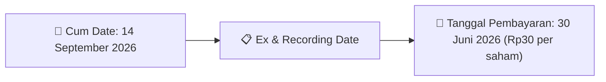

# Ikhtisar Pasar Harian (Daily Digest) - 2026-09-03

📅 **2026-09-03 (Daily Digest)**

## 1. Radar Pasar & Sentimen Harian (Executive Dashboard)
> [!NOTE]
> Terdeteksi sebanyak **136 pengumuman baru** dari 44 emiten pantauan pada (2026-09-03).

| Metric | Jumlah | Status Radar |
| :--- | :---: | :--- |
| **🟢 Sentimen Bullish / Positif** | `2` | [[Dividen Interim]], [[Mandatory Tender Offer]], Kinerja Positif |
| **⚪ Sentimen Netral / Routine** | `52` | [[Tanggapan Penjelasan Bursa]], [[RUPS]], [[Pendaftaran Unit]] |
| **🔴 Sentimen Bearish / Alert** | `2` | Sengketa Hukum, Defisit / Gugatan (Nihil hari ini) |
| **📄 [[Laporan Keuangan]] Baru** | `3` | Memicu Analisis Keuangan Otomatis |

> [!IMPORTANT]
> **Ditemukan Laporan Keuangan Baru Hari Ini:**
> - **POLA**: Laporan Keuangan 31 Maret 2026 POLA ([Buka PDF](file:///g:/My Drive/Model2/reports/raw/POLA/20260902_POLA_Laporan Keuangan 31 Maret 2026 POLA.pdf))
- **POLA**: Laporan Keuangan 30 September 2025 POLA ([Buka PDF](file:///g:/My Drive/Model2/reports/raw/POLA/20260902_POLA_Laporan Keuangan 30 September 2025 POLA.pdf))
- **POLA**: Surat KOREKSI Atas Penyajian Laporan Keuangan POLA ([Buka PDF](file:///g:/My Drive/Model2/reports/raw/POLA/20260902_POLA_Surat KOREKSI Atas Penyajian Laporan Keuangan POLA.pdf))
> 
> *Tugas Swarm Agent:* Lakukan analisis laporan keuangan mendalam per emiten secara terpisah untuk berkas-berkas di atas.

---

## 2. Sorotan Utama & Watchlist Strategis (Strategic Watchlist)
#### 💰 Watchlist Dividen & Distribution
- **[[DKFT]]**: Nominal Dividen = Rp30 per saham
- **[[DKFT]]**: Total Dividen = Rp169.15 Miliar
- **[[DKFT]]**: Cum Date = 14 September 2026
- **[[DKFT]]**: Ex Date = 15 September 2026
- **[[DKFT]]**: Recording Date = 11 September 2026
- **[[DKFT]]**: Tanggal Pembayaran = 30 Juni 2026

#### 🎯 Watchlist Penawaran Tender Wajib (MTO) & Strategis
- **[[YELO]]**: Pemegang saham pengendali = [[PT Artalindo Semesta Nusantara (ASN)]]
- **[[DSNG]]**: Rencana Pemegang Saham Utama dan Pengendali = [[Tidak ada]]

#### 📈 Watchlist Konversi Waran & Potensi Dilusi
- **[[INET]]**: Jumlah Waran Dikonversi = 662,437 lembar
- **[[INET]]**: Jumlah Saham Setelah Konversi = 22,376,934,006 lembar
- **[[INET]]**: Sisa Waran = 662,437 lembar
- **[[MGNA]]**: Kode Waran = MGNA-W
- **[[MGNA]]**: Jumlah Waran yang Di-exercise = 100
- **[[MGNA]]**: Sisa Waran Seri II Sebelum Exercise = 343.264.414

#### 👥 Watchlist Transaksi Orang Dalam & Kepemilikan Saham (Insider / Repo Moves)
- **[[NICK]]**: Nama Insider = NICHOLAS SANTOSO
- **[[MDLA]]**: Tanggal dan Waktu Pelaporan = 03-09-2026 10:09
- **[[AKPI]]**: Nama Insider = HENRY LIEM
- **[[AKPI]]**: Nama Insider = HENRY LIEM
- **[[BRMS]]**: Periode Pelaporan = 2025
- **[[DRMA]]**: Nama Insider = NOEL AELYO LARAS KUSUMA NEGARA

---

## 3. Matriks Pengumuman Pasar (Announcements Intelligence Table)
| Emiten | Sentimen | Jenis Pengumuman | Judul Pengumuman | Berkas |
| :--- | :---: | :--- | :--- | :--- |
| **[[POLA]]** | ⚪ NEUTRAL | Laporan Keuangan | Laporan Keuangan 31 Maret 2026 POLA | [Utama](file:///g:/My%20Drive/Model2/reports/raw/POLA/20260902_POLA_Laporan Keuangan 31 Maret 2026 POLA.pdf) |
| **[[POLA]]** | ⚪ NEUTRAL | Aksi Korporasi | SPD PAF 31 Maret 2026 Revisi | [Utama](file:///g:/My%20Drive/Model2/reports/raw/POLA/20260902_POLA_SPD PAF 31 Maret 2026 Revisi.pdf) |
| **[[POLA]]** | ⚪ NEUTRAL | Laporan Keuangan | Laporan Keuangan 30 September 2025 POLA | [Utama](file:///g:/My%20Drive/Model2/reports/raw/POLA/20260902_POLA_Laporan Keuangan 30 September 2025 POLA.pdf) |
| **[[POLA]]** | ⚪ NEUTRAL | Aksi Korporasi | SPD PAF 30 September 2025 Revisi | [Utama](file:///g:/My%20Drive/Model2/reports/raw/POLA/20260902_POLA_SPD PAF 30 September 2025 Revisi.pdf) |
| **[[POLA]]** | ⚪ NEUTRAL | Laporan Keuangan | Surat KOREKSI Atas Penyajian Laporan Keuangan POLA | [Utama](file:///g:/My%20Drive/Model2/reports/raw/POLA/20260902_POLA_Surat KOREKSI Atas Penyajian Laporan Keuangan POLA.pdf) |
| **[[INET]]** | ⚪ NEUTRAL | Aksi Korporasi | Pencatatan Saham Tambahan dari Konversi | [Utama](file:///g:/My%20Drive/Model2/reports/raw/INET/20260902_INET_20260902_INET_Pencatatan Saham Tambahan dari Konversi_32144257.pdf) |
| **[[MGNA]]** | ⚪ NEUTRAL | Aksi Korporasi | Pencatatan Saham Tambahan dari Konversi | [Utama](file:///g:/My%20Drive/Model2/reports/raw/MGNA/20260902_MGNA_20260902_MGNA_Pencatatan Saham Tambahan dari Konversi_32144230.pdf) · [Lamp 1](file:///g:/My%20Drive/Model2/reports/raw/MGNA/20260902_MGNA_20260902_MGNA_Pencatatan Saham Tambahan dari Konversi_32144230_lamp1.pdf) |
| **[[ELSA]]** | ⚪ NEUTRAL | Public Expose | Public Expose | [Utama](file:///g:/My%20Drive/Model2/reports/raw/ELSA/20260902_ELSA_20260902_ELSA_Public Expose_32144359.pdf) |
| **[[CYBR]]** | ⚪ NEUTRAL | Aksi Korporasi | Pencatatan Saham Tambahan dari Konversi | [Utama](file:///g:/My%20Drive/Model2/reports/raw/CYBR/20260902_CYBR_20260902_CYBR_Pencatatan Saham Tambahan dari Konversi_32144249.pdf) · [Lamp 1](file:///g:/My%20Drive/Model2/reports/raw/CYBR/20260902_CYBR_20260902_CYBR_Pencatatan Saham Tambahan dari Konversi_32144249_lamp1.pdf) |
| **[[PACK]]** | ⚪ NEUTRAL | Aksi Korporasi | Pencatatan Saham Tambahan dari Konversi | [Lamp 1](file:///g:/My%20Drive/Model2/reports/raw/PACK/20260902_PACK_20260902_PACK_Pencatatan Saham Tambahan dari Konversi_32144239_lamp1.pdf) |
| **[[PJHB]]** | ⚪ NEUTRAL | Aksi Korporasi | Pencatatan Saham Tambahan dari Konversi | [Utama](file:///g:/My%20Drive/Model2/reports/raw/PJHB/20260902_PJHB_20260902_PJHB_Pencatatan Saham Tambahan dari Konversi_32144241.pdf) |
| **[[PGEO]]** | ⚪ NEUTRAL | Aksi Korporasi | Pencatatan Saham Tambahan dari Konversi | [Utama](file:///g:/My%20Drive/Model2/reports/raw/PGEO/20260902_PGEO_20260902_PGEO_Pencatatan Saham Tambahan dari Konversi_32144221.pdf) |
| **[[BTEL]]** | ⚪ NEUTRAL | Aksi Korporasi | Pencatatan Saham Tambahan dari Konversi | [Utama](file:///g:/My%20Drive/Model2/reports/raw/BTEL/20260902_BTEL_20260902_BTEL_Pencatatan Saham Tambahan dari Konversi_32144224.pdf) |
| **[[BNBA]]** | ⚪ NEUTRAL | Aksi Korporasi | Laporan Informasi dan Fakta Material | [Utama](file:///g:/My%20Drive/Model2/reports/raw/BNBA/20260902_BNBA_20260902_BNBA_Laporan Informasi dan Fakta Material_32144458.pdf) · [Lamp 2](file:///g:/My%20Drive/Model2/reports/raw/BNBA/20260902_BNBA_20260902_BNBA_Laporan Informasi dan Fakta Material_32144458_lamp2.pdf) |
| **[[PALM]]** | ⚪ NEUTRAL | Aksi Korporasi | Pengumuman Jatuh Tempo Obligasi dan Sukuk | [Utama](file:///g:/My%20Drive/Model2/reports/raw/PALM/20260902_PALM_20260902_PALM_Pengumuman Jatuh Tempo Obligasi dan Sukuk_32144131.pdf) · [Lamp 1](file:///g:/My%20Drive/Model2/reports/raw/PALM/20260902_PALM_20260902_PALM_Pengumuman Jatuh Tempo Obligasi dan Sukuk_32144131_lamp1.pdf) |
| **[[SMCB]]** | ⚪ NEUTRAL | RUPS | Pemanggilan RUPS | [Utama](file:///g:/My%20Drive/Model2/reports/raw/SMCB/20260903_SMCB_20260901_SMCB_Pemanggilan RUPS_32143879.pdf) · [Lamp 2](file:///g:/My%20Drive/Model2/reports/raw/SMCB/20260903_SMCB_20260901_SMCB_Pemanggilan RUPS_32143879_lamp2.pdf) · [Lamp 3](file:///g:/My%20Drive/Model2/reports/raw/SMCB/20260903_SMCB_20260901_SMCB_Pemanggilan RUPS_32143879_lamp3.pdf) · [Lamp 1](file:///g:/My%20Drive/Model2/reports/raw/SMCB/20260903_SMCB_20260901_SMCB_Pemanggilan RUPS_32143879_lamp1.pdf) · [Lamp 4](file:///g:/My%20Drive/Model2/reports/raw/SMCB/20260903_SMCB_20260901_SMCB_Pemanggilan RUPS_32143879_lamp4.pdf) · [Lamp 5](file:///g:/My%20Drive/Model2/reports/raw/SMCB/20260903_SMCB_20260901_SMCB_Pemanggilan RUPS_32143879_lamp5.pdf) |
| **[[PIPA]]** | ⚪ NEUTRAL | Aksi Korporasi | ESG2025-PIPA | [Utama](file:///g:/My%20Drive/Model2/reports/raw/PIPA/20260903_PIPA_ESG2025-PIPA.pdf) |
| **[[PIPA]]** | ⚪ NEUTRAL | Aksi Korporasi | AnnualReport2025-PIPA-att1 | [Utama](file:///g:/My%20Drive/Model2/reports/raw/PIPA/20260903_PIPA_AnnualReport2025-PIPA-att1.pdf) |
| **[[FMFN]]** | ⚪ NEUTRAL | Aksi Korporasi | Laporan Informasi dan Fakta Material | [Utama](file:///g:/My%20Drive/Model2/reports/raw/FMFN/20260903_FMFN_20260903_FMFN_Laporan Informasi dan Fakta Material_32144544.pdf) · [Lamp 2](file:///g:/My%20Drive/Model2/reports/raw/FMFN/20260903_FMFN_20260903_FMFN_Laporan Informasi dan Fakta Material_32144544_lamp2.pdf) |
| **[[BSIM]]** | ⚪ NEUTRAL | Aksi Korporasi | Tanggapan atas Permintaan Penjelasan Bursa | [Utama](file:///g:/My%20Drive/Model2/reports/raw/BSIM/20260903_BSIM_20260903_BSIM_Tanggapan atas Permintaan Penjelasan Bursa_32144615.pdf) · [Lamp 1](file:///g:/My%20Drive/Model2/reports/raw/BSIM/20260903_BSIM_20260903_BSIM_Tanggapan atas Permintaan Penjelasan Bursa_32144615_lamp1.pdf) |
| **[[BCIC]]** | 🔴 BEARISH | Aksi Korporasi | Tanggapan atas Permintaan Penjelasan Bursa | [Utama](file:///g:/My%20Drive/Model2/reports/raw/BCIC/20260903_BCIC_20260903_BCIC_Tanggapan atas Permintaan Penjelasan Bursa_32144603.pdf) |
| **[[NISP]]** | ⚪ NEUTRAL | Aksi Korporasi | Laporan Informasi dan Fakta Material | [Utama](file:///g:/My%20Drive/Model2/reports/raw/NISP/20260903_NISP_20260903_NISP_Laporan Informasi dan Fakta Material_32144477.pdf) |
| **[[WINR]]** | ⚪ NEUTRAL | Aksi Korporasi | Laporan Informasi dan Fakta Material | [Utama](file:///g:/My%20Drive/Model2/reports/raw/WINR/20260903_WINR_20260903_WINR_Laporan Informasi dan Fakta Material_32144574.pdf) · [Lamp 1](file:///g:/My%20Drive/Model2/reports/raw/WINR/20260903_WINR_20260903_WINR_Laporan Informasi dan Fakta Material_32144574_lamp1.pdf) |
| **[[NICK]]** | ⚪ NEUTRAL | Kepemilikan Saham (Insider) | LK-03092026-2369-00 | [Utama](file:///g:/My%20Drive/Model2/reports/raw/NICK/20260903_NICK_LK-03092026-2369-00.pdf) |
| **[[MDLA]]** | ⚪ NEUTRAL | Public Expose | Public Expose | [Utama](file:///g:/My%20Drive/Model2/reports/raw/MDLA/20260903_MDLA_20260903_MDLA_Public Expose_32144471.pdf) · [Lamp 1](file:///g:/My%20Drive/Model2/reports/raw/MDLA/20260903_MDLA_20260903_MDLA_Public Expose_32144471_lamp1.pdf) |
| **[[AKPI]]** | ⚪ NEUTRAL | Kepemilikan Saham (Insider) | LK-03092026-5018-00 | [Utama](file:///g:/My%20Drive/Model2/reports/raw/AKPI/20260903_AKPI_LK-03092026-5018-00.pdf) |
| **[[AKPI]]** | ⚪ NEUTRAL | Kepemilikan Saham (Insider) | LK-03092026-6096-00 | [Utama](file:///g:/My%20Drive/Model2/reports/raw/AKPI/20260903_AKPI_LK-03092026-6096-00.pdf) |
| **[[SMSM]]** | ⚪ NEUTRAL | Public Expose | Public Expose | [Utama](file:///g:/My%20Drive/Model2/reports/raw/SMSM/20260903_SMSM_20260903_SMSM_Public Expose_32144473.pdf) · [Lamp 2](file:///g:/My%20Drive/Model2/reports/raw/SMSM/20260903_SMSM_20260903_SMSM_Public Expose_32144473_lamp2.pdf) · [Lamp 4](file:///g:/My%20Drive/Model2/reports/raw/SMSM/20260903_SMSM_20260903_SMSM_Public Expose_32144473_lamp4.pdf) · [Lamp 3](file:///g:/My%20Drive/Model2/reports/raw/SMSM/20260903_SMSM_20260903_SMSM_Public Expose_32144473_lamp3.pdf) |
| **[[RANS]]** | ⚪ NEUTRAL | RUPS | Pemanggilan RUPS | [Utama](file:///g:/My%20Drive/Model2/reports/raw/RANS/20260903_RANS_20260903_RANS_Pemanggilan RUPS_32144595.pdf) · [Lamp 1](file:///g:/My%20Drive/Model2/reports/raw/RANS/20260903_RANS_20260903_RANS_Pemanggilan RUPS_32144595_lamp1.pdf) |
| **[[PTPP]]** | ⚪ NEUTRAL | RUPS | Pemberitahuan RencanaPenyampaian PanggilanHasil RUPORUPSURUP EBA-SP | [Utama](file:///g:/My%20Drive/Model2/reports/raw/PTPP/20260903_PTPP_20260903_PTPP_Pemberitahuan RencanaPenyampaian PanggilanHasil RUPORUPSURUP EBA-SP_32144479.pdf) · [Lamp 1](file:///g:/My%20Drive/Model2/reports/raw/PTPP/20260903_PTPP_20260903_PTPP_Pemberitahuan RencanaPenyampaian PanggilanHasil RUPORUPSURUP EBA-SP_32144487_lamp1.pdf) · [Lamp 1](file:///g:/My%20Drive/Model2/reports/raw/PTPP/20260903_PTPP_20260903_PTPP_Pemberitahuan RencanaPenyampaian PanggilanHasil RUPORUPSURUP EBA-SP_32144485_lamp1.pdf) · [Lamp 1](file:///g:/My%20Drive/Model2/reports/raw/PTPP/20260903_PTPP_20260903_PTPP_Pemberitahuan RencanaPenyampaian PanggilanHasil RUPORUPSURUP EBA-SP_32144483_lamp1.pdf) · [Lamp 1](file:///g:/My%20Drive/Model2/reports/raw/PTPP/20260903_PTPP_20260903_PTPP_Pemberitahuan RencanaPenyampaian PanggilanHasil RUPORUPSURUP EBA-SP_32144479_lamp1.pdf) |
| **[[BRMS]]** | ⚪ NEUTRAL | Aksi Korporasi | ESG2025-BRMS | [Utama](file:///g:/My%20Drive/Model2/reports/raw/BRMS/20260903_BRMS_ESG2025-BRMS.pdf) |
| **[[BRMS]]** | ⚪ NEUTRAL | Aksi Korporasi | AnnualReport2025-BRMS-att2 | [Utama](file:///g:/My%20Drive/Model2/reports/raw/BRMS/20260903_BRMS_AnnualReport2025-BRMS-att2.pdf) |
| **[[BRMS]]** | ⚪ NEUTRAL | Aksi Korporasi | AnnualReport2025-BRMS-att1 | [Utama](file:///g:/My%20Drive/Model2/reports/raw/BRMS/20260903_BRMS_AnnualReport2025-BRMS-att1.pdf) |
| **[[BRMS]]** | ⚪ NEUTRAL | Aksi Korporasi | AnnualReport2025-BRMS-att3 | [Utama](file:///g:/My%20Drive/Model2/reports/raw/BRMS/20260903_BRMS_AnnualReport2025-BRMS-att3.pdf) |
| **[[AIMS]]** | ⚪ NEUTRAL | Public Expose | Public Expose | [Utama](file:///g:/My%20Drive/Model2/reports/raw/AIMS/20260903_AIMS_20260903_AIMS_Public Expose_32144690.pdf) · [Lamp 1](file:///g:/My%20Drive/Model2/reports/raw/AIMS/20260903_AIMS_20260903_AIMS_Public Expose_32144690_lamp1.pdf) |
| **[[RATU]]** | ⚪ NEUTRAL | Aksi Korporasi | Laporan Informasi dan Fakta Material | [Utama](file:///g:/My%20Drive/Model2/reports/raw/RATU/20260903_RATU_20260903_RATU_Laporan Informasi dan Fakta Material_32144599.pdf) · [Lamp 1](file:///g:/My%20Drive/Model2/reports/raw/RATU/20260903_RATU_20260903_RATU_Laporan Informasi dan Fakta Material_32144599_lamp1.pdf) · [Lamp 2](file:///g:/My%20Drive/Model2/reports/raw/RATU/20260903_RATU_20260903_RATU_Laporan Informasi dan Fakta Material_32144599_lamp2.pdf) |
| **[[DRMA]]** | ⚪ NEUTRAL | Kepemilikan Saham (Insider) | LK-03092026-9597-00 | [Utama](file:///g:/My%20Drive/Model2/reports/raw/DRMA/20260903_DRMA_LK-03092026-9597-00.pdf) |
| **[[MDIY]]** | ⚪ NEUTRAL | Aksi Korporasi | Laporan Informasi dan Fakta Material | [Utama](file:///g:/My%20Drive/Model2/reports/raw/MDIY/20260903_MDIY_20260902_MDIY_Laporan Informasi dan Fakta Material_32144217.pdf) · [Lamp 1](file:///g:/My%20Drive/Model2/reports/raw/MDIY/20260903_MDIY_20260902_MDIY_Laporan Informasi dan Fakta Material_32144217_lamp1.pdf) |
| **[[EXCL]]** | ⚪ NEUTRAL | RUPS | Pengumuman RUPS | [Utama](file:///g:/My%20Drive/Model2/reports/raw/EXCL/20260903_EXCL_20260903_EXCL_Pengumuman RUPS_32144537.pdf) · [Lamp 2](file:///g:/My%20Drive/Model2/reports/raw/EXCL/20260903_EXCL_20260903_EXCL_Pengumuman RUPS_32144537_lamp2.pdf) · [Lamp 1](file:///g:/My%20Drive/Model2/reports/raw/EXCL/20260903_EXCL_20260903_EXCL_Pengumuman RUPS_32144537_lamp1.pdf) |
| **[[BAIK]]** | 🔴 BEARISH | Public Expose | Public Expose | [Utama](file:///g:/My%20Drive/Model2/reports/raw/BAIK/20260903_BAIK_20260903_BAIK_Public Expose_32144565.pdf) · [Lamp 1](file:///g:/My%20Drive/Model2/reports/raw/BAIK/20260903_BAIK_20260903_BAIK_Public Expose_32144565_lamp1.pdf) |
| **[[CRAB]]** | ⚪ NEUTRAL | RUPS | Pemanggilan RUPS | [Utama](file:///g:/My%20Drive/Model2/reports/raw/CRAB/20260903_CRAB_20260903_CRAB_Pemanggilan RUPS_32144629.pdf) |
| **[[CRAB]]** | ⚪ NEUTRAL | Aksi Korporasi | ESG2025-CRAB | [Utama](file:///g:/My%20Drive/Model2/reports/raw/CRAB/20260903_CRAB_ESG2025-CRAB.pdf) |
| **[[CRAB]]** | ⚪ NEUTRAL | Aksi Korporasi | AnnualReport2025-CRAB-att1 | [Utama](file:///g:/My%20Drive/Model2/reports/raw/CRAB/20260903_CRAB_AnnualReport2025-CRAB-att1.pdf) |
| **[[CRAB]]** | ⚪ NEUTRAL | Aksi Korporasi | AnnualReport2025-CRAB-att2 | [Utama](file:///g:/My%20Drive/Model2/reports/raw/CRAB/20260903_CRAB_AnnualReport2025-CRAB-att2.pdf) |
| **[[NELY]]** | ⚪ NEUTRAL | Aksi Korporasi | Tanggapan atas Permintaan Penjelasan Bursa | [Utama](file:///g:/My%20Drive/Model2/reports/raw/NELY/20260903_NELY_20260903_NELY_Tanggapan atas Permintaan Penjelasan Bursa_32144504.pdf) |
| **[[LMPI]]** | ⚪ NEUTRAL | RUPS | Pemanggilan RUPS | [Utama](file:///g:/My%20Drive/Model2/reports/raw/LMPI/20260903_LMPI_20260903_LMPI_Pemanggilan RUPS_32144509.pdf) |
| **[[BOSS]]** | ⚪ NEUTRAL | RUPS | Pengumuman RUPS | [Utama](file:///g:/My%20Drive/Model2/reports/raw/BOSS/20260903_BOSS_20260903_BOSS_Pengumuman RUPS_32144475.pdf) · [Lamp 1](file:///g:/My%20Drive/Model2/reports/raw/BOSS/20260903_BOSS_20260903_BOSS_Pengumuman RUPS_32144475_lamp1.pdf) |
| **[[DKFT]]** | 🟢 BULLISH | Dividen | Jadwal Aksi Korporasi (Khusus Penyampaian Dividen Interim) | [Utama](file:///g:/My%20Drive/Model2/reports/raw/DKFT/20260903_DKFT_20260902_DKFT_Jadwal Aksi Korporasi (Khusus Penyampaian Dividen Interim)_32144154.pdf) |
| **[[YELO]]** | ⚪ NEUTRAL | Aksi Korporasi | Tanggapan atas Permintaan Penjelasan Bursa | [Utama](file:///g:/My%20Drive/Model2/reports/raw/YELO/20260903_YELO_20260903_YELO_Tanggapan atas Permintaan Penjelasan Bursa_32144525.pdf) · [Lamp 1](file:///g:/My%20Drive/Model2/reports/raw/YELO/20260903_YELO_20260903_YELO_Tanggapan atas Permintaan Penjelasan Bursa_32144525_lamp1.pdf) |
| **[[PRTL]]** | ⚪ NEUTRAL | Aksi Korporasi | Laporan Hasil Pemeringkatan | [Utama](file:///g:/My%20Drive/Model2/reports/raw/PRTL/20260903_PRTL_20260903_PRTL_Laporan Hasil Pemeringkatan_32144664.pdf) · [Lamp 2](file:///g:/My%20Drive/Model2/reports/raw/PRTL/20260903_PRTL_20260903_PRTL_Laporan Hasil Pemeringkatan_32144664_lamp2.pdf) · [Lamp 1](file:///g:/My%20Drive/Model2/reports/raw/PRTL/20260903_PRTL_20260903_PRTL_Laporan Hasil Pemeringkatan_32144664_lamp1.pdf) |
| **[[DSNG]]** | ⚪ NEUTRAL | Aksi Korporasi | Tanggapan atas Permintaan Penjelasan Bursa | [Utama](file:///g:/My%20Drive/Model2/reports/raw/DSNG/20260903_DSNG_20260903_DSNG_Tanggapan atas Permintaan Penjelasan Bursa_32144605.pdf) |
| **[[MTWI]]** | ⚪ NEUTRAL | Aksi Korporasi | Tanggapan atas Permintaan Penjelasan Bursa | [Utama](file:///g:/My%20Drive/Model2/reports/raw/MTWI/20260903_MTWI_20260903_MTWI_Tanggapan atas Permintaan Penjelasan Bursa_32144584.pdf) |
| **[[UNVR]]** | ⚪ NEUTRAL | Aksi Korporasi | Tanggapan atas Permintaan Penjelasan Bursa | [Utama](file:///g:/My%20Drive/Model2/reports/raw/UNVR/20260903_UNVR_20260903_UNVR_Tanggapan atas Permintaan Penjelasan Bursa_32144528.pdf) · [Lamp 1](file:///g:/My%20Drive/Model2/reports/raw/UNVR/20260903_UNVR_20260903_UNVR_Tanggapan atas Permintaan Penjelasan Bursa_32144528_lamp1.pdf) |
| **[[ERAA]]** | 🟢 BULLISH | Buyback | Laporan Informasi dan Fakta Material | [Utama](file:///g:/My%20Drive/Model2/reports/raw/ERAA/20260903_ERAA_20260903_ERAA_Laporan Informasi dan Fakta Material_32144526.pdf) · [Lamp 1](file:///g:/My%20Drive/Model2/reports/raw/ERAA/20260903_ERAA_20260903_ERAA_Laporan Informasi dan Fakta Material_32144526_lamp1.pdf) |
| **[[PMUI]]** | ⚪ NEUTRAL | Aksi Korporasi | Laporan Informasi dan Fakta Material | [Utama](file:///g:/My%20Drive/Model2/reports/raw/PMUI/20260903_PMUI_20260903_PMUI_Laporan Informasi dan Fakta Material_32144488.pdf) · [Lamp 1](file:///g:/My%20Drive/Model2/reports/raw/PMUI/20260903_PMUI_20260903_PMUI_Laporan Informasi dan Fakta Material_32144488_lamp1.pdf) |
| **[[GRPM]]** | ⚪ NEUTRAL | Aksi Korporasi | Laporan Informasi dan Fakta Material | [Lamp 2](file:///g:/My%20Drive/Model2/reports/raw/GRPM/20260903_GRPM_20260903_GRPM_Laporan Informasi dan Fakta Material_32144472_lamp2.pdf) |

---

## 4. Detail Informasi per Emiten (Grouped by Emiten)
### 📋 4.2. Detail Emiten Lain (Non-Watchlist)

#### 🔵 [[POLA]]
- **[Laporan Keuangan]** [Laporan Keuangan 31 Maret 2026 POLA](file:///g:/My%20Drive/Model2/reports/raw/POLA/20260902_POLA_Laporan Keuangan 31 Maret 2026 POLA.pdf)
  - 📌 *Deskripsi*: Teks mentah dokumen tidak tersedia sehingga informasi material tidak dapat diekstraksi.
- **[Aksi Korporasi]** [SPD PAF 31 Maret 2026 Revisi](file:///g:/My%20Drive/Model2/reports/raw/POLA/20260902_POLA_SPD PAF 31 Maret 2026 Revisi.pdf)
  - 📌 *Deskripsi*: Tidak dapat mengekstrak informasi karena teks dokumen tidak tersedia.
- **[Laporan Keuangan]** [Laporan Keuangan 30 September 2025 POLA](file:///g:/My%20Drive/Model2/reports/raw/POLA/20260902_POLA_Laporan Keuangan 30 September 2025 POLA.pdf)
  - 📌 *Deskripsi*: Tidak dapat mengekstrak informasi karena teks mentah dokumen tidak tersedia.
- **[Aksi Korporasi]** [SPD PAF 30 September 2025 Revisi](file:///g:/My%20Drive/Model2/reports/raw/POLA/20260902_POLA_SPD PAF 30 September 2025 Revisi.pdf)
  - 📌 *Deskripsi*: Tidak dapat mengekstrak informasi karena teks dokumen tidak tersedia.
- **[Laporan Keuangan]** [Surat KOREKSI Atas Penyajian Laporan Keuangan POLA](file:///g:/My%20Drive/Model2/reports/raw/POLA/20260902_POLA_Surat KOREKSI Atas Penyajian Laporan Keuangan POLA.pdf)

#### 🔵 [[INET]]
- **[Aksi Korporasi]** [Pencatatan Saham Tambahan dari Konversi](file:///g:/My%20Drive/Model2/reports/raw/INET/20260902_INET_20260902_INET_Pencatatan Saham Tambahan dari Konversi_32144257.pdf)
  - 📌 *Deskripsi*: Pencatatan saham tambahan hasil konversi waran INET.
  - 📊 **Fakta Material**:
    - **Jumlah Waran Dikonversi**: 662,437 lembar
    - **Jumlah Saham Setelah Konversi**: 22,376,934,006 lembar
    - **Sisa Waran**: 662,437 lembar
    - **Tanggal Pencatatan**: 03 September 2026

#### 🔵 [[MGNA]]
- **[Aksi Korporasi]** [Pencatatan Saham Tambahan dari Konversi](file:///g:/My%20Drive/Model2/reports/raw/MGNA/20260902_MGNA_20260902_MGNA_Pencatatan Saham Tambahan dari Konversi_32144230.pdf) *(Attachment: [Lamp 1](file:///g:/My%20Drive/Model2/reports/raw/MGNA/20260902_MGNA_20260902_MGNA_Pencatatan Saham Tambahan dari Konversi_32144230_lamp1.pdf))*
  - 📌 *Deskripsi*: PT Magna Investama Mandiri Tbk menyampaikan pencatatan penambahan saham hasil exercise Waran Seri II (MGNA-W) sebanyak 100 saham pada 2 September 2026, sehingga total saham tercatat bertambah dari 3.411.124.385 menjadi 3.411.124.485 lembar.
  - 📊 **Fakta Material**:
    - **Jenis Aksi Korporasi**: Pencatatan saham tambahan dari Exercise Waran Seri II
    - **Kode Waran**: MGNA-W
    - **Tanggal Pelaksanaan Exercise**: 2026-09-01
    - **Tanggal Penerbitan Saham Hasil Exercise**: 2026-09-02
    - **Jumlah Waran yang Di-exercise**: 100
    - **Jumlah Saham Baru Hasil Exercise**: 100
    - **Total Saham Sebelum Exercise**: 3.411.124.385
    - **Total Saham Setelah Exercise**: 3.411.124.485
    - **Sisa Waran Seri II Sebelum Exercise**: 343.264.414
    - **Sisa Waran Seri II Setelah Exercise**: 343.264.314

#### 🔵 [[ELSA]]
- **[Public Expose]** [Public Expose](file:///g:/My%20Drive/Model2/reports/raw/ELSA/20260902_ELSA_20260902_ELSA_Public Expose_32144359.pdf)
  - 📌 *Deskripsi*: Dokumen hanya berisi surat pengantar penyampaian materi Public Expose Tahunan dan tidak memuat lampiran materi yang berisi fakta material.

#### 🔵 [[CYBR]]
- **[Aksi Korporasi]** [Pencatatan Saham Tambahan dari Konversi](file:///g:/My%20Drive/Model2/reports/raw/CYBR/20260902_CYBR_20260902_CYBR_Pencatatan Saham Tambahan dari Konversi_32144249.pdf) *(Attachment: [Lamp 1](file:///g:/My%20Drive/Model2/reports/raw/CYBR/20260902_CYBR_20260902_CYBR_Pencatatan Saham Tambahan dari Konversi_32144249_lamp1.pdf))*
  - 📌 *Deskripsi*: PT ITSEC Asia Tbk. (CYBR) mencatatkan saham tambahan hasil konversi Waran CYBR-W sebanyak 202.000 saham di Papan Pengembangan, sehingga total saham tercatat setelah konversi menjadi 13.484.204.005 saham, dengan sisa waran 423.680.199. Pencatatan dan perdagangan efektif pada 03 September 2026.
  - 📊 **Fakta Material**:
    - **Nama Waran**: CYBR-W
    - **Jumlah Waran yang Dikonversi**: 202.000
    - **Jumlah Saham Hasil Konversi**: 202.000
    - **Total Saham Setelah Konversi**: 13.484.204.005
    - **Sisa Waran**: 423.680.199
    - **Papan Pencatatan**: Pengembangan
    - **Tanggal Pencatatan dan Perdagangan**: 03 September 2026

#### 🔵 [[PACK]]
- **[Aksi Korporasi]** [Pencatatan Saham Tambahan dari Konversi](file:///g:/My%20Drive/Model2/reports/raw/PACK/20260902_PACK_20260902_PACK_Pencatatan Saham Tambahan dari Konversi_32144239_lamp1.pdf)
  - 📌 *Deskripsi*: Pencatatan penambahan saham hasil konversi Obligasi Wajib Konversi PACK-01-CB menjadi saham baru PT Abadi Nusantara Hijau Investama Tbk.
  - 📊 **Fakta Material**:
    - **Kode Obligasi Wajib Konversi**: PACK-01-CB
    - **Tanggal Pelaksanaan Konversi**: 2026-08-31
    - **Tanggal Penerbitan Saham**: 2026-09-02
    - **Jumlah Nominal OWK yang Dikonversi**: 160.200.000
    - **Jumlah Saham Hasil Konversi**: 1.602.000
    - **Total Saham Sebelum Konversi**: 34.107.795.451
    - **Total Saham Setelah Konversi**: 34.109.397.451
    - **Sisa OWK Nominal Sebelum Konversi**: 7.654.289.300
    - **Sisa OWK Nominal Setelah Konversi**: 7.494.089.300

#### 🔵 [[PJHB]]
- **[Aksi Korporasi]** [Pencatatan Saham Tambahan dari Konversi](file:///g:/My%20Drive/Model2/reports/raw/PJHB/20260902_PJHB_20260902_PJHB_Pencatatan Saham Tambahan dari Konversi_32144241.pdf)
  - 📌 *Deskripsi*: Pencatatan saham tambahan hasil konversi waran PJHB.
  - 📊 **Fakta Material**:
    - **Jumlah Waran Dikonversi**: 2,523 lembar
    - **Jumlah Saham Setelah Konversi**: 1,920,906,032 lembar
    - **Sisa Waran**: 2,523 lembar
    - **Tanggal Pencatatan**: 03 September 2026

#### 🔵 [[PGEO]]
- **[Aksi Korporasi]** [Pencatatan Saham Tambahan dari Konversi](file:///g:/My%20Drive/Model2/reports/raw/PGEO/20260902_PGEO_20260902_PGEO_Pencatatan Saham Tambahan dari Konversi_32144221.pdf)
  - 📌 *Deskripsi*: Informasi dan fakta material PGEO: PT Pertamina Geothermal Energy Tbk (PGEO) PENGUMUMAN BURSA Pencatatan Saham Papan Pencatatan Utama Dengan ini Bursa mengumumkan sebagai berikut: ESOP/MSOP Tahapan Jumlah Saham Tanggal pencatatan dan perdagangan Jumlah saham setelah pencatatatan Sisa ESOP/MSOP Tahap I 1,306,444 03 September 2026 41,910,723,862 39,556,639 Tahap III 205,305 03 September 2026 41,910,929,167 20,700,106 PT. Bursa Efek Indonesia Pande Made Kusuma Ari A Kadiv Pengaturan & Operasional Perdagangan PT Bursa Efek Indonesia
  - 📊 **Fakta Material**:
    - **Uraian Kejadian**: PT Pertamina Geothermal Energy Tbk (PGEO) PENGUMUMAN BURSA Pencatatan Saham Papan Pencatatan Utama Dengan ini Bursa mengumumkan sebagai berikut: ESOP/MSOP Tahapan Jumlah Saham Tanggal pencatatan dan perdagangan Jumlah saham setelah pencatatatan Sisa ESOP/MSOP Tahap I 1,306,444 03 September 2026 41,910,723,862 39,556,639 Tahap III 205,305 03 September 2026 41,910,929,167 20,700,106 PT. Bursa Efek Indonesia Pande Made Kusuma Ari A Kadiv Pengaturan & Operasional Perdagangan PT Bursa Efek Indonesia

#### 🔵 [[BTEL]]
- **[Aksi Korporasi]** [Pencatatan Saham Tambahan dari Konversi](file:///g:/My%20Drive/Model2/reports/raw/BTEL/20260902_BTEL_20260902_BTEL_Pencatatan Saham Tambahan dari Konversi_32144224.pdf)
  - 📌 *Deskripsi*: Informasi dan fakta material BTEL: Bakrie Telecom Tbk (BTEL) PENGUMUMAN BURSA Pencatatan Saham Papan Pencatatan Pemantauan Khusus Dengan ini Bursa mengumumkan sebagai berikut: Obligasi Wajib Konversi Sisa Obligasi Wajib Konversi 03 September 2026 Jumlah Saham Setelah Pencatatan Saham Hasil Pelaksanaan Obligasi Wajib Konversi 61.847.903.535 6.742.246.210 Tanggal Pencatatan Penambahan Saham 17.201.582.062 PT. Bursa Efek Indonesia Pande Made Kusuma Ari A Kadiv Pengaturan & Operasional Perdagangan PT Bursa Efek Indonesia PH Kepala Di
  - 📊 **Fakta Material**:
    - **Uraian Kejadian**: Bakrie Telecom Tbk (BTEL) PENGUMUMAN BURSA Pencatatan Saham Papan Pencatatan Pemantauan Khusus Dengan ini Bursa mengumumkan sebagai berikut: Obligasi Wajib Konversi Sisa Obligasi Wajib Konversi 03 September 2026 Jumlah Saham Setelah Pencatatan Saham Hasil Pelaksanaan Obligasi Wajib Konversi 61.847.903.535 6.742.246.210 Tanggal Pencatatan Penambahan Saham 17.201.582.062 PT. Bursa Efek Indonesia Pande Made Kusuma Ari A Kadiv Pengaturan & Operasional Perdagangan PT Bursa Efek Indonesia PH Kepala Di

#### 🔵 [[BNBA]]
- **[Aksi Korporasi]** [Laporan Informasi dan Fakta Material](file:///g:/My%20Drive/Model2/reports/raw/BNBA/20260902_BNBA_20260902_BNBA_Laporan Informasi dan Fakta Material_32144458.pdf) *(Attachment: [Lamp 2](file:///g:/My%20Drive/Model2/reports/raw/BNBA/20260902_BNBA_20260902_BNBA_Laporan Informasi dan Fakta Material_32144458_lamp2.pdf))*
  - 📌 *Deskripsi*: PT Bank Bumi Arta Tbk. menyampaikan keterbukaan informasi bahwa pada 1 September 2026 memperoleh informasi masih terdapat perkara hukum yang melibatkan anggota Direksi, yaitu Bapak Wikan Aryono S. dan Bapak Hendrik Atmaja. Belum ada putusan pengadilan yang berkekuatan hukum tetap. Perseroan menghormati asas praduga tak bersalah dan memastikan operasional serta layanan nasabah tetap berjalan normal.
  - 📊 **Fakta Material**:
    - **Tanggal informasi diterima Perseroan**: 01 September 2026
    - **Pihak yang terlibat perkara hukum**: Bapak Wikan Aryono S. dan Bapak Hendrik Atmaja
    - **Status perkara hukum**: Masih berlangsung dan belum ada putusan pengadilan yang berkekuatan hukum tetap
    - **Dampak terhadap operasional Perseroan**: Operasional, kegiatan usaha, dan layanan kepada nasabah tetap berjalan sebagaimana mestinya
    - **Sikap Perseroan**: Menghormati proses hukum dengan asas praduga tak bersalah dan menjaga tata kelola perusahaan yang baik

#### 🔵 [[PALM]]
- **[Aksi Korporasi]** [Pengumuman Jatuh Tempo Obligasi dan Sukuk](file:///g:/My%20Drive/Model2/reports/raw/PALM/20260902_PALM_20260902_PALM_Pengumuman Jatuh Tempo Obligasi dan Sukuk_32144131.pdf) *(Attachment: [Lamp 1](file:///g:/My%20Drive/Model2/reports/raw/PALM/20260902_PALM_20260902_PALM_Pengumuman Jatuh Tempo Obligasi dan Sukuk_32144131_lamp1.pdf))*
  - 📌 *Deskripsi*: Pencatatan saham tambahan hasil konversi waran PALM.
  - 📊 **Fakta Material**:
    - **Tanggal Pencatatan**: 27 Agustus 2025

#### 🔵 [[SMCB]]
- **[RUPS]** [Pemanggilan RUPS](file:///g:/My%20Drive/Model2/reports/raw/SMCB/20260903_SMCB_20260901_SMCB_Pemanggilan RUPS_32143879.pdf) *(Attachment: [Lamp 2](file:///g:/My%20Drive/Model2/reports/raw/SMCB/20260903_SMCB_20260901_SMCB_Pemanggilan RUPS_32143879_lamp2.pdf) · [Lamp 3](file:///g:/My%20Drive/Model2/reports/raw/SMCB/20260903_SMCB_20260901_SMCB_Pemanggilan RUPS_32143879_lamp3.pdf) · [Lamp 1](file:///g:/My%20Drive/Model2/reports/raw/SMCB/20260903_SMCB_20260901_SMCB_Pemanggilan RUPS_32143879_lamp1.pdf) · [Lamp 4](file:///g:/My%20Drive/Model2/reports/raw/SMCB/20260903_SMCB_20260901_SMCB_Pemanggilan RUPS_32143879_lamp4.pdf) · [Lamp 5](file:///g:/My%20Drive/Model2/reports/raw/SMCB/20260903_SMCB_20260901_SMCB_Pemanggilan RUPS_32143879_lamp5.pdf))*
  - 📌 *Deskripsi*: PT Solusi Bangun Indonesia Tbk mengundang para pemegang saham untuk menghadiri Rapat Umum Pemegang Saham Luar Biasa yang akan diselenggarakan secara fisik dan elektronik pada Jumat, 25 September 2026 pukul 14.00 WIB di Hotel Ra Suites Simatupang, Jakarta Selatan, dengan tiga agenda utama: penyesuaian Pasal 3 Anggaran Dasar terkait maksud dan tujuan serta kegiatan usaha, pendelegasian kewenangan persetujuan RJPP 2026-2030 dan RKAP 2026 kepada Dewan Komisaris, serta persetujuan perubahan pengurus Perseroan.
  - 📊 **Fakta Material**:
    - **Nama Perusahaan**: PT Solusi Bangun Indonesia Tbk
    - **Jenis Rapat**: Rapat Umum Pemegang Saham Luar Biasa
    - **Hari dan Tanggal Rapat**: Jumat, 25 September 2026
    - **Waktu Rapat**: 14.00 WIB - selesai
    - **Lokasi Fisik**: Pandawa 1 & 2 Ballroom, Hotel Ra Suites Simatupang, Jl. TB Simatupang No. 30, RT2/RW9, Cilandak Baru, Kec. Cilandak, Jakarta Selatan 12430
    - **Mekanisme Rapat**: Fisik dan elektronik melalui video conference
    - **Agenda 1**: Persetujuan penyesuaian kembali Pasal 3 Anggaran Dasar Perseroan mengenai Maksud dan Tujuan serta Kegiatan Usaha untuk menyesuaikan dengan layanan perizinan Online Single Submission berdasarkan PP Nomor 28 Tahun 2025 dan KBLI 2025 berdasarkan Peraturan Kepala BPS Nomor 7 Tahun 2025
    - **Agenda 2**: Persetujuan pendelegasian kewenangan persetujuan perubahan atau penyesuaian Rencana Jangka Panjang Perusahaan 2026-2030 dan Rencana Kerja dan Anggaran Perusahaan 2026 kepada Dewan Komisaris
    - **Agenda 3**: Persetujuan perubahan pengurus Perseroan
    - **Sumber Materi Rapat**: https://solusibangunindonesia.com

#### 🔵 [[PIPA]]
- **[Aksi Korporasi]** [ESG2025-PIPA](file:///g:/My%20Drive/Model2/reports/raw/PIPA/20260903_PIPA_ESG2025-PIPA.pdf)
  - 📌 *Deskripsi*: Siaran pers kinerja keuangan & update bisnis PIPA (Anak Perusahaan yang) Periode 2026.
- **[Aksi Korporasi]** [AnnualReport2025-PIPA-att1](file:///g:/My%20Drive/Model2/reports/raw/PIPA/20260903_PIPA_AnnualReport2025-PIPA-att1.pdf)
  - 📌 *Deskripsi*: Dokumen merupakan halaman awal Laporan Tahunan & Keberlanjutan 2025 PT Multi Makmur Lemindo Tbk (PIPA). Berisi disclaimer, informasi kontak, dan daftar isi. Periode laporan mencakup 1 Januari 2025 hingga 31 Desember 2025. Belum terdapat data keuangan atau aksi korporasi spesifik pada bagian yang tersedia.
  - 📊 **Fakta Material**:
    - **Periode Laporan**: 1 Januari 2025 - 31 Desember 2025

#### 🔵 [[FMFN]]
- **[Aksi Korporasi]** [Laporan Informasi dan Fakta Material](file:///g:/My%20Drive/Model2/reports/raw/FMFN/20260903_FMFN_20260903_FMFN_Laporan Informasi dan Fakta Material_32144544.pdf) *(Attachment: [Lamp 2](file:///g:/My%20Drive/Model2/reports/raw/FMFN/20260903_FMFN_20260903_FMFN_Laporan Informasi dan Fakta Material_32144544_lamp2.pdf))*
  - 📌 *Deskripsi*: PT KB Finansia Multi Finance menyampaikan perubahan susunan Dewan Komisaris efektif 31 Agustus 2026, yaitu pengunduran diri Nursalam Andi Tabusalla sebagai Komisaris Independen dan susunan baru Dewan Komisaris: Sang In Lee sebagai Komisaris Utama, Je Ui Jung sebagai Komisaris, dan Trisna Widjaja sebagai Komisaris Independen.
  - 📊 **Fakta Material**:
    - **Nama Emiten**: PT KB Finansia Multi Finance
    - **Bidang Usaha**: Pembiayaan
    - **Tanggal Kejadian**: 01 September 2026
    - **Jenis Informasi atau Fakta Material**: Perubahan anggota Direksi dan/atau anggota Dewan Komisaris
    - **Dasar Keputusan**: Keputusan Sirkuler Pemegang Saham sebagai Pengganti Rapat Umum Pemegang Saham Luar Biasa tanggal 28 Agustus 2026
    - **Pengunduran Diri**: Nursalam Andi Tabusalla mengundurkan diri sebagai Komisaris Independen efektif 31 Agustus 2026
    - **Komisaris Utama**: Sang In Lee
    - **Komisaris**: Je Ui Jung
    - **Komisaris Independen**: Trisna Widjaja
    - **Akta Notaris**: Akta Nomor 149 tanggal 31 Agustus 2026 dibuat di hadapan Notaris Jose Dima Satria, S.H., M.Kn., Notaris di Jakarta Selatan
    - **Penerimaan Pemberitahuan Perubahan Data Perseroan**: Nomor AHU-AH.01.09-0398478 tanggal 1 September 2026
    - **Dampak terhadap kegiatan operasional, hukum, kondisi keuangan, atau kelangsungan usaha**: Tidak terdapat dampak material

#### 🔵 [[BSIM]]
- **[Aksi Korporasi]** [Tanggapan atas Permintaan Penjelasan Bursa](file:///g:/My%20Drive/Model2/reports/raw/BSIM/20260903_BSIM_20260903_BSIM_Tanggapan atas Permintaan Penjelasan Bursa_32144615.pdf) *(Attachment: [Lamp 1](file:///g:/My%20Drive/Model2/reports/raw/BSIM/20260903_BSIM_20260903_BSIM_Tanggapan atas Permintaan Penjelasan Bursa_32144615_lamp1.pdf))*
  - 📌 *Deskripsi*: PT Bank Sinarmas Tbk menyampaikan tanggapan atas surat BEI terkait volatilitas transaksi efek. Perseroan menyatakan tidak mengetahui adanya informasi atau fakta material yang mempengaruhi nilai atau harga efek, tidak terdapat aktivitas pemegang saham tertentu, tidak ada rencana aksi korporasi baru dalam 3 bulan mendatang, serta belum terdapat rencana pemegang saham utama terkait kepemilikan sahamnya di Perseroan.
  - 📊 **Fakta Material**:
    - **Nomor surat BEI**: S-11195/BEI.PP2/09-2026
    - **Tanggal surat BEI**: 1 September 2026
    - **Nomor surat Perseroan**: No.SKL.003/09-2026/PRESDIR-CorSec
    - **Informasi atau fakta material yang mempengaruhi nilai efek**: Tidak ada
    - **Informasi atau fakta material yang mempengaruhi harga efek**: Tidak ada
    - **Aktivitas pemegang saham tertentu**: Tidak terdapat
    - **Rencana tindakan korporasi dalam 3 bulan mendatang**: Tidak terdapat rencana aksi korporasi baru
    - **Informasi/fakta/kejadian penting lainnya yang material**: Tidak ada
    - **Rencana pemegang saham utama terkait kepemilikan saham**: Belum terdapat rencana

#### 🔵 [[BCIC]]
- **[Aksi Korporasi]** [Tanggapan atas Permintaan Penjelasan Bursa](file:///g:/My%20Drive/Model2/reports/raw/BCIC/20260903_BCIC_20260903_BCIC_Tanggapan atas Permintaan Penjelasan Bursa_32144603.pdf)
  - 📌 *Deskripsi*: PT Bank JTrust Indonesia Tbk. menyampaikan tanggapan atas permintaan penjelasan Bursa terkait surat PT Delapan Cahaya Timur mengenai sengketa fasilitas kredit modal kerja, penilaian aset jaminan, tuntutan penghapusan/pengalihan utang, larangan penjualan/lelang aset jaminan secara sepihak, serta permohonan restrukturisasi kredit.
  - 📊 **Fakta Material**:
    - **Pihak pengadu**: PT Delapan Cahaya Timur
    - **Nomor surat pengadu**: 26-04/DCT/VIII/2026
    - **Tanggal surat pengadu**: 19 Agustus 2026
    - **Tanggal tanggapan Perseroan**: 03 September 2026
    - **Nama pengirim tanggapan**: Hendy Deiny Wong
    - **Jabatan pengirim**: Corsec Division Head
    - **Penilaian aset jaminan oleh KJPP pilihan Perseroan**: Tidak di bawah nilai standar wajar
    - **Penggunaan KJPP Independen oleh PT Delapan Cahaya Timur**: Sebagai acuan resmi dalam proses fasilitas kredit modal kerja
    - **Tuntutan PT Delapan Cahaya Timur**: Meninjau ulang dan tidak mengakui hutang/peralihan hutang yang dianggap telah lunas melalui pembayaran bunga sejak era PT Bank Mutiara hingga PT Bank JTrust Indonesia
    - **Larangan atas aset jaminan**: Tidak diperbolehkan dijual atau dilelang secara sepihak
    - **Permohonan PT Delapan Cahaya Timur**: Restrukturisasi kredit dalam upaya negosiasi penyelesaian yang saling menguntungkan

#### 🔵 [[NISP]]
- **[Aksi Korporasi]** [Laporan Informasi dan Fakta Material](file:///g:/My%20Drive/Model2/reports/raw/NISP/20260903_NISP_20260903_NISP_Laporan Informasi dan Fakta Material_32144477.pdf)
  - 📌 *Deskripsi*: Informasi dan fakta material NISP: 036/IR-FINANCE/JT/PIKK/IX/2026 PT Bank OCBC NISP Tbk NISP 1 Penyelesaian pengambilalihan PT Great Eastern Life Indonesia (GELI) oleh Perseroan Dengan ini kami untuk dan atas menyampaikan Laporan Informasi atau Fakta Material sebagai berikut: Nama Emiten atau Perusahaan Publik PT Bank OCBC NISP Tbk Bidang Usaha Perbankan Telepon (021) 25533888 Faksimili (021) 57944000 Alamat Surat Elektronik (email) corporate.secretariat@ocbc.id Tanggal Kejadian 02 September 2026 Jenis Informasi atau Fakta Materi
  - 📊 **Fakta Material**:
    - **Uraian Kejadian**: 036/IR-FINANCE/JT/PIKK/IX/2026 PT Bank OCBC NISP Tbk NISP 1 Penyelesaian pengambilalihan PT Great Eastern Life Indonesia (GELI) oleh Perseroan Dengan ini kami untuk dan atas menyampaikan Laporan Informasi atau Fakta Material sebagai berikut: Nama Emiten atau Perusahaan Publik PT Bank OCBC NISP Tbk Bidang Usaha Perbankan Telepon (021) 25533888 Faksimili (021) 57944000 Alamat Surat Elektronik (email) corporate.secretariat@ocbc.id Tanggal Kejadian 02 September 2026 Jenis Informasi atau Fakta Materi

#### 🔵 [[WINR]]
- **[Aksi Korporasi]** [Laporan Informasi dan Fakta Material](file:///g:/My%20Drive/Model2/reports/raw/WINR/20260903_WINR_20260903_WINR_Laporan Informasi dan Fakta Material_32144574.pdf) *(Attachment: [Lamp 1](file:///g:/My%20Drive/Model2/reports/raw/WINR/20260903_WINR_20260903_WINR_Laporan Informasi dan Fakta Material_32144574_lamp1.pdf))*
  - 📌 *Deskripsi*: Laporan perubahan kepemilikan saham insider WINR.

#### 🔵 [[NICK]]
- **[Kepemilikan Saham (Insider)]** [LK-03092026-2369-00](file:///g:/My%20Drive/Model2/reports/raw/NICK/20260903_NICK_LK-03092026-2369-00.pdf)
  - 📌 *Deskripsi*: Laporan perubahan kepemilikan saham insider NICK.
  - 📊 **Fakta Material**:
    - **Nama Insider**: NICHOLAS SANTOSO

#### 🔵 [[MDLA]]
- **[Public Expose]** [Public Expose](file:///g:/My%20Drive/Model2/reports/raw/MDLA/20260903_MDLA_20260903_MDLA_Public Expose_32144471.pdf) *(Attachment: [Lamp 1](file:///g:/My%20Drive/Model2/reports/raw/MDLA/20260903_MDLA_20260903_MDLA_Public Expose_32144471_lamp1.pdf))*
  - 📌 *Deskripsi*: PT Medela Potentia Tbk menyampaikan materi Public Expose Tahunan melalui surat No. 049/VIII/DIR/MP/2026-E pada 3 September 2026, merujuk pada surat pengumuman Public Expose Tahunan No. 047/VIII/DIR/MP/2026-E tanggal 27 Agustus 2026.
  - 📊 **Fakta Material**:
    - **Nomor Surat Penyampaian Materi Public Expose**: 049/VIII/DIR/MP/2026-E
    - **Nomor Surat Rujukan Public Expose Tahunan**: 047/VIII/DIR/MP/2026-E
    - **Tanggal Surat Rujukan**: 27 Agustus 2026
    - **Nama Pengirim**: Edbert Orotodan
    - **Jabatan Pengirim**: Direktur
    - **Tanggal dan Waktu Pelaporan**: 03-09-2026 10:09
    - **Nama File Lampiran**: Medela Potentia - Update 1H 2026-Final.pdf

#### 🔵 [[AKPI]]
- **[Kepemilikan Saham (Insider)]** [LK-03092026-5018-00](file:///g:/My%20Drive/Model2/reports/raw/AKPI/20260903_AKPI_LK-03092026-5018-00.pdf)
  - 📌 *Deskripsi*: Laporan perubahan kepemilikan saham insider AKPI.
  - 📊 **Fakta Material**:
    - **Nama Insider**: HENRY LIEM
- **[Kepemilikan Saham (Insider)]** [LK-03092026-6096-00](file:///g:/My%20Drive/Model2/reports/raw/AKPI/20260903_AKPI_LK-03092026-6096-00.pdf)
  - 📌 *Deskripsi*: Laporan perubahan kepemilikan saham insider AKPI.
  - 📊 **Fakta Material**:
    - **Nama Insider**: HENRY LIEM

#### 🔵 [[SMSM]]
- **[Public Expose]** [Public Expose](file:///g:/My%20Drive/Model2/reports/raw/SMSM/20260903_SMSM_20260903_SMSM_Public Expose_32144473.pdf) *(Attachment: [Lamp 2](file:///g:/My%20Drive/Model2/reports/raw/SMSM/20260903_SMSM_20260903_SMSM_Public Expose_32144473_lamp2.pdf) · [Lamp 4](file:///g:/My%20Drive/Model2/reports/raw/SMSM/20260903_SMSM_20260903_SMSM_Public Expose_32144473_lamp4.pdf) · [Lamp 3](file:///g:/My%20Drive/Model2/reports/raw/SMSM/20260903_SMSM_20260903_SMSM_Public Expose_32144473_lamp3.pdf))*
  - 📌 *Deskripsi*: Perseroan menyampaikan materi Public Expose Tahunan melalui surat No. 0280/SS/IX/26 tanggal 3 September 2026, merujuk pada surat No. 0275/SS/VIII/26 tanggal 21 Agustus 2026. Dokumen ini merupakan surat pengantar penyampaian materi public expose beserta lampiran.
  - 📊 **Fakta Material**:
    - **Nomor Surat Penyampaian**: 0280/SS/IX/26
    - **Tanggal Penyampaian**: 2026-09-03
    - **Nomor Surat Rujukan**: 0275/SS/VIII/26
    - **Tanggal Surat Rujukan**: 2026-08-21
    - **Nama Pengirim**: Ang Andri Pribadi
    - **Jabatan Pengirim**: Wakil Direktur Utama
    - **Daftar Lampiran**: Penyampaian Materi Public Expose 2026.pdf, Press Release Public Expose 2026.pdf, Materi Public Expose SMSM (English).pdf, Materi Public Expose SMSM (Bahasa).pdf

#### 🔵 [[RANS]]
- **[RUPS]** [Pemanggilan RUPS](file:///g:/My%20Drive/Model2/reports/raw/RANS/20260903_RANS_20260903_RANS_Pemanggilan RUPS_32144595.pdf) *(Attachment: [Lamp 1](file:///g:/My%20Drive/Model2/reports/raw/RANS/20260903_RANS_20260903_RANS_Pemanggilan RUPS_32144595_lamp1.pdf))*
  - 📌 *Deskripsi*: Informasi dan fakta material RANS: 042/CORSEC/REI/VIII/2026 PT Rans Entertainmen Indonesia Tbk RANS 1 Pemanggilan Rapat Umum Pemegang Saham Luar Biasa(KOREKSI) Mengoreksi surat kami nomor : 038/CORSEC/REI/VIII/2026 tanggal 19 Agustus 2026 Pemanggilan Rapat Umum Pemegang Saham Luar Biasa, dengan ini perseroan menyampaikan hal sebagai berikut: Merujuk pada surat Perseroan Nomor 032/CORSEC/REI/VIII/2026 , Tanggal 04 Agustus 2026, Perseroan menyampaikan pemberitahuan penyelenggaraan Rapat Umum Pemegang Saham pada Pemanggilan Rencana
  - 📊 **Fakta Material**:
    - **Uraian Kejadian**: 042/CORSEC/REI/VIII/2026 PT Rans Entertainmen Indonesia Tbk RANS 1 Pemanggilan Rapat Umum Pemegang Saham Luar Biasa(KOREKSI) Mengoreksi surat kami nomor : 038/CORSEC/REI/VIII/2026 tanggal 19 Agustus 2026 Pemanggilan Rapat Umum Pemegang Saham Luar Biasa, dengan ini perseroan menyampaikan hal sebagai berikut: Merujuk pada surat Perseroan Nomor 032/CORSEC/REI/VIII/2026 , Tanggal 04 Agustus 2026, Perseroan menyampaikan pemberitahuan penyelenggaraan Rapat Umum Pemegang Saham pada Pemanggilan Rencana

#### 🔵 [[PTPP]]
- **[RUPS]** [Pemberitahuan RencanaPenyampaian PanggilanHasil RUPORUPSURUP EBA-SP](file:///g:/My%20Drive/Model2/reports/raw/PTPP/20260903_PTPP_20260903_PTPP_Pemberitahuan RencanaPenyampaian PanggilanHasil RUPORUPSURUP EBA-SP_32144479.pdf) *(Attachment: [Lamp 1](file:///g:/My%20Drive/Model2/reports/raw/PTPP/20260903_PTPP_20260903_PTPP_Pemberitahuan RencanaPenyampaian PanggilanHasil RUPORUPSURUP EBA-SP_32144487_lamp1.pdf) · [Lamp 1](file:///g:/My%20Drive/Model2/reports/raw/PTPP/20260903_PTPP_20260903_PTPP_Pemberitahuan RencanaPenyampaian PanggilanHasil RUPORUPSURUP EBA-SP_32144485_lamp1.pdf) · [Lamp 1](file:///g:/My%20Drive/Model2/reports/raw/PTPP/20260903_PTPP_20260903_PTPP_Pemberitahuan RencanaPenyampaian PanggilanHasil RUPORUPSURUP EBA-SP_32144483_lamp1.pdf) · [Lamp 1](file:///g:/My%20Drive/Model2/reports/raw/PTPP/20260903_PTPP_20260903_PTPP_Pemberitahuan RencanaPenyampaian PanggilanHasil RUPORUPSURUP EBA-SP_32144479_lamp1.pdf))*
  - 📌 *Deskripsi*: Informasi dan fakta material PTPP: CorGov Hal. 1 dari 1 T +62 21 840 3883 (hunting) F +62 21 840 3936 +62 21 840 3890 PT PP (Persero) Tbk Plaza PP – Wisma Subiyanto Pasar Rebo, Jakarta 13760 Nomor : 222/EXT/PP/CORSEC/2026 3 September 2026 : 1 (satu) berkas Kepada Otoritas Jasa Keuangan : Penyampaian Ringkasan Risalah RUPO atas Obligasi Berkelanjutan III PTPP Tahap II Tahun 2022 Seri B Dengan hormat, Bersama ini PT PP (Persero) Tbk (“Perseroan”) menyampaikan Ringkasan Risalah Rapat Umum Pemegang Obligasi (“RUPO”) atas Obligasi Ber
  - 📊 **Fakta Material**:
    - **Uraian Kejadian**: CorGov Hal. 1 dari 1 T +62 21 840 3883 (hunting) F +62 21 840 3936 +62 21 840 3890 PT PP (Persero) Tbk Plaza PP – Wisma Subiyanto Pasar Rebo, Jakarta 13760 Nomor : 222/EXT/PP/CORSEC/2026 3 September 2026 : 1 (satu) berkas Kepada Otoritas Jasa Keuangan : Penyampaian Ringkasan Risalah RUPO atas Obligasi Berkelanjutan III PTPP Tahap II Tahun 2022 Seri B Dengan hormat, Bersama ini PT PP (Persero) Tbk (“Perseroan”) menyampaikan Ringkasan Risalah Rapat Umum Pemegang Obligasi (“RUPO”) atas Obligasi Ber

#### 🔵 [[BRMS]]
- **[Aksi Korporasi]** [ESG2025-BRMS](file:///g:/My%20Drive/Model2/reports/raw/BRMS/20260903_BRMS_ESG2025-BRMS.pdf)
  - 📌 *Deskripsi*: Siaran pers kinerja keuangan & update bisnis BRMS (Anak Perusahaan yang) Periode 2026.
- **[Aksi Korporasi]** [AnnualReport2025-BRMS-att2](file:///g:/My%20Drive/Model2/reports/raw/BRMS/20260903_BRMS_AnnualReport2025-BRMS-att2.pdf)
  - 📌 *Deskripsi*: BRMS menerbitkan Laporan Keberlanjutan 2025 dengan tema 'Menjaga Kinerja dan Menciptakan Dampak Bagi Masa Depan', menekankan komitmen terhadap kinerja berkelanjutan, tata kelola yang matang, serta tanggung jawab lingkungan dan sosial.
  - 📊 **Fakta Material**:
    - **Periode Pelaporan**: 2025
    - **Tema Laporan**: Menjaga Kinerja dan Menciptakan Dampak Bagi Masa Depan
    - **Fokus Perusahaan**: Kinerja berkelanjutan, tata kelola, tanggung jawab lingkungan dan sosial
- **[Aksi Korporasi]** [AnnualReport2025-BRMS-att1](file:///g:/My%20Drive/Model2/reports/raw/BRMS/20260903_BRMS_AnnualReport2025-BRMS-att1.pdf)
  - 📌 *Deskripsi*: Tidak dapat mengekstrak informasi karena teks dokumen tidak tersedia atau kosong.
- **[Aksi Korporasi]** [AnnualReport2025-BRMS-att3](file:///g:/My%20Drive/Model2/reports/raw/BRMS/20260903_BRMS_AnnualReport2025-BRMS-att3.pdf)
  - 📌 *Deskripsi*: Siaran pers kinerja keuangan & update bisnis BRMS Periode 2025.

#### 🔵 [[AIMS]]
- **[Public Expose]** [Public Expose](file:///g:/My%20Drive/Model2/reports/raw/AIMS/20260903_AIMS_20260903_AIMS_Public Expose_32144690.pdf) *(Attachment: [Lamp 1](file:///g:/My%20Drive/Model2/reports/raw/AIMS/20260903_AIMS_20260903_AIMS_Public Expose_32144690_lamp1.pdf))*
  - 📌 *Deskripsi*: Siaran pers kinerja keuangan & update bisnis AIMS Periode 2026.

#### 🔵 [[RATU]]
- **[Aksi Korporasi]** [Laporan Informasi dan Fakta Material](file:///g:/My%20Drive/Model2/reports/raw/RATU/20260903_RATU_20260903_RATU_Laporan Informasi dan Fakta Material_32144599.pdf) *(Attachment: [Lamp 1](file:///g:/My%20Drive/Model2/reports/raw/RATU/20260903_RATU_20260903_RATU_Laporan Informasi dan Fakta Material_32144599_lamp1.pdf) · [Lamp 2](file:///g:/My%20Drive/Model2/reports/raw/RATU/20260903_RATU_20260903_RATU_Laporan Informasi dan Fakta Material_32144599_lamp2.pdf))*
  - 📌 *Deskripsi*: PT Raharja Energi Cepu Tbk menyampaikan tambahan keterbukaan informasi kepada para pemegang saham dalam rangka rencana penambahan modal tanpa memberikan hak memesan efek terlebih dahulu, sebagaimana diatur dalam POJK No. 14/POJK.04/2019. Dokumen ini diterbitkan di Jakarta pada tanggal 3 September 2026.
  - 📊 **Fakta Material**:
    - **Nama Perseroan**: PT Raharja Energi Cepu Tbk
    - **Kegiatan Usaha**: Aktivitas Perusahaan Holding, Aktivitas Konsultasi Manajemen lainnya, Pertambangan Minyak Bumi, dan Pertambangan Gas Alam
    - **Kantor Pusat**: Office Park Thamrin Residences A01-05 Indonesia
    - **Telepon**: (021) 23579812
    - **Faksimili**: (021) 23579812
    - **Email**: corsec@rec.co.id
    - **Tanggal Penerbitan Dokumen**: 3 September 2026
    - **Dasar Peraturan**: POJK No. 14/POJK.04/2019 tentang Perubahan atas POJK No. 32/POJK.04/2015
    - **Tanggal Keterbukaan Informasi Sebelumnya**: 30 Juli 2026
    - **Jenis Aksi Korporasi**: Penambahan Modal Tanpa Memberikan Hak Memesan Efek Terlebih Dahulu

#### 🔵 [[DRMA]]
- **[Kepemilikan Saham (Insider)]** [LK-03092026-9597-00](file:///g:/My%20Drive/Model2/reports/raw/DRMA/20260903_DRMA_LK-03092026-9597-00.pdf)
  - 📌 *Deskripsi*: Laporan perubahan kepemilikan saham insider DRMA.
  - 📊 **Fakta Material**:
    - **Nama Insider**: NOEL AELYO LARAS KUSUMA NEGARA

#### 🔵 [[MDIY]]
- **[Aksi Korporasi]** [Laporan Informasi dan Fakta Material](file:///g:/My%20Drive/Model2/reports/raw/MDIY/20260903_MDIY_20260902_MDIY_Laporan Informasi dan Fakta Material_32144217.pdf) *(Attachment: [Lamp 1](file:///g:/My%20Drive/Model2/reports/raw/MDIY/20260903_MDIY_20260902_MDIY_Laporan Informasi dan Fakta Material_32144217_lamp1.pdf))*
  - 📌 *Deskripsi*: PT Daya Intiguna Yasa Tbk mengumumkan pencapaian pembukaan toko ke-1.400 di Indonesia, menegaskan posisinya sebagai peritel perlengkapan rumah tangga terbesar di Tanah Air. Perseroan menargetkan pembukaan minimal 270 toko baru pada 2026 dan hingga Agustus 2026 telah membuka 177 toko baru. Ekspansi menjangkau 445 dari 514 kota/kabupaten di 37 dari 38 provinsi, termasuk area tier 3. Tidak terdapat dampak negatif terhadap kegiatan operasional, hukum, kondisi keuangan, atau kelangsungan usaha Perseroan.
  - 📊 **Fakta Material**:
    - **Jumlah toko yang dicapai**: 1.400 toko
    - **Tanggal pencapaian toko ke-1.400**: 03 September 2026
    - **Target pembukaan toko baru tahun 2026**: Paling tidak 270 toko baru
    - **Realisasi pembukaan toko baru hingga Agustus 2026**: 177 toko baru
    - **Jangkauan kota dan kabupaten**: 445 dari 514 kota dan kabupaten
    - **Jangkauan provinsi**: 37 dari 38 provinsi
    - **Pembukaan toko di luar Pulau Jawa Juli-Agustus 2026**: 27 toko
    - **Momentum Hari Pelanggan Nasional**: 4 September
    - **Dampak terhadap kegiatan operasional, hukum, kondisi keuangan, atau kelangsungan usaha**: Tidak terdapat dampak negatif

#### 🔵 [[EXCL]]
- **[RUPS]** [Pengumuman RUPS](file:///g:/My%20Drive/Model2/reports/raw/EXCL/20260903_EXCL_20260903_EXCL_Pengumuman RUPS_32144537.pdf) *(Attachment: [Lamp 2](file:///g:/My%20Drive/Model2/reports/raw/EXCL/20260903_EXCL_20260903_EXCL_Pengumuman RUPS_32144537_lamp2.pdf) · [Lamp 1](file:///g:/My%20Drive/Model2/reports/raw/EXCL/20260903_EXCL_20260903_EXCL_Pengumuman RUPS_32144537_lamp1.pdf))*
  - 📌 *Deskripsi*: PT XLSMART Telecom Sejahtera Tbk mengumumkan rencana penyelenggaraan Rapat Umum Pemegang Saham Luar Biasa pada Senin, 12 Oktober 2026 pukul 09:00 di XLSMART Tower, Jakarta Selatan, dengan tanggal daftar pemegang saham 17 September 2026.
  - 📊 **Fakta Material**:
    - **Jenis Rapat**: Rapat Umum Pemegang Saham Luar Biasa
    - **Lokasi RUPS**: XLSMART Tower, Jl. H. R. Rasuna Said Blok X5, Kav. 11-12, Jakarta Selatan 12950
    - **Tanggal Daftar Pemegang Saham**: 17 September 2026
    - **Hari/Tanggal RUPS**: Senin, 12 Oktober 2026
    - **Waktu RUPS**: 09:00
    - **Nomor Surat Pengumuman**: 0707/EXT/CSEC/CEOD/2026
    - **Nama Pengirim**: PT XLSMART Telecom Sejahtera Tbk
    - **Penanggung Jawab**: Cut Fika Lutfi

#### 🔵 [[BAIK]]
- **[Public Expose]** [Public Expose](file:///g:/My%20Drive/Model2/reports/raw/BAIK/20260903_BAIK_20260903_BAIK_Public Expose_32144565.pdf) *(Attachment: [Lamp 1](file:///g:/My%20Drive/Model2/reports/raw/BAIK/20260903_BAIK_20260903_BAIK_Public Expose_32144565_lamp1.pdf))*
  - 📌 *Deskripsi*: Informasi dan fakta material BAIK: Malang, 03 September 2026 No​ : 0118/SPn/BMP/09/2026 ​ : Penyampaian Rencana Public Expose Insidentil PT Bersama Mencapai Puncak Tbk. Kepada Yth Direktur Utama PT Bursa Efek Indonesia Jakarta Dengan Hormat, Sehubungan dengan Pengumuman Bursa Efek Indonesia Nomor Peng-SPT-00152/BEI.WAS/08-2026 penghentian sementara perdagangan (Suspensi) atas saham PT Bersama Mencapai Puncak Tbk (BAIK), serta dalam rangka memenuhi ketentuan keterbukaan informasi sebagaimana diatur dalam peraturan Bursa Efek Indon
  - 📊 **Fakta Material**:
    - **Uraian Kejadian**: Malang, 03 September 2026 No​ : 0118/SPn/BMP/09/2026 ​ : Penyampaian Rencana Public Expose Insidentil PT Bersama Mencapai Puncak Tbk. Kepada Yth Direktur Utama PT Bursa Efek Indonesia Jakarta Dengan Hormat, Sehubungan dengan Pengumuman Bursa Efek Indonesia Nomor Peng-SPT-00152/BEI.WAS/08-2026 penghentian sementara perdagangan (Suspensi) atas saham PT Bersama Mencapai Puncak Tbk (BAIK), serta dalam rangka memenuhi ketentuan keterbukaan informasi sebagaimana diatur dalam peraturan Bursa Efek Indon

#### 🔵 [[CRAB]]
- **[RUPS]** [Pemanggilan RUPS](file:///g:/My%20Drive/Model2/reports/raw/CRAB/20260903_CRAB_20260903_CRAB_Pemanggilan RUPS_32144629.pdf)
  - 📌 *Deskripsi*: Pencatatan saham tambahan hasil konversi waran CRAB.
- **[Aksi Korporasi]** [ESG2025-CRAB](file:///g:/My%20Drive/Model2/reports/raw/CRAB/20260903_CRAB_ESG2025-CRAB.pdf)
  - 📌 *Deskripsi*: Siaran pers kinerja keuangan & update bisnis CRAB (Anak Perusahaan yang) Periode 2026.
- **[Aksi Korporasi]** [AnnualReport2025-CRAB-att1](file:///g:/My%20Drive/Model2/reports/raw/CRAB/20260903_CRAB_AnnualReport2025-CRAB-att1.pdf)
  - 📌 *Deskripsi*: Tidak ada teks mentah yang disediakan untuk diekstraksi.
- **[Aksi Korporasi]** [AnnualReport2025-CRAB-att2](file:///g:/My%20Drive/Model2/reports/raw/CRAB/20260903_CRAB_AnnualReport2025-CRAB-att2.pdf)
  - 📌 *Deskripsi*: Informasi dan fakta material CRAB: 1 PT Toba Surimi Industries Tbk 2025 Annual Report & Sustainability Report 2 PT Toba Surimi Industries Tbk 2025 Annual Report & Sustainability Report Sanggahan dan Batasan Tanggung Jawab of Responsibilities Laporan Tahunan dan Laporan Keberlanjutan 2025 PT Toba Surimi Industries Tbk (selanjutnya disebut Perseroan) disusun sesuai dengan ketentuan Peraturan Otoritas Jasa Keuangan No. 29/POJK.04/2016 mengenai Laporan Tahunan Emiten atau Perusahaan Publik dan Peraturan Otoritas Jasa Keuangan No. 51/
  - 📊 **Fakta Material**:
    - **Uraian Kejadian**: 1 PT Toba Surimi Industries Tbk 2025 Annual Report & Sustainability Report 2 PT Toba Surimi Industries Tbk 2025 Annual Report & Sustainability Report Sanggahan dan Batasan Tanggung Jawab of Responsibilities Laporan Tahunan dan Laporan Keberlanjutan 2025 PT Toba Surimi Industries Tbk (selanjutnya disebut Perseroan) disusun sesuai dengan ketentuan Peraturan Otoritas Jasa Keuangan No. 29/POJK.04/2016 mengenai Laporan Tahunan Emiten atau Perusahaan Publik dan Peraturan Otoritas Jasa Keuangan No. 51/

#### 🔵 [[NELY]]
- **[Aksi Korporasi]** [Tanggapan atas Permintaan Penjelasan Bursa](file:///g:/My%20Drive/Model2/reports/raw/NELY/20260903_NELY_20260903_NELY_Tanggapan atas Permintaan Penjelasan Bursa_32144504.pdf)
  - 📌 *Deskripsi*: Tanggapan Penjelasan Bursa NELY [FAKTA MATERIAL DITEMUKAN]
  - 📊 **Fakta Material**:
    - **Pernyataan Emiten**: Pemegang Saham Utama tidak memiliki

#### 🔵 [[LMPI]]
- **[RUPS]** [Pemanggilan RUPS](file:///g:/My%20Drive/Model2/reports/raw/LMPI/20260903_LMPI_20260903_LMPI_Pemanggilan RUPS_32144509.pdf)
  - 📌 *Deskripsi*: Informasi dan fakta material LMPI: 168/IX/26/lm-hr Langgeng Makmur Industri Tbk LMPI 0 Pemanggilan Rapat Umum Pemegang Saham Luar Biasa Merujuk pada surat Perseroan Nomor 165/VIII/26/lm-hr , Tanggal 19 Agustus 2026, Perseroan menyampaikan pemberitahuan penyelenggaraan Rapat Umum Pemegang Saham pada Pemanggilan Rencana RUPS Lokasi Penyelenggaraan RUPS (bila sudah dapat diumumkan dan sesuai iklan) : Hari/Tanggal/Waktu : Waktu : 25 September 2026 10:00 PT Langgeng Makmur Industri Tbk Unit 2 Jl. Desa Bringinbendo, Taman Sidoarjo 6125
  - 📊 **Fakta Material**:
    - **Uraian Kejadian**: 168/IX/26/lm-hr Langgeng Makmur Industri Tbk LMPI 0 Pemanggilan Rapat Umum Pemegang Saham Luar Biasa Merujuk pada surat Perseroan Nomor 165/VIII/26/lm-hr , Tanggal 19 Agustus 2026, Perseroan menyampaikan pemberitahuan penyelenggaraan Rapat Umum Pemegang Saham pada Pemanggilan Rencana RUPS Lokasi Penyelenggaraan RUPS (bila sudah dapat diumumkan dan sesuai iklan) : Hari/Tanggal/Waktu : Waktu : 25 September 2026 10:00 PT Langgeng Makmur Industri Tbk Unit 2 Jl. Desa Bringinbendo, Taman Sidoarjo 6125

#### 🔵 [[BOSS]]
- **[RUPS]** [Pengumuman RUPS](file:///g:/My%20Drive/Model2/reports/raw/BOSS/20260903_BOSS_20260903_BOSS_Pengumuman RUPS_32144475.pdf) *(Attachment: [Lamp 1](file:///g:/My%20Drive/Model2/reports/raw/BOSS/20260903_BOSS_20260903_BOSS_Pengumuman RUPS_32144475_lamp1.pdf))*
  - 📌 *Deskripsi*: PT Borneo Olah Sarana Sukses Tbk mengumumkan rencana penyelenggaraan Rapat Umum Pemegang Saham Tahunan dan Luar Biasa untuk tahun buku yang berakhir 31 Desember 2023. RUPS akan diselenggarakan pada Senin, 12 Oktober 2026 pukul 10:00 di Jakarta, dengan recording date 17 September 2026.
  - 📊 **Fakta Material**:
    - **Jenis RUPS**: Rapat Umum Pemegang Saham Tahunan dan Luar Biasa
    - **Tahun Buku**: 31 Desember 2023
    - **Lokasi RUPS**: Jakarta
    - **Recording Date**: 17 September 2026
    - **Hari/Tanggal RUPS**: Senin, 12 Oktober 2026
    - **Waktu RUPS**: 10:00
    - **Nomor Surat Rujukan**: 12.130/SL.e/Corsec/BOSS/VIII/2026
    - **Nama Pengirim**: Widodo Nurly S
    - **Jabatan Pengirim**: Direktur

#### 🔵 [[DKFT]]
- **[Dividen]** [Jadwal Aksi Korporasi (Khusus Penyampaian Dividen Interim)](file:///g:/My%20Drive/Model2/reports/raw/DKFT/20260903_DKFT_20260902_DKFT_Jadwal Aksi Korporasi (Khusus Penyampaian Dividen Interim)_32144154.pdf)
  - 📌 *Deskripsi*: Pembagian dividen tunai DKFT.
  - 📊 **Fakta Material**:
    - **Nominal Dividen**: Rp30 per saham
    - **Total Dividen**: Rp169.15 Miliar
    - **Cum Date**: 14 September 2026
    - **Ex Date**: 15 September 2026
    - **Recording Date**: 11 September 2026
    - **Tanggal Pembayaran**: 30 Juni 2026

#### 🔵 [[YELO]]
- **[Aksi Korporasi]** [Tanggapan atas Permintaan Penjelasan Bursa](file:///g:/My%20Drive/Model2/reports/raw/YELO/20260903_YELO_20260903_YELO_Tanggapan atas Permintaan Penjelasan Bursa_32144525.pdf) *(Attachment: [Lamp 1](file:///g:/My%20Drive/Model2/reports/raw/YELO/20260903_YELO_20260903_YELO_Tanggapan atas Permintaan Penjelasan Bursa_32144525_lamp1.pdf))*
  - 📌 *Deskripsi*: Perseroan menyampaikan tidak mengetahui adanya informasi atau fakta material yang dapat mempengaruhi nilai atau harga efek, tidak memiliki rencana tindakan korporasi dalam waktu dekat, dan pemegang saham pengendali PT Artalindo Semesta Nusantara menyatakan investasinya bersifat jangka panjang tanpa rencana mengurangi kepemilikan.
  - 📊 **Fakta Material**:
    - **Nomor surat Perseroan**: 51/YLO-BEI/IX/2026
    - **Surat BEI yang dijawab**: S-11199/BEI.PP2/09-2026 tanggal 01 September 2026
    - **Informasi atau fakta material yang mempengaruhi nilai efek**: Tidak ada
    - **Informasi atau fakta material sesuai Peraturan BEI Nomor I-E**: Tidak ada
    - **Aktivitas pemegang saham tertentu menjaminkan saham**: Tidak ada informasi
    - **Rencana tindakan korporasi dalam 3 bulan mendatang**: Tidak ada
    - **Informasi material lain yang belum diungkapkan**: Tidak ada
    - **Pemegang saham pengendali**: PT Artalindo Semesta Nusantara (ASN)
    - **Rencana pemegang saham utama**: Investasi jangka panjang, tidak berencana mengurangi kepemilikan

#### 🔵 [[PRTL]]
- **[Aksi Korporasi]** [Laporan Hasil Pemeringkatan](file:///g:/My%20Drive/Model2/reports/raw/PRTL/20260903_PRTL_20260903_PRTL_Laporan Hasil Pemeringkatan_32144664.pdf) *(Attachment: [Lamp 2](file:///g:/My%20Drive/Model2/reports/raw/PRTL/20260903_PRTL_20260903_PRTL_Laporan Hasil Pemeringkatan_32144664_lamp2.pdf) · [Lamp 1](file:///g:/My%20Drive/Model2/reports/raw/PRTL/20260903_PRTL_20260903_PRTL_Laporan Hasil Pemeringkatan_32144664_lamp1.pdf))*
  - 📌 *Deskripsi*: PT Fitch Ratings Indonesia mengafirmasi Peringkat Nasional Jangka Panjang PT Profesional Telekomunikasi Indonesia di 'AAA(idn)' dengan Outlook Stabil, termasuk untuk berbagai obligasi dan program berkelanjutan.
  - 📊 **Fakta Material**:
    - **Lembaga Pemeringkat**: PT Fitch Ratings Indonesia
    - **Nomor Surat**: 167/DIR/RATLTR/IX/2026
    - **Tanggal Surat**: 1 September 2026
    - **Penerima Surat**: Ferdinandus Aming Santoso, Presiden Direktur PT Profesional Telekomunikasi Indonesia
    - **Peringkat Nasional Jangka Panjang**: AAA(idn), Outlook Stabil
    - **Peringkat Nasional Senior Tanpa Jaminan**: AAA(idn)
    - **Obligasi Berkelanjutan II Protelindo Tahap II Tahun 2021**: AAA(idn)
    - **Obligasi Berkelanjutan IV Protelindo Tahap I Tahun 2024**: AAA(idn)
    - **Program Obligasi Berkelanjutan V Protelindo**: AAA(idn), maksimum IDR20 triliun
    - **Obligasi Berkelanjutan V Protelindo Tahap I Tahun 2026**: AAA(idn)

#### 🔵 [[DSNG]]
- **[Aksi Korporasi]** [Tanggapan atas Permintaan Penjelasan Bursa](file:///g:/My%20Drive/Model2/reports/raw/DSNG/20260903_DSNG_20260903_DSNG_Tanggapan atas Permintaan Penjelasan Bursa_32144605.pdf)
  - 📌 *Deskripsi*: PT Dharma Satya Nusantara Tbk. menyampaikan tanggapan atas permintaan penjelasan Bursa Efek Indonesia terkait volatilitas transaksi efek. Perseroan menyatakan tidak mengetahui adanya informasi atau fakta material, tidak memiliki rencana tindakan korporasi dalam waktu dekat, dan pemegang saham utama serta pengendali tidak memiliki rencana strategis terkait kepemilikan sahamnya.
  - 📊 **Fakta Material**:
    - **Nomor Surat Permintaan Penjelasan BEI**: S-11257/BEI.PP1/09-2026
    - **Tanggal Kejadian yang Dikonfirmasi**: 20 Agustus 2026
    - **Pengetahuan atas Informasi atau Fakta Material**: Tidak ada
    - **Rencana Tindakan Korporasi dalam Waktu Dekat**: Tidak ada
    - **Rencana Pemegang Saham Utama dan Pengendali**: Tidak ada
    - **Nomor Surat Perseroan**: 032/CORSEC-II/IX/2026
    - **Nama Pengirim**: Paulina Suryanti

#### 🔵 [[MTWI]]
- **[Aksi Korporasi]** [Tanggapan atas Permintaan Penjelasan Bursa](file:///g:/My%20Drive/Model2/reports/raw/MTWI/20260903_MTWI_20260903_MTWI_Tanggapan atas Permintaan Penjelasan Bursa_32144584.pdf)
  - 📌 *Deskripsi*: Tanggapan Penjelasan Bursa MTWI [FAKTA MATERIAL DITEMUKAN]
  - 📊 **Fakta Material**:
    - **Pernyataan Emiten**: Pemegang saham utama saat ini belum memiliki rencana dengan kepemilikan sahamnya di Perseroan. · Tidak terdapa

#### 🔵 [[UNVR]]
- **[Aksi Korporasi]** [Tanggapan atas Permintaan Penjelasan Bursa](file:///g:/My%20Drive/Model2/reports/raw/UNVR/20260903_UNVR_20260903_UNVR_Tanggapan atas Permintaan Penjelasan Bursa_32144528.pdf) *(Attachment: [Lamp 1](file:///g:/My%20Drive/Model2/reports/raw/UNVR/20260903_UNVR_20260903_UNVR_Tanggapan atas Permintaan Penjelasan Bursa_32144528_lamp1.pdf))*
  - 📌 *Deskripsi*: Tanggapan Penjelasan Bursa UNVR [FAKTA MATERIAL DITEMUKAN]
  - 📊 **Fakta Material**:
    - **Pernyataan Emiten**: Perseroan di Bursa dalam 3 bulan datang. Apabila kedepannya terdapat rencana tindakan korporasi dari · Perseroan, maka Perseroan akan melakukan keterbukaan atas informasi sesuai dengan peraturan yang

#### 🔵 [[ERAA]]
- **[Buyback]** [Laporan Informasi dan Fakta Material](file:///g:/My%20Drive/Model2/reports/raw/ERAA/20260903_ERAA_20260903_ERAA_Laporan Informasi dan Fakta Material_32144526.pdf) *(Attachment: [Lamp 1](file:///g:/My%20Drive/Model2/reports/raw/ERAA/20260903_ERAA_20260903_ERAA_Laporan Informasi dan Fakta Material_32144526_lamp1.pdf))*
  - 📌 *Deskripsi*: PT Erajaya Swasembada Tbk mengumumkan rencana pembelian kembali saham (buyback) dengan jumlah maksimum Rp500 miliar, dilaksanakan secara bertahap selama 3 bulan mulai 4 September 2026 hingga 4 Desember 2026 melalui Bursa Efek Indonesia, mengacu pada POJK No. 13 Tahun 2023 dan SEOJK No. S-10/D.04/2026.
  - 📊 **Fakta Material**:
    - **Dasar Hukum**: POJK No. 13 Tahun 2023 dan SEOJK No. S-10/D.04/2026
    - **Jumlah Maksimum Pembelian Kembali**: Rp500.000.000.000
    - **Periode Pembelian Kembali**: 4 September 2026 sampai dengan 4 Desember 2026
    - **Durasi**: 3 bulan
    - **Tempat Pelaksanaan**: Bursa Efek Indonesia
    - **Tanggal Keterbukaan Informasi**: 3 September 2026

#### 🔵 [[PMUI]]
- **[Aksi Korporasi]** [Laporan Informasi dan Fakta Material](file:///g:/My%20Drive/Model2/reports/raw/PMUI/20260903_PMUI_20260903_PMUI_Laporan Informasi dan Fakta Material_32144488.pdf) *(Attachment: [Lamp 1](file:///g:/My%20Drive/Model2/reports/raw/PMUI/20260903_PMUI_20260903_PMUI_Laporan Informasi dan Fakta Material_32144488_lamp1.pdf))*
  - 📌 *Deskripsi*: Informasi dan fakta material PMUI: Grha Prima Indonesia Jl Tuparev, 87 A Cirebon – West Java Cirebon, 03 September 2026 Nomor : 1-065/PMUI-CORP/IX/2026 : - : Laporan Informasi atau Fakta Material PT Prima Multi Usaha Indonesia Tbk Kepada Yth. Otoritas Jasa Keuangan (“OJK”) PT Bursa Efek Indonesia (“BEI”) Dengan hormat, Dalam rangka memenuhi ketentuan Peraturan OJK Nomor 31/POJK.04/2015 tentang Keterbukaan atas Informasi atau Fakta Material oleh Emiten atau Perusahaan Publik, dengan ini kami untuk dan atas nama PT Prima Multi Usah
  - 📊 **Fakta Material**:
    - **Uraian Kejadian**: Grha Prima Indonesia Jl Tuparev, 87 A Cirebon – West Java Cirebon, 03 September 2026 Nomor : 1-065/PMUI-CORP/IX/2026 : - : Laporan Informasi atau Fakta Material PT Prima Multi Usaha Indonesia Tbk Kepada Yth. Otoritas Jasa Keuangan (“OJK”) PT Bursa Efek Indonesia (“BEI”) Dengan hormat, Dalam rangka memenuhi ketentuan Peraturan OJK Nomor 31/POJK.04/2015 tentang Keterbukaan atas Informasi atau Fakta Material oleh Emiten atau Perusahaan Publik, dengan ini kami untuk dan atas nama PT Prima Multi Usah

#### 🔵 [[GRPM]]
- **[Aksi Korporasi]** [Laporan Informasi dan Fakta Material](file:///g:/My%20Drive/Model2/reports/raw/GRPM/20260903_GRPM_20260903_GRPM_Laporan Informasi dan Fakta Material_32144472_lamp2.pdf)
  - 📌 *Deskripsi*: PT Graha Prima Mentari Tbk menyampaikan perpanjangan jangka waktu Term Sheet terkait rencana pengambilalihan Perseroan sampai dengan 31 Desember 2026 karena proses pembahasan dan negosiasi masih berlangsung.
  - 📊 **Fakta Material**:
    - **Tanggal Kejadian**: 2 September 2026
    - **Jenis Informasi atau Fakta Material**: Informasi atau fakta material lainnya
    - **Nomor Laporan Sebelumnya**: 1-151/GRPM-CORP/II/2026
    - **Tanggal Laporan Sebelumnya**: 13 Februari 2026
    - **Perpanjangan Term Sheet Sampai Dengan**: 31 Desember 2026
    - **Pihak Penjual**: PT Prima Multi Usaha Indonesia Tbk dan Bapak Agus Susanto
    - **Alasan Perpanjangan**: Proses pembahasan dan negosiasi rencana transaksi masih berlangsung
    - **Dampak Terhadap Operasional, Hukum, Keuangan, atau Kelangsungan Usaha**: Tidak memiliki dampak material
    - **Penandatangan Laporan**: Agus Susanto, Direktur Utama

---

## 5. Rekomendasi & Langkah Analisis Selanjutnya (Next Steps)
> [!TIP]
> **Instruksi Otomatis Swarm Agent**:
> 1. **Dividen Action**: Pantau *Recording Date & Payment Date* untuk emiten pembagi [[Dividen Interim]] (`[[TAPG]]`, `[[AMAR]]`).
> 2. **Tender Offer Action**: Pantau keterbukaan informasi lanjutan untuk `[[MAPI]]` terkait harga [[Mandatory Tender Offer]] oleh `[[Pacific Universal Investments Pte. Ltd.]]`.
> 3. **Financial Statement Deep-Dive**: Jika ada [[Laporan Keuangan]] baru di Section 1, jalankan agen `financial-summarizer-agent` untuk menghitung margin dan rasio valuasi.
