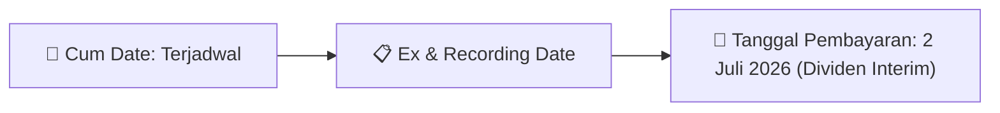

# Ikhtisar Pasar Harian (Daily Digest) - 2026-09-10

📅 **2026-09-10 (Daily Digest)**

## 1. Radar Pasar & Sentimen Harian (Executive Dashboard)
> [!NOTE]
> Terdeteksi sebanyak **54 pengumuman baru** dari 18 emiten pantauan pada (2026-09-10).

| Metric | Jumlah | Status Radar |
| :--- | :---: | :--- |
| **🟢 Sentimen Bullish / Positif** | `1` | [[Dividen Interim]], [[Mandatory Tender Offer]], Kinerja Positif |
| **⚪ Sentimen Netral / Routine** | `17` | [[Tanggapan Penjelasan Bursa]], [[RUPS]], [[Pendaftaran Unit]] |
| **🔴 Sentimen Bearish / Alert** | `0` | Sengketa Hukum, Defisit / Gugatan (Nihil hari ini) |
| **📄 [[Laporan Keuangan]] Baru** | `0` | Memicu Analisis Keuangan Otomatis |

> [!NOTE]
> Tidak dideteksi adanya publikasi laporan keuangan baru hari ini. Rangkuman per emiten secara terperinci tidak diperlukan.

---

## 2. Sorotan Utama & Watchlist Strategis (Strategic Watchlist)
#### 💰 Watchlist Dividen & Distribution
- **[[SCNP]]**: Pendapatan Usaha S1-2026 = Rp 156,58 Miliar
- **[[SCNP]]**: Pertumbuhan Pendapatan Usaha = Naik 41,7%
- **[[SCNP]]**: Laba Usaha S1-2026 = Rp 6,74 Miliar
- **[[SCNP]]**: Laba Usaha S1-2025 = Rp (1,15) Miliar
- **[[SCNP]]**: Laba Kotor S1-2026 = Rp 22,60 Miliar
- **[[SCNP]]**: Laba Tahun Berjalan S1-2026 = Rp 12,55 Miliar

#### 🎯 Watchlist Penawaran Tender Wajib (MTO) & Strategis
- **[[RELF]]**: Rencana Pemegang Saham Pengendali = [[Bapak Ghofar Rozaq Nazila (pemegang saham pengendali dan Komisaris) tidak memiliki rencana penambahan kepemilikan saham di RELF]]

#### 👥 Watchlist Transaksi Orang Dalam & Kepemilikan Saham (Insider / Repo Moves)
- **[[KDTN]]**: Nama Insider = PUTRASAKTI MANDIRI
- **[[KDTN]]**: Jabatan = Tidak
- **[[OBAT]]**: Tanggal dan Waktu Pelaporan = 10-09-2026 14:20
- **[[MGLV]]**: Nama Pelapor = PT NEXTIER DATAMATE CENTER
- **[[MGLV]]**: Status Kepemilikan = Tidak Langsung
- **[[MGLV]]**: Jenis Transaksi = Repurchase Agreement
- **[[MGLV]]**: Jumlah Saham Sebelum Transaksi = 1.275.000.000 unit
- **[[MGLV]]**: Hak Suara Sebelum Transaksi = 66,93%

---

## 3. Matriks Pengumuman Pasar (Announcements Intelligence Table)
| Emiten | Sentimen | Jenis Pengumuman | Judul Pengumuman | Berkas |
| :--- | :---: | :--- | :--- | :--- |
| **[[BAJA]]** | ⚪ NEUTRAL | Aksi Korporasi | Laporan Informasi dan Fakta Material | [Lamp 1](file:///g:/My%20Drive/Model2/reports/raw/BAJA/20260909_BAJA_20260909_BAJA_Laporan Informasi dan Fakta Material_32146713_lamp1.pdf) |
| **[[DMAS]]** | ⚪ NEUTRAL | Public Expose | Public Expose | [Utama](file:///g:/My%20Drive/Model2/reports/raw/DMAS/20260910_DMAS_20260909_DMAS_Public Expose_32146557.pdf) · [Lamp 2](file:///g:/My%20Drive/Model2/reports/raw/DMAS/20260910_DMAS_20260909_DMAS_Public Expose_32146557_lamp2.pdf) |
| **[[KDTN]]** | ⚪ NEUTRAL | Kepemilikan Saham (Insider) | LK-10092026-4035-00 | [Utama](file:///g:/My%20Drive/Model2/reports/raw/KDTN/20260910_KDTN_LK-10092026-4035-00.pdf) |
| **[[OBAT]]** | ⚪ NEUTRAL | Aksi Korporasi | Tanggapan atas Permintaan Penjelasan Bursa | [Utama](file:///g:/My%20Drive/Model2/reports/raw/OBAT/20260910_OBAT_20260910_OBAT_Tanggapan atas Permintaan Penjelasan Bursa_32147158.pdf) · [Lamp 1](file:///g:/My%20Drive/Model2/reports/raw/OBAT/20260910_OBAT_20260910_OBAT_Tanggapan atas Permintaan Penjelasan Bursa_32147158_lamp1.pdf) |
| **[[MGLV]]** | ⚪ NEUTRAL | Kepemilikan Saham (Insider) | LK-10092026-3465-00 | [Utama](file:///g:/My%20Drive/Model2/reports/raw/MGLV/20260910_MGLV_LK-10092026-3465-00.pdf) |
| **[[MITI]]** | ⚪ NEUTRAL | Aksi Korporasi | Laporan Informasi dan Fakta Material | [Utama](file:///g:/My%20Drive/Model2/reports/raw/MITI/20260910_MITI_20260910_MITI_Laporan Informasi dan Fakta Material_32147606.pdf) |
| **[[HALO]]** | ⚪ NEUTRAL | Aksi Korporasi | Tanggapan atas Permintaan Penjelasan Bursa | [Utama](file:///g:/My%20Drive/Model2/reports/raw/HALO/20260910_HALO_20260910_HALO_Tanggapan atas Permintaan Penjelasan Bursa_32147008.pdf) · [Lamp 1](file:///g:/My%20Drive/Model2/reports/raw/HALO/20260910_HALO_20260910_HALO_Tanggapan atas Permintaan Penjelasan Bursa_32147008_lamp1.pdf) |
| **[[RELF]]** | ⚪ NEUTRAL | Aksi Korporasi | Tanggapan atas Permintaan Penjelasan Bursa | [Utama](file:///g:/My%20Drive/Model2/reports/raw/RELF/20260910_RELF_20260910_RELF_Tanggapan atas Permintaan Penjelasan Bursa_32147108.pdf) |
| **[[MSJA]]** | ⚪ NEUTRAL | Aksi Korporasi | Tanggapan atas Permintaan Penjelasan Bursa | [Utama](file:///g:/My%20Drive/Model2/reports/raw/MSJA/20260910_MSJA_20260910_MSJA_Tanggapan atas Permintaan Penjelasan Bursa_32147161.pdf) · [Lamp 1](file:///g:/My%20Drive/Model2/reports/raw/MSJA/20260910_MSJA_20260910_MSJA_Tanggapan atas Permintaan Penjelasan Bursa_32147161_lamp1.pdf) |
| **[[FIRE]]** | ⚪ NEUTRAL | Aksi Korporasi | Tanggapan atas Permintaan Penjelasan Bursa | [Utama](file:///g:/My%20Drive/Model2/reports/raw/FIRE/20260910_FIRE_20260910_FIRE_Tanggapan atas Permintaan Penjelasan Bursa_32147167.pdf) · [Lamp 1](file:///g:/My%20Drive/Model2/reports/raw/FIRE/20260910_FIRE_20260910_FIRE_Tanggapan atas Permintaan Penjelasan Bursa_32147167_lamp1.pdf) |
| **[[CRAB]]** | ⚪ NEUTRAL | Public Expose | Public Expose | [Utama](file:///g:/My%20Drive/Model2/reports/raw/CRAB/20260910_CRAB_20260910_CRAB_Public Expose_32147200.pdf) |
| **[[LTLS]]** | ⚪ NEUTRAL | Public Expose | Public Expose | [Utama](file:///g:/My%20Drive/Model2/reports/raw/LTLS/20260910_LTLS_20260910_LTLS_Public Expose_32147147.pdf) · [Lamp 1](file:///g:/My%20Drive/Model2/reports/raw/LTLS/20260910_LTLS_20260910_LTLS_Public Expose_32147147_lamp1.pdf) |
| **[[PSAB]]** | ⚪ NEUTRAL | Aksi Korporasi | Laporan Informasi dan Fakta Material | [Utama](file:///g:/My%20Drive/Model2/reports/raw/PSAB/20260910_PSAB_20260910_PSAB_Laporan Informasi dan Fakta Material_32147318.pdf) · [Lamp 1](file:///g:/My%20Drive/Model2/reports/raw/PSAB/20260910_PSAB_20260910_PSAB_Laporan Informasi dan Fakta Material_32147318_lamp1.pdf) |
| **[[FIFA]]** | ⚪ NEUTRAL | Aksi Korporasi | Penyampaian ProspektusInformasi Tambahan | [Utama](file:///g:/My%20Drive/Model2/reports/raw/FIFA/20260910_FIFA_20260910_FIFA_Penyampaian ProspektusInformasi Tambahan_32147541.pdf) · [Lamp 1](file:///g:/My%20Drive/Model2/reports/raw/FIFA/20260910_FIFA_20260910_FIFA_Penyampaian ProspektusInformasi Tambahan_32147541_lamp1.pdf) |
| **[[SMLE]]** | ⚪ NEUTRAL | Public Expose | Public Expose | [Utama](file:///g:/My%20Drive/Model2/reports/raw/SMLE/20260910_SMLE_20260910_SMLE_Public Expose_32147582.pdf) · [Lamp 2](file:///g:/My%20Drive/Model2/reports/raw/SMLE/20260910_SMLE_20260910_SMLE_Public Expose_32147582_lamp2.pdf) |
| **[[CPIN]]** | ⚪ NEUTRAL | Kepemilikan Saham (Insider) | LK-10092026-4735-00 | [Utama](file:///g:/My%20Drive/Model2/reports/raw/CPIN/20260910_CPIN_LK-10092026-4735-00.pdf) |
| **[[PLAN]]** | ⚪ NEUTRAL | Aksi Korporasi | Tanggapan atas Permintaan Penjelasan Bursa | [Utama](file:///g:/My%20Drive/Model2/reports/raw/PLAN/20260910_PLAN_20260910_PLAN_Tanggapan atas Permintaan Penjelasan Bursa_32147324.pdf) · [Lamp 1](file:///g:/My%20Drive/Model2/reports/raw/PLAN/20260910_PLAN_20260910_PLAN_Tanggapan atas Permintaan Penjelasan Bursa_32147324_lamp1.pdf) |
| **[[SCNP]]** | 🟢 BULLISH | Dividen | Laporan Informasi dan Fakta Material | [Utama](file:///g:/My%20Drive/Model2/reports/raw/SCNP/20260910_SCNP_20260910_SCNP_Laporan Informasi dan Fakta Material_32147278.pdf) · [Lamp 1](file:///g:/My%20Drive/Model2/reports/raw/SCNP/20260910_SCNP_20260910_SCNP_Laporan Informasi dan Fakta Material_32147278_lamp1.pdf) |

---

## 4. Detail Informasi per Emiten (Grouped by Emiten)
### 📋 4.2. Detail Emiten Lain (Non-Watchlist)

#### 🔵 [[BAJA]]
- **[Aksi Korporasi]** [Laporan Informasi dan Fakta Material](file:///g:/My%20Drive/Model2/reports/raw/BAJA/20260909_BAJA_20260909_BAJA_Laporan Informasi dan Fakta Material_32146713_lamp1.pdf)
  - 📌 *Deskripsi*: Dokumen tidak dapat diekstrak karena teks yang diberikan tidak mengandung informasi yang cukup atau terbaca.

#### 🔵 [[DMAS]]
- **[Public Expose]** [Public Expose](file:///g:/My%20Drive/Model2/reports/raw/DMAS/20260910_DMAS_20260909_DMAS_Public Expose_32146557.pdf) *(Attachment: [Lamp 2](file:///g:/My%20Drive/Model2/reports/raw/DMAS/20260910_DMAS_20260909_DMAS_Public Expose_32146557_lamp2.pdf))*
  - 📌 *Deskripsi*: Informasi dan fakta material DMAS: DAFTAR HADIR PESERTA PUBLIC EXPOSE LIVE 2026 PT PURADELTA LESTARI TBK 7 SEPTEMBER 2026 No Nama Tipe Pengunjung 1 Abdul Suroso Investor 2 Abdullah Masyhuri Investor 3 Achmad Zainuddin Media 4 Adam Yunus Umum 5 Aditya Prayoga Investor 6 Agung Suprananto Investor 7 Ahmad Musawir Investor 8 Al Nadine Investor 9 Alexander Budianto 10 Andre Investor 11 Andrew Yap Investor 12 Andri Nur Ikhsan Investor 13 Anggit Setiawan Investor 14 Anitana widya Media 15 Anthony Umum 16 Antony Kusmawiraputra Investor 1
  - 📊 **Fakta Material**:
    - **Uraian Kejadian**: DAFTAR HADIR PESERTA PUBLIC EXPOSE LIVE 2026 PT PURADELTA LESTARI TBK 7 SEPTEMBER 2026 No Nama Tipe Pengunjung 1 Abdul Suroso Investor 2 Abdullah Masyhuri Investor 3 Achmad Zainuddin Media 4 Adam Yunus Umum 5 Aditya Prayoga Investor 6 Agung Suprananto Investor 7 Ahmad Musawir Investor 8 Al Nadine Investor 9 Alexander Budianto 10 Andre Investor 11 Andrew Yap Investor 12 Andri Nur Ikhsan Investor 13 Anggit Setiawan Investor 14 Anitana widya Media 15 Anthony Umum 16 Antony Kusmawiraputra Investor 1

#### 🔵 [[KDTN]]
- **[Kepemilikan Saham (Insider)]** [LK-10092026-4035-00](file:///g:/My%20Drive/Model2/reports/raw/KDTN/20260910_KDTN_LK-10092026-4035-00.pdf)
  - 📌 *Deskripsi*: Laporan perubahan kepemilikan saham insider KDTN.
  - 📊 **Fakta Material**:
    - **Nama Insider**: PUTRASAKTI MANDIRI
    - **Jabatan**: Tidak

#### 🔵 [[OBAT]]
- **[Aksi Korporasi]** [Tanggapan atas Permintaan Penjelasan Bursa](file:///g:/My%20Drive/Model2/reports/raw/OBAT/20260910_OBAT_20260910_OBAT_Tanggapan atas Permintaan Penjelasan Bursa_32147158.pdf) *(Attachment: [Lamp 1](file:///g:/My%20Drive/Model2/reports/raw/OBAT/20260910_OBAT_20260910_OBAT_Tanggapan atas Permintaan Penjelasan Bursa_32147158_lamp1.pdf))*
  - 📌 *Deskripsi*: PT Brigit Biofarmaka Teknologi Tbk (OBAT) menanggapi permintaan penjelasan Bursa Efek Indonesia (BEI) terkait volatilitas transaksi efek. Perseroan menyatakan tidak mengetahui adanya informasi atau fakta material yang mempengaruhi nilai efek, tidak mengetahui aktivitas pemegang saham tertentu, belum memiliki rencana aksi korporasi dalam waktu dekat, tidak ada informasi material lainnya yang belum diungkapkan, dan pemegang saham utama belum memiliki rencana terkait kepemilikan sahamnya.
  - 📊 **Fakta Material**:
    - **Nomor Surat Permintaan Penjelasan BEI**: S-11499/BEI.PP3/09-2026
    - **Pengetahuan Informasi/Fakta Material (POJK 31/POJK.04/2015)**: Tidak mengetahui
    - **Pengetahuan Informasi/Fakta Material (Peraturan I-E BEI)**: Tidak mengetahui
    - **Pengetahuan Aktivitas Pemegang Saham Tertentu**: Tidak mengetahui
    - **Rencana Aksi Korporasi dalam Waktu Dekat (3 bulan)**: Belum ada rencana
    - **Informasi/Fakta Material Lainnya yang Belum Diungkapkan**: Tidak ada
    - **Rencana Pemegang Saham Utama Terkait Kepemilikan Saham**: Belum ada rencana
    - **Nama Pengirim**: Toufin Noor Prambudi
    - **Jabatan Pengirim**: Corporate Secretary (implisit)
    - **Tanggal dan Waktu Pelaporan**: 10-09-2026 14:20

#### 🔵 [[MGLV]]
- **[Kepemilikan Saham (Insider)]** [LK-10092026-3465-00](file:///g:/My%20Drive/Model2/reports/raw/MGLV/20260910_MGLV_LK-10092026-3465-00.pdf)
  - 📌 *Deskripsi*: PT Nextier Datamate Center, pemegang saham pengendali MGLV (Panca Anugrah Wisesa Tbk), melaporkan penjualan 35.000.000 saham biasa pada 8 September 2026 dengan harga Rp7.000 per saham melalui transaksi Repurchase Agreement. Setelah transaksi, kepemilikan sahamnya turun dari 1.275.000.000 unit (66,93% hak suara) menjadi 1.240.000.000 unit (65,10% hak suara).
  - 📊 **Fakta Material**:
    - **Nama Pelapor**: PT NEXTIER DATAMATE CENTER
    - **Status Kepemilikan**: Tidak Langsung
    - **Jenis Transaksi**: Repurchase Agreement
    - **Jumlah Saham Sebelum Transaksi**: 1.275.000.000 unit
    - **Hak Suara Sebelum Transaksi**: 66,93%
    - **Jumlah Saham Setelah Transaksi**: 1.240.000.000 unit
    - **Hak Suara Setelah Transaksi**: 65,10%
    - **Jumlah Saham yang Ditransaksikan**: 35.000.000 unit
    - **Klasifikasi Saham**: Saham Biasa
    - **Harga Transaksi**: Rp7.000,00 per saham
    - **Tanggal Transaksi**: 2026-09-08
    - **Tujuan Transaksi**: Penjualan
    - **Nomor Laporan**: LK/10092026/0005/1

#### 🔵 [[MITI]]
- **[Aksi Korporasi]** [Laporan Informasi dan Fakta Material](file:///g:/My%20Drive/Model2/reports/raw/MITI/20260910_MITI_20260910_MITI_Laporan Informasi dan Fakta Material_32147606.pdf)
  - 📌 *Deskripsi*: Informasi dan fakta material MITI: 095/DIR-MI/IX/2026 Mitra Investindo Tbk MITI 1 Keterbukaan Informasi sehubungan dengan Jual Beli Kapal antara PT Wasesa yang merupakan Perusahaan terkendali Perseroan dan PT Imako Perkasa Lines. Dengan ini kami untuk dan atas menyampaikan Laporan Informasi atau Fakta Material sebagai berikut: Nama Emiten atau Perusahaan Publik Mitra Investindo Tbk Bidang Usaha Jasa Pelayaran dan Total Logistik Telepon (021) 29079558 Faksimili (021) 29079559 Alamat Surat Elektronik (email) corsec@mitra-investindo
  - 📊 **Fakta Material**:
    - **Uraian Kejadian**: 095/DIR-MI/IX/2026 Mitra Investindo Tbk MITI 1 Keterbukaan Informasi sehubungan dengan Jual Beli Kapal antara PT Wasesa yang merupakan Perusahaan terkendali Perseroan dan PT Imako Perkasa Lines. Dengan ini kami untuk dan atas menyampaikan Laporan Informasi atau Fakta Material sebagai berikut: Nama Emiten atau Perusahaan Publik Mitra Investindo Tbk Bidang Usaha Jasa Pelayaran dan Total Logistik Telepon (021) 29079558 Faksimili (021) 29079559 Alamat Surat Elektronik (email) corsec@mitra-investindo

#### 🔵 [[HALO]]
- **[Aksi Korporasi]** [Tanggapan atas Permintaan Penjelasan Bursa](file:///g:/My%20Drive/Model2/reports/raw/HALO/20260910_HALO_20260910_HALO_Tanggapan atas Permintaan Penjelasan Bursa_32147008.pdf) *(Attachment: [Lamp 1](file:///g:/My%20Drive/Model2/reports/raw/HALO/20260910_HALO_20260910_HALO_Tanggapan atas Permintaan Penjelasan Bursa_32147008_lamp1.pdf))*
  - 📌 *Deskripsi*: PT Haloni Jane Tbk menanggapi permintaan penjelasan dari Bursa Efek Indonesia (BEI) terkait volatilitas transaksi efek. Surat tanggapan ini ditujukan kepada Kepala Divisi Penilaian Perusahaan III BEI, merujuk pada surat BEI nomor S-11498/BEI.PP3/09-2026 tertanggal 9 September 2026.
  - 📊 **Fakta Material**:
    - **Nomor Surat**: 596/HJ-Tbk/IX/2026
    - **Tanggal Surat**: 10 September 2026
    - **Tujuan Surat**: PT Bursa Efek Indonesia, Kepala Divisi Penilaian Perusahaan III
    - **Perihal**: Tanggapan Permintaan Penjelasan Atas Volatilitas Transaksi Efek
    - **Nomor Surat BEI**: S-11498/BEI.PP3/09-2026
    - **Tanggal Surat BEI**: 9 September 2026
    - **Penandatangan**: Taufan Kuriawan, Direktur

#### 🔵 [[RELF]]
- **[Aksi Korporasi]** [Tanggapan atas Permintaan Penjelasan Bursa](file:///g:/My%20Drive/Model2/reports/raw/RELF/20260910_RELF_20260910_RELF_Tanggapan atas Permintaan Penjelasan Bursa_32147108.pdf)
  - 📌 *Deskripsi*: PT Graha Mitra Asia Tbk. (RELF) menanggapi permintaan penjelasan Bursa Efek Indonesia (BEI) terkait volatilitas transaksi efek. Perseroan menyatakan tidak mengetahui adanya informasi atau fakta material yang mempengaruhi nilai efek, tidak memiliki rencana aksi korporasi dalam 3 bulan mendatang, dan pemegang saham pengendali tidak berencana menambah kepemilikan saham.
  - 📊 **Fakta Material**:
    - **Nomor Surat Permintaan Penjelasan BEI**: S-11432/BEI.PP3/09-2026
    - **Nomor Surat Tanggapan**: 364/SPENG/GMA-HO/9/2026
    - **Tanggal Pelaporan**: 2026-09-10
    - **Pengetahuan Informasi/Fakta Material**: Perseroan tidak mengetahui adanya informasi atau fakta material yang mempengaruhi nilai efek atau keputusan investasi pemodal
    - **Kepatuhan Terhadap Peraturan BEI**: Perseroan memahami dan mematuhi Peraturan Nomor I-E Keputusan Direksi BEI Nomor Kep-00087/BEI/12-2025
    - **Aktivitas Pemegang Saham Tertentu**: Perseroan tidak mengetahui adanya aktivitas pemegang saham tertentu terkait kepemilikan atau perubahan kepemilikan saham
    - **Rencana Aksi Korporasi**: Tidak ada rencana aksi korporasi dalam waktu dekat (paling tidak 3 bulan mendatang)
    - **Informasi/Fakta Material Lainnya**: Tidak ada informasi/fakta/kejadian penting lainnya yang material dan belum diungkapkan kepada publik
    - **Rencana Pemegang Saham Pengendali**: Bapak Ghofar Rozaq Nazila (pemegang saham pengendali dan Komisaris) tidak memiliki rencana penambahan kepemilikan saham di RELF
    - **Nama Pengirim**: Ivan Darmanto
    - **Jabatan Pengirim**: Direktur Utama

#### 🔵 [[MSJA]]
- **[Aksi Korporasi]** [Tanggapan atas Permintaan Penjelasan Bursa](file:///g:/My%20Drive/Model2/reports/raw/MSJA/20260910_MSJA_20260910_MSJA_Tanggapan atas Permintaan Penjelasan Bursa_32147161.pdf) *(Attachment: [Lamp 1](file:///g:/My%20Drive/Model2/reports/raw/MSJA/20260910_MSJA_20260910_MSJA_Tanggapan atas Permintaan Penjelasan Bursa_32147161_lamp1.pdf))*
  - 📌 *Deskripsi*: PT Multi Spunindo Jaya Tbk (MSJA) menanggapi surat BEI terkait volatilitas transaksi efek pada periode 28 Agustus – 7 September 2026. Perseroan menyatakan tidak mengetahui adanya informasi atau fakta material yang mempengaruhi nilai efek, tidak ada rencana aksi korporasi dalam waktu dekat, dan tidak ada informasi penting lainnya yang belum diungkapkan.
  - 📊 **Fakta Material**:
    - **Nomor Surat BEI**: S-11504/BEI.PP2/09-2026
    - **Tanggal Surat BEI**: 2026-09-09
    - **Periode Volatilitas**: 28 Agustus - 7 September 2026
    - **Kenaikan Harga Saham Kumulatif**: Rp93 atau 21,53%
    - **Harga Penutupan 27 Agustus 2026**: Rp432
    - **Harga Penutupan Akhir Periode**: Rp525
    - **Rata-rata Aktivitas Saham Periode**: 14.698.557 saham dengan frekuensi 1.246 kali
    - **Aktivitas Saham 27 Agustus 2026**: 20.671.400 saham dengan frekuensi 483 kali
    - **Informasi Material Tambahan**: Tidak ada
    - **Rencana Aksi Korporasi**: Tidak ada dalam waktu dekat (minimal 3 bulan)
    - **Rencana Pemegang Saham Utama**: Tidak ada rencana terkait kepemilikan saham

#### 🔵 [[FIRE]]
- **[Aksi Korporasi]** [Tanggapan atas Permintaan Penjelasan Bursa](file:///g:/My%20Drive/Model2/reports/raw/FIRE/20260910_FIRE_20260910_FIRE_Tanggapan atas Permintaan Penjelasan Bursa_32147167.pdf) *(Attachment: [Lamp 1](file:///g:/My%20Drive/Model2/reports/raw/FIRE/20260910_FIRE_20260910_FIRE_Tanggapan atas Permintaan Penjelasan Bursa_32147167_lamp1.pdf))*
  - 📌 *Deskripsi*: PT Alfa Energi Investama Tbk. (FIRE) menanggapi permintaan penjelasan Bursa Efek Indonesia (BEI) terkait volatilitas transaksi efek. Perseroan menyatakan tidak mengetahui adanya informasi atau fakta material yang mempengaruhi nilai efek, tidak mengetahui aktivitas pemegang saham tertentu, tidak memiliki rencana aksi korporasi dalam waktu dekat, tidak ada informasi material lain yang belum diungkapkan, dan pemegang saham utama tidak memiliki rencana terkait kepemilikan sahamnya.
  - 📊 **Fakta Material**:
    - **Nomor Surat BEI**: S-10958/BEI.PP2/08-2026
    - **Tanggal Surat BEI**: 2026-08-24
    - **Pengetahuan Informasi Material**: Tidak mengetahui adanya informasi atau fakta material
    - **Pengetahuan Informasi Material Harga Efek**: Tidak mengetahui adanya informasi atau fakta material yang mempengaruhi harga efek
    - **Aktivitas Pemegang Saham Tertentu**: Tidak mengetahui aktivitas pemegang saham tertentu
    - **Rencana Tindakan Korporasi**: Tidak ada rencana tindakan korporasi dalam waktu dekat
    - **Informasi Material Lainnya**: Tidak ada informasi/fakta/kejadian penting lainnya yang material
    - **Rencana Pemegang Saham Utama**: Tidak ada rencana terkait kepemilikan sahamnya

#### 🔵 [[CRAB]]
- **[Public Expose]** [Public Expose](file:///g:/My%20Drive/Model2/reports/raw/CRAB/20260910_CRAB_20260910_CRAB_Public Expose_32147200.pdf)
  - 📌 *Deskripsi*: PT Toba Surimi Industries Tbk (CRAB) mengumumkan rencana penyelenggaraan Public Expose Tahunan untuk Tahun Buku 2026 yang akan diadakan pada 25 September 2026 di Grand City Hall Medan. Agenda acara meliputi pemaparan profil perusahaan, kinerja perusahaan, dan sesi tanya jawab.
  - 📊 **Fakta Material**:
    - **Nomor Surat**: 031/TSI/CORSEC/IX/2026
    - **Tanggal Pengumuman**: 10 September 2026
    - **Waktu Pelaksanaan**: 25 September 2026, 15:30 WIB
    - **Tempat Pelaksanaan**: Grand City Hall Medan, Lt 2, Ruang Rosewood
    - **Agenda 1**: Pemaparan sekilas mengenai Perseroan
    - **Agenda 2**: Pemaparan Kinerja Perseroan
    - **Agenda 3**: Sesi Tanya Jawab
    - **Nama Pengirim**: Gindra Tardy
    - **Jabatan Pengirim**: Direktur Utama
    - **Alamat Perseroan**: Komplek Cemara Asri Blok C6 No 12

#### 🔵 [[LTLS]]
- **[Public Expose]** [Public Expose](file:///g:/My%20Drive/Model2/reports/raw/LTLS/20260910_LTLS_20260910_LTLS_Public Expose_32147147.pdf) *(Attachment: [Lamp 1](file:///g:/My%20Drive/Model2/reports/raw/LTLS/20260910_LTLS_20260910_LTLS_Public Expose_32147147_lamp1.pdf))*
  - 📌 *Deskripsi*: Laporan pelaksanaan Paparan Publik Tahunan PT Lautan Luas Tbk yang diselenggarakan pada 8 September 2026 secara virtual. Manajemen memaparkan ikhtisar perusahaan, fokus bisnis, ikhtisar keuangan, komitmen keberlanjutan, dan sesi tanya jawab. Poin penting yang disampaikan antara lain kontribusi bisnis air sekitar 12% terhadap pendapatan semester I-2026 dengan target jangka panjang di atas 15%, dampak pelemahan rupiah dan harga minyak yang tidak signifikan karena strategi hedging dan diversifikasi principal, rencana pembayaran obligasi Rp135 miliar yang jatuh tempo November 2026, serta strategi menjaga profitabilitas melalui optimalisasi portofolio dan customer mix.
  - 📊 **Fakta Material**:
    - **Waktu Pelaksanaan**: 10.00 - 11.00 WIB
    - **Tempat Pelaksanaan**: Public Expose Live 2026, website pubexlive.idx.co.id
    - **Proyeksi Kontribusi Bisnis Air Semester II-2026**: 12-15%
    - **Target Kontribusi Bisnis Air Jangka Panjang**: Di atas 15%
    - **Obligasi Jatuh Tempo November 2026**: Rp135 miliar
    - **Rencana Pembayaran Obligasi**: Sebagian dari perbankan, sebagian dari hasil usaha tahun ini
    - **Dampak Pelemahan Rupiah dan Harga Minyak**: Tidak signifikan, dimitigasi dengan hedging dan diversifikasi principal
    - **Strategi Menjaga Profitabilitas**: Optimalisasi portfolio investasi, produk, dan customer mix

#### 🔵 [[PSAB]]
- **[Aksi Korporasi]** [Laporan Informasi dan Fakta Material](file:///g:/My%20Drive/Model2/reports/raw/PSAB/20260910_PSAB_20260910_PSAB_Laporan Informasi dan Fakta Material_32147318.pdf) *(Attachment: [Lamp 1](file:///g:/My%20Drive/Model2/reports/raw/PSAB/20260910_PSAB_20260910_PSAB_Laporan Informasi dan Fakta Material_32147318_lamp1.pdf))*
  - 📌 *Deskripsi*: PT J Resources Asia Pasifik Tbk (PSAB) melaporkan informasi material berupa persetujuan dari Kementerian Energi dan Sumber Daya Mineral (ESDM) atas perubahan pemegang saham JRBM. Kejadian ini dilaporkan pada tanggal 10 September 2026.
  - 📊 **Fakta Material**:
    - **Jenis Informasi Material**: Persetujuan dari Kementerian ESDM atas Perubahan Pemegang Saham JRBM
    - **Tanggal Kejadian**: 10 September 2026
    - **Bidang Usaha**: Pertambangan Emas
    - **Nomor Surat**: JRAP/SKLR/CSD/2026/IX/077
    - **Nama Pelapor**: Edi Permadi
    - **Jabatan Pelapor**: Tidak disebutkan secara spesifik dalam dokumen

#### 🔵 [[FIFA]]
- **[Aksi Korporasi]** [Penyampaian ProspektusInformasi Tambahan](file:///g:/My%20Drive/Model2/reports/raw/FIFA/20260910_FIFA_20260910_FIFA_Penyampaian ProspektusInformasi Tambahan_32147541.pdf) *(Attachment: [Lamp 1](file:///g:/My%20Drive/Model2/reports/raw/FIFA/20260910_FIFA_20260910_FIFA_Penyampaian ProspektusInformasi Tambahan_32147541_lamp1.pdf))*
  - 📌 *Deskripsi*: PT Federal International Finance (FIFA) menyampaikan Informasi Tambahan terkait Penawaran Umum Berkelanjutan Obligasi Berkelanjutan VII Tahap IV Tahun 2026 dengan target dana Rp10 triliun. Obligasi Tahap IV ditawarkan sebesar Rp2,5 triliun dalam 2 seri: Seri A (Rp1,41 triliun, bunga 7,15%, tenor 370 hari) dan Seri B (Rp1,09 triliun, bunga 7,40%, tenor 36 bulan).
  - 📊 **Fakta Material**:
    - **Target Dana PUB Obligasi Berkelanjutan VII**: Rp10.000.000.000.000
    - **Jumlah Pokok Obligasi Tahap IV Tahun 2026**: Rp2.500.000.000.000
    - **Jumlah Obligasi Seri A**: Rp1.410.872.000.000
    - **Tingkat Bunga Tetap Seri A**: 7,15% per tahun
    - **Jangka Waktu Seri A**: 370 Hari Kalender
    - **Jumlah Obligasi Seri B**: Rp1.089.128.000.000
    - **Tingkat Bunga Tetap Seri B**: 7,40% per tahun
    - **Jangka Waktu Seri B**: 36 bulan
    - **Tanggal Jatuh Tempo Seri A**: 2027-10-05
    - **Tanggal Jatuh Tempo Seri B**: 2029-09-25
    - **Jumlah Kantor Cabang per 30 Juni 2026**: 266
    - **Jumlah POS per 30 Juni 2026**: 445

#### 🔵 [[SMLE]]
- **[Public Expose]** [Public Expose](file:///g:/My%20Drive/Model2/reports/raw/SMLE/20260910_SMLE_20260910_SMLE_Public Expose_32147582.pdf) *(Attachment: [Lamp 2](file:///g:/My%20Drive/Model2/reports/raw/SMLE/20260910_SMLE_20260910_SMLE_Public Expose_32147582_lamp2.pdf))*
  - 📌 *Deskripsi*: PT Sinergi Multi Lestarindo Tbk (SMLE) menyampaikan koreksi atas surat nomor 0092/P-DIR/SMLE/IX/2026 tanggal 08 September 2026 terkait penyampaian materi Public Expose Tahunan. Materi Public Expose akan disampaikan dalam acara Public Expose Live IDX 2026, dengan lampiran berupa surat penyampaian materi dan materi presentasi untuk Public Expose yang dijadwalkan pada 11 September 2026.
  - 📊 **Fakta Material**:
    - **Nomor Surat**: 0094/P-DIR/SMLE/IX/2026
    - **Tanggal Surat**: 10 September 2026
    - **Nomor Surat Sebelumnya (Dikoreksi)**: 0092/P-DIR/SMLE/IX/2026
    - **Tanggal Surat Sebelumnya (Dikoreksi)**: 08 September 2026
    - **Rujukan Surat Pengumuman Public Expose**: 0090/P-DIR/SMLE/IX/2026
    - **Tanggal Rujukan Surat Pengumuman Public Expose**: 28 Agustus 2026
    - **Jenis Public Expose**: Public Expose Tahunan
    - **Acara**: Public Expose Live IDX 2026
    - **Tanggal Pelaksanaan Public Expose**: 11 September 2026
    - **Nama Pengirim**: PT Sinergi Multi Lestarindo Tbk
    - **Nama Penandatangan**: Arry Wahyu Riansyah
    - **Jabatan Penandatangan**: Direktur
    - **Alamat**: Business Park Kebon Jeruk Blok I 5-6
    - **Lampiran 1**: Surat Penyampaian Materi Pubex Live 2026 SMLE.pdf
    - **Lampiran 2**: PUBEX SMLE 11 September 2026_compressed.pdf

#### 🔵 [[CPIN]]
- **[Kepemilikan Saham (Insider)]** [LK-10092026-4735-00](file:///g:/My%20Drive/Model2/reports/raw/CPIN/20260910_CPIN_LK-10092026-4735-00.pdf)
  - 📌 *Deskripsi*: UBS AG LDN BRANCH A/C CLIENT, pemegang saham tidak langsung CPIN, melaporkan perubahan kepemilikan saham melalui transaksi Repurchase Agreement pada 7 September 2026. Jumlah saham berkurang dari 986.278.747 unit (6,01% hak suara) menjadi 982.737.000 unit (5,99% hak suara). Transaksi dilakukan untuk tujuan hedging aktivitas trading derivatif klien.
  - 📊 **Fakta Material**:
    - **Nama Pelapor**: UBS AG LDN BRANCH A/C CLIENT
    - **Jabatan**: Tidak (bukan direksi/komisaris)
    - **Kewarganegaraan**: WNA
    - **Jumlah Saham Sebelum Transaksi**: 986.278.747 unit
    - **Hak Suara Sebelum Transaksi**: 6,01%
    - **Jumlah Saham Setelah Transaksi**: 982.737.000 unit
    - **Hak Suara Setelah Transaksi**: 5,99%
    - **Jenis Transaksi**: Repurchase Agreement
    - **Tanggal Transaksi**: 2026-09-07
    - **Jumlah Saham yang Ditransaksikan**: 3.541.747 unit
    - **Klasifikasi Saham**: Saham Biasa
    - **Harga Transaksi**: Rp 3.220,00 per saham
    - **Tujuan Transaksi**: UBS sold shares for hedging client derivative trading activities
    - **Status Kepemilikan**: Tidak Langsung
    - **Nomor Laporan**: LK/10092026/0006/1

#### 🔵 [[PLAN]]
- **[Aksi Korporasi]** [Tanggapan atas Permintaan Penjelasan Bursa](file:///g:/My%20Drive/Model2/reports/raw/PLAN/20260910_PLAN_20260910_PLAN_Tanggapan atas Permintaan Penjelasan Bursa_32147324.pdf) *(Attachment: [Lamp 1](file:///g:/My%20Drive/Model2/reports/raw/PLAN/20260910_PLAN_20260910_PLAN_Tanggapan atas Permintaan Penjelasan Bursa_32147324_lamp1.pdf))*
  - 📌 *Deskripsi*: PT Planet Properindo Jaya Tbk (PLAN) menanggapi permintaan penjelasan Bursa Efek Indonesia (BEI) terkait volatilitas transaksi efek. Perseroan menyatakan tidak mengetahui adanya informasi atau fakta material yang mempengaruhi nilai efek atau keputusan investasi, tidak mengetahui aktivitas pemegang saham tertentu, tidak memiliki rencana aksi korporasi dalam waktu dekat (3 bulan), dan tidak ada informasi material lain yang belum diungkapkan kepada publik.
  - 📊 **Fakta Material**:
    - **Nomor Surat Tanggapan**: 028/PPJ/IX/2026
    - **Nomor Surat Permintaan BEI**: S-11411/BEI.PP1/09-2026
    - **Tanggal Surat Permintaan BEI**: 2026-09-08
    - **Pengetahuan Informasi/Fakta Material (POJK 31/2015)**: Tidak mengetahui adanya informasi atau fakta material
    - **Pengetahuan Informasi/Fakta Material (Peraturan I-E)**: Tidak mengetahui adanya informasi atau fakta material
    - **Aktivitas Pemegang Saham Tertentu**: Tidak ada informasi aktivitas pemegang saham tertentu
    - **Rencana Aksi Korporasi (3 Bulan Mendatang)**: Tidak memiliki rencana aksi korporasi
    - **Informasi Material Lainnya**: Tidak ada informasi/fakta/kejadian penting lainnya yang material
    - **Nama Pengirim**: Aaron Hartono Tanujaya
    - **Jabatan Pengirim**: Direktur

#### 🔵 [[SCNP]]
- **[Dividen]** [Laporan Informasi dan Fakta Material](file:///g:/My%20Drive/Model2/reports/raw/SCNP/20260910_SCNP_20260910_SCNP_Laporan Informasi dan Fakta Material_32147278.pdf) *(Attachment: [Lamp 1](file:///g:/My%20Drive/Model2/reports/raw/SCNP/20260910_SCNP_20260910_SCNP_Laporan Informasi dan Fakta Material_32147278_lamp1.pdf))*
  - 📌 *Deskripsi*: PT Selaras Citra Nusantara Perkasa Tbk (SCNP) melaporkan kinerja keuangan yang signifikan untuk semester pertama tahun 2026. Pendapatan usaha melonjak 41,7% menjadi Rp 156,58 miliar, dan perseroan berhasil membukukan laba usaha positif sebesar Rp 6,74 miliar, berbalik dari rugi usaha pada periode yang sama tahun sebelumnya. Laba tahun berjalan juga meningkat menjadi Rp 12,55 miliar. Perseroan juga membagikan dividen tunai sebesar Rp 10 miliar yang telah dibayarkan pada 2 Juli 2026.
  - 📊 **Fakta Material**:
    - **Pendapatan Usaha S1-2026**: Rp 156,58 Miliar
    - **Pertumbuhan Pendapatan Usaha**: Naik 41,7%
    - **Laba Usaha S1-2026**: Rp 6,74 Miliar
    - **Laba Usaha S1-2025**: Rp (1,15) Miliar
    - **Laba Kotor S1-2026**: Rp 22,60 Miliar
    - **Laba Tahun Berjalan S1-2026**: Rp 12,55 Miliar
    - **Marjin Laba Kotor (GPM) S1-2026**: 14,44%
    - **Marjin Laba Usaha (OPM) S1-2026**: 4,31%
    - **Rasio Utang terhadap Modal (DER)**: 36,84%
    - **Tingkat Penyelesaian Bangunan Pabrik**: Lebih dari 83%
    - **Serapan Investasi Aset Tetap Dalam Penyelesaian**: Rp 33,96 Miliar
    - **Target Volume Ekspansi Produksi**: 1.594.062 unit
    - **Peningkatan Volume Produksi**: Lebih dari 49% dibandingkan capaian 2025
    - **Dividen Tunai**: Rp 10 Miliar
    - **Tanggal Pembayaran Dividen**: 2 Juli 2026

---

## 5. Rekomendasi & Langkah Analisis Selanjutnya (Next Steps)
> [!TIP]
> **Instruksi Otomatis Swarm Agent**:
> 1. **Dividen Action**: Pantau *Recording Date & Payment Date* untuk emiten pembagi [[Dividen Interim]] (`[[TAPG]]`, `[[AMAR]]`).
> 2. **Tender Offer Action**: Pantau keterbukaan informasi lanjutan untuk `[[MAPI]]` terkait harga [[Mandatory Tender Offer]] oleh `[[Pacific Universal Investments Pte. Ltd.]]`.
> 3. **Financial Statement Deep-Dive**: Jika ada [[Laporan Keuangan]] baru di Section 1, jalankan agen `financial-summarizer-agent` untuk menghitung margin dan rasio valuasi.
