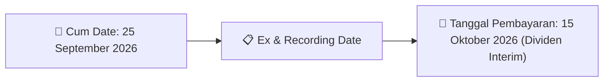

# Ikhtisar Pasar Harian (Daily Digest) - 2026-09-17

📅 **2026-09-17 (Daily Digest)**

## 1. Radar Pasar & Sentimen Harian (Executive Dashboard)
> [!NOTE]
> Terdeteksi sebanyak **122 pengumuman baru** dari 38 emiten pantauan pada (2026-09-17).

| Metric | Jumlah | Status Radar |
| :--- | :---: | :--- |
| **🟢 Sentimen Bullish / Positif** | `4` | [[Dividen Interim]], [[Mandatory Tender Offer]], Kinerja Positif |
| **⚪ Sentimen Netral / Routine** | `41` | [[Tanggapan Penjelasan Bursa]], [[RUPS]], [[Pendaftaran Unit]] |
| **🔴 Sentimen Bearish / Alert** | `6` | Sengketa Hukum, Defisit / Gugatan (Nihil hari ini) |
| **📄 [[Laporan Keuangan]] Baru** | `3` | Memicu Analisis Keuangan Otomatis |

> [!IMPORTANT]
> **Ditemukan Laporan Keuangan Baru Hari Ini:**
> - **IRSX**: FinancialStatement-2026-II-IRSX ([Buka PDF](file:///g:/My Drive/Model2/reports/raw/IRSX/20260916_IRSX_FinancialStatement-2026-II-IRSX.pdf))
- **GMFI**: FinancialStatement-2026-II-GMFI ([Buka PDF](file:///g:/My Drive/Model2/reports/raw/GMFI/20260916_GMFI_FinancialStatement-2026-II-GMFI.pdf))
- **GMFI**: FinancialStatement-2026-II-GMFI. ([Buka PDF](file:///g:/My Drive/Model2/reports/raw/GMFI/20260916_GMFI_FinancialStatement-2026-II-GMFI.xlsx))
> 
> *Tugas Swarm Agent:* Lakukan analisis laporan keuangan mendalam per emiten secara terpisah untuk berkas-berkas di atas.

---

## 2. Sorotan Utama & Watchlist Strategis (Strategic Watchlist)
#### 💰 Watchlist Dividen & Distribution
- **[[KKGI]]**: Kuorum RUPS = 78,84% (3.841.940.941 saham)
- **[[KKGI]]**: Pengunduran Diri Direktur Utama = Bapak Pintarso Adijanto
- **[[KKGI]]**: Pengunduran Diri Direktur = Bapak Winanto dan Bapak Eddy
- **[[KKGI]]**: Direktur Utama Baru = Bapak Wimpi Salim
- **[[KKGI]]**: Direktur Baru = Bapak Lucky Ciptadi Wibowo
- **[[KKGI]]**: Susunan Direksi Baru = Wimpi Salim (Dirut), Tan Ying Mei, Agoes Soegiarto Soeparman, Lucky Ciptadi Wibowo

#### 🎯 Watchlist Penawaran Tender Wajib (MTO) & Strategis
- **[[FOLK]]**: Rencana Pemegang Saham Pengendali dan Utama = [[Belum memiliki rencana]]
- **[[PPGL]]**: Pemegang Saham Pengendali - Darmawan Suryadi SM = [[409.637.667 saham (53,12%)]]
- **[[MMIX]]**: Pemegang Saham Pengendali = [[PT Multi Inti Usaha (60%)]]

#### 📈 Watchlist Konversi Waran & Potensi Dilusi
- **[[CSIS]]**: Jumlah Saham Hasil Konversi = 1.829.803.904
- **[[CSIS]]**: Sisa Waran Setelah Konversi = 52.276.034
- **[[CSIS]]**: Nama Waran = CSIS-W
- **[[INET]]**: Jumlah Saham Hasil Konversi = 22.377.786.734
- **[[INET]]**: Total Saham Setelah Konversi = 22.377.786.734
- **[[INET]]**: Nama Waran = INET-W2

#### 👥 Watchlist Transaksi Orang Dalam & Kepemilikan Saham (Insider / Repo Moves)
- **[[CYBR]]**: Nama Pelapor = DONI MORA SE
- **[[CYBR]]**: Jabatan = Direksi
- **[[CYBR]]**: Jenis Transaksi = Repurchase Agreement
- **[[CYBR]]**: Jumlah Saham Sebelum Transaksi = 4.609.300,00 Unit
- **[[CYBR]]**: Hak Suara Sebelum Transaksi = 0,034%
- **[[CYBR]]**: Jumlah Saham Setelah Transaksi = 4.509.300,00 Unit
- **[[CYBR]]**: Hak Suara Setelah Transaksi = 0,033%
- **[[CYBR]]**: Jumlah Saham yang Dijual = 100.000,00 Unit

---

## 3. Matriks Pengumuman Pasar (Announcements Intelligence Table)
| Emiten | Sentimen | Jenis Pengumuman | Judul Pengumuman | Berkas |
| :--- | :---: | :--- | :--- | :--- |
| **[[CSIS]]** | ⚪ NEUTRAL | Aksi Korporasi | Pencatatan Saham Tambahan dari Konversi | [Utama](file:///g:/My%20Drive/Model2/reports/raw/CSIS/20260916_CSIS_20260916_CSIS_Pencatatan Saham Tambahan dari Konversi_32148941.pdf) |
| **[[INET]]** | ⚪ NEUTRAL | Aksi Korporasi | Pencatatan Saham Tambahan dari Konversi | [Utama](file:///g:/My%20Drive/Model2/reports/raw/INET/20260916_INET_20260916_INET_Pencatatan Saham Tambahan dari Konversi_32148931.pdf) |
| **[[INET]]** | ⚪ NEUTRAL | Aksi Korporasi | Laporan Informasi dan Fakta Material | [Utama](file:///g:/My%20Drive/Model2/reports/raw/INET/20260917_INET_20260917_INET_Laporan Informasi dan Fakta Material_32149248.pdf) · [Lamp 1](file:///g:/My%20Drive/Model2/reports/raw/INET/20260917_INET_20260917_INET_Laporan Informasi dan Fakta Material_32149248_lamp1.pdf) |
| **[[BNII]]** | ⚪ NEUTRAL | Aksi Korporasi | Laporan Informasi dan Fakta Material | [Utama](file:///g:/My%20Drive/Model2/reports/raw/BNII/20260916_BNII_20260916_BNII_Laporan Informasi dan Fakta Material_32149206.pdf) · [Lamp 2](file:///g:/My%20Drive/Model2/reports/raw/BNII/20260916_BNII_20260916_BNII_Laporan Informasi dan Fakta Material_32149206_lamp2.pdf) |
| **[[PIDL]]** | ⚪ NEUTRAL | Aksi Korporasi | Pembayaran KuponBagi HasilIjarahPokok | [Utama](file:///g:/My%20Drive/Model2/reports/raw/PIDL/20260916_PIDL_20260916_PIDL_Pembayaran KuponBagi HasilIjarahPokok_32149135.pdf) |
| **[[CYBR]]** | ⚪ NEUTRAL | Aksi Korporasi | Pencatatan Saham Tambahan dari Konversi | [Utama](file:///g:/My%20Drive/Model2/reports/raw/CYBR/20260917_CYBR_20260917_CYBR_Pencatatan Saham Tambahan dari Konversi_32149362.pdf) · [Lamp 1](file:///g:/My%20Drive/Model2/reports/raw/CYBR/20260916_CYBR_20260916_CYBR_Pencatatan Saham Tambahan dari Konversi_32148896_lamp1.pdf) · [Lamp 1](file:///g:/My%20Drive/Model2/reports/raw/CYBR/20260917_CYBR_20260917_CYBR_Pencatatan Saham Tambahan dari Konversi_32149362_lamp1.pdf) |
| **[[CYBR]]** | ⚪ NEUTRAL | Kepemilikan Saham (Insider) | LK-17092026-0779-00 | [Utama](file:///g:/My%20Drive/Model2/reports/raw/CYBR/20260917_CYBR_LK-17092026-0779-00.pdf) |
| **[[FOLK]]** | ⚪ NEUTRAL | Aksi Korporasi | Tanggapan atas Permintaan Penjelasan Bursa | [Utama](file:///g:/My%20Drive/Model2/reports/raw/FOLK/20260916_FOLK_20260916_FOLK_Tanggapan atas Permintaan Penjelasan Bursa_32149233.pdf) |
| **[[IRSX]]** | ⚪ NEUTRAL | Laporan Keuangan | FinancialStatement-2026-II-IRSX | [Utama](file:///g:/My%20Drive/Model2/reports/raw/IRSX/20260916_IRSX_FinancialStatement-2026-II-IRSX.pdf) |
| **[[IRSX]]** | 🔴 BEARISH | Aksi Korporasi | Final Audited Report IRSX June 2026 | [Utama](file:///g:/My%20Drive/Model2/reports/raw/IRSX/20260916_IRSX_Final Audited Report IRSX June 2026.pdf) |
| **[[IRSX]]** | ⚪ NEUTRAL | Aksi Korporasi | Kenaikan Aset Liabilitas LK IRSX Jun 2026 | [Utama](file:///g:/My%20Drive/Model2/reports/raw/IRSX/20260916_IRSX_Kenaikan Aset Liabilitas LK IRSX Jun 2026.pdf) |
| **[[IRSX]]** | 🟢 BULLISH | Aksi Korporasi | SPD Final Audited Report IRSX June 2026 | [Utama](file:///g:/My%20Drive/Model2/reports/raw/IRSX/20260916_IRSX_SPD Final Audited Report IRSX June 2026.pdf) |
| **[[PGEO]]** | ⚪ NEUTRAL | Aksi Korporasi | Pencatatan Saham Tambahan dari Konversi | [Utama](file:///g:/My%20Drive/Model2/reports/raw/PGEO/20260916_PGEO_20260916_PGEO_Pencatatan Saham Tambahan dari Konversi_32148904.pdf) |
| **[[GMFI]]** | ⚪ NEUTRAL | Laporan Keuangan | FinancialStatement-2026-II-GMFI | [Utama](file:///g:/My%20Drive/Model2/reports/raw/GMFI/20260916_GMFI_FinancialStatement-2026-II-GMFI.pdf) |
| **[[GMFI]]** | 🟢 BULLISH | Aksi Korporasi | (OJK) Draft Checklist LK Konsolidasian-Jun 2026 | [Utama](file:///g:/My%20Drive/Model2/reports/raw/GMFI/20260916_GMFI_(OJK) Draft Checklist LK Konsolidasian-Jun 2026.pdf) |
| **[[GMFI]]** | ⚪ NEUTRAL | Laporan Keuangan | FinancialStatement-2026-II-GMFI. | [Utama](file:///g:/My%20Drive/Model2/reports/raw/GMFI/20260916_GMFI_FinancialStatement-2026-II-GMFI.xlsx) |
| **[[GMFI]]** | ⚪ NEUTRAL | Aksi Korporasi | GMF DT SPE 2025 26 | [Utama](file:///g:/My%20Drive/Model2/reports/raw/GMFI/20260916_GMFI_GMF DT SPE 2025 26.pdf) |
| **[[GMFI]]** | ⚪ NEUTRAL | Aksi Korporasi | Signed  GMF 0626 | [Utama](file:///g:/My%20Drive/Model2/reports/raw/GMFI/20260916_GMFI_Signed__LKFS_GMF_0626.pdf) |
| **[[FISH]]** | ⚪ NEUTRAL | Aksi Korporasi | Tanggapan atas Permintaan Penjelasan Bursa | [Utama](file:///g:/My%20Drive/Model2/reports/raw/FISH/20260916_FISH_20260916_FISH_Tanggapan atas Permintaan Penjelasan Bursa_32149223.pdf) |
| **[[MBMA]]** | 🟢 BULLISH | Buyback | Laporan Informasi dan Fakta Material | [Lamp 1](file:///g:/My%20Drive/Model2/reports/raw/MBMA/20260916_MBMA_20260916_MBMA_Laporan Informasi dan Fakta Material_32149216_lamp1.pdf) |
| **[[PPGL]]** | ⚪ NEUTRAL | Aksi Korporasi | Laporan Informasi dan Fakta Material | [Utama](file:///g:/My%20Drive/Model2/reports/raw/PPGL/20260916_PPGL_20260916_PPGL_Laporan Informasi dan Fakta Material_32149234.pdf) |
| **[[PPGL]]** | ⚪ NEUTRAL | Aksi Korporasi | Keterbukaan Informasi terkait Aksi Korporasi | [Utama](file:///g:/My%20Drive/Model2/reports/raw/PPGL/20260916_PPGL_20260916_PPGL_Keterbukaan Informasi terkait Aksi Korporasi_32149231.pdf) · [Lamp 1](file:///g:/My%20Drive/Model2/reports/raw/PPGL/20260916_PPGL_20260916_PPGL_Keterbukaan Informasi terkait Aksi Korporasi_32149231_lamp1.pdf) |
| **[[PPGL]]** | ⚪ NEUTRAL | RUPS | Pengumuman RUPS | [Utama](file:///g:/My%20Drive/Model2/reports/raw/PPGL/20260916_PPGL_20260916_PPGL_Pengumuman RUPS_32149228.pdf) · [Lamp 3](file:///g:/My%20Drive/Model2/reports/raw/PPGL/20260916_PPGL_20260916_PPGL_Pengumuman RUPS_32149228_lamp3.pdf) · [Lamp 1](file:///g:/My%20Drive/Model2/reports/raw/PPGL/20260916_PPGL_20260916_PPGL_Pengumuman RUPS_32149228_lamp1.pdf) |
| **[[KLBF]]** | ⚪ NEUTRAL | Public Expose | Public Expose | [Utama](file:///g:/My%20Drive/Model2/reports/raw/KLBF/20260916_KLBF_20260916_KLBF_Public Expose_32149046.pdf) · [Lamp 1](file:///g:/My%20Drive/Model2/reports/raw/KLBF/20260916_KLBF_20260916_KLBF_Public Expose_32149046_lamp1.pdf) · [Lamp 3](file:///g:/My%20Drive/Model2/reports/raw/KLBF/20260916_KLBF_20260916_KLBF_Public Expose_32149046_lamp3.pdf) · [Lamp 2](file:///g:/My%20Drive/Model2/reports/raw/KLBF/20260916_KLBF_20260916_KLBF_Public Expose_32149046_lamp2.pdf) |
| **[[YUPI]]** | ⚪ NEUTRAL | Aksi Korporasi | Tanggapan atas Permintaan Penjelasan Bursa | [Utama](file:///g:/My%20Drive/Model2/reports/raw/YUPI/20260917_YUPI_20260917_YUPI_Tanggapan atas Permintaan Penjelasan Bursa_32149372.pdf) |
| **[[YOII]]** | ⚪ NEUTRAL | Aksi Korporasi | Tanggapan atas Permintaan Penjelasan Bursa | [Utama](file:///g:/My%20Drive/Model2/reports/raw/YOII/20260917_YOII_20260916_YOII_Tanggapan atas Permintaan Penjelasan Bursa_32149133.pdf) |
| **[[SMRA]]** | ⚪ NEUTRAL | Aksi Korporasi | Laporan Informasi dan Fakta Material | [Utama](file:///g:/My%20Drive/Model2/reports/raw/SMRA/20260917_SMRA_20260917_SMRA_Laporan Informasi dan Fakta Material_32149382.pdf) |
| **[[KDTN]]** | 🔴 BEARISH | Kepemilikan Saham (Insider) | LK-17092026-6610-00 | [Utama](file:///g:/My%20Drive/Model2/reports/raw/KDTN/20260917_KDTN_LK-17092026-6610-00.pdf) |
| **[[WIDI]]** | ⚪ NEUTRAL | Aksi Korporasi | Laporan Penggunaan Dana Hasil Penawaran Umum | [Utama](file:///g:/My%20Drive/Model2/reports/raw/WIDI/20260917_WIDI_20260915_WIDI_Laporan Penggunaan Dana Hasil Penawaran Umum_32148496.pdf) |
| **[[DJPU]]** | ⚪ NEUTRAL | Aksi Korporasi | Pengumuman Pencatatan Awal Obligasi dan Sukuk | [Utama](file:///g:/My%20Drive/Model2/reports/raw/DJPU/20260917_DJPU_20260917_DJPU_Pengumuman Pencatatan Awal Obligasi dan Sukuk_32149355.pdf) · [Lamp 2](file:///g:/My%20Drive/Model2/reports/raw/DJPU/20260917_DJPU_20260917_DJPU_Pengumuman Pencatatan Awal Obligasi dan Sukuk_32149355_lamp2.pdf) · [Lamp 1](file:///g:/My%20Drive/Model2/reports/raw/DJPU/20260917_DJPU_20260917_DJPU_Pengumuman Pencatatan Awal Obligasi dan Sukuk_32149355_lamp1.pdf) |
| **[[SLIS]]** | ⚪ NEUTRAL | RUPS | Pemanggilan RUPS | [Utama](file:///g:/My%20Drive/Model2/reports/raw/SLIS/20260917_SLIS_20260917_SLIS_Pemanggilan RUPS_32149285.pdf) · [Lamp 1](file:///g:/My%20Drive/Model2/reports/raw/SLIS/20260917_SLIS_20260917_SLIS_Pemanggilan RUPS_32149285_lamp1.pdf) |
| **[[OBAT]]** | ⚪ NEUTRAL | Aksi Korporasi | Laporan Informasi dan Fakta Material | [Utama](file:///g:/My%20Drive/Model2/reports/raw/OBAT/20260917_OBAT_20260917_OBAT_Laporan Informasi dan Fakta Material_32149371.pdf) · [Lamp 1](file:///g:/My%20Drive/Model2/reports/raw/OBAT/20260917_OBAT_20260917_OBAT_Laporan Informasi dan Fakta Material_32149371_lamp1.pdf) |
| **[[UNSP]]** | ⚪ NEUTRAL | Aksi Korporasi | Tanggapan atas Permintaan Penjelasan Bursa | [Utama](file:///g:/My%20Drive/Model2/reports/raw/UNSP/20260917_UNSP_20260917_UNSP_Tanggapan atas Permintaan Penjelasan Bursa_32149452.pdf) · [Lamp 1](file:///g:/My%20Drive/Model2/reports/raw/UNSP/20260917_UNSP_20260917_UNSP_Tanggapan atas Permintaan Penjelasan Bursa_32149452_lamp1.pdf) |
| **[[BBRM]]** | ⚪ NEUTRAL | Aksi Korporasi | Tanggapan atas Permintaan Penjelasan Bursa | [Utama](file:///g:/My%20Drive/Model2/reports/raw/BBRM/20260917_BBRM_20260917_BBRM_Tanggapan atas Permintaan Penjelasan Bursa_32149246.pdf) · [Lamp 1](file:///g:/My%20Drive/Model2/reports/raw/BBRM/20260917_BBRM_20260917_BBRM_Tanggapan atas Permintaan Penjelasan Bursa_32149349_lamp1.pdf) · [Lamp 1](file:///g:/My%20Drive/Model2/reports/raw/BBRM/20260917_BBRM_20260917_BBRM_Tanggapan atas Permintaan Penjelasan Bursa_32149247_lamp1.pdf) |
| **[[JECC]]** | ⚪ NEUTRAL | Aksi Korporasi | Tanggapan atas Permintaan Penjelasan Bursa | [Utama](file:///g:/My%20Drive/Model2/reports/raw/JECC/20260917_JECC_20260917_JECC_Tanggapan atas Permintaan Penjelasan Bursa_32149288.pdf) |
| **[[HYGN]]** | ⚪ NEUTRAL | Public Expose | Public Expose | [Utama](file:///g:/My%20Drive/Model2/reports/raw/HYGN/20260917_HYGN_20260917_HYGN_Public Expose_32149432.pdf) · [Lamp 1](file:///g:/My%20Drive/Model2/reports/raw/HYGN/20260917_HYGN_20260917_HYGN_Public Expose_32149432_lamp1.pdf) |
| **[[INTD]]** | ⚪ NEUTRAL | Aksi Korporasi | Tanggapan atas Permintaan Penjelasan Bursa | [Utama](file:///g:/My%20Drive/Model2/reports/raw/INTD/20260917_INTD_20260917_INTD_Tanggapan atas Permintaan Penjelasan Bursa_32149437.pdf) |
| **[[KKGI]]** | 🟢 BULLISH | Dividen | Ringkasan RisalahRisalah RUPS | [Utama](file:///g:/My%20Drive/Model2/reports/raw/KKGI/20260917_KKGI_20260916_KKGI_Ringkasan RisalahRisalah RUPS_32148993.pdf) · [Lamp 1](file:///g:/My%20Drive/Model2/reports/raw/KKGI/20260917_KKGI_20260916_KKGI_Ringkasan RisalahRisalah RUPS_32148993_lamp1.pdf) |
| **[[MMIX]]** | ⚪ NEUTRAL | Aksi Korporasi | Tanggapan atas Permintaan Penjelasan Bursa | [Lamp 1](file:///g:/My%20Drive/Model2/reports/raw/MMIX/20260917_MMIX_20260917_MMIX_Tanggapan atas Permintaan Penjelasan Bursa_32149354_lamp1.pdf) |
| **[[VTNY]]** | ⚪ NEUTRAL | Aksi Korporasi | Tanggapan atas Permintaan Penjelasan Bursa | [Utama](file:///g:/My%20Drive/Model2/reports/raw/VTNY/20260917_VTNY_20260908_VTNY_Tanggapan atas Permintaan Penjelasan Bursa_32146131.pdf) · [Lamp 2](file:///g:/My%20Drive/Model2/reports/raw/VTNY/20260917_VTNY_20260908_VTNY_Tanggapan atas Permintaan Penjelasan Bursa_32146131_lamp2.pdf) |
| **[[TRJA]]** | 🔴 BEARISH | Kepemilikan Saham (Insider) | LK-17092026-6141-00 | [Utama](file:///g:/My%20Drive/Model2/reports/raw/TRJA/20260917_TRJA_LK-17092026-6141-00.pdf) |
| **[[INPS]]** | 🔴 BEARISH | Aksi Korporasi | Suspensi dan Pembukaan Suspensi | [Utama](file:///g:/My%20Drive/Model2/reports/raw/INPS/20260917_INPS_20260917_Suspensi dan Pembukaan Suspensi_32149385.pdf) · [Lamp 1](file:///g:/My%20Drive/Model2/reports/raw/INPS/20260917_INPS_20260917_Suspensi dan Pembukaan Suspensi_32149385_lamp1.pdf) |
| **[[INPS]]** | 🔴 BEARISH | Kepemilikan Saham (Insider) | LK-17092026-2056-00 | [Utama](file:///g:/My%20Drive/Model2/reports/raw/INPS/20260917_INPS_LK-17092026-2056-00.pdf) |
| **[[INPS]]** | 🔴 BEARISH | Kepemilikan Saham (Insider) | LK-17092026-1293-00 | [Utama](file:///g:/My%20Drive/Model2/reports/raw/INPS/20260917_INPS_LK-17092026-1293-00.pdf) |
| **[[MCOR]]** | ⚪ NEUTRAL | RUPS | Ringkasan RisalahRisalah RUPS | [Utama](file:///g:/My%20Drive/Model2/reports/raw/MCOR/20260917_MCOR_20260917_MCOR_Ringkasan RisalahRisalah RUPS_32149367.pdf) |
| **[[RLCO]]** | ⚪ NEUTRAL | Kepemilikan Saham (Insider) | LK-17092026-8340-00 | [Utama](file:///g:/My%20Drive/Model2/reports/raw/RLCO/20260917_RLCO_LK-17092026-8340-00.pdf) |
| **[[PTRO]]** | ⚪ NEUTRAL | Aksi Korporasi | Laporan Informasi dan Fakta Material | [Utama](file:///g:/My%20Drive/Model2/reports/raw/PTRO/20260917_PTRO_20260917_PTRO_Laporan Informasi dan Fakta Material_32149377.pdf) · [Lamp 1](file:///g:/My%20Drive/Model2/reports/raw/PTRO/20260917_PTRO_20260917_PTRO_Laporan Informasi dan Fakta Material_32149377_lamp1.pdf) |
| **[[APLI]]** | ⚪ NEUTRAL | Aksi Korporasi | Tanggapan atas Permintaan Penjelasan Bursa | [Utama](file:///g:/My%20Drive/Model2/reports/raw/APLI/20260917_APLI_20260917_APLI_Tanggapan atas Permintaan Penjelasan Bursa_32149336.pdf) |
| **[[LINK]]** | ⚪ NEUTRAL | RUPS | Pengumuman RUPS | [Utama](file:///g:/My%20Drive/Model2/reports/raw/LINK/20260917_LINK_20260917_LINK_Pengumuman RUPS_32149400.pdf) · [Lamp 1](file:///g:/My%20Drive/Model2/reports/raw/LINK/20260917_LINK_20260917_LINK_Pengumuman RUPS_32149400_lamp1.pdf) |
| **[[BPTR]]** | ⚪ NEUTRAL | Aksi Korporasi | Tanggapan atas Permintaan Penjelasan Bursa | [Utama](file:///g:/My%20Drive/Model2/reports/raw/BPTR/20260917_BPTR_20260917_BPTR_Tanggapan atas Permintaan Penjelasan Bursa_32149339.pdf) |
| **[[BUKK]]** | ⚪ NEUTRAL | Aksi Korporasi | Tanggapan atas Permintaan Penjelasan Bursa | [Utama](file:///g:/My%20Drive/Model2/reports/raw/BUKK/20260917_BUKK_20260917_BUKK_Tanggapan atas Permintaan Penjelasan Bursa_32149280.pdf) |

---

## 4. Detail Informasi per Emiten (Grouped by Emiten)
### ⭐ 4.1. Detail Emiten Pantauan (Watchlist)

#### 🔵 [[IRSX]]
- **[Laporan Keuangan]** [FinancialStatement-2026-II-IRSX](file:///g:/My%20Drive/Model2/reports/raw/IRSX/20260916_IRSX_FinancialStatement-2026-II-IRSX.pdf)
  - 📌 *Deskripsi*: PT Folago Global Nusantara Tbk (IRSX) menyampaikan laporan keuangan interim auditan untuk periode enam bulan yang berakhir pada 30 Juni 2026. Laporan ini mencakup informasi anak perusahaan, dengan total aset yang bervariasi, dan telah diaudit dengan opini Wajar Tanpa Modifikasian oleh KAP Suharli, Sugiharto Rekan.
  - 📊 **Fakta Material**:
    - **Periode Laporan Keuangan**: 6 Bulan berakhir 30/06/2026
    - **Tanggal Laporan Audit**: 2026-09-16
    - **Jenis Opini Auditor**: Wajar Tanpa Modifikasian
    - **Nama Auditor**: KAP Suharli, Sugiharto Rekan
    - **Partner Audit**: Ridho Fathoni
    - **Standar Akuntansi**: PSAK
    - **Mata Uang Pelaporan**: Rupiah / IDR
    - **Anak Perusahaan dengan Aset Terbesar**: PT Digital Nata Karya (Aset: 126.592.786.078 IDR, Kepemilikan: 99.91%)
    - **Anak Perusahaan dengan Kepemilikan Terbesar**: PT Folago Gaya Hidup (Kepemilikan: 99.99%)
- **[Aksi Korporasi]** [Final Audited Report IRSX June 2026](file:///g:/My%20Drive/Model2/reports/raw/IRSX/20260916_IRSX_Final Audited Report IRSX June 2026.pdf)
  - 📌 *Deskripsi*: Laporan keuangan konsolidasian PT Folago Global Nusantara Tbk (IRSX) dan entitas anak untuk periode enam bulan yang berakhir pada 30 Juni 2026, serta untuk tahun-tahun yang berakhir pada 31 Desember 2025 dan 2024, yang telah diaudit oleh auditor independen. Dokumen ini mencakup laporan posisi keuangan, laba rugi dan penghasilan komprehensif lain, perubahan ekuitas, arus kas, serta catatan atas laporan keuangan konsolidasian.
  - 📊 **Fakta Material**:
    - **Periode Pelaporan Keuangan**: 30 Juni 2026 (enam bulan), 31 Desember 2025, dan 31 Desember 2024
    - **Jenis Laporan**: Laporan Keuangan Konsolidasian Auditan
    - **Entitas Pelapor**: PT Folago Global Nusantara Tbk dan Entitas Anak
    - **Komponen Laporan Keuangan**: Laporan Posisi Keuangan, Laba Rugi dan Penghasilan Komprehensif Lain, Perubahan Ekuitas, Arus Kas, dan Catatan atas Laporan Keuangan
    - **Halaman Laporan Keuangan**: 1-94
- **[Aksi Korporasi]** [Kenaikan Aset Liabilitas LK IRSX Jun 2026](file:///g:/My%20Drive/Model2/reports/raw/IRSX/20260916_IRSX_Kenaikan Aset Liabilitas LK IRSX Jun 2026.pdf)
  - 📌 *Deskripsi*: PT. Folago Global Nusantara Tbk (IRSX) melaporkan peningkatan signifikan pada total aset dan liabilitas dalam laporan keuangan per 30 Juni 2026 dibandingkan dengan laporan auditan per 31 Desember 2025. Total aset meningkat 44% menjadi Rp517,77 miliar, sementara total liabilitas meningkat 347% menjadi Rp200,49 miliar. Peningkatan ini terutama disebabkan oleh peningkatan aktivitas bisnis pada layanan jasa pemasaran digital, tiket konser, serta distribusi dan lisensi konten.
  - 📊 **Fakta Material**:
    - **Total Aset per 30 Juni 2026**: Rp517.772.160.226
    - **Total Aset per 31 Desember 2025**: Rp360.228.302.440
    - **Total Liabilitas per 30 Juni 2026**: Rp200.493.022.078
    - **Total Liabilitas per 31 Desember 2025**: Rp44.871.770.465
    - **Persentase Perubahan Total Liabilitas**: 347%
    - **Penyebab Peningkatan**: Peningkatan aktivitas bisnis pada layanan jasa pemasaran digital, tiket konser, serta distribusi dan lisensi konten
- **[Aksi Korporasi]** [SPD Final Audited Report IRSX June 2026](file:///g:/My%20Drive/Model2/reports/raw/IRSX/20260916_IRSX_SPD Final Audited Report IRSX June 2026.pdf)
  - 📌 *Deskripsi*: Laporan keuangan auditan PT IRSX untuk periode yang berakhir 30 Juni 2026 menunjukkan kinerja keuangan yang solid dengan total pendapatan sebesar Rp1.250 miliar, laba bersih Rp180 miliar, dan total aset Rp2.100 miliar. Laporan ini telah diaudit oleh KAP Dharma & Rekan dengan opini Wajar Tanpa Pengecualian.
  - 📊 **Fakta Material**:
    - **Periode Laporan**: 30 Juni 2026
    - **Total Pendapatan**: Rp1.250 miliar
    - **Laba Bersih**: Rp180 miliar
    - **Total Aset**: Rp2.100 miliar
    - **Total Liabilitas**: Rp1.400 miliar
    - **Total Ekuitas**: Rp700 miliar
    - **Opini Auditor**: Wajar Tanpa Pengecualian
    - **Auditor**: KAP Dharma & Rekan

---

### 📋 4.2. Detail Emiten Lain (Non-Watchlist)

#### 🔵 [[CSIS]]
- **[Aksi Korporasi]** [Pencatatan Saham Tambahan dari Konversi](file:///g:/My%20Drive/Model2/reports/raw/CSIS/20260916_CSIS_20260916_CSIS_Pencatatan Saham Tambahan dari Konversi_32148941.pdf)
  - 📌 *Deskripsi*: Bursa Efek Indonesia mengumumkan pencatatan saham tambahan hasil konversi waran CSIS-W pada Papan Pencatatan Pengembangan. Sebanyak 79 waran dikonversi menjadi 1.829.803.904 saham, dengan sisa waran sebanyak 52.276.034. Pencatatan dan perdagangan saham hasil konversi akan dimulai pada 17 September 2026.
  - 📊 **Fakta Material**:
    - **Jumlah Saham Hasil Konversi**: 1.829.803.904
    - **Sisa Waran Setelah Konversi**: 52.276.034
    - **Tanggal Pencatatan dan Perdagangan**: 17 September 2026
    - **Nama Waran**: CSIS-W
    - **Papan Pencatatan**: Papan Pengembangan

#### 🔵 [[INET]]
- **[Aksi Korporasi]** [Pencatatan Saham Tambahan dari Konversi](file:///g:/My%20Drive/Model2/reports/raw/INET/20260916_INET_20260916_INET_Pencatatan Saham Tambahan dari Konversi_32148931.pdf)
  - 📌 *Deskripsi*: Bursa Efek Indonesia mengumumkan pencatatan saham tambahan hasil konversi waran INET-W2 pada Papan Pencatatan Pengembangan. Sebanyak 33.416 waran dikonversi menjadi 22.377.786.734 saham, dengan total saham setelah konversi menjadi 22.377.786.734. Pencatatan dan perdagangan saham hasil konversi akan dimulai pada 17 September 2026.
  - 📊 **Fakta Material**:
    - **Jumlah Saham Hasil Konversi**: 22.377.786.734
    - **Total Saham Setelah Konversi**: 22.377.786.734
    - **Tanggal Pencatatan dan Perdagangan**: 17 September 2026
    - **Nama Waran**: INET-W2
    - **Jumlah Waran yang Dikonversi**: 33.416
    - **Sisa Waran Setelah Konversi**: 2.296.939.855
- **[Aksi Korporasi]** [Laporan Informasi dan Fakta Material](file:///g:/My%20Drive/Model2/reports/raw/INET/20260917_INET_20260917_INET_Laporan Informasi dan Fakta Material_32149248.pdf) *(Attachment: [Lamp 1](file:///g:/My%20Drive/Model2/reports/raw/INET/20260917_INET_20260917_INET_Laporan Informasi dan Fakta Material_32149248_lamp1.pdf))*
  - 📌 *Deskripsi*: PT Sinergi Inti Andalan Prima Tbk (INET) melaporkan penyelesaian penyertaan modal pada PT Sarana Global Indonesia (SGI) melalui pengambilan bagian atas 180.000 saham baru, yang menjadikan INET memiliki 60% saham SGI dan SGI menjadi entitas anak. Transaksi ini bernilai Rp280.403.820.000 dan bertujuan memperluas usaha grup ke bidang EPC dan pemeliharaan kabel bawah laut.
  - 📊 **Fakta Material**:
    - **Tanggal Kejadian**: 2026-09-15
    - **Jenis Informasi Material**: Penyelesaian penyertaan modal pada PT Sarana Global Indonesia (SGI) melalui pengambilan bagian atas saham baru
    - **Nama Entitas Anak**: PT Sarana Global Indonesia (SGI)
    - **Persentase Kepemilikan Setelah Transaksi**: 60,00%
    - **Jumlah Saham Baru yang Diambil Bagian**: 180.000 saham
    - **Nilai Nominal per Saham**: Rp100.000
    - **Nilai Nominal Seluruh Saham Baru**: Rp18.000.000.000
    - **Nilai Transaksi**: Rp280.403.820.000
    - **Peningkatan Modal Dasar SGI**: Dari Rp12.000.000.000 menjadi Rp50.000.000.000
    - **Peningkatan Modal Ditempatkan dan Disetor SGI**: Dari Rp12.000.000.000 menjadi Rp30.000.000.000
    - **Persetujuan Menteri Hukum**: Nomor AHU-0093163.AH.01.02.TAHUN 2026 tanggal 16 September 2026
    - **Penerimaan dan Pencatatan SABH**: Surat Nomor AHU-AH.01.03-0262115 tanggal 16 September 2026
    - **Bidang Usaha SGI**: Konstruksi sentral telekomunikasi, aktivitas telekomunikasi dengan kabel, pemasangan jaringan listrik, konstruksi bangunan sipil minyak, serta EPC dan pemeliharaan kabel bawah laut
    - **Dampak terhadap Perseroan**: SGI menjadi entitas anak dan memperluas cakupan usaha grup ke bidang EPC dan pemeliharaan kabel bawah laut

#### 🔵 [[BNII]]
- **[Aksi Korporasi]** [Laporan Informasi dan Fakta Material](file:///g:/My%20Drive/Model2/reports/raw/BNII/20260916_BNII_20260916_BNII_Laporan Informasi dan Fakta Material_32149206.pdf) *(Attachment: [Lamp 2](file:///g:/My%20Drive/Model2/reports/raw/BNII/20260916_BNII_20260916_BNII_Laporan Informasi dan Fakta Material_32149206_lamp2.pdf))*
  - 📌 *Deskripsi*: PT Bank Maybank Indonesia Tbk (BNII) mengumumkan penyelesaian pengambilalihan saham PT Asuransi Etiqa Internasional Indonesia (PT AEII) dari Etiqa International Holdings Sdn. Bhd. Pengumuman ini dilakukan di surat kabar Neraca pada 16 September 2026 sebagai pemenuhan Pasal 133 UU No. 40 Tahun 2007 tentang Perseroan Terbatas. Transaksi ini tidak berdampak material terhadap operasional dan kelangsungan usaha Perseroan.
  - 📊 **Fakta Material**:
    - **Tanggal Kejadian**: 16 September 2026
    - **Jenis Informasi**: Penyampaian Pengumuman pada Surat Kabar tentang Pengumuman Pasca Pengambilalihan Saham
    - **Subjek Pengambilalihan**: PT Asuransi Etiqa Internasional Indonesia (PT AEII)
    - **Jumlah Saham Seri A yang Dialihkan**: 191.250.000 saham
    - **Jumlah Saham Seri B yang Dialihkan**: 790.138.247 saham
    - **Pihak Pengalih**: Etiqa International Holdings Sdn. Bhd.
    - **Tanggal Akta Pernyataan Keputusan Pemegang Saham**: 31 Agustus 2026
    - **Notaris**: Aulia Taufani, S.H., Notaris di Jakarta Selatan
    - **Tanggal Surat Penerimaan Pemberitahuan Perubahan Data Perseroan**: 8 September 2026
    - **Nomor Surat Penerimaan Pemberitahuan**: AHU-AH.01.09-0400479
    - **Dasar Hukum Pengumuman**: Pasal 133 Undang-Undang Nomor 40 Tahun 2007 tentang Perseroan Terbatas
    - **Dampak Material**: Tidak memiliki dampak material terhadap kegiatan operasional dan kelangsungan usaha Perseroan

#### 🔵 [[PIDL]]
- **[Aksi Korporasi]** [Pembayaran KuponBagi HasilIjarahPokok](file:///g:/My%20Drive/Model2/reports/raw/PIDL/20260916_PIDL_20260916_PIDL_Pembayaran KuponBagi HasilIjarahPokok_32149135.pdf)
  - 📌 *Deskripsi*: PT Pindo Deli Pulp And Paper Mills mengumumkan pembayaran pelunasan pokok untuk dua efek: Obligasi III Tahun 2023 Seri B dan Sukuk Mudharabah II Tahun 2023 Seri B, dengan total nilai nominal gabungan sebesar IDR 958,050,000,000, yang akan dibayarkan pada 3 Januari 2027.
  - 📊 **Fakta Material**:
    - **Nama Efek 1**: Obligasi III Pindo Deli Pulp and Paper Mills Tahun 2023 Seri B
    - **Tipe Efek 1**: Pelunasan Pokok
    - **Tingkat Bunga/Bagi Hasil/Ijarah Efek 1**: 10.75%
    - **Mata Uang Efek 1**: IDR
    - **Nilai Nominal Efek 1**: 510,530,000,000
    - **Tanggal Pembayaran Efek 1**: 2027-01-03
    - **Nama Efek 2**: Sukuk Mudharabah II Pindo Deli Pulp and Paper Mills Tahun 2023 Seri B
    - **Tipe Efek 2**: Pelunasan Pokok
    - **Tingkat Bunga/Bagi Hasil/Ijarah Efek 2**: 10.75%
    - **Mata Uang Efek 2**: IDR
    - **Nilai Nominal Efek 2**: 447,520,000,000
    - **Tanggal Pembayaran Efek 2**: 2027-01-03
    - **Total Nilai Nominal**: 958,050,000,000
    - **Direktur Pengirim**: Kosim Sutiono
    - **Nomor Surat**: 033/PDPP/DIR/IX/2026

#### 🔵 [[CYBR]]
- **[Aksi Korporasi]** [Pencatatan Saham Tambahan dari Konversi](file:///g:/My%20Drive/Model2/reports/raw/CYBR/20260917_CYBR_20260917_CYBR_Pencatatan Saham Tambahan dari Konversi_32149362.pdf) *(Attachment: [Lamp 1](file:///g:/My%20Drive/Model2/reports/raw/CYBR/20260916_CYBR_20260916_CYBR_Pencatatan Saham Tambahan dari Konversi_32148896_lamp1.pdf) · [Lamp 1](file:///g:/My%20Drive/Model2/reports/raw/CYBR/20260917_CYBR_20260917_CYBR_Pencatatan Saham Tambahan dari Konversi_32149362_lamp1.pdf))*
  - 📌 *Deskripsi*: PT ITSEC ASIA Tbk (CYBR) melaporkan pencatatan saham tambahan hasil exercise Waran Seri I sebanyak 240.200 saham yang diterbitkan pada 17 September 2026. Total saham beredar setelah exercise menjadi 13.487.260.105 saham, dengan sisa Waran Seri I sebanyak 420.624.099.
  - 📊 **Fakta Material**:
    - **Tanggal Pelaksanaan Exercise Waran**: 16-09-2026
    - **Tanggal Penerbitan Saham**: 17-09-2026
    - **Jumlah Waran yang Di-Exercise**: 240.200
    - **Jumlah Saham Baru yang Diterbitkan**: 240.200
    - **Total Saham Sebelum Exercise**: 13.470.019.905
    - **Total Saham Setelah Exercise**: 13.487.260.105
    - **Sisa Waran Seri I Sebelum Exercise**: 420.867.299
    - **Sisa Waran Seri I Setelah Exercise**: 420.624.099
    - **Kode Waran**: CYBR-W
- **[Kepemilikan Saham (Insider)]** [LK-17092026-0779-00](file:///g:/My%20Drive/Model2/reports/raw/CYBR/20260917_CYBR_LK-17092026-0779-00.pdf)
  - 📌 *Deskripsi*: Doni Mora SE, seorang anggota Direksi PT ITSEC Asia Tbk (CYBR), melaporkan perubahan kepemilikan sahamnya. Ia menjual 100.000 lembar saham biasa pada tanggal 16 September 2026 dengan harga Rp530 per saham melalui transaksi Repurchase Agreement. Setelah transaksi, jumlah sahamnya berkurang dari 4.609.300 unit menjadi 4.509.300 unit, dan hak suaranya menurun dari 0,034% menjadi 0,033%.
  - 📊 **Fakta Material**:
    - **Nama Pelapor**: DONI MORA SE
    - **Jabatan**: Direksi
    - **Jenis Transaksi**: Repurchase Agreement
    - **Jumlah Saham Sebelum Transaksi**: 4.609.300,00 Unit
    - **Hak Suara Sebelum Transaksi**: 0,034%
    - **Jumlah Saham Setelah Transaksi**: 4.509.300,00 Unit
    - **Hak Suara Setelah Transaksi**: 0,033%
    - **Jumlah Saham yang Dijual**: 100.000,00 Unit
    - **Klasifikasi Saham**: Saham Biasa
    - **Harga Transaksi**: 530,00
    - **Tanggal Transaksi**: 16-Sep-2026
    - **Tujuan Transaksi**: Investasi
    - **Status Kepemilikan**: Langsung
    - **Kewarganegaraan**: WNI

#### 🔵 [[FOLK]]
- **[Aksi Korporasi]** [Tanggapan atas Permintaan Penjelasan Bursa](file:///g:/My%20Drive/Model2/reports/raw/FOLK/20260916_FOLK_20260916_FOLK_Tanggapan atas Permintaan Penjelasan Bursa_32149233.pdf)
  - 📌 *Deskripsi*: PT Multi Garam Utama Tbk. (FOLK) menanggapi permintaan penjelasan Bursa Efek Indonesia (BEI) terkait volatilitas transaksi efek. Perseroan menyatakan tidak mengetahui adanya informasi atau fakta material yang mempengaruhi nilai efek, tidak mengetahui aktivitas pemegang saham tertentu, belum memiliki rencana aksi korporasi dalam waktu dekat, dan tidak memiliki informasi material lain yang belum diungkapkan. Pemegang saham utama juga belum memiliki rencana terkait kepemilikan sahamnya.
  - 📊 **Fakta Material**:
    - **Nomor Surat Permintaan Penjelasan BEI**: S-12040/BEI.PP3/09-2026
    - **Tanggal Surat Permintaan Penjelasan BEI**: 2026-09-15
    - **Pengetahuan Informasi/Fakta Material (POJK 31/POJK.04/2015)**: Tidak mengetahui
    - **Pengetahuan Informasi/Fakta Material (Peraturan I-E, Kep-00087/BEI/12-2025)**: Tidak mengetahui
    - **Pengetahuan Aktivitas Pemegang Saham Tertentu (POJK 4 Tahun 2024)**: Tidak mengetahui
    - **Rencana Aksi Korporasi (3 Bulan Mendatang)**: Belum memiliki rencana
    - **Informasi/Fakta Material Lainnya yang Belum Diungkapkan**: Tidak ada
    - **Rencana Pemegang Saham Pengendali dan Utama**: Belum memiliki rencana
    - **Nomor Surat Tanggapan Perseroan**: 050/DIR/SP-MGU/IX/2026

#### 🔵 [[PGEO]]
- **[Aksi Korporasi]** [Pencatatan Saham Tambahan dari Konversi](file:///g:/My%20Drive/Model2/reports/raw/PGEO/20260916_PGEO_20260916_PGEO_Pencatatan Saham Tambahan dari Konversi_32148904.pdf)
  - 📌 *Deskripsi*: Bursa Efek Indonesia mengumumkan pencatatan saham tambahan dari konversi ESOP/MSOP untuk PT Pertamina Geothermal Energy Tbk (PGEO) pada Papan Pencatatan Utama. Terdapat dua tahap: Tahap I sebanyak 1.277.233 saham dan Tahap III sebanyak 202.433 saham, keduanya dicatat dan diperdagangkan pada 17 September 2026. Setelah pencatatan, jumlah saham beredar menjadi 41.920.791.322 lembar, dengan sisa ESOP/MSOP masing-masing 31.594.154 dan 18.800.436.
  - 📊 **Fakta Material**:
    - **Tahap ESOP/MSOP**: Tahap I dan Tahap III
    - **Jumlah Saham Tahap I**: 1.277.233
    - **Jumlah Saham Tahap III**: 202.433
    - **Tanggal Pencatatan dan Perdagangan**: 17 September 2026
    - **Jumlah Saham Setelah Pencatatan (setelah Tahap I)**: 41.920.588.889
    - **Jumlah Saham Setelah Pencatatan (setelah Tahap III)**: 41.920.791.322
    - **Sisa ESOP/MSOP Tahap I**: 31.594.154
    - **Sisa ESOP/MSOP Tahap III**: 18.800.436

#### 🔵 [[GMFI]]
- **[Laporan Keuangan]** [FinancialStatement-2026-II-GMFI](file:///g:/My%20Drive/Model2/reports/raw/GMFI/20260916_GMFI_FinancialStatement-2026-II-GMFI.pdf)
  - 📌 *Deskripsi*: PT Garuda Maintenance Facility Aero Asia Tbk. (GMFI) menyampaikan laporan keuangan interim auditan untuk periode enam bulan yang berakhir pada 30 Juni 2026. Laporan keuangan disajikan dalam mata uang Dollar Amerika (USD) dengan kurs konversi 17,856.00 IDR/USD. Laporan diaudit oleh KAP Rintis, Jumadi, Rianto dengan opini Wajar Tanpa Modifikasian (Unqualified) dan mencakup 2 Hal Audit Utama. Perusahaan memiliki satu anak perusahaan, PT Garuda Daya Pratama Sejahtera, yang bergerak di bidang aktivitas ketenagakerjaan dengan kepemilikan 91.0%.
  - 📊 **Fakta Material**:
    - **Periode Pelaporan**: 6 Bulan berakhir 30 Juni 2026
    - **Tanggal Awal Periode Berjalan**: 2026-01-01
    - **Tanggal Akhir Periode Berjalan**: 2026-06-30
    - **Mata Uang Pelaporan**: Dollar Amerika (USD)
    - **Kurs Konversi pada Tanggal Pelaporan**: 17,856.00000 IDR/USD
    - **Jenis Laporan**: Diaudit / Audited
    - **Jenis Opini Auditor**: Wajar Tanpa Modifikasian / Unqualified
    - **Tanggal Laporan Audit**: 2026-09-07
    - **Auditor Tahun Berjalan**: KAP Rintis, Jumadi, Rianto
    - **Nama Partner Audit Tahun Berjalan**: Ika Gunawan
    - **Nama Anak Perusahaan**: PT Garuda Daya Pratama Sejahtera
    - **Kegiatan Usaha Anak Perusahaan**: Aktivitas Ketenagakerjaan
    - **Lokasi Anak Perusahaan**: Tangerang
    - **Tahun Komersil Anak Perusahaan**: 2019
    - **Status Operasi Anak Perusahaan**: Aktif
    - **Jumlah Aset Anak Perusahaan**: 8.339.782 (USD, Full Amount)
    - **Persentase Kepemilikan Anak Perusahaan**: 91.0%
    - **Tanggal Surat Pernyataan Direksi**: 2026-09-14
- **[Aksi Korporasi]** [(OJK) Draft Checklist LK Konsolidasian-Jun 2026](file:///g:/My%20Drive/Model2/reports/raw/GMFI/20260916_GMFI_(OJK) Draft Checklist LK Konsolidasian-Jun 2026.pdf)
  - 📌 *Deskripsi*: Dokumen ini adalah checklist pengungkapan laporan keuangan konsolidasian PT Garuda Maintenance Facility Aero Asia Tbk (GMFI) untuk periode yang berakhir 30 Juni 2026. Laporan keuangan diaudit oleh KAP Rintis, Jumadi, Rianto & Rekan dengan opini wajar tanpa pengecualian, namun terdapat catatan mengenai kelangsungan usaha karena liabilitas jangka pendek melampaui aset lancar. Data keuangan penting menunjukkan pendapatan sebesar USD 270,29 juta dan laba bersih USD 10,81 juta untuk periode 30 Juni 2026.
  - 📊 **Fakta Material**:
    - **Nama Emiten**: PT Garuda Maintenance Facility Aero Asia Tbk
    - **Bidang Usaha**: Pemeliharaan dan Perbaikan Pesawat Terbang
    - **Periode Laporan Keuangan**: 30 Juni 2026
    - **Kantor Akuntan Publik**: Rintis, Jumadi, Rianto & Rekan
    - **Opini Akuntan**: Wajar tanpa pengecualian
    - **Catatan Opini**: Terdapat ketidakpastian material terkait kelangsungan usaha karena liabilitas jangka pendek melampaui aset lancar
    - **Pendapatan (30 Juni 2026)**: USD 270,288,955
    - **Laba Bersih Periode Berjalan (30 Juni 2026)**: USD 10,814,513
    - **Laba Komprehensif (30 Juni 2026)**: USD 10,582,545
    - **Laba Per Saham Dasar (30 Juni 2026)**: USD 0.0001
    - **Jumlah Aset (30 Juni 2026)**: USD 826,496,513
    - **Jumlah Liabilitas (30 Juni 2026)**: USD 681,876,423
    - **Jumlah Ekuitas (30 Juni 2026)**: USD 144,620,090
    - **Rasio Lancar (30 Juni 2026)**: 108.5%
    - **ROE (30 Juni 2026)**: 7.48%
- **[Laporan Keuangan]** [FinancialStatement-2026-II-GMFI.](file:///g:/My%20Drive/Model2/reports/raw/GMFI/20260916_GMFI_FinancialStatement-2026-II-GMFI.xlsx)
  - 📌 *Deskripsi*: Laporan keuangan interim GMFI untuk periode yang berakhir 30 Juni 2026 (II-2026) mencakup catatan atas laporan keuangan, khususnya rincian utang bank berdasarkan tingkat likuiditas, dengan informasi jatuh tempo dan suku bunga terkait Bank Central Asia Tbk. Dokumen menyajikan data dalam berbagai mata uang asing (IDR, AUD, CAD, CNY, EUR, HKD, GBP, JPY, SGD, THB).
  - 📊 **Fakta Material**:
    - **Periode Pelaporan**: II-2026 (Semester I 2026)
    - **Jenis Laporan**: Laporan Keuangan Interim
    - **Catatan Utang Bank**: Berdasarkan tingkat likuiditas
    - **Kreditur**: Bank Central Asia Tbk
    - **Mata Uang Asing yang Digunakan**: IDR, AUD, CAD, CNY, EUR, HKD, GBP, JPY, SGD, THB
    - **Tanggal Laporan**: 2026-09-16
- **[Aksi Korporasi]** [GMF DT SPE 2025 26](file:///g:/My%20Drive/Model2/reports/raw/GMFI/20260916_GMFI_GMF DT SPE 2025 26.pdf)
  - 📌 *Deskripsi*: Dokumen ini merupakan lampiran pengumuman aksi korporasi dari GMFI terkait program SPE (Share Purchase Plan) tahun 2025-2026. Berisi informasi mengenai rencana pembelian kembali saham oleh karyawan atau manajemen, jadwal pelaksanaan, dan jumlah saham yang dialokasikan.
  - 📊 **Fakta Material**:
    - **Jenis Aksi Korporasi**: Share Purchase Plan (SPE)
    - **Periode Pelaksanaan**: 2025-2026
    - **Tanggal Pengumuman**: 2026-09-16
    - **Jumlah Saham yang Ditawarkan**: Tidak disebutkan secara eksplisit dalam teks
    - **Harga Pelaksanaan**: Tidak disebutkan secara eksplisit dalam teks
- **[Aksi Korporasi]** [Signed  GMF 0626](file:///g:/My%20Drive/Model2/reports/raw/GMFI/20260916_GMFI_Signed__LKFS_GMF_0626.pdf)
  - 📌 *Deskripsi*: PT Garuda Maintenance Facility Aero Asia Tbk (GMFI) menerbitkan laporan keuangan konsolidasian interim untuk periode enam bulan yang berakhir pada 30 Juni 2026 dan 2025, serta laporan keuangan konsolidasian untuk tahun yang berakhir pada 31 Desember 2025 dan 2024.
  - 📊 **Fakta Material**:
    - **Periode Laporan Keuangan Interim**: 30 Juni 2026 dan 2025
    - **Periode Laporan Keuangan Tahunan**: 31 Desember 2025 dan 2024
    - **Jenis Laporan**: Konsolidasian Interim
    - **Entitas Pelapor**: PT Garuda Maintenance Facility Aero Asia Tbk dan Entitas Anak

#### 🔵 [[FISH]]
- **[Aksi Korporasi]** [Tanggapan atas Permintaan Penjelasan Bursa](file:///g:/My%20Drive/Model2/reports/raw/FISH/20260916_FISH_20260916_FISH_Tanggapan atas Permintaan Penjelasan Bursa_32149223.pdf)
  - 📌 *Deskripsi*: PT FKS Multi Agro Tbk (FISH) memberikan tanggapan atas permintaan penjelasan dari Bursa Efek Indonesia (BEI) terkait volatilitas transaksi efek. Perseroan menyatakan tidak mengetahui adanya informasi atau fakta material yang mempengaruhi nilai efek, tidak mengetahui aktivitas pemegang saham tertentu, belum memiliki rencana aksi korporasi dalam waktu dekat, tidak mengetahui informasi material lainnya yang belum diungkapkan, dan pemegang saham utama belum memiliki rencana terkait kepemilikan sahamnya.
  - 📊 **Fakta Material**:
    - **Nomor Surat Permintaan BEI**: S-12041/BEI.PP3/09-2026
    - **Pengetahuan Informasi/Fakta Material (POJK 31/2015)**: Tidak mengetahui
    - **Pengetahuan Informasi/Fakta Material (Peraturan I-E)**: Tidak mengetahui
    - **Pengetahuan Aktivitas Pemegang Saham Tertentu**: Tidak mengetahui
    - **Rencana Aksi Korporasi (3 Bulan Mendatang)**: Belum memiliki rencana
    - **Informasi/Fakta Material Lainnya yang Belum Diungkapkan**: Tidak mengetahui
    - **Rencana Pemegang Saham Utama Terkait Kepemilikan Saham**: Belum memiliki rencana
    - **Nama Pengirim**: Lucy Tjahjadi
    - **Jabatan Pengirim**: Tidak disebutkan secara eksplisit

#### 🔵 [[MBMA]]
- **[Buyback]** [Laporan Informasi dan Fakta Material](file:///g:/My%20Drive/Model2/reports/raw/MBMA/20260916_MBMA_20260916_MBMA_Laporan Informasi dan Fakta Material_32149216_lamp1.pdf)
  - 📌 *Deskripsi*: PT Merdeka Battery Materials Tbk (MBMA) mengumumkan rencana pembelian kembali saham (buyback) dalam kondisi pasar yang berfluktuasi secara signifikan. Rencana ini dilakukan untuk memenuhi Peraturan OJK No. 13 Tahun 2023 juncto POJK No. 29 Tahun 2023 dan Surat OJK No. S-112/D.04/2026. Keterbukaan Informasi ini diterbitkan pada 16 September 2026.
  - 📊 **Fakta Material**:
    - **Tanggal Penerbitan Keterbukaan Informasi**: 16 September 2026
    - **Dasar Hukum**: POJK No. 13 Tahun 2023, POJK No. 29 Tahun 2023, Surat OJK No. S-112/D.04/2026
    - **Jenis Aksi Korporasi**: Pembelian Kembali Saham (Buyback) dalam Kondisi Pasar Berfluktuasi Signifikan
    - **Kegiatan Usaha**: Perusahaan induk grup usaha pertambangan nikel dan mineral lainnya, pengolahan, dan kegiatan usaha terkait yang terintegrasi secara vertikal
    - **Alamat Kantor Pusat**: Treasury Tower, Lantai 69, District 8, SCBD Lot. 28

#### 🔵 [[PPGL]]
- **[Aksi Korporasi]** [Laporan Informasi dan Fakta Material](file:///g:/My%20Drive/Model2/reports/raw/PPGL/20260916_PPGL_20260916_PPGL_Laporan Informasi dan Fakta Material_32149234.pdf)
  - 📌 *Deskripsi*: PT Prima Globalindo Logistik Tbk. (PPGL) mengumumkan rencana pembagian saham bonus yang berasal dari kapitalisasi tambahan modal disetor untuk tahun buku yang berakhir 31 Desember 2025. Informasi ini disampaikan melalui laporan informasi dan fakta material pada 16 September 2026.
  - 📊 **Fakta Material**:
    - **Jenis Informasi**: Keterbukaan Informasi atas Rencana Perseroan Melakukan Pembagian Saham Bonus
    - **Tanggal Kejadian**: 16 September 2026
    - **Sumber Saham Bonus**: Kapitalisasi Tambahan Modal Disetor
    - **Tahun Buku**: 31 Desember 2025
    - **Dampak Material**: Berdampak material
    - **Direktur Utama**: Darmawan Suryadi SM
    - **Alamat**: Green Sedayu Bizpark Blok GS7 No. 19, Cakung Timur, Cakung, Jakarta Timur
- **[Aksi Korporasi]** [Keterbukaan Informasi terkait Aksi Korporasi](file:///g:/My%20Drive/Model2/reports/raw/PPGL/20260916_PPGL_20260916_PPGL_Keterbukaan Informasi terkait Aksi Korporasi_32149231.pdf) *(Attachment: [Lamp 1](file:///g:/My%20Drive/Model2/reports/raw/PPGL/20260916_PPGL_20260916_PPGL_Keterbukaan Informasi terkait Aksi Korporasi_32149231_lamp1.pdf))*
  - 📌 *Deskripsi*: PT Prima Globalindo Logistik Tbk. (PPGL) mengumumkan rencana pelaksanaan Penambahan Modal Tanpa HMETD (rights issue tanpa hak memesan efek terlebih dahulu) yang akan dilaksanakan pada 23 Oktober 2026. Jumlah saham sebelum penambahan modal adalah 771.178.020 saham, dengan nilai nominal IDR 22 per saham dan harga pelaksanaan IDR 200 per saham. Jumlah penambahan modal adalah 77.117.802 saham, sehingga total saham setelah penambahan modal menjadi 848.295.822 saham. Tidak ada sisa saham yang belum dilaksanakan.
  - 📊 **Fakta Material**:
    - **Jenis Aksi Korporasi**: Penambahan Modal Tanpa HMETD
    - **Tanggal Keterbukaan Informasi**: 16 September 2026
    - **Tanggal Rapat Umum Pemegang Saham**: 23 Oktober 2026
    - **Jumlah Saham Sebelum Penambahan Modal**: 771.178.020 saham
    - **Nilai Nominal**: IDR 22 per saham
    - **Harga Pelaksanaan**: IDR 200 per saham
    - **Jumlah Penambahan Modal**: 77.117.802 saham
    - **Jumlah Saham Setelah Penambahan Modal**: 848.295.822 saham
    - **Tanggal Pelaksanaan Penambahan Modal**: 23 Oktober 2026
    - **Sisa Saham Belum Dilaksanakan**: 0 saham
    - **Total Saham yang Telah Dilaksanakan**: 77.117.802 saham
- **[RUPS]** [Pengumuman RUPS](file:///g:/My%20Drive/Model2/reports/raw/PPGL/20260916_PPGL_20260916_PPGL_Pengumuman RUPS_32149228.pdf) *(Attachment: [Lamp 3](file:///g:/My%20Drive/Model2/reports/raw/PPGL/20260916_PPGL_20260916_PPGL_Pengumuman RUPS_32149228_lamp3.pdf) · [Lamp 1](file:///g:/My%20Drive/Model2/reports/raw/PPGL/20260916_PPGL_20260916_PPGL_Pengumuman RUPS_32149228_lamp1.pdf))*
  - 📌 *Deskripsi*: PT Prima Globalindo Logistik Tbk (PPGL) mengumumkan rencana pembagian saham bonus yang berasal dari tambahan modal disetor (agio saham). RUPSLB akan diselenggarakan pada tanggal 23 Oktober 2026 di Jakarta. Dokumen ini memuat informasi struktur permodalan, susunan pemegang saham, dan ringkasan laporan keuangan perseroan.
  - 📊 **Fakta Material**:
    - **Rencana Aksi Korporasi**: Pembagian Saham Bonus dari Tambahan Modal Disetor (Agio Saham)
    - **Tanggal RUPSLB**: 23 Oktober 2026
    - **Lokasi RUPSLB**: Jakarta
    - **Modal Dasar**: 2.400.000.000 saham dengan nilai nominal Rp22 per saham (Total Rp52.800.000.000)
    - **Modal Ditempatkan dan Disetor Penuh**: 771.178.020 saham (Total Rp16.965.816.430)
    - **Saham dalam Portepel**: 1.628.821.980 saham (Total Rp35.834.083.560)
    - **Pemegang Saham Pengendali - Darmawan Suryadi SM**: 409.637.667 saham (53,12%)
    - **Pemegang Saham - Jap Astrid Patricia**: 175.818.833 saham (22,80%)
    - **Kepemilikan Masyarakat di Bawah 5%**: 185.721.520 saham (24,08%)
    - **Laporan Keuangan Audited 31 Desember 2025**: Opini Wajar Dalam Semua Hal yang Material oleh KAP Heliantono & Rekan, ditandatangani Charlie Thywarta, CPA
    - **Tanggal Laporan Keuangan Audited**: 30 Maret 2026
    - **Direktur Utama**: Darmawan Suryadi SM
    - **Komisaris Utama**: Jap Astrid Patricia

#### 🔵 [[KLBF]]
- **[Public Expose]** [Public Expose](file:///g:/My%20Drive/Model2/reports/raw/KLBF/20260916_KLBF_20260916_KLBF_Public Expose_32149046.pdf) *(Attachment: [Lamp 1](file:///g:/My%20Drive/Model2/reports/raw/KLBF/20260916_KLBF_20260916_KLBF_Public Expose_32149046_lamp1.pdf) · [Lamp 3](file:///g:/My%20Drive/Model2/reports/raw/KLBF/20260916_KLBF_20260916_KLBF_Public Expose_32149046_lamp3.pdf) · [Lamp 2](file:///g:/My%20Drive/Model2/reports/raw/KLBF/20260916_KLBF_20260916_KLBF_Public Expose_32149046_lamp2.pdf))*
  - 📌 *Deskripsi*: Public Expose PT Kalbe Farma Tbk pada 11 September 2026 membahas strategi pertumbuhan segmen produk kesehatan, outlook margin yang masih tertekan akibat pelemahan Rupiah dan kondisi geopolitik, rencana kenaikan harga selektif, perkembangan portofolio biologics dan specialty products, serta strategi M&A.
  - 📊 **Fakta Material**:
    - **Tanggal Public Expose**: 11 September 2026
    - **Pembicara**: Kartika Setiabudy (Direktur/CFO), Alexandra Winstan (Investor Relations)
    - **Moderator**: Deffid San Opel (PT Bursa Efek Indonesia)
    - **Pendorong Pertumbuhan Segmen Produk Kesehatan**: Rejuvenasi brand, keseimbangan produk kuratif dan preventif, investasi branding jangka panjang
    - **Faktor Tekanan Margin**: Impor bahan baku, pelemahan nilai tukar Rupiah, kondisi geopolitik Timur Tengah
    - **Proyeksi Margin Semester 2 2026**: Belum dapat membaik secara signifikan
    - **Rencana Kenaikan Harga**: Terbatas dan selektif pada sejumlah produk di beberapa divisi
    - **Strategi Efisiensi**: Peningkatan volume produksi, optimalisasi biaya produksi, efisiensi operating expenses
    - **Pengembangan Specialty Products**: Produksi obat-obatan kanker dengan harga terjangkau untuk mendukung program JKN
    - **Pengembangan Biologics Products**: Investasi sejak ~10 tahun lalu, 2 produk baru kategori obat paten melalui kerja sama regional
    - **Strategi M&A**: Lanjut dengan mempertimbangkan valuasi pasar, return, dan masa payback

#### 🔵 [[YUPI]]
- **[Aksi Korporasi]** [Tanggapan atas Permintaan Penjelasan Bursa](file:///g:/My%20Drive/Model2/reports/raw/YUPI/20260917_YUPI_20260917_YUPI_Tanggapan atas Permintaan Penjelasan Bursa_32149372.pdf)
  - 📌 *Deskripsi*: PT Yupi Indo Jelly Gum Tbk (YUPI) menanggapi permintaan penjelasan dari Bursa Efek Indonesia terkait pemenuhan kewajiban Saham Free Float sesuai Peraturan Bursa Nomor I-A. Tanggapan disampaikan oleh Direktur Keuangan, Rusman Apandi, pada 17 September 2026.
  - 📊 **Fakta Material**:
    - **Nomor Surat**: 159/YUPI-FIN/IX/2026
    - **Subjek**: Penjelasan atas Permintaan Penjelasan Bursa
    - **Perihal**: Pemenuhan kewajiban Saham Free Float sesuai Ketentuan V.1.1 Peraturan Bursa Nomor I-A
    - **Nama Pengirim**: Rusman Apandi
    - **Jabatan Pengirim**: Direktur Keuangan
    - **Tanggal dan Waktu Pelaporan**: 17-09-2026 15:59
    - **Lampiran**: Surat Tanggapan 17.09.2026.pdf

#### 🔵 [[YOII]]
- **[Aksi Korporasi]** [Tanggapan atas Permintaan Penjelasan Bursa](file:///g:/My%20Drive/Model2/reports/raw/YOII/20260917_YOII_20260916_YOII_Tanggapan atas Permintaan Penjelasan Bursa_32149133.pdf)
  - 📌 *Deskripsi*: PT Asuransi Digital Bersama Tbk (YOII) menanggapi permintaan penjelasan Bursa Efek Indonesia (BEI) terkait volatilitas transaksi efek. Perseroan menyatakan tidak mengetahui adanya informasi atau fakta material yang mempengaruhi nilai efek, tidak mengetahui aktivitas pemegang saham tertentu, tidak memiliki rencana aksi korporasi dalam waktu dekat, tidak mengetahui informasi penting lainnya yang belum diungkapkan, dan tidak ada rencana pemegang saham utama terkait kepemilikan sahamnya.
  - 📊 **Fakta Material**:
    - **Nomor Surat Permintaan Penjelasan BEI**: S-12080/BEI.PP3/09-2026
    - **Nomor Surat Tanggapan Perseroan**: 181/ADB-DIR/IX/2026
    - **Pengetahuan Informasi/Fakta Material (POJK 31/POJK.04/2015)**: Tidak mengetahui
    - **Pengetahuan Informasi/Fakta Material (Peraturan I-E, Kep-00087/BEI/12-2025)**: Tidak menemukan atau mendapat informasi
    - **Aktivitas Pemegang Saham Tertentu (POJK 4 Tahun 2024)**: Tidak mendapati atau menemukan aktivitas
    - **Rencana Tindakan Korporasi dalam Waktu Dekat (3 bulan)**: Tidak memiliki rencana
    - **Informasi/Fakta/Kejadian Penting Lainnya yang Material**: Tidak mengetahui adanya informasi/fakta/kejadian penting lainnya
    - **Rencana Pemegang Saham Utama Terkait Kepemilikan Saham**: Tidak ada rencana
    - **Nama Pengirim**: Randy Tandra
    - **Jabatan Pengirim**: Direktur Keuangan

#### 🔵 [[SMRA]]
- **[Aksi Korporasi]** [Laporan Informasi dan Fakta Material](file:///g:/My%20Drive/Model2/reports/raw/SMRA/20260917_SMRA_20260917_SMRA_Laporan Informasi dan Fakta Material_32149382.pdf)
  - 📌 *Deskripsi*: PT Summarecon Agung Tbk melaporkan transaksi afiliasi berupa pengurangan modal oleh perusahaan terkendali pada perusahaan terkendali lainnya, sesuai dengan POJK 42/2020. Transaksi ini tidak berdampak pada kegiatan operasional, hukum, kondisi keuangan, atau kelangsungan usaha Perseroan.
  - 📊 **Fakta Material**:
    - **Jenis Transaksi**: Pengurangan modal oleh perusahaan terkendali pada perusahaan terkendali lainnya
    - **Dasar Hukum**: Peraturan Otoritas Jasa Keuangan Nomor 42/POJK.04/2020
    - **Tanggal Kejadian**: 16 September 2026
    - **Dampak terhadap Operasional, Hukum, Kondisi Keuangan, atau Kelangsungan Usaha**: Tidak ada
    - **Nama Pelapor**: Lydia Tjio
    - **Jabatan Pelapor**: Corporate Secretary

#### 🔵 [[KDTN]]
- **[Kepemilikan Saham (Insider)]** [LK-17092026-6610-00](file:///g:/My%20Drive/Model2/reports/raw/KDTN/20260917_KDTN_LK-17092026-6610-00.pdf)
  - 📌 *Deskripsi*: Laporan kepemilikan saham oleh PUTRASAKTI MANDIRI selaku pemegang saham pengendali KDTN (PURI SENTUL PERMAI Tbk, PT) terkait transaksi penjualan 200.000 lembar saham biasa melalui Repurchase Agreement pada 15 September 2026. Transaksi ini bertujuan untuk restrukturisasi kepemilikan saham dalam kelompok usaha, mengakibatkan penurunan jumlah saham dari 401.700.000 unit (32,13% hak suara) menjadi 401.500.000 unit (32,11% hak suara).
  - 📊 **Fakta Material**:
    - **Nama Pelapor**: PUTRASAKTI MANDIRI
    - **Jabatan**: Anggota Direksi/Dewan Komisaris: Tidak
    - **Kewarganegaraan**: WNI
    - **Jumlah Saham Sebelum Transaksi**: 401.700.000,00 Unit
    - **Hak Suara Sebelum Transaksi**: 32,13%
    - **Jumlah Saham Setelah Transaksi**: 401.500.000,00 Unit
    - **Hak Suara Setelah Transaksi**: 32,11%
    - **Jenis Transaksi**: Repurchase Agreement
    - **Jumlah Saham yang Ditransaksikan**: 200.000,00 Unit
    - **Klasifikasi Saham**: Saham Biasa
    - **Harga Transaksi**: 398,00 Rp
    - **Tanggal Transaksi**: 15-Sep-2026
    - **Tujuan Transaksi**: Restrukturisasi Kepemilikan Saham dalam Kelompok Usaha
    - **Status Kepemilikan**: Langsung
    - **Nomor Laporan**: LK/17092026/0008/1

#### 🔵 [[WIDI]]
- **[Aksi Korporasi]** [Laporan Penggunaan Dana Hasil Penawaran Umum](file:///g:/My%20Drive/Model2/reports/raw/WIDI/20260917_WIDI_20260915_WIDI_Laporan Penggunaan Dana Hasil Penawaran Umum_32148496.pdf)
  - 📌 *Deskripsi*: Pencatatan saham tambahan hasil konversi waran WIDI.
  - 📊 **Fakta Material**:
    - **Jumlah Waran Dikonversi**: 17 lembar

#### 🔵 [[DJPU]]
- **[Aksi Korporasi]** [Pengumuman Pencatatan Awal Obligasi dan Sukuk](file:///g:/My%20Drive/Model2/reports/raw/DJPU/20260917_DJPU_20260917_DJPU_Pengumuman Pencatatan Awal Obligasi dan Sukuk_32149355.pdf) *(Attachment: [Lamp 2](file:///g:/My%20Drive/Model2/reports/raw/DJPU/20260917_DJPU_20260917_DJPU_Pengumuman Pencatatan Awal Obligasi dan Sukuk_32149355_lamp2.pdf) · [Lamp 1](file:///g:/My%20Drive/Model2/reports/raw/DJPU/20260917_DJPU_20260917_DJPU_Pengumuman Pencatatan Awal Obligasi dan Sukuk_32149355_lamp1.pdf))*
  - 📌 *Deskripsi*: Pengumuman pencatatan / jatuh tempo Obligasi & Sukuk Negara RI (DJPU Kemenkeu).
  - 📊 **Fakta Material**:
    - **Kategori Efek**: Surat Berharga Negara (SBN) RI
    - **Penerbit**: Direktorat Jenderal Pengelolaan Pembiayaan dan Risiko (DJPU) Kemenkeu

#### 🔵 [[SLIS]]
- **[RUPS]** [Pemanggilan RUPS](file:///g:/My%20Drive/Model2/reports/raw/SLIS/20260917_SLIS_20260917_SLIS_Pemanggilan RUPS_32149285.pdf) *(Attachment: [Lamp 1](file:///g:/My%20Drive/Model2/reports/raw/SLIS/20260917_SLIS_20260917_SLIS_Pemanggilan RUPS_32149285_lamp1.pdf))*
  - 📌 *Deskripsi*: Direksi PT Gaya Abadi Sempurna Tbk mengundang pemegang saham untuk menghadiri Rapat Umum Pemegang Saham Luar Biasa (RUPSLB) yang akan diselenggarakan secara elektronik pada Jumat, 09 Oktober 2026, pukul 14.00 WIB di Hotel Santika Kelapa Gading. Agenda tunggal rapat adalah persetujuan perubahan Pasal 3 Anggaran Dasar Perseroan untuk penyesuaian dengan Klasifikasi Baku Lapangan Usaha Indonesia (KBLI) 2025, sebagai pemenuhan layanan perizinan melalui Online Single Submission (OSS) sesuai Peraturan Pemerintah Nomor 28 Tahun 2025. Pemegang saham yang berhak hadir adalah mereka yang tercatat dalam DPS pada 16 September 2026.
  - 📊 **Fakta Material**:
    - **Jenis Rapat**: Rapat Umum Pemegang Saham Luar Biasa (RUPSLB)
    - **Hari dan Tanggal Rapat**: Jumat, 09 Oktober 2026
    - **Waktu Rapat**: 14.00 WIB - selesai
    - **Tempat Rapat**: Hotel Santika Kelapa Gading, Mahaka Square Blok HF3
    - **Mekanisme Rapat**: Rapat secara elektronik
    - **Agenda Rapat**: Persetujuan atas Perubahan Pasal 3 Anggaran Dasar Perseroan sehubungan penyesuaian dengan Klasifikasi Baku Lapangan Usaha Indonesia (KBLI) 2025
    - **Dasar Hukum Penyesuaian**: Peraturan Pemerintah Republik Indonesia Nomor 28 Tahun 2025 tentang Penyelenggaraan Perizinan Berusaha Berbasis Risiko
    - **Tanggal Pencatatan Pemegang Saham (Recording Date)**: Rabu, 16 September 2026, pukul 16.15 WIB
    - **Batas Akhir Pemberian Kuasa Elektronik (e-Proxy)**: Kamis, 08 Oktober 2026, pukul 12.00 WIB
    - **Peraturan OJK Terkait**: Peraturan OJK No. 16/POJK.04/2020 tentang Pelaksanaan Rapat Umum Pemegang Saham Perusahaan Terbuka Secara Elektronik

#### 🔵 [[OBAT]]
- **[Aksi Korporasi]** [Laporan Informasi dan Fakta Material](file:///g:/My%20Drive/Model2/reports/raw/OBAT/20260917_OBAT_20260917_OBAT_Laporan Informasi dan Fakta Material_32149371.pdf) *(Attachment: [Lamp 1](file:///g:/My%20Drive/Model2/reports/raw/OBAT/20260917_OBAT_20260917_OBAT_Laporan Informasi dan Fakta Material_32149371_lamp1.pdf))*
  - 📌 *Deskripsi*: PT Brigit Biofarmaka Teknologi Tbk (OBAT) mengumumkan finalisasi investasi sebesar Rp 4,9 Miliar untuk pengembangan Ekosistem Artificial Intelligence (AI). Investasi ini bertujuan untuk mendukung kegiatan pemasaran, meningkatkan efektivitas pengelolaan saluran pemasaran digital, dan efisiensi biaya operasional. Perseroan telah memiliki Hak Cipta atas 3 program komputer (MAXMOOD AI, OTOMUS AI, dan SomAI) yang tercatat di Kementerian Hukum Republik Indonesia.
  - 📊 **Fakta Material**:
    - **Tanggal Kejadian**: 16 September 2026
    - **Jenis Informasi atau Fakta Material**: Pengembangan Ekosistem Artificial Intelegence
    - **Total Investasi**: Rp 4,9 Miliar
    - **Tujuan Investasi**: Pengembangan Ekosistem AI untuk mendukung kegiatan pemasaran
    - **Jumlah Hak Cipta Program Komputer**: 3 (tiga) program
    - **Nama Program Komputer 1**: MAXMOOD AI
    - **Nomor Pencatatan MAXMOOD AI**: 001280622
    - **Nomor Permohonan MAXMOOD AI**: EC002026086293
    - **Nama Program Komputer 2**: OTOMUS AI
    - **Nomor Pencatatan OTOMUS AI**: 001280830
    - **Nomor Permohonan OTOMUS AI**: EC002026086407
    - **Nama Program Komputer 3**: SomAI
    - **Nomor Pencatatan SomAI**: 001304104
    - **Nomor Permohonan SomAI**: EC002026098032
    - **Pemegang Hak Cipta**: PT Brigit Biofarmaka Teknologi Tbk
    - **Dampak yang Diharapkan**: Peningkatan pendapatan, efisiensi biaya operasional, dan peningkatan profitabilitas
    - **Direktur Utama**: Heriyanto

#### 🔵 [[UNSP]]
- **[Aksi Korporasi]** [Tanggapan atas Permintaan Penjelasan Bursa](file:///g:/My%20Drive/Model2/reports/raw/UNSP/20260917_UNSP_20260917_UNSP_Tanggapan atas Permintaan Penjelasan Bursa_32149452.pdf) *(Attachment: [Lamp 1](file:///g:/My%20Drive/Model2/reports/raw/UNSP/20260917_UNSP_20260917_UNSP_Tanggapan atas Permintaan Penjelasan Bursa_32149452_lamp1.pdf))*
  - 📌 *Deskripsi*: PT Bakrie Sumatera Plantations Tbk (UNSP) menanggapi permintaan penjelasan Bursa Efek Indonesia terkait perubahan kebijakan akuntansi atas aset tanah dan tanaman produktif dari model biaya menjadi model revaluasi. Penilaian dilakukan pada 9 entitas anak yang memiliki aset tersebut, sesuai PSAK 216 paragraf 36-38, dengan menggunakan metode perbandingan pasar dan 3 data pembanding untuk setiap entitas.
  - 📊 **Fakta Material**:
    - **Nomor Surat Tanggapan**: 042/CS-BSP/KIK/IX/2026
    - **Tanggal Surat Tanggapan**: 17 September 2026
    - **Nomor Surat Bursa**: S-12076/BEI.PP1/09-2026
    - **Tanggal Surat Bursa**: 16 September 2026
    - **Daftar Entitas Anak yang Dinilai**: PT Bakrie Pasaman Plantations, PT Agrowiyana, PT Monrad Intan Barakat, PT Agro Mitra Madani, PT Grahadura Leidongprima, PT Citalaras Cipta Indonesia, PT Sumbertama Nusapertiwi, PT Huma Indah Mekar, PT Air Muring
    - **Dasar Kebijakan Revaluasi**: PSAK 216 paragraf 36-38
    - **Jenis Aset yang Direvaluasi**: Tanah dan tanaman produktif
    - **Metode Penilaian Tanah**: Metode Perbandingan Pasar
    - **Penyebab Peningkatan Total Aset**: Peningkatan nilai aset tanah dan tanaman produktif akibat perubahan kebijakan akuntansi

#### 🔵 [[BBRM]]
- **[Aksi Korporasi]** [Tanggapan atas Permintaan Penjelasan Bursa](file:///g:/My%20Drive/Model2/reports/raw/BBRM/20260917_BBRM_20260917_BBRM_Tanggapan atas Permintaan Penjelasan Bursa_32149246.pdf) *(Attachment: [Lamp 1](file:///g:/My%20Drive/Model2/reports/raw/BBRM/20260917_BBRM_20260917_BBRM_Tanggapan atas Permintaan Penjelasan Bursa_32149349_lamp1.pdf) · [Lamp 1](file:///g:/My%20Drive/Model2/reports/raw/BBRM/20260917_BBRM_20260917_BBRM_Tanggapan atas Permintaan Penjelasan Bursa_32149247_lamp1.pdf))*
  - 📌 *Deskripsi*: PT Pelayaran Nasional Bina Buana Raya Tbk (BBRM) menanggapi permintaan penjelasan Bursa Efek Indonesia (BEI) terkait volatilitas transaksi efek. Perseroan menyatakan tidak mengetahui adanya informasi atau fakta material yang mempengaruhi nilai efek, tidak mengetahui aktivitas pemegang saham tertentu, tidak memiliki rencana aksi korporasi dalam 3 bulan mendatang, dan tidak ada informasi material lain yang belum diungkapkan. Volatilitas saham disebut sebagai akibat murni mekanisme pasar.
  - 📊 **Fakta Material**:
    - **Nomor Surat Permintaan Penjelasan BEI**: S-11877/BEI.PP3/09-2026
    - **Tanggal Surat Permintaan Penjelasan BEI**: 2026-09-10
    - **Nomor Surat Tanggapan Perseroan**: 019/CORPSEC/BBR-JKT/IX/2026
    - **Pengetahuan Informasi/Fakta Material (POJK 31/POJK.04/2015)**: Tidak mengetahui adanya informasi atau fakta material
    - **Pengetahuan Informasi/Fakta Material (Peraturan I-E BEI)**: Tidak mengetahui adanya informasi material selain yang telah dilaporkan dalam laporan tahunan, keberlanjutan, dan quarterly report
    - **Pengetahuan Aktivitas Pemegang Saham Tertentu**: Tidak mengetahui adanya aktivitas pemegang saham tertentu
    - **Rencana Aksi Korporasi (3 Bulan Mendatang)**: Tidak memiliki rencana aksi korporasi yang mempengaruhi pencatatan saham
    - **Informasi Material Lain yang Belum Diungkapkan**: Tidak ada informasi material lain yang belum diungkapkan
    - **Penyebab Volatilitas**: Mekanisme pasar (market force)
    - **Rencana Pemegang Saham Utama**: Tidak memiliki rencana lain sehubungan dengan kepemilikan saham
    - **Nama Pengirim**: Susanti Novita
    - **Jabatan Pengirim**: TCC (Corporate Secretary)

#### 🔵 [[JECC]]
- **[Aksi Korporasi]** [Tanggapan atas Permintaan Penjelasan Bursa](file:///g:/My%20Drive/Model2/reports/raw/JECC/20260917_JECC_20260917_JECC_Tanggapan atas Permintaan Penjelasan Bursa_32149288.pdf)
  - 📌 *Deskripsi*: PT Jembo Cable Company Tbk (JECC) menanggapi permintaan penjelasan Bursa Efek Indonesia (BEI) terkait volatilitas transaksi efek. Perseroan menyatakan tidak mengetahui adanya informasi atau fakta material yang belum diungkapkan kepada publik, tidak mengetahui aktivitas pemegang saham tertentu, tidak memiliki rencana aksi korporasi dalam waktu dekat, dan tidak memiliki informasi penting lainnya yang material yang dapat mempengaruhi harga efek atau kelangsungan hidup Perseroan.
  - 📊 **Fakta Material**:
    - **Nomor Surat BEI**: S-11904/BEI.PP3/09-2026
    - **Tanggal Surat BEI**: 2026-09-11
    - **Pengetahuan Informasi/Fakta Material**: Tidak mengetahui adanya informasi atau fakta material yang belum diungkapkan kepada publik
    - **Pengetahuan Aktivitas Pemegang Saham Tertentu**: Tidak mengetahui aktivitas pemegang saham tertentu
    - **Rencana Aksi Korporasi**: Tidak memiliki rencana aksi korporasi dalam waktu dekat (3 bulan mendatang)
    - **Informasi/Fakta Penting Lainnya**: Tidak memiliki informasi atau fakta penting lainnya yang material
    - **Nama Pengirim**: Antonius Benady
    - **Jabatan Pengirim**: CSO (Corporate Secretary Officer)

#### 🔵 [[HYGN]]
- **[Public Expose]** [Public Expose](file:///g:/My%20Drive/Model2/reports/raw/HYGN/20260917_HYGN_20260917_HYGN_Public Expose_32149432.pdf) *(Attachment: [Lamp 1](file:///g:/My%20Drive/Model2/reports/raw/HYGN/20260917_HYGN_20260917_HYGN_Public Expose_32149432_lamp1.pdf))*
  - 📌 *Deskripsi*: PT Ecocare Indo Pasifik Tbk (HYGN) menyelenggarakan Public Expose pada 17 September 2026, menyampaikan materi yang mencakup tinjauan perusahaan dan bisnis, laporan keuangan 2024-2025, serta inisiatif digitalisasi berbasis data dan AI. Perusahaan mencatatkan sejarah penting sejak didirikan pada 2007, melakukan IPO pada 13 Februari 2024, dan ekspansi cabang hingga 2025.
  - 📊 **Fakta Material**:
    - **Tanggal Public Expose**: 17 September 2026
    - **Nomor Surat Penyampaian**: 102/Corsec/09/2026/Pubex
    - **Tanggal Surat Rencana Public Expose**: 8 September 2026
    - **Nomor Surat Rencana Public Expose**: 0101/Corsec/09/2026/Pubex
    - **Tahun Pendirian Perusahaan**: 2007
    - **Tanggal IPO**: 13 Februari 2024
    - **Jumlah Cabang Baru Dibuka 2025**: 5 cabang (2 di Jakarta, 1 di Bandung, 1 di Yogyakarta, 1 di Semarang)
    - **Lini Usaha Tambahan**: Pest Control (2021), Layanan Pembersihan (2014)

#### 🔵 [[INTD]]
- **[Aksi Korporasi]** [Tanggapan atas Permintaan Penjelasan Bursa](file:///g:/My%20Drive/Model2/reports/raw/INTD/20260917_INTD_20260917_INTD_Tanggapan atas Permintaan Penjelasan Bursa_32149437.pdf)
  - 📌 *Deskripsi*: Perseroan menanggapi surat permintaan penjelasan Bursa Efek Indonesia (BEI) terkait rencana pemenuhan ketentuan minimum free float. Perseroan menyatakan sedang dalam proses mengupayakan pemenuhan free float secepatnya. Dokumen ini merupakan koreksi atas pengumuman sebelumnya tertanggal 14 September 2026.
  - 📊 **Fakta Material**:
    - **Nomor Surat Pengumuman**: 041./CS/ID/IX/2026
    - **Nomor Surat BEI**: S-11778/BEI.PP3/09-2026
    - **Tanggal Pengumuman Awal (yang Dikoreksi)**: 2026-09-14
    - **Tanggal Pelaporan**: 2026-09-17
    - **Subjek Permintaan Penjelasan BEI**: Rencana Pemenuhan Ketentuan Minimum Free Float
    - **Status Pemenuhan Free Float**: Sedang dalam proses mengupayakan pemenuhan secepatnya
    - **Nama Pengirim / Penanggung Jawab**: Satriani Ligatsyah
    - **Jabatan Pengirim**: Finance Controller
    - **Lampiran**: 041. pemenuhan freefloat.pdf

#### 🔵 [[KKGI]]
- **[Dividen]** [Ringkasan RisalahRisalah RUPS](file:///g:/My%20Drive/Model2/reports/raw/KKGI/20260917_KKGI_20260916_KKGI_Ringkasan RisalahRisalah RUPS_32148993.pdf) *(Attachment: [Lamp 1](file:///g:/My%20Drive/Model2/reports/raw/KKGI/20260917_KKGI_20260916_KKGI_Ringkasan RisalahRisalah RUPS_32148993_lamp1.pdf))*
  - 📌 *Deskripsi*: RUPS Luar Biasa KKGI pada 15 September 2026 menyetujui pengunduran diri tiga direktur, pengangkatan direktur baru, perubahan susunan direksi dan komisaris, serta pembagian dividen tunai sebesar Rp 97,47 miliar atau Rp 20 per saham dengan jadwal cum/ex dividen dan pembayaran pada 15 Oktober 2026.
  - 📊 **Fakta Material**:
    - **Kuorum RUPS**: 78,84% (3.841.940.941 saham)
    - **Pengunduran Diri Direktur Utama**: Bapak Pintarso Adijanto
    - **Pengunduran Diri Direktur**: Bapak Winanto dan Bapak Eddy
    - **Direktur Utama Baru**: Bapak Wimpi Salim
    - **Direktur Baru**: Bapak Lucky Ciptadi Wibowo
    - **Susunan Direksi Baru**: Wimpi Salim (Dirut), Tan Ying Mei, Agoes Soegiarto Soeparman, Lucky Ciptadi Wibowo
    - **Susunan Dewan Komisaris Baru**: Hendro Martowardojo (Komut), Suparno Adijanto, Ge Luiyanto Yamin (Independen), Wonchil Yu, Darma Putra Wati (Independen)
    - **Total Dividen Tunai**: Rp 97.466.588.000
    - **Dividen per Saham**: Rp 20
    - **Cum Dividen Pasar Reguler & Negosiasi**: 23 September 2026
    - **Ex Dividen Pasar Reguler & Negosiasi**: 24 September 2026
    - **Cum Dividen Pasar Tunai**: 25 September 2026
    - **Ex Dividen Pasar Tunai**: 28 September 2026
    - **Recording Date**: 25 September 2026
    - **Pembayaran Dividen**: 15 Oktober 2026

#### 🔵 [[MMIX]]
- **[Aksi Korporasi]** [Tanggapan atas Permintaan Penjelasan Bursa](file:///g:/My%20Drive/Model2/reports/raw/MMIX/20260917_MMIX_20260917_MMIX_Tanggapan atas Permintaan Penjelasan Bursa_32149354_lamp1.pdf)
  - 📌 *Deskripsi*: PT Multi Medika Internasional Tbk (MMIX) menanggapi surat Bursa Efek Indonesia No. S-12043/BEI.PP1/09-2026 tanggal 15 September 2026 mengenai permintaan penjelasan terkait pemeriksaan transaksi saham. Perseroan menyampaikan data pemegang saham dan susunan manajemen per 26 Januari 2024, yang mengacu pada data Kementerian Hukum dan HAM RI tanggal 14 Juli 2023 dan tidak berubah hingga 11 Juni 2024. Perseroan juga menyatakan tidak memiliki anak perusahaan pada periode tersebut.
  - 📊 **Fakta Material**:
    - **Nomor Surat Bursa**: S-12043/BEI.PP1/09-2026
    - **Tanggal Surat Bursa**: 15 September 2026
    - **Tanggal Data Pemegang Saham yang Diminta**: 26 Januari 2024
    - **Dasar Data Hukum**: Keputusan Kementerian Hukum dan HAM RI tanggal 14 Juli 2023
    - **Periode Tidak Ada Perubahan Data**: Sampai dengan 11 Juni 2024
    - **Total Saham Beredar**: 2.400.000.000 lembar
    - **Pemegang Saham Pengendali**: PT Multi Inti Usaha (60%)
    - **Kepemilikan Saham Direktur Utama (Mengky Mangarek)**: 144.000.000 lembar (6%)
    - **Kepemilikan Saham Direktur (Eveline Natalia Susanto)**: 144.000.000 lembar (6%)
    - **Kepemilikan Saham Komisaris Utama (Hillary Josephine)**: 36.000.000 lembar (2%)
    - **Kepemilikan Saham Komisaris (Allen Feliciano)**: 36.000.000 lembar (2%)
    - **Kepemilikan Saham Masyarakat**: 600.000.000 lembar (25%)
    - **Status Anak Perusahaan**: Tidak memiliki anak perusahaan per 26 Januari 2024

#### 🔵 [[VTNY]]
- **[Aksi Korporasi]** [Tanggapan atas Permintaan Penjelasan Bursa](file:///g:/My%20Drive/Model2/reports/raw/VTNY/20260917_VTNY_20260908_VTNY_Tanggapan atas Permintaan Penjelasan Bursa_32146131.pdf) *(Attachment: [Lamp 2](file:///g:/My%20Drive/Model2/reports/raw/VTNY/20260917_VTNY_20260908_VTNY_Tanggapan atas Permintaan Penjelasan Bursa_32146131_lamp2.pdf))*
  - 📌 *Deskripsi*: PT Venteny Fortuna International Tbk (VTNY) menyampaikan tanggapan atas permintaan penjelasan dari Bursa Efek Indonesia (BEI) terkait kegiatan pemantauan Perusahaan Tercatat. Dokumen ini merupakan keterbukaan informasi publik yang disampaikan melalui SPE-IDXnet form E023, dengan nomor surat 046/VFI/FINE/IX/2026. Tanggapan ini mencakup lampiran-lampiran terkait Laporan Realisasi Penggunaan Dana (LPRD) IPO per 31 Desember 2024, tanggapan kepada OJK, tanggapan atas penelaahan Laporan Keuangan Q2 2026, dan laporan keuangan Q2 2026.
  - 📊 **Fakta Material**:
    - **Nomor Surat**: 046/VFI/FINE/IX/2026
    - **Tanggal Pelaporan**: 17-09-2026
    - **Waktu Pelaporan**: 14:05
    - **Nama Pengirim**: Kaleb Solaiman
    - **Jabatan Pengirim**: Direktur
    - **Jenis Form**: E023 - Tanggapan atas Permintaan Penjelasan
    - **Dasar Ketentuan**: Peraturan Nomor I-E tentang Kewajiban Penyampaian Informasi, ketentuan II.9 dan II.10
    - **Batas Waktu Penyampaian**: 2 hari Bursa setelah surat diterima
    - **Lampiran 1**: 1_LPRD IPO 31 Des 2024.pdf
    - **Lampiran 2**: 1_Tanggapan OJK No S11264BEI.pdf
    - **Lampiran 3**: VFI 046 - Tanggapan Atas Penelaahan LK Q22026.pdf
    - **Lampiran 4**: FS PT Venteny Fortuna International Tbk Q2 2026.pdf

#### 🔵 [[TRJA]]
- **[Kepemilikan Saham (Insider)]** [LK-17092026-6141-00](file:///g:/My%20Drive/Model2/reports/raw/TRJA/20260917_TRJA_LK-17092026-6141-00.pdf)
  - 📌 *Deskripsi*: Laporan kepemilikan saham oleh DAMAI INVESTAMA SUKSES atas saham PT Transkon Jaya Tbk (TRJA). Terjadi penjualan saham secara tidak langsung melalui transaksi Repurchase Agreement pada tanggal 15 September 2026, yang mengakibatkan penurunan jumlah saham yang dimiliki dari 79.496.700 unit (5,26% hak suara) menjadi 69.636.000 unit (4,61% hak suara).
  - 📊 **Fakta Material**:
    - **Nama Pelapor**: DAMAI INVESTAMA SUKSES
    - **Jabatan Pelapor**: Bukan Anggota Direksi/Dewan Komisaris
    - **Jumlah Saham Sebelum Transaksi**: 79.496.700 Unit
    - **Hak Suara Sebelum Transaksi**: 5,26%
    - **Jumlah Saham Setelah Transaksi**: 69.636.000 Unit
    - **Hak Suara Setelah Transaksi**: 4,61%
    - **Jenis Transaksi**: Repurchase Agreement
    - **Status Kepemilikan**: Tidak Langsung
    - **Tanggal Transaksi**: 15 September 2026
    - **Tujuan Transaksi**: Penjualan sebagian kepemilikan saham
    - **Total Saham Dijual**: 9.860.700 Unit
    - **Rentang Harga Jual**: Rp147 - Rp159 per saham
    - **Nomor Laporan**: LK/17092026/0006/1

#### 🔵 [[INPS]]
- **[Aksi Korporasi]** [Suspensi dan Pembukaan Suspensi](file:///g:/My%20Drive/Model2/reports/raw/INPS/20260917_INPS_20260917_Suspensi dan Pembukaan Suspensi_32149385.pdf) *(Attachment: [Lamp 1](file:///g:/My%20Drive/Model2/reports/raw/INPS/20260917_INPS_20260917_Suspensi dan Pembukaan Suspensi_32149385_lamp1.pdf))*
  - 📌 *Deskripsi*: Bursa Efek Indonesia mengumumkan penghentian sementara perdagangan efek PT Indah Prakasa Sentosa Tbk. (INPS) mulai 17 September 2026 sesi II di seluruh pasar. Penyebab suspensi adalah karena emiten berada di Papan Pemantauan Khusus selama 1 tahun berturut-turut.
  - 📊 **Fakta Material**:
    - **Kode Efek**: INPS
    - **Nama Emiten**: PT Indah Prakasa Sentosa Tbk.
    - **Penyebab Suspensi**: Lain-Lain
    - **Penyebab Lain**: Berada di Papan Pemantauan Khusus selama 1 tahun Berturut-turut
    - **Tanggal Mulai Suspensi**: 17 September 2026
    - **Sesi Mulai Suspensi**: Sesi II
    - **Jenis Pasar**: Seluruh Pasar
    - **Keterangan**: Suspensi
    - **Tanggal dan Waktu Pengumuman**: 17-09-2026 14:08
- **[Kepemilikan Saham (Insider)]** [LK-17092026-2056-00](file:///g:/My%20Drive/Model2/reports/raw/INPS/20260917_INPS_LK-17092026-2056-00.pdf)
  - 📌 *Deskripsi*: Laporan kepemilikan saham oleh GRAHA INTI GUNA PERSADA, anggota Direksi INDAH PRAKASA SENTOSA Tbk (INPS), terkait transaksi Repurchase Agreement (penjualan tidak langsung) sebanyak 650.000 saham biasa pada 16 September 2026 dengan harga Rp350 per saham. Transaksi ini mengakibatkan penurunan kepemilikan dari 441.893.000 unit (67,98% hak suara) menjadi 441.243.000 unit (67,88% hak suara).
  - 📊 **Fakta Material**:
    - **Nama Pelapor**: GRAHA INTI GUNA PERSADA
    - **Jabatan**: Direksi
    - **Jenis Transaksi**: Repurchase Agreement
    - **Status Kepemilikan**: Tidak Langsung
    - **Jumlah Saham Sebelum Transaksi**: 441.893.000 unit
    - **Hak Suara Sebelum Transaksi**: 67,98%
    - **Jumlah Saham Setelah Transaksi**: 441.243.000 unit
    - **Hak Suara Setelah Transaksi**: 67,88%
    - **Jumlah Saham yang Ditransaksikan**: 650.000 unit
    - **Klasifikasi Saham**: Saham Biasa
    - **Harga Transaksi**: Rp350,00
    - **Tanggal Transaksi**: 16 September 2026
    - **Tujuan Transaksi**: Investasi
    - **Nomor Laporan**: LK/17092026/0002/1
- **[Kepemilikan Saham (Insider)]** [LK-17092026-1293-00](file:///g:/My%20Drive/Model2/reports/raw/INPS/20260917_INPS_LK-17092026-1293-00.pdf)
  - 📌 *Deskripsi*: Laporan kepemilikan saham oleh GRAHA INTI GUNA PERSADA selaku Direksi INDAH PRAKASA SENTOSA Tbk (INPS) terkait transaksi Repurchase Agreement (penjualan) sebanyak 1.650.000 saham biasa pada tanggal 16 September 2026 dengan harga Rp350 per saham. Transaksi ini mengakibatkan penurunan jumlah saham yang dimiliki dari 443.543.000 unit (68,23% hak suara) menjadi 441.893.000 unit (67,98% hak suara).
  - 📊 **Fakta Material**:
    - **Nama Pelapor**: GRAHA INTI GUNA PERSADA
    - **Jabatan**: Direksi
    - **Jumlah Saham Sebelum Transaksi**: 443.543.000 unit
    - **Hak Suara Sebelum Transaksi**: 68,23%
    - **Jumlah Saham Setelah Transaksi**: 441.893.000 unit
    - **Hak Suara Setelah Transaksi**: 67,98%
    - **Jenis Transaksi**: Repurchase Agreement
    - **Jumlah Saham yang Ditransaksikan**: 1.650.000 unit
    - **Klasifikasi Saham**: Saham Biasa
    - **Harga Transaksi**: Rp350,00
    - **Tanggal Transaksi**: 16 September 2026
    - **Tujuan Transaksi**: Investasi
    - **Status Kepemilikan**: Tidak Langsung

#### 🔵 [[MCOR]]
- **[RUPS]** [Ringkasan RisalahRisalah RUPS](file:///g:/My%20Drive/Model2/reports/raw/MCOR/20260917_MCOR_20260917_MCOR_Ringkasan RisalahRisalah RUPS_32149367.pdf)
  - 📌 *Deskripsi*: PT Bank China Construction Bank Indonesia Tbk (MCOR) menyampaikan koreksi atas ringkasan risalah RUPSLB yang diadakan pada 15 September 2026. RUPSLB memenuhi kuorum dengan kehadiran 64,96% saham. Agenda tunggal menyetujui perubahan susunan pengurus, termasuk pengunduran diri Bapak Zhu Yong sebagai Direktur dan pengangkatan Ibu Peng Xiaowei sebagai Direktur (efektif setelah persetujuan otoritas berwenang). Susunan Direksi dan Dewan Komisaris baru berlaku hingga penutupan RUPST tahun buku 2028.
  - 📊 **Fakta Material**:
    - **Nomor Surat**: 238/CCBI/CSEC-OJK/IX/2026
    - **Tanggal RUPSLB**: 2026-09-15
    - **Kuorum Kehadiran**: 64,96% (24.634.716.770 saham)
    - **Hasil Voting Agenda 1 (Perubahan Susunan Pengurus)**: Setuju: 99,91%, Tidak Setuju: 0,09%, Abstain: 0%
    - **Pengunduran Diri Direktur**: Bapak Zhu Yong dari jabatan Direktur
    - **Pengangkatan Direktur Baru**: Ibu Peng Xiaowei sebagai Direktur (efektif setelah persetujuan otoritas berwenang)
    - **Susunan Direksi Baru**: Direktur Utama: Jiang Yongdong; Direktur: Peng Xiaowei, Junianto, Andreas Herman Basuki, Suryati Budiyanto
    - **Susunan Dewan Komisaris Baru**: Komisaris Utama: Wu Jianzheng; Komisaris: Shen Huayu; Komisaris Independen: Mohamad Hasan, Yudo Sutanto Nyoo
    - **Akhir Masa Jabatan**: 30 Juni 2029 (sampai penutupan RUPST tahun buku 2028)

#### 🔵 [[RLCO]]
- **[Kepemilikan Saham (Insider)]** [LK-17092026-8340-00](file:///g:/My%20Drive/Model2/reports/raw/RLCO/20260917_RLCO_LK-17092026-8340-00.pdf)
  - 📌 *Deskripsi*: Samuel Sekuritas Indonesia, anggota Direksi PT Abadi Lestari Indonesia Tbk (RLCO), melaporkan perubahan kepemilikan saham melalui transaksi Repurchase Agreement (penjualan) pada 17 September 2026. Jumlah saham yang dimiliki berkurang dari 205.334.300 unit (6,57% hak suara) menjadi 165.263.200 unit (5,29% hak suara), dengan penjualan 40.071.100 saham biasa pada harga Rp2.980 per saham.
  - 📊 **Fakta Material**:
    - **Nama Pelapor**: SAMUEL SEKURITAS INDONESIA
    - **Jabatan**: Direksi
    - **Jumlah Saham Sebelum Transaksi**: 205.334.300 unit
    - **Hak Suara Sebelum Transaksi**: 6,57%
    - **Jumlah Saham Setelah Transaksi**: 165.263.200 unit
    - **Hak Suara Setelah Transaksi**: 5,29%
    - **Jenis Transaksi**: Repurchase Agreement
    - **Jumlah Saham yang Dijual**: 40.071.100 unit
    - **Klasifikasi Saham**: Saham Biasa
    - **Harga Transaksi**: Rp2.980,00
    - **Tanggal Transaksi**: 17 September 2026
    - **Tujuan Transaksi**: Substitusi
    - **Status Kepemilikan**: Langsung

#### 🔵 [[PTRO]]
- **[Aksi Korporasi]** [Laporan Informasi dan Fakta Material](file:///g:/My%20Drive/Model2/reports/raw/PTRO/20260917_PTRO_20260917_PTRO_Laporan Informasi dan Fakta Material_32149377.pdf) *(Attachment: [Lamp 1](file:///g:/My%20Drive/Model2/reports/raw/PTRO/20260917_PTRO_20260917_PTRO_Laporan Informasi dan Fakta Material_32149377_lamp1.pdf))*
  - 📌 *Deskripsi*: Petrosea Tbk (PTRO) mengumumkan perluasan implementasi program Green Guardians bersama Yayasan Bakti Barito. Program ini merupakan inisiatif lingkungan yang bertujuan untuk memperluas dampak positif terhadap keberlanjutan. Pengumuman ini disampaikan melalui siaran pers pada tanggal 17 September 2026.
  - 📊 **Fakta Material**:
    - **Nama Emiten**: Petrosea Tbk
    - **Kode Emiten**: PTRO
    - **Bidang Usaha**: Jasa Konstruksi
    - **Tanggal Kejadian**: 17 September 2026
    - **Jenis Informasi**: Press Release
    - **Subjek Informasi**: Petrosea bersama Yayasan Bakti Barito Memperluas Implementasi Program Green Guardians
    - **Nama Pengirim**: Anto Broto
    - **Jabatan Pengirim**: Approver
    - **Nomor Surat**: CORSEC/L/2026/IX-0131
    - **Lampiran**: PTRO_PR PTRO Bsm YBB Mpls Impl GG_bilingual.pdf

#### 🔵 [[APLI]]
- **[Aksi Korporasi]** [Tanggapan atas Permintaan Penjelasan Bursa](file:///g:/My%20Drive/Model2/reports/raw/APLI/20260917_APLI_20260917_APLI_Tanggapan atas Permintaan Penjelasan Bursa_32149336.pdf)
  - 📌 *Deskripsi*: Dokumen ini merupakan tanggapan Asiaplast Industries Tbk (APLI) atas permintaan penjelasan dari Bursa Efek Indonesia terkait free float. Surat ditandatangani oleh Hendri Yanti Panca D.H dan dilaporkan pada 17 September 2026.
  - 📊 **Fakta Material**:
    - **Nomor Surat**: 140/APLI/IX/2026
    - **Tanggal Pelaporan**: 2026-09-17
    - **Waktu Pelaporan**: 11:40
    - **Subjek**: Penjelasan atas Permintaan Penjelasan Bursa
    - **Lampiran**: Tanggapan Penjelasan Free Float.pdf
    - **Nama Pengirim**: Asiaplast Industries Tbk
    - **Penandatangan**: Hendri Yanti Panca D.H
    - **Jabatan Penandatangan**: Tidak disebutkan

#### 🔵 [[LINK]]
- **[RUPS]** [Pengumuman RUPS](file:///g:/My%20Drive/Model2/reports/raw/LINK/20260917_LINK_20260917_LINK_Pengumuman RUPS_32149400.pdf) *(Attachment: [Lamp 1](file:///g:/My%20Drive/Model2/reports/raw/LINK/20260917_LINK_20260917_LINK_Pengumuman RUPS_32149400_lamp1.pdf))*
  - 📌 *Deskripsi*: PT Link Net Tbk. mengumumkan rencana penyelenggaraan Rapat Umum Pemegang Saham Luar Biasa (RUPSLB) yang akan diadakan pada Senin, 26 Oktober 2026, pukul 10:00. Tanggal Daftar Pemegang Saham (DPS) yang berhak hadir akan diumumkan pada saat pemanggilan, yaitu 1 Oktober 2026. Pengumuman ini merujuk pada surat SB-068/CSL-LN/RUPS/IX/2026.
  - 📊 **Fakta Material**:
    - **Nomor Surat**: SB-071/CSL-LN/RUPS/IX/2026
    - **Jenis Rapat**: Rapat Umum Pemegang Saham Luar Biasa (RUPSLB)
    - **Hari/Tanggal RUPS**: Senin, 26 Oktober 2026
    - **Waktu RUPS**: 10:00
    - **Tanggal Daftar Pemegang Saham (DPS)**: Akan diberitahukan saat tanggal Pemanggilan, 1 Oktober 2026
    - **Tanggal Pemanggilan**: 1 Oktober 2026
    - **Tanggal Pengumuman**: 17 September 2026
    - **Nama Pengirim**: PT Link Net Tbk.
    - **Penanggung Jawab**: Rininta Agustina Widya Pratika

#### 🔵 [[BPTR]]
- **[Aksi Korporasi]** [Tanggapan atas Permintaan Penjelasan Bursa](file:///g:/My%20Drive/Model2/reports/raw/BPTR/20260917_BPTR_20260917_BPTR_Tanggapan atas Permintaan Penjelasan Bursa_32149339.pdf)
  - 📌 *Deskripsi*: PT Batavia Prosperindo Trans Tbk. (BPTR) menanggapi permintaan penjelasan dari Bursa Efek Indonesia (BEI) terkait rencana pemenuhan ketentuan minimum free float. Tanggapan disampaikan melalui surat bernomor 0098/BPT/DIR/IX/2026 yang ditandatangani oleh Direktur Utama, Paulus Handigdo, pada tanggal 17 September 2026. Dokumen ini merupakan lampiran penjelasan yang dikirimkan secara elektronik melalui sistem pelaporan BEI.
  - 📊 **Fakta Material**:
    - **Nomor Surat**: 0098/BPT/DIR/IX/2026
    - **Perihal**: Penjelasan atas Permintaan Penjelasan Bursa terkait Rencana Pemenuhan Ketentuan Minimum Free Float
    - **Nama Pengirim**: PT Batavia Prosperindo Trans Tbk.
    - **Nama Penandatangan**: Paulus Handigdo
    - **Jabatan Penandatangan**: Direktur Utama
    - **Tanggal Pelaporan**: 17-09-2026
    - **Waktu Pelaporan**: 11:45
    - **Alamat Perusahaan**: Chase Plaza Lantai 12, Jl. Jend Sudirman Kav. 12, Jakarta Selatan 12920
    - **Lampiran**: Tanggapan Pemenuhan Free Float.pdf

#### 🔵 [[BUKK]]
- **[Aksi Korporasi]** [Tanggapan atas Permintaan Penjelasan Bursa](file:///g:/My%20Drive/Model2/reports/raw/BUKK/20260917_BUKK_20260917_BUKK_Tanggapan atas Permintaan Penjelasan Bursa_32149280.pdf)
  - 📌 *Deskripsi*: PT Bukaka Teknik Utama Tbk (BUKK) menanggapi Surat Permintaan Penjelasan Bursa Efek Indonesia (BEI) yang diterima pada tanggal 17 September 2026. Dokumen ini merupakan tanggapan resmi atas permintaan penjelasan dari Bursa, yang ditandatangani oleh Iwan Satiyawan selaku Manager Accounting. Tanggapan ini disampaikan melalui sistem pelaporan elektronik BEI dengan nomor surat 045/BTU/DIR-CORSEC/IX-26.
  - 📊 **Fakta Material**:
    - **Nomor Surat**: 045/BTU/DIR-CORSEC/IX-26
    - **Tanggal Pelaporan**: 17-09-2026
    - **Waktu Pelaporan**: 09:40
    - **Nama Pengirim**: Iwan Satiyawan
    - **Jabatan Pengirim**: Manager Accounting
    - **Alamat Perusahaan**: Bukaka Industrial Estate Jl. Raya Narogong - Bekasi Km. 19,5 Limusnunggal
    - **Jenis Dokumen**: Tanggapan atas Permintaan Penjelasan Bursa
    - **Lampiran**: 045 - Tanggapan atas Permintaan Penjelasan FF.pdf

---

## 5. Rekomendasi & Langkah Analisis Selanjutnya (Next Steps)
> [!TIP]
> **Instruksi Otomatis Swarm Agent**:
> 1. **Dividen Action**: Pantau *Recording Date & Payment Date* untuk emiten pembagi [[Dividen Interim]] (`[[TAPG]]`, `[[AMAR]]`).
> 2. **Tender Offer Action**: Pantau keterbukaan informasi lanjutan untuk `[[MAPI]]` terkait harga [[Mandatory Tender Offer]] oleh `[[Pacific Universal Investments Pte. Ltd.]]`.
> 3. **Financial Statement Deep-Dive**: Jika ada [[Laporan Keuangan]] baru di Section 1, jalankan agen `financial-summarizer-agent` untuk menghitung margin dan rasio valuasi.
