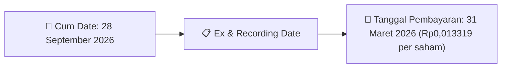
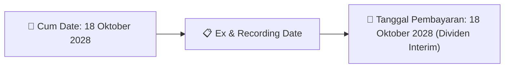
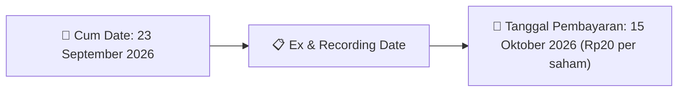
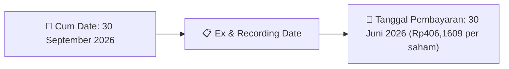

# Ikhtisar Pasar Harian (Daily Digest) - 2026-09-21

📅 **2026-09-21 (Daily Digest)**

## 1. Radar Pasar & Sentimen Harian (Executive Dashboard)
> [!NOTE]
> Terdeteksi sebanyak **156 pengumuman baru** dari 56 emiten pantauan pada (2026-09-21).

| Metric | Jumlah | Status Radar |
| :--- | :---: | :--- |
| **🟢 Sentimen Bullish / Positif** | `5` | [[Dividen Interim]], [[Mandatory Tender Offer]], Kinerja Positif |
| **⚪ Sentimen Netral / Routine** | `76` | [[Tanggapan Penjelasan Bursa]], [[RUPS]], [[Pendaftaran Unit]] |
| **🔴 Sentimen Bearish / Alert** | `0` | Sengketa Hukum, Defisit / Gugatan (Nihil hari ini) |
| **📄 [[Laporan Keuangan]] Baru** | `6` | Memicu Analisis Keuangan Otomatis |

> [!IMPORTANT]
> **Ditemukan Laporan Keuangan Baru Hari Ini:**
> - **MEDC**: FinancialStatement-2026-II-MEDC ([Buka PDF](file:///g:/My Drive/Model2/reports/raw/MEDC/20260921_MEDC_FinancialStatement-2026-II-MEDC.pdf))
- **MEDC**: FinancialStatement-2026-II-MEDC. ([Buka PDF](file:///g:/My Drive/Model2/reports/raw/MEDC/20260921_MEDC_FinancialStatement-2026-II-MEDC.xlsx))
- **AMMN**: FinancialStatement-2026-II-AMMN ([Buka PDF](file:///g:/My Drive/Model2/reports/raw/AMMN/20260921_AMMN_FinancialStatement-2026-II-AMMN.pdf))
- **AMMN**: AMMN - Penyampaian Laporan Keuangan Q226 ([Buka PDF](file:///g:/My Drive/Model2/reports/raw/AMMN/20260921_AMMN_AMMN - Penyampaian Laporan Keuangan Q226.pdf))
- **AMMN**: FinancialStatement-2026-II-AMMN. ([Buka PDF](file:///g:/My Drive/Model2/reports/raw/AMMN/20260921_AMMN_FinancialStatement-2026-II-AMMN.xlsx))
- **AMMN**: FS - PT AMI Tbk - 30 June 2026 ([Buka PDF](file:///g:/My Drive/Model2/reports/raw/AMMN/20260921_AMMN_FS - PT AMI Tbk - 30 June 2026.pdf))
> 
> *Tugas Swarm Agent:* Lakukan analisis laporan keuangan mendalam per emiten secara terpisah untuk berkas-berkas di atas.

---

## 2. Sorotan Utama & Watchlist Strategis (Strategic Watchlist)
#### 💰 Watchlist Dividen & Distribution
- **[[HEXA]]**: Nominal Dividen = Rp0,013319 per saham
- **[[HEXA]]**: Total Dividen = Rp11.187.960
- **[[HEXA]]**: Cum Date = 28 September 2026
- **[[HEXA]]**: Ex Date = 29 September 2026
- **[[HEXA]]**: Recording Date = 25 September 2026
- **[[HEXA]]**: Tanggal Pembayaran = 31 Maret 2026

#### 🎯 Watchlist Penawaran Tender Wajib (MTO) & Strategis
- **[[KETR]]**: Pengendali = [[Tidak]]

#### 📈 Watchlist Konversi Waran & Potensi Dilusi
- **[[INET]]**: Jumlah Waran Dikonversi = 21,880 lembar
- **[[INET]]**: Jumlah Saham Setelah Konversi = 22,377,832,142 lembar
- **[[INET]]**: Sisa Waran = 21,880 lembar
- **[[ISAP]]**: Jumlah Waran Dikonversi = 6 lembar
- **[[ISAP]]**: Jumlah Saham Setelah Konversi = 4,020,377,758 lembar
- **[[ISAP]]**: Sisa Waran = 6 lembar

#### 👥 Watchlist Transaksi Orang Dalam & Kepemilikan Saham (Insider / Repo Moves)
- **[[NSSS]]**: Nama Insider = SAMUEL SEKURITAS INDONESIA
- **[[NSSS]]**: Nama Insider = SAMUEL TUMBUH BERSAMA
- **[[NSSS]]**: Nama Insider = SAMUEL TUMBUH BERSAMA
- **[[CYBR]]**: Nama Insider = DONI MORA SE
- **[[CYBR]]**: Nama Insider = PATRICK RUDOLF DANNACHER
- **[[BKSL]]**: Nama Insider = SAMUEL SEKURITAS INDONESIA
- **[[FILM]]**: Nama Insider = SAMUEL SEKURITAS INDONESIA
- **[[MDLA]]**: Nama Insider = EDBERT OROTODAN

---

## 3. Matriks Pengumuman Pasar (Announcements Intelligence Table)
| Emiten | Sentimen | Jenis Pengumuman | Judul Pengumuman | Berkas |
| :--- | :---: | :--- | :--- | :--- |
| **[[HEXA]]** | 🟢 BULLISH | Dividen | Keterbukaan Informasi terkait Aksi Korporasi | [Utama](file:///g:/My%20Drive/Model2/reports/raw/HEXA/20260921_HEXA_20260921_HEXA_Keterbukaan Informasi terkait Aksi Korporasi_32150002.pdf) |
| **[[INET]]** | ⚪ NEUTRAL | Aksi Korporasi | Pencatatan Saham Tambahan dari Konversi | [Utama](file:///g:/My%20Drive/Model2/reports/raw/INET/20260921_INET_20260921_INET_Pencatatan Saham Tambahan dari Konversi_32150031.pdf) |
| **[[ISAP]]** | ⚪ NEUTRAL | Aksi Korporasi | Pencatatan Saham Tambahan dari Konversi | [Utama](file:///g:/My%20Drive/Model2/reports/raw/ISAP/20260921_ISAP_20260921_ISAP_Pencatatan Saham Tambahan dari Konversi_32150021.pdf) |
| **[[MREI]]** | ⚪ NEUTRAL | Aksi Korporasi | Laporan Informasi dan Fakta Material | [Utama](file:///g:/My%20Drive/Model2/reports/raw/MREI/20260921_MREI_20260921_MREI_Laporan Informasi dan Fakta Material_32150025.pdf) · [Lamp 1](file:///g:/My%20Drive/Model2/reports/raw/MREI/20260921_MREI_20260921_MREI_Laporan Informasi dan Fakta Material_32150025_lamp1.pdf) · [Lamp 2](file:///g:/My%20Drive/Model2/reports/raw/MREI/20260921_MREI_20260921_MREI_Laporan Informasi dan Fakta Material_32150025_lamp2.pdf) |
| **[[MGNA]]** | ⚪ NEUTRAL | Aksi Korporasi | Pencatatan Saham Tambahan dari Konversi | [Utama](file:///g:/My%20Drive/Model2/reports/raw/MGNA/20260921_MGNA_20260921_MGNA_Pencatatan Saham Tambahan dari Konversi_32150034.pdf) |
| **[[PSSI]]** | ⚪ NEUTRAL | Aksi Korporasi | Laporan Informasi dan Fakta Material | [Utama](file:///g:/My%20Drive/Model2/reports/raw/PSSI/20260921_PSSI_20260921_PSSI_Laporan Informasi dan Fakta Material_32150059.pdf) · [Lamp 3](file:///g:/My%20Drive/Model2/reports/raw/PSSI/20260921_PSSI_20260921_PSSI_Laporan Informasi dan Fakta Material_32150059_lamp3.pdf) · [Lamp 4](file:///g:/My%20Drive/Model2/reports/raw/PSSI/20260921_PSSI_20260921_PSSI_Laporan Informasi dan Fakta Material_32150059_lamp4.pdf) |
| **[[PSSI]]** | ⚪ NEUTRAL | RUPS | Pengumuman RUPS | [Utama](file:///g:/My%20Drive/Model2/reports/raw/PSSI/20260921_PSSI_20260921_PSSI_Pengumuman RUPS_32150049.pdf) · [Lamp 1](file:///g:/My%20Drive/Model2/reports/raw/PSSI/20260921_PSSI_20260921_PSSI_Pengumuman RUPS_32150049_lamp1.pdf) |
| **[[NSSS]]** | ⚪ NEUTRAL | Kepemilikan Saham (Insider) | LK-21092026-7501-00 | [Utama](file:///g:/My%20Drive/Model2/reports/raw/NSSS/20260921_NSSS_LK-21092026-7501-00.pdf) |
| **[[NSSS]]** | ⚪ NEUTRAL | Kepemilikan Saham (Insider) | LK-21092026-6242-00 | [Utama](file:///g:/My%20Drive/Model2/reports/raw/NSSS/20260921_NSSS_LK-21092026-6242-00.pdf) |
| **[[NSSS]]** | ⚪ NEUTRAL | Kepemilikan Saham (Insider) | LK-21092026-2472-00 | [Utama](file:///g:/My%20Drive/Model2/reports/raw/NSSS/20260921_NSSS_LK-21092026-2472-00.pdf) |
| **[[CYBR]]** | ⚪ NEUTRAL | Aksi Korporasi | Pencatatan Saham Tambahan dari Konversi | [Utama](file:///g:/My%20Drive/Model2/reports/raw/CYBR/20260921_CYBR_20260921_CYBR_Pencatatan Saham Tambahan dari Konversi_32150040.pdf) |
| **[[CYBR]]** | ⚪ NEUTRAL | Kepemilikan Saham (Insider) | LK-21092026-0586-00 | [Utama](file:///g:/My%20Drive/Model2/reports/raw/CYBR/20260921_CYBR_LK-21092026-0586-00.pdf) |
| **[[CYBR]]** | ⚪ NEUTRAL | Kepemilikan Saham (Insider) | LK-21092026-1557-00 | [Utama](file:///g:/My%20Drive/Model2/reports/raw/CYBR/20260921_CYBR_LK-21092026-1557-00.pdf) |
| **[[DNRK]]** | ⚪ NEUTRAL | Aksi Korporasi | Pembayaran KuponBagi HasilIjarahPokok | [Utama](file:///g:/My%20Drive/Model2/reports/raw/DNRK/20260921_DNRK_20260921_DNRK_Pembayaran KuponBagi HasilIjarahPokok_32150171.pdf) |
| **[[DJPU]]** | ⚪ NEUTRAL | Aksi Korporasi | Pengumuman Pencatatan Awal Obligasi dan Sukuk | [Utama](file:///g:/My%20Drive/Model2/reports/raw/DJPU/20260921_DJPU_20260921_DJPU_Pengumuman Pencatatan Awal Obligasi dan Sukuk_32150094.pdf) |
| **[[PACK]]** | ⚪ NEUTRAL | Aksi Korporasi | Pencatatan Saham Tambahan dari Konversi | [Utama](file:///g:/My%20Drive/Model2/reports/raw/PACK/20260921_PACK_20260921_PACK_Pencatatan Saham Tambahan dari Konversi_32150016.pdf) |
| **[[BSDE]]** | ⚪ NEUTRAL | Aksi Korporasi | Pembayaran KuponBagi HasilIjarahPokok | [Utama](file:///g:/My%20Drive/Model2/reports/raw/BSDE/20260921_BSDE_20260921_BSDE_Pembayaran KuponBagi HasilIjarahPokok_32150097.pdf) |
| **[[VISI]]** | ⚪ NEUTRAL | Aksi Korporasi | Tanggapan atas Permintaan Penjelasan Bursa | [Utama](file:///g:/My%20Drive/Model2/reports/raw/VISI/20260921_VISI_20260921_VISI_Tanggapan atas Permintaan Penjelasan Bursa_32150051.pdf) · [Lamp 1](file:///g:/My%20Drive/Model2/reports/raw/VISI/20260921_VISI_20260921_VISI_Tanggapan atas Permintaan Penjelasan Bursa_32150051_lamp1.pdf) |
| **[[WIKA]]** | ⚪ NEUTRAL | RUPS | Pemberitahuan RencanaPenyampaian PanggilanHasil RUPORUPSURUP EBA-SP | [Utama](file:///g:/My%20Drive/Model2/reports/raw/WIKA/20260921_WIKA_20260921_WIKA_Pemberitahuan RencanaPenyampaian PanggilanHasil RUPORUPSURUP EBA-SP_32149987.pdf) · [Lamp 1](file:///g:/My%20Drive/Model2/reports/raw/WIKA/20260921_WIKA_20260921_WIKA_Pemberitahuan RencanaPenyampaian PanggilanHasil RUPORUPSURUP EBA-SP_32149995_lamp1.pdf) · [Lamp 1](file:///g:/My%20Drive/Model2/reports/raw/WIKA/20260921_WIKA_20260921_WIKA_Pemberitahuan RencanaPenyampaian PanggilanHasil RUPORUPSURUP EBA-SP_32149994_lamp1.pdf) · [Lamp 1](file:///g:/My%20Drive/Model2/reports/raw/WIKA/20260921_WIKA_20260921_WIKA_Pemberitahuan RencanaPenyampaian PanggilanHasil RUPORUPSURUP EBA-SP_32149992_lamp1.pdf) · [Lamp 1](file:///g:/My%20Drive/Model2/reports/raw/WIKA/20260921_WIKA_20260921_WIKA_Pemberitahuan RencanaPenyampaian PanggilanHasil RUPORUPSURUP EBA-SP_32149991_lamp1.pdf) · [Lamp 1](file:///g:/My%20Drive/Model2/reports/raw/WIKA/20260921_WIKA_20260921_WIKA_Pemberitahuan RencanaPenyampaian PanggilanHasil RUPORUPSURUP EBA-SP_32149989_lamp1.pdf) · [Lamp 1](file:///g:/My%20Drive/Model2/reports/raw/WIKA/20260921_WIKA_20260921_WIKA_Pemberitahuan RencanaPenyampaian PanggilanHasil RUPORUPSURUP EBA-SP_32149987_lamp1.pdf) |
| **[[TMPO]]** | ⚪ NEUTRAL | Aksi Korporasi | Pengumuman Bursa | [Utama](file:///g:/My%20Drive/Model2/reports/raw/TMPO/20260921_TMPO_20260921_TMPO_Pengumuman Bursa_32149930.pdf) |
| **[[BKSL]]** | ⚪ NEUTRAL | Kepemilikan Saham (Insider) | LK-21092026-9029-00 | [Utama](file:///g:/My%20Drive/Model2/reports/raw/BKSL/20260921_BKSL_LK-21092026-9029-00.pdf) |
| **[[FILM]]** | ⚪ NEUTRAL | Kepemilikan Saham (Insider) | LK-21092026-5719-00 | [Utama](file:///g:/My%20Drive/Model2/reports/raw/FILM/20260921_FILM_LK-21092026-5719-00.pdf) |
| **[[MDLA]]** | ⚪ NEUTRAL | Kepemilikan Saham (Insider) | LK-21092026-8484-00 | [Utama](file:///g:/My%20Drive/Model2/reports/raw/MDLA/20260921_MDLA_LK-21092026-8484-00.pdf) |
| **[[SDRA]]** | ⚪ NEUTRAL | Aksi Korporasi | Laporan Informasi dan Fakta Material | [Utama](file:///g:/My%20Drive/Model2/reports/raw/SDRA/20260921_SDRA_20260921_SDRA_Laporan Informasi dan Fakta Material_32150127.pdf) |
| **[[JSMR]]** | ⚪ NEUTRAL | Aksi Korporasi | Informasi Transaksi Afiliasi | [Utama](file:///g:/My%20Drive/Model2/reports/raw/JSMR/20260921_JSMR_20260921_JSMR_Informasi Transaksi Afiliasi_32150173.pdf) · [Lamp 4](file:///g:/My%20Drive/Model2/reports/raw/JSMR/20260921_JSMR_20260921_JSMR_Informasi Transaksi Afiliasi_32150173_lamp4.pdf) · [Lamp 5](file:///g:/My%20Drive/Model2/reports/raw/JSMR/20260921_JSMR_20260921_JSMR_Informasi Transaksi Afiliasi_32150173_lamp5.pdf) · [Lamp 1](file:///g:/My%20Drive/Model2/reports/raw/JSMR/20260921_JSMR_20260921_JSMR_Informasi Transaksi Afiliasi_32150173_lamp1.pdf) · [Lamp 3](file:///g:/My%20Drive/Model2/reports/raw/JSMR/20260921_JSMR_20260921_JSMR_Informasi Transaksi Afiliasi_32150173_lamp3.pdf) |
| **[[PYFA]]** | ⚪ NEUTRAL | Aksi Korporasi | Pencatatan Saham Tambahan dari Konversi | [Utama](file:///g:/My%20Drive/Model2/reports/raw/PYFA/20260921_PYFA_20260921_PYFA_Pencatatan Saham Tambahan dari Konversi_32150053.pdf) |
| **[[PYFA]]** | ⚪ NEUTRAL | RUPS | Pemberitahuan RencanaPenyampaian PanggilanHasil RUPORUPSURUP EBA-SP | [Utama](file:///g:/My%20Drive/Model2/reports/raw/PYFA/20260921_PYFA_20260921_PYFA_Pemberitahuan RencanaPenyampaian PanggilanHasil RUPORUPSURUP EBA-SP_32150043.pdf) · [Lamp 1](file:///g:/My%20Drive/Model2/reports/raw/PYFA/20260921_PYFA_20260921_PYFA_Pemberitahuan RencanaPenyampaian PanggilanHasil RUPORUPSURUP EBA-SP_32150043_lamp1.pdf) |
| **[[UNSP]]** | ⚪ NEUTRAL | Aksi Korporasi | Tanggapan atas Permintaan Penjelasan Bursa | [Utama](file:///g:/My%20Drive/Model2/reports/raw/UNSP/20260921_UNSP_20260921_UNSP_Tanggapan atas Permintaan Penjelasan Bursa_32149997.pdf) · [Lamp 1](file:///g:/My%20Drive/Model2/reports/raw/UNSP/20260921_UNSP_20260921_UNSP_Tanggapan atas Permintaan Penjelasan Bursa_32149997_lamp1.pdf) |
| **[[PGEO]]** | ⚪ NEUTRAL | Aksi Korporasi | Pencatatan Saham Tambahan dari Konversi | [Utama](file:///g:/My%20Drive/Model2/reports/raw/PGEO/20260921_PGEO_20260921_PGEO_Pencatatan Saham Tambahan dari Konversi_32150014.pdf) |
| **[[JECX]]** | ⚪ NEUTRAL | Kepemilikan Saham (Insider) | LK-21092026-7121-00 | [Utama](file:///g:/My%20Drive/Model2/reports/raw/JECX/20260921_JECX_LK-21092026-7121-00.pdf) |
| **[[JECX]]** | ⚪ NEUTRAL | Aksi Korporasi | Laporan Informasi dan Fakta Material | [Utama](file:///g:/My%20Drive/Model2/reports/raw/JECX/20260921_JECX_20260921_JECX_Laporan Informasi dan Fakta Material_32149922.pdf) · [Lamp 1](file:///g:/My%20Drive/Model2/reports/raw/JECX/20260921_JECX_20260921_JECX_Laporan Informasi dan Fakta Material_32149922_lamp1.pdf) |
| **[[UCID]]** | ⚪ NEUTRAL | RUPS | Pemanggilan RUPS | [Utama](file:///g:/My%20Drive/Model2/reports/raw/UCID/20260922_UCID_20260921_UCID_Pemanggilan RUPS_32149952.pdf) · [Lamp 1](file:///g:/My%20Drive/Model2/reports/raw/UCID/20260922_UCID_20260921_UCID_Pemanggilan RUPS_32149952_lamp1.pdf) |
| **[[BTPS]]** | ⚪ NEUTRAL | RUPS | Pemanggilan RUPS | [Utama](file:///g:/My%20Drive/Model2/reports/raw/BTPS/20260921_BTPS_20260921_BTPS_Pemanggilan RUPS_32150146.pdf) · [Lamp 5](file:///g:/My%20Drive/Model2/reports/raw/BTPS/20260921_BTPS_20260921_BTPS_Pemanggilan RUPS_32150146_lamp5.pdf) · [Lamp 6](file:///g:/My%20Drive/Model2/reports/raw/BTPS/20260921_BTPS_20260921_BTPS_Pemanggilan RUPS_32150146_lamp6.pdf) · [Lamp 2](file:///g:/My%20Drive/Model2/reports/raw/BTPS/20260921_BTPS_20260921_BTPS_Pemanggilan RUPS_32150146_lamp2.pdf) · [Lamp 8](file:///g:/My%20Drive/Model2/reports/raw/BTPS/20260921_BTPS_20260921_BTPS_Pemanggilan RUPS_32150146_lamp8.pdf) · [Lamp 3](file:///g:/My%20Drive/Model2/reports/raw/BTPS/20260921_BTPS_20260921_BTPS_Pemanggilan RUPS_32150146_lamp3.pdf) · [Lamp 7](file:///g:/My%20Drive/Model2/reports/raw/BTPS/20260921_BTPS_20260921_BTPS_Pemanggilan RUPS_32150146_lamp7.pdf) · [Lamp 4](file:///g:/My%20Drive/Model2/reports/raw/BTPS/20260921_BTPS_20260921_BTPS_Pemanggilan RUPS_32150146_lamp4.pdf) |
| **[[TCPI]]** | ⚪ NEUTRAL | Kepemilikan Saham (Insider) | LK-21092026-9960-00 | [Utama](file:///g:/My%20Drive/Model2/reports/raw/TCPI/20260921_TCPI_LK-21092026-9960-00.pdf) |
| **[[PNBS]]** | ⚪ NEUTRAL | Aksi Korporasi | Laporan Informasi dan Fakta Material | [Utama](file:///g:/My%20Drive/Model2/reports/raw/PNBS/20260921_PNBS_20260921_PNBS_Laporan Informasi dan Fakta Material_32149938.pdf) · [Lamp 2](file:///g:/My%20Drive/Model2/reports/raw/PNBS/20260921_PNBS_20260921_PNBS_Laporan Informasi dan Fakta Material_32149938_lamp2.pdf) · [Lamp 3](file:///g:/My%20Drive/Model2/reports/raw/PNBS/20260921_PNBS_20260921_PNBS_Laporan Informasi dan Fakta Material_32149938_lamp3.pdf) |
| **[[GMFI]]** | ⚪ NEUTRAL | Kepemilikan Saham (Insider) | LK-21092026-7719-00 | [Utama](file:///g:/My%20Drive/Model2/reports/raw/GMFI/20260921_GMFI_LK-21092026-7719-00.pdf) |
| **[[KOCI]]** | ⚪ NEUTRAL | Aksi Korporasi | Pencatatan Saham Tambahan dari Konversi | [Utama](file:///g:/My%20Drive/Model2/reports/raw/KOCI/20260921_KOCI_20260921_KOCI_Pencatatan Saham Tambahan dari Konversi_32149959.pdf) · [Lamp 1](file:///g:/My%20Drive/Model2/reports/raw/KOCI/20260921_KOCI_20260921_KOCI_Pencatatan Saham Tambahan dari Konversi_32149959_lamp1.pdf) |
| **[[REAL]]** | ⚪ NEUTRAL | Kepemilikan Saham (Insider) | LK-21092026-0949-00 | [Utama](file:///g:/My%20Drive/Model2/reports/raw/REAL/20260921_REAL_LK-21092026-0949-00.pdf) |
| **[[KETR]]** | ⚪ NEUTRAL | Kepemilikan Saham (Insider) | LK-21092026-7205-00 | [Utama](file:///g:/My%20Drive/Model2/reports/raw/KETR/20260921_KETR_LK-21092026-7205-00.pdf) |
| **[[KETR]]** | ⚪ NEUTRAL | Kepemilikan Saham (Insider) | LK-21092026-4165-00 | [Utama](file:///g:/My%20Drive/Model2/reports/raw/KETR/20260921_KETR_LK-21092026-4165-00.pdf) |
| **[[WSKT]]** | ⚪ NEUTRAL | Aksi Korporasi | Perubahan Perjanjian Perwaliamanatan | [Utama](file:///g:/My%20Drive/Model2/reports/raw/WSKT/20260921_WSKT_20260921_WSKT_Perubahan Perjanjian Perwaliamanatan_32150057.pdf) · [Lamp 1](file:///g:/My%20Drive/Model2/reports/raw/WSKT/20260921_WSKT_20260921_WSKT_Perubahan Perjanjian Perwaliamanatan_32150183_lamp1.pdf) · [Lamp 1](file:///g:/My%20Drive/Model2/reports/raw/WSKT/20260921_WSKT_20260921_WSKT_Perubahan Perjanjian Perwaliamanatan_32150057_lamp1.pdf) |
| **[[AIMS]]** | ⚪ NEUTRAL | Public Expose | Public Expose | [Utama](file:///g:/My%20Drive/Model2/reports/raw/AIMS/20260921_AIMS_20260921_AIMS_Public Expose_32150101.pdf) · [Lamp 1](file:///g:/My%20Drive/Model2/reports/raw/AIMS/20260921_AIMS_20260921_AIMS_Public Expose_32150101_lamp1.pdf) |
| **[[AIMS]]** | 🟢 BULLISH | Dividen | Ringkasan RisalahRisalah RUPS | [Utama](file:///g:/My%20Drive/Model2/reports/raw/AIMS/20260921_AIMS_20260921_AIMS_Ringkasan RisalahRisalah RUPS_32150086.pdf) · [Lamp 5](file:///g:/My%20Drive/Model2/reports/raw/AIMS/20260921_AIMS_20260921_AIMS_Ringkasan RisalahRisalah RUPS_32150086_lamp5.pdf) · [Lamp 4](file:///g:/My%20Drive/Model2/reports/raw/AIMS/20260921_AIMS_20260921_AIMS_Ringkasan RisalahRisalah RUPS_32150086_lamp4.pdf) · [Lamp 2](file:///g:/My%20Drive/Model2/reports/raw/AIMS/20260921_AIMS_20260921_AIMS_Ringkasan RisalahRisalah RUPS_32150086_lamp2.pdf) · [Lamp 3](file:///g:/My%20Drive/Model2/reports/raw/AIMS/20260921_AIMS_20260921_AIMS_Ringkasan RisalahRisalah RUPS_32150086_lamp3.pdf) · [Lamp 6](file:///g:/My%20Drive/Model2/reports/raw/AIMS/20260921_AIMS_20260921_AIMS_Ringkasan RisalahRisalah RUPS_32150086_lamp6.pdf) · [Lamp 1](file:///g:/My%20Drive/Model2/reports/raw/AIMS/20260921_AIMS_20260921_AIMS_Ringkasan RisalahRisalah RUPS_32150086_lamp1.pdf) |
| **[[KKGI]]** | 🟢 BULLISH | Dividen | Keterbukaan Informasi terkait Aksi Korporasi | [Utama](file:///g:/My%20Drive/Model2/reports/raw/KKGI/20260921_KKGI_20260921_KKGI_Keterbukaan Informasi terkait Aksi Korporasi_32150022.pdf) |
| **[[FORU]]** | ⚪ NEUTRAL | Aksi Korporasi | Peng-Harga Teoretis FORU 260921-.POP09-2026 | [Utama](file:///g:/My%20Drive/Model2/reports/raw/FORU/20260921_FORU_Peng-Harga Teoretis FORU 260921-No. Peng-00174BEI.POP09-2026.pdf) |
| **[[UANG]]** | ⚪ NEUTRAL | Aksi Korporasi | Perubahan Corsec Komite Audit Alamat NPWP Internal Audit | [Utama](file:///g:/My%20Drive/Model2/reports/raw/UANG/20260921_UANG_20260921_UANG_Perubahan Corsec Komite Audit Alamat NPWP Internal Audit_32150162.pdf) |
| **[[SAFE]]** | ⚪ NEUTRAL | Kepemilikan Saham (Insider) | LK-21092026-7514-00 | [Utama](file:///g:/My%20Drive/Model2/reports/raw/SAFE/20260921_SAFE_LK-21092026-7514-00.pdf) |
| **[[SAFE]]** | ⚪ NEUTRAL | Kepemilikan Saham (Insider) | LK-21092026-1402-00 | [Utama](file:///g:/My%20Drive/Model2/reports/raw/SAFE/20260921_SAFE_LK-21092026-1402-00.pdf) |
| **[[SAFE]]** | ⚪ NEUTRAL | Kepemilikan Saham (Insider) | LK-21092026-5017-00 | [Utama](file:///g:/My%20Drive/Model2/reports/raw/SAFE/20260921_SAFE_LK-21092026-5017-00.pdf) |
| **[[MEDC]]** | 🟢 BULLISH | Laporan Keuangan | FinancialStatement-2026-II-MEDC | [Utama](file:///g:/My%20Drive/Model2/reports/raw/MEDC/20260921_MEDC_FinancialStatement-2026-II-MEDC.pdf) |
| **[[MEDC]]** | ⚪ NEUTRAL | Aksi Korporasi | Checklist Pengungkapan Lapkeu - 30 June 2026 | [Utama](file:///g:/My%20Drive/Model2/reports/raw/MEDC/20260921_MEDC_Checklist Pengungkapan Lapkeu - 30 June 2026.pdf) |
| **[[MEDC]]** | ⚪ NEUTRAL | Aksi Korporasi | Cover Letter Lap Keu 30 Juni 2026 | [Utama](file:///g:/My%20Drive/Model2/reports/raw/MEDC/20260921_MEDC_Cover Letter Lap Keu 30 Juni 2026.pdf) |
| **[[MEDC]]** | ⚪ NEUTRAL | Laporan Keuangan | FinancialStatement-2026-II-MEDC. | [Utama](file:///g:/My%20Drive/Model2/reports/raw/MEDC/20260921_MEDC_FinancialStatement-2026-II-MEDC.xlsx) |
| **[[MEDC]]** | ⚪ NEUTRAL | Aksi Korporasi | Lap Keu 30 Juni 2026 | [Utama](file:///g:/My%20Drive/Model2/reports/raw/MEDC/20260921_MEDC_Lap Keu 30_Juni 2026_MEDC.pdf) |
| **[[MEDC]]** | ⚪ NEUTRAL | Public Expose | Press Release MedcoEnergi First Half 2026 Results | [Utama](file:///g:/My%20Drive/Model2/reports/raw/MEDC/20260921_MEDC_Press Release_MedcoEnergi First Half 2026 Results.pdf) |
| **[[MEDC]]** | ⚪ NEUTRAL | Public Expose | Siaran Pers MedcoEnergi Kinerja Semester I 2026 | [Utama](file:///g:/My%20Drive/Model2/reports/raw/MEDC/20260921_MEDC_Siaran Pers MedcoEnergi Kinerja Semester I 2026.pdf) |
| **[[MEDC]]** | ⚪ NEUTRAL | Aksi Korporasi | Surat Pernyataan Direksi 30 Juni 2026 | [Utama](file:///g:/My%20Drive/Model2/reports/raw/MEDC/20260921_MEDC_Surat Pernyataan Direksi 30 Juni 2026.pdf) |
| **[[AMMN]]** | ⚪ NEUTRAL | Laporan Keuangan | FinancialStatement-2026-II-AMMN | [Utama](file:///g:/My%20Drive/Model2/reports/raw/AMMN/20260921_AMMN_FinancialStatement-2026-II-AMMN.pdf) |
| **[[AMMN]]** | ⚪ NEUTRAL | Laporan Keuangan | AMMN - Penyampaian Laporan Keuangan Q226 | [Utama](file:///g:/My%20Drive/Model2/reports/raw/AMMN/20260921_AMMN_AMMN - Penyampaian Laporan Keuangan Q226.pdf) |
| **[[AMMN]]** | ⚪ NEUTRAL | Laporan Keuangan | FinancialStatement-2026-II-AMMN. | [Utama](file:///g:/My%20Drive/Model2/reports/raw/AMMN/20260921_AMMN_FinancialStatement-2026-II-AMMN.xlsx) |
| **[[AMMN]]** | ⚪ NEUTRAL | Laporan Keuangan | FS - PT AMI Tbk - 30 June 2026 | [Utama](file:///g:/My%20Drive/Model2/reports/raw/AMMN/20260921_AMMN_FS - PT AMI Tbk - 30 June 2026.pdf) |
| **[[AMMN]]** | ⚪ NEUTRAL | Aksi Korporasi | Laporan Informasi dan Fakta Material | [Utama](file:///g:/My%20Drive/Model2/reports/raw/AMMN/20260921_AMMN_20260921_AMMN_Laporan Informasi dan Fakta Material_32149929.pdf) · [Lamp 2](file:///g:/My%20Drive/Model2/reports/raw/AMMN/20260921_AMMN_20260921_AMMN_Laporan Informasi dan Fakta Material_32149929_lamp2.pdf) · [Lamp 1](file:///g:/My%20Drive/Model2/reports/raw/AMMN/20260921_AMMN_20260921_AMMN_Laporan Informasi dan Fakta Material_32149929_lamp1.pdf) |
| **[[RLCO]]** | ⚪ NEUTRAL | Kepemilikan Saham (Insider) | LK-21092026-4729-00 | [Utama](file:///g:/My%20Drive/Model2/reports/raw/RLCO/20260921_RLCO_LK-21092026-4729-00.pdf) |
| **[[RLCO]]** | ⚪ NEUTRAL | Kepemilikan Saham (Insider) | LK-21092026-0754-00 | [Utama](file:///g:/My%20Drive/Model2/reports/raw/RLCO/20260921_RLCO_LK-21092026-0754-00.pdf) |
| **[[MNCN]]** | ⚪ NEUTRAL | Aksi Korporasi | Tanggapan atas Permintaan Penjelasan Bursa | [Utama](file:///g:/My%20Drive/Model2/reports/raw/MNCN/20260921_MNCN_20260921_MNCN_Tanggapan atas Permintaan Penjelasan Bursa_32149996.pdf) |
| **[[PPGL]]** | ⚪ NEUTRAL | Aksi Korporasi | Laporan Informasi dan Fakta Material | [Utama](file:///g:/My%20Drive/Model2/reports/raw/PPGL/20260921_PPGL_20260921_PPGL_Laporan Informasi dan Fakta Material_32150182.pdf) · [Lamp 1](file:///g:/My%20Drive/Model2/reports/raw/PPGL/20260921_PPGL_20260921_PPGL_Laporan Informasi dan Fakta Material_32150182_lamp1.pdf) |
| **[[TRUE]]** | ⚪ NEUTRAL | Aksi Korporasi | ESG2025-TRUE | [Utama](file:///g:/My%20Drive/Model2/reports/raw/TRUE/20260921_TRUE_ESG2025-TRUE.pdf) |
| **[[TRUE]]** | ⚪ NEUTRAL | Aksi Korporasi | AnnualReport2025-TRUE-att1 | [Utama](file:///g:/My%20Drive/Model2/reports/raw/TRUE/20260921_TRUE_AnnualReport2025-TRUE-att1.pdf) |
| **[[YELO]]** | ⚪ NEUTRAL | RUPS | Ringkasan RisalahRisalah RUPS | [Utama](file:///g:/My%20Drive/Model2/reports/raw/YELO/20260921_YELO_20260921_YELO_Ringkasan RisalahRisalah RUPS_32150091.pdf) |
| **[[FIFA]]** | ⚪ NEUTRAL | Aksi Korporasi | Pengumuman Jatuh Tempo Obligasi dan Sukuk | [Utama](file:///g:/My%20Drive/Model2/reports/raw/FIFA/20260921_FIFA_20260921_FIFA_Pengumuman Jatuh Tempo Obligasi dan Sukuk_32149924.pdf) · [Lamp 1](file:///g:/My%20Drive/Model2/reports/raw/FIFA/20260921_FIFA_20260921_FIFA_Pengumuman Jatuh Tempo Obligasi dan Sukuk_32149924_lamp1.pdf) |
| **[[VICI]]** | ⚪ NEUTRAL | Public Expose | Public Expose | [Utama](file:///g:/My%20Drive/Model2/reports/raw/VICI/20260921_VICI_20260921_VICI_Public Expose_32149988.pdf) · [Lamp 2](file:///g:/My%20Drive/Model2/reports/raw/VICI/20260921_VICI_20260921_VICI_Public Expose_32149988_lamp2.pdf) |
| **[[TNCA]]** | ⚪ NEUTRAL | Aksi Korporasi | Perubahan Corsec Komite Audit Alamat NPWP Internal Audit | [Utama](file:///g:/My%20Drive/Model2/reports/raw/TNCA/20260921_TNCA_20260921_TNCA_Perubahan Corsec Komite Audit Alamat NPWP Internal Audit_32150015.pdf) |
| **[[CPIN]]** | ⚪ NEUTRAL | Kepemilikan Saham (Insider) | LK-21092026-2312-00 | [Utama](file:///g:/My%20Drive/Model2/reports/raw/CPIN/20260921_CPIN_LK-21092026-2312-00.pdf) |
| **[[CPIN]]** | ⚪ NEUTRAL | Kepemilikan Saham (Insider) | LK-21092026-2278-00 | [Utama](file:///g:/My%20Drive/Model2/reports/raw/CPIN/20260921_CPIN_LK-21092026-2278-00.pdf) |
| **[[DYAN]]** | ⚪ NEUTRAL | Aksi Korporasi | Laporan Informasi dan Fakta Material | [Utama](file:///g:/My%20Drive/Model2/reports/raw/DYAN/20260921_DYAN_20260921_DYAN_Laporan Informasi dan Fakta Material_32150106.pdf) · [Lamp 1](file:///g:/My%20Drive/Model2/reports/raw/DYAN/20260921_DYAN_20260921_DYAN_Laporan Informasi dan Fakta Material_32150106_lamp1.pdf) |
| **[[BSSR]]** | 🟢 BULLISH | Dividen | Jadwal Aksi Korporasi (Khusus Penyampaian Dividen Interim) | [Utama](file:///g:/My%20Drive/Model2/reports/raw/BSSR/20260921_BSSR_20260921_BSSR_Jadwal Aksi Korporasi (Khusus Penyampaian Dividen Interim)_32150093.pdf) |
| **[[CANI]]** | ⚪ NEUTRAL | Aksi Korporasi | Tanggapan atas Permintaan Penjelasan Bursa | [Utama](file:///g:/My%20Drive/Model2/reports/raw/CANI/20260921_CANI_20260921_CANI_Tanggapan atas Permintaan Penjelasan Bursa_32150181.pdf) · [Lamp 1](file:///g:/My%20Drive/Model2/reports/raw/CANI/20260921_CANI_20260921_CANI_Tanggapan atas Permintaan Penjelasan Bursa_32150181_lamp1.pdf) |
| **[[VAST]]** | ⚪ NEUTRAL | Aksi Korporasi | Tanggapan atas Permintaan Penjelasan Bursa | [Utama](file:///g:/My%20Drive/Model2/reports/raw/VAST/20260921_VAST_20260921_VAST_Tanggapan atas Permintaan Penjelasan Bursa_32150184.pdf) · [Lamp 1](file:///g:/My%20Drive/Model2/reports/raw/VAST/20260921_VAST_20260921_VAST_Tanggapan atas Permintaan Penjelasan Bursa_32150184_lamp1.pdf) |
| **[[FORE]]** | ⚪ NEUTRAL | Kepemilikan Saham (Insider) | LK-21092026-0022-00 | [Utama](file:///g:/My%20Drive/Model2/reports/raw/FORE/20260921_FORE_LK-21092026-0022-00.pdf) |
| **[[KOPI]]** | ⚪ NEUTRAL | Aksi Korporasi | Tanggapan atas Permintaan Penjelasan Bursa | [Utama](file:///g:/My%20Drive/Model2/reports/raw/KOPI/20260921_KOPI_20260921_KOPI_Tanggapan atas Permintaan Penjelasan Bursa_32150004.pdf) |
| **[[MKPI]]** | ⚪ NEUTRAL | Kepemilikan Saham (Insider) | LK-21092026-7529-00 | [Utama](file:///g:/My%20Drive/Model2/reports/raw/MKPI/20260921_MKPI_LK-21092026-7529-00.pdf) |

---

## 4. Detail Informasi per Emiten (Grouped by Emiten)
### 📋 4.2. Detail Emiten Lain (Non-Watchlist)

#### 🔵 [[HEXA]]
- **[Dividen]** [Keterbukaan Informasi terkait Aksi Korporasi](file:///g:/My%20Drive/Model2/reports/raw/HEXA/20260921_HEXA_20260921_HEXA_Keterbukaan Informasi terkait Aksi Korporasi_32150002.pdf)
  - 📌 *Deskripsi*: Pembagian dividen tunai HEXA.
  - 📊 **Fakta Material**:
    - **Nominal Dividen**: Rp0,013319 per saham
    - **Total Dividen**: Rp11.187.960
    - **Cum Date**: 28 September 2026
    - **Ex Date**: 29 September 2026
    - **Recording Date**: 25 September 2026
    - **Tanggal Pembayaran**: 31 Maret 2026

#### 🔵 [[INET]]
- **[Aksi Korporasi]** [Pencatatan Saham Tambahan dari Konversi](file:///g:/My%20Drive/Model2/reports/raw/INET/20260921_INET_20260921_INET_Pencatatan Saham Tambahan dari Konversi_32150031.pdf)
  - 📌 *Deskripsi*: Pencatatan saham tambahan hasil konversi waran INET.
  - 📊 **Fakta Material**:
    - **Jumlah Waran Dikonversi**: 21,880 lembar
    - **Jumlah Saham Setelah Konversi**: 22,377,832,142 lembar
    - **Sisa Waran**: 21,880 lembar
    - **Tanggal Pencatatan**: 22 September 2026

#### 🔵 [[ISAP]]
- **[Aksi Korporasi]** [Pencatatan Saham Tambahan dari Konversi](file:///g:/My%20Drive/Model2/reports/raw/ISAP/20260921_ISAP_20260921_ISAP_Pencatatan Saham Tambahan dari Konversi_32150021.pdf)
  - 📌 *Deskripsi*: Pencatatan saham tambahan hasil konversi waran ISAP.
  - 📊 **Fakta Material**:
    - **Jumlah Waran Dikonversi**: 6 lembar
    - **Jumlah Saham Setelah Konversi**: 4,020,377,758 lembar
    - **Sisa Waran**: 6 lembar
    - **Tanggal Pencatatan**: 22 September 2026

#### 🔵 [[MREI]]
- **[Aksi Korporasi]** [Laporan Informasi dan Fakta Material](file:///g:/My%20Drive/Model2/reports/raw/MREI/20260921_MREI_20260921_MREI_Laporan Informasi dan Fakta Material_32150025.pdf) *(Attachment: [Lamp 1](file:///g:/My%20Drive/Model2/reports/raw/MREI/20260921_MREI_20260921_MREI_Laporan Informasi dan Fakta Material_32150025_lamp1.pdf) · [Lamp 2](file:///g:/My%20Drive/Model2/reports/raw/MREI/20260921_MREI_20260921_MREI_Laporan Informasi dan Fakta Material_32150025_lamp2.pdf))*
  - 📌 *Deskripsi*: Informasi dan fakta material MREI: Pasal Anggaran Dasar Sebelum Perubahan Setelah Perubahan Pasal 3 Ayat 2 Untuk mencapai maksud dan tujuan tersebut di atas, Perseroan dapat melaksanakan kegiatan usaha utama sebagai berikut: a. Reasuransi Konvensional Kelompok ini mencakup usaha reasuransi yang diselenggarakan secara konvensional, dengan kegiatan usaha meliputi usaha penyelenggaraan usaha jasa pertanggungan ulang terhadap risiko yang dihadapi oleh perusahaan asuransi, perusahaan penjaminan, atau perusahaan reasuransi lainnya. b.
  - 📊 **Fakta Material**:
    - **Uraian Kejadian**: Pasal Anggaran Dasar Sebelum Perubahan Setelah Perubahan Pasal 3 Ayat 2 Untuk mencapai maksud dan tujuan tersebut di atas, Perseroan dapat melaksanakan kegiatan usaha utama sebagai berikut: a. Reasuransi Konvensional Kelompok ini mencakup usaha reasuransi yang diselenggarakan secara konvensional, dengan kegiatan usaha meliputi usaha penyelenggaraan usaha jasa pertanggungan ulang terhadap risiko yang dihadapi oleh perusahaan asuransi, perusahaan penjaminan, atau perusahaan reasuransi lainnya. b.

#### 🔵 [[MGNA]]
- **[Aksi Korporasi]** [Pencatatan Saham Tambahan dari Konversi](file:///g:/My%20Drive/Model2/reports/raw/MGNA/20260921_MGNA_20260921_MGNA_Pencatatan Saham Tambahan dari Konversi_32150034.pdf)
  - 📌 *Deskripsi*: Pencatatan saham tambahan hasil konversi waran MGNA.
  - 📊 **Fakta Material**:
    - **Jumlah Waran Dikonversi**: 50,700 lembar
    - **Jumlah Saham Setelah Konversi**: 3,411,176,235 lembar
    - **Sisa Waran**: 50,700 lembar
    - **Tanggal Pencatatan**: 22 September 2026

#### 🔵 [[PSSI]]
- **[Aksi Korporasi]** [Laporan Informasi dan Fakta Material](file:///g:/My%20Drive/Model2/reports/raw/PSSI/20260921_PSSI_20260921_PSSI_Laporan Informasi dan Fakta Material_32150059.pdf) *(Attachment: [Lamp 3](file:///g:/My%20Drive/Model2/reports/raw/PSSI/20260921_PSSI_20260921_PSSI_Laporan Informasi dan Fakta Material_32150059_lamp3.pdf) · [Lamp 4](file:///g:/My%20Drive/Model2/reports/raw/PSSI/20260921_PSSI_20260921_PSSI_Laporan Informasi dan Fakta Material_32150059_lamp4.pdf))*
  - 📌 *Deskripsi*: Informasi dan fakta material PSSI: 1 INFORMATION DISCLOSURE TO THE SHAREHOLDERS OF PT IMC PELITA LOGISTIK TBK REGARDING THE PROPOSED BONUS SHARE DISTRIBUTION IN ACCORDANCE WITH FINANCIAL SERVICES AUTHORITY REGULATION NO. 27/POJK.04/2020 CONCERNING BONUS SHARES PT IMC Pelita Logistik Tbk assumes full responsibility for the accuracy of all information contained in this Information Disclosure and confirms that there are no undisclosed material facts that would render this disclosure misleading. PT IMC PELITA LOGISTIK TBK (“the Compa
  - 📊 **Fakta Material**:
    - **Uraian Kejadian**: 1 INFORMATION DISCLOSURE TO THE SHAREHOLDERS OF PT IMC PELITA LOGISTIK TBK REGARDING THE PROPOSED BONUS SHARE DISTRIBUTION IN ACCORDANCE WITH FINANCIAL SERVICES AUTHORITY REGULATION NO. 27/POJK.04/2020 CONCERNING BONUS SHARES PT IMC Pelita Logistik Tbk assumes full responsibility for the accuracy of all information contained in this Information Disclosure and confirms that there are no undisclosed material facts that would render this disclosure misleading. PT IMC PELITA LOGISTIK TBK (“the Compa
- **[RUPS]** [Pengumuman RUPS](file:///g:/My%20Drive/Model2/reports/raw/PSSI/20260921_PSSI_20260921_PSSI_Pengumuman RUPS_32150049.pdf) *(Attachment: [Lamp 1](file:///g:/My%20Drive/Model2/reports/raw/PSSI/20260921_PSSI_20260921_PSSI_Pengumuman RUPS_32150049_lamp1.pdf))*
  - 📌 *Deskripsi*: Informasi dan fakta material PSSI: PT IMC Pelita Logistik Tbk Kantor Pusat : Menara Astra Lantai 23, Jalan Jenderal Sudirman Kavling 5 -6, Jakarta 10220, Indonesia Tel : +62 21 3000 6800 Fax: +62 21 3000 6801 Kantpr Cabang: Jl. Arief Rahman Hakim No.26, Samarinda, Kalimantan Timur 7 5113, Indonesia. Tel: +62 541 736 890 Fax: +62 541 736 909 PENGUMUMAN RAPAT UMUM PEMEGANG SAHAM LUAR BIASA PT IMC PELITA LOGISTIK TBK (“Perseroan” ) Dengan ini, Direksi Perseroan mengumumkan kepada para pemegang saham Perseroan bahwa Perseroan akan me
  - 📊 **Fakta Material**:
    - **Uraian Kejadian**: PT IMC Pelita Logistik Tbk Kantor Pusat : Menara Astra Lantai 23, Jalan Jenderal Sudirman Kavling 5 -6, Jakarta 10220, Indonesia Tel : +62 21 3000 6800 Fax: +62 21 3000 6801 Kantpr Cabang: Jl. Arief Rahman Hakim No.26, Samarinda, Kalimantan Timur 7 5113, Indonesia. Tel: +62 541 736 890 Fax: +62 541 736 909 PENGUMUMAN RAPAT UMUM PEMEGANG SAHAM LUAR BIASA PT IMC PELITA LOGISTIK TBK (“Perseroan” ) Dengan ini, Direksi Perseroan mengumumkan kepada para pemegang saham Perseroan bahwa Perseroan akan me

#### 🔵 [[NSSS]]
- **[Kepemilikan Saham (Insider)]** [LK-21092026-7501-00](file:///g:/My%20Drive/Model2/reports/raw/NSSS/20260921_NSSS_LK-21092026-7501-00.pdf)
  - 📌 *Deskripsi*: Laporan perubahan kepemilikan saham insider NSSS.
  - 📊 **Fakta Material**:
    - **Nama Insider**: SAMUEL SEKURITAS INDONESIA
- **[Kepemilikan Saham (Insider)]** [LK-21092026-6242-00](file:///g:/My%20Drive/Model2/reports/raw/NSSS/20260921_NSSS_LK-21092026-6242-00.pdf)
  - 📌 *Deskripsi*: Laporan perubahan kepemilikan saham insider NSSS.
  - 📊 **Fakta Material**:
    - **Nama Insider**: SAMUEL TUMBUH BERSAMA
- **[Kepemilikan Saham (Insider)]** [LK-21092026-2472-00](file:///g:/My%20Drive/Model2/reports/raw/NSSS/20260921_NSSS_LK-21092026-2472-00.pdf)
  - 📌 *Deskripsi*: Laporan perubahan kepemilikan saham insider NSSS.
  - 📊 **Fakta Material**:
    - **Nama Insider**: SAMUEL TUMBUH BERSAMA

#### 🔵 [[CYBR]]
- **[Aksi Korporasi]** [Pencatatan Saham Tambahan dari Konversi](file:///g:/My%20Drive/Model2/reports/raw/CYBR/20260921_CYBR_20260921_CYBR_Pencatatan Saham Tambahan dari Konversi_32150040.pdf)
  - 📌 *Deskripsi*: Pencatatan saham tambahan hasil konversi waran CYBR.
  - 📊 **Fakta Material**:
    - **Jumlah Waran Dikonversi**: 100 lembar
    - **Jumlah Saham Setelah Konversi**: 13,487,260,605 lembar
    - **Sisa Waran**: 100 lembar
    - **Tanggal Pencatatan**: 22 September 2026
- **[Kepemilikan Saham (Insider)]** [LK-21092026-0586-00](file:///g:/My%20Drive/Model2/reports/raw/CYBR/20260921_CYBR_LK-21092026-0586-00.pdf)
  - 📌 *Deskripsi*: Laporan perubahan kepemilikan saham insider CYBR.
  - 📊 **Fakta Material**:
    - **Nama Insider**: DONI MORA SE
- **[Kepemilikan Saham (Insider)]** [LK-21092026-1557-00](file:///g:/My%20Drive/Model2/reports/raw/CYBR/20260921_CYBR_LK-21092026-1557-00.pdf)
  - 📌 *Deskripsi*: Laporan perubahan kepemilikan saham insider CYBR.
  - 📊 **Fakta Material**:
    - **Nama Insider**: PATRICK RUDOLF DANNACHER

#### 🔵 [[DNRK]]
- **[Aksi Korporasi]** [Pembayaran KuponBagi HasilIjarahPokok](file:///g:/My%20Drive/Model2/reports/raw/DNRK/20260921_DNRK_20260921_DNRK_Pembayaran KuponBagi HasilIjarahPokok_32150171.pdf)
  - 📌 *Deskripsi*: PT Danareksa (Persero) mengumumkan informasi pembayaran Pokok dan Kupon / Ijarah Fee / Bagi Hasil untuk Obligasi VIII Danareksa Tahun 2023 Seri B. Pokok obligasi senilai IDR 520.000.000.000 jatuh tempo pada 09 Januari 2027, sedangkan kupon ke-11 sebesar 7,70% senilai IDR 11.972.500.000 jatuh tempo pada 09 Oktober 2026.
  - 📊 **Fakta Material**:
    - **Nama Obligasi**: Obligasi VIII Danareksa Tahun 2023 Seri B
    - **Tipe Pembayaran Pokok**: Pokok
    - **Tipe Pembayaran Kupon**: Kupon ke-11
    - **Tingkat Bunga / Bagi Hasil / Ijarah Fee**: 7,70%
    - **Mata Uang**: IDR
    - **Nilai Nominal Pokok**: IDR 520.000.000.000
    - **Tanggal Pembayaran Pokok**: 09 Januari 2027
    - **Nilai Kupon / Bagi Hasil / Ijarah Fee**: IDR 11.972.500.000
    - **Tanggal Pembayaran Kupon / Bagi Hasil / Ijarah Fee**: 09 Oktober 2026
    - **Pihak Pengumum**: PT Danareksa (Persero)
    - **Nama Pengirim**: Nur Hira Windria
    - **Jabatan Pengirim**: Office of the Board Department Head

#### 🔵 [[DJPU]]
- **[Aksi Korporasi]** [Pengumuman Pencatatan Awal Obligasi dan Sukuk](file:///g:/My%20Drive/Model2/reports/raw/DJPU/20260921_DJPU_20260921_DJPU_Pengumuman Pencatatan Awal Obligasi dan Sukuk_32150094.pdf)
  - 📌 *Deskripsi*: Pengumuman pencatatan / jatuh tempo Obligasi & Sukuk Negara RI (DJPU Kemenkeu).
  - 📊 **Fakta Material**:
    - **Kategori Efek**: Surat Berharga Negara (SBN) RI
    - **Penerbit**: Direktorat Jenderal Pengelolaan Pembiayaan dan Risiko (DJPU) Kemenkeu

#### 🔵 [[PACK]]
- **[Aksi Korporasi]** [Pencatatan Saham Tambahan dari Konversi](file:///g:/My%20Drive/Model2/reports/raw/PACK/20260921_PACK_20260921_PACK_Pencatatan Saham Tambahan dari Konversi_32150016.pdf)
  - 📌 *Deskripsi*: Informasi dan fakta material PACK: PT Abadi Nusantara Hijau Investama Tbk (PACK) PENGUMUMAN BURSA Pencatatan Saham Papan Pencatatan Pemantauan Khusus Dengan ini Bursa mengumumkan sebagai berikut: Obligasi Wajib Konversi Sisa Obligasi Wajib Konversi 22 September 2026 Jumlah Saham Setelah Pencatatan Saham Hasil Pelaksanaan Obligasi Wajib Konversi 34.114.429.971 69.908.373 Tanggal Pencatatan Penambahan Saham 10.220 PT. Bursa Efek Indonesia Pande Made Kusuma Ari A Kadiv Pengaturan & Operasional Perdagangan PT Bursa Efek Indonesia PH
  - 📊 **Fakta Material**:
    - **Uraian Kejadian**: PT Abadi Nusantara Hijau Investama Tbk (PACK) PENGUMUMAN BURSA Pencatatan Saham Papan Pencatatan Pemantauan Khusus Dengan ini Bursa mengumumkan sebagai berikut: Obligasi Wajib Konversi Sisa Obligasi Wajib Konversi 22 September 2026 Jumlah Saham Setelah Pencatatan Saham Hasil Pelaksanaan Obligasi Wajib Konversi 34.114.429.971 69.908.373 Tanggal Pencatatan Penambahan Saham 10.220 PT. Bursa Efek Indonesia Pande Made Kusuma Ari A Kadiv Pengaturan & Operasional Perdagangan PT Bursa Efek Indonesia PH

#### 🔵 [[BSDE]]
- **[Aksi Korporasi]** [Pembayaran KuponBagi HasilIjarahPokok](file:///g:/My%20Drive/Model2/reports/raw/BSDE/20260921_BSDE_20260921_BSDE_Pembayaran KuponBagi HasilIjarahPokok_32150097.pdf)
  - 📌 *Deskripsi*: Informasi dan fakta material BSDE: 091/IR-CS/BSD/IX/2026 PT Bumi Serpong Damai Tbk BSDE 0 Informasi Kupon Direksi PT Bumi Serpong Damai Tbk memberitahukan kepada para pemegang efek bahwa sehubungan dengan pelaksanaan pembayaran Kupon , berikut kami informasikan sebagai berikut Nama Obligasi Tipe ke Tingkat Bunga / Bagi Hasil / Ijarah Mata Uang Nilai Nominal Tanggal Pembayaran Obligasi Berkelanjutan IV Bumi Serpong Damai Tahap I Tahun 2025 Seri A Kupon 4 6% IDR 562,500,000 23 September 2026 Obligasi Berkelanjutan IV Bumi Serpong D
  - 📊 **Fakta Material**:
    - **Uraian Kejadian**: 091/IR-CS/BSD/IX/2026 PT Bumi Serpong Damai Tbk BSDE 0 Informasi Kupon Direksi PT Bumi Serpong Damai Tbk memberitahukan kepada para pemegang efek bahwa sehubungan dengan pelaksanaan pembayaran Kupon , berikut kami informasikan sebagai berikut Nama Obligasi Tipe ke Tingkat Bunga / Bagi Hasil / Ijarah Mata Uang Nilai Nominal Tanggal Pembayaran Obligasi Berkelanjutan IV Bumi Serpong Damai Tahap I Tahun 2025 Seri A Kupon 4 6% IDR 562,500,000 23 September 2026 Obligasi Berkelanjutan IV Bumi Serpong D

#### 🔵 [[VISI]]
- **[Aksi Korporasi]** [Tanggapan atas Permintaan Penjelasan Bursa](file:///g:/My%20Drive/Model2/reports/raw/VISI/20260921_VISI_20260921_VISI_Tanggapan atas Permintaan Penjelasan Bursa_32150051.pdf) *(Attachment: [Lamp 1](file:///g:/My%20Drive/Model2/reports/raw/VISI/20260921_VISI_20260921_VISI_Tanggapan atas Permintaan Penjelasan Bursa_32150051_lamp1.pdf))*
  - 📌 *Deskripsi*: Tanggapan Penjelasan Bursa VISI [FAKTA MATERIAL DITEMUKAN]
  - 📊 **Fakta Material**:
    - **Pernyataan Emiten**: Perseroan memiliki rencana untuk melakukan beberapa tindakan korporasi dalam waktu dekat, termasuk · Pemegang saham utama juga menyampaikan bahwa apabila terdapat perubahan atas rencana tersebut di

#### 🔵 [[WIKA]]
- **[RUPS]** [Pemberitahuan RencanaPenyampaian PanggilanHasil RUPORUPSURUP EBA-SP](file:///g:/My%20Drive/Model2/reports/raw/WIKA/20260921_WIKA_20260921_WIKA_Pemberitahuan RencanaPenyampaian PanggilanHasil RUPORUPSURUP EBA-SP_32149987.pdf) *(Attachment: [Lamp 1](file:///g:/My%20Drive/Model2/reports/raw/WIKA/20260921_WIKA_20260921_WIKA_Pemberitahuan RencanaPenyampaian PanggilanHasil RUPORUPSURUP EBA-SP_32149995_lamp1.pdf) · [Lamp 1](file:///g:/My%20Drive/Model2/reports/raw/WIKA/20260921_WIKA_20260921_WIKA_Pemberitahuan RencanaPenyampaian PanggilanHasil RUPORUPSURUP EBA-SP_32149994_lamp1.pdf) · [Lamp 1](file:///g:/My%20Drive/Model2/reports/raw/WIKA/20260921_WIKA_20260921_WIKA_Pemberitahuan RencanaPenyampaian PanggilanHasil RUPORUPSURUP EBA-SP_32149992_lamp1.pdf) · [Lamp 1](file:///g:/My%20Drive/Model2/reports/raw/WIKA/20260921_WIKA_20260921_WIKA_Pemberitahuan RencanaPenyampaian PanggilanHasil RUPORUPSURUP EBA-SP_32149991_lamp1.pdf) · [Lamp 1](file:///g:/My%20Drive/Model2/reports/raw/WIKA/20260921_WIKA_20260921_WIKA_Pemberitahuan RencanaPenyampaian PanggilanHasil RUPORUPSURUP EBA-SP_32149989_lamp1.pdf) · [Lamp 1](file:///g:/My%20Drive/Model2/reports/raw/WIKA/20260921_WIKA_20260921_WIKA_Pemberitahuan RencanaPenyampaian PanggilanHasil RUPORUPSURUP EBA-SP_32149987_lamp1.pdf))*
  - 📌 *Deskripsi*: Informasi dan fakta material WIKA: PENGUMUMAN KEPADA PARA PEMEGANG OBLIGASI BERKELANJUTAN II WIJAYA KARYA TAHAP I TAHUN 2021 PT Bank Mega Tbk, berkedudukan di Jakarta Selatan, dalam hal ini bertindak selaku Wali Amanat berdasarkan Perjanjian Perwaliamanatan Obligasi Berkelanjutan II Wijaya Karya Tahap I Tahun 2021, Akta No. 3, tanggal 2 Juli 2021, yang dibuat di hadapan Ir. Nanette Cahyanie Handari Adi Warsito, S.H., Notaris di Jakarta, berikut perubahan-perubahannya (“Perjanjian Perwaliamanatan”), dengan ini memberitahukan kepad
  - 📊 **Fakta Material**:
    - **Uraian Kejadian**: PENGUMUMAN KEPADA PARA PEMEGANG OBLIGASI BERKELANJUTAN II WIJAYA KARYA TAHAP I TAHUN 2021 PT Bank Mega Tbk, berkedudukan di Jakarta Selatan, dalam hal ini bertindak selaku Wali Amanat berdasarkan Perjanjian Perwaliamanatan Obligasi Berkelanjutan II Wijaya Karya Tahap I Tahun 2021, Akta No. 3, tanggal 2 Juli 2021, yang dibuat di hadapan Ir. Nanette Cahyanie Handari Adi Warsito, S.H., Notaris di Jakarta, berikut perubahan-perubahannya (“Perjanjian Perwaliamanatan”), dengan ini memberitahukan kepad

#### 🔵 [[TMPO]]
- **[Aksi Korporasi]** [Pengumuman Bursa](file:///g:/My%20Drive/Model2/reports/raw/TMPO/20260921_TMPO_20260921_TMPO_Pengumuman Bursa_32149930.pdf)
  - 📌 *Deskripsi*: PT Bursa Efek Indonesia mengumumkan informasi saham hilang PT Tempo Inti Media Tbk (TMPO) pada Papan Pencatatan Pengembangan. Pengumuman disampaikan pada 21-09-2026 pukul 15:55 dengan lampiran 20260918_Saham Hilang TMPO.pdf.
  - 📊 **Fakta Material**:
    - **Nama Emiten**: PT Tempo Inti Media Tbk
    - **Kode Emiten**: TMPO
    - **Papan Pencatatan**: Pengembangan
    - **Topik Pengumuman**: Saham Hilang
    - **Tanggal dan Waktu Pengumuman**: 21-09-2026 15:55
    - **Lampiran**: 20260918_Saham Hilang TMPO.pdf
    - **Penandatangan 1**: Lidia M. Panjaitan - Kadiv Penilaian Perusahaan 3
    - **Penandatangan 2**: Teuku Fahmi Ariandar - Kadiv Peraturan dan Layanan Perusahaan Tercatat

#### 🔵 [[BKSL]]
- **[Kepemilikan Saham (Insider)]** [LK-21092026-9029-00](file:///g:/My%20Drive/Model2/reports/raw/BKSL/20260921_BKSL_LK-21092026-9029-00.pdf)
  - 📌 *Deskripsi*: Laporan perubahan kepemilikan saham insider BKSL.
  - 📊 **Fakta Material**:
    - **Nama Insider**: SAMUEL SEKURITAS INDONESIA

#### 🔵 [[FILM]]
- **[Kepemilikan Saham (Insider)]** [LK-21092026-5719-00](file:///g:/My%20Drive/Model2/reports/raw/FILM/20260921_FILM_LK-21092026-5719-00.pdf)
  - 📌 *Deskripsi*: Laporan perubahan kepemilikan saham insider FILM.
  - 📊 **Fakta Material**:
    - **Nama Insider**: SAMUEL SEKURITAS INDONESIA

#### 🔵 [[MDLA]]
- **[Kepemilikan Saham (Insider)]** [LK-21092026-8484-00](file:///g:/My%20Drive/Model2/reports/raw/MDLA/20260921_MDLA_LK-21092026-8484-00.pdf)
  - 📌 *Deskripsi*: Laporan perubahan kepemilikan saham insider MDLA.
  - 📊 **Fakta Material**:
    - **Nama Insider**: EDBERT OROTODAN

#### 🔵 [[SDRA]]
- **[Aksi Korporasi]** [Laporan Informasi dan Fakta Material](file:///g:/My%20Drive/Model2/reports/raw/SDRA/20260921_SDRA_20260921_SDRA_Laporan Informasi dan Fakta Material_32150127.pdf)
  - 📌 *Deskripsi*: Informasi dan fakta material SDRA: X0072026090836 PT Bank Woori Saudara Indonesia 1906 Tbk SDRA 4 Perubahan Anggota Direksi Perseroan (Informasi Pengangkatan Efektif Anggota Direksi Perseroan) Dengan ini kami untuk dan atas menyampaikan Laporan Informasi atau Fakta Material sebagai berikut: Nama Emiten atau Perusahaan Publik PT Bank Woori Saudara Indonesia 1906 Tbk Bidang Usaha Perbankan Telepon (62-21) 50871906 Faksimili (62-21) 50871900 Alamat Surat Elektronik (email) saudara@bankwoorisaudara.com Tanggal Kejadian 18 September 2
  - 📊 **Fakta Material**:
    - **Uraian Kejadian**: X0072026090836 PT Bank Woori Saudara Indonesia 1906 Tbk SDRA 4 Perubahan Anggota Direksi Perseroan (Informasi Pengangkatan Efektif Anggota Direksi Perseroan) Dengan ini kami untuk dan atas menyampaikan Laporan Informasi atau Fakta Material sebagai berikut: Nama Emiten atau Perusahaan Publik PT Bank Woori Saudara Indonesia 1906 Tbk Bidang Usaha Perbankan Telepon (62-21) 50871906 Faksimili (62-21) 50871900 Alamat Surat Elektronik (email) saudara@bankwoorisaudara.com Tanggal Kejadian 18 September 2

#### 🔵 [[JSMR]]
- **[Aksi Korporasi]** [Informasi Transaksi Afiliasi](file:///g:/My%20Drive/Model2/reports/raw/JSMR/20260921_JSMR_20260921_JSMR_Informasi Transaksi Afiliasi_32150173.pdf) *(Attachment: [Lamp 4](file:///g:/My%20Drive/Model2/reports/raw/JSMR/20260921_JSMR_20260921_JSMR_Informasi Transaksi Afiliasi_32150173_lamp4.pdf) · [Lamp 5](file:///g:/My%20Drive/Model2/reports/raw/JSMR/20260921_JSMR_20260921_JSMR_Informasi Transaksi Afiliasi_32150173_lamp5.pdf) · [Lamp 1](file:///g:/My%20Drive/Model2/reports/raw/JSMR/20260921_JSMR_20260921_JSMR_Informasi Transaksi Afiliasi_32150173_lamp1.pdf) · [Lamp 3](file:///g:/My%20Drive/Model2/reports/raw/JSMR/20260921_JSMR_20260921_JSMR_Informasi Transaksi Afiliasi_32150173_lamp3.pdf))*
  - 📌 *Deskripsi*: Informasi dan fakta material JSMR: 1 RINGKASAN LAPORAN PENDAPAT KEWAJARAN I. IDENTITAS PENILAI Konsultan Jasa Penilai Publik (KJPP) Budi, Edy, Saptono dan Rekan merupakan suatu badan hukum yang berbentuk persekutuan yang telah memiliki Izin Usaha dari Menteri Keuangan Nomor : 2.09.0033 melalui Surat Keputusan Menteri Keuangan Nomor : 402/KM.1/2009, tanggal 22 April 2009 yang ditunjuk oleh Perseroan berdasarkan Surat Perintah Kerja Pekerjaan Pendapat Kewajaran Dalam Rangka Pemberian Shareholder Loan (SHL) PT Jasamarga Jalanlayang
  - 📊 **Fakta Material**:
    - **Uraian Kejadian**: 1 RINGKASAN LAPORAN PENDAPAT KEWAJARAN I. IDENTITAS PENILAI Konsultan Jasa Penilai Publik (KJPP) Budi, Edy, Saptono dan Rekan merupakan suatu badan hukum yang berbentuk persekutuan yang telah memiliki Izin Usaha dari Menteri Keuangan Nomor : 2.09.0033 melalui Surat Keputusan Menteri Keuangan Nomor : 402/KM.1/2009, tanggal 22 April 2009 yang ditunjuk oleh Perseroan berdasarkan Surat Perintah Kerja Pekerjaan Pendapat Kewajaran Dalam Rangka Pemberian Shareholder Loan (SHL) PT Jasamarga Jalanlayang

#### 🔵 [[PYFA]]
- **[Aksi Korporasi]** [Pencatatan Saham Tambahan dari Konversi](file:///g:/My%20Drive/Model2/reports/raw/PYFA/20260921_PYFA_20260921_PYFA_Pencatatan Saham Tambahan dari Konversi_32150053.pdf)
  - 📌 *Deskripsi*: Pencatatan saham tambahan hasil konversi waran PYFA.
  - 📊 **Fakta Material**:
    - **Jumlah Waran Dikonversi**: 10 lembar
    - **Jumlah Saham Setelah Konversi**: 11,236,751,009 lembar
    - **Sisa Waran**: 10 lembar
    - **Tanggal Pencatatan**: 22 September 2026
- **[RUPS]** [Pemberitahuan RencanaPenyampaian PanggilanHasil RUPORUPSURUP EBA-SP](file:///g:/My%20Drive/Model2/reports/raw/PYFA/20260921_PYFA_20260921_PYFA_Pemberitahuan RencanaPenyampaian PanggilanHasil RUPORUPSURUP EBA-SP_32150043.pdf) *(Attachment: [Lamp 1](file:///g:/My%20Drive/Model2/reports/raw/PYFA/20260921_PYFA_20260921_PYFA_Pemberitahuan RencanaPenyampaian PanggilanHasil RUPORUPSURUP EBA-SP_32150043_lamp1.pdf))*
  - 📌 *Deskripsi*: Informasi dan fakta material PYFA: 238/PYFA-CS/IX/2026 PT Pyridam Farma Tbk PYFA 1 Pemberitahuan Rencana RUPO PT Pyridam Farma Tbk Perseroan Memberitahukan kepada para pemegang efek bahwa Perseroan akan menyelenggarakan Rapat Umum pemegang Obligasi sebagai berikut : RUPO Ke Nama Emisi Hari dan Tanggal Waktu Tempat Agenda 2 Obligasi Berkelanjutan I Pyridam Farma Tahap I Tahun 2022 19 Oktober 2026 10:00 Sinar Mas Land Plaza Sudirman, Lantai 12, Jl. Jenderal Sudirman Kav. 21, Jakarta Selatan - 12920 - Jenis Rapat Sinar Mas Land Plaz
  - 📊 **Fakta Material**:
    - **Uraian Kejadian**: 238/PYFA-CS/IX/2026 PT Pyridam Farma Tbk PYFA 1 Pemberitahuan Rencana RUPO PT Pyridam Farma Tbk Perseroan Memberitahukan kepada para pemegang efek bahwa Perseroan akan menyelenggarakan Rapat Umum pemegang Obligasi sebagai berikut : RUPO Ke Nama Emisi Hari dan Tanggal Waktu Tempat Agenda 2 Obligasi Berkelanjutan I Pyridam Farma Tahap I Tahun 2022 19 Oktober 2026 10:00 Sinar Mas Land Plaza Sudirman, Lantai 12, Jl. Jenderal Sudirman Kav. 21, Jakarta Selatan - 12920 - Jenis Rapat Sinar Mas Land Plaz

#### 🔵 [[UNSP]]
- **[Aksi Korporasi]** [Tanggapan atas Permintaan Penjelasan Bursa](file:///g:/My%20Drive/Model2/reports/raw/UNSP/20260921_UNSP_20260921_UNSP_Tanggapan atas Permintaan Penjelasan Bursa_32149997.pdf) *(Attachment: [Lamp 1](file:///g:/My%20Drive/Model2/reports/raw/UNSP/20260921_UNSP_20260921_UNSP_Tanggapan atas Permintaan Penjelasan Bursa_32149997_lamp1.pdf))*
  - 📌 *Deskripsi*: Tanggapan Penjelasan Bursa UNSP [FAKTA MATERIAL DITEMUKAN]
  - 📊 **Fakta Material**:
    - **Pernyataan Emiten**: Perseroan dan Entitas Anak secara spesifik, atau merupakan pendekatan standar

#### 🔵 [[PGEO]]
- **[Aksi Korporasi]** [Pencatatan Saham Tambahan dari Konversi](file:///g:/My%20Drive/Model2/reports/raw/PGEO/20260921_PGEO_20260921_PGEO_Pencatatan Saham Tambahan dari Konversi_32150014.pdf)
  - 📌 *Deskripsi*: Informasi dan fakta material PGEO: PT Pertamina Geothermal Energy Tbk (PGEO) PENGUMUMAN BURSA Pencatatan Saham Papan Pencatatan Utama Dengan ini Bursa mengumumkan sebagai berikut: ESOP/MSOP Tahapan Jumlah Saham Tanggal pencatatan dan perdagangan Jumlah saham setelah pencatatatan Sisa ESOP/MSOP Tahap I 317,782 22 September 2026 41,922,600,713 30,283,576 Tahap III 156,772 22 September 2026 41,922,757,485 18,144,851 PT. Bursa Efek Indonesia Pande Made Kusuma Ari A Kadiv Pengaturan & Operasional Perdagangan PT Bursa Efek Indonesia Ka
  - 📊 **Fakta Material**:
    - **Uraian Kejadian**: PT Pertamina Geothermal Energy Tbk (PGEO) PENGUMUMAN BURSA Pencatatan Saham Papan Pencatatan Utama Dengan ini Bursa mengumumkan sebagai berikut: ESOP/MSOP Tahapan Jumlah Saham Tanggal pencatatan dan perdagangan Jumlah saham setelah pencatatatan Sisa ESOP/MSOP Tahap I 317,782 22 September 2026 41,922,600,713 30,283,576 Tahap III 156,772 22 September 2026 41,922,757,485 18,144,851 PT. Bursa Efek Indonesia Pande Made Kusuma Ari A Kadiv Pengaturan & Operasional Perdagangan PT Bursa Efek Indonesia Ka

#### 🔵 [[JECX]]
- **[Kepemilikan Saham (Insider)]** [LK-21092026-7121-00](file:///g:/My%20Drive/Model2/reports/raw/JECX/20260921_JECX_LK-21092026-7121-00.pdf)
  - 📌 *Deskripsi*: Laporan perubahan kepemilikan saham insider JECX.
  - 📊 **Fakta Material**:
    - **Nama Insider**: PT SARANA MEDITAMA METROPOLITAN, TBK.
    - **Jabatan**: Tidak
- **[Aksi Korporasi]** [Laporan Informasi dan Fakta Material](file:///g:/My%20Drive/Model2/reports/raw/JECX/20260921_JECX_20260921_JECX_Laporan Informasi dan Fakta Material_32149922.pdf) *(Attachment: [Lamp 1](file:///g:/My%20Drive/Model2/reports/raw/JECX/20260921_JECX_20260921_JECX_Laporan Informasi dan Fakta Material_32149922_lamp1.pdf))*
  - 📌 *Deskripsi*: Informasi dan fakta material JECX: Kepada Yth. Otoritas Jasa Keuangan Kepala Eksekutif Pengawas Pasar Modal, Keuangan Derivatif dan Bursa Karbon Jakarta 10710 Direksi PT Bursa Efek Indonesia /Regarding : Keterbukaan Informasi yang perlu Diketahui Publik/ Mandatory Disclosure of Information for Public Dengan hormat, Dear Sir or Madam, Dalam rangka memenuhi Peraturan Otoritas Jasa Keuangan Nomor 31/POJK.04/2015 tentang Keterbukaan atas Informasi atau Fakta Material oleh Emiten atau Perusahaan Publik sebagaimana telah diubah berdasa
  - 📊 **Fakta Material**:
    - **Uraian Kejadian**: Kepada Yth. Otoritas Jasa Keuangan Kepala Eksekutif Pengawas Pasar Modal, Keuangan Derivatif dan Bursa Karbon Jakarta 10710 Direksi PT Bursa Efek Indonesia /Regarding : Keterbukaan Informasi yang perlu Diketahui Publik/ Mandatory Disclosure of Information for Public Dengan hormat, Dear Sir or Madam, Dalam rangka memenuhi Peraturan Otoritas Jasa Keuangan Nomor 31/POJK.04/2015 tentang Keterbukaan atas Informasi atau Fakta Material oleh Emiten atau Perusahaan Publik sebagaimana telah diubah berdasa

#### 🔵 [[UCID]]
- **[RUPS]** [Pemanggilan RUPS](file:///g:/My%20Drive/Model2/reports/raw/UCID/20260922_UCID_20260921_UCID_Pemanggilan RUPS_32149952.pdf) *(Attachment: [Lamp 1](file:///g:/My%20Drive/Model2/reports/raw/UCID/20260922_UCID_20260921_UCID_Pemanggilan RUPS_32149952_lamp1.pdf))*
  - 📌 *Deskripsi*: Informasi dan fakta material UCID: Page 1 of 3 © 2026 PT Uni-Charm Indonesia Tbk. All rights reserved under applicable laws PT UNI-CHARM INDONESIA Tbk Sinar Mas Land Plaza Sudirman Fl. 42 Setiabudi – Jakarta 12920 Phone : +62 21 2918 9191 Fax : +62 21 2918 9199 PEMANGGILAN NOTICE OF RAPAT UMUM PEMEGANG SAHAM LUAR BIASA EXTRAORDINARY GENERAL MEETING OF SHAREHOLDERS PT UNI-CHARM INDONESIA TBK PT UNI-CHARM INDONESIA TBK Direksi PT Uni-Charm Indonesia Tbk (“Perseroan”), berkedudukan di Jakarta Selatan, dengan ini mengundang para peme
  - 📊 **Fakta Material**:
    - **Uraian Kejadian**: Page 1 of 3 © 2026 PT Uni-Charm Indonesia Tbk. All rights reserved under applicable laws PT UNI-CHARM INDONESIA Tbk Sinar Mas Land Plaza Sudirman Fl. 42 Setiabudi – Jakarta 12920 Phone : +62 21 2918 9191 Fax : +62 21 2918 9199 PEMANGGILAN NOTICE OF RAPAT UMUM PEMEGANG SAHAM LUAR BIASA EXTRAORDINARY GENERAL MEETING OF SHAREHOLDERS PT UNI-CHARM INDONESIA TBK PT UNI-CHARM INDONESIA TBK Direksi PT Uni-Charm Indonesia Tbk (“Perseroan”), berkedudukan di Jakarta Selatan, dengan ini mengundang para peme

#### 🔵 [[BTPS]]
- **[RUPS]** [Pemanggilan RUPS](file:///g:/My%20Drive/Model2/reports/raw/BTPS/20260921_BTPS_20260921_BTPS_Pemanggilan RUPS_32150146.pdf) *(Attachment: [Lamp 5](file:///g:/My%20Drive/Model2/reports/raw/BTPS/20260921_BTPS_20260921_BTPS_Pemanggilan RUPS_32150146_lamp5.pdf) · [Lamp 6](file:///g:/My%20Drive/Model2/reports/raw/BTPS/20260921_BTPS_20260921_BTPS_Pemanggilan RUPS_32150146_lamp6.pdf) · [Lamp 2](file:///g:/My%20Drive/Model2/reports/raw/BTPS/20260921_BTPS_20260921_BTPS_Pemanggilan RUPS_32150146_lamp2.pdf) · [Lamp 8](file:///g:/My%20Drive/Model2/reports/raw/BTPS/20260921_BTPS_20260921_BTPS_Pemanggilan RUPS_32150146_lamp8.pdf) · [Lamp 3](file:///g:/My%20Drive/Model2/reports/raw/BTPS/20260921_BTPS_20260921_BTPS_Pemanggilan RUPS_32150146_lamp3.pdf) · [Lamp 7](file:///g:/My%20Drive/Model2/reports/raw/BTPS/20260921_BTPS_20260921_BTPS_Pemanggilan RUPS_32150146_lamp7.pdf) · [Lamp 4](file:///g:/My%20Drive/Model2/reports/raw/BTPS/20260921_BTPS_20260921_BTPS_Pemanggilan RUPS_32150146_lamp4.pdf))*
  - 📌 *Deskripsi*: BTPS mempublikasikan bukti pemanggilan RUPS Luar Biasa Tahun 2026 melalui website dalam Bahasa Indonesia dan Bahasa Inggris.
  - 📊 **Fakta Material**:
    - **Jenis RUPS**: RUPS Luar Biasa Tahun 2026
    - **Media Publikasi**: Website – Bahasa Website – English
    - **Dokumen**: Bukti Publikasi Pemanggilan RUPS Luar Biasa Tahun 2026

#### 🔵 [[TCPI]]
- **[Kepemilikan Saham (Insider)]** [LK-21092026-9960-00](file:///g:/My%20Drive/Model2/reports/raw/TCPI/20260921_TCPI_LK-21092026-9960-00.pdf)
  - 📌 *Deskripsi*: Laporan perubahan kepemilikan saham insider TCPI.
  - 📊 **Fakta Material**:
    - **Nama Insider**: CGS INTERNATIONAL SEKURITAS INDONESIA
    - **Jabatan**: Tidak

#### 🔵 [[PNBS]]
- **[Aksi Korporasi]** [Laporan Informasi dan Fakta Material](file:///g:/My%20Drive/Model2/reports/raw/PNBS/20260921_PNBS_20260921_PNBS_Laporan Informasi dan Fakta Material_32149938.pdf) *(Attachment: [Lamp 2](file:///g:/My%20Drive/Model2/reports/raw/PNBS/20260921_PNBS_20260921_PNBS_Laporan Informasi dan Fakta Material_32149938_lamp2.pdf) · [Lamp 3](file:///g:/My%20Drive/Model2/reports/raw/PNBS/20260921_PNBS_20260921_PNBS_Laporan Informasi dan Fakta Material_32149938_lamp3.pdf))*
  - 📌 *Deskripsi*: Informasi dan fakta material PNBS: PT BANK PANIN DUBAI SYARIAH TBK (“Perseroan”) PENGUMUMAN RINGKASAN RISALAH RAPAT UMUM PEMEGANG SAHAM TAHUNAN Direksi PT BANK PANIN DUBAI SYARIAH Tbk (selanjutnya disebut “Perseroan”) dengan ini memberitahukan kepada Para Pemegang Saham Perseroan, bahwa Perseroan telah menyelenggarakan Rapat Umum Pemegang Saham Tahunan (selanjutnya disebut “Rapat”) yaitu pada : Hari/Tanggal : Rabu/ 10 Juni 2026 Waktu pelaksanaan Rapat : 09.14 - 10.10 WIB Tempat : Panin Bank Building Lantai 4 Mata acara Rapat 1. P
  - 📊 **Fakta Material**:
    - **Uraian Kejadian**: PT BANK PANIN DUBAI SYARIAH TBK (“Perseroan”) PENGUMUMAN RINGKASAN RISALAH RAPAT UMUM PEMEGANG SAHAM TAHUNAN Direksi PT BANK PANIN DUBAI SYARIAH Tbk (selanjutnya disebut “Perseroan”) dengan ini memberitahukan kepada Para Pemegang Saham Perseroan, bahwa Perseroan telah menyelenggarakan Rapat Umum Pemegang Saham Tahunan (selanjutnya disebut “Rapat”) yaitu pada : Hari/Tanggal : Rabu/ 10 Juni 2026 Waktu pelaksanaan Rapat : 09.14 - 10.10 WIB Tempat : Panin Bank Building Lantai 4 Mata acara Rapat 1. P

#### 🔵 [[GMFI]]
- **[Kepemilikan Saham (Insider)]** [LK-21092026-7719-00](file:///g:/My%20Drive/Model2/reports/raw/GMFI/20260921_GMFI_LK-21092026-7719-00.pdf)
  - 📌 *Deskripsi*: Pencatatan unit tambahan ETF / Reksa Dana GMFI.

#### 🔵 [[KOCI]]
- **[Aksi Korporasi]** [Pencatatan Saham Tambahan dari Konversi](file:///g:/My%20Drive/Model2/reports/raw/KOCI/20260921_KOCI_20260921_KOCI_Pencatatan Saham Tambahan dari Konversi_32149959.pdf) *(Attachment: [Lamp 1](file:///g:/My%20Drive/Model2/reports/raw/KOCI/20260921_KOCI_20260921_KOCI_Pencatatan Saham Tambahan dari Konversi_32149959_lamp1.pdf))*
  - 📌 *Deskripsi*: Pencatatan saham tambahan hasil konversi waran KOCI.
  - 📊 **Fakta Material**:
    - **Jumlah Waran Dikonversi**: 308 lembar
    - **Jumlah Saham Setelah Konversi**: 4,467,655,020 lembar
    - **Sisa Waran**: 308 lembar
    - **Tanggal Pencatatan**: 22 September 2026

#### 🔵 [[REAL]]
- **[Kepemilikan Saham (Insider)]** [LK-21092026-0949-00](file:///g:/My%20Drive/Model2/reports/raw/REAL/20260921_REAL_LK-21092026-0949-00.pdf)
  - 📌 *Deskripsi*: Laporan perubahan kepemilikan saham insider REAL.
  - 📊 **Fakta Material**:
    - **Nama Insider**: PT ENAM BERLIAN SINERGI
    - **Jabatan**: Tidak

#### 🔵 [[KETR]]
- **[Kepemilikan Saham (Insider)]** [LK-21092026-7205-00](file:///g:/My%20Drive/Model2/reports/raw/KETR/20260921_KETR_LK-21092026-7205-00.pdf)
  - 📌 *Deskripsi*: DANI SAMSUL EPENDI SE, seorang Direksi KETR, melaporkan kepemilikan saham setelah transaksi. Sebelum transaksi memiliki 0 saham (0,00%), setelah transaksi memiliki 48.301.257 saham dengan hak suara 1,70%. Transaksi berupa Repurchase Agreement dengan harga Rp200,00 per saham, tanggal transaksi 17 September 2026, klasifikasi saham biasa, tujuan investasi.
  - 📊 **Fakta Material**:
    - **Nama Pelapor**: DANI SAMSUL EPENDI SE
    - **Jabatan**: Direksi
    - **Emiten**: KETR - KETROSDEN TRIASMITRA, PT
    - **Jumlah Saham Sebelum Transaksi**: 0,00 Unit
    - **Hak Suara Sebelum Transaksi**: 0,00%
    - **Jumlah Saham Setelah Transaksi**: 48.301.257,00 Unit
    - **Hak Suara Setelah Transaksi**: 1,70%
    - **Nomor Laporan**: LK/21092026/0007/1
    - **Jenis Transaksi**: Repurchase Agreement
    - **Klasifikasi Saham**: Saham Biasa
    - **Harga Transaksi**: Rp200,00
    - **Tanggal Transaksi**: 2026-09-17
    - **Tujuan Transaksi**: Investasi
    - **Pengendali**: Tidak
- **[Kepemilikan Saham (Insider)]** [LK-21092026-4165-00](file:///g:/My%20Drive/Model2/reports/raw/KETR/20260921_KETR_LK-21092026-4165-00.pdf)
  - 📌 *Deskripsi*: Laporan perubahan kepemilikan saham insider KETR.
  - 📊 **Fakta Material**:
    - **Nama Insider**: FAJAR SEJAHTERA MANDIRI NUSANTARA
    - **Jabatan**: Tidak

#### 🔵 [[WSKT]]
- **[Aksi Korporasi]** [Perubahan Perjanjian Perwaliamanatan](file:///g:/My%20Drive/Model2/reports/raw/WSKT/20260921_WSKT_20260921_WSKT_Perubahan Perjanjian Perwaliamanatan_32150057.pdf) *(Attachment: [Lamp 1](file:///g:/My%20Drive/Model2/reports/raw/WSKT/20260921_WSKT_20260921_WSKT_Perubahan Perjanjian Perwaliamanatan_32150183_lamp1.pdf) · [Lamp 1](file:///g:/My%20Drive/Model2/reports/raw/WSKT/20260921_WSKT_20260921_WSKT_Perubahan Perjanjian Perwaliamanatan_32150057_lamp1.pdf))*
  - 📌 *Deskripsi*: Informasi dan fakta material WSKT: Nomor : 988/WK/DIR/2026 Jakarta, 21 September 2026 Kepada Yth. : Direktur Utama PT Bursa Efek Indonesia Up. Bpk Jeffrey Hendrik : Pemberitahuan Perubahan Perjanjian- Perjanjian terkait Obligasi Berkelanjutan III Waskita Karya Tahap IV Tahun 2019 Dengan hormat, Bersama ini kami sampaikan hal-hal sebagai berikut: 1. Bahwa pada tanggal 3 September 2026 telah dilaksanakan Rapat Umum Pemegang Obligasi atas Obligasi Berkelanjutan III Waskita Karya Tahap IV Tahun 2019 dengan hasil skema restrukturisasi
  - 📊 **Fakta Material**:
    - **Uraian Kejadian**: Nomor : 988/WK/DIR/2026 Jakarta, 21 September 2026 Kepada Yth. : Direktur Utama PT Bursa Efek Indonesia Up. Bpk Jeffrey Hendrik : Pemberitahuan Perubahan Perjanjian- Perjanjian terkait Obligasi Berkelanjutan III Waskita Karya Tahap IV Tahun 2019 Dengan hormat, Bersama ini kami sampaikan hal-hal sebagai berikut: 1. Bahwa pada tanggal 3 September 2026 telah dilaksanakan Rapat Umum Pemegang Obligasi atas Obligasi Berkelanjutan III Waskita Karya Tahap IV Tahun 2019 dengan hasil skema restrukturisasi

#### 🔵 [[AIMS]]
- **[Public Expose]** [Public Expose](file:///g:/My%20Drive/Model2/reports/raw/AIMS/20260921_AIMS_20260921_AIMS_Public Expose_32150101.pdf) *(Attachment: [Lamp 1](file:///g:/My%20Drive/Model2/reports/raw/AIMS/20260921_AIMS_20260921_AIMS_Public Expose_32150101_lamp1.pdf))*
  - 📌 *Deskripsi*: Informasi dan fakta material AIMS: 003/AIMS-PUBEX/IX/2026 PT Artha Mahiya Investama Tbk AIMS 1 Laporan Hasil Public Expose Tahunan Merujuk pada rencana penyelenggaraan Public Expose No. 002.SPM.PUBEX-AIMS.XI.2026 , Tanggal 14 September 2026, Perseroan menyampaikan hasil Public Expose Tahunan sebagai terlampir Peserta yang hadir dalam acara public expose tersebut (tidak termasuk manajemen dan karyawan Perseroan) adalah Penyampaian Hasil Public Expose sebanyak 38 orang Nama Pengirim PT Artha Mahiya Investama Tbk Anton Hidayat PT Ar
  - 📊 **Fakta Material**:
    - **Uraian Kejadian**: 003/AIMS-PUBEX/IX/2026 PT Artha Mahiya Investama Tbk AIMS 1 Laporan Hasil Public Expose Tahunan Merujuk pada rencana penyelenggaraan Public Expose No. 002.SPM.PUBEX-AIMS.XI.2026 , Tanggal 14 September 2026, Perseroan menyampaikan hasil Public Expose Tahunan sebagai terlampir Peserta yang hadir dalam acara public expose tersebut (tidak termasuk manajemen dan karyawan Perseroan) adalah Penyampaian Hasil Public Expose sebanyak 38 orang Nama Pengirim PT Artha Mahiya Investama Tbk Anton Hidayat PT Ar
- **[Dividen]** [Ringkasan RisalahRisalah RUPS](file:///g:/My%20Drive/Model2/reports/raw/AIMS/20260921_AIMS_20260921_AIMS_Ringkasan RisalahRisalah RUPS_32150086.pdf) *(Attachment: [Lamp 5](file:///g:/My%20Drive/Model2/reports/raw/AIMS/20260921_AIMS_20260921_AIMS_Ringkasan RisalahRisalah RUPS_32150086_lamp5.pdf) · [Lamp 4](file:///g:/My%20Drive/Model2/reports/raw/AIMS/20260921_AIMS_20260921_AIMS_Ringkasan RisalahRisalah RUPS_32150086_lamp4.pdf) · [Lamp 2](file:///g:/My%20Drive/Model2/reports/raw/AIMS/20260921_AIMS_20260921_AIMS_Ringkasan RisalahRisalah RUPS_32150086_lamp2.pdf) · [Lamp 3](file:///g:/My%20Drive/Model2/reports/raw/AIMS/20260921_AIMS_20260921_AIMS_Ringkasan RisalahRisalah RUPS_32150086_lamp3.pdf) · [Lamp 6](file:///g:/My%20Drive/Model2/reports/raw/AIMS/20260921_AIMS_20260921_AIMS_Ringkasan RisalahRisalah RUPS_32150086_lamp6.pdf) · [Lamp 1](file:///g:/My%20Drive/Model2/reports/raw/AIMS/20260921_AIMS_20260921_AIMS_Ringkasan RisalahRisalah RUPS_32150086_lamp1.pdf))*
  - 📌 *Deskripsi*: Pembagian dividen tunai AIMS.
  - 📊 **Fakta Material**:
    - **Cum Date**: 18 Oktober 2028
    - **Ex Date**: 19 Oktober 2023
    - **Recording Date**: 19 Oktober 2023
    - **Tanggal Pembayaran**: 18 Oktober 2028

#### 🔵 [[KKGI]]
- **[Dividen]** [Keterbukaan Informasi terkait Aksi Korporasi](file:///g:/My%20Drive/Model2/reports/raw/KKGI/20260921_KKGI_20260921_KKGI_Keterbukaan Informasi terkait Aksi Korporasi_32150022.pdf)
  - 📌 *Deskripsi*: Pembagian dividen tunai KKGI.
  - 📊 **Fakta Material**:
    - **Nominal Dividen**: Rp20 per saham
    - **Total Dividen**: Rp97.47 Miliar
    - **Cum Date**: 23 September 2026
    - **Ex Date**: 24 September 2026
    - **Recording Date**: 25 September 2026
    - **Tanggal Pembayaran**: 15 Oktober 2026

#### 🔵 [[FORU]]
- **[Aksi Korporasi]** [Peng-Harga Teoretis FORU 260921-.POP09-2026](file:///g:/My%20Drive/Model2/reports/raw/FORU/20260921_FORU_Peng-Harga Teoretis FORU 260921-No. Peng-00174BEI.POP09-2026.pdf)
  - 📌 *Deskripsi*: Informasi dan fakta material FORU: PENGUMUMAN Harga Teoretis Saham PT Fortune Indonesia Tbk (FORU) (Tercatat di Papan:Pengembangan) Berdasarkan Peraturan Nomor II-A tentang ”Perdagangan Efek Bersifat Ekuitas’’ dan menunjuk surat PT Fortune Indonesia Tbk (FORU) No. 074/FORU-CS/IX/2026 Tanggal 14 September 2026 “Keterbukaan Informasi terkait Aksi Korporasi - HMETD - 14092026”, dengan ini diumumkan hal- hal sebagai berikut: 1. Rasio HMETD FORU adalah 100:46.235 untuk saham (setiap pemegang 100 saham lama FORU mempunyai 46.235 HMETD
  - 📊 **Fakta Material**:
    - **Uraian Kejadian**: PENGUMUMAN Harga Teoretis Saham PT Fortune Indonesia Tbk (FORU) (Tercatat di Papan:Pengembangan) Berdasarkan Peraturan Nomor II-A tentang ”Perdagangan Efek Bersifat Ekuitas’’ dan menunjuk surat PT Fortune Indonesia Tbk (FORU) No. 074/FORU-CS/IX/2026 Tanggal 14 September 2026 “Keterbukaan Informasi terkait Aksi Korporasi - HMETD - 14092026”, dengan ini diumumkan hal- hal sebagai berikut: 1. Rasio HMETD FORU adalah 100:46.235 untuk saham (setiap pemegang 100 saham lama FORU mempunyai 46.235 HMETD

#### 🔵 [[UANG]]
- **[Aksi Korporasi]** [Perubahan Corsec Komite Audit Alamat NPWP Internal Audit](file:///g:/My%20Drive/Model2/reports/raw/UANG/20260921_UANG_20260921_UANG_Perubahan Corsec Komite Audit Alamat NPWP Internal Audit_32150162.pdf)
  - 📌 *Deskripsi*: Informasi dan fakta material UANG: 072/DIR-LGL/PAKUAN/IX/2026 PT Pakuan Tbk UANG 2 Perubahan Komite Audit Perubahan Komite Audit Bersama ini kami sampaikan pemberitahuanPerubahanKomite Audit Perseroan yang efektif pada 21 September 2026Sebagai Berikut : Jenis Baru Lama Periode KETUA Yoshihiro Kobi Bonny Harry Periode Ke-1 ANGGOTA Eko Julianto Margini Setyaningsih Periode Ke-2 ANGGOTA Riza Ardiyanto Irma Sundari Sulaeman Periode Ke-2 ANGGOTA Eko Julianto Periode Ke-1 Nama Pengirim PT Pakuan Tbk Asa Nisi Siahaan PT Pakuan Tbk Asa N
  - 📊 **Fakta Material**:
    - **Uraian Kejadian**: 072/DIR-LGL/PAKUAN/IX/2026 PT Pakuan Tbk UANG 2 Perubahan Komite Audit Perubahan Komite Audit Bersama ini kami sampaikan pemberitahuanPerubahanKomite Audit Perseroan yang efektif pada 21 September 2026Sebagai Berikut : Jenis Baru Lama Periode KETUA Yoshihiro Kobi Bonny Harry Periode Ke-1 ANGGOTA Eko Julianto Margini Setyaningsih Periode Ke-2 ANGGOTA Riza Ardiyanto Irma Sundari Sulaeman Periode Ke-2 ANGGOTA Eko Julianto Periode Ke-1 Nama Pengirim PT Pakuan Tbk Asa Nisi Siahaan PT Pakuan Tbk Asa N

#### 🔵 [[SAFE]]
- **[Kepemilikan Saham (Insider)]** [LK-21092026-7514-00](file:///g:/My%20Drive/Model2/reports/raw/SAFE/20260921_SAFE_LK-21092026-7514-00.pdf)
  - 📌 *Deskripsi*: Laporan perubahan kepemilikan saham insider SAFE.
  - 📊 **Fakta Material**:
    - **Nama Insider**: INFINITI WAHANA
    - **Jabatan**: Tidak
- **[Kepemilikan Saham (Insider)]** [LK-21092026-1402-00](file:///g:/My%20Drive/Model2/reports/raw/SAFE/20260921_SAFE_LK-21092026-1402-00.pdf)
  - 📌 *Deskripsi*: Laporan perubahan kepemilikan saham insider SAFE.
  - 📊 **Fakta Material**:
    - **Nama Insider**: INFINITI WAHANA
    - **Jabatan**: Tidak
- **[Kepemilikan Saham (Insider)]** [LK-21092026-5017-00](file:///g:/My%20Drive/Model2/reports/raw/SAFE/20260921_SAFE_LK-21092026-5017-00.pdf)
  - 📌 *Deskripsi*: Laporan perubahan kepemilikan saham insider SAFE.
  - 📊 **Fakta Material**:
    - **Nama Insider**: INFINITI WAHANA
    - **Jabatan**: Tidak

#### 🔵 [[MEDC]]
- **[Laporan Keuangan]** [FinancialStatement-2026-II-MEDC](file:///g:/My%20Drive/Model2/reports/raw/MEDC/20260921_MEDC_FinancialStatement-2026-II-MEDC.pdf)
  - 📌 *Deskripsi*: Pembagian dividen tunai MEDC.
- **[Aksi Korporasi]** [Checklist Pengungkapan Lapkeu - 30 June 2026](file:///g:/My%20Drive/Model2/reports/raw/MEDC/20260921_MEDC_Checklist Pengungkapan Lapkeu - 30 June 2026.pdf)
  - 📌 *Deskripsi*: Pencatatan saham tambahan hasil konversi waran MEDC.
- **[Aksi Korporasi]** [Cover Letter Lap Keu 30 Juni 2026](file:///g:/My%20Drive/Model2/reports/raw/MEDC/20260921_MEDC_Cover Letter Lap Keu 30 Juni 2026.pdf)
  - 📌 *Deskripsi*: Tidak dapat mengekstrak fakta material karena teks mentah lampiran tidak tersedia/kosong. Informasi hanya terbatas pada metadata dokumen: MEDC, cover letter laporan keuangan periode 30 Juni 2026.
- **[Laporan Keuangan]** [FinancialStatement-2026-II-MEDC.](file:///g:/My%20Drive/Model2/reports/raw/MEDC/20260921_MEDC_FinancialStatement-2026-II-MEDC.xlsx)
  - 📌 *Deskripsi*: Informasi dan fakta material MEDC: [1697000_BD] Notes to the financial statements - Bank Loans by Order of Liquidity Interest Information (breakdown) - General Industry CurrentYearInstant Catatan utang bank berdasarkan tingkat likuiditas | Notes for bank loans by order of liquidity Catatan utang bank berdasarkan tingkat likuiditas [baris komponen] Utang bank berdasarkan tingkat likuiditas, nilai dalam mata uang asing | Jatuh tempo utang bank | Bunga Bank Central Asia Tbk | IDR AUD CAD CNY EUR HKD GBP JPY SGD THB
  - 📊 **Fakta Material**:
    - **Uraian Kejadian**: [1697000_BD] Notes to the financial statements - Bank Loans by Order of Liquidity Interest Information (breakdown) - General Industry CurrentYearInstant Catatan utang bank berdasarkan tingkat likuiditas | Notes for bank loans by order of liquidity Catatan utang bank berdasarkan tingkat likuiditas [baris komponen] Utang bank berdasarkan tingkat likuiditas, nilai dalam mata uang asing | Jatuh tempo utang bank | Bunga Bank Central Asia Tbk | IDR AUD CAD CNY EUR HKD GBP JPY SGD THB
- **[Aksi Korporasi]** [Lap Keu 30 Juni 2026](file:///g:/My%20Drive/Model2/reports/raw/MEDC/20260921_MEDC_Lap Keu 30_Juni 2026_MEDC.pdf)
  - 📌 *Deskripsi*: Siaran pers kinerja keuangan & update bisnis MEDC Periode 2026.
- **[Public Expose]** [Press Release MedcoEnergi First Half 2026 Results](file:///g:/My%20Drive/Model2/reports/raw/MEDC/20260921_MEDC_Press Release_MedcoEnergi First Half 2026 Results.pdf)
  - 📌 *Deskripsi*: Siaran pers kinerja keuangan & update bisnis MEDC Periode 2995.
- **[Public Expose]** [Siaran Pers MedcoEnergi Kinerja Semester I 2026](file:///g:/My%20Drive/Model2/reports/raw/MEDC/20260921_MEDC_Siaran Pers MedcoEnergi Kinerja Semester I 2026.pdf)
  - 📌 *Deskripsi*: Siaran pers kinerja keuangan & update bisnis MEDC (Anak Perusahaan pada) Periode 2995.
- **[Aksi Korporasi]** [Surat Pernyataan Direksi 30 Juni 2026](file:///g:/My%20Drive/Model2/reports/raw/MEDC/20260921_MEDC_Surat Pernyataan Direksi 30 Juni 2026.pdf)
  - 📌 *Deskripsi*: Tidak dapat mengekstrak fakta material karena teks mentah lampiran tidak tersedia/kosong.

#### 🔵 [[AMMN]]
- **[Laporan Keuangan]** [FinancialStatement-2026-II-AMMN](file:///g:/My%20Drive/Model2/reports/raw/AMMN/20260921_AMMN_FinancialStatement-2026-II-AMMN.pdf)
  - 📌 *Deskripsi*: Informasi dan fakta material AMMN: Perseroan dengan ini menyampaikan laporan keuangan untuk periode 6 Bulan yang berakhir pada 30/06/2026 dengan ikhtisar sebagai berikut : Informasi mengenai anak perusahaan Perseroan sebagai berikut : elektronik. PT Amman Mineral Internasional Tbk. bertanggung jawab penuh atas informasi tertera di dalam dokumen ini. 039/CORSEC/AMI/IX/2026 Nama Emiten PT Amman Mineral Internasional Tbk. AMMN Penyampaian Laporan Keuangan Interim Auditan No Nama Kegiatan Usaha Lokasi Tahun Komersil Status Operasi Ju
  - 📊 **Fakta Material**:
    - **Uraian Kejadian**: Perseroan dengan ini menyampaikan laporan keuangan untuk periode 6 Bulan yang berakhir pada 30/06/2026 dengan ikhtisar sebagai berikut : Informasi mengenai anak perusahaan Perseroan sebagai berikut : elektronik. PT Amman Mineral Internasional Tbk. bertanggung jawab penuh atas informasi tertera di dalam dokumen ini. 039/CORSEC/AMI/IX/2026 Nama Emiten PT Amman Mineral Internasional Tbk. AMMN Penyampaian Laporan Keuangan Interim Auditan No Nama Kegiatan Usaha Lokasi Tahun Komersil Status Operasi Ju
- **[Laporan Keuangan]** [AMMN - Penyampaian Laporan Keuangan Q226](file:///g:/My%20Drive/Model2/reports/raw/AMMN/20260921_AMMN_AMMN - Penyampaian Laporan Keuangan Q226.pdf)
  - 📌 *Deskripsi*: Tidak dapat mengekstrak fakta material karena teks mentah lampiran tidak tersedia/kosong.
- **[Laporan Keuangan]** [FinancialStatement-2026-II-AMMN.](file:///g:/My%20Drive/Model2/reports/raw/AMMN/20260921_AMMN_FinancialStatement-2026-II-AMMN.xlsx)
  - 📌 *Deskripsi*: Informasi dan fakta material AMMN: [1697000_BD] Notes to the financial statements - Bank Loans by Order of Liquidity Interest Information (breakdown) - General Industry CurrentYearInstant Catatan utang bank berdasarkan tingkat likuiditas | Notes for bank loans by order of liquidity Catatan utang bank berdasarkan tingkat likuiditas [baris komponen] Utang bank berdasarkan tingkat likuiditas, nilai dalam mata uang asing | Jatuh tempo utang bank | Bunga Bank Central Asia Tbk | IDR AUD CAD CNY EUR HKD GBP JPY SGD THB
  - 📊 **Fakta Material**:
    - **Uraian Kejadian**: [1697000_BD] Notes to the financial statements - Bank Loans by Order of Liquidity Interest Information (breakdown) - General Industry CurrentYearInstant Catatan utang bank berdasarkan tingkat likuiditas | Notes for bank loans by order of liquidity Catatan utang bank berdasarkan tingkat likuiditas [baris komponen] Utang bank berdasarkan tingkat likuiditas, nilai dalam mata uang asing | Jatuh tempo utang bank | Bunga Bank Central Asia Tbk | IDR AUD CAD CNY EUR HKD GBP JPY SGD THB
- **[Laporan Keuangan]** [FS - PT AMI Tbk - 30 June 2026](file:///g:/My%20Drive/Model2/reports/raw/AMMN/20260921_AMMN_FS - PT AMI Tbk - 30 June 2026.pdf)
  - 📌 *Deskripsi*: Siaran pers kinerja keuangan & update bisnis AMMN Periode 2026.
- **[Aksi Korporasi]** [Laporan Informasi dan Fakta Material](file:///g:/My%20Drive/Model2/reports/raw/AMMN/20260921_AMMN_20260921_AMMN_Laporan Informasi dan Fakta Material_32149929.pdf) *(Attachment: [Lamp 2](file:///g:/My%20Drive/Model2/reports/raw/AMMN/20260921_AMMN_20260921_AMMN_Laporan Informasi dan Fakta Material_32149929_lamp2.pdf) · [Lamp 1](file:///g:/My%20Drive/Model2/reports/raw/AMMN/20260921_AMMN_20260921_AMMN_Laporan Informasi dan Fakta Material_32149929_lamp1.pdf))*
  - 📌 *Deskripsi*: Siaran pers kinerja keuangan & update bisnis AMMN Periode 2026.

#### 🔵 [[RLCO]]
- **[Kepemilikan Saham (Insider)]** [LK-21092026-4729-00](file:///g:/My%20Drive/Model2/reports/raw/RLCO/20260921_RLCO_LK-21092026-4729-00.pdf)
  - 📌 *Deskripsi*: Laporan perubahan kepemilikan saham insider RLCO.
  - 📊 **Fakta Material**:
    - **Nama Insider**: SAMUEL TUMBUH BERSAMA
- **[Kepemilikan Saham (Insider)]** [LK-21092026-0754-00](file:///g:/My%20Drive/Model2/reports/raw/RLCO/20260921_RLCO_LK-21092026-0754-00.pdf)
  - 📌 *Deskripsi*: Laporan perubahan kepemilikan saham insider RLCO.
  - 📊 **Fakta Material**:
    - **Nama Insider**: SAMUEL TUMBUH BERSAMA

#### 🔵 [[MNCN]]
- **[Aksi Korporasi]** [Tanggapan atas Permintaan Penjelasan Bursa](file:///g:/My%20Drive/Model2/reports/raw/MNCN/20260921_MNCN_20260921_MNCN_Tanggapan atas Permintaan Penjelasan Bursa_32149996.pdf)
  - 📌 *Deskripsi*: Tanggapan Penjelasan Bursa MNCN [FAKTA MATERIAL DITEMUKAN]
  - 📊 **Fakta Material**:
    - **Pernyataan Emiten**: Perseroan. · Perseroan secara konsolidasian adalah sebagai berikut: kontribusi terhadap pendapatan sebesar 3,99%,

#### 🔵 [[PPGL]]
- **[Aksi Korporasi]** [Laporan Informasi dan Fakta Material](file:///g:/My%20Drive/Model2/reports/raw/PPGL/20260921_PPGL_20260921_PPGL_Laporan Informasi dan Fakta Material_32150182.pdf) *(Attachment: [Lamp 1](file:///g:/My%20Drive/Model2/reports/raw/PPGL/20260921_PPGL_20260921_PPGL_Laporan Informasi dan Fakta Material_32150182_lamp1.pdf))*
  - 📌 *Deskripsi*: Rencana Penambahan Modal HMETD (Rights Issue / PMHMETD) oleh PPGL.
  - 📊 **Fakta Material**:
    - **Jenis Aksi Korporasi**: Penambahan Modal HMETD (Rights Issue)

#### 🔵 [[TRUE]]
- **[Aksi Korporasi]** [ESG2025-TRUE](file:///g:/My%20Drive/Model2/reports/raw/TRUE/20260921_TRUE_ESG2025-TRUE.pdf)
  - 📌 *Deskripsi*: Siaran pers kinerja keuangan & update bisnis TRUE (Anak Perusahaan yang) Periode 2026.
- **[Aksi Korporasi]** [AnnualReport2025-TRUE-att1](file:///g:/My%20Drive/Model2/reports/raw/TRUE/20260921_TRUE_AnnualReport2025-TRUE-att1.pdf)
  - 📌 *Deskripsi*: Informasi dan fakta material TRUE: PT Triniti Dinamik Tbk 2 Laporan Tahunan & Keberlanjutan 2025 PT Triniti Dinamik Tbk 2 Laporan Tahunan & Keberlanjutan 2025 01 03 05 02 04 06 Tentang Laporan About This Report Laporan ini memuat Laporan Tahunan dan Laporan Keberlanjutan PT Triniti Dinamik Tbk untuk periode pelaporan tahun buku 2025. Selanjutnya, Laporan Tahunan dan Laporan Keberlanjutan dapat disebut juga sebagai “Laporan” dan PT Triniti Dinamik Tbk dapat disebut juga sebagai “Perseroan”, “Triniti Dinamik”, atau “TRUE”. Perseroa
  - 📊 **Fakta Material**:
    - **Uraian Kejadian**: PT Triniti Dinamik Tbk 2 Laporan Tahunan & Keberlanjutan 2025 PT Triniti Dinamik Tbk 2 Laporan Tahunan & Keberlanjutan 2025 01 03 05 02 04 06 Tentang Laporan About This Report Laporan ini memuat Laporan Tahunan dan Laporan Keberlanjutan PT Triniti Dinamik Tbk untuk periode pelaporan tahun buku 2025. Selanjutnya, Laporan Tahunan dan Laporan Keberlanjutan dapat disebut juga sebagai “Laporan” dan PT Triniti Dinamik Tbk dapat disebut juga sebagai “Perseroan”, “Triniti Dinamik”, atau “TRUE”. Perseroa

#### 🔵 [[YELO]]
- **[RUPS]** [Ringkasan RisalahRisalah RUPS](file:///g:/My%20Drive/Model2/reports/raw/YELO/20260921_YELO_20260921_YELO_Ringkasan RisalahRisalah RUPS_32150091.pdf)
  - 📌 *Deskripsi*: Informasi dan fakta material YELO: 59/YLO-OJK/IX/2026 PT Yelooo Integra Datanet Tbk. YELO 1 Ringkasan Risalah Rapat Umum Para Pemegang Saham Luar Biasa Merujuk pada surat Perseroan nomor 55/YLO-OJK/IX/2026 tanggal 09 September 2026, Perseroan menyampaikan hasil penyelenggaraan Rapat Umum Pemegang Saham yang dilaksanakan pada tanggal 17 September 2026, sebagai berikut: RUPS Luar Biasa Rapat Umum Pemegang Saham Tidak memenuhi kuorum karena dihadiri oleh pemegang saham yang mewakili 699.180.048 saham atau 36,533% dari seluruh saham
  - 📊 **Fakta Material**:
    - **Uraian Kejadian**: 59/YLO-OJK/IX/2026 PT Yelooo Integra Datanet Tbk. YELO 1 Ringkasan Risalah Rapat Umum Para Pemegang Saham Luar Biasa Merujuk pada surat Perseroan nomor 55/YLO-OJK/IX/2026 tanggal 09 September 2026, Perseroan menyampaikan hasil penyelenggaraan Rapat Umum Pemegang Saham yang dilaksanakan pada tanggal 17 September 2026, sebagai berikut: RUPS Luar Biasa Rapat Umum Pemegang Saham Tidak memenuhi kuorum karena dihadiri oleh pemegang saham yang mewakili 699.180.048 saham atau 36,533% dari seluruh saham

#### 🔵 [[FIFA]]
- **[Aksi Korporasi]** [Pengumuman Jatuh Tempo Obligasi dan Sukuk](file:///g:/My%20Drive/Model2/reports/raw/FIFA/20260921_FIFA_20260921_FIFA_Pengumuman Jatuh Tempo Obligasi dan Sukuk_32149924.pdf) *(Attachment: [Lamp 1](file:///g:/My%20Drive/Model2/reports/raw/FIFA/20260921_FIFA_20260921_FIFA_Pengumuman Jatuh Tempo Obligasi dan Sukuk_32149924_lamp1.pdf))*
  - 📌 *Deskripsi*: Pencatatan saham tambahan hasil konversi waran FIFA.
  - 📊 **Fakta Material**:
    - **Tanggal Pencatatan**: 15 September 2025

#### 🔵 [[VICI]]
- **[Public Expose]** [Public Expose](file:///g:/My%20Drive/Model2/reports/raw/VICI/20260921_VICI_20260921_VICI_Public Expose_32149988.pdf) *(Attachment: [Lamp 2](file:///g:/My%20Drive/Model2/reports/raw/VICI/20260921_VICI_20260921_VICI_Public Expose_32149988_lamp2.pdf))*
  - 📌 *Deskripsi*: PT Victoria Care Indonesia Tbk (VICI) menyelenggarakan Public Expose Insidental pada 18 September 2026 secara virtual. Manajemen memaparkan perkembangan rencana akuisisi brand, kinerja keuangan semester pertama yang mencatat pertumbuhan penjualan double digit namun laba menurun akibat tekanan biaya, serta strategi ke depan termasuk alokasi capex Rp20-30 miliar untuk modernisasi aset produksi.
  - 📊 **Fakta Material**:
    - **Tanggal Pelaksanaan Public Expose**: 18 September 2026
    - **Waktu Pelaksanaan**: 11:00 WIB - selesai
    - **Media Pelaksanaan**: Web Conferencing melalui aplikasi Zoom
    - **Jumlah Peserta Terdaftar**: 13 orang
    - **Perwakilan Manajemen**: Erwan Irawan Noer (Direktur), Luhur Dino Herlambang (Direktur), Andi Sulistiawan (Direktur)
    - **Status Rencana Akuisisi Brand**: Masih dalam tahap penjajakan dengan beberapa brand potensial
    - **Brand yang Sedang Dijajaki**: Secret Garden
    - **Target Penyelesaian Akuisisi**: Semester pertama tahun 2027
    - **Pertumbuhan Penjualan Semester I 2026**: Double digit, lebih dari 10% dibandingkan periode yang sama tahun sebelumnya
    - **Faktor Penekan Laba**: Fluktuasi nilai tukar, kenaikan harga minyak bumi, peningkatan biaya bahan baku dan packaging, serta aktivitas promosi
    - **Estimasi Kebutuhan Capex 2026**: Rp20-30 miliar
    - **Fokus Alokasi Capex 2026**: Modernisasi aset dan peralatan produksi untuk peningkatan efisiensi dan optimalisasi operasional
    - **Target Pertumbuhan Penjualan Akhir 2026**: Double digit, melampaui 10%

#### 🔵 [[TNCA]]
- **[Aksi Korporasi]** [Perubahan Corsec Komite Audit Alamat NPWP Internal Audit](file:///g:/My%20Drive/Model2/reports/raw/TNCA/20260921_TNCA_20260921_TNCA_Perubahan Corsec Komite Audit Alamat NPWP Internal Audit_32150015.pdf)
  - 📌 *Deskripsi*: Informasi dan fakta material TNCA: 063/GED-CORSEC/SD/IX/2026 PT Trimuda Nuansa Citra Tbk. TNCA 1 Perubahan Komite Audit Perubahan Komite Audit Bersama ini kami sampaikan pemberitahuanPerubahanKomite Audit Perseroan yang efektif pada 18 September 2026Sebagai Berikut : Jenis Baru Lama Periode KETUA R. Bagus Panuntun Achmad Sutjipto Periode Ke-1 ANGGOTA Agustine Rosmaulina Munthe Agustine Rosmaulina Munthe Periode Ke-1 ANGGOTA Meri Binti Sabon Meri Binti Sabon Periode Ke-1 Wisma Intra Asia, Ground Floor Nama Pengirim PT Trimuda Nuan
  - 📊 **Fakta Material**:
    - **Uraian Kejadian**: 063/GED-CORSEC/SD/IX/2026 PT Trimuda Nuansa Citra Tbk. TNCA 1 Perubahan Komite Audit Perubahan Komite Audit Bersama ini kami sampaikan pemberitahuanPerubahanKomite Audit Perseroan yang efektif pada 18 September 2026Sebagai Berikut : Jenis Baru Lama Periode KETUA R. Bagus Panuntun Achmad Sutjipto Periode Ke-1 ANGGOTA Agustine Rosmaulina Munthe Agustine Rosmaulina Munthe Periode Ke-1 ANGGOTA Meri Binti Sabon Meri Binti Sabon Periode Ke-1 Wisma Intra Asia, Ground Floor Nama Pengirim PT Trimuda Nuan

#### 🔵 [[CPIN]]
- **[Kepemilikan Saham (Insider)]** [LK-21092026-2312-00](file:///g:/My%20Drive/Model2/reports/raw/CPIN/20260921_CPIN_LK-21092026-2312-00.pdf)
  - 📌 *Deskripsi*: Laporan perubahan kepemilikan saham insider CPIN.
  - 📊 **Fakta Material**:
    - **Nama Insider**: UBS AG LDN BRANCH A/C CLIENT
    - **Jabatan**: Tidak
- **[Kepemilikan Saham (Insider)]** [LK-21092026-2278-00](file:///g:/My%20Drive/Model2/reports/raw/CPIN/20260921_CPIN_LK-21092026-2278-00.pdf)
  - 📌 *Deskripsi*: Laporan perubahan kepemilikan saham insider CPIN.
  - 📊 **Fakta Material**:
    - **Nama Insider**: HERY
    - **Jabatan**: Tidak

#### 🔵 [[DYAN]]
- **[Aksi Korporasi]** [Laporan Informasi dan Fakta Material](file:///g:/My%20Drive/Model2/reports/raw/DYAN/20260921_DYAN_20260921_DYAN_Laporan Informasi dan Fakta Material_32150106.pdf) *(Attachment: [Lamp 1](file:///g:/My%20Drive/Model2/reports/raw/DYAN/20260921_DYAN_20260921_DYAN_Laporan Informasi dan Fakta Material_32150106_lamp1.pdf))*
  - 📌 *Deskripsi*: Informasi dan fakta material DYAN: 0288/CORSEC/DMI/MG/IX/2026 PT Dyandra Media International Tbk. DYAN 1 Perjanjian Pengikatan Jual Beli Tanah dan Bangunan Dengan ini kami untuk dan atas menyampaikan Laporan Informasi atau Fakta Material sebagai berikut: Nama Emiten atau Perusahaan Publik PT Dyandra Media International Tbk. Bidang Usaha Jasa Perindustrian Telepon 02153673111 Faksimili 02131996277 Alamat Surat Elektronik (email) corsec@dyandramedia.com Tanggal Kejadian 21 September 2026 Jenis Informasi atau Fakta Material Perjanji
  - 📊 **Fakta Material**:
    - **Uraian Kejadian**: 0288/CORSEC/DMI/MG/IX/2026 PT Dyandra Media International Tbk. DYAN 1 Perjanjian Pengikatan Jual Beli Tanah dan Bangunan Dengan ini kami untuk dan atas menyampaikan Laporan Informasi atau Fakta Material sebagai berikut: Nama Emiten atau Perusahaan Publik PT Dyandra Media International Tbk. Bidang Usaha Jasa Perindustrian Telepon 02153673111 Faksimili 02131996277 Alamat Surat Elektronik (email) corsec@dyandramedia.com Tanggal Kejadian 21 September 2026 Jenis Informasi atau Fakta Material Perjanji

#### 🔵 [[BSSR]]
- **[Dividen]** [Jadwal Aksi Korporasi (Khusus Penyampaian Dividen Interim)](file:///g:/My%20Drive/Model2/reports/raw/BSSR/20260921_BSSR_20260921_BSSR_Jadwal Aksi Korporasi (Khusus Penyampaian Dividen Interim)_32150093.pdf)
  - 📌 *Deskripsi*: Pembagian dividen tunai BSSR.
  - 📊 **Fakta Material**:
    - **Nominal Dividen**: Rp406,1609 per saham
    - **Total Dividen**: Rp60.000.000
    - **Cum Date**: 30 September 2026
    - **Ex Date**: 01 Oktober 2026
    - **Recording Date**: 29 September 2026
    - **Tanggal Pembayaran**: 30 Juni 2026

#### 🔵 [[CANI]]
- **[Aksi Korporasi]** [Tanggapan atas Permintaan Penjelasan Bursa](file:///g:/My%20Drive/Model2/reports/raw/CANI/20260921_CANI_20260921_CANI_Tanggapan atas Permintaan Penjelasan Bursa_32150181.pdf) *(Attachment: [Lamp 1](file:///g:/My%20Drive/Model2/reports/raw/CANI/20260921_CANI_20260921_CANI_Tanggapan atas Permintaan Penjelasan Bursa_32150181_lamp1.pdf))*
  - 📌 *Deskripsi*: Tanggapan Penjelasan Bursa CANI [FAKTA MATERIAL DITEMUKAN]
  - 📊 **Fakta Material**:
    - **Pernyataan Emiten**: Perseroan melihat nilai yang benar adalah 7,11% (tujuh koma sebelas persen) dari total aset · Perseroan dengan mempertimbangkan basis acuan yang digunakan Perseroan adalah Laporan

#### 🔵 [[VAST]]
- **[Aksi Korporasi]** [Tanggapan atas Permintaan Penjelasan Bursa](file:///g:/My%20Drive/Model2/reports/raw/VAST/20260921_VAST_20260921_VAST_Tanggapan atas Permintaan Penjelasan Bursa_32150184.pdf) *(Attachment: [Lamp 1](file:///g:/My%20Drive/Model2/reports/raw/VAST/20260921_VAST_20260921_VAST_Tanggapan atas Permintaan Penjelasan Bursa_32150184_lamp1.pdf))*
  - 📌 *Deskripsi*: Tanggapan Penjelasan Bursa VAST [FAKTA MATERIAL DITEMUKAN]
  - 📊 **Fakta Material**:
    - **Pernyataan Emiten**: pemegang saham utama dalam menjawab konfirmasi tersebut ?

#### 🔵 [[FORE]]
- **[Kepemilikan Saham (Insider)]** [LK-21092026-0022-00](file:///g:/My%20Drive/Model2/reports/raw/FORE/20260921_FORE_LK-21092026-0022-00.pdf)
  - 📌 *Deskripsi*: Laporan kepemilikan saham oleh Ferry Sudjono, yang bukan anggota Direksi/Dewan Komisaris, atas saham PT Fore Kopi Indonesia Tbk (FORE). Terjadi transaksi pembelian saham sebanyak 2.215.500 unit pada tanggal 16 September 2026 dengan harga Rp760 per saham, melalui skema Repurchase Agreement. Kepemilikan saham meningkat dari 532.980.400 unit (5,97% hak suara) menjadi 535.195.900 unit (6,00% hak suara) setelah transaksi. Tujuan transaksi adalah investasi untuk memperoleh potensi capital gain.
  - 📊 **Fakta Material**:
    - **Nama Pelapor**: FERRY SUDJONO
    - **Jabatan**: Bukan Anggota Direksi/Dewan Komisaris
    - **Jumlah Saham Sebelum Transaksi**: 532.980.400 unit
    - **Hak Suara Sebelum Transaksi**: 5,97%
    - **Jumlah Saham Setelah Transaksi**: 535.195.900 unit
    - **Hak Suara Setelah Transaksi**: 6,00%
    - **Jenis Transaksi**: Repurchase Agreement
    - **Jumlah Saham yang Dibeli**: 2.215.500 unit
    - **Klasifikasi Saham**: Saham Biasa
    - **Harga Transaksi**: Rp760,00 per unit
    - **Tanggal Transaksi**: 2026-09-16
    - **Tujuan Transaksi**: Investasi untuk memperoleh potensi capital gain
    - **Status Kepemilikan**: Langsung

#### 🔵 [[KOPI]]
- **[Aksi Korporasi]** [Tanggapan atas Permintaan Penjelasan Bursa](file:///g:/My%20Drive/Model2/reports/raw/KOPI/20260921_KOPI_20260921_KOPI_Tanggapan atas Permintaan Penjelasan Bursa_32150004.pdf)
  - 📌 *Deskripsi*: Tanggapan Penjelasan Bursa KOPI [FAKTA MATERIAL DITEMUKAN]
  - 📊 **Fakta Material**:
    - **Pernyataan Emiten**: tidak dalam 3 bulan mendatang) yang akan berakibat terhadap pencatatan saham Perseroan di Bursa. · Perseroan melalui Corporate Secretary telah melakukan konfirmasi kepada pemegang saham utama

#### 🔵 [[MKPI]]
- **[Kepemilikan Saham (Insider)]** [LK-21092026-7529-00](file:///g:/My%20Drive/Model2/reports/raw/MKPI/20260921_MKPI_LK-21092026-7529-00.pdf)
  - 📌 *Deskripsi*: Laporan kepemilikan saham oleh Samuel Tumbuh Bersama, anggota Direksi PT Metropolitan Kentjana Tbk (MKPI), terkait transaksi Repurchase Agreement pada 16 September 2026. Jumlah saham meningkat dari 29.400.000 unit (3,10% hak suara) menjadi 50.500.000 unit (5,33% hak suara), dengan penambahan 21.100.000 saham biasa.
  - 📊 **Fakta Material**:
    - **Nama Pelapor**: SAMUEL TUMBUH BERSAMA
    - **Jabatan**: Direksi
    - **Jumlah Saham Sebelum Transaksi**: 29.400.000,00 Unit
    - **Hak Suara Sebelum Transaksi**: 3,10%
    - **Jumlah Saham Setelah Transaksi**: 50.500.000,00 Unit
    - **Hak Suara Setelah Transaksi**: 5,33%
    - **Jenis Transaksi**: Repurchase Agreement
    - **Tanggal Transaksi**: 16-Sep-2026
    - **Jumlah Saham Transaksi**: 21.100.000,00 Unit
    - **Klasifikasi Saham**: Saham Biasa
    - **Tujuan Transaksi**: Pengembalian Saham
    - **Status Kepemilikan**: Tidak Langsung
    - **Nomor Laporan**: LK/21092026/0003/1

---

## 5. Rekomendasi & Langkah Analisis Selanjutnya (Next Steps)
> [!TIP]
> **Instruksi Otomatis Swarm Agent**:
> 1. **Dividen Action**: Pantau *Recording Date & Payment Date* untuk emiten pembagi [[Dividen Interim]] (`[[TAPG]]`, `[[AMAR]]`).
> 2. **Tender Offer Action**: Pantau keterbukaan informasi lanjutan untuk `[[MAPI]]` terkait harga [[Mandatory Tender Offer]] oleh `[[Pacific Universal Investments Pte. Ltd.]]`.
> 3. **Financial Statement Deep-Dive**: Jika ada [[Laporan Keuangan]] baru di Section 1, jalankan agen `financial-summarizer-agent` untuk menghitung margin dan rasio valuasi.
