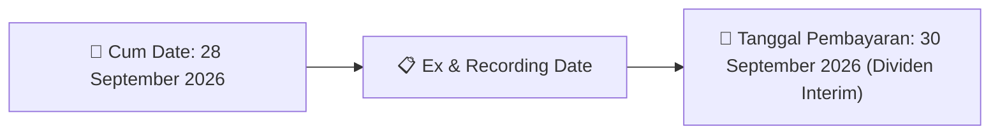
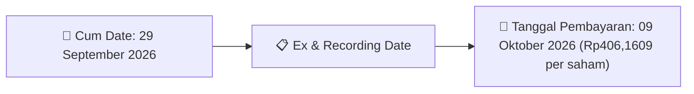

# Ikhtisar Pasar Harian (Daily Digest) - 2026-09-22

📅 **2026-09-22 (Daily Digest)**

## 1. Radar Pasar & Sentimen Harian (Executive Dashboard)
> [!NOTE]
> Terdeteksi sebanyak **50 pengumuman baru** dari 11 emiten pantauan pada (2026-09-22).

| Metric | Jumlah | Status Radar |
| :--- | :---: | :--- |
| **🟢 Sentimen Bullish / Positif** | `2` | [[Dividen Interim]], [[Mandatory Tender Offer]], Kinerja Positif |
| **⚪ Sentimen Netral / Routine** | `12` | [[Tanggapan Penjelasan Bursa]], [[RUPS]], [[Pendaftaran Unit]] |
| **🔴 Sentimen Bearish / Alert** | `0` | Sengketa Hukum, Defisit / Gugatan (Nihil hari ini) |
| **📄 [[Laporan Keuangan]] Baru** | `1` | Memicu Analisis Keuangan Otomatis |

> [!IMPORTANT]
> **Ditemukan Laporan Keuangan Baru Hari Ini:**
> - **AMMN**: AMMN - Penyampaian Laporan Keuangan Q226 ([Buka PDF](file:///g:/My Drive/Model2/reports/raw/AMMN/20260921_AMMN_AMMN - Penyampaian Laporan Keuangan Q226.pdf))
> 
> *Tugas Swarm Agent:* Lakukan analisis laporan keuangan mendalam per emiten secara terpisah untuk berkas-berkas di atas.

---

## 2. Sorotan Utama & Watchlist Strategis (Strategic Watchlist)
#### 💰 Watchlist Dividen & Distribution
- **[[VICO]]**: Cum Date = 28 September 2026
- **[[VICO]]**: Ex Date = 30 September 2026
- **[[VICO]]**: Recording Date = 27 Maret 2026
- **[[VICO]]**: Tanggal Pembayaran = 30 September 2026
- **[[BSSR]]**: Nominal Dividen = Rp406,1609 per saham
- **[[BSSR]]**: Total Dividen = Rp60.000.000

#### 👥 Watchlist Transaksi Orang Dalam & Kepemilikan Saham (Insider / Repo Moves)
- **[[AKPI]]**: Nama Insider = HENRY LIEM
- **[[TRUK]]**: Nama Insider = PT PUKUL RATA KANAN
- **[[TRUK]]**: Jabatan = Tidak
- **[[TRUK]]**: Nama Insider = HAKIMSON GROWTH CAPITAL
- **[[TRUK]]**: Jabatan = Tidak
- **[[AVIA]]**: Tanggal dan Waktu Pelaporan = 22-09-2026 10:06

---

## 3. Matriks Pengumuman Pasar (Announcements Intelligence Table)
| Emiten | Sentimen | Jenis Pengumuman | Judul Pengumuman | Berkas |
| :--- | :---: | :--- | :--- | :--- |
| **[[HEXA]]** | ⚪ NEUTRAL | Public Expose | Public Expose | [Utama](file:///g:/My%20Drive/Model2/reports/raw/HEXA/20260922_HEXA_20260922_HEXA_Public Expose_32150243.pdf) · [Lamp 1](file:///g:/My%20Drive/Model2/reports/raw/HEXA/20260922_HEXA_20260922_HEXA_Public Expose_32150243_lamp1.pdf) |
| **[[MPXL]]** | ⚪ NEUTRAL | Aksi Korporasi | Laporan Informasi dan Fakta Material | [Utama](file:///g:/My%20Drive/Model2/reports/raw/MPXL/20260922_MPXL_20260922_MPXL_Laporan Informasi dan Fakta Material_32150199.pdf) · [Lamp 1](file:///g:/My%20Drive/Model2/reports/raw/MPXL/20260922_MPXL_20260922_MPXL_Laporan Informasi dan Fakta Material_32150199_lamp1.pdf) |
| **[[AKPI]]** | ⚪ NEUTRAL | Kepemilikan Saham (Insider) | LK-22092026-8137-00 | [Utama](file:///g:/My%20Drive/Model2/reports/raw/AKPI/20260922_AKPI_LK-22092026-8137-00.pdf) |
| **[[FAST]]** | ⚪ NEUTRAL | RUPS | Pemanggilan RUPS | [Lamp 2](file:///g:/My%20Drive/Model2/reports/raw/FAST/20260922_FAST_20260922_FAST_Pemanggilan RUPS_32150244_lamp2.pdf) · [Lamp 1](file:///g:/My%20Drive/Model2/reports/raw/FAST/20260922_FAST_20260922_FAST_Pemanggilan RUPS_32150244_lamp1.pdf) |
| **[[VICO]]** | 🟢 BULLISH | Dividen | Ringkasan RisalahRisalah RUPS | [Utama](file:///g:/My%20Drive/Model2/reports/raw/VICO/20260922_VICO_20260922_VICO_Ringkasan RisalahRisalah RUPS_32150212.pdf) · [Lamp 2](file:///g:/My%20Drive/Model2/reports/raw/VICO/20260922_VICO_20260922_VICO_Ringkasan RisalahRisalah RUPS_32150235_lamp2.pdf) · [Lamp 1](file:///g:/My%20Drive/Model2/reports/raw/VICO/20260922_VICO_20260922_VICO_Ringkasan RisalahRisalah RUPS_32150212_lamp1.pdf) |
| **[[TRUK]]** | ⚪ NEUTRAL | Kepemilikan Saham (Insider) | LK-22092026-1723-00 | [Utama](file:///g:/My%20Drive/Model2/reports/raw/TRUK/20260922_TRUK_LK-22092026-1723-00.pdf) |
| **[[TRUK]]** | ⚪ NEUTRAL | Kepemilikan Saham (Insider) | LK-22092026-1484-00 | [Utama](file:///g:/My%20Drive/Model2/reports/raw/TRUK/20260922_TRUK_LK-22092026-1484-00.pdf) |
| **[[TRUK]]** | ⚪ NEUTRAL | Kepemilikan Saham (Insider) | LK-22092026-7169-00 | [Utama](file:///g:/My%20Drive/Model2/reports/raw/TRUK/20260922_TRUK_LK-22092026-7169-00.pdf) |
| **[[AVIA]]** | ⚪ NEUTRAL | Aksi Korporasi | Laporan Informasi dan Fakta Material | [Utama](file:///g:/My%20Drive/Model2/reports/raw/AVIA/20260922_AVIA_20260922_AVIA_Laporan Informasi dan Fakta Material_32150188.pdf) · [Lamp 1](file:///g:/My%20Drive/Model2/reports/raw/AVIA/20260922_AVIA_20260922_AVIA_Laporan Informasi dan Fakta Material_32150188_lamp1.pdf) |
| **[[BSSR]]** | 🟢 BULLISH | Dividen | Jadwal Aksi Korporasi (Khusus Penyampaian Dividen Interim) | [Utama](file:///g:/My%20Drive/Model2/reports/raw/BSSR/20260922_BSSR_20260922_BSSR_Jadwal Aksi Korporasi (Khusus Penyampaian Dividen Interim)_32150192.pdf) · [Lamp 1](file:///g:/My%20Drive/Model2/reports/raw/BSSR/20260922_BSSR_20260922_BSSR_Jadwal Aksi Korporasi (Khusus Penyampaian Dividen Interim)_32150192_lamp1.pdf) · [Lamp 2](file:///g:/My%20Drive/Model2/reports/raw/BSSR/20260922_BSSR_20260922_BSSR_Jadwal Aksi Korporasi (Khusus Penyampaian Dividen Interim)_32150192_lamp2.pdf) |
| **[[PYFA]]** | ⚪ NEUTRAL | RUPS | Pemberitahuan RencanaPenyampaian PanggilanHasil RUPORUPSURUP EBA-SP | [Lamp 1](file:///g:/My%20Drive/Model2/reports/raw/PYFA/20260921_PYFA_20260921_PYFA_Pemberitahuan RencanaPenyampaian PanggilanHasil RUPORUPSURUP EBA-SP_32150043_lamp1.pdf) |
| **[[MEDC]]** | ⚪ NEUTRAL | Aksi Korporasi | Cover Letter Lap Keu 30 Juni 2026 | [Utama](file:///g:/My%20Drive/Model2/reports/raw/MEDC/20260921_MEDC_Cover Letter Lap Keu 30 Juni 2026.pdf) |
| **[[MEDC]]** | ⚪ NEUTRAL | Aksi Korporasi | Surat Pernyataan Direksi 30 Juni 2026 | [Utama](file:///g:/My%20Drive/Model2/reports/raw/MEDC/20260921_MEDC_Surat Pernyataan Direksi 30 Juni 2026.pdf) |
| **[[AMMN]]** | ⚪ NEUTRAL | Laporan Keuangan | AMMN - Penyampaian Laporan Keuangan Q226 | [Utama](file:///g:/My%20Drive/Model2/reports/raw/AMMN/20260921_AMMN_AMMN - Penyampaian Laporan Keuangan Q226.pdf) |

---

## 4. Detail Informasi per Emiten (Grouped by Emiten)
### 📋 4.2. Detail Emiten Lain (Non-Watchlist)

#### 🔵 [[HEXA]]
- **[Public Expose]** [Public Expose](file:///g:/My%20Drive/Model2/reports/raw/HEXA/20260922_HEXA_20260922_HEXA_Public Expose_32150243.pdf) *(Attachment: [Lamp 1](file:///g:/My%20Drive/Model2/reports/raw/HEXA/20260922_HEXA_20260922_HEXA_Public Expose_32150243_lamp1.pdf))*
  - 📌 *Deskripsi*: Informasi dan fakta material HEXA: 052/HEXA/9034/IX/2026 Hexindo Adiperkasa Tbk HEXA 1 Laporan Hasil Public Expose Tahunan Merujuk pada rencana penyelenggaraan Public Expose No. 045/HEXA/9034/IX/2026 , Tanggal 14 September 2026, Perseroan menyampaikan hasil Public Expose Tahunan sebagai terlampir Peserta yang hadir dalam acara public expose tersebut (tidak termasuk manajemen dan karyawan Perseroan) adalah Penyampaian Hasil Public Expose sebanyak 16 orang Nama Pengirim Hexindo Adiperkasa Tbk Listiana A. Kurniawati Hexindo Adiperka
  - 📊 **Fakta Material**:
    - **Uraian Kejadian**: 052/HEXA/9034/IX/2026 Hexindo Adiperkasa Tbk HEXA 1 Laporan Hasil Public Expose Tahunan Merujuk pada rencana penyelenggaraan Public Expose No. 045/HEXA/9034/IX/2026 , Tanggal 14 September 2026, Perseroan menyampaikan hasil Public Expose Tahunan sebagai terlampir Peserta yang hadir dalam acara public expose tersebut (tidak termasuk manajemen dan karyawan Perseroan) adalah Penyampaian Hasil Public Expose sebanyak 16 orang Nama Pengirim Hexindo Adiperkasa Tbk Listiana A. Kurniawati Hexindo Adiperka

#### 🔵 [[MPXL]]
- **[Aksi Korporasi]** [Laporan Informasi dan Fakta Material](file:///g:/My%20Drive/Model2/reports/raw/MPXL/20260922_MPXL_20260922_MPXL_Laporan Informasi dan Fakta Material_32150199.pdf) *(Attachment: [Lamp 1](file:///g:/My%20Drive/Model2/reports/raw/MPXL/20260922_MPXL_20260922_MPXL_Laporan Informasi dan Fakta Material_32150199_lamp1.pdf))*
  - 📌 *Deskripsi*: Siaran pers kinerja keuangan & update bisnis MPXL Periode 2026.

#### 🔵 [[AKPI]]
- **[Kepemilikan Saham (Insider)]** [LK-22092026-8137-00](file:///g:/My%20Drive/Model2/reports/raw/AKPI/20260922_AKPI_LK-22092026-8137-00.pdf)
  - 📌 *Deskripsi*: Laporan perubahan kepemilikan saham insider AKPI.
  - 📊 **Fakta Material**:
    - **Nama Insider**: HENRY LIEM

#### 🔵 [[FAST]]
- **[RUPS]** [Pemanggilan RUPS](file:///g:/My%20Drive/Model2/reports/raw/FAST/20260922_FAST_20260922_FAST_Pemanggilan RUPS_32150244_lamp2.pdf)
  - 📌 *Deskripsi*: Informasi dan fakta material FAST: INVITATION OF EXTRAORDINARY MEETING OF SHAREHOLDERS The Directors of the Company hereby invites the shareholders of the Company to attend the Extraordinary Meeting of Shareholders, hereinafter referred to as the “EGMS”, which will be held on: Day/date : Wednesday, 14 October 2026 Time : 10.00 WIB – finish Venue : Floor 5, Jl. MT Haryono Kav 7, Tebet, South Jakarta. Agenda of EGMS: 1. Approval of Change in the Composition of the Board of Directors Explanation: The Company seeks approval from the
  - 📊 **Fakta Material**:
    - **Uraian Kejadian**: INVITATION OF EXTRAORDINARY MEETING OF SHAREHOLDERS The Directors of the Company hereby invites the shareholders of the Company to attend the Extraordinary Meeting of Shareholders, hereinafter referred to as the “EGMS”, which will be held on: Day/date : Wednesday, 14 October 2026 Time : 10.00 WIB – finish Venue : Floor 5, Jl. MT Haryono Kav 7, Tebet, South Jakarta. Agenda of EGMS: 1. Approval of Change in the Composition of the Board of Directors Explanation: The Company seeks approval from the

#### 🔵 [[VICO]]
- **[Dividen]** [Ringkasan RisalahRisalah RUPS](file:///g:/My%20Drive/Model2/reports/raw/VICO/20260922_VICO_20260922_VICO_Ringkasan RisalahRisalah RUPS_32150212.pdf) *(Attachment: [Lamp 2](file:///g:/My%20Drive/Model2/reports/raw/VICO/20260922_VICO_20260922_VICO_Ringkasan RisalahRisalah RUPS_32150235_lamp2.pdf) · [Lamp 1](file:///g:/My%20Drive/Model2/reports/raw/VICO/20260922_VICO_20260922_VICO_Ringkasan RisalahRisalah RUPS_32150212_lamp1.pdf))*
  - 📌 *Deskripsi*: Pembagian dividen tunai VICO.
  - 📊 **Fakta Material**:
    - **Cum Date**: 28 September 2026
    - **Ex Date**: 30 September 2026
    - **Recording Date**: 27 Maret 2026
    - **Tanggal Pembayaran**: 30 September 2026

#### 🔵 [[TRUK]]
- **[Kepemilikan Saham (Insider)]** [LK-22092026-1723-00](file:///g:/My%20Drive/Model2/reports/raw/TRUK/20260922_TRUK_LK-22092026-1723-00.pdf)
  - 📌 *Deskripsi*: Laporan perubahan kepemilikan saham insider TRUK.
  - 📊 **Fakta Material**:
    - **Nama Insider**: PT PUKUL RATA KANAN
    - **Jabatan**: Tidak
- **[Kepemilikan Saham (Insider)]** [LK-22092026-1484-00](file:///g:/My%20Drive/Model2/reports/raw/TRUK/20260922_TRUK_LK-22092026-1484-00.pdf)
  - 📌 *Deskripsi*: Laporan perubahan kepemilikan saham insider TRUK.
  - 📊 **Fakta Material**:
    - **Nama Insider**: HAKIMSON GROWTH CAPITAL
    - **Jabatan**: Tidak
- **[Kepemilikan Saham (Insider)]** [LK-22092026-7169-00](file:///g:/My%20Drive/Model2/reports/raw/TRUK/20260922_TRUK_LK-22092026-7169-00.pdf)
  - 📌 *Deskripsi*: Pencatatan unit tambahan ETF / Reksa Dana TRUK.

#### 🔵 [[AVIA]]
- **[Aksi Korporasi]** [Laporan Informasi dan Fakta Material](file:///g:/My%20Drive/Model2/reports/raw/AVIA/20260922_AVIA_20260922_AVIA_Laporan Informasi dan Fakta Material_32150188.pdf) *(Attachment: [Lamp 1](file:///g:/My%20Drive/Model2/reports/raw/AVIA/20260922_AVIA_20260922_AVIA_Laporan Informasi dan Fakta Material_32150188_lamp1.pdf))*
  - 📌 *Deskripsi*: PT Avia Avian Tbk menyampaikan Laporan Informasi atau Fakta Material berupa Siaran Pers dengan judul 'Avian Raih Juara 1 ESG dan Tata Kelola di Katadata SAFE The Green Changer'.
  - 📊 **Fakta Material**:
    - **Nomor Surat**: 094/AA/CORSEC/IX/2026
    - **Nama Emiten atau Perusahaan Publik**: PT Avia Avian Tbk
    - **Bidang Usaha**: Industri dan perdagangan cat dan tinta cetak, pernis, lak, perekat/lem, mortar atau beton siap
    - **Tanggal Kejadian**: 22 September 2026
    - **Jenis Informasi atau Fakta Material**: Siaran Pers
    - **Judul Siaran Pers**: Avian Raih Juara 1 ESG dan Tata Kelola di Katadata SAFE The Green Changer
    - **Nama Pengirim**: Kurnia Hadi Sinanto
    - **Jabatan Pengirim**: Direktur
    - **Tanggal dan Waktu Pelaporan**: 22-09-2026 10:06
    - **Lampiran**: AVIA_094_Keterbukaan Informasi Siaran Pers.pdf

#### 🔵 [[BSSR]]
- **[Dividen]** [Jadwal Aksi Korporasi (Khusus Penyampaian Dividen Interim)](file:///g:/My%20Drive/Model2/reports/raw/BSSR/20260922_BSSR_20260922_BSSR_Jadwal Aksi Korporasi (Khusus Penyampaian Dividen Interim)_32150192.pdf) *(Attachment: [Lamp 1](file:///g:/My%20Drive/Model2/reports/raw/BSSR/20260922_BSSR_20260922_BSSR_Jadwal Aksi Korporasi (Khusus Penyampaian Dividen Interim)_32150192_lamp1.pdf) · [Lamp 2](file:///g:/My%20Drive/Model2/reports/raw/BSSR/20260922_BSSR_20260922_BSSR_Jadwal Aksi Korporasi (Khusus Penyampaian Dividen Interim)_32150192_lamp2.pdf))*
  - 📌 *Deskripsi*: Pembagian dividen tunai BSSR.
  - 📊 **Fakta Material**:
    - **Nominal Dividen**: Rp406,1609 per saham
    - **Total Dividen**: Rp60.000.000
    - **Cum Date**: 29 September 2026
    - **Ex Date**: 30 September 2026
    - **Recording Date**: 01 Oktober 2026
    - **Tanggal Pembayaran**: 09 Oktober 2026

#### 🔵 [[PYFA]]
- **[RUPS]** [Pemberitahuan RencanaPenyampaian PanggilanHasil RUPORUPSURUP EBA-SP](file:///g:/My%20Drive/Model2/reports/raw/PYFA/20260921_PYFA_20260921_PYFA_Pemberitahuan RencanaPenyampaian PanggilanHasil RUPORUPSURUP EBA-SP_32150043_lamp1.pdf)
  - 📌 *Deskripsi*: Teks yang diberikan tidak memuat informasi aksi korporasi/RUPS PYFA. Isi dokumen berupa artikel berita tentang pemeriksaan BPK terhadap BPI Danantara dan kebijakan pajak marketplace, sehingga tidak ada fakta material PYFA yang dapat diekstrak.

#### 🔵 [[MEDC]]
- **[Aksi Korporasi]** [Cover Letter Lap Keu 30 Juni 2026](file:///g:/My%20Drive/Model2/reports/raw/MEDC/20260921_MEDC_Cover Letter Lap Keu 30 Juni 2026.pdf)
  - 📌 *Deskripsi*: Tidak dapat mengekstrak fakta material karena teks mentah lampiran tidak tersedia/kosong. Informasi hanya terbatas pada metadata dokumen: MEDC, cover letter laporan keuangan periode 30 Juni 2026.
- **[Aksi Korporasi]** [Surat Pernyataan Direksi 30 Juni 2026](file:///g:/My%20Drive/Model2/reports/raw/MEDC/20260921_MEDC_Surat Pernyataan Direksi 30 Juni 2026.pdf)
  - 📌 *Deskripsi*: Tidak dapat mengekstrak fakta material karena teks mentah lampiran tidak tersedia/kosong.

#### 🔵 [[AMMN]]
- **[Laporan Keuangan]** [AMMN - Penyampaian Laporan Keuangan Q226](file:///g:/My%20Drive/Model2/reports/raw/AMMN/20260921_AMMN_AMMN - Penyampaian Laporan Keuangan Q226.pdf)
  - 📌 *Deskripsi*: Tidak dapat mengekstrak fakta material karena teks mentah lampiran tidak tersedia/kosong.

---

## 5. Rekomendasi & Langkah Analisis Selanjutnya (Next Steps)
> [!TIP]
> **Instruksi Otomatis Swarm Agent**:
> 1. **Dividen Action**: Pantau *Recording Date & Payment Date* untuk emiten pembagi [[Dividen Interim]] (`[[TAPG]]`, `[[AMAR]]`).
> 2. **Tender Offer Action**: Pantau keterbukaan informasi lanjutan untuk `[[MAPI]]` terkait harga [[Mandatory Tender Offer]] oleh `[[Pacific Universal Investments Pte. Ltd.]]`.
> 3. **Financial Statement Deep-Dive**: Jika ada [[Laporan Keuangan]] baru di Section 1, jalankan agen `financial-summarizer-agent` untuk menghitung margin dan rasio valuasi.
