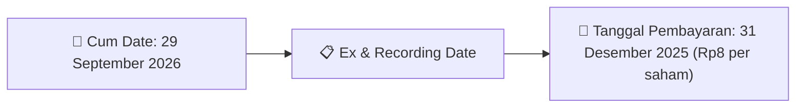
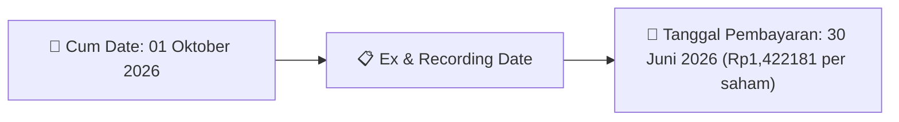

# Ikhtisar Pasar Harian (Daily Digest) - 2026-09-23

📅 **2026-09-23 (Daily Digest)**

## 1. Radar Pasar & Sentimen Harian (Executive Dashboard)
> [!NOTE]
> Terdeteksi sebanyak **141 pengumuman baru** dari 48 emiten pantauan pada (2026-09-23).

| Metric | Jumlah | Status Radar |
| :--- | :---: | :--- |
| **🟢 Sentimen Bullish / Positif** | `4` | [[Dividen Interim]], [[Mandatory Tender Offer]], Kinerja Positif |
| **⚪ Sentimen Netral / Routine** | `44` | [[Tanggapan Penjelasan Bursa]], [[RUPS]], [[Pendaftaran Unit]] |
| **🔴 Sentimen Bearish / Alert** | `2` | Sengketa Hukum, Defisit / Gugatan (Nihil hari ini) |
| **📄 [[Laporan Keuangan]] Baru** | `0` | Memicu Analisis Keuangan Otomatis |

> [!NOTE]
> Tidak dideteksi adanya publikasi laporan keuangan baru hari ini. Rangkuman per emiten secara terperinci tidak diperlukan.

---

## 2. Sorotan Utama & Watchlist Strategis (Strategic Watchlist)
#### 💰 Watchlist Dividen & Distribution
- **[[VICO]]**: Nominal Dividen = Rp8 per saham
- **[[VICO]]**: Total Dividen = Rp121.74 Miliar
- **[[VICO]]**: Cum Date = 29 September 2026
- **[[VICO]]**: Ex Date = 30 September 2026
- **[[VICO]]**: Recording Date = 28 September 2026
- **[[VICO]]**: Tanggal Pembayaran = 31 Desember 2025

#### 👥 Watchlist Transaksi Orang Dalam & Kepemilikan Saham (Insider / Repo Moves)
- **[[IMPC]]**: Nama Insider = TUNGGAL JAYA INVESTAMA
- **[[IMPC]]**: Jabatan = Tidak
- **[[SRTG]]**: Nama Insider = EDWIN SOERYADJAYA
- **[[CYBR]]**: Nama Insider = MB INVESTMENT MANAGEMENT PTE.LTD.
- **[[CYBR]]**: Jabatan = Tidak
- **[[ZONE]]**: Nama Insider = VANDA GUNAWAN
- **[[ZONE]]**: Jabatan = Tidak
- **[[WINR]]**: Nama Insider = PEMENANG NUSANTARA INTERNASIONAL

---

## 3. Matriks Pengumuman Pasar (Announcements Intelligence Table)
| Emiten       |  Sentimen  | Jenis Pengumuman            | Judul Pengumuman                                                    | Berkas                                                                                                                                                                                                                                                                                                                                                                                                                                                                                                                                                                                                                                                                                                                                                               |
| :----------- | :--------: | :-------------------------- | :------------------------------------------------------------------ | :------------------------------------------------------------------------------------------------------------------------------------------------------------------------------------------------------------------------------------------------------------------------------------------------------------------------------------------------------------------------------------------------------------------------------------------------------------------------------------------------------------------------------------------------------------------------------------------------------------------------------------------------------------------------------------------------------------------------------------------------------------------- |
| **[[PIPA]]** | ⚪ NEUTRAL  | Aksi Korporasi              | Laporan Penggunaan Dana Hasil Penawaran Umum                        | [Utama](file:///g:/My%20Drive/Model2/reports/raw/PIPA/20260922_PIPA_20260922_PIPA_Laporan Penggunaan Dana Hasil Penawaran Umum_32150294.pdf) · [Lamp 1](file:///g:/My%20Drive/Model2/reports/raw/PIPA/20260922_PIPA_20260922_PIPA_Laporan Penggunaan Dana Hasil Penawaran Umum_32150294_lamp1.pdf)                                                                                                                                                                                                                                                                                                                                                                                                                                                                   |
| **[[IMPC]]** | ⚪ NEUTRAL  | Kepemilikan Saham (Insider) | LK-22092026-6940-00                                                 | [Utama](file:///g:/My%20Drive/Model2/reports/raw/IMPC/20260922_IMPC_LK-22092026-6940-00.pdf)                                                                                                                                                                                                                                                                                                                                                                                                                                                                                                                                                                                                                                                                         |
| **[[SRTG]]** | ⚪ NEUTRAL  | Kepemilikan Saham (Insider) | LK-22092026-8437-00                                                 | [Utama](file:///g:/My%20Drive/Model2/reports/raw/SRTG/20260922_SRTG_LK-22092026-8437-00.pdf)                                                                                                                                                                                                                                                                                                                                                                                                                                                                                                                                                                                                                                                                         |
| **[[SKBM]]** | ⚪ NEUTRAL  | Aksi Korporasi              | Tanggapan atas Permintaan Penjelasan Bursa                          | [Utama](file:///g:/My%20Drive/Model2/reports/raw/SKBM/20260922_SKBM_20260922_SKBM_Tanggapan atas Permintaan Penjelasan Bursa_32150439.pdf)                                                                                                                                                                                                                                                                                                                                                                                                                                                                                                                                                                                                                           |
| **[[CYBR]]** | ⚪ NEUTRAL  | Kepemilikan Saham (Insider) | LK-22092026-6817-00                                                 | [Utama](file:///g:/My%20Drive/Model2/reports/raw/CYBR/20260922_CYBR_LK-22092026-6817-00.pdf)                                                                                                                                                                                                                                                                                                                                                                                                                                                                                                                                                                                                                                                                         |
| **[[ZONE]]** | ⚪ NEUTRAL  | Kepemilikan Saham (Insider) | LK-22092026-0390-00                                                 | [Utama](file:///g:/My%20Drive/Model2/reports/raw/ZONE/20260922_ZONE_LK-22092026-0390-00.pdf)                                                                                                                                                                                                                                                                                                                                                                                                                                                                                                                                                                                                                                                                         |
| **[[DMAS]]** | ⚪ NEUTRAL  | Aksi Korporasi              | Laporan Informasi dan Fakta Material                                | [Utama](file:///g:/My%20Drive/Model2/reports/raw/DMAS/20260922_DMAS_20260922_DMAS_Laporan Informasi dan Fakta Material_32150378.pdf) · [Lamp 1](file:///g:/My%20Drive/Model2/reports/raw/DMAS/20260922_DMAS_20260922_DMAS_Laporan Informasi dan Fakta Material_32150378_lamp1.pdf)                                                                                                                                                                                                                                                                                                                                                                                                                                                                                   |
| **[[BAFI]]** | ⚪ NEUTRAL  | Aksi Korporasi              | Laporan Informasi dan Fakta Material                                | [Utama](file:///g:/My%20Drive/Model2/reports/raw/BAFI/20260922_BAFI_20260922_BAFI_Laporan Informasi dan Fakta Material_32150374.pdf) · [Lamp 1](file:///g:/My%20Drive/Model2/reports/raw/BAFI/20260922_BAFI_20260922_BAFI_Laporan Informasi dan Fakta Material_32150374_lamp1.pdf) · [Lamp 2](file:///g:/My%20Drive/Model2/reports/raw/BAFI/20260922_BAFI_20260922_BAFI_Laporan Informasi dan Fakta Material_32150374_lamp2.pdf)                                                                                                                                                                                                                                                                                                                                     |
| **[[WINR]]** | ⚪ NEUTRAL  | Kepemilikan Saham (Insider) | LK-22092026-6182-00                                                 | [Utama](file:///g:/My%20Drive/Model2/reports/raw/WINR/20260922_WINR_LK-22092026-6182-00.pdf)                                                                                                                                                                                                                                                                                                                                                                                                                                                                                                                                                                                                                                                                         |
| **[[MKNT]]** | ⚪ NEUTRAL  | Aksi Korporasi              | Keterbukaan Informasi terkait Aksi Korporasi                        | [Utama](file:///g:/My%20Drive/Model2/reports/raw/MKNT/20260922_MKNT_20260922_MKNT_Keterbukaan Informasi terkait Aksi Korporasi_32150455.pdf) · [Lamp 1](file:///g:/My%20Drive/Model2/reports/raw/MKNT/20260922_MKNT_20260922_MKNT_Keterbukaan Informasi terkait Aksi Korporasi_32150463_lamp1.pdf) · [Lamp 2](file:///g:/My%20Drive/Model2/reports/raw/MKNT/20260922_MKNT_20260922_MKNT_Keterbukaan Informasi terkait Aksi Korporasi_32150463_lamp2.pdf) · [Lamp 1](file:///g:/My%20Drive/Model2/reports/raw/MKNT/20260922_MKNT_20260922_MKNT_Keterbukaan Informasi terkait Aksi Korporasi_32150455_lamp1.pdf) · [Lamp 2](file:///g:/My%20Drive/Model2/reports/raw/MKNT/20260922_MKNT_20260922_MKNT_Keterbukaan Informasi terkait Aksi Korporasi_32150455_lamp2.pdf) |
| **[[TOWR]]** | 🔴 BEARISH | Aksi Korporasi              | Laporan Informasi dan Fakta Material                                | [Utama](file:///g:/My%20Drive/Model2/reports/raw/TOWR/20260922_TOWR_20260922_TOWR_Laporan Informasi dan Fakta Material_32150323.pdf)                                                                                                                                                                                                                                                                                                                                                                                                                                                                                                                                                                                                                                 |
| **[[KAII]]** | ⚪ NEUTRAL  | Aksi Korporasi              | Pembayaran KuponBagi HasilIjarahPokok                               | [Utama](file:///g:/My%20Drive/Model2/reports/raw/KAII/20260922_KAII_20260922_KAII_Pembayaran KuponBagi HasilIjarahPokok_32150264.pdf) · [Lamp 1](file:///g:/My%20Drive/Model2/reports/raw/KAII/20260922_KAII_20260922_KAII_Pembayaran KuponBagi HasilIjarahPokok_32150264_lamp1.pdf)                                                                                                                                                                                                                                                                                                                                                                                                                                                                                 |
| **[[BAPA]]** | ⚪ NEUTRAL  | Kepemilikan Saham (Insider) | LK-22092026-4712-00                                                 | [Utama](file:///g:/My%20Drive/Model2/reports/raw/BAPA/20260922_BAPA_LK-22092026-4712-00.pdf)                                                                                                                                                                                                                                                                                                                                                                                                                                                                                                                                                                                                                                                                         |
| **[[BIKE]]** | 🔴 BEARISH | Public Expose               | Public Expose                                                       | [Utama](file:///g:/My%20Drive/Model2/reports/raw/BIKE/20260922_BIKE_20260922_BIKE_Public Expose_32150452.pdf) · [Lamp 1](file:///g:/My%20Drive/Model2/reports/raw/BIKE/20260922_BIKE_20260922_BIKE_Public Expose_32150452_lamp1.pdf)                                                                                                                                                                                                                                                                                                                                                                                                                                                                                                                                 |
| **[[INAF]]** | ⚪ NEUTRAL  | RUPS                        | Pengumuman RUPS                                                     | [Utama](file:///g:/My%20Drive/Model2/reports/raw/INAF/20260922_INAF_20260922_INAF_Pengumuman RUPS_32150305.pdf) · [Lamp 2](file:///g:/My%20Drive/Model2/reports/raw/INAF/20260922_INAF_20260922_INAF_Pengumuman RUPS_32150305_lamp2.pdf) · [Lamp 1](file:///g:/My%20Drive/Model2/reports/raw/INAF/20260922_INAF_20260922_INAF_Pengumuman RUPS_32150305_lamp1.pdf)                                                                                                                                                                                                                                                                                                                                                                                                    |
| **[[BTPS]]** | ⚪ NEUTRAL  | Aksi Korporasi              | Tanggapan atas Permintaan Penjelasan Bursa                          | [Utama](file:///g:/My%20Drive/Model2/reports/raw/BTPS/20260922_BTPS_20260922_BTPS_Tanggapan atas Permintaan Penjelasan Bursa_32150468.pdf)                                                                                                                                                                                                                                                                                                                                                                                                                                                                                                                                                                                                                           |
| **[[SMMA]]** | ⚪ NEUTRAL  | Aksi Korporasi              | Laporan Informasi dan Fakta Material                                | [Utama](file:///g:/My%20Drive/Model2/reports/raw/SMMA/20260922_SMMA_20260922_SMMA_Laporan Informasi dan Fakta Material_32150276.pdf)                                                                                                                                                                                                                                                                                                                                                                                                                                                                                                                                                                                                                                 |
| **[[EURO]]** | ⚪ NEUTRAL  | RUPS                        | Ringkasan RisalahRisalah RUPS                                       | [Utama](file:///g:/My%20Drive/Model2/reports/raw/EURO/20260922_EURO_20260921_EURO_Ringkasan RisalahRisalah RUPS_32150047.pdf) · [Lamp 1](file:///g:/My%20Drive/Model2/reports/raw/EURO/20260922_EURO_20260921_EURO_Ringkasan RisalahRisalah RUPS_32150047_lamp1.pdf)                                                                                                                                                                                                                                                                                                                                                                                                                                                                                                 |
| **[[VICO]]** | 🟢 BULLISH | Dividen                     | Keterbukaan Informasi terkait Aksi Korporasi                        | [Utama](file:///g:/My%20Drive/Model2/reports/raw/VICO/20260922_VICO_20260922_VICO_Keterbukaan Informasi terkait Aksi Korporasi_32150217.pdf)                                                                                                                                                                                                                                                                                                                                                                                                                                                                                                                                                                                                                         |
| **[[GOTO]]** | ⚪ NEUTRAL  | RUPS                        | Pemanggilan RUPS                                                    | [Utama](file:///g:/My%20Drive/Model2/reports/raw/GOTO/20260922_GOTO_20260922_GOTO_Pemanggilan RUPS_32150299.pdf) · [Lamp 1](file:///g:/My%20Drive/Model2/reports/raw/GOTO/20260922_GOTO_20260922_GOTO_Pemanggilan RUPS_32150299_lamp1.pdf) · [Lamp 2](file:///g:/My%20Drive/Model2/reports/raw/GOTO/20260922_GOTO_20260922_GOTO_Pemanggilan RUPS_32150299_lamp2.pdf)                                                                                                                                                                                                                                                                                                                                                                                                 |
| **[[SILO]]** | ⚪ NEUTRAL  | RUPS                        | Ringkasan RisalahRisalah RUPS                                       | [Utama](file:///g:/My%20Drive/Model2/reports/raw/SILO/20260922_SILO_20260922_SILO_Ringkasan RisalahRisalah RUPS_32150448.pdf) · [Lamp 1](file:///g:/My%20Drive/Model2/reports/raw/SILO/20260922_SILO_20260922_SILO_Ringkasan RisalahRisalah RUPS_32150448_lamp1.pdf) · [Lamp 3](file:///g:/My%20Drive/Model2/reports/raw/SILO/20260922_SILO_20260922_SILO_Ringkasan RisalahRisalah RUPS_32150448_lamp3.pdf) · [Lamp 2](file:///g:/My%20Drive/Model2/reports/raw/SILO/20260922_SILO_20260922_SILO_Ringkasan RisalahRisalah RUPS_32150448_lamp2.pdf)                                                                                                                                                                                                                   |
| **[[TPIA]]** | ⚪ NEUTRAL  | Aksi Korporasi              | Laporan Informasi dan Fakta Material                                | [Utama](file:///g:/My%20Drive/Model2/reports/raw/TPIA/20260922_TPIA_20260922_TPIA_Laporan Informasi dan Fakta Material_32150254.pdf) · [Lamp 2](file:///g:/My%20Drive/Model2/reports/raw/TPIA/20260922_TPIA_20260922_TPIA_Laporan Informasi dan Fakta Material_32150254_lamp2.pdf) · [Lamp 1](file:///g:/My%20Drive/Model2/reports/raw/TPIA/20260922_TPIA_20260922_TPIA_Laporan Informasi dan Fakta Material_32150254_lamp1.pdf)                                                                                                                                                                                                                                                                                                                                     |
| **[[WSKT]]** | ⚪ NEUTRAL  | Aksi Korporasi              | Perubahan Perjanjian Perwaliamanatan                                | [Utama](file:///g:/My%20Drive/Model2/reports/raw/WSKT/20260922_WSKT_20260922_WSKT_Perubahan Perjanjian Perwaliamanatan_32150281.pdf) · [Lamp 1](file:///g:/My%20Drive/Model2/reports/raw/WSKT/20260922_WSKT_20260922_WSKT_Perubahan Perjanjian Perwaliamanatan_32150281_lamp1.pdf)                                                                                                                                                                                                                                                                                                                                                                                                                                                                                   |
| **[[MTFN]]** | ⚪ NEUTRAL  | Aksi Korporasi              | Laporan Informasi dan Fakta Material                                | [Utama](file:///g:/My%20Drive/Model2/reports/raw/MTFN/20260922_MTFN_20260922_MTFN_Laporan Informasi dan Fakta Material_32150260.pdf) · [Lamp 1](file:///g:/My%20Drive/Model2/reports/raw/MTFN/20260922_MTFN_20260922_MTFN_Laporan Informasi dan Fakta Material_32150260_lamp1.pdf)                                                                                                                                                                                                                                                                                                                                                                                                                                                                                   |
| **[[ELTY]]** | ⚪ NEUTRAL  | Aksi Korporasi              | ESG2025-ELTY                                                        | [Utama](file:///g:/My%20Drive/Model2/reports/raw/ELTY/20260922_ELTY_ESG2025-ELTY.pdf)                                                                                                                                                                                                                                                                                                                                                                                                                                                                                                                                                                                                                                                                                |
| **[[ELTY]]** | ⚪ NEUTRAL  | Aksi Korporasi              | AnnualReport2025-ELTY-att2                                          | [Utama](file:///g:/My%20Drive/Model2/reports/raw/ELTY/20260922_ELTY_AnnualReport2025-ELTY-att2.pdf)                                                                                                                                                                                                                                                                                                                                                                                                                                                                                                                                                                                                                                                                  |
| **[[ELTY]]** | ⚪ NEUTRAL  | Aksi Korporasi              | AnnualReport2025-ELTY-att1                                          | [Utama](file:///g:/My%20Drive/Model2/reports/raw/ELTY/20260922_ELTY_AnnualReport2025-ELTY-att1.pdf)                                                                                                                                                                                                                                                                                                                                                                                                                                                                                                                                                                                                                                                                  |
| **[[UNTR]]** | ⚪ NEUTRAL  | Aksi Korporasi              | Informasi Transaksi Afiliasi                                        | [Utama](file:///g:/My%20Drive/Model2/reports/raw/UNTR/20260922_UNTR_20260922_UNTR_Informasi Transaksi Afiliasi_32150364.pdf) · [Lamp 1](file:///g:/My%20Drive/Model2/reports/raw/UNTR/20260922_UNTR_20260922_UNTR_Informasi Transaksi Afiliasi_32150364_lamp1.pdf)                                                                                                                                                                                                                                                                                                                                                                                                                                                                                                   |
| **[[KKGI]]** | ⚪ NEUTRAL  | Kepemilikan Saham (Insider) | LK-22092026-9273-00                                                 | [Utama](file:///g:/My%20Drive/Model2/reports/raw/KKGI/20260922_KKGI_LK-22092026-9273-00.pdf)                                                                                                                                                                                                                                                                                                                                                                                                                                                                                                                                                                                                                                                                         |
| **[[ARKO]]** | ⚪ NEUTRAL  | RUPS                        | Pemberitahuan RencanaPenyampaian PanggilanHasil RUPORUPSURUP EBA-SP | [Utama](file:///g:/My%20Drive/Model2/reports/raw/ARKO/20260922_ARKO_20260922_ARKO_Pemberitahuan RencanaPenyampaian PanggilanHasil RUPORUPSURUP EBA-SP_32150326.pdf) · [Lamp 1](file:///g:/My%20Drive/Model2/reports/raw/ARKO/20260922_ARKO_20260922_ARKO_Pemberitahuan RencanaPenyampaian PanggilanHasil RUPORUPSURUP EBA-SP_32150326_lamp1.pdf)                                                                                                                                                                                                                                                                                                                                                                                                                     |
| **[[ZYRX]]** | ⚪ NEUTRAL  | Aksi Korporasi              | Laporan Informasi dan Fakta Material                                | [Utama](file:///g:/My%20Drive/Model2/reports/raw/ZYRX/20260922_ZYRX_20260922_ZYRX_Laporan Informasi dan Fakta Material_32150354.pdf) · [Lamp 1](file:///g:/My%20Drive/Model2/reports/raw/ZYRX/20260922_ZYRX_20260922_ZYRX_Laporan Informasi dan Fakta Material_32150354_lamp1.pdf)                                                                                                                                                                                                                                                                                                                                                                                                                                                                                   |
| **[[JPFA]]** | ⚪ NEUTRAL  | Aksi Korporasi              | Laporan Informasi dan Fakta Material                                | [Utama](file:///g:/My%20Drive/Model2/reports/raw/JPFA/20260922_JPFA_20260922_JPFA_Laporan Informasi dan Fakta Material_32150361.pdf)                                                                                                                                                                                                                                                                                                                                                                                                                                                                                                                                                                                                                                 |
| **[[PNLF]]** | ⚪ NEUTRAL  | Aksi Korporasi              | Tanggapan atas Permintaan Penjelasan Bursa                          | [Utama](file:///g:/My%20Drive/Model2/reports/raw/PNLF/20260922_PNLF_20260922_PNLF_Tanggapan atas Permintaan Penjelasan Bursa_32150274.pdf)                                                                                                                                                                                                                                                                                                                                                                                                                                                                                                                                                                                                                           |
| **[[BOSS]]** | ⚪ NEUTRAL  | RUPS                        | Pengumuman RUPS                                                     | [Utama](file:///g:/My%20Drive/Model2/reports/raw/BOSS/20260922_BOSS_20260922_BOSS_Pengumuman RUPS_32150325.pdf) · [Lamp 1](file:///g:/My%20Drive/Model2/reports/raw/BOSS/20260922_BOSS_20260922_BOSS_Pengumuman RUPS_32150325_lamp1.pdf)                                                                                                                                                                                                                                                                                                                                                                                                                                                                                                                             |
| **[[AYLS]]** | ⚪ NEUTRAL  | Aksi Korporasi              | Tanggapan atas Permintaan Penjelasan Bursa                          | [Utama](file:///g:/My%20Drive/Model2/reports/raw/AYLS/20260922_AYLS_20260922_AYLS_Tanggapan atas Permintaan Penjelasan Bursa_32150277.pdf)                                                                                                                                                                                                                                                                                                                                                                                                                                                                                                                                                                                                                           |
| **[[POST]]** | ⚪ NEUTRAL  | RUPS                        | Pemberitahuan RencanaPenyampaian PanggilanHasil RUPORUPSURUP EBA-SP | [Utama](file:///g:/My%20Drive/Model2/reports/raw/POST/20260922_POST_20260922_POST_Pemberitahuan RencanaPenyampaian PanggilanHasil RUPORUPSURUP EBA-SP_32150287.pdf) · [Lamp 1](file:///g:/My%20Drive/Model2/reports/raw/POST/20260922_POST_20260922_POST_Pemberitahuan RencanaPenyampaian PanggilanHasil RUPORUPSURUP EBA-SP_32150291_lamp1.pdf) · [Lamp 1](file:///g:/My%20Drive/Model2/reports/raw/POST/20260922_POST_20260922_POST_Pemberitahuan RencanaPenyampaian PanggilanHasil RUPORUPSURUP EBA-SP_32150287_lamp1.pdf)                                                                                                                                                                                                                                        |
| **[[HRUM]]** | ⚪ NEUTRAL  | RUPS                        | Ringkasan RisalahRisalah RUPS                                       | [Utama](file:///g:/My%20Drive/Model2/reports/raw/HRUM/20260922_HRUM_20260921_HRUM_Ringkasan RisalahRisalah RUPS_32150038.pdf) · [Lamp 2](file:///g:/My%20Drive/Model2/reports/raw/HRUM/20260922_HRUM_20260921_HRUM_Ringkasan RisalahRisalah RUPS_32150038_lamp2.pdf)                                                                                                                                                                                                                                                                                                                                                                                                                                                                                                 |
| **[[PBSA]]** | ⚪ NEUTRAL  | RUPS                        | Ringkasan RisalahRisalah RUPS                                       | [Utama](file:///g:/My%20Drive/Model2/reports/raw/PBSA/20260922_PBSA_20260922_PBSA_Ringkasan RisalahRisalah RUPS_32150234.pdf) · [Lamp 2](file:///g:/My%20Drive/Model2/reports/raw/PBSA/20260922_PBSA_20260922_PBSA_Ringkasan RisalahRisalah RUPS_32150234_lamp2.pdf)                                                                                                                                                                                                                                                                                                                                                                                                                                                                                                 |
| **[[BJBR]]** | ⚪ NEUTRAL  | Aksi Korporasi              | Tanggapan atas Permintaan Penjelasan Bursa                          | [Utama](file:///g:/My%20Drive/Model2/reports/raw/BJBR/20260922_BJBR_20260922_BJBR_Tanggapan atas Permintaan Penjelasan Bursa_32150357.pdf) · [Lamp 1](file:///g:/My%20Drive/Model2/reports/raw/BJBR/20260922_BJBR_20260922_BJBR_Tanggapan atas Permintaan Penjelasan Bursa_32150357_lamp1.pdf)                                                                                                                                                                                                                                                                                                                                                                                                                                                                       |
| **[[BYAN]]** | ⚪ NEUTRAL  | Kepemilikan Saham (Insider) | LK-22092026-8820-00                                                 | [Utama](file:///g:/My%20Drive/Model2/reports/raw/BYAN/20260922_BYAN_LK-22092026-8820-00.pdf)                                                                                                                                                                                                                                                                                                                                                                                                                                                                                                                                                                                                                                                                         |
| **[[SUPR]]** | 🟢 BULLISH | Aksi Korporasi              | Laporan Informasi dan Fakta Material                                | [Utama](file:///g:/My%20Drive/Model2/reports/raw/SUPR/20260922_SUPR_20260922_SUPR_Laporan Informasi dan Fakta Material_32150451.pdf) · [Lamp 1](file:///g:/My%20Drive/Model2/reports/raw/SUPR/20260922_SUPR_20260922_SUPR_Laporan Informasi dan Fakta Material_32150451_lamp1.pdf) · [Lamp 3](file:///g:/My%20Drive/Model2/reports/raw/SUPR/20260922_SUPR_20260922_SUPR_Laporan Informasi dan Fakta Material_32150451_lamp3.pdf) · [Lamp 2](file:///g:/My%20Drive/Model2/reports/raw/SUPR/20260922_SUPR_20260922_SUPR_Laporan Informasi dan Fakta Material_32150451_lamp2.pdf)                                                                                                                                                                                       |
| **[[PRTL]]** | 🟢 BULLISH | Aksi Korporasi              | Laporan Informasi dan Fakta Material                                | [Utama](file:///g:/My%20Drive/Model2/reports/raw/PRTL/20260922_PRTL_20260922_PRTL_Laporan Informasi dan Fakta Material_32150394.pdf) · [Lamp 3](file:///g:/My%20Drive/Model2/reports/raw/PRTL/20260922_PRTL_20260922_PRTL_Laporan Informasi dan Fakta Material_32150394_lamp3.pdf) · [Lamp 1](file:///g:/My%20Drive/Model2/reports/raw/PRTL/20260922_PRTL_20260922_PRTL_Laporan Informasi dan Fakta Material_32150394_lamp1.pdf) · [Lamp 2](file:///g:/My%20Drive/Model2/reports/raw/PRTL/20260922_PRTL_20260922_PRTL_Laporan Informasi dan Fakta Material_32150394_lamp2.pdf)                                                                                                                                                                                       |
| **[[SMLE]]** | ⚪ NEUTRAL  | Kepemilikan Saham (Insider) | LK-22092026-6210-00                                                 | [Utama](file:///g:/My%20Drive/Model2/reports/raw/SMLE/20260922_SMLE_LK-22092026-6210-00.pdf)                                                                                                                                                                                                                                                                                                                                                                                                                                                                                                                                                                                                                                                                         |
| **[[AGII]]** | ⚪ NEUTRAL  | Aksi Korporasi              | Tanggapan atas Permintaan Penjelasan Bursa                          | [Utama](file:///g:/My%20Drive/Model2/reports/raw/AGII/20260922_AGII_20260920_AGII_Tanggapan atas Permintaan Penjelasan Bursa_32149912.pdf) · [Lamp 1](file:///g:/My%20Drive/Model2/reports/raw/AGII/20260922_AGII_20260920_AGII_Tanggapan atas Permintaan Penjelasan Bursa_32149912_lamp1.pdf)                                                                                                                                                                                                                                                                                                                                                                                                                                                                       |
| **[[VICI]]** | ⚪ NEUTRAL  | RUPS                        | Pengumuman RUPS                                                     | [Utama](file:///g:/My%20Drive/Model2/reports/raw/VICI/20260922_VICI_20260922_VICI_Pengumuman RUPS_32150223.pdf) · [Lamp 2](file:///g:/My%20Drive/Model2/reports/raw/VICI/20260922_VICI_20260922_VICI_Pengumuman RUPS_32150223_lamp2.pdf)                                                                                                                                                                                                                                                                                                                                                                                                                                                                                                                             |
| **[[AKKU]]** | ⚪ NEUTRAL  | Public Expose               | Public Expose                                                       | [Utama](file:///g:/My%20Drive/Model2/reports/raw/AKKU/20260922_AKKU_20260922_AKKU_Public Expose_32150335.pdf) · [Lamp 1](file:///g:/My%20Drive/Model2/reports/raw/AKKU/20260922_AKKU_20260922_AKKU_Public Expose_32150390_lamp1.pdf)                                                                                                                                                                                                                                                                                                                                                                                                                                                                                                                                 |
| **[[GSMF]]** | ⚪ NEUTRAL  | Aksi Korporasi              | Laporan Informasi dan Fakta Material                                | [Utama](file:///g:/My%20Drive/Model2/reports/raw/GSMF/20260922_GSMF_20260922_GSMF_Laporan Informasi dan Fakta Material_32150377.pdf)                                                                                                                                                                                                                                                                                                                                                                                                                                                                                                                                                                                                                                 |
| **[[CDIA]]** | 🟢 BULLISH | Dividen                     | Jadwal Aksi Korporasi (Khusus Penyampaian Dividen Interim)          | [Utama](file:///g:/My%20Drive/Model2/reports/raw/CDIA/20260922_CDIA_20260922_CDIA_Jadwal Aksi Korporasi (Khusus Penyampaian Dividen Interim)_32150221.pdf) · [Lamp 1](file:///g:/My%20Drive/Model2/reports/raw/CDIA/20260922_CDIA_20260922_CDIA_Jadwal Aksi Korporasi (Khusus Penyampaian Dividen Interim)_32150221_lamp1.pdf) · [Lamp 2](file:///g:/My%20Drive/Model2/reports/raw/CDIA/20260922_CDIA_20260922_CDIA_Jadwal Aksi Korporasi (Khusus Penyampaian Dividen Interim)_32150221_lamp2.pdf)                                                                                                                                                                                                                                                                   |
| **[[BBYB]]** | ⚪ NEUTRAL  | RUPS                        | Pengumuman RUPS                                                     | [Utama](file:///g:/My%20Drive/Model2/reports/raw/BBYB/20260922_BBYB_20260922_BBYB_Pengumuman RUPS_32150322.pdf)                                                                                                                                                                                                                                                                                                                                                                                                                                                                                                                                                                                                                                                      |
| **[[ESTA]]** | ⚪ NEUTRAL  | Aksi Korporasi              | Tanggapan atas Permintaan Penjelasan Bursa                          | [Utama](file:///g:/My%20Drive/Model2/reports/raw/ESTA/20260922_ESTA_20260922_ESTA_Tanggapan atas Permintaan Penjelasan Bursa_32150324.pdf) · [Lamp 1](file:///g:/My%20Drive/Model2/reports/raw/ESTA/20260922_ESTA_20260922_ESTA_Tanggapan atas Permintaan Penjelasan Bursa_32150324_lamp1.pdf)                                                                                                                                                                                                                                                                                                                                                                                                                                                                       |

---

## 4. Detail Informasi per Emiten (Grouped by Emiten)
### 📋 4.2. Detail Emiten Lain (Non-Watchlist)

#### 🔵 [[PIPA]]
- **[Aksi Korporasi]** [Laporan Penggunaan Dana Hasil Penawaran Umum](file:///g:/My%20Drive/Model2/reports/raw/PIPA/20260922_PIPA_20260922_PIPA_Laporan Penggunaan Dana Hasil Penawaran Umum_32150294.pdf) *(Attachment: [Lamp 1](file:///g:/My%20Drive/Model2/reports/raw/PIPA/20260922_PIPA_20260922_PIPA_Laporan Penggunaan Dana Hasil Penawaran Umum_32150294_lamp1.pdf))*
  - 📌 *Deskripsi*: Pencatatan saham tambahan hasil konversi waran PIPA.

#### 🔵 [[IMPC]]
- **[Kepemilikan Saham (Insider)]** [LK-22092026-6940-00](file:///g:/My%20Drive/Model2/reports/raw/IMPC/20260922_IMPC_LK-22092026-6940-00.pdf)
  - 📌 *Deskripsi*: Laporan perubahan kepemilikan saham insider IMPC.
  - 📊 **Fakta Material**:
    - **Nama Insider**: TUNGGAL JAYA INVESTAMA
    - **Jabatan**: Tidak

#### 🔵 [[SRTG]]
- **[Kepemilikan Saham (Insider)]** [LK-22092026-8437-00](file:///g:/My%20Drive/Model2/reports/raw/SRTG/20260922_SRTG_LK-22092026-8437-00.pdf)
  - 📌 *Deskripsi*: Laporan perubahan kepemilikan saham insider SRTG.
  - 📊 **Fakta Material**:
    - **Nama Insider**: EDWIN SOERYADJAYA

#### 🔵 [[SKBM]]
- **[Aksi Korporasi]** [Tanggapan atas Permintaan Penjelasan Bursa](file:///g:/My%20Drive/Model2/reports/raw/SKBM/20260922_SKBM_20260922_SKBM_Tanggapan atas Permintaan Penjelasan Bursa_32150439.pdf)
  - 📌 *Deskripsi*: Perseroan mengonfirmasi TIDAK MENGETAHUI adanya informasi/fakta material lain atau rencana aksi korporasi yang mempengaruhi volatilitas saham.

#### 🔵 [[CYBR]]
- **[Kepemilikan Saham (Insider)]** [LK-22092026-6817-00](file:///g:/My%20Drive/Model2/reports/raw/CYBR/20260922_CYBR_LK-22092026-6817-00.pdf)
  - 📌 *Deskripsi*: Laporan perubahan kepemilikan saham insider CYBR.
  - 📊 **Fakta Material**:
    - **Nama Insider**: MB INVESTMENT MANAGEMENT PTE.LTD.
    - **Jabatan**: Tidak

#### 🔵 [[ZONE]]
- **[Kepemilikan Saham (Insider)]** [LK-22092026-0390-00](file:///g:/My%20Drive/Model2/reports/raw/ZONE/20260922_ZONE_LK-22092026-0390-00.pdf)
  - 📌 *Deskripsi*: Laporan perubahan kepemilikan saham insider ZONE.
  - 📊 **Fakta Material**:
    - **Nama Insider**: VANDA GUNAWAN
    - **Jabatan**: Tidak

#### 🔵 [[DMAS]]
- **[Aksi Korporasi]** [Laporan Informasi dan Fakta Material](file:///g:/My%20Drive/Model2/reports/raw/DMAS/20260922_DMAS_20260922_DMAS_Laporan Informasi dan Fakta Material_32150378.pdf) *(Attachment: [Lamp 1](file:///g:/My%20Drive/Model2/reports/raw/DMAS/20260922_DMAS_20260922_DMAS_Laporan Informasi dan Fakta Material_32150378_lamp1.pdf))*
  - 📌 *Deskripsi*: Informasi dan fakta material DMAS: NEWS RELEASE SEPTEMBER 22, 2026 Page 1 of 2 RUPSLB DMAS tanggal 22 September 2026 DMAS’ EGMS on September 22, 2026 (unofficial translation) CIKARANG, 22 September 2026 — PT Puradelta Lestari Tbk (kode saham: DMAS), pengembang kawasan industri terpadu Kota Deltamas mengadakan Rapat Umum Pemegang Saham Luar Biasa (RUPSLB) pada tanggal 22 September 2026, di Le Premier Hotel Kota Deltamas, Cikarang – Kabupaten Bekasi. “RUPS Luar Biasa PT Puradelta Lestari Tbk telah memutuskan untuk menyetujui peruba
  - 📊 **Fakta Material**:
    - **Uraian Kejadian**: NEWS RELEASE SEPTEMBER 22, 2026 Page 1 of 2 RUPSLB DMAS tanggal 22 September 2026 DMAS’ EGMS on September 22, 2026 (unofficial translation) CIKARANG, 22 September 2026 — PT Puradelta Lestari Tbk (kode saham: DMAS), pengembang kawasan industri terpadu Kota Deltamas mengadakan Rapat Umum Pemegang Saham Luar Biasa (RUPSLB) pada tanggal 22 September 2026, di Le Premier Hotel Kota Deltamas, Cikarang – Kabupaten Bekasi. “RUPS Luar Biasa PT Puradelta Lestari Tbk telah memutuskan untuk menyetujui peruba

#### 🔵 [[BAFI]]
- **[Aksi Korporasi]** [Laporan Informasi dan Fakta Material](file:///g:/My%20Drive/Model2/reports/raw/BAFI/20260922_BAFI_20260922_BAFI_Laporan Informasi dan Fakta Material_32150374.pdf) *(Attachment: [Lamp 1](file:///g:/My%20Drive/Model2/reports/raw/BAFI/20260922_BAFI_20260922_BAFI_Laporan Informasi dan Fakta Material_32150374_lamp1.pdf) · [Lamp 2](file:///g:/My%20Drive/Model2/reports/raw/BAFI/20260922_BAFI_20260922_BAFI_Laporan Informasi dan Fakta Material_32150374_lamp2.pdf))*
  - 📌 *Deskripsi*: Tidak dapat mengekstrak fakta material karena teks lampiran tidak memuat informasi substantif selain tanggal dan beberapa angka tanpa konteks.

#### 🔵 [[WINR]]
- **[Kepemilikan Saham (Insider)]** [LK-22092026-6182-00](file:///g:/My%20Drive/Model2/reports/raw/WINR/20260922_WINR_LK-22092026-6182-00.pdf)
  - 📌 *Deskripsi*: Laporan perubahan kepemilikan saham insider WINR.
  - 📊 **Fakta Material**:
    - **Nama Insider**: PEMENANG NUSANTARA INTERNASIONAL
    - **Jabatan**: Tidak

#### 🔵 [[MKNT]]
- **[Aksi Korporasi]** [Keterbukaan Informasi terkait Aksi Korporasi](file:///g:/My%20Drive/Model2/reports/raw/MKNT/20260922_MKNT_20260922_MKNT_Keterbukaan Informasi terkait Aksi Korporasi_32150455.pdf) *(Attachment: [Lamp 1](file:///g:/My%20Drive/Model2/reports/raw/MKNT/20260922_MKNT_20260922_MKNT_Keterbukaan Informasi terkait Aksi Korporasi_32150463_lamp1.pdf) · [Lamp 2](file:///g:/My%20Drive/Model2/reports/raw/MKNT/20260922_MKNT_20260922_MKNT_Keterbukaan Informasi terkait Aksi Korporasi_32150463_lamp2.pdf) · [Lamp 1](file:///g:/My%20Drive/Model2/reports/raw/MKNT/20260922_MKNT_20260922_MKNT_Keterbukaan Informasi terkait Aksi Korporasi_32150455_lamp1.pdf) · [Lamp 2](file:///g:/My%20Drive/Model2/reports/raw/MKNT/20260922_MKNT_20260922_MKNT_Keterbukaan Informasi terkait Aksi Korporasi_32150455_lamp2.pdf))*
  - 📌 *Deskripsi*: PT Mitra Komunikasi Nusantara Tbk (MKNT) mengumumkan rencana Penambahan Modal Tanpa Hak Memesan Efek Terlebih Dahulu (PMTHMETD) dengan menerbitkan 1.024.490.000.000 saham baru seri B bernilai nominal Rp1 per saham, mewakili maksimal 99,46% dari total saham setelah PMTHMETD. Penerbitan saham ini ditujukan untuk perbaikan posisi keuangan dan penguatan struktur permodalan Perseroan. Pihak-pihak yang akan mengambil bagian meliputi PT Headwell Bintang Energi Hijau, PT Mantra Capital Persadan, dan beberapa individu. Pencatatan saham baru di Bursa Efek Indonesia dijadwalkan pada 1 Oktober 2026.
  - 📊 **Fakta Material**:
    - **Nomor Surat**: 005/MKNT/EXT/OJK/IX/2026
    - **Tanggal Pengumuman**: 22 September 2026
    - **Jenis Aksi Korporasi**: Penambahan Modal Tanpa Hak Memesan Efek Terlebih Dahulu (PMTHMETD)
    - **Jumlah Saham Baru Diterbitkan**: 1.024.490.000.000 saham
    - **Nilai Nominal Saham Baru**: Rp1 per saham
    - **Persentase Saham Baru dari Total Saham Setelah PMTHMETD**: 99,46%
    - **Pihak Pengambil Bagian - PT Headwell Bintang Energi Hijau**: 668.000.000.000 saham
    - **Pihak Pengambil Bagian - PT Mantra Capital Persadan**: 156.490.000.000 saham
    - **Pihak Pengambil Bagian - Suripto**: 50.000.000.000 saham
    - **Pihak Pengambil Bagian - Daniel Tejakusuma**: 25.000.000.000 saham
    - **Pihak Pengambil Bagian - Rossa Lina**: 25.000.000.000 saham
    - **Pihak Pengambil Bagian - Jhon Veter Firdaus**: 25.000.000.000 saham
    - **Pihak Pengambil Bagian - Antony Lesmana**: 50.000.000.000 saham
    - **Tanggal Penerbitan dan Penyetoran Saham Baru**: 30 September 2026
    - **Tanggal Pencatatan Saham Baru di BEI**: 1 Oktober 2026
    - **Tanggal Pengumuman Hasil PMTHMETD**: 2 Oktober 2026
    - **Modal Ditempatkan dan Disetor Sebelum PMTHMETD**: Rp110.000.000.000
    - **Modal Ditempatkan dan Disetor Setelah PMTHMETD**: Rp1.134.490.000.000
    - **Tujuan PMTHMETD**: Perbaikan posisi keuangan dan penguatan struktur permodalan
    - **Dasar Hukum**: POJK No. 14/2019, Peraturan BEI No. I-A, Kep-0122/BEI/08-2026

#### 🔵 [[TOWR]]
- **[Aksi Korporasi]** [Laporan Informasi dan Fakta Material](file:///g:/My%20Drive/Model2/reports/raw/TOWR/20260922_TOWR_20260922_TOWR_Laporan Informasi dan Fakta Material_32150323.pdf)
  - 📌 *Deskripsi*: Pada tanggal 22 September 2026, Sarana Menara Nusantara Tbk (TOWR) melalui anak usahanya (Protelindo, Iforte, BIT, QTR, VTS, IGPU, IEN, dan IEB) menandatangani Addendum Ke-20 Perjanjian Fasilitas dengan PT Bank Central Asia Tbk. Perubahan meliputi perpanjangan jangka waktu Fasilitas B hingga 16 November 2027 dan penambahan fasilitas kredit baru (Fasilitas M dan N) masing-masing sebesar Rp1 triliun untuk Protelindo. Transaksi ini merupakan transaksi afiliasi namun bukan transaksi benturan kepentingan atau transaksi material, dan tidak menimbulkan dampak merugikan yang material.
  - 📊 **Fakta Material**:
    - **Jenis Informasi atau Fakta Material**: Penandatanganan Addendum Ke-20 Perjanjian Fasilitas antara Protelindo, Iforte, BIT, QTR, VTS, IGPU, IEN, IEB dengan PT Bank Central Asia Tbk
    - **Tanggal Kejadian**: 22 September 2026
    - **Pihak Peminjam**: Protelindo, Iforte, BIT, QTR, VTS, IGPU, IEN, dan IEB
    - **Pihak Pemberi Pinjaman**: PT Bank Central Asia Tbk
    - **Perpanjangan Jangka Waktu Fasilitas B**: Sampai dengan 16 November 2027
    - **Penambahan Fasilitas M untuk Protelindo**: Rp1.000.000.000.000 (satu triliun Rupiah)
    - **Penambahan Fasilitas N untuk Protelindo**: Rp1.000.000.000.000 (satu triliun Rupiah)
    - **Jangka Waktu Fasilitas M dan N**: 24 bulan sejak penarikan pertama
    - **Tujuan Pinjaman Fasilitas M dan N**: Tujuan umum perusahaan, termasuk pembiayaan kembali pinjaman yang telah ada
    - **Hukum yang Berlaku**: Hukum Indonesia
    - **Sifat Transaksi**: Transaksi afiliasi, bukan transaksi benturan kepentingan, bukan transaksi material
    - **Dampak Terhadap Perseroan**: Tidak menimbulkan dampak merugikan yang material terhadap kegiatan operasional, aspek hukum, kondisi keuangan, maupun kelangsungan usaha

#### 🔵 [[KAII]]
- **[Aksi Korporasi]** [Pembayaran KuponBagi HasilIjarahPokok](file:///g:/My%20Drive/Model2/reports/raw/KAII/20260922_KAII_20260922_KAII_Pembayaran KuponBagi HasilIjarahPokok_32150264.pdf) *(Attachment: [Lamp 1](file:///g:/My%20Drive/Model2/reports/raw/KAII/20260922_KAII_20260922_KAII_Pembayaran KuponBagi HasilIjarahPokok_32150264_lamp1.pdf))*
  - 📌 *Deskripsi*: Informasi dan fakta material KAII: Sesuai dengan ketentuan peraturan perundang-undangan yang berlaku, surat ini telah ditandatangani secara elektronik sehingga tidak diperlukan tanda tangan dan stempel basah. Nomor : KL.217/IX/16/KA-2026 22 September 2026 Sifat : Terbatas : __ Yth. Kepala Eksekutif Pengawas Pasar Modal, Keuangan Derivatif dan Bursa Karbon Otoritas Jasa Keuangan di Tempat : Laporan Pembayaran Bunga Efek Bersifat Utang dan Sukuk 1. Berkelanjutan II Kereta Api Indonesia Tahap II Tahun 2025 Seri A-B dan Permintaan Da
  - 📊 **Fakta Material**:
    - **Uraian Kejadian**: Sesuai dengan ketentuan peraturan perundang-undangan yang berlaku, surat ini telah ditandatangani secara elektronik sehingga tidak diperlukan tanda tangan dan stempel basah. Nomor : KL.217/IX/16/KA-2026 22 September 2026 Sifat : Terbatas : __ Yth. Kepala Eksekutif Pengawas Pasar Modal, Keuangan Derivatif dan Bursa Karbon Otoritas Jasa Keuangan di Tempat : Laporan Pembayaran Bunga Efek Bersifat Utang dan Sukuk 1. Berkelanjutan II Kereta Api Indonesia Tahap II Tahun 2025 Seri A-B dan Permintaan Da

#### 🔵 [[BAPA]]
- **[Kepemilikan Saham (Insider)]** [LK-22092026-4712-00](file:///g:/My%20Drive/Model2/reports/raw/BAPA/20260922_BAPA_LK-22092026-4712-00.pdf)
  - 📌 *Deskripsi*: BELVIN TANNADI, pemilik langsung saham PT Bekasi Asri Pemula Tbk (BAPA), melaporkan penjualan seluruh kepemilikannya melalui transaksi Repurchase Agreement. Sebelum transaksi, ia memiliki 76.384.700 unit saham (11,54% hak suara), dan setelah transaksi menjadi 0 unit (0% hak suara). Terdapat dua transaksi penjualan pada tanggal 3 September 2026 dan 22 September 2026 dengan harga Rp145 per saham, dengan tujuan 'butuh modal' dan 'cutloss'.
  - 📊 **Fakta Material**:
    - **Nama Pelapor**: BELVIN TANNADI
    - **Jabatan**: Tidak
    - **Kewarganegaraan**: WNI
    - **Jumlah Saham Sebelum Transaksi**: 76.384.700,00 Unit
    - **Hak Suara Sebelum Transaksi**: 11,54%
    - **Jumlah Saham Setelah Transaksi**: 0,00 Unit
    - **Hak Suara Setelah Transaksi**: 0,00%
    - **Jenis Transaksi**: Repurchase Agreement
    - **Status Kepemilikan**: Langsung
    - **Tanggal Transaksi 1**: 2026-09-03
    - **Jumlah Saham Transaksi 1**: 76.384.700,00 Unit
    - **Klasifikasi Saham Transaksi 1**: Saham dengan hak suara multiple
    - **Harga Transaksi 1**: 145,00
    - **Tujuan Transaksi 1**: butuh modal
    - **Tanggal Transaksi 2**: 2026-09-22
    - **Jumlah Saham Transaksi 2**: 76.384.700,00 Unit
    - **Klasifikasi Saham Transaksi 2**: Saham Biasa
    - **Harga Transaksi 2**: 145,00
    - **Tujuan Transaksi 2**: cutloss
    - **Nomor Laporan**: LK/22092026/0011/1

#### 🔵 [[BIKE]]
- **[Public Expose]** [Public Expose](file:///g:/My%20Drive/Model2/reports/raw/BIKE/20260922_BIKE_20260922_BIKE_Public Expose_32150452.pdf) *(Attachment: [Lamp 1](file:///g:/My%20Drive/Model2/reports/raw/BIKE/20260922_BIKE_20260922_BIKE_Public Expose_32150452_lamp1.pdf))*
  - 📌 *Deskripsi*: Informasi dan fakta material BIKE: Tangerang, 22 September 2026 No : 2026/261/IX/BIKE/EK : Penyampaian Rencana Penyelenggaraan Public Expose Insidentil PT BIKE Tbk. Kepada Yth Direktur Utama PT Bursa Efek Indonesia Jakarta Dengan Hormat, Sehubungan dengan Pengumuman Bursa Efek Indonesia Nomor Peng-SPT- 00181/BEI.WAS/09-2026 tanggal 21 September 2026 penghentian sementara perdagangan saham PT Bhineka Inovasi Ketahanan Energi Tbk (BIKE) atau Suspensi Cooling Down tanggal 21 September 2026 dan merujuk pada permintaan BEI via email t
  - 📊 **Fakta Material**:
    - **Uraian Kejadian**: Tangerang, 22 September 2026 No : 2026/261/IX/BIKE/EK : Penyampaian Rencana Penyelenggaraan Public Expose Insidentil PT BIKE Tbk. Kepada Yth Direktur Utama PT Bursa Efek Indonesia Jakarta Dengan Hormat, Sehubungan dengan Pengumuman Bursa Efek Indonesia Nomor Peng-SPT- 00181/BEI.WAS/09-2026 tanggal 21 September 2026 penghentian sementara perdagangan saham PT Bhineka Inovasi Ketahanan Energi Tbk (BIKE) atau Suspensi Cooling Down tanggal 21 September 2026 dan merujuk pada permintaan BEI via email t

#### 🔵 [[INAF]]
- **[RUPS]** [Pengumuman RUPS](file:///g:/My%20Drive/Model2/reports/raw/INAF/20260922_INAF_20260922_INAF_Pengumuman RUPS_32150305.pdf) *(Attachment: [Lamp 2](file:///g:/My%20Drive/Model2/reports/raw/INAF/20260922_INAF_20260922_INAF_Pengumuman RUPS_32150305_lamp2.pdf) · [Lamp 1](file:///g:/My%20Drive/Model2/reports/raw/INAF/20260922_INAF_20260922_INAF_Pengumuman RUPS_32150305_lamp1.pdf))*
  - 📌 *Deskripsi*: Informasi dan fakta material INAF: ANNOUNCEMENT EXTRAORDINARY GENERAL MEETING OF SHAREHOLDERS PT INDOFARMA (PERSERO) TBK The Board of Directors of PT Indofarma (Persero) Tbk ("Company") hereby announces that the Company's 2026 Extraordinary General Meeting of Shareholders ("EGMS") will be held on Thursday, October 29, 2026. In accordance with the Financial Services Authority Regulation Number 15/POJK.04/2020 concerning the Plan and Organization of General Meetings of Shareholders of Public Companies ("POJK Number 15 of 2020") jun
  - 📊 **Fakta Material**:
    - **Uraian Kejadian**: ANNOUNCEMENT EXTRAORDINARY GENERAL MEETING OF SHAREHOLDERS PT INDOFARMA (PERSERO) TBK The Board of Directors of PT Indofarma (Persero) Tbk ("Company") hereby announces that the Company's 2026 Extraordinary General Meeting of Shareholders ("EGMS") will be held on Thursday, October 29, 2026. In accordance with the Financial Services Authority Regulation Number 15/POJK.04/2020 concerning the Plan and Organization of General Meetings of Shareholders of Public Companies ("POJK Number 15 of 2020") jun

#### 🔵 [[BTPS]]
- **[Aksi Korporasi]** [Tanggapan atas Permintaan Penjelasan Bursa](file:///g:/My%20Drive/Model2/reports/raw/BTPS/20260922_BTPS_20260922_BTPS_Tanggapan atas Permintaan Penjelasan Bursa_32150468.pdf)
  - 📌 *Deskripsi*: Tanggapan Penjelasan Bursa BTPS [FAKTA MATERIAL DITEMUKAN]
  - 📊 **Fakta Material**:
    - **Pernyataan Emiten**: Perseroan · pemegang saham utama dalam menjawab konfirmasi tersebut.

#### 🔵 [[SMMA]]
- **[Aksi Korporasi]** [Laporan Informasi dan Fakta Material](file:///g:/My%20Drive/Model2/reports/raw/SMMA/20260922_SMMA_20260922_SMMA_Laporan Informasi dan Fakta Material_32150276.pdf)
  - 📌 *Deskripsi*: Informasi dan fakta material SMMA: 174/SMMA/IX/2026 PT Sinar Mas Multiartha Tbk SMMA 1 Keterbukan Informasi Perseroan Kepada Publik Dengan ini kami untuk dan atas menyampaikan Laporan Informasi atau Fakta Material sebagai berikut: Nama Emiten atau Perusahaan Publik PT Sinar Mas Multiartha Tbk Bidang Usaha Investment Company Telepon (021) 3925660 Faksimili (021 ) 3925788 Alamat Surat Elektronik (email) multiartha@smma.co.id Tanggal Kejadian 21 September 2026 Jenis Informasi atau Fakta Material Keterbukan Informasi Perseroan Kepada
  - 📊 **Fakta Material**:
    - **Uraian Kejadian**: 174/SMMA/IX/2026 PT Sinar Mas Multiartha Tbk SMMA 1 Keterbukan Informasi Perseroan Kepada Publik Dengan ini kami untuk dan atas menyampaikan Laporan Informasi atau Fakta Material sebagai berikut: Nama Emiten atau Perusahaan Publik PT Sinar Mas Multiartha Tbk Bidang Usaha Investment Company Telepon (021) 3925660 Faksimili (021 ) 3925788 Alamat Surat Elektronik (email) multiartha@smma.co.id Tanggal Kejadian 21 September 2026 Jenis Informasi atau Fakta Material Keterbukan Informasi Perseroan Kepada

#### 🔵 [[EURO]]
- **[RUPS]** [Ringkasan RisalahRisalah RUPS](file:///g:/My%20Drive/Model2/reports/raw/EURO/20260922_EURO_20260921_EURO_Ringkasan RisalahRisalah RUPS_32150047.pdf) *(Attachment: [Lamp 1](file:///g:/My%20Drive/Model2/reports/raw/EURO/20260922_EURO_20260921_EURO_Ringkasan RisalahRisalah RUPS_32150047_lamp1.pdf))*
  - 📌 *Deskripsi*: Pencatatan saham tambahan hasil konversi waran EURO.

#### 🔵 [[VICO]]
- **[Dividen]** [Keterbukaan Informasi terkait Aksi Korporasi](file:///g:/My%20Drive/Model2/reports/raw/VICO/20260922_VICO_20260922_VICO_Keterbukaan Informasi terkait Aksi Korporasi_32150217.pdf)
  - 📌 *Deskripsi*: Pembagian dividen tunai VICO.
  - 📊 **Fakta Material**:
    - **Nominal Dividen**: Rp8 per saham
    - **Total Dividen**: Rp121.74 Miliar
    - **Cum Date**: 29 September 2026
    - **Ex Date**: 30 September 2026
    - **Recording Date**: 28 September 2026
    - **Tanggal Pembayaran**: 31 Desember 2025

#### 🔵 [[GOTO]]
- **[RUPS]** [Pemanggilan RUPS](file:///g:/My%20Drive/Model2/reports/raw/GOTO/20260922_GOTO_20260922_GOTO_Pemanggilan RUPS_32150299.pdf) *(Attachment: [Lamp 1](file:///g:/My%20Drive/Model2/reports/raw/GOTO/20260922_GOTO_20260922_GOTO_Pemanggilan RUPS_32150299_lamp1.pdf) · [Lamp 2](file:///g:/My%20Drive/Model2/reports/raw/GOTO/20260922_GOTO_20260922_GOTO_Pemanggilan RUPS_32150299_lamp2.pdf))*
  - 📌 *Deskripsi*: Informasi dan fakta material GOTO: 1 INVITATION OF THE EXTRAORDINARY GENERAL MEETING OF SHAREHOLDERS PT GOTO GOJEK TOKOPEDIA Tbk (the "Company") The Board of Directors of the Company hereby invites the shareholders of the Company to attend the Extraordinary General Meeting of Shareholders (“EGMS”) of the Company which will be convened on: Day/Date : Wednesday, October 14, 2026 Time : 10.00 AM – 11.30 AM Western Indonesian Time Venue : GoTo Office, Pasaraya Blok M Building, 7th floor, Jl. Iskandarsyah II No. 2, South Jakarta 12160
  - 📊 **Fakta Material**:
    - **Uraian Kejadian**: 1 INVITATION OF THE EXTRAORDINARY GENERAL MEETING OF SHAREHOLDERS PT GOTO GOJEK TOKOPEDIA Tbk (the "Company") The Board of Directors of the Company hereby invites the shareholders of the Company to attend the Extraordinary General Meeting of Shareholders (“EGMS”) of the Company which will be convened on: Day/Date : Wednesday, October 14, 2026 Time : 10.00 AM – 11.30 AM Western Indonesian Time Venue : GoTo Office, Pasaraya Blok M Building, 7th floor, Jl. Iskandarsyah II No. 2, South Jakarta 12160

#### 🔵 [[SILO]]
- **[RUPS]** [Ringkasan RisalahRisalah RUPS](file:///g:/My%20Drive/Model2/reports/raw/SILO/20260922_SILO_20260922_SILO_Ringkasan RisalahRisalah RUPS_32150448.pdf) *(Attachment: [Lamp 1](file:///g:/My%20Drive/Model2/reports/raw/SILO/20260922_SILO_20260922_SILO_Ringkasan RisalahRisalah RUPS_32150448_lamp1.pdf) · [Lamp 3](file:///g:/My%20Drive/Model2/reports/raw/SILO/20260922_SILO_20260922_SILO_Ringkasan RisalahRisalah RUPS_32150448_lamp3.pdf) · [Lamp 2](file:///g:/My%20Drive/Model2/reports/raw/SILO/20260922_SILO_20260922_SILO_Ringkasan RisalahRisalah RUPS_32150448_lamp2.pdf))*
  - 📌 *Deskripsi*: Informasi dan fakta material SILO: Siloam International Hospitals 1 Lippo Village, Tangerang 15811, Indonesia RINGKASAN RISALAH RAPAT UMUM PEMEGANG SAHAM LUAR BIASA PT SILOAM INTERNATIONAL HOSPITALS TBK A. Pendahuluan dan Informasi Umum tentang Rapat Umum Pemegang Saham Luar Biasa (“Rapat”) Direksi PT Siloam International Hospitals Tbk (“Perseroan”) dengan ini mengumumkan kepada para Pemegang Saham Perseroan bahwa Rapat telah diselenggarakan secara fisik dan elektronik Institute for Nanotechnology, Jl. Jenderal Sudirman No.1688,
  - 📊 **Fakta Material**:
    - **Uraian Kejadian**: Siloam International Hospitals 1 Lippo Village, Tangerang 15811, Indonesia RINGKASAN RISALAH RAPAT UMUM PEMEGANG SAHAM LUAR BIASA PT SILOAM INTERNATIONAL HOSPITALS TBK A. Pendahuluan dan Informasi Umum tentang Rapat Umum Pemegang Saham Luar Biasa (“Rapat”) Direksi PT Siloam International Hospitals Tbk (“Perseroan”) dengan ini mengumumkan kepada para Pemegang Saham Perseroan bahwa Rapat telah diselenggarakan secara fisik dan elektronik Institute for Nanotechnology, Jl. Jenderal Sudirman No.1688,

#### 🔵 [[TPIA]]
- **[Aksi Korporasi]** [Laporan Informasi dan Fakta Material](file:///g:/My%20Drive/Model2/reports/raw/TPIA/20260922_TPIA_20260922_TPIA_Laporan Informasi dan Fakta Material_32150254.pdf) *(Attachment: [Lamp 2](file:///g:/My%20Drive/Model2/reports/raw/TPIA/20260922_TPIA_20260922_TPIA_Laporan Informasi dan Fakta Material_32150254_lamp2.pdf) · [Lamp 1](file:///g:/My%20Drive/Model2/reports/raw/TPIA/20260922_TPIA_20260922_TPIA_Laporan Informasi dan Fakta Material_32150254_lamp1.pdf))*
  - 📌 *Deskripsi*: Informasi dan fakta material TPIA: PRESS RELEASE From Back Office to Strategic Business Partner, CASS Supports Chandra Asri Group’s Transformation Jakarta, September 22, 2026 – As businesses continue to expand and corporate operations become increasingly integrated, the role of shared services is evolving from merely providing administrative support into becoming a strategic partner that drives business growth and value creation. This trend is also reflected in the development of global shared services models, which increasingly
  - 📊 **Fakta Material**:
    - **Uraian Kejadian**: PRESS RELEASE From Back Office to Strategic Business Partner, CASS Supports Chandra Asri Group’s Transformation Jakarta, September 22, 2026 – As businesses continue to expand and corporate operations become increasingly integrated, the role of shared services is evolving from merely providing administrative support into becoming a strategic partner that drives business growth and value creation. This trend is also reflected in the development of global shared services models, which increasingly

#### 🔵 [[WSKT]]
- **[Aksi Korporasi]** [Perubahan Perjanjian Perwaliamanatan](file:///g:/My%20Drive/Model2/reports/raw/WSKT/20260922_WSKT_20260922_WSKT_Perubahan Perjanjian Perwaliamanatan_32150281.pdf) *(Attachment: [Lamp 1](file:///g:/My%20Drive/Model2/reports/raw/WSKT/20260922_WSKT_20260922_WSKT_Perubahan Perjanjian Perwaliamanatan_32150281_lamp1.pdf))*
  - 📌 *Deskripsi*: Informasi dan fakta material WSKT: Nomor : 992/WK/DIR/2026 Jakarta, 22 September 2026 Kepada Yth. : Direktur Utama PT Bursa Efek Indonesia Up. Bpk Jeffrey Hendrik : Informasi Skema Restrukturisasi Kepada Pemegang Obligasi Berkelanjutan III Waskita Karya Tahap IV Tahun 2019 Dengan hormat, Pertama-tama kami ucapkan terima kasih atas kerja sama yang selama ini terjalin antara PT Bursa Efek Indonesia (“BEI”) dengan PT Waskita Karya (Persero), Tbk. (“Waskita”). Sebagaimana diketahui, pada 3 September 2026 Waskita kembali menyelenggara
  - 📊 **Fakta Material**:
    - **Uraian Kejadian**: Nomor : 992/WK/DIR/2026 Jakarta, 22 September 2026 Kepada Yth. : Direktur Utama PT Bursa Efek Indonesia Up. Bpk Jeffrey Hendrik : Informasi Skema Restrukturisasi Kepada Pemegang Obligasi Berkelanjutan III Waskita Karya Tahap IV Tahun 2019 Dengan hormat, Pertama-tama kami ucapkan terima kasih atas kerja sama yang selama ini terjalin antara PT Bursa Efek Indonesia (“BEI”) dengan PT Waskita Karya (Persero), Tbk. (“Waskita”). Sebagaimana diketahui, pada 3 September 2026 Waskita kembali menyelenggara

#### 🔵 [[MTFN]]
- **[Aksi Korporasi]** [Laporan Informasi dan Fakta Material](file:///g:/My%20Drive/Model2/reports/raw/MTFN/20260922_MTFN_20260922_MTFN_Laporan Informasi dan Fakta Material_32150260.pdf) *(Attachment: [Lamp 1](file:///g:/My%20Drive/Model2/reports/raw/MTFN/20260922_MTFN_20260922_MTFN_Laporan Informasi dan Fakta Material_32150260_lamp1.pdf))*
  - 📌 *Deskripsi*: Informasi dan fakta material MTFN: 067/CI/Corsec/IX/2026 Capitalinc Investment Tbk MTFN 1 Penjelasan Opini Laporan Keuangan Tahunan 2025 PT Capitalinc Investment Tbk Dengan ini kami untuk dan atas menyampaikan Laporan Informasi atau Fakta Material sebagai berikut: Nama Emiten atau Perusahaan Publik Capitalinc Investment Tbk Bidang Usaha Investasi Telepon 021 - 2751 7000 Faksimili 021 - 2793 2002 Alamat Surat Elektronik (email) legal@capitalinc-investment.com Tanggal Kejadian 22 September 2026 Jenis Informasi atau Fakta Material P
  - 📊 **Fakta Material**:
    - **Uraian Kejadian**: 067/CI/Corsec/IX/2026 Capitalinc Investment Tbk MTFN 1 Penjelasan Opini Laporan Keuangan Tahunan 2025 PT Capitalinc Investment Tbk Dengan ini kami untuk dan atas menyampaikan Laporan Informasi atau Fakta Material sebagai berikut: Nama Emiten atau Perusahaan Publik Capitalinc Investment Tbk Bidang Usaha Investasi Telepon 021 - 2751 7000 Faksimili 021 - 2793 2002 Alamat Surat Elektronik (email) legal@capitalinc-investment.com Tanggal Kejadian 22 September 2026 Jenis Informasi atau Fakta Material P

#### 🔵 [[ELTY]]
- **[Aksi Korporasi]** [ESG2025-ELTY](file:///g:/My%20Drive/Model2/reports/raw/ELTY/20260922_ELTY_ESG2025-ELTY.pdf)
  - 📌 *Deskripsi*: Siaran pers kinerja keuangan & update bisnis ELTY (Anak Perusahaan yang) Periode 2026.
- **[Aksi Korporasi]** [AnnualReport2025-ELTY-att2](file:///g:/My%20Drive/Model2/reports/raw/ELTY/20260922_ELTY_AnnualReport2025-ELTY-att2.pdf)
  - 📌 *Deskripsi*: Pencatatan saham tambahan hasil konversi waran ELTY.
- **[Aksi Korporasi]** [AnnualReport2025-ELTY-att1](file:///g:/My%20Drive/Model2/reports/raw/ELTY/20260922_ELTY_AnnualReport2025-ELTY-att1.pdf)
  - 📌 *Deskripsi*: Informasi dan fakta material ELTY: Jakarta, 22 September 2026 Ref. No. : 113/SKL/BLD-CORSEC-LEGAL/HN/IX/2026 : 1 (satu) Kepada, OTORITAS JASA KEUANGAN Jakarta 10710 Up. Yth. : Bapak Hasan Fawzi, Kepala Eksekutif Pengawas Pasar Modal : Koreksi Atas Laporan Tahunan (Annual Report) 2025 PT Bakrieland Development Tbk Dengan hormat, Sesuai Peraturan Otoritas Jasa Keuangan Nomor 29/POJK.04/2016 Tentang Laporan Tahunan Emiten Atau Perusahan Publik dan Peraturan PT Bursa Efek Indonesia nomor I-E butir III.1.2. tentang penyampaian Laporan
  - 📊 **Fakta Material**:
    - **Uraian Kejadian**: Jakarta, 22 September 2026 Ref. No. : 113/SKL/BLD-CORSEC-LEGAL/HN/IX/2026 : 1 (satu) Kepada, OTORITAS JASA KEUANGAN Jakarta 10710 Up. Yth. : Bapak Hasan Fawzi, Kepala Eksekutif Pengawas Pasar Modal : Koreksi Atas Laporan Tahunan (Annual Report) 2025 PT Bakrieland Development Tbk Dengan hormat, Sesuai Peraturan Otoritas Jasa Keuangan Nomor 29/POJK.04/2016 Tentang Laporan Tahunan Emiten Atau Perusahan Publik dan Peraturan PT Bursa Efek Indonesia nomor I-E butir III.1.2. tentang penyampaian Laporan

#### 🔵 [[UNTR]]
- **[Aksi Korporasi]** [Informasi Transaksi Afiliasi](file:///g:/My%20Drive/Model2/reports/raw/UNTR/20260922_UNTR_20260922_UNTR_Informasi Transaksi Afiliasi_32150364.pdf) *(Attachment: [Lamp 1](file:///g:/My%20Drive/Model2/reports/raw/UNTR/20260922_UNTR_20260922_UNTR_Informasi Transaksi Afiliasi_32150364_lamp1.pdf))*
  - 📌 *Deskripsi*: Laporan perubahan kepemilikan saham insider UNTR.

#### 🔵 [[KKGI]]
- **[Kepemilikan Saham (Insider)]** [LK-22092026-9273-00](file:///g:/My%20Drive/Model2/reports/raw/KKGI/20260922_KKGI_LK-22092026-9273-00.pdf)
  - 📌 *Deskripsi*: Laporan perubahan kepemilikan saham insider KKGI.
  - 📊 **Fakta Material**:
    - **Nama Insider**: DRS. HENDRO MARTOWARDOJO

#### 🔵 [[ARKO]]
- **[RUPS]** [Pemberitahuan RencanaPenyampaian PanggilanHasil RUPORUPSURUP EBA-SP](file:///g:/My%20Drive/Model2/reports/raw/ARKO/20260922_ARKO_20260922_ARKO_Pemberitahuan RencanaPenyampaian PanggilanHasil RUPORUPSURUP EBA-SP_32150326.pdf) *(Attachment: [Lamp 1](file:///g:/My%20Drive/Model2/reports/raw/ARKO/20260922_ARKO_20260922_ARKO_Pemberitahuan RencanaPenyampaian PanggilanHasil RUPORUPSURUP EBA-SP_32150326_lamp1.pdf))*
  - 📌 *Deskripsi*: Informasi dan fakta material ARKO: „ NERACA Momentum peringatan Hari Batik Nasional dihara- pkan tidak hanya mening- katkan kecintaan masya- rakat terhadap batik sebagai warisan budaya bangsa, tetapi juga membuka pelu- ang yang lebih luas bagi in- dustri kecil dan menengah (IKM) batik untuk berkem- bang dan memperluas pasar. Menteri Perindustrian Agus Gumiwang Kartasas- mita mengatakan, industri batik memiliki peran pent- ing dalam struktur industri nasional karena tidak hanya mengandung nilai budaya yang tinggi, tetapi juga memb
  - 📊 **Fakta Material**:
    - **Uraian Kejadian**: „ NERACA Momentum peringatan Hari Batik Nasional dihara- pkan tidak hanya mening- katkan kecintaan masya- rakat terhadap batik sebagai warisan budaya bangsa, tetapi juga membuka pelu- ang yang lebih luas bagi in- dustri kecil dan menengah (IKM) batik untuk berkem- bang dan memperluas pasar. Menteri Perindustrian Agus Gumiwang Kartasas- mita mengatakan, industri batik memiliki peran pent- ing dalam struktur industri nasional karena tidak hanya mengandung nilai budaya yang tinggi, tetapi juga memb

#### 🔵 [[ZYRX]]
- **[Aksi Korporasi]** [Laporan Informasi dan Fakta Material](file:///g:/My%20Drive/Model2/reports/raw/ZYRX/20260922_ZYRX_20260922_ZYRX_Laporan Informasi dan Fakta Material_32150354.pdf) *(Attachment: [Lamp 1](file:///g:/My%20Drive/Model2/reports/raw/ZYRX/20260922_ZYRX_20260922_ZYRX_Laporan Informasi dan Fakta Material_32150354_lamp1.pdf))*
  - 📌 *Deskripsi*: Informasi dan fakta material ZYRX: Jakarta, 22 September 2026 Nomor : 21.043/CRS-ZMB/IX/26 : - : Keterbukaan atas Informasi dan Fakta Material tentang Perubahan Logo Kepada Yth. Kepala Eksekutif Pengawasan Pasar Modal Otoritas Jasa Keuangan (“OJK”) Jakarta 10710 Dengan hormat, Dengan ini kami dan atas menyampaikan Laporan Informasi atau Fakta Material sesuai dengan Peraturan Otoritas Jasa Keuangan (“POJK”) No. 31/POJK.04/2015 tentang Keterbukaan atas Informasi atau Fakta Material oleh Emiten atau Perusahaan Publik melakukan keter
  - 📊 **Fakta Material**:
    - **Uraian Kejadian**: Jakarta, 22 September 2026 Nomor : 21.043/CRS-ZMB/IX/26 : - : Keterbukaan atas Informasi dan Fakta Material tentang Perubahan Logo Kepada Yth. Kepala Eksekutif Pengawasan Pasar Modal Otoritas Jasa Keuangan (“OJK”) Jakarta 10710 Dengan hormat, Dengan ini kami dan atas menyampaikan Laporan Informasi atau Fakta Material sesuai dengan Peraturan Otoritas Jasa Keuangan (“POJK”) No. 31/POJK.04/2015 tentang Keterbukaan atas Informasi atau Fakta Material oleh Emiten atau Perusahaan Publik melakukan keter
    - **Dampak Kejadian**: 1. Direktur Penilaian Perusahaan - PT Bursa Efek Indonesia;

#### 🔵 [[JPFA]]
- **[Aksi Korporasi]** [Laporan Informasi dan Fakta Material](file:///g:/My%20Drive/Model2/reports/raw/JPFA/20260922_JPFA_20260922_JPFA_Laporan Informasi dan Fakta Material_32150361.pdf)
  - 📌 *Deskripsi*: Informasi dan fakta material JPFA: 147/JAPFA-OJK/LD-CS/IX/2026 JAPFA Comfeed Indonesia Tbk JPFA 1 Penunjukan Auditor PT Japfa Comfeed Indonesia Tbk Dengan ini kami untuk dan atas menyampaikan Laporan Informasi atau Fakta Material sebagai berikut: Nama Emiten atau Perusahaan Publik JAPFA Comfeed Indonesia Tbk Bidang Usaha Animal Feed Telepon 021-28545680 Faksimili 021-8310309 Alamat Surat Elektronik (email) maya.pradjono@japfa.com; yakobus.sugeng@japfa.com; Tanggal Kejadian 22 September 2026 Jenis Informasi atau Fakta Material Pen
  - 📊 **Fakta Material**:
    - **Uraian Kejadian**: 147/JAPFA-OJK/LD-CS/IX/2026 JAPFA Comfeed Indonesia Tbk JPFA 1 Penunjukan Auditor PT Japfa Comfeed Indonesia Tbk Dengan ini kami untuk dan atas menyampaikan Laporan Informasi atau Fakta Material sebagai berikut: Nama Emiten atau Perusahaan Publik JAPFA Comfeed Indonesia Tbk Bidang Usaha Animal Feed Telepon 021-28545680 Faksimili 021-8310309 Alamat Surat Elektronik (email) maya.pradjono@japfa.com; yakobus.sugeng@japfa.com; Tanggal Kejadian 22 September 2026 Jenis Informasi atau Fakta Material Pen

#### 🔵 [[PNLF]]
- **[Aksi Korporasi]** [Tanggapan atas Permintaan Penjelasan Bursa](file:///g:/My%20Drive/Model2/reports/raw/PNLF/20260922_PNLF_20260922_PNLF_Tanggapan atas Permintaan Penjelasan Bursa_32150274.pdf)
  - 📌 *Deskripsi*: Tanggapan Penjelasan Bursa PNLF [FAKTA MATERIAL DITEMUKAN]
  - 📊 **Fakta Material**:
    - **Pernyataan Emiten**: pemegang saham utama dalam menjawab konfirmasi tersebut. · pemegang saham utama dalam menjawab konfirmasi tersebut.

#### 🔵 [[BOSS]]
- **[RUPS]** [Pengumuman RUPS](file:///g:/My%20Drive/Model2/reports/raw/BOSS/20260922_BOSS_20260922_BOSS_Pengumuman RUPS_32150325.pdf) *(Attachment: [Lamp 1](file:///g:/My%20Drive/Model2/reports/raw/BOSS/20260922_BOSS_20260922_BOSS_Pengumuman RUPS_32150325_lamp1.pdf))*
  - 📌 *Deskripsi*: Informasi dan fakta material BOSS: RALAT PENGUMUMAN KEPADA PARA PEMEGANG SAHAM PT BORNEO OLAH SARANA SUKSES TBK (“PERSEROAN”) Dengan ini diumumkan kepada Para Pemegang Saham Perseroan bahwa Perseroan akan menyelenggarakan Rapat Umum Pemegang Saham Tahunan Untuk Tahun Buku 2023, Tahun Buku 2024, Tahun Buku 2025 (“RUPST 2023, 2024, 2025)” dan Rapat Umum Pemegang Saham Luar Biasa (“RUPSLB”) (Selanjutnya disebut “RAPAT”) yang akan diselenggarakan pada : Hari/Tanggal : Kamis/ 29 Oktober 2026 Waktu : 10.00 WIB s/d selesai Tempat : Wism
  - 📊 **Fakta Material**:
    - **Uraian Kejadian**: RALAT PENGUMUMAN KEPADA PARA PEMEGANG SAHAM PT BORNEO OLAH SARANA SUKSES TBK (“PERSEROAN”) Dengan ini diumumkan kepada Para Pemegang Saham Perseroan bahwa Perseroan akan menyelenggarakan Rapat Umum Pemegang Saham Tahunan Untuk Tahun Buku 2023, Tahun Buku 2024, Tahun Buku 2025 (“RUPST 2023, 2024, 2025)” dan Rapat Umum Pemegang Saham Luar Biasa (“RUPSLB”) (Selanjutnya disebut “RAPAT”) yang akan diselenggarakan pada : Hari/Tanggal : Kamis/ 29 Oktober 2026 Waktu : 10.00 WIB s/d selesai Tempat : Wism

#### 🔵 [[AYLS]]
- **[Aksi Korporasi]** [Tanggapan atas Permintaan Penjelasan Bursa](file:///g:/My%20Drive/Model2/reports/raw/AYLS/20260922_AYLS_20260922_AYLS_Tanggapan atas Permintaan Penjelasan Bursa_32150277.pdf)
  - 📌 *Deskripsi*: Tanggapan Penjelasan Bursa AYLS [FAKTA MATERIAL DITEMUKAN]
  - 📊 **Fakta Material**:
    - **Pernyataan Emiten**: pemegang saham utama dan telah memberikan konfirmasinya terkait hal ini.

#### 🔵 [[POST]]
- **[RUPS]** [Pemberitahuan RencanaPenyampaian PanggilanHasil RUPORUPSURUP EBA-SP](file:///g:/My%20Drive/Model2/reports/raw/POST/20260922_POST_20260922_POST_Pemberitahuan RencanaPenyampaian PanggilanHasil RUPORUPSURUP EBA-SP_32150287.pdf) *(Attachment: [Lamp 1](file:///g:/My%20Drive/Model2/reports/raw/POST/20260922_POST_20260922_POST_Pemberitahuan RencanaPenyampaian PanggilanHasil RUPORUPSURUP EBA-SP_32150291_lamp1.pdf) · [Lamp 1](file:///g:/My%20Drive/Model2/reports/raw/POST/20260922_POST_20260922_POST_Pemberitahuan RencanaPenyampaian PanggilanHasil RUPORUPSURUP EBA-SP_32150287_lamp1.pdf))*
  - 📌 *Deskripsi*: Informasi dan fakta material POST: 217/TreasuryandTax/09/2026 PT Pos Indonesia (Persero) POST 1 Pemberitahuan Hasil RUPO PT Pos Indonesia (Persero) Perseroan Memberitahukan kepada para pemegang efek bahwa Perseroan telah menyelenggarakan Rapat Umum pemegang Obligasi sebagai berikut : RUPO Ke Nama Emisi Hari dan Tanggal Waktu Tempat Agenda 1 Obligasi I Pos Indonesia Tahun 2022 21 September 2026 09:52 Culture Hall PosBloc Lantai 2 Jl.Pos No.2 Jakarta Pusat 10710 1. Penjelasan mengenai kondisi Perseroan serta rencana pemulihan melal
  - 📊 **Fakta Material**:
    - **Uraian Kejadian**: 217/TreasuryandTax/09/2026 PT Pos Indonesia (Persero) POST 1 Pemberitahuan Hasil RUPO PT Pos Indonesia (Persero) Perseroan Memberitahukan kepada para pemegang efek bahwa Perseroan telah menyelenggarakan Rapat Umum pemegang Obligasi sebagai berikut : RUPO Ke Nama Emisi Hari dan Tanggal Waktu Tempat Agenda 1 Obligasi I Pos Indonesia Tahun 2022 21 September 2026 09:52 Culture Hall PosBloc Lantai 2 Jl.Pos No.2 Jakarta Pusat 10710 1. Penjelasan mengenai kondisi Perseroan serta rencana pemulihan melal

#### 🔵 [[HRUM]]
- **[RUPS]** [Ringkasan RisalahRisalah RUPS](file:///g:/My%20Drive/Model2/reports/raw/HRUM/20260922_HRUM_20260921_HRUM_Ringkasan RisalahRisalah RUPS_32150038.pdf) *(Attachment: [Lamp 2](file:///g:/My%20Drive/Model2/reports/raw/HRUM/20260922_HRUM_20260921_HRUM_Ringkasan RisalahRisalah RUPS_32150038_lamp2.pdf))*
  - 📌 *Deskripsi*: Informasi dan fakta material HRUM: 1 PENGUMUMAN RINGKASAN RISALAH RAPAT UMUM PEMEGANG SAHAM LUAR BIASA PT HARUM ENERGY TBK ANNOUNCEMENT SUMMARY OF MINUTES OF EXTRAORDINARY GENERAL MEETING OF SHAREHOLDERS PT HARUM ENERGY TBK Direksi PT Harum Energy Tbk. (”Perseroan”) dengan ini memberitahukan bahwa Rapat Umum Pemegang Saham Luar Biasa (“RUPSLB”) Perseroan telah dilaksanakan pada hari Jumat, 18 September 2026 pukul 10.04 – 10.21 WIB di The Board of Directors of PT Harum Energy Tbk. (the “Company”) hereby announce that the Extraordi
  - 📊 **Fakta Material**:
    - **Uraian Kejadian**: 1 PENGUMUMAN RINGKASAN RISALAH RAPAT UMUM PEMEGANG SAHAM LUAR BIASA PT HARUM ENERGY TBK ANNOUNCEMENT SUMMARY OF MINUTES OF EXTRAORDINARY GENERAL MEETING OF SHAREHOLDERS PT HARUM ENERGY TBK Direksi PT Harum Energy Tbk. (”Perseroan”) dengan ini memberitahukan bahwa Rapat Umum Pemegang Saham Luar Biasa (“RUPSLB”) Perseroan telah dilaksanakan pada hari Jumat, 18 September 2026 pukul 10.04 – 10.21 WIB di The Board of Directors of PT Harum Energy Tbk. (the “Company”) hereby announce that the Extraordi

#### 🔵 [[PBSA]]
- **[RUPS]** [Ringkasan RisalahRisalah RUPS](file:///g:/My%20Drive/Model2/reports/raw/PBSA/20260922_PBSA_20260922_PBSA_Ringkasan RisalahRisalah RUPS_32150234.pdf) *(Attachment: [Lamp 2](file:///g:/My%20Drive/Model2/reports/raw/PBSA/20260922_PBSA_20260922_PBSA_Ringkasan RisalahRisalah RUPS_32150234_lamp2.pdf))*
  - 📌 *Deskripsi*: Informasi dan fakta material PBSA: PENGUMUMAN RINGKASAN RISALAH RAPAT UMUM PEMEGANG SAHAM LUAR BIASA PT PARAMITA BANGUN SARANA TBK Pada hari Jumat, 18 September 2026 di Shanghai Meeting Room Lantai 6, Merlynn Park Hotel Jakarta. Jl. KH. Hasyim Ashari No. 29-31, RT.7/RW.7, Petojo Utara, Gambir, Jakarta Pusat, 10130, telah diselenggarakan Rapat Umum Pemegang Saham Luar Biasa (”RUPSLB”) PT Paramita Bangun Sarana Tbk (”Perseroan”) dan Ringkasan Risalahnya adalah sebagai berikut: I. Kehadiran Direksi dan Dewan Komisaris Perseroan RUPS
  - 📊 **Fakta Material**:
    - **Uraian Kejadian**: PENGUMUMAN RINGKASAN RISALAH RAPAT UMUM PEMEGANG SAHAM LUAR BIASA PT PARAMITA BANGUN SARANA TBK Pada hari Jumat, 18 September 2026 di Shanghai Meeting Room Lantai 6, Merlynn Park Hotel Jakarta. Jl. KH. Hasyim Ashari No. 29-31, RT.7/RW.7, Petojo Utara, Gambir, Jakarta Pusat, 10130, telah diselenggarakan Rapat Umum Pemegang Saham Luar Biasa (”RUPSLB”) PT Paramita Bangun Sarana Tbk (”Perseroan”) dan Ringkasan Risalahnya adalah sebagai berikut: I. Kehadiran Direksi dan Dewan Komisaris Perseroan RUPS

#### 🔵 [[BJBR]]
- **[Aksi Korporasi]** [Tanggapan atas Permintaan Penjelasan Bursa](file:///g:/My%20Drive/Model2/reports/raw/BJBR/20260922_BJBR_20260922_BJBR_Tanggapan atas Permintaan Penjelasan Bursa_32150357.pdf) *(Attachment: [Lamp 1](file:///g:/My%20Drive/Model2/reports/raw/BJBR/20260922_BJBR_20260922_BJBR_Tanggapan atas Permintaan Penjelasan Bursa_32150357_lamp1.pdf))*
  - 📌 *Deskripsi*: Tanggapan Penjelasan Bursa BJBR [FAKTA MATERIAL DITEMUKAN]
  - 📊 **Fakta Material**:
    - **Pernyataan Emiten**: Perseroan )dak mengetahui adanya informasi atau fakta material yang dapat mempengaruhi nilai · Perseroan )dak mengetahui adanya informasi atau fakta material yang dapat mempengaruhi harga

#### 🔵 [[BYAN]]
- **[Kepemilikan Saham (Insider)]** [LK-22092026-8820-00](file:///g:/My%20Drive/Model2/reports/raw/BYAN/20260922_BYAN_LK-22092026-8820-00.pdf)
  - 📌 *Deskripsi*: Laporan perubahan kepemilikan saham insider BYAN.
  - 📊 **Fakta Material**:
    - **Nama Insider**: ALASTAIR GORDON CHRISTOPHER MCLEOD

#### 🔵 [[SUPR]]
- **[Aksi Korporasi]** [Laporan Informasi dan Fakta Material](file:///g:/My%20Drive/Model2/reports/raw/SUPR/20260922_SUPR_20260922_SUPR_Laporan Informasi dan Fakta Material_32150451.pdf) *(Attachment: [Lamp 1](file:///g:/My%20Drive/Model2/reports/raw/SUPR/20260922_SUPR_20260922_SUPR_Laporan Informasi dan Fakta Material_32150451_lamp1.pdf) · [Lamp 3](file:///g:/My%20Drive/Model2/reports/raw/SUPR/20260922_SUPR_20260922_SUPR_Laporan Informasi dan Fakta Material_32150451_lamp3.pdf) · [Lamp 2](file:///g:/My%20Drive/Model2/reports/raw/SUPR/20260922_SUPR_20260922_SUPR_Laporan Informasi dan Fakta Material_32150451_lamp2.pdf))*
  - 📌 *Deskripsi*: Informasi dan fakta material SUPR: Unofficial Translation In accordance with the provisions of Article 17 paragraph (2) jo. Article 22 of OJK Regulation No. 54/POJK.04/2015 and in order to provide an opportunity for the Public Shareholders who have not yet decided to participate in the voluntary tender offer conducted by Protelindo over the shares of the Target Company (the "VTO"), as disclosed in the Supplementary Information to the VTO Statement, Protelindo hereby announces the second extension of the VTO Period on the same ter
  - 📊 **Fakta Material**:
    - **Uraian Kejadian**: Unofficial Translation In accordance with the provisions of Article 17 paragraph (2) jo. Article 22 of OJK Regulation No. 54/POJK.04/2015 and in order to provide an opportunity for the Public Shareholders who have not yet decided to participate in the voluntary tender offer conducted by Protelindo over the shares of the Target Company (the "VTO"), as disclosed in the Supplementary Information to the VTO Statement, Protelindo hereby announces the second extension of the VTO Period on the same ter

#### 🔵 [[PRTL]]
- **[Aksi Korporasi]** [Laporan Informasi dan Fakta Material](file:///g:/My%20Drive/Model2/reports/raw/PRTL/20260922_PRTL_20260922_PRTL_Laporan Informasi dan Fakta Material_32150394.pdf) *(Attachment: [Lamp 3](file:///g:/My%20Drive/Model2/reports/raw/PRTL/20260922_PRTL_20260922_PRTL_Laporan Informasi dan Fakta Material_32150394_lamp3.pdf) · [Lamp 1](file:///g:/My%20Drive/Model2/reports/raw/PRTL/20260922_PRTL_20260922_PRTL_Laporan Informasi dan Fakta Material_32150394_lamp1.pdf) · [Lamp 2](file:///g:/My%20Drive/Model2/reports/raw/PRTL/20260922_PRTL_20260922_PRTL_Laporan Informasi dan Fakta Material_32150394_lamp2.pdf))*
  - 📌 *Deskripsi*: Informasi dan fakta material PRTL: Unofficial Translation In accordance with the provisions of Article 17 paragraph (2) jo. Article 22 of OJK Regulation No. 54/POJK.04/2015 and in order to provide an opportunity for the Public Shareholders who have not yet decided to participate in the voluntary tender offer conducted by Protelindo over the shares of the Target Company (the "VTO"), as disclosed in the Supplementary Information to the VTO Statement, Protelindo hereby announces the second extension of the VTO Period on the same ter
  - 📊 **Fakta Material**:
    - **Uraian Kejadian**: Unofficial Translation In accordance with the provisions of Article 17 paragraph (2) jo. Article 22 of OJK Regulation No. 54/POJK.04/2015 and in order to provide an opportunity for the Public Shareholders who have not yet decided to participate in the voluntary tender offer conducted by Protelindo over the shares of the Target Company (the "VTO"), as disclosed in the Supplementary Information to the VTO Statement, Protelindo hereby announces the second extension of the VTO Period on the same ter

#### 🔵 [[SMLE]]
- **[Kepemilikan Saham (Insider)]** [LK-22092026-6210-00](file:///g:/My%20Drive/Model2/reports/raw/SMLE/20260922_SMLE_LK-22092026-6210-00.pdf)
  - 📌 *Deskripsi*: Laporan perubahan kepemilikan saham insider SMLE.
  - 📊 **Fakta Material**:
    - **Nama Insider**: SINERGI ASIA CORPORINDO
    - **Jabatan**: Tidak

#### 🔵 [[AGII]]
- **[Aksi Korporasi]** [Tanggapan atas Permintaan Penjelasan Bursa](file:///g:/My%20Drive/Model2/reports/raw/AGII/20260922_AGII_20260920_AGII_Tanggapan atas Permintaan Penjelasan Bursa_32149912.pdf) *(Attachment: [Lamp 1](file:///g:/My%20Drive/Model2/reports/raw/AGII/20260922_AGII_20260920_AGII_Tanggapan atas Permintaan Penjelasan Bursa_32149912_lamp1.pdf))*
  - 📌 *Deskripsi*: Tanggapan Penjelasan Bursa AGII [FAKTA MATERIAL DITEMUKAN]
  - 📊 **Fakta Material**:
    - **Pernyataan Emiten**: Perseroan di Bursa. · Perseroan maupun kelangsungan hidup Perseroan yang belum diungkapkan kepada publik.

#### 🔵 [[VICI]]
- **[RUPS]** [Pengumuman RUPS](file:///g:/My%20Drive/Model2/reports/raw/VICI/20260922_VICI_20260922_VICI_Pengumuman RUPS_32150223.pdf) *(Attachment: [Lamp 2](file:///g:/My%20Drive/Model2/reports/raw/VICI/20260922_VICI_20260922_VICI_Pengumuman RUPS_32150223_lamp2.pdf))*
  - 📌 *Deskripsi*: Informasi dan fakta material VICI: PT VICTORIA CARE INDONESIA Tbk (“Perseroan”) Berkedudukan Hukum di Jakarta Barat PENGUMUMAN KEPADA PARA PEMEGANG SAHAM Dengan ini diberitahukan kepada pemegang saham Perseroan bahwa Perseroan akan mengadakan Rapat Umum Pemegang Saham Luar Biasa (“Rapat”) yang akan diselenggarakan pada hari Kamis, 29 Oktober 2026. Sesuai dengan ketentuan Pasal 52 ayat 1 Peraturan Otoritas Jasa Keuangan No.15/POJK.04/2020 Tentang Rencana dan Penyelenggaraan Rapat Umum Pemegang Saham Perusahaan Terbuka (“POJK No.15
  - 📊 **Fakta Material**:
    - **Uraian Kejadian**: PT VICTORIA CARE INDONESIA Tbk (“Perseroan”) Berkedudukan Hukum di Jakarta Barat PENGUMUMAN KEPADA PARA PEMEGANG SAHAM Dengan ini diberitahukan kepada pemegang saham Perseroan bahwa Perseroan akan mengadakan Rapat Umum Pemegang Saham Luar Biasa (“Rapat”) yang akan diselenggarakan pada hari Kamis, 29 Oktober 2026. Sesuai dengan ketentuan Pasal 52 ayat 1 Peraturan Otoritas Jasa Keuangan No.15/POJK.04/2020 Tentang Rencana dan Penyelenggaraan Rapat Umum Pemegang Saham Perusahaan Terbuka (“POJK No.15

#### 🔵 [[AKKU]]
- **[Public Expose]** [Public Expose](file:///g:/My%20Drive/Model2/reports/raw/AKKU/20260922_AKKU_20260922_AKKU_Public Expose_32150335.pdf) *(Attachment: [Lamp 1](file:///g:/My%20Drive/Model2/reports/raw/AKKU/20260922_AKKU_20260922_AKKU_Public Expose_32150390_lamp1.pdf))*
  - 📌 *Deskripsi*: Informasi dan fakta material AKKU: 008/AKKU-PUBEX/IX/2026 PT Anugerah Kagum Karya Utama Tbk AKKU 1 Laporan Hasil Public Expose Insidentil Latar Belakang Pelaksanaan Sukarela Permintaan Bursa Permintaan Otoritas Jasa Keuangan ( OJK) Merujuk pada rencana penyelenggaraan Public Expose No. 006/AKKU-PUBEX/IX/2026 , Tanggal 15 September 2026, Perseroan menyampaikan hasil Public Expose Insidentil sebagai terlampir Peserta yang hadir dalam acara public expose tersebut (tidak termasuk manajemen dan karyawan Perseroan) adalah Penyampaian H
  - 📊 **Fakta Material**:
    - **Uraian Kejadian**: 008/AKKU-PUBEX/IX/2026 PT Anugerah Kagum Karya Utama Tbk AKKU 1 Laporan Hasil Public Expose Insidentil Latar Belakang Pelaksanaan Sukarela Permintaan Bursa Permintaan Otoritas Jasa Keuangan ( OJK) Merujuk pada rencana penyelenggaraan Public Expose No. 006/AKKU-PUBEX/IX/2026 , Tanggal 15 September 2026, Perseroan menyampaikan hasil Public Expose Insidentil sebagai terlampir Peserta yang hadir dalam acara public expose tersebut (tidak termasuk manajemen dan karyawan Perseroan) adalah Penyampaian H

#### 🔵 [[GSMF]]
- **[Aksi Korporasi]** [Laporan Informasi dan Fakta Material](file:///g:/My%20Drive/Model2/reports/raw/GSMF/20260922_GSMF_20260922_GSMF_Laporan Informasi dan Fakta Material_32150377.pdf)
  - 📌 *Deskripsi*: Informasi dan fakta material GSMF: 220/EDI/IX/2026. Equity Development Investment Tbk GSMF 1 Penyesuaian Rencana Waktu PMTHMETD Tahap II Dengan ini kami untuk dan atas menyampaikan Laporan Informasi atau Fakta Material sebagai berikut: Nama Emiten atau Perusahaan Publik Equity Development Investment Tbk Bidang Usaha Investment Company Telepon 021-80632550 Faksimili 021-2313285 Alamat Surat Elektronik (email) secretary@theequityone.com Tanggal Kejadian 22 September 2026 Jenis Informasi atau Fakta Material Penyesuaian Rencana Waktu
  - 📊 **Fakta Material**:
    - **Uraian Kejadian**: 220/EDI/IX/2026. Equity Development Investment Tbk GSMF 1 Penyesuaian Rencana Waktu PMTHMETD Tahap II Dengan ini kami untuk dan atas menyampaikan Laporan Informasi atau Fakta Material sebagai berikut: Nama Emiten atau Perusahaan Publik Equity Development Investment Tbk Bidang Usaha Investment Company Telepon 021-80632550 Faksimili 021-2313285 Alamat Surat Elektronik (email) secretary@theequityone.com Tanggal Kejadian 22 September 2026 Jenis Informasi atau Fakta Material Penyesuaian Rencana Waktu

#### 🔵 [[CDIA]]
- **[Dividen]** [Jadwal Aksi Korporasi (Khusus Penyampaian Dividen Interim)](file:///g:/My%20Drive/Model2/reports/raw/CDIA/20260922_CDIA_20260922_CDIA_Jadwal Aksi Korporasi (Khusus Penyampaian Dividen Interim)_32150221.pdf) *(Attachment: [Lamp 1](file:///g:/My%20Drive/Model2/reports/raw/CDIA/20260922_CDIA_20260922_CDIA_Jadwal Aksi Korporasi (Khusus Penyampaian Dividen Interim)_32150221_lamp1.pdf) · [Lamp 2](file:///g:/My%20Drive/Model2/reports/raw/CDIA/20260922_CDIA_20260922_CDIA_Jadwal Aksi Korporasi (Khusus Penyampaian Dividen Interim)_32150221_lamp2.pdf))*
  - 📌 *Deskripsi*: Pembagian dividen tunai CDIA.
  - 📊 **Fakta Material**:
    - **Nominal Dividen**: Rp1,422181 per saham
    - **Total Dividen**: Rp10.000.000
    - **Cum Date**: 01 Oktober 2026
    - **Ex Date**: 02 Oktober 2026
    - **Recording Date**: 30 September 2026
    - **Tanggal Pembayaran**: 30 Juni 2026

#### 🔵 [[BBYB]]
- **[RUPS]** [Pengumuman RUPS](file:///g:/My%20Drive/Model2/reports/raw/BBYB/20260922_BBYB_20260922_BBYB_Pengumuman RUPS_32150322.pdf)
  - 📌 *Deskripsi*: Informasi dan fakta material BBYB: 047/BNC-Tbk/E-Report/IDX/IX/2026 PT Bank Neo Commerce Tbk. BBYB 1 Pemberitahuan Rencana Rapat Umum Pemegang Saham Luar Biasa Pengumuman Rencana RUPS Merujuk pada surat : 046/BNC-Tbk/E-Report/IDX/IX/2026 Perseroan menyampaikan permberitahuan penyelenggaraan Rapat Umum Pemegang Saham pada : Lokasi Penyelenggaraan RUPS (bila sudah dapat diumumkan dan sesuai iklan) : Tanggal Daftar Pemegang Saham (DPS) yang berhak hadir dalam RUPS Kantor PT Bank Neo Commerce Tbk, 06 Oktober 2026 : Hari/Tanggal/Waktu
  - 📊 **Fakta Material**:
    - **Uraian Kejadian**: 047/BNC-Tbk/E-Report/IDX/IX/2026 PT Bank Neo Commerce Tbk. BBYB 1 Pemberitahuan Rencana Rapat Umum Pemegang Saham Luar Biasa Pengumuman Rencana RUPS Merujuk pada surat : 046/BNC-Tbk/E-Report/IDX/IX/2026 Perseroan menyampaikan permberitahuan penyelenggaraan Rapat Umum Pemegang Saham pada : Lokasi Penyelenggaraan RUPS (bila sudah dapat diumumkan dan sesuai iklan) : Tanggal Daftar Pemegang Saham (DPS) yang berhak hadir dalam RUPS Kantor PT Bank Neo Commerce Tbk, 06 Oktober 2026 : Hari/Tanggal/Waktu

#### 🔵 [[ESTA]]
- **[Aksi Korporasi]** [Tanggapan atas Permintaan Penjelasan Bursa](file:///g:/My%20Drive/Model2/reports/raw/ESTA/20260922_ESTA_20260922_ESTA_Tanggapan atas Permintaan Penjelasan Bursa_32150324.pdf) *(Attachment: [Lamp 1](file:///g:/My%20Drive/Model2/reports/raw/ESTA/20260922_ESTA_20260922_ESTA_Tanggapan atas Permintaan Penjelasan Bursa_32150324_lamp1.pdf))*
  - 📌 *Deskripsi*: Perseroan mengonfirmasi TIDAK MENGETAHUI adanya informasi/fakta material lain atau rencana aksi korporasi yang mempengaruhi volatilitas saham.

---

## 5. Rekomendasi & Langkah Analisis Selanjutnya (Next Steps)
> [!TIP]
> **Instruksi Otomatis Swarm Agent**:
> 1. **Dividen Action**: Pantau *Recording Date & Payment Date* untuk emiten pembagi [[Dividen Interim]] (`[[TAPG]]`, `[[AMAR]]`).
> 2. **Tender Offer Action**: Pantau keterbukaan informasi lanjutan untuk `[[MAPI]]` terkait harga [[Mandatory Tender Offer]] oleh `[[Pacific Universal Investments Pte. Ltd.]]`.
> 3. **Financial Statement Deep-Dive**: Jika ada [[Laporan Keuangan]] baru di Section 1, jalankan agen `financial-summarizer-agent` untuk menghitung margin dan rasio valuasi.
