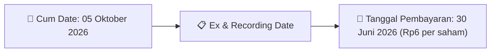

# Ikhtisar Pasar Harian (Daily Digest) - 2026-09-25

📅 **2026-09-25 (Daily Digest)**

## 1. Radar Pasar & Sentimen Harian (Executive Dashboard)
> [!NOTE]
> Terdeteksi sebanyak **152 pengumuman baru** dari 54 emiten pantauan pada (2026-09-25).

| Metric | Jumlah | Status Radar |
| :--- | :---: | :--- |
| **🟢 Sentimen Bullish / Positif** | `1` | [[Dividen Interim]], [[Mandatory Tender Offer]], Kinerja Positif |
| **⚪ Sentimen Netral / Routine** | `63` | [[Tanggapan Penjelasan Bursa]], [[RUPS]], [[Pendaftaran Unit]] |
| **🔴 Sentimen Bearish / Alert** | `4` | Sengketa Hukum, Defisit / Gugatan (Nihil hari ini) |
| **📄 [[Laporan Keuangan]] Baru** | `6` | Memicu Analisis Keuangan Otomatis |

> [!IMPORTANT]
> **Ditemukan Laporan Keuangan Baru Hari Ini:**
> - **ZONE**: FinancialStatement-2026-II-ZONE ([Buka PDF](file:///g:/My Drive/Model2/reports/raw/ZONE/20260924_ZONE_FinancialStatement-2026-II-ZONE.pdf))
- **ZONE**: 2026 - Checklist Laporan Keuangan MP Q2 ([Buka PDF](file:///g:/My Drive/Model2/reports/raw/ZONE/20260924_ZONE_2026 - Checklist Laporan Keuangan MP Q2.pdf))
- **ZONE**: FinancialStatement-2026-II-ZONE. ([Buka PDF](file:///g:/My Drive/Model2/reports/raw/ZONE/20260924_ZONE_FinancialStatement-2026-II-ZONE.xlsx))
- **APII**: FinancialStatement-2026-II-APII ([Buka PDF](file:///g:/My Drive/Model2/reports/raw/APII/20260924_APII_FinancialStatement-2026-II-APII.pdf))
- **APII**: FinancialStatement-2026-II-APII. ([Buka PDF](file:///g:/My Drive/Model2/reports/raw/APII/20260924_APII_FinancialStatement-2026-II-APII.xlsx))
- **APII**: Surat Penyampaian Laporan Keuangan ([Buka PDF](file:///g:/My Drive/Model2/reports/raw/APII/20260924_APII_Surat Penyampaian Laporan Keuangan.pdf))
> 
> *Tugas Swarm Agent:* Lakukan analisis laporan keuangan mendalam per emiten secara terpisah untuk berkas-berkas di atas.

---

## 2. Sorotan Utama & Watchlist Strategis (Strategic Watchlist)
#### 💰 Watchlist Dividen & Distribution
- **[[NICL]]**: Nominal Dividen = Rp6 per saham
- **[[NICL]]**: Total Dividen = Rp63.81 Miliar
- **[[NICL]]**: Cum Date = 05 Oktober 2026
- **[[NICL]]**: Ex Date = 06 Oktober 2026
- **[[NICL]]**: Recording Date = 02 Oktober 2026
- **[[NICL]]**: Tanggal Pembayaran = 30 Juni 2026

#### 🎯 Watchlist Penawaran Tender Wajib (MTO) & Strategis
- **[[NASI]]**: Rencana Pemegang Saham Utama dan Pengendali = [[Tidak terdapat rencana apa pun dari para pemegang saham terkait kepemilikan sahamnya di Perseroan]]

#### 📈 Watchlist Konversi Waran & Potensi Dilusi
- **[[MPRO]]**: Jenis Penawaran Umum = IPO Saham
- **[[MPRO]]**: Jumlah Hasil Penawaran Umum = 164,175,000,000 IDR
- **[[MPRO]]**: Biaya Penawaran Umum = 7,828,589,963 IDR
- **[[MPRO]]**: Rincian Biaya Penawaran Umum = Biaya jasa penjaminan: 1,641,750,000 (1%); Biaya jasa penyelenggaraan: 602,000,000 (0.37%); Biaya jasa penjualan: 378,946,028 (0.23%); Biaya jasa profesi penunjang pasar modal: 1,709,545,454 (1.04%); Biaya jasa lembaga penunjang pasar modal: 117,125,000 (0.07%); Biaya jasa konsultasi keuangan: 1,049,547,000 (0.64%); Biaya lain-lain: 2,329,676,481 (1.42%)

#### 👥 Watchlist Transaksi Orang Dalam & Kepemilikan Saham (Insider / Repo Moves)
- **[[NASI]]**: Tanggal dan Waktu Pelaporan = 23-09-2026 18:33
- **[[SEMA]]**: Tanggal dan waktu pelaporan = 23-09-2026 20:29
- **[[IMPC]]**: Nama Insider = TUNGGAL JAYA INVESTAMA
- **[[IMPC]]**: Jabatan = Tidak
- **[[SRTG]]**: Nama Insider = EDWIN SOERYADJAYA
- **[[MRAT]]**: Nama Insider = JODI ANDREA SURYO KUSUMO
- **[[NSSS]]**: Nama Insider = SAMUEL TUMBUH BERSAMA
- **[[NSSS]]**: Nama Insider = SAMUEL SEKURITAS INDONESIA

---

## 3. Matriks Pengumuman Pasar (Announcements Intelligence Table)
| Emiten | Sentimen | Jenis Pengumuman | Judul Pengumuman | Berkas |
| :--- | :---: | :--- | :--- | :--- |
| **[[PIPA]]** | ⚪ NEUTRAL | Aksi Korporasi | Laporan Penggunaan Dana Hasil Penawaran Umum | [Utama](file:///g:/My%20Drive/Model2/reports/raw/PIPA/20260923_PIPA_20260923_PIPA_Laporan Penggunaan Dana Hasil Penawaran Umum_32150722.pdf) |
| **[[BSML]]** | ⚪ NEUTRAL | RUPS | Pengumuman RUPS | [Utama](file:///g:/My%20Drive/Model2/reports/raw/BSML/20260923_BSML_20260923_BSML_Pengumuman RUPS_32150504.pdf) · [Lamp 1](file:///g:/My%20Drive/Model2/reports/raw/BSML/20260923_BSML_20260923_BSML_Pengumuman RUPS_32150504_lamp1.pdf) |
| **[[NICK]]** | ⚪ NEUTRAL | Aksi Korporasi | Tanggapan atas Permintaan Penjelasan Bursa | [Utama](file:///g:/My%20Drive/Model2/reports/raw/NICK/20260923_NICK_20260923_NICK_Tanggapan atas Permintaan Penjelasan Bursa_32150610.pdf) · [Lamp 1](file:///g:/My%20Drive/Model2/reports/raw/NICK/20260923_NICK_20260923_NICK_Tanggapan atas Permintaan Penjelasan Bursa_32150610_lamp1.pdf) |
| **[[MGLV]]** | ⚪ NEUTRAL | Aksi Korporasi | Informasi Transaksi Afiliasi | [Utama](file:///g:/My%20Drive/Model2/reports/raw/MGLV/20260923_MGLV_20260923_MGLV_Informasi Transaksi Afiliasi_32150706.pdf) |
| **[[MGLV]]** | ⚪ NEUTRAL | RUPS | Transaksi Material Tanpa Persetujuan RUPS | [Utama](file:///g:/My%20Drive/Model2/reports/raw/MGLV/20260924_MGLV_20260924_MGLV_Transaksi Material Tanpa Persetujuan RUPS_32150745.pdf) · [Lamp 1](file:///g:/My%20Drive/Model2/reports/raw/MGLV/20260924_MGLV_20260924_MGLV_Transaksi Material Tanpa Persetujuan RUPS_32150749_lamp1.pdf) · [Lamp 1](file:///g:/My%20Drive/Model2/reports/raw/MGLV/20260924_MGLV_20260924_MGLV_Transaksi Material Tanpa Persetujuan RUPS_32150745_lamp1.pdf) |
| **[[BIKE]]** | ⚪ NEUTRAL | Public Expose | Public Expose | [Utama](file:///g:/My%20Drive/Model2/reports/raw/BIKE/20260923_BIKE_20260923_BIKE_Public Expose_32150728.pdf) · [Lamp 1](file:///g:/My%20Drive/Model2/reports/raw/BIKE/20260923_BIKE_20260923_BIKE_Public Expose_32150728_lamp1.pdf) · [Lamp 2](file:///g:/My%20Drive/Model2/reports/raw/BIKE/20260923_BIKE_20260923_BIKE_Public Expose_32150728_lamp2.pdf) |
| **[[BIKE]]** | ⚪ NEUTRAL | RUPS | Pengumuman RUPS | [Utama](file:///g:/My%20Drive/Model2/reports/raw/BIKE/20260924_BIKE_20260924_BIKE_Pengumuman RUPS_32150729.pdf) |
| **[[TSPC]]** | ⚪ NEUTRAL | Aksi Korporasi | Laporan Informasi dan Fakta Material | [Utama](file:///g:/My%20Drive/Model2/reports/raw/TSPC/20260923_TSPC_20260923_TSPC_Laporan Informasi dan Fakta Material_32150632.pdf) |
| **[[TSPC]]** | ⚪ NEUTRAL | Aksi Korporasi | Tanggapan atas Permintaan Penjelasan Bursa | [Utama](file:///g:/My%20Drive/Model2/reports/raw/TSPC/20260924_TSPC_20260924_TSPC_Tanggapan atas Permintaan Penjelasan Bursa_32150780.pdf) |
| **[[WSKT]]** | ⚪ NEUTRAL | Aksi Korporasi | Laporan Informasi dan Fakta Material | [Utama](file:///g:/My%20Drive/Model2/reports/raw/WSKT/20260923_WSKT_20260923_WSKT_Laporan Informasi dan Fakta Material_32150656.pdf) · [Lamp 1](file:///g:/My%20Drive/Model2/reports/raw/WSKT/20260923_WSKT_20260923_WSKT_Laporan Informasi dan Fakta Material_32150656_lamp1.pdf) |
| **[[WSKT]]** | 🔴 BEARISH | Aksi Korporasi | Suspensi dan Pembukaan Suspensi | [Utama](file:///g:/My%20Drive/Model2/reports/raw/WSKT/20260924_WSKT_20260924_Suspensi dan Pembukaan Suspensi_32150737.pdf) · [Lamp 1](file:///g:/My%20Drive/Model2/reports/raw/WSKT/20260924_WSKT_20260924_Suspensi dan Pembukaan Suspensi_32150737_lamp1.pdf) |
| **[[HYGN]]** | ⚪ NEUTRAL | Public Expose | Public Expose | [Utama](file:///g:/My%20Drive/Model2/reports/raw/HYGN/20260923_HYGN_20260923_HYGN_Public Expose_32150721.pdf) · [Lamp 1](file:///g:/My%20Drive/Model2/reports/raw/HYGN/20260923_HYGN_20260923_HYGN_Public Expose_32150721_lamp1.pdf) |
| **[[NASI]]** | ⚪ NEUTRAL | Aksi Korporasi | Tanggapan atas Permintaan Penjelasan Bursa | [Utama](file:///g:/My%20Drive/Model2/reports/raw/NASI/20260923_NASI_20260923_NASI_Tanggapan atas Permintaan Penjelasan Bursa_32150696.pdf) |
| **[[JARR]]** | ⚪ NEUTRAL | Aksi Korporasi | Tanggapan atas Permintaan Penjelasan Bursa | [Utama](file:///g:/My%20Drive/Model2/reports/raw/JARR/20260923_JARR_20260923_JARR_Tanggapan atas Permintaan Penjelasan Bursa_32150712.pdf) · [Lamp 1](file:///g:/My%20Drive/Model2/reports/raw/JARR/20260923_JARR_20260923_JARR_Tanggapan atas Permintaan Penjelasan Bursa_32150712_lamp1.pdf) |
| **[[ASLI]]** | ⚪ NEUTRAL | Aksi Korporasi | Laporan Informasi dan Fakta Material | [Utama](file:///g:/My%20Drive/Model2/reports/raw/ASLI/20260923_ASLI_20260923_ASLI_Laporan Informasi dan Fakta Material_32150725.pdf) · [Lamp 1](file:///g:/My%20Drive/Model2/reports/raw/ASLI/20260923_ASLI_20260923_ASLI_Laporan Informasi dan Fakta Material_32150725_lamp1.pdf) |
| **[[SEMA]]** | ⚪ NEUTRAL | Aksi Korporasi | Tanggapan atas Permintaan Penjelasan Bursa | [Utama](file:///g:/My%20Drive/Model2/reports/raw/SEMA/20260923_SEMA_20260923_SEMA_Tanggapan atas Permintaan Penjelasan Bursa_32150717.pdf) |
| **[[PRDL]]** | ⚪ NEUTRAL | Aksi Korporasi | Laporan Penggunaan Dana Hasil Penawaran Umum | [Utama](file:///g:/My%20Drive/Model2/reports/raw/PRDL/20260923_PRDL_20260923_PRDL_Laporan Penggunaan Dana Hasil Penawaran Umum_32150564.pdf) · [Lamp 1](file:///g:/My%20Drive/Model2/reports/raw/PRDL/20260923_PRDL_20260923_PRDL_Laporan Penggunaan Dana Hasil Penawaran Umum_32150564_lamp1.pdf) |
| **[[IMPC]]** | ⚪ NEUTRAL | Kepemilikan Saham (Insider) | LK-24092026-8391-00 | [Utama](file:///g:/My%20Drive/Model2/reports/raw/IMPC/20260924_IMPC_LK-24092026-8391-00.pdf) |
| **[[SRTG]]** | ⚪ NEUTRAL | Kepemilikan Saham (Insider) | LK-24092026-4856-00 | [Utama](file:///g:/My%20Drive/Model2/reports/raw/SRTG/20260924_SRTG_LK-24092026-4856-00.pdf) |
| **[[IPCM]]** | ⚪ NEUTRAL | RUPS | Ringkasan RisalahRisalah RUPS | [Utama](file:///g:/My%20Drive/Model2/reports/raw/IPCM/20260924_IPCM_20260924_IPCM_Ringkasan RisalahRisalah RUPS_32150882.pdf) · [Lamp 1](file:///g:/My%20Drive/Model2/reports/raw/IPCM/20260924_IPCM_20260924_IPCM_Ringkasan RisalahRisalah RUPS_32150882_lamp1.pdf) |
| **[[UVCR]]** | ⚪ NEUTRAL | Aksi Korporasi | Tanggapan atas Permintaan Penjelasan Bursa | [Utama](file:///g:/My%20Drive/Model2/reports/raw/UVCR/20260924_UVCR_20260924_UVCR_Tanggapan atas Permintaan Penjelasan Bursa_32150804.pdf) · [Lamp 1](file:///g:/My%20Drive/Model2/reports/raw/UVCR/20260924_UVCR_20260924_UVCR_Tanggapan atas Permintaan Penjelasan Bursa_32150804_lamp1.pdf) |
| **[[MRAT]]** | ⚪ NEUTRAL | Kepemilikan Saham (Insider) | LK-24092026-7659-00 | [Utama](file:///g:/My%20Drive/Model2/reports/raw/MRAT/20260924_MRAT_LK-24092026-7659-00.pdf) |
| **[[NSSS]]** | ⚪ NEUTRAL | Kepemilikan Saham (Insider) | LK-24092026-4545-00 | [Utama](file:///g:/My%20Drive/Model2/reports/raw/NSSS/20260924_NSSS_LK-24092026-4545-00.pdf) |
| **[[NSSS]]** | ⚪ NEUTRAL | Kepemilikan Saham (Insider) | LK-24092026-4495-00 | [Utama](file:///g:/My%20Drive/Model2/reports/raw/NSSS/20260924_NSSS_LK-24092026-4495-00.pdf) |
| **[[SMFP]]** | ⚪ NEUTRAL | Aksi Korporasi | Laporan Informasi dan Fakta Material | [Utama](file:///g:/My%20Drive/Model2/reports/raw/SMFP/20260924_SMFP_20260924_SMFP_Laporan Informasi dan Fakta Material_32150771.pdf) · [Lamp 1](file:///g:/My%20Drive/Model2/reports/raw/SMFP/20260924_SMFP_20260924_SMFP_Laporan Informasi dan Fakta Material_32150775_lamp1.pdf) · [Lamp 1](file:///g:/My%20Drive/Model2/reports/raw/SMFP/20260924_SMFP_20260924_SMFP_Laporan Informasi dan Fakta Material_32150773_lamp1.pdf) · [Lamp 1](file:///g:/My%20Drive/Model2/reports/raw/SMFP/20260924_SMFP_20260924_SMFP_Laporan Informasi dan Fakta Material_32150771_lamp1.pdf) |
| **[[SMRA]]** | ⚪ NEUTRAL | Aksi Korporasi | Pembayaran KuponBagi HasilIjarahPokok | [Utama](file:///g:/My%20Drive/Model2/reports/raw/SMRA/20260924_SMRA_20260924_SMRA_Pembayaran KuponBagi HasilIjarahPokok_32150755.pdf) |
| **[[ZONE]]** | ⚪ NEUTRAL | Laporan Keuangan | FinancialStatement-2026-II-ZONE | [Utama](file:///g:/My%20Drive/Model2/reports/raw/ZONE/20260924_ZONE_FinancialStatement-2026-II-ZONE.pdf) |
| **[[ZONE]]** | ⚪ NEUTRAL | Laporan Keuangan | 2026 - Checklist Laporan Keuangan MP Q2 | [Utama](file:///g:/My%20Drive/Model2/reports/raw/ZONE/20260924_ZONE_2026 - Checklist Laporan Keuangan MP Q2.pdf) |
| **[[ZONE]]** | ⚪ NEUTRAL | Laporan Keuangan | FinancialStatement-2026-II-ZONE. | [Utama](file:///g:/My%20Drive/Model2/reports/raw/ZONE/20260924_ZONE_FinancialStatement-2026-II-ZONE.xlsx) |
| **[[ZONE]]** | 🔴 BEARISH | Aksi Korporasi | KI Kenaikan Penurunan Q2 2026 | [Utama](file:///g:/My%20Drive/Model2/reports/raw/ZONE/20260924_ZONE_KI Kenaikan Penurunan Q2 2026.pdf) |
| **[[ZONE]]** | ⚪ NEUTRAL | Aksi Korporasi | PT Mega Perintis Tbk Jun 2026 Q2 R.1 | [Utama](file:///g:/My%20Drive/Model2/reports/raw/ZONE/20260924_ZONE_PT Mega Perintis Tbk Jun 2026 Q2 R.1.pdf) |
| **[[ZONE]]** | ⚪ NEUTRAL | Aksi Korporasi | SPD Q2 26 | [Utama](file:///g:/My%20Drive/Model2/reports/raw/ZONE/20260924_ZONE_SPD Q2 26.pdf) |
| **[[DMAS]]** | ⚪ NEUTRAL | RUPS | Ringkasan RisalahRisalah RUPS | [Utama](file:///g:/My%20Drive/Model2/reports/raw/DMAS/20260924_DMAS_20260924_DMAS_Ringkasan RisalahRisalah RUPS_32150879.pdf) |
| **[[CASH]]** | ⚪ NEUTRAL | Public Expose | Public Expose | [Utama](file:///g:/My%20Drive/Model2/reports/raw/CASH/20260924_CASH_20260924_CASH_Public Expose_32150783.pdf) · [Lamp 1](file:///g:/My%20Drive/Model2/reports/raw/CASH/20260924_CASH_20260924_CASH_Public Expose_32150783_lamp1.pdf) |
| **[[OILS]]** | ⚪ NEUTRAL | RUPS | Ringkasan RisalahRisalah RUPS | [Utama](file:///g:/My%20Drive/Model2/reports/raw/OILS/20260924_OILS_20260923_OILS_Ringkasan RisalahRisalah RUPS_32150620.pdf) |
| **[[ALKA]]** | ⚪ NEUTRAL | Aksi Korporasi | Tanggapan atas Permintaan Penjelasan Bursa | [Utama](file:///g:/My%20Drive/Model2/reports/raw/ALKA/20260924_ALKA_20260924_ALKA_Tanggapan atas Permintaan Penjelasan Bursa_32150888.pdf) |
| **[[TAPG]]** | ⚪ NEUTRAL | Kepemilikan Saham (Insider) | LK-24092026-7754-00 | [Utama](file:///g:/My%20Drive/Model2/reports/raw/TAPG/20260924_TAPG_LK-24092026-7754-00.pdf) |
| **[[AKPI]]** | ⚪ NEUTRAL | Kepemilikan Saham (Insider) | LK-24092026-2165-00 | [Utama](file:///g:/My%20Drive/Model2/reports/raw/AKPI/20260924_AKPI_LK-24092026-2165-00.pdf) |
| **[[HRTA]]** | ⚪ NEUTRAL | RUPS | Pemanggilan RUPS | [Utama](file:///g:/My%20Drive/Model2/reports/raw/HRTA/20260924_HRTA_20260924_HRTA_Pemanggilan RUPS_32150746.pdf) · [Lamp 1](file:///g:/My%20Drive/Model2/reports/raw/HRTA/20260924_HRTA_20260924_HRTA_Pemanggilan RUPS_32150746_lamp1.pdf) · [Lamp 2](file:///g:/My%20Drive/Model2/reports/raw/HRTA/20260924_HRTA_20260924_HRTA_Pemanggilan RUPS_32150746_lamp2.pdf) |
| **[[LABA]]** | ⚪ NEUTRAL | Aksi Korporasi | Laporan Informasi dan Fakta Material | [Utama](file:///g:/My%20Drive/Model2/reports/raw/LABA/20260924_LABA_20260924_LABA_Laporan Informasi dan Fakta Material_32150823.pdf) · [Lamp 1](file:///g:/My%20Drive/Model2/reports/raw/LABA/20260924_LABA_20260924_LABA_Laporan Informasi dan Fakta Material_32150823_lamp1.pdf) |
| **[[APII]]** | ⚪ NEUTRAL | Laporan Keuangan | FinancialStatement-2026-II-APII | [Utama](file:///g:/My%20Drive/Model2/reports/raw/APII/20260924_APII_FinancialStatement-2026-II-APII.pdf) |
| **[[APII]]** | ⚪ NEUTRAL | Laporan Keuangan | FinancialStatement-2026-II-APII. | [Utama](file:///g:/My%20Drive/Model2/reports/raw/APII/20260924_APII_FinancialStatement-2026-II-APII.xlsx) |
| **[[APII]]** | 🔴 BEARISH | Aksi Korporasi | PT Arita Prima Indonesia Tbk 30 Juni 2026 (Final) | [Utama](file:///g:/My%20Drive/Model2/reports/raw/APII/20260924_APII_PT Arita Prima Indonesia Tbk 30 Juni 2026 (Final).pdf) |
| **[[APII]]** | ⚪ NEUTRAL | Laporan Keuangan | Surat Penyampaian Laporan Keuangan | [Utama](file:///g:/My%20Drive/Model2/reports/raw/APII/20260924_APII_Surat Penyampaian Laporan Keuangan.pdf) |
| **[[MPRO]]** | ⚪ NEUTRAL | Aksi Korporasi | Laporan Penggunaan Dana Hasil Penawaran Umum | [Utama](file:///g:/My%20Drive/Model2/reports/raw/MPRO/20260924_MPRO_20260924_MPRO_Laporan Penggunaan Dana Hasil Penawaran Umum_32150744.pdf) |
| **[[WIFI]]** | ⚪ NEUTRAL | RUPS | Pengumuman RUPS | [Utama](file:///g:/My%20Drive/Model2/reports/raw/WIFI/20260924_WIFI_20260923_WIFI_Pengumuman RUPS_32150678.pdf) · [Lamp 1](file:///g:/My%20Drive/Model2/reports/raw/WIFI/20260924_WIFI_20260923_WIFI_Pengumuman RUPS_32150678_lamp1.pdf) |
| **[[DPNS]]** | ⚪ NEUTRAL | Aksi Korporasi | Sanksi | [Utama](file:///g:/My%20Drive/Model2/reports/raw/DPNS/20260924_DPNS_20260924_DPNS_Sanksi_32150776.pdf) · [Lamp 2](file:///g:/My%20Drive/Model2/reports/raw/DPNS/20260924_DPNS_20260924_DPNS_Sanksi_32150776_lamp2.pdf) · [Lamp 1](file:///g:/My%20Drive/Model2/reports/raw/DPNS/20260924_DPNS_20260924_DPNS_Sanksi_32150776_lamp1.pdf) |
| **[[MERK]]** | ⚪ NEUTRAL | Public Expose | Public Expose | [Utama](file:///g:/My%20Drive/Model2/reports/raw/MERK/20260924_MERK_20260924_MERK_Public Expose_32150902.pdf) |
| **[[MERK]]** | ⚪ NEUTRAL | Aksi Korporasi | Laporan Informasi dan Fakta Material | [Utama](file:///g:/My%20Drive/Model2/reports/raw/MERK/20260924_MERK_20260924_MERK_Laporan Informasi dan Fakta Material_32150872.pdf) · [Lamp 1](file:///g:/My%20Drive/Model2/reports/raw/MERK/20260924_MERK_20260924_MERK_Laporan Informasi dan Fakta Material_32150872_lamp1.pdf) |
| **[[BATA]]** | ⚪ NEUTRAL | Aksi Korporasi | Laporan Informasi dan Fakta Material | [Utama](file:///g:/My%20Drive/Model2/reports/raw/BATA/20260924_BATA_20260924_BATA_Laporan Informasi dan Fakta Material_32150810.pdf) · [Lamp 1](file:///g:/My%20Drive/Model2/reports/raw/BATA/20260924_BATA_20260924_BATA_Laporan Informasi dan Fakta Material_32150810_lamp1.pdf) |
| **[[JAST]]** | ⚪ NEUTRAL | Aksi Korporasi | Laporan Informasi dan Fakta Material | [Utama](file:///g:/My%20Drive/Model2/reports/raw/JAST/20260924_JAST_20260924_JAST_Laporan Informasi dan Fakta Material_32150809.pdf) · [Lamp 1](file:///g:/My%20Drive/Model2/reports/raw/JAST/20260924_JAST_20260924_JAST_Laporan Informasi dan Fakta Material_32150809_lamp1.pdf) |
| **[[POOL]]** | ⚪ NEUTRAL | RUPS | Ringkasan RisalahRisalah RUPS | [Utama](file:///g:/My%20Drive/Model2/reports/raw/POOL/20260924_POOL_20260924_POOL_Ringkasan RisalahRisalah RUPS_32150843.pdf) · [Lamp 1](file:///g:/My%20Drive/Model2/reports/raw/POOL/20260924_POOL_20260924_POOL_Ringkasan RisalahRisalah RUPS_32150843_lamp1.pdf) |
| **[[MPIX]]** | ⚪ NEUTRAL | Aksi Korporasi | Tanggapan atas Permintaan Penjelasan Bursa | [Utama](file:///g:/My%20Drive/Model2/reports/raw/MPIX/20260924_MPIX_20260924_MPIX_Tanggapan atas Permintaan Penjelasan Bursa_32150849.pdf) · [Lamp 1](file:///g:/My%20Drive/Model2/reports/raw/MPIX/20260924_MPIX_20260924_MPIX_Tanggapan atas Permintaan Penjelasan Bursa_32150849_lamp1.pdf) |
| **[[MAYA]]** | ⚪ NEUTRAL | Aksi Korporasi | Tanggapan atas Permintaan Penjelasan Bursa | [Utama](file:///g:/My%20Drive/Model2/reports/raw/MAYA/20260924_MAYA_20260924_MAYA_Tanggapan atas Permintaan Penjelasan Bursa_32150876.pdf) |
| **[[IBOS]]** | ⚪ NEUTRAL | RUPS | Pemanggilan RUPS | [Utama](file:///g:/My%20Drive/Model2/reports/raw/IBOS/20260924_IBOS_20260924_IBOS_Pemanggilan RUPS_32150901.pdf) · [Lamp 1](file:///g:/My%20Drive/Model2/reports/raw/IBOS/20260924_IBOS_20260924_IBOS_Pemanggilan RUPS_32150901_lamp1.pdf) |
| **[[PTRO]]** | ⚪ NEUTRAL | Aksi Korporasi | Pengumuman Bursa | [Utama](file:///g:/My%20Drive/Model2/reports/raw/PTRO/20260924_PTRO_20260924_PTRO_Pengumuman Bursa_32150793.pdf) · [Lamp 1](file:///g:/My%20Drive/Model2/reports/raw/PTRO/20260924_PTRO_20260924_PTRO_Pengumuman Bursa_32150793_lamp1.pdf) |
| **[[PPGL]]** | ⚪ NEUTRAL | Kepemilikan Saham (Insider) | LK-24092026-3452-00 | [Utama](file:///g:/My%20Drive/Model2/reports/raw/PPGL/20260924_PPGL_LK-24092026-3452-00.pdf) |
| **[[TRUE]]** | ⚪ NEUTRAL | Aksi Korporasi | Tanggapan atas Permintaan Penjelasan Bursa | [Utama](file:///g:/My%20Drive/Model2/reports/raw/TRUE/20260924_TRUE_20260924_TRUE_Tanggapan atas Permintaan Penjelasan Bursa_32150759.pdf) · [Lamp 1](file:///g:/My%20Drive/Model2/reports/raw/TRUE/20260924_TRUE_20260924_TRUE_Tanggapan atas Permintaan Penjelasan Bursa_32150759_lamp1.pdf) |
| **[[BYAN]]** | ⚪ NEUTRAL | Aksi Korporasi | Laporan Informasi dan Fakta Material | [Utama](file:///g:/My%20Drive/Model2/reports/raw/BYAN/20260924_BYAN_20260924_BYAN_Laporan Informasi dan Fakta Material_32150734.pdf) |
| **[[LPPI]]** | ⚪ NEUTRAL | Aksi Korporasi | Laporan Informasi dan Fakta Material | [Utama](file:///g:/My%20Drive/Model2/reports/raw/LPPI/20260924_LPPI_20260922_LPPI_Laporan Informasi dan Fakta Material_32150253.pdf) · [Lamp 2](file:///g:/My%20Drive/Model2/reports/raw/LPPI/20260924_LPPI_20260922_LPPI_Laporan Informasi dan Fakta Material_32150253_lamp2.pdf) |
| **[[PART]]** | ⚪ NEUTRAL | Aksi Korporasi | Tanggapan atas Permintaan Penjelasan Bursa | [Utama](file:///g:/My%20Drive/Model2/reports/raw/PART/20260924_PART_20260922_PART_Tanggapan atas Permintaan Penjelasan Bursa_32150297.pdf) · [Lamp 1](file:///g:/My%20Drive/Model2/reports/raw/PART/20260924_PART_20260922_PART_Tanggapan atas Permintaan Penjelasan Bursa_32150297_lamp1.pdf) |
| **[[MOYA]]** | ⚪ NEUTRAL | Aksi Korporasi | Tanggapan atas Permintaan Penjelasan Bursa | [Utama](file:///g:/My%20Drive/Model2/reports/raw/MOYA/20260924_MOYA_20260924_MOYA_Tanggapan atas Permintaan Penjelasan Bursa_32150978.pdf) · [Lamp 1](file:///g:/My%20Drive/Model2/reports/raw/MOYA/20260924_MOYA_20260924_MOYA_Tanggapan atas Permintaan Penjelasan Bursa_32150978_lamp1.pdf) |
| **[[AKKU]]** | 🔴 BEARISH | Aksi Korporasi | Suspensi dan Pembukaan Suspensi | [Utama](file:///g:/My%20Drive/Model2/reports/raw/AKKU/20260924_AKKU_20260924_Suspensi dan Pembukaan Suspensi_32150812.pdf) · [Lamp 1](file:///g:/My%20Drive/Model2/reports/raw/AKKU/20260924_AKKU_20260924_Suspensi dan Pembukaan Suspensi_32150812_lamp1.pdf) |
| **[[UNTD]]** | ⚪ NEUTRAL | Public Expose | Public Expose | [Utama](file:///g:/My%20Drive/Model2/reports/raw/UNTD/20260924_UNTD_20260923_UNTD_Public Expose_32150578.pdf) |
| **[[CPIN]]** | ⚪ NEUTRAL | Kepemilikan Saham (Insider) | LK-24092026-5504-00 | [Utama](file:///g:/My%20Drive/Model2/reports/raw/CPIN/20260924_CPIN_LK-24092026-5504-00.pdf) |
| **[[PMUI]]** | ⚪ NEUTRAL | Aksi Korporasi | Laporan Informasi dan Fakta Material | [Utama](file:///g:/My%20Drive/Model2/reports/raw/PMUI/20260924_PMUI_20260924_PMUI_Laporan Informasi dan Fakta Material_32150754.pdf) · [Lamp 1](file:///g:/My%20Drive/Model2/reports/raw/PMUI/20260924_PMUI_20260924_PMUI_Laporan Informasi dan Fakta Material_32150754_lamp1.pdf) |
| **[[BPTR]]** | ⚪ NEUTRAL | Aksi Korporasi | Tanggapan atas Permintaan Penjelasan Bursa | [Utama](file:///g:/My%20Drive/Model2/reports/raw/BPTR/20260924_BPTR_20260924_BPTR_Tanggapan atas Permintaan Penjelasan Bursa_32150767.pdf) |
| **[[NICL]]** | 🟢 BULLISH | Dividen | Jadwal Aksi Korporasi (Khusus Penyampaian Dividen Interim) | [Utama](file:///g:/My%20Drive/Model2/reports/raw/NICL/20260924_NICL_20260924_NICL_Jadwal Aksi Korporasi (Khusus Penyampaian Dividen Interim)_32150910.pdf) |

---

## 4. Detail Informasi per Emiten (Grouped by Emiten)
### 📋 4.2. Detail Emiten Lain (Non-Watchlist)

#### 🔵 [[PIPA]]
- **[Aksi Korporasi]** [Laporan Penggunaan Dana Hasil Penawaran Umum](file:///g:/My%20Drive/Model2/reports/raw/PIPA/20260923_PIPA_20260923_PIPA_Laporan Penggunaan Dana Hasil Penawaran Umum_32150722.pdf)
  - 📌 *Deskripsi*: Pencatatan saham tambahan hasil konversi waran PIPA.

#### 🔵 [[BSML]]
- **[RUPS]** [Pengumuman RUPS](file:///g:/My%20Drive/Model2/reports/raw/BSML/20260923_BSML_20260923_BSML_Pengumuman RUPS_32150504.pdf) *(Attachment: [Lamp 1](file:///g:/My%20Drive/Model2/reports/raw/BSML/20260923_BSML_20260923_BSML_Pengumuman RUPS_32150504_lamp1.pdf))*
  - 📌 *Deskripsi*: Informasi dan fakta material BSML: No : 065/DIR-BSML/IX/2026 PENGUMUMAN RAPAT UMUM PEMEGANG SAHAM LUAR BIASA PT BINTANG SAMUDERA MANDIRI LINES TBK Direksi PT Bintang Samudera Mandiri Lines Tbk ("Perseroan") dengan ini mengumumkan kepada para Pemegang Saham bahwa Perseroan akan menyelenggarakan Rapat Umum Pemegang Saham Luar Biasa ("Rapat") pada hari Jumat, tanggal 30 Oktober 2026 bertempat di Jakarta. Sesuai dengan ketentuan dalam Anggaran Dasar Perseroan dan dengan memperhatikan Peraturan Otoritas Jasa Keuangan No. 15/POJK.04/20
  - 📊 **Fakta Material**:
    - **Uraian Kejadian**: No : 065/DIR-BSML/IX/2026 PENGUMUMAN RAPAT UMUM PEMEGANG SAHAM LUAR BIASA PT BINTANG SAMUDERA MANDIRI LINES TBK Direksi PT Bintang Samudera Mandiri Lines Tbk ("Perseroan") dengan ini mengumumkan kepada para Pemegang Saham bahwa Perseroan akan menyelenggarakan Rapat Umum Pemegang Saham Luar Biasa ("Rapat") pada hari Jumat, tanggal 30 Oktober 2026 bertempat di Jakarta. Sesuai dengan ketentuan dalam Anggaran Dasar Perseroan dan dengan memperhatikan Peraturan Otoritas Jasa Keuangan No. 15/POJK.04/20

#### 🔵 [[NICK]]
- **[Aksi Korporasi]** [Tanggapan atas Permintaan Penjelasan Bursa](file:///g:/My%20Drive/Model2/reports/raw/NICK/20260923_NICK_20260923_NICK_Tanggapan atas Permintaan Penjelasan Bursa_32150610.pdf) *(Attachment: [Lamp 1](file:///g:/My%20Drive/Model2/reports/raw/NICK/20260923_NICK_20260923_NICK_Tanggapan atas Permintaan Penjelasan Bursa_32150610_lamp1.pdf))*
  - 📌 *Deskripsi*: PT Charnic Capital Tbk. (NICK) menyampaikan tanggapan atas permintaan penjelasan Bursa Efek Indonesia terkait surat Bursa nomor S-12259/BEI.PP2/09-2026 tanggal 22 September 2026. Tanggapan disampaikan oleh Nicholas Santoso selaku Corsec pada 23 September 2026 pukul 20:49.
  - 📊 **Fakta Material**:
    - **Nomor Surat Tanggapan**: 057/CC/IX/2026
    - **Perihal**: Penjelasan atas Permintaan Penjelasan Bursa
    - **Nomor Surat Bursa**: S-12259/BEI.PP2/09-2026
    - **Tanggal Surat Bursa**: 2026-09-22
    - **Nama Pengirim**: PT Charnic Capital Tbk.
    - **Nama Penandatangan**: Nicholas Santoso
    - **Jabatan**: Corsec
    - **Tanggal dan Waktu Penyampaian**: 2026-09-23 20:49
    - **Lampiran**: 260923 Surat Tanggapan 023.pdf

#### 🔵 [[MGLV]]
- **[Aksi Korporasi]** [Informasi Transaksi Afiliasi](file:///g:/My%20Drive/Model2/reports/raw/MGLV/20260923_MGLV_20260923_MGLV_Informasi Transaksi Afiliasi_32150706.pdf)
  - 📌 *Deskripsi*: Informasi dan fakta material MGLV: 052S/Dir-NexAI/IX/2026 PT NexAI Digital Infrastruktur Tbk MGLV 1 Transaksi Afiliasi Perseroan menyampaikan informasi tentang Transaksi Afiliasi sebagai berikut : Tanggal Transaksi Obyek Transaksi Nilai Transaksi 21 September 2026 10.754.099.000.000 Penandatanganan dokumen terkait Transaksi Transaksi Afiliasi Penjelasan, pertimbangan, dan alasan dilakukannya Transaksi Afiliasi Nama Pihak Sifat Hubungan Afiliasi (jika ada) Perseroan Afiliasi NAC (PT Nextier Askara Center ) Afiliasi NGC (PT Nextier
  - 📊 **Fakta Material**:
    - **Uraian Kejadian**: 052S/Dir-NexAI/IX/2026 PT NexAI Digital Infrastruktur Tbk MGLV 1 Transaksi Afiliasi Perseroan menyampaikan informasi tentang Transaksi Afiliasi sebagai berikut : Tanggal Transaksi Obyek Transaksi Nilai Transaksi 21 September 2026 10.754.099.000.000 Penandatanganan dokumen terkait Transaksi Transaksi Afiliasi Penjelasan, pertimbangan, dan alasan dilakukannya Transaksi Afiliasi Nama Pihak Sifat Hubungan Afiliasi (jika ada) Perseroan Afiliasi NAC (PT Nextier Askara Center ) Afiliasi NGC (PT Nextier
- **[RUPS]** [Transaksi Material Tanpa Persetujuan RUPS](file:///g:/My%20Drive/Model2/reports/raw/MGLV/20260924_MGLV_20260924_MGLV_Transaksi Material Tanpa Persetujuan RUPS_32150745.pdf) *(Attachment: [Lamp 1](file:///g:/My%20Drive/Model2/reports/raw/MGLV/20260924_MGLV_20260924_MGLV_Transaksi Material Tanpa Persetujuan RUPS_32150749_lamp1.pdf) · [Lamp 1](file:///g:/My%20Drive/Model2/reports/raw/MGLV/20260924_MGLV_20260924_MGLV_Transaksi Material Tanpa Persetujuan RUPS_32150745_lamp1.pdf))*
  - 📌 *Deskripsi*: Informasi dan fakta material MGLV: 1 KETERBUKAAN INFORMASI KEPADA PEMEGANG SAHAM SEHUBUNGAN DENGAN TRANSAKSI MATERIAL DAN TRANSAKSI AFILIASI PT NEXAI DIGITAL INFRASTRUKTUR TBK (“PERSEROAN”) (“KETERBUKAAN INFORMASI”) INFORMASI SEBAGAIMANA TERCANTUM DALAM KETERBUKAAN INFORMASI INI PENTING DAN PERLU DIPERHATIKAN OLEH PEMEGANG SAHAM PERSEROAN SEHUBUNGAN DENGAN TRANSAKSI MATERIAL DAN TRANSAKSI AFILIASI YANG TELAH DILAKUKAN OLEH PERSEROAN DAN PERUSAHAAN ANAK. KETERBUKAAN INFORMASI KEPADA PARA PEMEGANG SAHAM INI DISAMPAIKAN OLEH PERSERO
  - 📊 **Fakta Material**:
    - **Uraian Kejadian**: 1 KETERBUKAAN INFORMASI KEPADA PEMEGANG SAHAM SEHUBUNGAN DENGAN TRANSAKSI MATERIAL DAN TRANSAKSI AFILIASI PT NEXAI DIGITAL INFRASTRUKTUR TBK (“PERSEROAN”) (“KETERBUKAAN INFORMASI”) INFORMASI SEBAGAIMANA TERCANTUM DALAM KETERBUKAAN INFORMASI INI PENTING DAN PERLU DIPERHATIKAN OLEH PEMEGANG SAHAM PERSEROAN SEHUBUNGAN DENGAN TRANSAKSI MATERIAL DAN TRANSAKSI AFILIASI YANG TELAH DILAKUKAN OLEH PERSEROAN DAN PERUSAHAAN ANAK. KETERBUKAAN INFORMASI KEPADA PARA PEMEGANG SAHAM INI DISAMPAIKAN OLEH PERSERO

#### 🔵 [[BIKE]]
- **[Public Expose]** [Public Expose](file:///g:/My%20Drive/Model2/reports/raw/BIKE/20260923_BIKE_20260923_BIKE_Public Expose_32150728.pdf) *(Attachment: [Lamp 1](file:///g:/My%20Drive/Model2/reports/raw/BIKE/20260923_BIKE_20260923_BIKE_Public Expose_32150728_lamp1.pdf) · [Lamp 2](file:///g:/My%20Drive/Model2/reports/raw/BIKE/20260923_BIKE_20260923_BIKE_Public Expose_32150728_lamp2.pdf))*
  - 📌 *Deskripsi*: Informasi dan fakta material BIKE: PUBLIC EXPOSE INSIDENTIL PT BHINEKA INOVASI KETAHANAN ENERGI TBK Jakarta , 24 September 2026 AGENDA 1. Informasi terkait perkembangan kinerja dan operasional terkini Perseroan dan anak perusahaan, 2.Summary Laporan Keuangan terakhir/terkini, 3.Rencana Usaha Perseroan dan anak perusahaan ke depannya, 4.Informasi material lainnya yang belum disampaikan kepada publik. TATA TERTIB PUBLIC EXPOSE INSIDENTIL 1. Public Expose Insidentil diselenggarakan secara Zoom Meeting (Online). 2.Pelaksanaan Public
  - 📊 **Fakta Material**:
    - **Uraian Kejadian**: PUBLIC EXPOSE INSIDENTIL PT BHINEKA INOVASI KETAHANAN ENERGI TBK Jakarta , 24 September 2026 AGENDA 1. Informasi terkait perkembangan kinerja dan operasional terkini Perseroan dan anak perusahaan, 2.Summary Laporan Keuangan terakhir/terkini, 3.Rencana Usaha Perseroan dan anak perusahaan ke depannya, 4.Informasi material lainnya yang belum disampaikan kepada publik. TATA TERTIB PUBLIC EXPOSE INSIDENTIL 1. Public Expose Insidentil diselenggarakan secara Zoom Meeting (Online). 2.Pelaksanaan Public
- **[RUPS]** [Pengumuman RUPS](file:///g:/My%20Drive/Model2/reports/raw/BIKE/20260924_BIKE_20260924_BIKE_Pengumuman RUPS_32150729.pdf)
  - 📌 *Deskripsi*: Informasi dan fakta material BIKE: 2026/264/IX/EK PT Bhineka Inovasi Ketahanan Energi Tbk BIKE 1 Pemberitahuan Penundaan Rapat Umum Pemegang Saham Luar Biasa dan Independen Pengumuman Penundaan RUPS Merujuk pada surat : 2026/235R/IX/BIKE/EK Perseroan menyampaikan penundaan penyelenggaraan Rapat Umum Pemegang Saham pada : Lokasi Penyelenggaraan RUPS (bila sudah dapat diumumkan dan sesuai iklan) : Tanggal Daftar Pemegang Saham (DPS) yang berhak hadir dalam RUPS Selatan 22 September 2026 : Hari/Tanggal/Waktu : Kamis, 15 Oktober 2026
  - 📊 **Fakta Material**:
    - **Uraian Kejadian**: 2026/264/IX/EK PT Bhineka Inovasi Ketahanan Energi Tbk BIKE 1 Pemberitahuan Penundaan Rapat Umum Pemegang Saham Luar Biasa dan Independen Pengumuman Penundaan RUPS Merujuk pada surat : 2026/235R/IX/BIKE/EK Perseroan menyampaikan penundaan penyelenggaraan Rapat Umum Pemegang Saham pada : Lokasi Penyelenggaraan RUPS (bila sudah dapat diumumkan dan sesuai iklan) : Tanggal Daftar Pemegang Saham (DPS) yang berhak hadir dalam RUPS Selatan 22 September 2026 : Hari/Tanggal/Waktu : Kamis, 15 Oktober 2026

#### 🔵 [[TSPC]]
- **[Aksi Korporasi]** [Laporan Informasi dan Fakta Material](file:///g:/My%20Drive/Model2/reports/raw/TSPC/20260923_TSPC_20260923_TSPC_Laporan Informasi dan Fakta Material_32150632.pdf)
  - 📌 *Deskripsi*: Informasi dan fakta material TSPC: 055/CS-L/IX/2026 Tempo Scan Pacific Tbk TSPC 1 Klarifikasi Pemberitaan Dengan ini kami untuk dan atas menyampaikan Laporan Informasi atau Fakta Material sebagai berikut: Nama Emiten atau Perusahaan Publik Tempo Scan Pacific Tbk Bidang Usaha Industri Farmasi Telepon 2921-8888 (5438) Faksimili 2920-9999 Alamat Surat Elektronik (email) investorrelation@thetempogroup.com Tanggal Kejadian 22 September 2026 Jenis Informasi atau Fakta Material Klarifikasi Pemberitaan Uraian Informasi atau Fakta Materia
  - 📊 **Fakta Material**:
    - **Uraian Kejadian**: 055/CS-L/IX/2026 Tempo Scan Pacific Tbk TSPC 1 Klarifikasi Pemberitaan Dengan ini kami untuk dan atas menyampaikan Laporan Informasi atau Fakta Material sebagai berikut: Nama Emiten atau Perusahaan Publik Tempo Scan Pacific Tbk Bidang Usaha Industri Farmasi Telepon 2921-8888 (5438) Faksimili 2920-9999 Alamat Surat Elektronik (email) investorrelation@thetempogroup.com Tanggal Kejadian 22 September 2026 Jenis Informasi atau Fakta Material Klarifikasi Pemberitaan Uraian Informasi atau Fakta Materia
- **[Aksi Korporasi]** [Tanggapan atas Permintaan Penjelasan Bursa](file:///g:/My%20Drive/Model2/reports/raw/TSPC/20260924_TSPC_20260924_TSPC_Tanggapan atas Permintaan Penjelasan Bursa_32150780.pdf)
  - 📌 *Deskripsi*: Perseroan mengonfirmasi TIDAK MENGETAHUI adanya informasi/fakta material lain atau rencana aksi korporasi yang mempengaruhi volatilitas saham.

#### 🔵 [[WSKT]]
- **[Aksi Korporasi]** [Laporan Informasi dan Fakta Material](file:///g:/My%20Drive/Model2/reports/raw/WSKT/20260923_WSKT_20260923_WSKT_Laporan Informasi dan Fakta Material_32150656.pdf) *(Attachment: [Lamp 1](file:///g:/My%20Drive/Model2/reports/raw/WSKT/20260923_WSKT_20260923_WSKT_Laporan Informasi dan Fakta Material_32150656_lamp1.pdf))*
  - 📌 *Deskripsi*: Informasi dan fakta material WSKT: Nomor : 997/WK/DIR/2026 Jakarta, 23 September 2026 Kepada Yth. : Direktur Utama PT Bursa Efek Indonesia Up. Bpk Jeffrey Hendrik : Laporan Kesiapan Dana Bunga dan Pokok atas Obligasi III Tahun 2021 Seri A Dengan hormat, Berdasarkan Peraturan Bursa Efek Indonesia Nomor I-E tentang Kewajiban Penyampaian Informasi pasal IV.2.12 dan sehubungan dengan adanya jatuh tempo Obligasi III Tahun 2021 Seri A pada tanggal 24 September 2026, bersama ini kami sampaikan hal-hal sebagai berikut: 1. Sejak 20 Agustu
  - 📊 **Fakta Material**:
    - **Uraian Kejadian**: Nomor : 997/WK/DIR/2026 Jakarta, 23 September 2026 Kepada Yth. : Direktur Utama PT Bursa Efek Indonesia Up. Bpk Jeffrey Hendrik : Laporan Kesiapan Dana Bunga dan Pokok atas Obligasi III Tahun 2021 Seri A Dengan hormat, Berdasarkan Peraturan Bursa Efek Indonesia Nomor I-E tentang Kewajiban Penyampaian Informasi pasal IV.2.12 dan sehubungan dengan adanya jatuh tempo Obligasi III Tahun 2021 Seri A pada tanggal 24 September 2026, bersama ini kami sampaikan hal-hal sebagai berikut: 1. Sejak 20 Agustu
- **[Aksi Korporasi]** [Suspensi dan Pembukaan Suspensi](file:///g:/My%20Drive/Model2/reports/raw/WSKT/20260924_WSKT_20260924_Suspensi dan Pembukaan Suspensi_32150737.pdf) *(Attachment: [Lamp 1](file:///g:/My%20Drive/Model2/reports/raw/WSKT/20260924_WSKT_20260924_Suspensi dan Pembukaan Suspensi_32150737_lamp1.pdf))*
  - 📌 *Deskripsi*: Bursa Efek Indonesia mengumumkan penghentian sementara perdagangan efek WSKT karena tidak memenuhi kewajiban pembayaran kupon dan/atau pokok. Suspensi dimulai pada 24 September 2026 Sesi I untuk seluruh pasar dan merupakan kelanjutan suspensi.
  - 📊 **Fakta Material**:
    - **Kode Efek**: WSKT
    - **Nama Emiten**: PT Waskita Karya (Persero) Tbk
    - **Penyebab Suspensi**: Tidak memenuhi kewajiban Pembayaran Kupon dan atau Pokok
    - **Tanggal Mulai Suspensi**: 24 September 2026
    - **Sesi Mulai Suspensi**: Sesi I
    - **Jenis Pasar**: Seluruh Pasar
    - **Keterangan**: Melanjutkan Suspensi
    - **Waktu Pengumuman**: 24-09-2026 18:05
    - **Nomor Dokumen**: 20260924_Peng-SPT-00017-WSKT-Peng-Suspensi-WSKT03A.pdf

#### 🔵 [[HYGN]]
- **[Public Expose]** [Public Expose](file:///g:/My%20Drive/Model2/reports/raw/HYGN/20260923_HYGN_20260923_HYGN_Public Expose_32150721.pdf) *(Attachment: [Lamp 1](file:///g:/My%20Drive/Model2/reports/raw/HYGN/20260923_HYGN_20260923_HYGN_Public Expose_32150721_lamp1.pdf))*
  - 📌 *Deskripsi*: PT Ecocare Indo Pasifik Tbk. (HYGN) menyampaikan laporan hasil Public Expose Tahunan. Acara dihadiri oleh 27 orang peserta di luar manajemen dan karyawan Perseroan. Laporan disampaikan oleh Direktur Utama, Wincent Yunanda, pada 23 September 2026 pukul 21:02.
  - 📊 **Fakta Material**:
    - **Nomor surat laporan**: 103/Corsec/09/2026/Pubex
    - **Nomor surat rencana Public Expose**: 102/Corsec/09/2026/Pubex
    - **Tanggal surat rencana Public Expose**: 17 September 2026
    - **Jumlah peserta hadir di luar manajemen dan karyawan**: 27 orang
    - **Nama Direktur Utama**: Wincent Yunanda
    - **Jabatan pengirim**: Direktur Utama
    - **Tanggal dan waktu penyampaian**: 23-09-2026 21:02
    - **Lampiran**: Final - Laporan Public Expose Tahun 2026 - HYGN.pdf

#### 🔵 [[NASI]]
- **[Aksi Korporasi]** [Tanggapan atas Permintaan Penjelasan Bursa](file:///g:/My%20Drive/Model2/reports/raw/NASI/20260923_NASI_20260923_NASI_Tanggapan atas Permintaan Penjelasan Bursa_32150696.pdf)
  - 📌 *Deskripsi*: PT Wahana Inti Makmur Tbk (NASI) menyampaikan tanggapan atas permintaan penjelasan BEI terkait volatilitas transaksi efek. Perseroan menyatakan tidak mengetahui adanya informasi atau fakta material yang belum diungkapkan, tidak ada aktivitas khusus pemegang saham tertentu, tidak memiliki rencana aksi korporasi dalam waktu dekat, dan tidak ada rencana dari pemegang saham utama/pengendali terkait kepemilikan sahamnya.
  - 📊 **Fakta Material**:
    - **Nomor Surat Perseroan**: 001/WIM-BEI/IX/2026
    - **Nomor Surat Permintaan Penjelasan BEI**: S-12178/BEI.PP1/09-2026
    - **Tanggal Surat Permintaan Penjelasan BEI**: 2026-09-21
    - **Perihal**: Penjelasan atas Volatilitas Transaksi
    - **Ada Informasi atau Fakta Material yang Belum Diungkapkan**: Tidak ada
    - **Ada Aktivitas Pemegang Saham Tertentu yang Mempengaruhi Harga Efek**: Tidak terdapat aktivitas khusus dari pemegang saham tertentu
    - **Rencana Aksi Korporasi dalam Waktu Dekat**: Belum memiliki rencana aksi korporasi yang dapat menimbulkan akibat terhadap pencatatan saham di Bursa dalam waktu dekat
    - **Rencana Pemegang Saham Utama dan Pengendali**: Tidak terdapat rencana apa pun dari para pemegang saham terkait kepemilikan sahamnya di Perseroan
    - **Nama Pengirim**: Piero Mustafa
    - **Jabatan Pengirim**: Direktur Utama
    - **Tanggal dan Waktu Pelaporan**: 23-09-2026 18:33

#### 🔵 [[JARR]]
- **[Aksi Korporasi]** [Tanggapan atas Permintaan Penjelasan Bursa](file:///g:/My%20Drive/Model2/reports/raw/JARR/20260923_JARR_20260923_JARR_Tanggapan atas Permintaan Penjelasan Bursa_32150712.pdf) *(Attachment: [Lamp 1](file:///g:/My%20Drive/Model2/reports/raw/JARR/20260923_JARR_20260923_JARR_Tanggapan atas Permintaan Penjelasan Bursa_32150712_lamp1.pdf))*
  - 📌 *Deskripsi*: Tanggapan Penjelasan Bursa JARR [FAKTA MATERIAL DITEMUKAN]
  - 📊 **Fakta Material**:
    - **Pernyataan Emiten**: tidak · Perseroan dan PT Jhonlin Baratama merupakan entitas yang berada di bawah

#### 🔵 [[ASLI]]
- **[Aksi Korporasi]** [Laporan Informasi dan Fakta Material](file:///g:/My%20Drive/Model2/reports/raw/ASLI/20260923_ASLI_20260923_ASLI_Laporan Informasi dan Fakta Material_32150725.pdf) *(Attachment: [Lamp 1](file:///g:/My%20Drive/Model2/reports/raw/ASLI/20260923_ASLI_20260923_ASLI_Laporan Informasi dan Fakta Material_32150725_lamp1.pdf))*
  - 📌 *Deskripsi*: Informasi dan fakta material ASLI: 040/ASRI-DIR/EXTERNAL/IX/2026 PT Asri Karya Lestari Tbk. ASLI 1 Transaksi Pembelian Saham oleh PT Wahana Konstruksi Mandiri (Pemegang Saham Pengendali) Dengan ini kami untuk dan atas menyampaikan Laporan Informasi atau Fakta Material sebagai berikut: Nama Emiten atau Perusahaan Publik PT Asri Karya Lestari Tbk. Bidang Usaha General Contractor khususnya dalam pekerjaan pondasi, erection, bekisting, dan pekerjaan jalan Telepon +62 21 88969144 Faksimili Alamat Surat Elektronik (email) corsec@asrika
  - 📊 **Fakta Material**:
    - **Uraian Kejadian**: 040/ASRI-DIR/EXTERNAL/IX/2026 PT Asri Karya Lestari Tbk. ASLI 1 Transaksi Pembelian Saham oleh PT Wahana Konstruksi Mandiri (Pemegang Saham Pengendali) Dengan ini kami untuk dan atas menyampaikan Laporan Informasi atau Fakta Material sebagai berikut: Nama Emiten atau Perusahaan Publik PT Asri Karya Lestari Tbk. Bidang Usaha General Contractor khususnya dalam pekerjaan pondasi, erection, bekisting, dan pekerjaan jalan Telepon +62 21 88969144 Faksimili Alamat Surat Elektronik (email) corsec@asrika

#### 🔵 [[SEMA]]
- **[Aksi Korporasi]** [Tanggapan atas Permintaan Penjelasan Bursa](file:///g:/My%20Drive/Model2/reports/raw/SEMA/20260923_SEMA_20260923_SEMA_Tanggapan atas Permintaan Penjelasan Bursa_32150717.pdf)
  - 📌 *Deskripsi*: PT Semacom Integrated Tbk menyampaikan tanggapan atas surat Bursa nomor S-12262/BEI.PP2/09-2026 tanggal 22 September 2026 perihal Permintaan Penjelasan. Perseroan menyatakan akan menyampaikan penjelasan sesuai ketentuan II.9 dan II.10 Peraturan Nomor I-E tentang Kewajiban Penyampaian Informasi paling lambat 5 Hari Bursa setelah surat diterima, melalui SPE-IDXnet/e-Reporting. Dokumen ditandatangani oleh Riany Sandra Widjaja selaku Director pada 23-09-2026 20:29.
  - 📊 **Fakta Material**:
    - **Nomor surat Bursa**: S-12262/BEI.PP2/09-2026
    - **Tanggal surat Bursa**: 2026-09-22
    - **Perihal surat Bursa**: Permintaan Penjelasan
    - **Dasar ketentuan**: II.9 dan II.10 Peraturan Nomor I-E tentang Kewajiban Penyampaian Informasi
    - **Batas waktu penyampaian penjelasan**: Paling lambat 5 (lima) Hari Bursa setelah tanggal surat diterima
    - **Metode penyampaian**: SPE-IDXnet dan sistem pelaporan elektronik (e-Reporting)
    - **Nama pengirim**: Riany Sandra Widjaja
    - **Jabatan pengirim**: Director
    - **Tanggal dan waktu pelaporan**: 23-09-2026 20:29
    - **Telepon**: +62 251 8615872
    - **Fax**: +62 251 861 5874
    - **Website**: https://sema.id/

#### 🔵 [[PRDL]]
- **[Aksi Korporasi]** [Laporan Penggunaan Dana Hasil Penawaran Umum](file:///g:/My%20Drive/Model2/reports/raw/PRDL/20260923_PRDL_20260923_PRDL_Laporan Penggunaan Dana Hasil Penawaran Umum_32150564.pdf) *(Attachment: [Lamp 1](file:///g:/My%20Drive/Model2/reports/raw/PRDL/20260923_PRDL_20260923_PRDL_Laporan Penggunaan Dana Hasil Penawaran Umum_32150564_lamp1.pdf))*
  - 📌 *Deskripsi*: PT Prodia Diagnostic Line Tbk (PRDL) menyampaikan Laporan Perubahan Penggunaan Dana Hasil Penawaran Umum untuk periode 30 September 2026. Dokumen ini bukan LRPD terakhir dan dilampiri KI Rencana Perubahan Penggunaan Dana IPO (PRDL).pdf.
  - 📊 **Fakta Material**:
    - **Nomor Pengumuman**: 2026.g-EKS.216
    - **Nama Emiten**: PT Prodia Diagnostic Line Tbk
    - **Kode Emiten**: PRDL
    - **Subjek**: Laporan Perubahan Penggunaan Dana Hasil Penawaran Umum
    - **Periode Laporan**: 30 September 2026
    - **Apakah LRPD Terakhir**: Tidak
    - **Tanggal dan Waktu Penyampaian**: 23-09-2026 18:42
    - **Nama Pengirim**: Cristina Sandjaja
    - **Jabatan**: Direktur Utama
    - **Alamat**: Kawasan Industri Jababeka III
    - **Lampiran**: KI Rencana Perubahan Penggunaan Dana IPO (PRDL).pdf

#### 🔵 [[IMPC]]
- **[Kepemilikan Saham (Insider)]** [LK-24092026-8391-00](file:///g:/My%20Drive/Model2/reports/raw/IMPC/20260924_IMPC_LK-24092026-8391-00.pdf)
  - 📌 *Deskripsi*: Laporan perubahan kepemilikan saham insider IMPC.
  - 📊 **Fakta Material**:
    - **Nama Insider**: TUNGGAL JAYA INVESTAMA
    - **Jabatan**: Tidak

#### 🔵 [[SRTG]]
- **[Kepemilikan Saham (Insider)]** [LK-24092026-4856-00](file:///g:/My%20Drive/Model2/reports/raw/SRTG/20260924_SRTG_LK-24092026-4856-00.pdf)
  - 📌 *Deskripsi*: Laporan perubahan kepemilikan saham insider SRTG.
  - 📊 **Fakta Material**:
    - **Nama Insider**: EDWIN SOERYADJAYA

#### 🔵 [[IPCM]]
- **[RUPS]** [Ringkasan RisalahRisalah RUPS](file:///g:/My%20Drive/Model2/reports/raw/IPCM/20260924_IPCM_20260924_IPCM_Ringkasan RisalahRisalah RUPS_32150882.pdf) *(Attachment: [Lamp 1](file:///g:/My%20Drive/Model2/reports/raw/IPCM/20260924_IPCM_20260924_IPCM_Ringkasan RisalahRisalah RUPS_32150882_lamp1.pdf))*
  - 📌 *Deskripsi*: Informasi dan fakta material IPCM: Halaman 1 dari 4 PENGUMUMAN RINGKASAN RISALAH RAPAT UMUM PEMEGANG SAHAM TAHUNAN PT JASA ARMADA INDONESIA Tbk No. SK.03/24/9/2/KGC/SPR/JAI-26 Direksi PT Jasa Armada Indonesia Tbk (selanjutnya disebut “Perseroan”) dengan ini memberitahukan kepada Para Pemegang Saham Perseroan, bahwa Perseroan telah menyelenggarakan Rapat Umum Pemegang Saham Luar Biasa (selanjutnya disebut “Rapat”) yaitu: A. Pada: Hari/Tanggal : Rabu, 23 September 2026 Waktu : Pukul 16.29 WIB s.d. 17.14 WIB Tempat : Museum Maritim
  - 📊 **Fakta Material**:
    - **Uraian Kejadian**: Halaman 1 dari 4 PENGUMUMAN RINGKASAN RISALAH RAPAT UMUM PEMEGANG SAHAM TAHUNAN PT JASA ARMADA INDONESIA Tbk No. SK.03/24/9/2/KGC/SPR/JAI-26 Direksi PT Jasa Armada Indonesia Tbk (selanjutnya disebut “Perseroan”) dengan ini memberitahukan kepada Para Pemegang Saham Perseroan, bahwa Perseroan telah menyelenggarakan Rapat Umum Pemegang Saham Luar Biasa (selanjutnya disebut “Rapat”) yaitu: A. Pada: Hari/Tanggal : Rabu, 23 September 2026 Waktu : Pukul 16.29 WIB s.d. 17.14 WIB Tempat : Museum Maritim

#### 🔵 [[UVCR]]
- **[Aksi Korporasi]** [Tanggapan atas Permintaan Penjelasan Bursa](file:///g:/My%20Drive/Model2/reports/raw/UVCR/20260924_UVCR_20260924_UVCR_Tanggapan atas Permintaan Penjelasan Bursa_32150804.pdf) *(Attachment: [Lamp 1](file:///g:/My%20Drive/Model2/reports/raw/UVCR/20260924_UVCR_20260924_UVCR_Tanggapan atas Permintaan Penjelasan Bursa_32150804_lamp1.pdf))*
  - 📌 *Deskripsi*: Tanggapan Penjelasan Bursa UVCR [FAKTA MATERIAL DITEMUKAN]
  - 📊 **Fakta Material**:
    - **Pernyataan Emiten**: Perseroan · Perseroan / Divisi

#### 🔵 [[MRAT]]
- **[Kepemilikan Saham (Insider)]** [LK-24092026-7659-00](file:///g:/My%20Drive/Model2/reports/raw/MRAT/20260924_MRAT_LK-24092026-7659-00.pdf)
  - 📌 *Deskripsi*: Laporan perubahan kepemilikan saham insider MRAT.
  - 📊 **Fakta Material**:
    - **Nama Insider**: JODI ANDREA SURYO KUSUMO

#### 🔵 [[NSSS]]
- **[Kepemilikan Saham (Insider)]** [LK-24092026-4545-00](file:///g:/My%20Drive/Model2/reports/raw/NSSS/20260924_NSSS_LK-24092026-4545-00.pdf)
  - 📌 *Deskripsi*: Laporan perubahan kepemilikan saham insider NSSS.
  - 📊 **Fakta Material**:
    - **Nama Insider**: SAMUEL TUMBUH BERSAMA
- **[Kepemilikan Saham (Insider)]** [LK-24092026-4495-00](file:///g:/My%20Drive/Model2/reports/raw/NSSS/20260924_NSSS_LK-24092026-4495-00.pdf)
  - 📌 *Deskripsi*: Laporan perubahan kepemilikan saham insider NSSS.
  - 📊 **Fakta Material**:
    - **Nama Insider**: SAMUEL SEKURITAS INDONESIA

#### 🔵 [[SMFP]]
- **[Aksi Korporasi]** [Laporan Informasi dan Fakta Material](file:///g:/My%20Drive/Model2/reports/raw/SMFP/20260924_SMFP_20260924_SMFP_Laporan Informasi dan Fakta Material_32150771.pdf) *(Attachment: [Lamp 1](file:///g:/My%20Drive/Model2/reports/raw/SMFP/20260924_SMFP_20260924_SMFP_Laporan Informasi dan Fakta Material_32150775_lamp1.pdf) · [Lamp 1](file:///g:/My%20Drive/Model2/reports/raw/SMFP/20260924_SMFP_20260924_SMFP_Laporan Informasi dan Fakta Material_32150773_lamp1.pdf) · [Lamp 1](file:///g:/My%20Drive/Model2/reports/raw/SMFP/20260924_SMFP_20260924_SMFP_Laporan Informasi dan Fakta Material_32150771_lamp1.pdf))*
  - 📌 *Deskripsi*: SMFP menyampaikan laporan informasi atau fakta material terkait rencana pembayaran bunga dan cicilan pokok SPSMFBTN07A untuk periode September 2026. Dokumen tidak memuat uraian rinci maupun dampak material terhadap kegiatan operasional, hukum, kondisi keuangan, atau kelangsungan usaha emiten.
  - 📊 **Fakta Material**:
    - **Nama Emiten atau Perusahaan Publik**: Sarana Multigriya Finansial (Persero)
    - **Kode Emiten**: SMFP
    - **Bidang Usaha**: Pembiayaan Sekunder Perumahan
    - **Tanggal Kejadian**: 24 September 2026
    - **Jenis Informasi atau Fakta Material**: Laporan Rencana Pembayaran Bunga dan Cicilan Pokok SPSMFBTN07A Periode September 2026
    - **Kode Obligasi**: SPSMFBTN07A
    - **Periode**: September 2026
    - **Uraian Informasi atau Fakta Material**: tidak ada
    - **Dampak Kejadian, Informasi, atau Fakta Material**: tidak ada
    - **Nama Pengirim**: Harya Narendra
    - **Jabatan Pengirim**: Kepala Divisi
    - **Lampiran**: S-2225 IDX Net SPSMFBTN07A September 2026.pdf

#### 🔵 [[SMRA]]
- **[Aksi Korporasi]** [Pembayaran KuponBagi HasilIjarahPokok](file:///g:/My%20Drive/Model2/reports/raw/SMRA/20260924_SMRA_20260924_SMRA_Pembayaran KuponBagi HasilIjarahPokok_32150755.pdf)
  - 📌 *Deskripsi*: Informasi dan fakta material SMRA: 0711/IX/DIR/SMRA/26 PT Summarecon Agung Tbk SMRA 1 Informasi Pelunasan Efek Direksi PT Summarecon Agung Tbk memberitahukan kepada para pemegang efek bahwa sehubungan dengan pelaksanaan pembayaran Pelunasan Efek , berikut kami informasikan sebagai berikut Nama Obligasi Tipe Tingkat Bunga / Bagi Hasil / Ijarah Mata Uang Nilai Nominal Tanggal Pembayaran Obligasi Berkelanjutan IV Summarecon Agung Tahap II Tahun 2023 Seri A Pelunasan Pokok 7,35% IDR 468,000,000,000 19 Oktober 2026 Nama Pengirim PT Su
  - 📊 **Fakta Material**:
    - **Uraian Kejadian**: 0711/IX/DIR/SMRA/26 PT Summarecon Agung Tbk SMRA 1 Informasi Pelunasan Efek Direksi PT Summarecon Agung Tbk memberitahukan kepada para pemegang efek bahwa sehubungan dengan pelaksanaan pembayaran Pelunasan Efek , berikut kami informasikan sebagai berikut Nama Obligasi Tipe Tingkat Bunga / Bagi Hasil / Ijarah Mata Uang Nilai Nominal Tanggal Pembayaran Obligasi Berkelanjutan IV Summarecon Agung Tahap II Tahun 2023 Seri A Pelunasan Pokok 7,35% IDR 468,000,000,000 19 Oktober 2026 Nama Pengirim PT Su

#### 🔵 [[ZONE]]
- **[Laporan Keuangan]** [FinancialStatement-2026-II-ZONE](file:///g:/My%20Drive/Model2/reports/raw/ZONE/20260924_ZONE_FinancialStatement-2026-II-ZONE.pdf)
  - 📌 *Deskripsi*: Siaran pers kinerja keuangan & update bisnis ZONE (Anak Perusahaan Pers) Periode 2026.
- **[Laporan Keuangan]** [2026 - Checklist Laporan Keuangan MP Q2](file:///g:/My%20Drive/Model2/reports/raw/ZONE/20260924_ZONE_2026 - Checklist Laporan Keuangan MP Q2.pdf)
  - 📌 *Deskripsi*: Dokumen merupakan checklist laporan keuangan MP Q2 untuk emiten ZONE. Teks yang tersedia hanya berisi daftar periksa pengungkapan Catatan Atas Laporan Keuangan dan tidak memuat data material spesifik seperti angka, tanggal, nama, atau keputusan strategis.
- **[Laporan Keuangan]** [FinancialStatement-2026-II-ZONE.](file:///g:/My%20Drive/Model2/reports/raw/ZONE/20260924_ZONE_FinancialStatement-2026-II-ZONE.xlsx)
  - 📌 *Deskripsi*: Informasi dan fakta material ZONE: [1697000_BD] Notes to the financial statements - Bank Loans by Order of Liquidity Interest Information (breakdown) - General Industry CurrentYearInstant Catatan utang bank berdasarkan tingkat likuiditas | Notes for bank loans by order of liquidity Catatan utang bank berdasarkan tingkat likuiditas [baris komponen] Utang bank berdasarkan tingkat likuiditas, nilai dalam mata uang asing | Jatuh tempo utang bank | Bunga Bank Central Asia Tbk | IDR AUD CAD CNY EUR HKD GBP JPY SGD THB
  - 📊 **Fakta Material**:
    - **Uraian Kejadian**: [1697000_BD] Notes to the financial statements - Bank Loans by Order of Liquidity Interest Information (breakdown) - General Industry CurrentYearInstant Catatan utang bank berdasarkan tingkat likuiditas | Notes for bank loans by order of liquidity Catatan utang bank berdasarkan tingkat likuiditas [baris komponen] Utang bank berdasarkan tingkat likuiditas, nilai dalam mata uang asing | Jatuh tempo utang bank | Bunga Bank Central Asia Tbk | IDR AUD CAD CNY EUR HKD GBP JPY SGD THB
- **[Aksi Korporasi]** [KI Kenaikan Penurunan Q2 2026](file:///g:/My%20Drive/Model2/reports/raw/ZONE/20260924_ZONE_KI Kenaikan Penurunan Q2 2026.pdf)
  - 📌 *Deskripsi*: Tidak dapat diekstrak karena teks mentah lampiran tidak tersedia.
- **[Aksi Korporasi]** [PT Mega Perintis Tbk Jun 2026 Q2 R.1](file:///g:/My%20Drive/Model2/reports/raw/ZONE/20260924_ZONE_PT Mega Perintis Tbk Jun 2026 Q2 R.1.pdf)
  - 📌 *Deskripsi*: Informasi dan fakta material ZONE: PT MEGA PERINTIS TBK DAN ENTITAS ANAK PT MEGA PERINTIS TBK AND SUBSIDIARIES Laporan Keuangan Konsolidasian Tanggal 30 Juni 2026 (Tidak Diaudit) Dan 31 Desember 2025 Serta Untuk Periode Enam Bulan Yang Berakhir Pada Tanggal 30 Juni 2026 dan 2025 (Tidak Diaudit) (Mata Uang Rupiah Indonesia) Consolidated Financial Statements As of June 30, 2026 (Unaudited) And December 31, 2025 And For The Six Months Period Ended June 30, 2026 and 2025 (Unaudited) (Indonesian Rupiah Currency) The original consolida
  - 📊 **Fakta Material**:
    - **Uraian Kejadian**: PT MEGA PERINTIS TBK DAN ENTITAS ANAK PT MEGA PERINTIS TBK AND SUBSIDIARIES Laporan Keuangan Konsolidasian Tanggal 30 Juni 2026 (Tidak Diaudit) Dan 31 Desember 2025 Serta Untuk Periode Enam Bulan Yang Berakhir Pada Tanggal 30 Juni 2026 dan 2025 (Tidak Diaudit) (Mata Uang Rupiah Indonesia) Consolidated Financial Statements As of June 30, 2026 (Unaudited) And December 31, 2025 And For The Six Months Period Ended June 30, 2026 and 2025 (Unaudited) (Indonesian Rupiah Currency) The original consolida
- **[Aksi Korporasi]** [SPD Q2 26](file:///g:/My%20Drive/Model2/reports/raw/ZONE/20260924_ZONE_SPD Q2 26.pdf)
  - 📌 *Deskripsi*: Tidak dapat melakukan ekstraksi karena teks mentah dokumen tidak tersedia atau kosong.

#### 🔵 [[DMAS]]
- **[RUPS]** [Ringkasan RisalahRisalah RUPS](file:///g:/My%20Drive/Model2/reports/raw/DMAS/20260924_DMAS_20260924_DMAS_Ringkasan RisalahRisalah RUPS_32150879.pdf)
  - 📌 *Deskripsi*: Informasi dan fakta material DMAS: 051/DMAS/IR-CS/IX/2026 PT Puradelta Lestari Tbk. DMAS 2 Ringkasan Risalah Rapat Umum Para Pemegang Saham Luar Biasa Merujuk pada surat Perseroan nomor 045/DMAS/IR-CS/VIII/2026 tanggal 31 Agustus 2026, Perseroan menyampaikan hasil penyelenggaraan Rapat Umum Pemegang Saham yang dilaksanakan pada tanggal 22 September 2026, sebagai berikut: RUPS Luar Biasa Rapat Umum Pemegang Saham Telah memenuhi kuorum karena dihadiri oleh pemegang saham yang mewakili 40.080.998.216 saham atau 83,1589% dari seluruh
  - 📊 **Fakta Material**:
    - **Uraian Kejadian**: 051/DMAS/IR-CS/IX/2026 PT Puradelta Lestari Tbk. DMAS 2 Ringkasan Risalah Rapat Umum Para Pemegang Saham Luar Biasa Merujuk pada surat Perseroan nomor 045/DMAS/IR-CS/VIII/2026 tanggal 31 Agustus 2026, Perseroan menyampaikan hasil penyelenggaraan Rapat Umum Pemegang Saham yang dilaksanakan pada tanggal 22 September 2026, sebagai berikut: RUPS Luar Biasa Rapat Umum Pemegang Saham Telah memenuhi kuorum karena dihadiri oleh pemegang saham yang mewakili 40.080.998.216 saham atau 83,1589% dari seluruh

#### 🔵 [[CASH]]
- **[Public Expose]** [Public Expose](file:///g:/My%20Drive/Model2/reports/raw/CASH/20260924_CASH_20260924_CASH_Public Expose_32150783.pdf) *(Attachment: [Lamp 1](file:///g:/My%20Drive/Model2/reports/raw/CASH/20260924_CASH_20260924_CASH_Public Expose_32150783_lamp1.pdf))*
  - 📌 *Deskripsi*: PT Cashlez Worldwide Indonesia Tbk. (CASH) mengumumkan rencana penyelenggaraan Public Expose Tahunan untuk Tahun Buku 2026 secara daring pada 8 Oktober 2026 pukul 15:00 dengan agenda pemaparan kinerja dan strategi Perseroan.
  - 📊 **Fakta Material**:
    - **Nomor Surat**: 395/SK/CSC-CWI/IX/2026
    - **Jenis Pengumuman**: Public Expose Tahunan
    - **Tahun Buku**: 2026
    - **Tempat**: https://us02web.zoom.us/j/84948835653?pwd=Fa3b7XLiQjVXEGSh8c2sJLY5WQuD0t.1
    - **Hari/Tanggal**: 08 Oktober 2026
    - **Waktu**: 15:00
    - **Agenda**: Pemaparan Kinerja dan Strategi Perseroan
    - **Nama Pengirim**: Willy Chandry
    - **Jabatan Pengirim**: Presiden Direktur
    - **Tanggal dan Waktu Pengumuman**: 24-09-2026 11:39
    - **Lampiran**: Pemberitahuan Rencana Public Expose 2026.pdf

#### 🔵 [[OILS]]
- **[RUPS]** [Ringkasan RisalahRisalah RUPS](file:///g:/My%20Drive/Model2/reports/raw/OILS/20260924_OILS_20260923_OILS_Ringkasan RisalahRisalah RUPS_32150620.pdf)
  - 📌 *Deskripsi*: Informasi dan fakta material OILS: 030/SK/IOP/IX/2026 PT Indo Oil Perkasa Tbk OILS 1 Ringkasan Risalah Rapat Umum Para Pemegang Saham Luar Biasa Merujuk pada surat Perseroan nomor 038/SK/IOP/VIII/2026 tanggal 31 Agustus 2026, Perseroan menyampaikan hasil penyelenggaraan Rapat Umum Pemegang Saham yang dilaksanakan pada tanggal 22 September 2026, sebagai berikut: RUPS Luar Biasa Rapat Umum Pemegang Saham Telah memenuhi kuorum karena dihadiri oleh pemegang saham yang mewakili 309.466.900 saham atau 68,156% dari seluruh saham dengan
  - 📊 **Fakta Material**:
    - **Uraian Kejadian**: 030/SK/IOP/IX/2026 PT Indo Oil Perkasa Tbk OILS 1 Ringkasan Risalah Rapat Umum Para Pemegang Saham Luar Biasa Merujuk pada surat Perseroan nomor 038/SK/IOP/VIII/2026 tanggal 31 Agustus 2026, Perseroan menyampaikan hasil penyelenggaraan Rapat Umum Pemegang Saham yang dilaksanakan pada tanggal 22 September 2026, sebagai berikut: RUPS Luar Biasa Rapat Umum Pemegang Saham Telah memenuhi kuorum karena dihadiri oleh pemegang saham yang mewakili 309.466.900 saham atau 68,156% dari seluruh saham dengan

#### 🔵 [[ALKA]]
- **[Aksi Korporasi]** [Tanggapan atas Permintaan Penjelasan Bursa](file:///g:/My%20Drive/Model2/reports/raw/ALKA/20260924_ALKA_20260924_ALKA_Tanggapan atas Permintaan Penjelasan Bursa_32150888.pdf)
  - 📌 *Deskripsi*: Perseroan mengonfirmasi TIDAK MENGETAHUI adanya informasi/fakta material lain atau rencana aksi korporasi yang mempengaruhi volatilitas saham.

#### 🔵 [[TAPG]]
- **[Kepemilikan Saham (Insider)]** [LK-24092026-7754-00](file:///g:/My%20Drive/Model2/reports/raw/TAPG/20260924_TAPG_LK-24092026-7754-00.pdf)
  - 📌 *Deskripsi*: Laporan perubahan kepemilikan saham insider TAPG.
  - 📊 **Fakta Material**:
    - **Nama Insider**: PT Investindo Arya

#### 🔵 [[AKPI]]
- **[Kepemilikan Saham (Insider)]** [LK-24092026-2165-00](file:///g:/My%20Drive/Model2/reports/raw/AKPI/20260924_AKPI_LK-24092026-2165-00.pdf)
  - 📌 *Deskripsi*: Laporan perubahan kepemilikan saham insider AKPI.
  - 📊 **Fakta Material**:
    - **Nama Insider**: HENRY LIEM

#### 🔵 [[HRTA]]
- **[RUPS]** [Pemanggilan RUPS](file:///g:/My%20Drive/Model2/reports/raw/HRTA/20260924_HRTA_20260924_HRTA_Pemanggilan RUPS_32150746.pdf) *(Attachment: [Lamp 1](file:///g:/My%20Drive/Model2/reports/raw/HRTA/20260924_HRTA_20260924_HRTA_Pemanggilan RUPS_32150746_lamp1.pdf) · [Lamp 2](file:///g:/My%20Drive/Model2/reports/raw/HRTA/20260924_HRTA_20260924_HRTA_Pemanggilan RUPS_32150746_lamp2.pdf))*
  - 📌 *Deskripsi*: Rencana Penambahan Modal HMETD (Rights Issue / PMHMETD) oleh HRTA.
  - 📊 **Fakta Material**:
    - **Jenis Aksi Korporasi**: Penambahan Modal HMETD (Rights Issue)
    - **Harga Pelaksanaan**: harga pelaksanaan, jadwal dan tata cara, membuat atau meminta dibuatkan selur

#### 🔵 [[LABA]]
- **[Aksi Korporasi]** [Laporan Informasi dan Fakta Material](file:///g:/My%20Drive/Model2/reports/raw/LABA/20260924_LABA_20260924_LABA_Laporan Informasi dan Fakta Material_32150823.pdf) *(Attachment: [Lamp 1](file:///g:/My%20Drive/Model2/reports/raw/LABA/20260924_LABA_20260924_LABA_Laporan Informasi dan Fakta Material_32150823_lamp1.pdf))*
  - 📌 *Deskripsi*: Informasi dan fakta material LABA: PT Green Power Group Tbk Jawa Barat, 17530 Phone (021) 6511 595 PRESS RELEASE PT. Green Power Group Tbk Green Power Group dan Oscar Investama Siapkan "Bank Baterai" untuk Truk Listrik Jakarta, 23 September 2026 – PT Green Power Group Tbk (IDX: LABA) dan PT Oscar Investama Indonesia hari ini menandatangani Perjanjian Kerja Sama Pendirian, Investasi, dan Pengelolaan PT Gobattery Solusi Indonesia (GOIN) di Jakarta. Melalui perjanjian ini, kedua perusahaan sepakat mendirikan perusahaan di bidang ene
  - 📊 **Fakta Material**:
    - **Uraian Kejadian**: PT Green Power Group Tbk Jawa Barat, 17530 Phone (021) 6511 595 PRESS RELEASE PT. Green Power Group Tbk Green Power Group dan Oscar Investama Siapkan "Bank Baterai" untuk Truk Listrik Jakarta, 23 September 2026 – PT Green Power Group Tbk (IDX: LABA) dan PT Oscar Investama Indonesia hari ini menandatangani Perjanjian Kerja Sama Pendirian, Investasi, dan Pengelolaan PT Gobattery Solusi Indonesia (GOIN) di Jakarta. Melalui perjanjian ini, kedua perusahaan sepakat mendirikan perusahaan di bidang ene

#### 🔵 [[APII]]
- **[Laporan Keuangan]** [FinancialStatement-2026-II-APII](file:///g:/My%20Drive/Model2/reports/raw/APII/20260924_APII_FinancialStatement-2026-II-APII.pdf)
  - 📌 *Deskripsi*: Siaran pers kinerja keuangan & update bisnis APII (Anak Perusahaan Pers) Periode 2026.
- **[Laporan Keuangan]** [FinancialStatement-2026-II-APII.](file:///g:/My%20Drive/Model2/reports/raw/APII/20260924_APII_FinancialStatement-2026-II-APII.xlsx)
  - 📌 *Deskripsi*: Informasi dan fakta material APII: [1697000_BD] Notes to the financial statements - Bank Loans by Order of Liquidity Interest Information (breakdown) - General Industry CurrentYearInstant Catatan utang bank berdasarkan tingkat likuiditas | Notes for bank loans by order of liquidity Catatan utang bank berdasarkan tingkat likuiditas [baris komponen] Utang bank berdasarkan tingkat likuiditas, nilai dalam mata uang asing | Jatuh tempo utang bank | Bunga Bank Central Asia Tbk | IDR AUD CAD CNY EUR HKD GBP JPY SGD THB
  - 📊 **Fakta Material**:
    - **Uraian Kejadian**: [1697000_BD] Notes to the financial statements - Bank Loans by Order of Liquidity Interest Information (breakdown) - General Industry CurrentYearInstant Catatan utang bank berdasarkan tingkat likuiditas | Notes for bank loans by order of liquidity Catatan utang bank berdasarkan tingkat likuiditas [baris komponen] Utang bank berdasarkan tingkat likuiditas, nilai dalam mata uang asing | Jatuh tempo utang bank | Bunga Bank Central Asia Tbk | IDR AUD CAD CNY EUR HKD GBP JPY SGD THB
- **[Aksi Korporasi]** [PT Arita Prima Indonesia Tbk 30 Juni 2026 (Final)](file:///g:/My%20Drive/Model2/reports/raw/APII/20260924_APII_PT Arita Prima Indonesia Tbk 30 Juni 2026 (Final).pdf)
  - 📌 *Deskripsi*: Informasi dan fakta material APII: PT ARITA PRIMA INDONESIA Tbk DAN ENTITAS ANAK / PT ARITA PRIMA INDONESIA Tbk AND SUBSIDIARIES LAPORAN KEUANGAN KONSOLIDASIAN INTERIM TANGGAL 30 JUNI 2026 DAN UNTUK PERIODE 6 BULAN YANG BERAKHIR PADA TANGGAL TERSEBUT INTERIM CONSOLIDATED FINANCIAL STATEMENTS AS AT JUNE 30, 2026 Halaman/ Page Surat Pernyataan Direksi / i Statements of Directors Laporan Posisi Keuangan Konsolidasian Interim / Interim Consolidated Statements of Financial Position 1 - 3 Laporan Laba Rugi dan Penghasilan Komprehensif
  - 📊 **Fakta Material**:
    - **Uraian Kejadian**: PT ARITA PRIMA INDONESIA Tbk DAN ENTITAS ANAK / PT ARITA PRIMA INDONESIA Tbk AND SUBSIDIARIES LAPORAN KEUANGAN KONSOLIDASIAN INTERIM TANGGAL 30 JUNI 2026 DAN UNTUK PERIODE 6 BULAN YANG BERAKHIR PADA TANGGAL TERSEBUT INTERIM CONSOLIDATED FINANCIAL STATEMENTS AS AT JUNE 30, 2026 Halaman/ Page Surat Pernyataan Direksi / i Statements of Directors Laporan Posisi Keuangan Konsolidasian Interim / Interim Consolidated Statements of Financial Position 1 - 3 Laporan Laba Rugi dan Penghasilan Komprehensif
- **[Laporan Keuangan]** [Surat Penyampaian Laporan Keuangan](file:///g:/My%20Drive/Model2/reports/raw/APII/20260924_APII_Surat Penyampaian Laporan Keuangan.pdf)
  - 📌 *Deskripsi*: PT Arita Prima Indonesia Tbk menyampaikan Laporan Keuangan Triwulan II yang berakhir per 30 Juni 2026 kepada PT Bursa Efek Indonesia, berdasarkan surat nomor 105/SEKPER/APII/VII/26 tanggal 28 Juli 2026.
  - 📊 **Fakta Material**:
    - **Nomor Surat**: 105/SEKPER/APII/VII/26
    - **Tanggal Surat**: 28 Juli 2026
    - **Perihal**: Penyampaian Laporan Keuangan Triwulan II PT Arita Prima Indonesia Tbk yang berakhir per 30 Juni 2026
    - **Jumlah Set Dokumen**: 1 (satu) set
    - **Penerima**: PT Bursa Efek Indonesia, Jakarta 12190
    - **Periode Laporan**: Triwulan II yang berakhir per 30 Juni 2026
    - **Nama Emiten**: PT Arita Prima Indonesia Tbk
    - **Penandatangan**: Muhammad Farras Zulna
    - **Tembusan**: Otoritas Jasa Keuangan; Dewan Komisaris APII; Direksi APII; Komite Audit APII

#### 🔵 [[MPRO]]
- **[Aksi Korporasi]** [Laporan Penggunaan Dana Hasil Penawaran Umum](file:///g:/My%20Drive/Model2/reports/raw/MPRO/20260924_MPRO_20260924_MPRO_Laporan Penggunaan Dana Hasil Penawaran Umum_32150744.pdf)
  - 📌 *Deskripsi*: PT Maha Properti Indonesia Tbk. (MPRO) melaporkan koreksi atas laporan penggunaan dana hasil penawaran umum (IPO) yang efektif pada 28 September 2018. Total hasil penawaran umum sebesar Rp164,175,000,000 dengan biaya penawaran Rp7,828,589,963, menghasilkan realisasi bersih Rp156,346,410,037. Rencana penggunaan dana menurut prospektus adalah untuk Proyek Apartemen Apsara Tower 1 (15%), Modal Kerja Operasional (5%), dan Proyek Simprug Signature (80%). Realisasi penggunaan dana adalah untuk Proyek Apartemen Apsara Tower 1 (34%), Modal Kerja Operasional (49%), dan Proyek Simprug Signature (15%). Sisa dana sebesar Rp4,007,342,939 ditempatkan dalam kas besar dengan tingkat bunga 0% dan jangka waktu penyimpanan 0 hari.
  - 📊 **Fakta Material**:
    - **Jenis Penawaran Umum**: IPO Saham
    - **Nama Emisi**: MPRO
    - **Tanggal Efektif**: 28 September 2018
    - **Jumlah Hasil Penawaran Umum**: 164,175,000,000 IDR
    - **Biaya Penawaran Umum**: 7,828,589,963 IDR
    - **Hasil Realisasi Bersih**: 156,346,410,037 IDR
    - **Rencana Penggunaan Dana Menurut Prospektus**: Proyek Apartemen Apsara Tower 1: 23,451,961,506 (15%); Modal Kerja Operasional: 7,817,320,501 (5%); Proyek Simprug Signature: 125,077,128,030 (80%)
    - **Realisasi Penggunaan Dana**: Proyek Apartemen Apsara Tower 1: 53,385,165,114 (34%); Modal Kerja Operasional: 75,968,529,101 (49%); Proyek Simprug Signature: 22,985,372,883 (15%)
    - **Sisa Dana**: 4,007,342,939 IDR
    - **Penempatan Sisa Dana**: Kas Besar
    - **Jangka Waktu Penyimpanan**: 0 hari
    - **Hubungan dengan Perusahaan**: Afiliasi
    - **Rincian Biaya Penawaran Umum**: Biaya jasa penjaminan: 1,641,750,000 (1%); Biaya jasa penyelenggaraan: 602,000,000 (0.37%); Biaya jasa penjualan: 378,946,028 (0.23%); Biaya jasa profesi penunjang pasar modal: 1,709,545,454 (1.04%); Biaya jasa lembaga penunjang pasar modal: 117,125,000 (0.07%); Biaya jasa konsultasi keuangan: 1,049,547,000 (0.64%); Biaya lain-lain: 2,329,676,481 (1.42%)

#### 🔵 [[WIFI]]
- **[RUPS]** [Pengumuman RUPS](file:///g:/My%20Drive/Model2/reports/raw/WIFI/20260924_WIFI_20260923_WIFI_Pengumuman RUPS_32150678.pdf) *(Attachment: [Lamp 1](file:///g:/My%20Drive/Model2/reports/raw/WIFI/20260924_WIFI_20260923_WIFI_Pengumuman RUPS_32150678_lamp1.pdf))*
  - 📌 *Deskripsi*: Informasi dan fakta material WIFI: PENGUMUMAN PERUBAHAN JADWAL RAPAT UMUM PEMEGANG SAHAM LUAR BIASA PT SOLUSI SINERGI DIGITAL TBK Merujuk kepada Pengumuman Rapat Umum Pemegang Saham Luar Biasa (“Rapat”) PT Solusi Sinergi Digital Tbk (“Perseroan”) yang telah diumumkan pada hari Jumat, 7 Agustus 2026 dan Pengumuman Perubahan Jadwal Rapat yang telah diumumkan pada hari Kamis, 20 Agustus 2026, dengan ini Direksi Perseroan mengumumkan bahwa pelaksanaan Rapat yang semula akan diselenggarakan pada hari Jumat, tanggal 11 September 2026,
  - 📊 **Fakta Material**:
    - **Uraian Kejadian**: PENGUMUMAN PERUBAHAN JADWAL RAPAT UMUM PEMEGANG SAHAM LUAR BIASA PT SOLUSI SINERGI DIGITAL TBK Merujuk kepada Pengumuman Rapat Umum Pemegang Saham Luar Biasa (“Rapat”) PT Solusi Sinergi Digital Tbk (“Perseroan”) yang telah diumumkan pada hari Jumat, 7 Agustus 2026 dan Pengumuman Perubahan Jadwal Rapat yang telah diumumkan pada hari Kamis, 20 Agustus 2026, dengan ini Direksi Perseroan mengumumkan bahwa pelaksanaan Rapat yang semula akan diselenggarakan pada hari Jumat, tanggal 11 September 2026,

#### 🔵 [[DPNS]]
- **[Aksi Korporasi]** [Sanksi](file:///g:/My%20Drive/Model2/reports/raw/DPNS/20260924_DPNS_20260924_DPNS_Sanksi_32150776.pdf) *(Attachment: [Lamp 2](file:///g:/My%20Drive/Model2/reports/raw/DPNS/20260924_DPNS_20260924_DPNS_Sanksi_32150776_lamp2.pdf) · [Lamp 1](file:///g:/My%20Drive/Model2/reports/raw/DPNS/20260924_DPNS_20260924_DPNS_Sanksi_32150776_lamp1.pdf))*
  - 📌 *Deskripsi*: Informasi dan fakta material DPNS: PENGUMUMAN BURSA Sanksi Keterlambatan Laporan Keuangan Sanksi Keterlambatan Laporan Keuangan Nama Emiten Status LK Batas Waktu Jenis Sanksi Denda DPNS Duta Pertiwi Nusantara Tbk Belum Menyampaikan LKTW I 2026 Late Submission of Financial Reports as of March, 2026 29 Agustus 2026 SP3 & Denda 150,000,000 Bursa mengenakan sanksi atas keterlambatan penyampaian laporan keuangan periode TW1 yang berakhir pada 31 Maret 2026. Perusahaan tercatat yang dikenakan sanksi adalah sebagai berikut: PT. Bursa Ef
  - 📊 **Fakta Material**:
    - **Uraian Kejadian**: PENGUMUMAN BURSA Sanksi Keterlambatan Laporan Keuangan Sanksi Keterlambatan Laporan Keuangan Nama Emiten Status LK Batas Waktu Jenis Sanksi Denda DPNS Duta Pertiwi Nusantara Tbk Belum Menyampaikan LKTW I 2026 Late Submission of Financial Reports as of March, 2026 29 Agustus 2026 SP3 & Denda 150,000,000 Bursa mengenakan sanksi atas keterlambatan penyampaian laporan keuangan periode TW1 yang berakhir pada 31 Maret 2026. Perusahaan tercatat yang dikenakan sanksi adalah sebagai berikut: PT. Bursa Ef

#### 🔵 [[MERK]]
- **[Public Expose]** [Public Expose](file:///g:/My%20Drive/Model2/reports/raw/MERK/20260924_MERK_20260924_MERK_Public Expose_32150902.pdf)
  - 📌 *Deskripsi*: Informasi dan fakta material MERK: 37/CS/MS/IX/2026 Merck Tbk MERK 1 Rencana Penyelenggaraan Public Expose Tahunan Perseroan melaporkan rencana Public Expose Tahunan sebagai berikut: Rencana Penyelenggaraan Public Expose Tahun Buku yang Berakhir pada 2026 : Tempat : Kantor Perseroan, Jl. T.B. Simatupang No. 8, Pasar Rebo, Jakarta Timur Hari/Tanggal : 08 Oktober 2026 Waktu 10:30 : Agenda : Penjelasan Keterbukaan Informasi Nama Pengirim Merck Tbk Melisa Sandrianti Merck Tbk Melisa Sandrianti Jabatan 24-09-2026 16:32 1. 37_MERK_Renc
  - 📊 **Fakta Material**:
    - **Uraian Kejadian**: 37/CS/MS/IX/2026 Merck Tbk MERK 1 Rencana Penyelenggaraan Public Expose Tahunan Perseroan melaporkan rencana Public Expose Tahunan sebagai berikut: Rencana Penyelenggaraan Public Expose Tahun Buku yang Berakhir pada 2026 : Tempat : Kantor Perseroan, Jl. T.B. Simatupang No. 8, Pasar Rebo, Jakarta Timur Hari/Tanggal : 08 Oktober 2026 Waktu 10:30 : Agenda : Penjelasan Keterbukaan Informasi Nama Pengirim Merck Tbk Melisa Sandrianti Merck Tbk Melisa Sandrianti Jabatan 24-09-2026 16:32 1. 37_MERK_Renc
- **[Aksi Korporasi]** [Laporan Informasi dan Fakta Material](file:///g:/My%20Drive/Model2/reports/raw/MERK/20260924_MERK_20260924_MERK_Laporan Informasi dan Fakta Material_32150872.pdf) *(Attachment: [Lamp 1](file:///g:/My%20Drive/Model2/reports/raw/MERK/20260924_MERK_20260924_MERK_Laporan Informasi dan Fakta Material_32150872_lamp1.pdf))*
  - 📌 *Deskripsi*: Siaran pers kinerja keuangan & update bisnis MERK Periode 1376.

#### 🔵 [[BATA]]
- **[Aksi Korporasi]** [Laporan Informasi dan Fakta Material](file:///g:/My%20Drive/Model2/reports/raw/BATA/20260924_BATA_20260924_BATA_Laporan Informasi dan Fakta Material_32150810.pdf) *(Attachment: [Lamp 1](file:///g:/My%20Drive/Model2/reports/raw/BATA/20260924_BATA_20260924_BATA_Laporan Informasi dan Fakta Material_32150810_lamp1.pdf))*
  - 📌 *Deskripsi*: PT Sepatu Bata Tbk melaporkan pengunduran diri Bapak Amitav Nandy dari jabatan Presiden Direktur Perseroan pada 23 September 2026. Pengunduran diri terkait rotasi jabatan di Bata Group dan akan diputuskan dalam Rapat Umum Pemegang Saham Perseroan. Perseroan menyatakan tidak ada dampak material terhadap kegiatan operasional, hukum, kondisi keuangan, atau kelangsungan usaha.
  - 📊 **Fakta Material**:
    - **Nama Emiten atau Perusahaan Publik**: PT Sepatu Bata Tbk
    - **Kode Emiten**: BATA
    - **Bidang Usaha**: Industri Alas Kaki
    - **Nomor Surat**: 034/BATA-CS/IX/2026
    - **Tanggal Kejadian**: 23 September 2026
    - **Jenis Informasi atau Fakta Material**: Pengunduran Diri Anggota Direksi PT Sepatu Bata Tbk
    - **Nama Direktur yang Mengundurkan Diri**: Amitav Nandy
    - **Jabatan**: Presiden Direktur
    - **Alasan Pengunduran Diri**: Rotasi jabatan di Bata Group
    - **Dasar Hukum**: Pasal 19.9 Anggaran Dasar Perseroan dan Pasal 8 ayat (3) POJK No. 33/2014
    - **Mekanisme Keputusan**: Akan diputuskan dalam Rapat Umum Pemegang Saham Perseroan
    - **Dampak Kejadian**: Tidak ada dampak terhadap kegiatan operasional, hukum, kondisi keuangan, atau kelangsungan usaha Emiten atau Perusahaan Publik
    - **Nama Pengirim**: Sanusi
    - **Jabatan Pengirim**: Sanusi
    - **Tanggal dan Waktu Pelaporan**: 24-09-2026 05:19
    - **Lampiran**: 1. BATA KI Pengunduran Diri PresDir.pdf

#### 🔵 [[JAST]]
- **[Aksi Korporasi]** [Laporan Informasi dan Fakta Material](file:///g:/My%20Drive/Model2/reports/raw/JAST/20260924_JAST_20260924_JAST_Laporan Informasi dan Fakta Material_32150809.pdf) *(Attachment: [Lamp 1](file:///g:/My%20Drive/Model2/reports/raw/JAST/20260924_JAST_20260924_JAST_Laporan Informasi dan Fakta Material_32150809_lamp1.pdf))*
  - 📌 *Deskripsi*: Informasi dan fakta material JAST: 1581/YH-JT/CORSEC/IX/2026 PT Jasnita Telekomindo Tbk. JAST 1 Jasnita Raih Empat Penghargaan di ICCA 2026, Perkuat Komitmen pada Inovasi dan Kualitas Layanan Contact Center Dengan ini kami untuk dan atas menyampaikan Laporan Informasi atau Fakta Material sebagai berikut: Nama Emiten atau Perusahaan Publik PT Jasnita Telekomindo Tbk. Bidang Usaha Perdagangan Besar Peralatan Telekomunikasi, Aktivitas Telekomunikasi Dengan Kabel, Aktivitas Telekomunikasi Telepon 021-2856 5288 Faksimili 021-391 6282
  - 📊 **Fakta Material**:
    - **Uraian Kejadian**: 1581/YH-JT/CORSEC/IX/2026 PT Jasnita Telekomindo Tbk. JAST 1 Jasnita Raih Empat Penghargaan di ICCA 2026, Perkuat Komitmen pada Inovasi dan Kualitas Layanan Contact Center Dengan ini kami untuk dan atas menyampaikan Laporan Informasi atau Fakta Material sebagai berikut: Nama Emiten atau Perusahaan Publik PT Jasnita Telekomindo Tbk. Bidang Usaha Perdagangan Besar Peralatan Telekomunikasi, Aktivitas Telekomunikasi Dengan Kabel, Aktivitas Telekomunikasi Telepon 021-2856 5288 Faksimili 021-391 6282

#### 🔵 [[POOL]]
- **[RUPS]** [Ringkasan RisalahRisalah RUPS](file:///g:/My%20Drive/Model2/reports/raw/POOL/20260924_POOL_20260924_POOL_Ringkasan RisalahRisalah RUPS_32150843.pdf) *(Attachment: [Lamp 1](file:///g:/My%20Drive/Model2/reports/raw/POOL/20260924_POOL_20260924_POOL_Ringkasan RisalahRisalah RUPS_32150843_lamp1.pdf))*
  - 📌 *Deskripsi*: Informasi dan fakta material POOL: PENGUMUMAN RINGKASAN RISALAH RAPAT UMUM PEMEGANG SAHAM LUAR BIASA PT POOL ADVISTA INDONESIA Tbk. PT POOL ADVISTA INDONESIA Tbk, berkedudukan di Jakarta Selatan, dengan ini memberitahukan bahwa pada hari Selasa, tanggal 22 September 2026, di Aula Kantor PT Pool Advista Indonesia Tbk Lantai 2, Jalan Letjen Soepomo Blok CC6 nomor 9-10, Arteri Permata Hijau, Jakarta Selatan 12210, Indonesia, telah diadakan Rapat Umum Pemegang Saham Luar Biasa (selanjutnya disebut “RUPSLB”) PT POOL ADVISTA INDONESIA
  - 📊 **Fakta Material**:
    - **Uraian Kejadian**: PENGUMUMAN RINGKASAN RISALAH RAPAT UMUM PEMEGANG SAHAM LUAR BIASA PT POOL ADVISTA INDONESIA Tbk. PT POOL ADVISTA INDONESIA Tbk, berkedudukan di Jakarta Selatan, dengan ini memberitahukan bahwa pada hari Selasa, tanggal 22 September 2026, di Aula Kantor PT Pool Advista Indonesia Tbk Lantai 2, Jalan Letjen Soepomo Blok CC6 nomor 9-10, Arteri Permata Hijau, Jakarta Selatan 12210, Indonesia, telah diadakan Rapat Umum Pemegang Saham Luar Biasa (selanjutnya disebut “RUPSLB”) PT POOL ADVISTA INDONESIA

#### 🔵 [[MPIX]]
- **[Aksi Korporasi]** [Tanggapan atas Permintaan Penjelasan Bursa](file:///g:/My%20Drive/Model2/reports/raw/MPIX/20260924_MPIX_20260924_MPIX_Tanggapan atas Permintaan Penjelasan Bursa_32150849.pdf) *(Attachment: [Lamp 1](file:///g:/My%20Drive/Model2/reports/raw/MPIX/20260924_MPIX_20260924_MPIX_Tanggapan atas Permintaan Penjelasan Bursa_32150849_lamp1.pdf))*
  - 📌 *Deskripsi*: Tanggapan Penjelasan Bursa MPIX [FAKTA MATERIAL DITEMUKAN]
  - 📊 **Fakta Material**:
    - **Pernyataan Emiten**: tidak terselesaikannya proses balik nama adalah rendah. · Tidak.

#### 🔵 [[MAYA]]
- **[Aksi Korporasi]** [Tanggapan atas Permintaan Penjelasan Bursa](file:///g:/My%20Drive/Model2/reports/raw/MAYA/20260924_MAYA_20260924_MAYA_Tanggapan atas Permintaan Penjelasan Bursa_32150876.pdf)
  - 📌 *Deskripsi*: Perseroan mengonfirmasi TIDAK MENGETAHUI adanya informasi/fakta material lain atau rencana aksi korporasi yang mempengaruhi volatilitas saham.

#### 🔵 [[IBOS]]
- **[RUPS]** [Pemanggilan RUPS](file:///g:/My%20Drive/Model2/reports/raw/IBOS/20260924_IBOS_20260924_IBOS_Pemanggilan RUPS_32150901.pdf) *(Attachment: [Lamp 1](file:///g:/My%20Drive/Model2/reports/raw/IBOS/20260924_IBOS_20260924_IBOS_Pemanggilan RUPS_32150901_lamp1.pdf))*
  - 📌 *Deskripsi*: Informasi dan fakta material IBOS: PT INDO BOGA SUKSES TBK BAKI Restaurant Phone: +62 274 2880 288 Mobile: +62 821 3531 0001 corsec@indobogasukses.com PEMANGGILAN RAPAT UMUM PEMEGANG SAHAM LUAR BIASA PT INDO BOGA SUKSES Tbk Direksi PT Indo Boga Sukses Tbk (“Perseroan”) dengan ini mengundang Pemegang Saham Perseroan untuk menghadiri Rapat Umum Pemegang Saham Luar Biasa Tahun Buku 2026 (“Rapat”) yang akan diselenggarakan pada: Hari dan Tanggal : Jumat, 16 Oktober 2026 Waktu : 10.00 WIB – Selesai Tempat : BAKI Restaurant – Jl. Randu
  - 📊 **Fakta Material**:
    - **Uraian Kejadian**: PT INDO BOGA SUKSES TBK BAKI Restaurant Phone: +62 274 2880 288 Mobile: +62 821 3531 0001 corsec@indobogasukses.com PEMANGGILAN RAPAT UMUM PEMEGANG SAHAM LUAR BIASA PT INDO BOGA SUKSES Tbk Direksi PT Indo Boga Sukses Tbk (“Perseroan”) dengan ini mengundang Pemegang Saham Perseroan untuk menghadiri Rapat Umum Pemegang Saham Luar Biasa Tahun Buku 2026 (“Rapat”) yang akan diselenggarakan pada: Hari dan Tanggal : Jumat, 16 Oktober 2026 Waktu : 10.00 WIB – Selesai Tempat : BAKI Restaurant – Jl. Randu

#### 🔵 [[PTRO]]
- **[Aksi Korporasi]** [Pengumuman Bursa](file:///g:/My%20Drive/Model2/reports/raw/PTRO/20260924_PTRO_20260924_PTRO_Pengumuman Bursa_32150793.pdf) *(Attachment: [Lamp 1](file:///g:/My%20Drive/Model2/reports/raw/PTRO/20260924_PTRO_20260924_PTRO_Pengumuman Bursa_32150793_lamp1.pdf))*
  - 📌 *Deskripsi*: Informasi dan fakta material PTRO: DATINDO ENTRYCOM biro administrasi efek if E. Agung Setiawati DIrektur Utama J1. Hayam Wuruk No. 28 Jakarta 10120 Telp (021) 3508077 Email : sc@datindo.com dm@datindo.com No. : DE/IX/26-3040 Jakarta, 21 September 2026 : Permohonan Pengumuman Penerbitan SKS Pengganti Kepada Yth.: PT BURSA EFEK INDONESIA JI. Jend. Sudirman Kav. 52 — 53 Jakarta. Up. : Kepala Divisi Penilaian Perusahaan Group 1 Dengan hormat, Bersama ini kami, mewakili PT Petrosea Tbk berdasarkan Akta Perjanjian Pengelolaan Administ
  - 📊 **Fakta Material**:
    - **Uraian Kejadian**: DATINDO ENTRYCOM biro administrasi efek if E. Agung Setiawati DIrektur Utama J1. Hayam Wuruk No. 28 Jakarta 10120 Telp (021) 3508077 Email : sc@datindo.com dm@datindo.com No. : DE/IX/26-3040 Jakarta, 21 September 2026 : Permohonan Pengumuman Penerbitan SKS Pengganti Kepada Yth.: PT BURSA EFEK INDONESIA JI. Jend. Sudirman Kav. 52 — 53 Jakarta. Up. : Kepala Divisi Penilaian Perusahaan Group 1 Dengan hormat, Bersama ini kami, mewakili PT Petrosea Tbk berdasarkan Akta Perjanjian Pengelolaan Administ

#### 🔵 [[PPGL]]
- **[Kepemilikan Saham (Insider)]** [LK-24092026-3452-00](file:///g:/My%20Drive/Model2/reports/raw/PPGL/20260924_PPGL_LK-24092026-3452-00.pdf)
  - 📌 *Deskripsi*: Laporan perubahan kepemilikan saham insider PPGL.
  - 📊 **Fakta Material**:
    - **Nama Insider**: JAP ASTRID PATRICIA

#### 🔵 [[TRUE]]
- **[Aksi Korporasi]** [Tanggapan atas Permintaan Penjelasan Bursa](file:///g:/My%20Drive/Model2/reports/raw/TRUE/20260924_TRUE_20260924_TRUE_Tanggapan atas Permintaan Penjelasan Bursa_32150759.pdf) *(Attachment: [Lamp 1](file:///g:/My%20Drive/Model2/reports/raw/TRUE/20260924_TRUE_20260924_TRUE_Tanggapan atas Permintaan Penjelasan Bursa_32150759_lamp1.pdf))*
  - 📌 *Deskripsi*: Tanggapan Penjelasan Bursa TRUE [FAKTA MATERIAL DITEMUKAN]
  - 📊 **Fakta Material**:
    - **Pernyataan Emiten**: Perseroan di Bursa (paling tidak dalam 3 bulan mendatang)? · Pemegang Saham Utama yang dapat mempengaruhi kepemilikan sahamnya di Perseroan.

#### 🔵 [[BYAN]]
- **[Aksi Korporasi]** [Laporan Informasi dan Fakta Material](file:///g:/My%20Drive/Model2/reports/raw/BYAN/20260924_BYAN_20260924_BYAN_Laporan Informasi dan Fakta Material_32150734.pdf)
  - 📌 *Deskripsi*: Informasi dan fakta material BYAN: 499/BR-OJK/IX/2026 Bayan Resources Tbk BYAN 1 Pencabutan Keadaan / Kejadian Yang Bersifat Memaksa (Keadaan Kahar/Force Majeure) Dengan ini kami untuk dan atas menyampaikan Laporan Informasi atau Fakta Material sebagai berikut: Nama Emiten atau Perusahaan Publik Bayan Resources Tbk Bidang Usaha Pertambangan Batubara(Coal Mining) Telepon 021-2935 6888 Faksimili 021-2935 6999 Alamat Surat Elektronik (email) corporate.secretary@bayan.com.sg Tanggal Kejadian 23 September 2026 Jenis Informasi atau Fak
  - 📊 **Fakta Material**:
    - **Uraian Kejadian**: 499/BR-OJK/IX/2026 Bayan Resources Tbk BYAN 1 Pencabutan Keadaan / Kejadian Yang Bersifat Memaksa (Keadaan Kahar/Force Majeure) Dengan ini kami untuk dan atas menyampaikan Laporan Informasi atau Fakta Material sebagai berikut: Nama Emiten atau Perusahaan Publik Bayan Resources Tbk Bidang Usaha Pertambangan Batubara(Coal Mining) Telepon 021-2935 6888 Faksimili 021-2935 6999 Alamat Surat Elektronik (email) corporate.secretary@bayan.com.sg Tanggal Kejadian 23 September 2026 Jenis Informasi atau Fak

#### 🔵 [[LPPI]]
- **[Aksi Korporasi]** [Laporan Informasi dan Fakta Material](file:///g:/My%20Drive/Model2/reports/raw/LPPI/20260924_LPPI_20260922_LPPI_Laporan Informasi dan Fakta Material_32150253.pdf) *(Attachment: [Lamp 2](file:///g:/My%20Drive/Model2/reports/raw/LPPI/20260924_LPPI_20260922_LPPI_Laporan Informasi dan Fakta Material_32150253_lamp2.pdf))*
  - 📌 *Deskripsi*: Pencatatan saham tambahan hasil konversi waran LPPI.

#### 🔵 [[PART]]
- **[Aksi Korporasi]** [Tanggapan atas Permintaan Penjelasan Bursa](file:///g:/My%20Drive/Model2/reports/raw/PART/20260924_PART_20260922_PART_Tanggapan atas Permintaan Penjelasan Bursa_32150297.pdf) *(Attachment: [Lamp 1](file:///g:/My%20Drive/Model2/reports/raw/PART/20260924_PART_20260922_PART_Tanggapan atas Permintaan Penjelasan Bursa_32150297_lamp1.pdf))*
  - 📌 *Deskripsi*: Tanggapan Penjelasan Bursa PART [FAKTA MATERIAL DITEMUKAN]
  - 📊 **Fakta Material**:
    - **Pernyataan Emiten**: Perseroan memberikan fasilitas pembayaran secara kredit kepada pelanggan dengan · Perseroan.

#### 🔵 [[MOYA]]
- **[Aksi Korporasi]** [Tanggapan atas Permintaan Penjelasan Bursa](file:///g:/My%20Drive/Model2/reports/raw/MOYA/20260924_MOYA_20260924_MOYA_Tanggapan atas Permintaan Penjelasan Bursa_32150978.pdf) *(Attachment: [Lamp 1](file:///g:/My%20Drive/Model2/reports/raw/MOYA/20260924_MOYA_20260924_MOYA_Tanggapan atas Permintaan Penjelasan Bursa_32150978_lamp1.pdf))*
  - 📌 *Deskripsi*: Perseroan mengonfirmasi TIDAK MENGETAHUI adanya informasi/fakta material lain atau rencana aksi korporasi yang mempengaruhi volatilitas saham.

#### 🔵 [[AKKU]]
- **[Aksi Korporasi]** [Suspensi dan Pembukaan Suspensi](file:///g:/My%20Drive/Model2/reports/raw/AKKU/20260924_AKKU_20260924_Suspensi dan Pembukaan Suspensi_32150812.pdf) *(Attachment: [Lamp 1](file:///g:/My%20Drive/Model2/reports/raw/AKKU/20260924_AKKU_20260924_Suspensi dan Pembukaan Suspensi_32150812_lamp1.pdf))*
  - 📌 *Deskripsi*: Bursa Efek Indonesia mengumumkan pembukaan penghentian sementara perdagangan efek AKKU (PT Anugerah Kagum Karya Utama Tbk) di seluruh pasar mulai 24 September 2026. Pembukaan suspensi dilakukan karena Laporan Keuangan 30 Juni 2026 telah memperoleh opini Wajar dengan Pengecualian (WDP) dan emiten telah memenuhi kewajiban Peraturan I-E.
  - 📊 **Fakta Material**:
    - **Kode Efek**: AKKU
    - **Nama Emiten**: PT Anugerah Kagum Karya Utama Tbk
    - **Pengumuman Suspensi Sebelumnya**: Peng-SPT-00002/BEI.PP1/04-2006
    - **Tanggal Dilakukan Suspensi**: 2026-04-02
    - **Tanggal Pembukaan Suspensi**: 2026-09-24
    - **Dasar Pembukaan Suspensi**: Laporan Keuangan 30 Juni 2026 telah memperoleh Opini Wajar dengan Pengecualian (WDP) dan telah memenuhi kewajiban Peraturan I-E
    - **Jenis Pasar yang Dibuka**: Seluruh Pasar
    - **Penandatangan**: Aditya Nugraha, PH Kepala Divisi PP1
    - **Waktu Pengumuman**: 24-09-2026 06:43

#### 🔵 [[UNTD]]
- **[Public Expose]** [Public Expose](file:///g:/My%20Drive/Model2/reports/raw/UNTD/20260924_UNTD_20260923_UNTD_Public Expose_32150578.pdf)
  - 📌 *Deskripsi*: Informasi dan fakta material UNTD: 2026/230/21/TDISM PT Terang Dunia Internusa Tbk. UNTD 1 Rencana Penyelenggaraan Public Expose Tahunan Perseroan melaporkan rencana Public Expose Tahunan sebagai berikut: Rencana Penyelenggaraan Public Expose Tahun Buku yang Berakhir pada 2025 : Tempat : United Bike Building, 2nd Floor (Alam Sutera Boulevard Kav. 12A, Pakulonan, Serpong Utara Hari/Tanggal : 09 November 2026 Waktu 13:00 : Agenda : Kinerja PT Terang Dunia Internusa Tbk Director Nama Pengirim PT Terang Dunia Internusa Tbk. Andrew PT
  - 📊 **Fakta Material**:
    - **Uraian Kejadian**: 2026/230/21/TDISM PT Terang Dunia Internusa Tbk. UNTD 1 Rencana Penyelenggaraan Public Expose Tahunan Perseroan melaporkan rencana Public Expose Tahunan sebagai berikut: Rencana Penyelenggaraan Public Expose Tahun Buku yang Berakhir pada 2025 : Tempat : United Bike Building, 2nd Floor (Alam Sutera Boulevard Kav. 12A, Pakulonan, Serpong Utara Hari/Tanggal : 09 November 2026 Waktu 13:00 : Agenda : Kinerja PT Terang Dunia Internusa Tbk Director Nama Pengirim PT Terang Dunia Internusa Tbk. Andrew PT

#### 🔵 [[CPIN]]
- **[Kepemilikan Saham (Insider)]** [LK-24092026-5504-00](file:///g:/My%20Drive/Model2/reports/raw/CPIN/20260924_CPIN_LK-24092026-5504-00.pdf)
  - 📌 *Deskripsi*: Laporan perubahan kepemilikan saham insider CPIN.
  - 📊 **Fakta Material**:
    - **Nama Insider**: UBS AG LDN BRANCH A/C CLIENT
    - **Jabatan**: Tidak

#### 🔵 [[PMUI]]
- **[Aksi Korporasi]** [Laporan Informasi dan Fakta Material](file:///g:/My%20Drive/Model2/reports/raw/PMUI/20260924_PMUI_20260924_PMUI_Laporan Informasi dan Fakta Material_32150754.pdf) *(Attachment: [Lamp 1](file:///g:/My%20Drive/Model2/reports/raw/PMUI/20260924_PMUI_20260924_PMUI_Laporan Informasi dan Fakta Material_32150754_lamp1.pdf))*
  - 📌 *Deskripsi*: Informasi dan fakta material PMUI: Grha Prima Indonesia Jl Tuparev, 87 A Cirebon – West Java Cirebon, 24 September 2026 Nomor : 1-071/PMUI-CORP/IX/2026 : - : Keterbukaan Informasi PT Prima Multi Usaha Indonesia Tbk Kepada Yth. Otoritas Jasa Keuangan (“OJK”) PT Bursa Efek Indonesia (“BEI”) Dengan hormat, Dalam rangka memenuhi ketentuan Peraturan OJK Nomor 31/POJK.04/2015 tentang Keterbukaan atas Informasi atau Fakta Material oleh Emiten atau Perusahaan Publik, dengan ini kami untuk dan atas nama PT Prima Multi Usaha Indonesia Tbk
  - 📊 **Fakta Material**:
    - **Uraian Kejadian**: Grha Prima Indonesia Jl Tuparev, 87 A Cirebon – West Java Cirebon, 24 September 2026 Nomor : 1-071/PMUI-CORP/IX/2026 : - : Keterbukaan Informasi PT Prima Multi Usaha Indonesia Tbk Kepada Yth. Otoritas Jasa Keuangan (“OJK”) PT Bursa Efek Indonesia (“BEI”) Dengan hormat, Dalam rangka memenuhi ketentuan Peraturan OJK Nomor 31/POJK.04/2015 tentang Keterbukaan atas Informasi atau Fakta Material oleh Emiten atau Perusahaan Publik, dengan ini kami untuk dan atas nama PT Prima Multi Usaha Indonesia Tbk
    - **Dampak Kejadian**: Ari Purwandini

#### 🔵 [[BPTR]]
- **[Aksi Korporasi]** [Tanggapan atas Permintaan Penjelasan Bursa](file:///g:/My%20Drive/Model2/reports/raw/BPTR/20260924_BPTR_20260924_BPTR_Tanggapan atas Permintaan Penjelasan Bursa_32150767.pdf)
  - 📌 *Deskripsi*: Tanggapan Penjelasan Bursa BPTR [FAKTA MATERIAL DITEMUKAN]
  - 📊 **Fakta Material**:
    - **Pernyataan Emiten**: Perseroan tidak memiliki informasi/fakta/kejadian penting lainnya yang material dan dapat mempengaruhi · Pemegang saham utama hanya melakukan beli saham di pasar dengan tujuan investasi.

#### 🔵 [[NICL]]
- **[Dividen]** [Jadwal Aksi Korporasi (Khusus Penyampaian Dividen Interim)](file:///g:/My%20Drive/Model2/reports/raw/NICL/20260924_NICL_20260924_NICL_Jadwal Aksi Korporasi (Khusus Penyampaian Dividen Interim)_32150910.pdf)
  - 📌 *Deskripsi*: Pembagian dividen tunai NICL.
  - 📊 **Fakta Material**:
    - **Nominal Dividen**: Rp6 per saham
    - **Total Dividen**: Rp63.81 Miliar
    - **Cum Date**: 05 Oktober 2026
    - **Ex Date**: 06 Oktober 2026
    - **Recording Date**: 02 Oktober 2026
    - **Tanggal Pembayaran**: 30 Juni 2026

---

## 5. Rekomendasi & Langkah Analisis Selanjutnya (Next Steps)
> [!TIP]
> **Instruksi Otomatis Swarm Agent**:
> 1. **Dividen Action**: Pantau *Recording Date & Payment Date* untuk emiten pembagi [[Dividen Interim]] (`[[TAPG]]`, `[[AMAR]]`).
> 2. **Tender Offer Action**: Pantau keterbukaan informasi lanjutan untuk `[[MAPI]]` terkait harga [[Mandatory Tender Offer]] oleh `[[Pacific Universal Investments Pte. Ltd.]]`.
> 3. **Financial Statement Deep-Dive**: Jika ada [[Laporan Keuangan]] baru di Section 1, jalankan agen `financial-summarizer-agent` untuk menghitung margin dan rasio valuasi.
