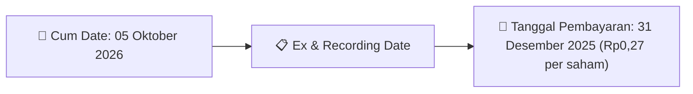
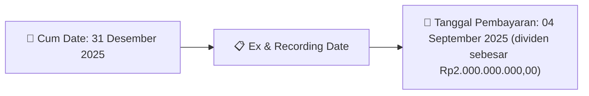
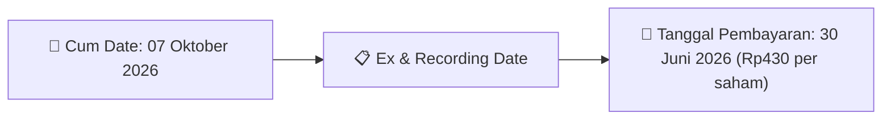
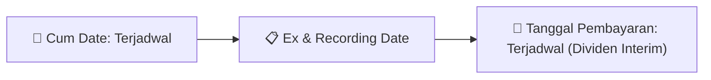
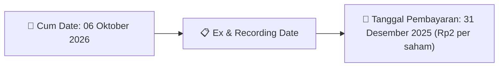

# Ikhtisar Pasar Harian (Daily Digest) - 2026-09-29

📅 **2026-09-29 (Daily Digest)**

## 1. Radar Pasar & Sentimen Harian (Executive Dashboard)
> [!NOTE]
> Terdeteksi sebanyak **280 pengumuman baru** dari 89 emiten pantauan pada (2026-09-29).

| Metric | Jumlah | Status Radar |
| :--- | :---: | :--- |
| **🟢 Sentimen Bullish / Positif** | `9` | [[Dividen Interim]], [[Mandatory Tender Offer]], Kinerja Positif |
| **⚪ Sentimen Netral / Routine** | `117` | [[Tanggapan Penjelasan Bursa]], [[RUPS]], [[Pendaftaran Unit]] |
| **🔴 Sentimen Bearish / Alert** | `1` | Sengketa Hukum, Defisit / Gugatan (Nihil hari ini) |
| **📄 [[Laporan Keuangan]] Baru** | `10` | Memicu Analisis Keuangan Otomatis |

> [!IMPORTANT]
> **Ditemukan Laporan Keuangan Baru Hari Ini:**
> - **NIRO**: FinancialStatement-2026-II-NIRO ([Buka PDF](file:///g:/My Drive/Model2/reports/raw/NIRO/20260928_NIRO_FinancialStatement-2026-II-NIRO.pdf))
- **NIRO**: FinancialStatement-2026-II-NIRO. ([Buka PDF](file:///g:/My Drive/Model2/reports/raw/NIRO/20260928_NIRO_FinancialStatement-2026-II-NIRO.xlsx))
- **GEMS**: FinancialStatement-2026-II-GEMS ([Buka PDF](file:///g:/My Drive/Model2/reports/raw/GEMS/20260928_GEMS_FinancialStatement-2026-II-GEMS.pdf))
- **GEMS**: FinancialStatement-2026-II-GEMS. ([Buka PDF](file:///g:/My Drive/Model2/reports/raw/GEMS/20260928_GEMS_FinancialStatement-2026-II-GEMS.xlsx))
- **CSIS**: FinancialStatement-2026-II-CSIS ([Buka PDF](file:///g:/My Drive/Model2/reports/raw/CSIS/20260929_CSIS_FinancialStatement-2026-II-CSIS.pdf))
- **CSIS**: FinancialStatement-2026-II-CSIS. ([Buka PDF](file:///g:/My Drive/Model2/reports/raw/CSIS/20260929_CSIS_FinancialStatement-2026-II-CSIS.xlsx))
- **CMNP**: FinancialStatement-2026-II-CMNP ([Buka PDF](file:///g:/My Drive/Model2/reports/raw/CMNP/20260929_CMNP_FinancialStatement-2026-II-CMNP.pdf))
- **CMNP**: FinancialStatement-2026-II-CMNP. ([Buka PDF](file:///g:/My Drive/Model2/reports/raw/CMNP/20260929_CMNP_FinancialStatement-2026-II-CMNP.xlsx))
- **TGRA**: FinancialStatement-2025-Tahunan-TGRA ([Buka PDF](file:///g:/My Drive/Model2/reports/raw/TGRA/20260929_TGRA_FinancialStatement-2025-Tahunan-TGRA.pdf))
- **TGRA**: FinancialStatement-2025-Tahunan-TGRA. ([Buka PDF](file:///g:/My Drive/Model2/reports/raw/TGRA/20260929_TGRA_FinancialStatement-2025-Tahunan-TGRA.xlsx))
> 
> *Tugas Swarm Agent:* Lakukan analisis laporan keuangan mendalam per emiten secara terpisah untuk berkas-berkas di atas.

---

## 2. Sorotan Utama & Watchlist Strategis (Strategic Watchlist)
#### 💰 Watchlist Dividen & Distribution
- **[[DADA]]**: Nominal Dividen = Rp0,27 per saham
- **[[DADA]]**: Total Dividen = Rp2.01 Miliar
- **[[DADA]]**: Cum Date = 05 Oktober 2026
- **[[DADA]]**: Ex Date = 06 Oktober 2026
- **[[DADA]]**: Recording Date = 02 Oktober 2026
- **[[DADA]]**: Tanggal Pembayaran = 31 Desember 2025

#### 📈 Watchlist Konversi Waran & Potensi Dilusi
- **[[MGNA]]**: Jumlah Waran Dikonversi = 500 lembar
- **[[MGNA]]**: Jumlah Saham Setelah Konversi = 3,411,177,335 lembar
- **[[MGNA]]**: Sisa Waran = 500 lembar
- **[[CYBR]]**: Jumlah Waran Dikonversi = 100 lembar
- **[[CYBR]]**: Jumlah Saham Setelah Konversi = 13,487,933,209 lembar
- **[[CYBR]]**: Sisa Waran = 100 lembar

#### 👥 Watchlist Transaksi Orang Dalam & Kepemilikan Saham (Insider / Repo Moves)
- **[[ASII]]**: Nama Insider = RUDY
- **[[RAAM]]**: Nama Insider = RAM JETHMAL PUNJABI
- **[[SRTG]]**: Nama Insider = EDWIN SOERYADJAYA
- **[[NSSS]]**: Nama Insider = SAMUEL SEKURITAS INDONESIA
- **[[BKSL]]**: Nama Insider = SAMUEL SEKURITAS INDONESIA
- **[[FILM]]**: Nama Insider = SAMUEL SEKURITAS INDONESIA
- **[[TAPG]]**: Nama Insider = GEORGE OETOMO
- **[[TAPG]]**: Nama Insider = GEORGE OETOMO

---

## 3. Matriks Pengumuman Pasar (Announcements Intelligence Table)
| Emiten | Sentimen | Jenis Pengumuman | Judul Pengumuman | Berkas |
| :--- | :---: | :--- | :--- | :--- |
| **[[ASII]]** | ⚪ NEUTRAL | Kepemilikan Saham (Insider) | LK-28092026-0056-00 | [Utama](file:///g:/My%20Drive/Model2/reports/raw/ASII/20260928_ASII_LK-28092026-0056-00.pdf) |
| **[[FUTR]]** | ⚪ NEUTRAL | Aksi Korporasi | Tanggapan atas Permintaan Penjelasan Bursa | [Utama](file:///g:/My%20Drive/Model2/reports/raw/FUTR/20260928_FUTR_20260928_FUTR_Tanggapan atas Permintaan Penjelasan Bursa_32161482.pdf) |
| **[[RAAM]]** | ⚪ NEUTRAL | Kepemilikan Saham (Insider) | LK-28092026-1712-00 | [Utama](file:///g:/My%20Drive/Model2/reports/raw/RAAM/20260928_RAAM_LK-28092026-1712-00.pdf) |
| **[[SMCB]]** | ⚪ NEUTRAL | RUPS | Ringkasan RisalahRisalah RUPS | [Utama](file:///g:/My%20Drive/Model2/reports/raw/SMCB/20260928_SMCB_20260925_SMCB_Ringkasan RisalahRisalah RUPS_32151122.pdf) · [Lamp 4](file:///g:/My%20Drive/Model2/reports/raw/SMCB/20260928_SMCB_20260925_SMCB_Ringkasan RisalahRisalah RUPS_32151122_lamp4.pdf) · [Lamp 3](file:///g:/My%20Drive/Model2/reports/raw/SMCB/20260928_SMCB_20260925_SMCB_Ringkasan RisalahRisalah RUPS_32151122_lamp3.pdf) · [Lamp 2](file:///g:/My%20Drive/Model2/reports/raw/SMCB/20260928_SMCB_20260925_SMCB_Ringkasan RisalahRisalah RUPS_32151122_lamp2.pdf) · [Lamp 1](file:///g:/My%20Drive/Model2/reports/raw/SMCB/20260928_SMCB_20260925_SMCB_Ringkasan RisalahRisalah RUPS_32151122_lamp1.pdf) |
| **[[HAIS]]** | 🟢 BULLISH | Aksi Korporasi | Laporan Informasi dan Fakta Material | [Utama](file:///g:/My%20Drive/Model2/reports/raw/HAIS/20260928_HAIS_20260928_HAIS_Laporan Informasi dan Fakta Material_32161416.pdf) · [Lamp 1](file:///g:/My%20Drive/Model2/reports/raw/HAIS/20260928_HAIS_20260928_HAIS_Laporan Informasi dan Fakta Material_32161416_lamp1.pdf) |
| **[[ASDF]]** | ⚪ NEUTRAL | Aksi Korporasi | Pembayaran KuponBagi HasilIjarahPokok | [Utama](file:///g:/My%20Drive/Model2/reports/raw/ASDF/20260928_ASDF_20260928_ASDF_Pembayaran KuponBagi HasilIjarahPokok_32161529.pdf) |
| **[[MGNA]]** | ⚪ NEUTRAL | Aksi Korporasi | Pencatatan Saham Tambahan dari Konversi | [Utama](file:///g:/My%20Drive/Model2/reports/raw/MGNA/20260928_MGNA_20260928_MGNA_Pencatatan Saham Tambahan dari Konversi_32161329.pdf) · [Lamp 1](file:///g:/My%20Drive/Model2/reports/raw/MGNA/20260928_MGNA_20260928_MGNA_Pencatatan Saham Tambahan dari Konversi_32161329_lamp1.pdf) |
| **[[SRTG]]** | ⚪ NEUTRAL | Kepemilikan Saham (Insider) | LK-28092026-9236-00 | [Utama](file:///g:/My%20Drive/Model2/reports/raw/SRTG/20260928_SRTG_LK-28092026-9236-00.pdf) |
| **[[NIRO]]** | ⚪ NEUTRAL | Laporan Keuangan | FinancialStatement-2026-II-NIRO | [Utama](file:///g:/My%20Drive/Model2/reports/raw/NIRO/20260928_NIRO_FinancialStatement-2026-II-NIRO.pdf) |
| **[[NIRO]]** | ⚪ NEUTRAL | Aksi Korporasi | city retail developments 30 Juni 2026- reviu | [Utama](file:///g:/My%20Drive/Model2/reports/raw/NIRO/20260928_NIRO_city retail developments 30 Juni 2026- reviu.pdf) |
| **[[NIRO]]** | ⚪ NEUTRAL | Laporan Keuangan | FinancialStatement-2026-II-NIRO. | [Utama](file:///g:/My%20Drive/Model2/reports/raw/NIRO/20260928_NIRO_FinancialStatement-2026-II-NIRO.xlsx) |
| **[[NIRO]]** | ⚪ NEUTRAL | Aksi Korporasi | NIRO penjelasan aset 30Juni 2026 | [Utama](file:///g:/My%20Drive/Model2/reports/raw/NIRO/20260928_NIRO_NIRO penjelasan aset 30Juni 2026.pdf) |
| **[[NIRO]]** | ⚪ NEUTRAL | Aksi Korporasi | OJK checklist Juni 2026 | [Utama](file:///g:/My%20Drive/Model2/reports/raw/NIRO/20260928_NIRO_OJK checklist Juni 2026.pdf) |
| **[[NSSS]]** | ⚪ NEUTRAL | Kepemilikan Saham (Insider) | LK-28092026-5445-00 | [Utama](file:///g:/My%20Drive/Model2/reports/raw/NSSS/20260928_NSSS_LK-28092026-5445-00.pdf) |
| **[[AMOR]]** | 🟢 BULLISH | Aksi Korporasi | Keterbukaan Informasi terkait Aksi Korporasi | [Utama](file:///g:/My%20Drive/Model2/reports/raw/AMOR/20260928_AMOR_20260928_AMOR_Keterbukaan Informasi terkait Aksi Korporasi_32161455.pdf) · [Lamp 2](file:///g:/My%20Drive/Model2/reports/raw/AMOR/20260928_AMOR_20260928_AMOR_Keterbukaan Informasi terkait Aksi Korporasi_32161455_lamp2.pdf) · [Lamp 1](file:///g:/My%20Drive/Model2/reports/raw/AMOR/20260928_AMOR_20260928_AMOR_Keterbukaan Informasi terkait Aksi Korporasi_32161455_lamp1.pdf) |
| **[[AMOR]]** | ⚪ NEUTRAL | RUPS | Pengumuman RUPS | [Utama](file:///g:/My%20Drive/Model2/reports/raw/AMOR/20260928_AMOR_20260928_AMOR_Pengumuman RUPS_32161343.pdf) · [Lamp 2](file:///g:/My%20Drive/Model2/reports/raw/AMOR/20260928_AMOR_20260928_AMOR_Pengumuman RUPS_32161343_lamp2.pdf) · [Lamp 1](file:///g:/My%20Drive/Model2/reports/raw/AMOR/20260928_AMOR_20260928_AMOR_Pengumuman RUPS_32161343_lamp1.pdf) |
| **[[SMFP]]** | ⚪ NEUTRAL | Aksi Korporasi | Pengumuman Perubahan Pencatatan EBA Partisipasi | [Utama](file:///g:/My%20Drive/Model2/reports/raw/SMFP/20260928_SMFP_20260925_SMFP_Pengumuman Perubahan Pencatatan EBA Partisipasi_32151024.pdf) |
| **[[CYBR]]** | ⚪ NEUTRAL | Aksi Korporasi | Pencatatan Saham Tambahan dari Konversi | [Utama](file:///g:/My%20Drive/Model2/reports/raw/CYBR/20260928_CYBR_20260928_CYBR_Pencatatan Saham Tambahan dari Konversi_32161318.pdf) · [Lamp 1](file:///g:/My%20Drive/Model2/reports/raw/CYBR/20260928_CYBR_20260928_CYBR_Pencatatan Saham Tambahan dari Konversi_32161318_lamp1.pdf) |
| **[[KDTN]]** | ⚪ NEUTRAL | Aksi Korporasi | Laporan Informasi dan Fakta Material | [Utama](file:///g:/My%20Drive/Model2/reports/raw/KDTN/20260928_KDTN_20260925_KDTN_Laporan Informasi dan Fakta Material_32151113.pdf) |
| **[[SMIL]]** | ⚪ NEUTRAL | Aksi Korporasi | Laporan Penggunaan Dana Hasil Penawaran Umum | [Utama](file:///g:/My%20Drive/Model2/reports/raw/SMIL/20260928_SMIL_20260928_SMIL_Laporan Penggunaan Dana Hasil Penawaran Umum_32161537.pdf) · [Lamp 1](file:///g:/My%20Drive/Model2/reports/raw/SMIL/20260928_SMIL_20260928_SMIL_Laporan Penggunaan Dana Hasil Penawaran Umum_32161537_lamp1.pdf) |
| **[[SMMT]]** | ⚪ NEUTRAL | RUPS | Pemanggilan RUPS | [Utama](file:///g:/My%20Drive/Model2/reports/raw/SMMT/20260928_SMMT_20260928_SMMT_Pemanggilan RUPS_32161412.pdf) · [Lamp 1](file:///g:/My%20Drive/Model2/reports/raw/SMMT/20260928_SMMT_20260928_SMMT_Pemanggilan RUPS_32161412_lamp1.pdf) |
| **[[DJPU]]** | ⚪ NEUTRAL | Aksi Korporasi | Pengumuman Pencatatan Awal Obligasi dan Sukuk | [Utama](file:///g:/My%20Drive/Model2/reports/raw/DJPU/20260928_DJPU_20260924_DJPU_Pengumuman Pencatatan Awal Obligasi dan Sukuk_32150980.pdf) · [Lamp 2](file:///g:/My%20Drive/Model2/reports/raw/DJPU/20260928_DJPU_20260924_DJPU_Pengumuman Pencatatan Awal Obligasi dan Sukuk_32150980_lamp2.pdf) · [Lamp 1](file:///g:/My%20Drive/Model2/reports/raw/DJPU/20260928_DJPU_20260924_DJPU_Pengumuman Pencatatan Awal Obligasi dan Sukuk_32150980_lamp1.pdf) |
| **[[DJPU]]** | ⚪ NEUTRAL | Aksi Korporasi | Pengumuman Jatuh Tempo Obligasi dan Sukuk | [Utama](file:///g:/My%20Drive/Model2/reports/raw/DJPU/20260928_DJPU_20260925_DJPU_Pengumuman Jatuh Tempo Obligasi dan Sukuk_32151049.pdf) |
| **[[PACK]]** | ⚪ NEUTRAL | Aksi Korporasi | Pencatatan Saham Tambahan dari Konversi | [Utama](file:///g:/My%20Drive/Model2/reports/raw/PACK/20260928_PACK_20260928_PACK_Pencatatan Saham Tambahan dari Konversi_32161415.pdf) |
| **[[PJHB]]** | ⚪ NEUTRAL | Aksi Korporasi | Pencatatan Saham Tambahan dari Konversi | [Utama](file:///g:/My%20Drive/Model2/reports/raw/PJHB/20260928_PJHB_20260928_PJHB_Pencatatan Saham Tambahan dari Konversi_32161298.pdf) |
| **[[MANG]]** | ⚪ NEUTRAL | Aksi Korporasi | Pencatatan Saham Tambahan dari Konversi | [Utama](file:///g:/My%20Drive/Model2/reports/raw/MANG/20260928_MANG_20260928_MANG_Pencatatan Saham Tambahan dari Konversi_32161303.pdf) · [Lamp 1](file:///g:/My%20Drive/Model2/reports/raw/MANG/20260928_MANG_20260928_MANG_Pencatatan Saham Tambahan dari Konversi_32161303_lamp1.pdf) |
| **[[VISI]]** | ⚪ NEUTRAL | RUPS | Rencana Transaksi Material Dengan Persetujuan RUPS | [Utama](file:///g:/My%20Drive/Model2/reports/raw/VISI/20260928_VISI_20260928_VISI_Rencana Transaksi Material Dengan Persetujuan RUPS_32161538.pdf) · [Lamp 2](file:///g:/My%20Drive/Model2/reports/raw/VISI/20260928_VISI_20260928_VISI_Rencana Transaksi Material Dengan Persetujuan RUPS_32161538_lamp2.pdf) · [Lamp 1](file:///g:/My%20Drive/Model2/reports/raw/VISI/20260928_VISI_20260928_VISI_Rencana Transaksi Material Dengan Persetujuan RUPS_32161538_lamp1.pdf) |
| **[[VISI]]** | ⚪ NEUTRAL | Aksi Korporasi | Penambahan Modal Tanpa HMETD | [Utama](file:///g:/My%20Drive/Model2/reports/raw/VISI/20260928_VISI_20260928_VISI_Penambahan Modal Tanpa HMETD_32161528.pdf) · [Lamp 2](file:///g:/My%20Drive/Model2/reports/raw/VISI/20260928_VISI_20260928_VISI_Penambahan Modal Tanpa HMETD_32161528_lamp2.pdf) · [Lamp 1](file:///g:/My%20Drive/Model2/reports/raw/VISI/20260928_VISI_20260928_VISI_Penambahan Modal Tanpa HMETD_32161528_lamp1.pdf) |
| **[[WIKA]]** | ⚪ NEUTRAL | RUPS | Pemberitahuan RencanaPenyampaian PanggilanHasil RUPORUPSURUP EBA-SP | [Utama](file:///g:/My%20Drive/Model2/reports/raw/WIKA/20260928_WIKA_20260928_WIKA_Pemberitahuan RencanaPenyampaian PanggilanHasil RUPORUPSURUP EBA-SP_32161279.pdf) · [Lamp 1](file:///g:/My%20Drive/Model2/reports/raw/WIKA/20260928_WIKA_20260928_WIKA_Pemberitahuan RencanaPenyampaian PanggilanHasil RUPORUPSURUP EBA-SP_32161285_lamp1.pdf) · [Lamp 1](file:///g:/My%20Drive/Model2/reports/raw/WIKA/20260928_WIKA_20260928_WIKA_Pemberitahuan RencanaPenyampaian PanggilanHasil RUPORUPSURUP EBA-SP_32161284_lamp1.pdf) · [Lamp 1](file:///g:/My%20Drive/Model2/reports/raw/WIKA/20260928_WIKA_20260928_WIKA_Pemberitahuan RencanaPenyampaian PanggilanHasil RUPORUPSURUP EBA-SP_32161282_lamp1.pdf) · [Lamp 1](file:///g:/My%20Drive/Model2/reports/raw/WIKA/20260928_WIKA_20260928_WIKA_Pemberitahuan RencanaPenyampaian PanggilanHasil RUPORUPSURUP EBA-SP_32161279_lamp1.pdf) |
| **[[WIKA]]** | ⚪ NEUTRAL | Public Expose | Public Expose | [Utama](file:///g:/My%20Drive/Model2/reports/raw/WIKA/20260928_WIKA_20260928_WIKA_Public Expose_32161306.pdf) · [Lamp 1](file:///g:/My%20Drive/Model2/reports/raw/WIKA/20260928_WIKA_20260928_WIKA_Public Expose_32161306_lamp1.pdf) · [Lamp 2](file:///g:/My%20Drive/Model2/reports/raw/WIKA/20260928_WIKA_20260928_WIKA_Public Expose_32161306_lamp2.pdf) |
| **[[BIPP]]** | ⚪ NEUTRAL | RUPS | Ringkasan RisalahRisalah RUPS | [Utama](file:///g:/My%20Drive/Model2/reports/raw/BIPP/20260928_BIPP_20260928_BIPP_Ringkasan RisalahRisalah RUPS_32161389.pdf) |
| **[[TAMU]]** | ⚪ NEUTRAL | Aksi Korporasi | Laporan Informasi dan Fakta Material | [Utama](file:///g:/My%20Drive/Model2/reports/raw/TAMU/20260928_TAMU_20260928_TAMU_Laporan Informasi dan Fakta Material_32161554.pdf) · [Lamp 1](file:///g:/My%20Drive/Model2/reports/raw/TAMU/20260928_TAMU_20260928_TAMU_Laporan Informasi dan Fakta Material_32161554_lamp1.pdf) |
| **[[BKSL]]** | ⚪ NEUTRAL | Kepemilikan Saham (Insider) | LK-28092026-3386-00 | [Utama](file:///g:/My%20Drive/Model2/reports/raw/BKSL/20260928_BKSL_LK-28092026-3386-00.pdf) |
| **[[FILM]]** | ⚪ NEUTRAL | Kepemilikan Saham (Insider) | LK-28092026-8574-00 | [Utama](file:///g:/My%20Drive/Model2/reports/raw/FILM/20260928_FILM_LK-28092026-8574-00.pdf) |
| **[[IRSX]]** | ⚪ NEUTRAL | Aksi Korporasi | Laporan Informasi dan Fakta Material | [Utama](file:///g:/My%20Drive/Model2/reports/raw/IRSX/20260928_IRSX_20260928_IRSX_Laporan Informasi dan Fakta Material_32161420.pdf) · [Lamp 1](file:///g:/My%20Drive/Model2/reports/raw/IRSX/20260928_IRSX_20260928_IRSX_Laporan Informasi dan Fakta Material_32161420_lamp1.pdf) |
| **[[IRSX]]** | ⚪ NEUTRAL | RUPS | Ringkasan RisalahRisalah RUPS | [Utama](file:///g:/My%20Drive/Model2/reports/raw/IRSX/20260928_IRSX_20260925_IRSX_Ringkasan RisalahRisalah RUPS_32151234.pdf) · [Lamp 1](file:///g:/My%20Drive/Model2/reports/raw/IRSX/20260928_IRSX_20260928_IRSX_Ringkasan RisalahRisalah RUPS_32161426_lamp1.pdf) |
| **[[EPAC]]** | 🟢 BULLISH | Buyback | Laporan Informasi dan Fakta Material | [Utama](file:///g:/My%20Drive/Model2/reports/raw/EPAC/20260928_EPAC_20260928_EPAC_Laporan Informasi dan Fakta Material_32161304.pdf) · [Lamp 1](file:///g:/My%20Drive/Model2/reports/raw/EPAC/20260928_EPAC_20260928_EPAC_Laporan Informasi dan Fakta Material_32161304_lamp1.pdf) |
| **[[TAPG]]** | ⚪ NEUTRAL | Kepemilikan Saham (Insider) | LK-28092026-4055-00 | [Utama](file:///g:/My%20Drive/Model2/reports/raw/TAPG/20260928_TAPG_LK-28092026-4055-00.pdf) |
| **[[TAPG]]** | ⚪ NEUTRAL | Kepemilikan Saham (Insider) | LK-29092026-7838-00 | [Utama](file:///g:/My%20Drive/Model2/reports/raw/TAPG/20260929_TAPG_LK-29092026-7838-00.pdf) |
| **[[JSMR]]** | ⚪ NEUTRAL | Aksi Korporasi | Informasi Transaksi Afiliasi | [Utama](file:///g:/My%20Drive/Model2/reports/raw/JSMR/20260928_JSMR_20260928_JSMR_Informasi Transaksi Afiliasi_32161472.pdf) · [Lamp 2](file:///g:/My%20Drive/Model2/reports/raw/JSMR/20260928_JSMR_20260928_JSMR_Informasi Transaksi Afiliasi_32161472_lamp2.pdf) · [Lamp 3](file:///g:/My%20Drive/Model2/reports/raw/JSMR/20260928_JSMR_20260928_JSMR_Informasi Transaksi Afiliasi_32161472_lamp3.pdf) |
| **[[SOFA]]** | ⚪ NEUTRAL | Aksi Korporasi | Perubahan danatau Tambahan Keterbukaan Informasi terkait Aksi Korporasi | [Utama](file:///g:/My%20Drive/Model2/reports/raw/SOFA/20260929_SOFA_20260929_SOFA_Perubahan danatau Tambahan Keterbukaan Informasi terkait Aksi Korporasi_32161555.pdf) · [Lamp 2](file:///g:/My%20Drive/Model2/reports/raw/SOFA/20260928_SOFA_20260924_SOFA_Perubahan danatau Tambahan Keterbukaan Informasi terkait Aksi Korporasi_32150856_lamp2.pdf) · [Lamp 11](file:///g:/My%20Drive/Model2/reports/raw/SOFA/20260928_SOFA_20260924_SOFA_Perubahan danatau Tambahan Keterbukaan Informasi terkait Aksi Korporasi_32150856_lamp11.pdf) · [Lamp 3](file:///g:/My%20Drive/Model2/reports/raw/SOFA/20260928_SOFA_20260924_SOFA_Perubahan danatau Tambahan Keterbukaan Informasi terkait Aksi Korporasi_32150856_lamp3.pdf) · [Lamp 3](file:///g:/My%20Drive/Model2/reports/raw/SOFA/20260929_SOFA_20260929_SOFA_Perubahan danatau Tambahan Keterbukaan Informasi terkait Aksi Korporasi_32161556_lamp3.pdf) · [Lamp 1](file:///g:/My%20Drive/Model2/reports/raw/SOFA/20260929_SOFA_20260929_SOFA_Perubahan danatau Tambahan Keterbukaan Informasi terkait Aksi Korporasi_32161556_lamp1.pdf) · [Lamp 2](file:///g:/My%20Drive/Model2/reports/raw/SOFA/20260929_SOFA_20260929_SOFA_Perubahan danatau Tambahan Keterbukaan Informasi terkait Aksi Korporasi_32161556_lamp2.pdf) |
| **[[PGEO]]** | ⚪ NEUTRAL | Aksi Korporasi | Pencatatan Saham Tambahan dari Konversi | [Utama](file:///g:/My%20Drive/Model2/reports/raw/PGEO/20260928_PGEO_20260925_PGEO_Pencatatan Saham Tambahan dari Konversi_32151089.pdf) |
| **[[BALI]]** | ⚪ NEUTRAL | Kepemilikan Saham (Insider) | LK-28092026-3602-00 | [Utama](file:///g:/My%20Drive/Model2/reports/raw/BALI/20260928_BALI_LK-28092026-3602-00.pdf) |
| **[[IPAC]]** | ⚪ NEUTRAL | RUPS | Pemanggilan RUPS | [Utama](file:///g:/My%20Drive/Model2/reports/raw/IPAC/20260928_IPAC_20260925_IPAC_Pemanggilan RUPS_32151019.pdf) · [Lamp 2](file:///g:/My%20Drive/Model2/reports/raw/IPAC/20260928_IPAC_20260925_IPAC_Pemanggilan RUPS_32151019_lamp2.pdf) |
| **[[BRMS]]** | ⚪ NEUTRAL | Kepemilikan Saham (Insider) | LK-28092026-7738-00 | [Utama](file:///g:/My%20Drive/Model2/reports/raw/BRMS/20260928_BRMS_LK-28092026-7738-00.pdf) |
| **[[TEBE]]** | ⚪ NEUTRAL | Public Expose | Public Expose | [Utama](file:///g:/My%20Drive/Model2/reports/raw/TEBE/20260929_TEBE_20260928_TEBE_Public Expose_32161491.pdf) · [Lamp 1](file:///g:/My%20Drive/Model2/reports/raw/TEBE/20260928_TEBE_20260928_TEBE_Public Expose_32161394_lamp1.pdf) · [Lamp 1](file:///g:/My%20Drive/Model2/reports/raw/TEBE/20260929_TEBE_20260928_TEBE_Public Expose_32161491_lamp1.pdf) |
| **[[DADA]]** | 🟢 BULLISH | Dividen | Keterbukaan Informasi terkait Aksi Korporasi | [Utama](file:///g:/My%20Drive/Model2/reports/raw/DADA/20260928_DADA_20260928_DADA_Keterbukaan Informasi terkait Aksi Korporasi_32161461.pdf) |
| **[[DADA]]** | 🟢 BULLISH | Dividen | Ringkasan RisalahRisalah RUPS | [Utama](file:///g:/My%20Drive/Model2/reports/raw/DADA/20260928_DADA_20260928_DADA_Ringkasan RisalahRisalah RUPS_32161443.pdf) |
| **[[RDTX]]** | ⚪ NEUTRAL | RUPS | Pengumuman RUPS | [Utama](file:///g:/My%20Drive/Model2/reports/raw/RDTX/20260928_RDTX_20260928_RDTX_Pengumuman RUPS_32161384.pdf) · [Lamp 3](file:///g:/My%20Drive/Model2/reports/raw/RDTX/20260928_RDTX_20260928_RDTX_Pengumuman RUPS_32161384_lamp3.pdf) |
| **[[KOCI]]** | ⚪ NEUTRAL | Aksi Korporasi | Pencatatan Saham Tambahan dari Konversi | [Utama](file:///g:/My%20Drive/Model2/reports/raw/KOCI/20260928_KOCI_20260928_KOCI_Pencatatan Saham Tambahan dari Konversi_32161346.pdf) · [Lamp 1](file:///g:/My%20Drive/Model2/reports/raw/KOCI/20260928_KOCI_20260928_KOCI_Pencatatan Saham Tambahan dari Konversi_32161346_lamp1.pdf) |
| **[[TRIM]]** | ⚪ NEUTRAL | Aksi Korporasi | Pembayaran KuponBagi HasilIjarahPokok | [Utama](file:///g:/My%20Drive/Model2/reports/raw/TRIM/20260928_TRIM_20260928_TRIM_Pembayaran KuponBagi HasilIjarahPokok_32161305.pdf) |
| **[[PTBA]]** | ⚪ NEUTRAL | RUPS | Transaksi Material Tanpa Persetujuan RUPS | [Utama](file:///g:/My%20Drive/Model2/reports/raw/PTBA/20260928_PTBA_20260928_PTBA_Transaksi Material Tanpa Persetujuan RUPS_32161546.pdf) · [Lamp 2](file:///g:/My%20Drive/Model2/reports/raw/PTBA/20260928_PTBA_20260928_PTBA_Transaksi Material Tanpa Persetujuan RUPS_32161546_lamp2.pdf) · [Lamp 1](file:///g:/My%20Drive/Model2/reports/raw/PTBA/20260928_PTBA_20260928_PTBA_Transaksi Material Tanpa Persetujuan RUPS_32161546_lamp1.pdf) |
| **[[MSKY]]** | ⚪ NEUTRAL | Aksi Korporasi | Tanggapan atas Permintaan Penjelasan Bursa | [Utama](file:///g:/My%20Drive/Model2/reports/raw/MSKY/20260928_MSKY_20260928_MSKY_Tanggapan atas Permintaan Penjelasan Bursa_32161419.pdf) |
| **[[GOTO]]** | ⚪ NEUTRAL | Kepemilikan Saham (Insider) | LK-28092026-8273-00 | [Utama](file:///g:/My%20Drive/Model2/reports/raw/GOTO/20260928_GOTO_LK-28092026-8273-00.pdf) |
| **[[WIFI]]** | ⚪ NEUTRAL | RUPS | Pengumuman RUPS | [Utama](file:///g:/My%20Drive/Model2/reports/raw/WIFI/20260928_WIFI_20260927_WIFI_Pengumuman RUPS_32161271.pdf) · [Lamp 1](file:///g:/My%20Drive/Model2/reports/raw/WIFI/20260928_WIFI_20260927_WIFI_Pengumuman RUPS_32161271_lamp1.pdf) |
| **[[KETR]]** | ⚪ NEUTRAL | Aksi Korporasi | Laporan Informasi dan Fakta Material | [Utama](file:///g:/My%20Drive/Model2/reports/raw/KETR/20260928_KETR_20260928_KETR_Laporan Informasi dan Fakta Material_32161530.pdf) |
| **[[KETR]]** | ⚪ NEUTRAL | Kepemilikan Saham (Insider) | LK-28092026-8908-00 | [Utama](file:///g:/My%20Drive/Model2/reports/raw/KETR/20260928_KETR_LK-28092026-8908-00.pdf) |
| **[[KETR]]** | ⚪ NEUTRAL | Kepemilikan Saham (Insider) | LK-28092026-7406-00 | [Utama](file:///g:/My%20Drive/Model2/reports/raw/KETR/20260928_KETR_LK-28092026-7406-00.pdf) |
| **[[KETR]]** | ⚪ NEUTRAL | RUPS | Pengumuman RUPS | [Utama](file:///g:/My%20Drive/Model2/reports/raw/KETR/20260928_KETR_20260928_KETR_Pengumuman RUPS_32161381.pdf) |
| **[[WSKT]]** | ⚪ NEUTRAL | Aksi Korporasi | Pengumuman Jatuh Tempo Obligasi dan Sukuk | [Utama](file:///g:/My%20Drive/Model2/reports/raw/WSKT/20260928_WSKT_20260928_WSKT_Pengumuman Jatuh Tempo Obligasi dan Sukuk_32161400.pdf) |
| **[[WSKT]]** | ⚪ NEUTRAL | Aksi Korporasi | Laporan Hasil Pemeringkatan | [Utama](file:///g:/My%20Drive/Model2/reports/raw/WSKT/20260929_WSKT_20260929_WSKT_Laporan Hasil Pemeringkatan_32161595.pdf) · [Lamp 1](file:///g:/My%20Drive/Model2/reports/raw/WSKT/20260929_WSKT_20260929_WSKT_Laporan Hasil Pemeringkatan_32161595_lamp1.pdf) |
| **[[JAST]]** | ⚪ NEUTRAL | Aksi Korporasi | Laporan Informasi dan Fakta Material | [Utama](file:///g:/My%20Drive/Model2/reports/raw/JAST/20260928_JAST_20260928_JAST_Laporan Informasi dan Fakta Material_32161308.pdf) · [Lamp 1](file:///g:/My%20Drive/Model2/reports/raw/JAST/20260928_JAST_20260928_JAST_Laporan Informasi dan Fakta Material_32161308_lamp1.pdf) |
| **[[GEMS]]** | ⚪ NEUTRAL | Laporan Keuangan | FinancialStatement-2026-II-GEMS | [Utama](file:///g:/My%20Drive/Model2/reports/raw/GEMS/20260928_GEMS_FinancialStatement-2026-II-GEMS.pdf) |
| **[[GEMS]]** | ⚪ NEUTRAL | Aksi Korporasi | Aset Liabilitas 30 Juni 2026 | [Utama](file:///g:/My%20Drive/Model2/reports/raw/GEMS/20260928_GEMS_260925_Aset Liabilitas 30 Juni 2026.pdf) |
| **[[GEMS]]** | ⚪ NEUTRAL | Aksi Korporasi | 260928 Penyampaian Lapkeu GEMS Q2 2026 | [Utama](file:///g:/My%20Drive/Model2/reports/raw/GEMS/20260928_GEMS_260928 Penyampaian Lapkeu GEMS Q2 2026.pdf) |
| **[[GEMS]]** | ⚪ NEUTRAL | Laporan Keuangan | FinancialStatement-2026-II-GEMS. | [Utama](file:///g:/My%20Drive/Model2/reports/raw/GEMS/20260928_GEMS_FinancialStatement-2026-II-GEMS.xlsx) |
| **[[GEMS]]** | ⚪ NEUTRAL | Aksi Korporasi | Golden Energy Mines Tbk Q2 2026 (fn) | [Utama](file:///g:/My%20Drive/Model2/reports/raw/GEMS/20260928_GEMS_Golden Energy Mines Tbk Q2 2026 (fn).pdf) |
| **[[GEMS]]** | ⚪ NEUTRAL | Aksi Korporasi | OJK CHECKLIST GEMS  June 2026 | [Utama](file:///g:/My%20Drive/Model2/reports/raw/GEMS/20260928_GEMS_OJK CHECKLIST GEMS  June 2026.pdf) |
| **[[UNTR]]** | 🟢 BULLISH | Dividen | Jadwal Aksi Korporasi (Khusus Penyampaian Dividen Interim) | [Utama](file:///g:/My%20Drive/Model2/reports/raw/UNTR/20260928_UNTR_20260928_UNTR_Jadwal Aksi Korporasi (Khusus Penyampaian Dividen Interim)_32161307.pdf) |
| **[[UNTR]]** | 🟢 BULLISH | Dividen | Laporan Informasi dan Fakta Material | [Utama](file:///g:/My%20Drive/Model2/reports/raw/UNTR/20260928_UNTR_20260928_UNTR_Laporan Informasi dan Fakta Material_32161433.pdf) |
| **[[LAPD]]** | ⚪ NEUTRAL | RUPS | Pemanggilan RUPS | [Utama](file:///g:/My%20Drive/Model2/reports/raw/LAPD/20260928_LAPD_20260928_LAPD_Pemanggilan RUPS_32161348.pdf) · [Lamp 2](file:///g:/My%20Drive/Model2/reports/raw/LAPD/20260928_LAPD_20260928_LAPD_Pemanggilan RUPS_32161348_lamp2.pdf) · [Lamp 1](file:///g:/My%20Drive/Model2/reports/raw/LAPD/20260928_LAPD_20260928_LAPD_Pemanggilan RUPS_32161348_lamp1.pdf) |
| **[[CRAB]]** | ⚪ NEUTRAL | Aksi Korporasi | Laporan Informasi dan Fakta Material | [Utama](file:///g:/My%20Drive/Model2/reports/raw/CRAB/20260928_CRAB_20260927_CRAB_Laporan Informasi dan Fakta Material_32161272.pdf) |
| **[[CRAB]]** | 🟢 BULLISH | Dividen | Ringkasan RisalahRisalah RUPS | [Utama](file:///g:/My%20Drive/Model2/reports/raw/CRAB/20260929_CRAB_20260928_CRAB_Ringkasan RisalahRisalah RUPS_32161278.pdf) · [Lamp 1](file:///g:/My%20Drive/Model2/reports/raw/CRAB/20260929_CRAB_20260928_CRAB_Ringkasan RisalahRisalah RUPS_32161278_lamp1.pdf) |
| **[[CRAB]]** | 🟢 BULLISH | Dividen | Keterbukaan Informasi terkait Aksi Korporasi | [Utama](file:///g:/My%20Drive/Model2/reports/raw/CRAB/20260929_CRAB_20260929_CRAB_Keterbukaan Informasi terkait Aksi Korporasi_32161611.pdf) |
| **[[CRAB]]** | ⚪ NEUTRAL | Public Expose | Public Expose | [Utama](file:///g:/My%20Drive/Model2/reports/raw/CRAB/20260929_CRAB_20260928_CRAB_Public Expose_32161501.pdf) · [Lamp 3](file:///g:/My%20Drive/Model2/reports/raw/CRAB/20260929_CRAB_20260928_CRAB_Public Expose_32161501_lamp3.pdf) |
| **[[TRUK]]** | ⚪ NEUTRAL | Aksi Korporasi | Laporan Informasi dan Fakta Material | [Utama](file:///g:/My%20Drive/Model2/reports/raw/TRUK/20260928_TRUK_20260928_TRUK_Laporan Informasi dan Fakta Material_32161316.pdf) · [Lamp 1](file:///g:/My%20Drive/Model2/reports/raw/TRUK/20260928_TRUK_20260928_TRUK_Laporan Informasi dan Fakta Material_32161316_lamp1.pdf) · [Lamp 4](file:///g:/My%20Drive/Model2/reports/raw/TRUK/20260928_TRUK_20260928_TRUK_Laporan Informasi dan Fakta Material_32161316_lamp4.pdf) · [Lamp 2](file:///g:/My%20Drive/Model2/reports/raw/TRUK/20260928_TRUK_20260928_TRUK_Laporan Informasi dan Fakta Material_32161316_lamp2.pdf) · [Lamp 3](file:///g:/My%20Drive/Model2/reports/raw/TRUK/20260928_TRUK_20260928_TRUK_Laporan Informasi dan Fakta Material_32161316_lamp3.pdf) |
| **[[FORU]]** | ⚪ NEUTRAL | Aksi Korporasi | Pencatatan Saham Tambahan dari Konversi | [Utama](file:///g:/My%20Drive/Model2/reports/raw/FORU/20260928_FORU_20260928_FORU_Pencatatan Saham Tambahan dari Konversi_32161355.pdf) |
| **[[MINE]]** | ⚪ NEUTRAL | RUPS | Pengumuman RUPS | [Utama](file:///g:/My%20Drive/Model2/reports/raw/MINE/20260928_MINE_20260928_MINE_Pengumuman RUPS_32161535.pdf) · [Lamp 1](file:///g:/My%20Drive/Model2/reports/raw/MINE/20260928_MINE_20260928_MINE_Pengumuman RUPS_32161535_lamp1.pdf) |
| **[[OASA]]** | ⚪ NEUTRAL | Kepemilikan Saham (Insider) | LK-28092026-0261-00 | [Utama](file:///g:/My%20Drive/Model2/reports/raw/OASA/20260928_OASA_LK-28092026-0261-00.pdf) |
| **[[INPS]]** | ⚪ NEUTRAL | Aksi Korporasi | Tanggapan atas Permintaan Penjelasan Bursa | [Utama](file:///g:/My%20Drive/Model2/reports/raw/INPS/20260928_INPS_20260928_INPS_Tanggapan atas Permintaan Penjelasan Bursa_32161457.pdf) |
| **[[INPS]]** | ⚪ NEUTRAL | Aksi Korporasi | Keterbukaan Informasi terkait Aksi Korporasi | [Utama](file:///g:/My%20Drive/Model2/reports/raw/INPS/20260929_INPS_20260929_INPS_Keterbukaan Informasi terkait Aksi Korporasi_32161628.pdf) · [Lamp 2](file:///g:/My%20Drive/Model2/reports/raw/INPS/20260929_INPS_20260929_INPS_Keterbukaan Informasi terkait Aksi Korporasi_32161628_lamp2.pdf) |
| **[[INPS]]** | ⚪ NEUTRAL | RUPS | Pengumuman RUPS | [Utama](file:///g:/My%20Drive/Model2/reports/raw/INPS/20260929_INPS_20260929_INPS_Pengumuman RUPS_32161596.pdf) · [Lamp 3](file:///g:/My%20Drive/Model2/reports/raw/INPS/20260929_INPS_20260929_INPS_Pengumuman RUPS_32161596_lamp3.pdf) |
| **[[UANG]]** | ⚪ NEUTRAL | RUPS | Ringkasan RisalahRisalah RUPS | [Utama](file:///g:/My%20Drive/Model2/reports/raw/UANG/20260928_UANG_20260928_UANG_Ringkasan RisalahRisalah RUPS_32161544.pdf) |
| **[[LMPI]]** | ⚪ NEUTRAL | RUPS | Ringkasan RisalahRisalah RUPS | [Utama](file:///g:/My%20Drive/Model2/reports/raw/LMPI/20260928_LMPI_20260928_LMPI_Ringkasan RisalahRisalah RUPS_32161328.pdf) · [Lamp 2](file:///g:/My%20Drive/Model2/reports/raw/LMPI/20260928_LMPI_20260928_LMPI_Ringkasan RisalahRisalah RUPS_32161328_lamp2.pdf) · [Lamp 1](file:///g:/My%20Drive/Model2/reports/raw/LMPI/20260928_LMPI_20260928_LMPI_Ringkasan RisalahRisalah RUPS_32161328_lamp1.pdf) |
| **[[TOBA]]** | ⚪ NEUTRAL | Aksi Korporasi | Laporan Penggunaan Dana Hasil Penawaran Umum | [Utama](file:///g:/My%20Drive/Model2/reports/raw/TOBA/20260928_TOBA_20260928_TOBA_Laporan Penggunaan Dana Hasil Penawaran Umum_32161548.pdf) |
| **[[PPGL]]** | ⚪ NEUTRAL | Aksi Korporasi | Tanggapan atas Permintaan Penjelasan Bursa | [Utama](file:///g:/My%20Drive/Model2/reports/raw/PPGL/20260928_PPGL_20260928_PPGL_Tanggapan atas Permintaan Penjelasan Bursa_32161545.pdf) · [Lamp 1](file:///g:/My%20Drive/Model2/reports/raw/PPGL/20260928_PPGL_20260928_PPGL_Tanggapan atas Permintaan Penjelasan Bursa_32161545_lamp1.pdf) |
| **[[POST]]** | ⚪ NEUTRAL | Aksi Korporasi | Laporan Informasi dan Fakta Material | [Utama](file:///g:/My%20Drive/Model2/reports/raw/POST/20260928_POST_20260925_POST_Laporan Informasi dan Fakta Material_32151267.pdf) · [Lamp 1](file:///g:/My%20Drive/Model2/reports/raw/POST/20260928_POST_20260928_POST_Laporan Informasi dan Fakta Material_32161332_lamp1.pdf) · [Lamp 1](file:///g:/My%20Drive/Model2/reports/raw/POST/20260928_POST_20260925_POST_Laporan Informasi dan Fakta Material_32151267_lamp1.pdf) |
| **[[REFI]]** | ⚪ NEUTRAL | Aksi Korporasi | Laporan Informasi dan Fakta Material | [Utama](file:///g:/My%20Drive/Model2/reports/raw/REFI/20260928_REFI_20260928_REFI_Laporan Informasi dan Fakta Material_32161498.pdf) · [Lamp 1](file:///g:/My%20Drive/Model2/reports/raw/REFI/20260928_REFI_20260928_REFI_Laporan Informasi dan Fakta Material_32161498_lamp1.pdf) · [Lamp 2](file:///g:/My%20Drive/Model2/reports/raw/REFI/20260928_REFI_20260928_REFI_Laporan Informasi dan Fakta Material_32161498_lamp2.pdf) |
| **[[ENRG]]** | ⚪ NEUTRAL | Aksi Korporasi | Keterbukaan Informasi terkait Aksi Korporasi | [Utama](file:///g:/My%20Drive/Model2/reports/raw/ENRG/20260928_ENRG_20260928_ENRG_Keterbukaan Informasi terkait Aksi Korporasi_32161313.pdf) |
| **[[BJBR]]** | ⚪ NEUTRAL | Aksi Korporasi | Pembayaran KuponBagi HasilIjarahPokok | [Utama](file:///g:/My%20Drive/Model2/reports/raw/BJBR/20260928_BJBR_20260928_BJBR_Pembayaran KuponBagi HasilIjarahPokok_32161337.pdf) |
| **[[WSBP]]** | 🔴 BEARISH | Aksi Korporasi | Suspensi dan Pembukaan Suspensi | [Utama](file:///g:/My%20Drive/Model2/reports/raw/WSBP/20260928_WSBP_20260925_Suspensi dan Pembukaan Suspensi_32151251.pdf) · [Lamp 1](file:///g:/My%20Drive/Model2/reports/raw/WSBP/20260928_WSBP_20260925_Suspensi dan Pembukaan Suspensi_32151251_lamp1.pdf) |
| **[[LPPI]]** | ⚪ NEUTRAL | Aksi Korporasi | Laporan Informasi dan Fakta Material | [Utama](file:///g:/My%20Drive/Model2/reports/raw/LPPI/20260928_LPPI_20260922_LPPI_Laporan Informasi dan Fakta Material_32150255.pdf) · [Lamp 2](file:///g:/My%20Drive/Model2/reports/raw/LPPI/20260928_LPPI_20260922_LPPI_Laporan Informasi dan Fakta Material_32150255_lamp2.pdf) |
| **[[IJEE]]** | ⚪ NEUTRAL | Aksi Korporasi | Laporan Informasi dan Fakta Material | [Utama](file:///g:/My%20Drive/Model2/reports/raw/IJEE/20260928_IJEE_20260928_IJEE_Laporan Informasi dan Fakta Material_32161475.pdf) · [Lamp 1](file:///g:/My%20Drive/Model2/reports/raw/IJEE/20260928_IJEE_20260928_IJEE_Laporan Informasi dan Fakta Material_32161475_lamp1.pdf) |
| **[[FIFA]]** | ⚪ NEUTRAL | Aksi Korporasi | Laporan Penggunaan Dana Hasil Penawaran Umum | [Utama](file:///g:/My%20Drive/Model2/reports/raw/FIFA/20260928_FIFA_20260928_FIFA_Laporan Penggunaan Dana Hasil Penawaran Umum_32161395.pdf) |
| **[[ASPI]]** | ⚪ NEUTRAL | Public Expose | Public Expose | [Utama](file:///g:/My%20Drive/Model2/reports/raw/ASPI/20260928_ASPI_20260928_ASPI_Public Expose_32161437.pdf) · [Lamp 1](file:///g:/My%20Drive/Model2/reports/raw/ASPI/20260928_ASPI_20260928_ASPI_Public Expose_32161488_lamp1.pdf) · [Lamp 1](file:///g:/My%20Drive/Model2/reports/raw/ASPI/20260928_ASPI_20260928_ASPI_Public Expose_32161437_lamp1.pdf) |
| **[[SEMA]]** | ⚪ NEUTRAL | Aksi Korporasi | Laporan Informasi dan Fakta Material | [Utama](file:///g:/My%20Drive/Model2/reports/raw/SEMA/20260928_SEMA_20260928_SEMA_Laporan Informasi dan Fakta Material_32161543.pdf) |
| **[[PTMR]]** | ⚪ NEUTRAL | Aksi Korporasi | Tanggapan atas Permintaan Penjelasan Bursa | [Utama](file:///g:/My%20Drive/Model2/reports/raw/PTMR/20260928_PTMR_20260925_PTMR_Tanggapan atas Permintaan Penjelasan Bursa_32151027.pdf) · [Lamp 1](file:///g:/My%20Drive/Model2/reports/raw/PTMR/20260928_PTMR_20260925_PTMR_Tanggapan atas Permintaan Penjelasan Bursa_32151027_lamp1.pdf) · [Lamp 2](file:///g:/My%20Drive/Model2/reports/raw/PTMR/20260928_PTMR_20260925_PTMR_Tanggapan atas Permintaan Penjelasan Bursa_32151027_lamp2.pdf) |
| **[[RIGS]]** | ⚪ NEUTRAL | Aksi Korporasi | ESG2026-RIGS | [Utama](file:///g:/My%20Drive/Model2/reports/raw/RIGS/20260928_RIGS_ESG2026-RIGS.pdf) |
| **[[RIGS]]** | ⚪ NEUTRAL | Aksi Korporasi | AnnualReport2026-RIGS-att1 | [Utama](file:///g:/My%20Drive/Model2/reports/raw/RIGS/20260928_RIGS_AnnualReport2026-RIGS-att1.pdf) |
| **[[BBCA]]** | ⚪ NEUTRAL | Aksi Korporasi | Tanggapan atas Permintaan Penjelasan Bursa | [Utama](file:///g:/My%20Drive/Model2/reports/raw/BBCA/20260929_BBCA_20260929_BBCA_Tanggapan atas Permintaan Penjelasan Bursa_32161571.pdf) |
| **[[CSIS]]** | ⚪ NEUTRAL | Laporan Keuangan | FinancialStatement-2026-II-CSIS | [Utama](file:///g:/My%20Drive/Model2/reports/raw/CSIS/20260929_CSIS_FinancialStatement-2026-II-CSIS.pdf) |
| **[[CSIS]]** | ⚪ NEUTRAL | Aksi Korporasi | Analisa perubahan aset dan Liabilitas | [Utama](file:///g:/My%20Drive/Model2/reports/raw/CSIS/20260929_CSIS_Analisa perubahan aset dan Liabilitas.pdf) |
| **[[CSIS]]** | ⚪ NEUTRAL | Aksi Korporasi | Checklist Pengungkapan LPK 300626 | [Utama](file:///g:/My%20Drive/Model2/reports/raw/CSIS/20260929_CSIS_Checklist Pengungkapan LPK 300626.pdf) |
| **[[CSIS]]** | ⚪ NEUTRAL | Aksi Korporasi | FINAL LK AUDIT CSIS JUNI 2026 | [Utama](file:///g:/My%20Drive/Model2/reports/raw/CSIS/20260929_CSIS_FINAL LK AUDIT CSIS JUNI 2026.pdf) |
| **[[CSIS]]** | ⚪ NEUTRAL | Laporan Keuangan | FinancialStatement-2026-II-CSIS. | [Utama](file:///g:/My%20Drive/Model2/reports/raw/CSIS/20260929_CSIS_FinancialStatement-2026-II-CSIS.xlsx) |
| **[[CSIS]]** | ⚪ NEUTRAL | Aksi Korporasi | Penyampaian LPK 300626 | [Utama](file:///g:/My%20Drive/Model2/reports/raw/CSIS/20260929_CSIS_Penyampaian LPK 300626.pdf) |
| **[[DGWG]]** | ⚪ NEUTRAL | RUPS | Ringkasan RisalahRisalah RUPS | [Utama](file:///g:/My%20Drive/Model2/reports/raw/DGWG/20260929_DGWG_20260929_DGWG_Ringkasan RisalahRisalah RUPS_32161645.pdf) · [Lamp 3](file:///g:/My%20Drive/Model2/reports/raw/DGWG/20260929_DGWG_20260929_DGWG_Ringkasan RisalahRisalah RUPS_32161645_lamp3.pdf) |
| **[[CMNP]]** | ⚪ NEUTRAL | Laporan Keuangan | FinancialStatement-2026-II-CMNP | [Utama](file:///g:/My%20Drive/Model2/reports/raw/CMNP/20260929_CMNP_FinancialStatement-2026-II-CMNP.pdf) |
| **[[CMNP]]** | ⚪ NEUTRAL | Aksi Korporasi | FINAL REPORT - CMNP Consolidated - 30 Jun 26 | [Utama](file:///g:/My%20Drive/Model2/reports/raw/CMNP/20260929_CMNP_FINAL REPORT - CMNP Consolidated - 30 Jun 26_.pdf) |
| **[[CMNP]]** | ⚪ NEUTRAL | Laporan Keuangan | FinancialStatement-2026-II-CMNP. | [Utama](file:///g:/My%20Drive/Model2/reports/raw/CMNP/20260929_CMNP_FinancialStatement-2026-II-CMNP.xlsx) |
| **[[CMNP]]** | ⚪ NEUTRAL | Aksi Korporasi | SPD LKTT 2026 | [Utama](file:///g:/My%20Drive/Model2/reports/raw/CMNP/20260929_CMNP_SPD LKTT 2026.pdf) |
| **[[CMNP]]** | ⚪ NEUTRAL | Aksi Korporasi | Srt ke OJK No. 594 Penyampaian LKTT Auditan 2026 | [Utama](file:///g:/My%20Drive/Model2/reports/raw/CMNP/20260929_CMNP_Srt ke OJK No. 594 Penyampaian LKTT Auditan 2026.pdf) |
| **[[WGSH]]** | ⚪ NEUTRAL | RUPS | Pemanggilan RUPS | [Utama](file:///g:/My%20Drive/Model2/reports/raw/WGSH/20260929_WGSH_20260929_WGSH_Pemanggilan RUPS_32161685.pdf) · [Lamp 1](file:///g:/My%20Drive/Model2/reports/raw/WGSH/20260929_WGSH_20260929_WGSH_Pemanggilan RUPS_32161685_lamp1.pdf) · [Lamp 2](file:///g:/My%20Drive/Model2/reports/raw/WGSH/20260929_WGSH_20260929_WGSH_Pemanggilan RUPS_32161685_lamp2.pdf) |
| **[[PTPP]]** | ⚪ NEUTRAL | Aksi Korporasi | Laporan Informasi dan Fakta Material | [Utama](file:///g:/My%20Drive/Model2/reports/raw/PTPP/20260929_PTPP_20260929_PTPP_Laporan Informasi dan Fakta Material_32161623.pdf) · [Lamp 1](file:///g:/My%20Drive/Model2/reports/raw/PTPP/20260929_PTPP_20260929_PTPP_Laporan Informasi dan Fakta Material_32161623_lamp1.pdf) |
| **[[URBN]]** | ⚪ NEUTRAL | Aksi Korporasi | Tanggapan atas Permintaan Penjelasan Bursa | [Utama](file:///g:/My%20Drive/Model2/reports/raw/URBN/20260929_URBN_20260928_URBN_Tanggapan atas Permintaan Penjelasan Bursa_32161425.pdf) · [Lamp 1](file:///g:/My%20Drive/Model2/reports/raw/URBN/20260929_URBN_20260928_URBN_Tanggapan atas Permintaan Penjelasan Bursa_32161425_lamp1.pdf) |
| **[[TPIA]]** | ⚪ NEUTRAL | Aksi Korporasi | Laporan Informasi dan Fakta Material | [Utama](file:///g:/My%20Drive/Model2/reports/raw/TPIA/20260929_TPIA_20260929_TPIA_Laporan Informasi dan Fakta Material_32161574.pdf) · [Lamp 2](file:///g:/My%20Drive/Model2/reports/raw/TPIA/20260929_TPIA_20260929_TPIA_Laporan Informasi dan Fakta Material_32161574_lamp2.pdf) · [Lamp 1](file:///g:/My%20Drive/Model2/reports/raw/TPIA/20260929_TPIA_20260929_TPIA_Laporan Informasi dan Fakta Material_32161574_lamp1.pdf) |
| **[[MPRO]]** | ⚪ NEUTRAL | Kepemilikan Saham (Insider) | LK-29092026-6069-00 | [Utama](file:///g:/My%20Drive/Model2/reports/raw/MPRO/20260929_MPRO_LK-29092026-6069-00.pdf) |
| **[[ANJT]]** | ⚪ NEUTRAL | RUPS | Transaksi Material Tanpa Persetujuan RUPS | [Utama](file:///g:/My%20Drive/Model2/reports/raw/ANJT/20260929_ANJT_20260929_ANJT_Transaksi Material Tanpa Persetujuan RUPS_32161643.pdf) · [Lamp 3](file:///g:/My%20Drive/Model2/reports/raw/ANJT/20260929_ANJT_20260929_ANJT_Transaksi Material Tanpa Persetujuan RUPS_32161643_lamp3.pdf) · [Lamp 2](file:///g:/My%20Drive/Model2/reports/raw/ANJT/20260929_ANJT_20260929_ANJT_Transaksi Material Tanpa Persetujuan RUPS_32161643_lamp2.pdf) · [Lamp 4](file:///g:/My%20Drive/Model2/reports/raw/ANJT/20260929_ANJT_20260929_ANJT_Transaksi Material Tanpa Persetujuan RUPS_32161643_lamp4.pdf) |
| **[[DRMA]]** | ⚪ NEUTRAL | Kepemilikan Saham (Insider) | LK-29092026-2648-00 | [Utama](file:///g:/My%20Drive/Model2/reports/raw/DRMA/20260929_DRMA_LK-29092026-2648-00.pdf) |
| **[[BATA]]** | ⚪ NEUTRAL | RUPS | Pengumuman RUPS | [Utama](file:///g:/My%20Drive/Model2/reports/raw/BATA/20260929_BATA_20260929_BATA_Pengumuman RUPS_32161585.pdf) · [Lamp 1](file:///g:/My%20Drive/Model2/reports/raw/BATA/20260929_BATA_20260929_BATA_Pengumuman RUPS_32161585_lamp1.pdf) |
| **[[INKP]]** | ⚪ NEUTRAL | Aksi Korporasi | Pembayaran KuponBagi HasilIjarahPokok | [Utama](file:///g:/My%20Drive/Model2/reports/raw/INKP/20260929_INKP_20260929_INKP_Pembayaran KuponBagi HasilIjarahPokok_32161590.pdf) |
| **[[AYLS]]** | ⚪ NEUTRAL | Aksi Korporasi | Informasi Transaksi Afiliasi | [Utama](file:///g:/My%20Drive/Model2/reports/raw/AYLS/20260929_AYLS_20260929_AYLS_Informasi Transaksi Afiliasi_32161613.pdf) |
| **[[ERTX]]** | ⚪ NEUTRAL | Aksi Korporasi | Laporan Informasi dan Fakta Material | [Utama](file:///g:/My%20Drive/Model2/reports/raw/ERTX/20260929_ERTX_20260929_ERTX_Laporan Informasi dan Fakta Material_32161619.pdf) |
| **[[TNCA]]** | ⚪ NEUTRAL | RUPS | Ringkasan RisalahRisalah RUPS | [Utama](file:///g:/My%20Drive/Model2/reports/raw/TNCA/20260929_TNCA_20260929_TNCA_Ringkasan RisalahRisalah RUPS_32161577.pdf) |
| **[[TGRA]]** | ⚪ NEUTRAL | Laporan Keuangan | FinancialStatement-2025-Tahunan-TGRA | [Utama](file:///g:/My%20Drive/Model2/reports/raw/TGRA/20260929_TGRA_FinancialStatement-2025-Tahunan-TGRA.pdf) |
| **[[TGRA]]** | ⚪ NEUTRAL | Aksi Korporasi | Audited Report 2025 - TGRA (revisi 2) | [Utama](file:///g:/My%20Drive/Model2/reports/raw/TGRA/20260929_TGRA_Audited Report 2025 - TGRA (revisi 2).pdf) |
| **[[TGRA]]** | ⚪ NEUTRAL | Laporan Keuangan | FinancialStatement-2025-Tahunan-TGRA. | [Utama](file:///g:/My%20Drive/Model2/reports/raw/TGRA/20260929_TGRA_FinancialStatement-2025-Tahunan-TGRA.xlsx) |

---

## 4. Detail Informasi per Emiten (Grouped by Emiten)
### ⭐ 4.1. Detail Emiten Pantauan (Watchlist)

#### 🔵 [[ASII]]
- **[Kepemilikan Saham (Insider)]** [LK-28092026-0056-00](file:///g:/My%20Drive/Model2/reports/raw/ASII/20260928_ASII_LK-28092026-0056-00.pdf)
  - 📌 *Deskripsi*: Laporan perubahan kepemilikan saham insider ASII.
  - 📊 **Fakta Material**:
    - **Nama Insider**: RUDY

#### 🔵 [[IRSX]]
- **[Aksi Korporasi]** [Laporan Informasi dan Fakta Material](file:///g:/My%20Drive/Model2/reports/raw/IRSX/20260928_IRSX_20260928_IRSX_Laporan Informasi dan Fakta Material_32161420.pdf) *(Attachment: [Lamp 1](file:///g:/My%20Drive/Model2/reports/raw/IRSX/20260928_IRSX_20260928_IRSX_Laporan Informasi dan Fakta Material_32161420_lamp1.pdf))*
  - 📌 *Deskripsi*: Informasi dan fakta material IRSX: Jakarta, 28 September 2026 Nomor : 144/IRSX-OJK/IX/2026 : - : Laporan Informasi atau Fakta Material PT Folago Global Nusantara Tbk (“Perseroan”) terkait Perubahan susunan Direksi dan/atau Dewan Komisaris Yth. Otoritas Jasa Keuangan (OJK) Dengan hormat, Sehubungan dengan pemenuhan Peraturan Otoritas Jasa Keuangan Nomor 31/POJK.04/2015 tentang Keterbukaan atas Informasi atau Fakta Material oleh Emiten atau Perusahaan Publik (“POJK 31/2015”), sebagaimana telah disesuaikan dengan ketentuan POJK No.
  - 📊 **Fakta Material**:
    - **Uraian Kejadian**: Jakarta, 28 September 2026 Nomor : 144/IRSX-OJK/IX/2026 : - : Laporan Informasi atau Fakta Material PT Folago Global Nusantara Tbk (“Perseroan”) terkait Perubahan susunan Direksi dan/atau Dewan Komisaris Yth. Otoritas Jasa Keuangan (OJK) Dengan hormat, Sehubungan dengan pemenuhan Peraturan Otoritas Jasa Keuangan Nomor 31/POJK.04/2015 tentang Keterbukaan atas Informasi atau Fakta Material oleh Emiten atau Perusahaan Publik (“POJK 31/2015”), sebagaimana telah disesuaikan dengan ketentuan POJK No.
    - **Dampak Kejadian**: M.Ak. Direktur
- **[RUPS]** [Ringkasan RisalahRisalah RUPS](file:///g:/My%20Drive/Model2/reports/raw/IRSX/20260928_IRSX_20260925_IRSX_Ringkasan RisalahRisalah RUPS_32151234.pdf) *(Attachment: [Lamp 1](file:///g:/My%20Drive/Model2/reports/raw/IRSX/20260928_IRSX_20260928_IRSX_Ringkasan RisalahRisalah RUPS_32161426_lamp1.pdf))*
  - 📌 *Deskripsi*: Pencatatan saham tambahan hasil konversi waran IRSX.

#### 🔵 [[BBCA]]
- **[Aksi Korporasi]** [Tanggapan atas Permintaan Penjelasan Bursa](file:///g:/My%20Drive/Model2/reports/raw/BBCA/20260929_BBCA_20260929_BBCA_Tanggapan atas Permintaan Penjelasan Bursa_32161571.pdf)
  - 📌 *Deskripsi*: Perseroan mengonfirmasi TIDAK MENGETAHUI adanya informasi/fakta material lain atau rencana aksi korporasi yang mempengaruhi volatilitas saham.

---

### 📋 4.2. Detail Emiten Lain (Non-Watchlist)

#### 🔵 [[FUTR]]
- **[Aksi Korporasi]** [Tanggapan atas Permintaan Penjelasan Bursa](file:///g:/My%20Drive/Model2/reports/raw/FUTR/20260928_FUTR_20260928_FUTR_Tanggapan atas Permintaan Penjelasan Bursa_32161482.pdf)
  - 📌 *Deskripsi*: Tanggapan Penjelasan Bursa FUTR [FAKTA MATERIAL DITEMUKAN]
  - 📊 **Fakta Material**:
    - **Pernyataan Emiten**: Perseroan yang disampaikan melalui keterangan tertulis tanggal 21 September 2026 dan kemudian · Perseroan adalah infrastruktur pengolahan air, yaitu instalasi pengolahan air (water treatment plant),

#### 🔵 [[RAAM]]
- **[Kepemilikan Saham (Insider)]** [LK-28092026-1712-00](file:///g:/My%20Drive/Model2/reports/raw/RAAM/20260928_RAAM_LK-28092026-1712-00.pdf)
  - 📌 *Deskripsi*: Laporan perubahan kepemilikan saham insider RAAM.
  - 📊 **Fakta Material**:
    - **Nama Insider**: RAM JETHMAL PUNJABI

#### 🔵 [[SMCB]]
- **[RUPS]** [Ringkasan RisalahRisalah RUPS](file:///g:/My%20Drive/Model2/reports/raw/SMCB/20260928_SMCB_20260925_SMCB_Ringkasan RisalahRisalah RUPS_32151122.pdf) *(Attachment: [Lamp 4](file:///g:/My%20Drive/Model2/reports/raw/SMCB/20260928_SMCB_20260925_SMCB_Ringkasan RisalahRisalah RUPS_32151122_lamp4.pdf) · [Lamp 3](file:///g:/My%20Drive/Model2/reports/raw/SMCB/20260928_SMCB_20260925_SMCB_Ringkasan RisalahRisalah RUPS_32151122_lamp3.pdf) · [Lamp 2](file:///g:/My%20Drive/Model2/reports/raw/SMCB/20260928_SMCB_20260925_SMCB_Ringkasan RisalahRisalah RUPS_32151122_lamp2.pdf) · [Lamp 1](file:///g:/My%20Drive/Model2/reports/raw/SMCB/20260928_SMCB_20260925_SMCB_Ringkasan RisalahRisalah RUPS_32151122_lamp1.pdf))*
  - 📌 *Deskripsi*: Informasi dan fakta material SMCB: No : 317/LGRC/SBI/IX/2026 Jakarta, 28 September 2026 : 3 : Penyampaian Risalah Rapat Umum Pemegang Saham Luar Biasa (“RUPSLB”) PT Solusi Bangun Indonesia Tbk (“Perseroan”) Kepada Yth. Otoritas Jasa Keuangan Kompleks Perkantoran Kemenkeu RI u.p.: Kepala Eksekutif Pengawas Pasar Modal, Keuangan Derivatif, dan Bursa Karbon Dengan hormat, Merujuk pada ketentuan Pasal 51 POJK No. 15/POJK.04/2020 tanggal 20 April 2020 tentang Rencana dan Penyelenggaraan Rapat Umum Pemegang Saham Perusahaan Terbuka dan
  - 📊 **Fakta Material**:
    - **Uraian Kejadian**: No : 317/LGRC/SBI/IX/2026 Jakarta, 28 September 2026 : 3 : Penyampaian Risalah Rapat Umum Pemegang Saham Luar Biasa (“RUPSLB”) PT Solusi Bangun Indonesia Tbk (“Perseroan”) Kepada Yth. Otoritas Jasa Keuangan Kompleks Perkantoran Kemenkeu RI u.p.: Kepala Eksekutif Pengawas Pasar Modal, Keuangan Derivatif, dan Bursa Karbon Dengan hormat, Merujuk pada ketentuan Pasal 51 POJK No. 15/POJK.04/2020 tanggal 20 April 2020 tentang Rencana dan Penyelenggaraan Rapat Umum Pemegang Saham Perusahaan Terbuka dan

#### 🔵 [[HAIS]]
- **[Aksi Korporasi]** [Laporan Informasi dan Fakta Material](file:///g:/My%20Drive/Model2/reports/raw/HAIS/20260928_HAIS_20260928_HAIS_Laporan Informasi dan Fakta Material_32161416.pdf) *(Attachment: [Lamp 1](file:///g:/My%20Drive/Model2/reports/raw/HAIS/20260928_HAIS_20260928_HAIS_Laporan Informasi dan Fakta Material_32161416_lamp1.pdf))*
  - 📌 *Deskripsi*: Pembagian dividen tunai HAIS.

#### 🔵 [[ASDF]]
- **[Aksi Korporasi]** [Pembayaran KuponBagi HasilIjarahPokok](file:///g:/My%20Drive/Model2/reports/raw/ASDF/20260928_ASDF_20260928_ASDF_Pembayaran KuponBagi HasilIjarahPokok_32161529.pdf)
  - 📌 *Deskripsi*: Informasi dan fakta material ASDF: 026/Treas/ASF-BEI/IX/2026 PT Astra Sedaya Finance ASDF 1 Informasi Kupon Direksi PT Astra Sedaya Finance memberitahukan kepada para pemegang efek bahwa sehubungan dengan pelaksanaan pembayaran Kupon , berikut kami informasikan sebagai berikut Nama Obligasi Tipe ke Tingkat Bunga / Bagi Hasil / Ijarah Mata Uang Nilai Nominal Tanggal Pembayaran Obligasi Berkelanjutan VII Astra Sedaya Finance Tahap I Tahun 2025 Seri B Kupon 5 6,55 IDR 8,351,577,500 02 Oktober 2026 Nama Pengirim PT Astra Sedaya Finan
  - 📊 **Fakta Material**:
    - **Uraian Kejadian**: 026/Treas/ASF-BEI/IX/2026 PT Astra Sedaya Finance ASDF 1 Informasi Kupon Direksi PT Astra Sedaya Finance memberitahukan kepada para pemegang efek bahwa sehubungan dengan pelaksanaan pembayaran Kupon , berikut kami informasikan sebagai berikut Nama Obligasi Tipe ke Tingkat Bunga / Bagi Hasil / Ijarah Mata Uang Nilai Nominal Tanggal Pembayaran Obligasi Berkelanjutan VII Astra Sedaya Finance Tahap I Tahun 2025 Seri B Kupon 5 6,55 IDR 8,351,577,500 02 Oktober 2026 Nama Pengirim PT Astra Sedaya Finan

#### 🔵 [[MGNA]]
- **[Aksi Korporasi]** [Pencatatan Saham Tambahan dari Konversi](file:///g:/My%20Drive/Model2/reports/raw/MGNA/20260928_MGNA_20260928_MGNA_Pencatatan Saham Tambahan dari Konversi_32161329.pdf) *(Attachment: [Lamp 1](file:///g:/My%20Drive/Model2/reports/raw/MGNA/20260928_MGNA_20260928_MGNA_Pencatatan Saham Tambahan dari Konversi_32161329_lamp1.pdf))*
  - 📌 *Deskripsi*: Pencatatan saham tambahan hasil konversi waran MGNA.
  - 📊 **Fakta Material**:
    - **Jumlah Waran Dikonversi**: 500 lembar
    - **Jumlah Saham Setelah Konversi**: 3,411,177,335 lembar
    - **Sisa Waran**: 500 lembar
    - **Tanggal Pencatatan**: 29 September 2026

#### 🔵 [[SRTG]]
- **[Kepemilikan Saham (Insider)]** [LK-28092026-9236-00](file:///g:/My%20Drive/Model2/reports/raw/SRTG/20260928_SRTG_LK-28092026-9236-00.pdf)
  - 📌 *Deskripsi*: Laporan perubahan kepemilikan saham insider SRTG.
  - 📊 **Fakta Material**:
    - **Nama Insider**: EDWIN SOERYADJAYA

#### 🔵 [[NIRO]]
- **[Laporan Keuangan]** [FinancialStatement-2026-II-NIRO](file:///g:/My%20Drive/Model2/reports/raw/NIRO/20260928_NIRO_FinancialStatement-2026-II-NIRO.pdf)
  - 📌 *Deskripsi*: Informasi dan fakta material NIRO: Perseroan dengan ini menyampaikan laporan keuangan untuk periode 6 Bulan yang berakhir pada 30/06/2026 dengan ikhtisar sebagai berikut : Informasi mengenai anak perusahaan Perseroan sebagai berikut : 00 Nama Emiten City Retail Developments Tbk NIRO Penyampaian Laporan Keuangan Interim Yang Ditelaah Secara Terbatas No Nama Kegiatan Usaha Lokasi Tahun Komersil Status Operasi Jumlah Aset Satuan Mata Uang Persentase (%) 1 PT Kalingga Kara Daneswara Pembangunan , perdagangan, perindustrian, pengangku
  - 📊 **Fakta Material**:
    - **Uraian Kejadian**: Perseroan dengan ini menyampaikan laporan keuangan untuk periode 6 Bulan yang berakhir pada 30/06/2026 dengan ikhtisar sebagai berikut : Informasi mengenai anak perusahaan Perseroan sebagai berikut : 00 Nama Emiten City Retail Developments Tbk NIRO Penyampaian Laporan Keuangan Interim Yang Ditelaah Secara Terbatas No Nama Kegiatan Usaha Lokasi Tahun Komersil Status Operasi Jumlah Aset Satuan Mata Uang Persentase (%) 1 PT Kalingga Kara Daneswara Pembangunan , perdagangan, perindustrian, pengangku
- **[Aksi Korporasi]** [city retail developments 30 Juni 2026- reviu](file:///g:/My%20Drive/Model2/reports/raw/NIRO/20260928_NIRO_city retail developments 30 Juni 2026- reviu.pdf)
  - 📌 *Deskripsi*: Informasi dan fakta material NIRO: PT City Retail Developments Tbk dan entitas anaknya/and its subsidiaries Laporan keuangan konsolidasian interim yang tidak diaudit tanggal 30 Juni 2026 dan untuk periode enam bulan yang berakhir pada tanggal tersebut beserta laporan atas reviu informasi keuangan interim/ Unaudited interim consolidated financial statements as of June 30, 2026 and for the six-month period then ended with report on review of interim financial information The original interim consolidated financial statements includ
  - 📊 **Fakta Material**:
    - **Uraian Kejadian**: PT City Retail Developments Tbk dan entitas anaknya/and its subsidiaries Laporan keuangan konsolidasian interim yang tidak diaudit tanggal 30 Juni 2026 dan untuk periode enam bulan yang berakhir pada tanggal tersebut beserta laporan atas reviu informasi keuangan interim/ Unaudited interim consolidated financial statements as of June 30, 2026 and for the six-month period then ended with report on review of interim financial information The original interim consolidated financial statements includ
- **[Laporan Keuangan]** [FinancialStatement-2026-II-NIRO.](file:///g:/My%20Drive/Model2/reports/raw/NIRO/20260928_NIRO_FinancialStatement-2026-II-NIRO.xlsx)
  - 📌 *Deskripsi*: Informasi dan fakta material NIRO: [2697000_BD] Notes to the financial statements - Bank Loans by Order of Liquidity Interest Information (breakdown) - Property Industry CurrentYearInstant Catatan utang bank berdasarkan tingkat likuiditas | Notes for bank loans by order of liquidity Catatan utang bank berdasarkan tingkat likuiditas [baris komponen] Utang bank berdasarkan tingkat likuiditas, nilai dalam mata uang asing | Jatuh tempo utang bank | Bunga Bank Central Asia Tbk | IDR AUD CAD CNY EUR HKD GBP JPY SGD THB
  - 📊 **Fakta Material**:
    - **Uraian Kejadian**: [2697000_BD] Notes to the financial statements - Bank Loans by Order of Liquidity Interest Information (breakdown) - Property Industry CurrentYearInstant Catatan utang bank berdasarkan tingkat likuiditas | Notes for bank loans by order of liquidity Catatan utang bank berdasarkan tingkat likuiditas [baris komponen] Utang bank berdasarkan tingkat likuiditas, nilai dalam mata uang asing | Jatuh tempo utang bank | Bunga Bank Central Asia Tbk | IDR AUD CAD CNY EUR HKD GBP JPY SGD THB
- **[Aksi Korporasi]** [NIRO penjelasan aset 30Juni 2026](file:///g:/My%20Drive/Model2/reports/raw/NIRO/20260928_NIRO_NIRO penjelasan aset 30Juni 2026.pdf)
  - 📌 *Deskripsi*: Informasi dan fakta material NIRO: Jakarta, 28 September 2026 No. : .036/CRD-CS/IX/2026 Kepada Yth : Direktur PT BURSA EFEK INDONESIA Jakarta 12190 Up. Divisi Penilaian Perusahaan 3 : Penjelasan Atas Perubahan Lebih Dari 20% (dua puluh persen) Pada Pos Total Liabilitas atau Aset Dengan hormat, Menunjuk Peraturan PT Bursa Efek Jakarta, Peraturan Nomor I-E tentang Kewajiban Penyampaian Informasi, butir III.1.4 dimana tidak terdapat perubahan yang melebihi 20% (dua puluh persen) pada Laporan Posisi Keuangan Tahunan per tanggal 30 Ju
  - 📊 **Fakta Material**:
    - **Uraian Kejadian**: Jakarta, 28 September 2026 No. : .036/CRD-CS/IX/2026 Kepada Yth : Direktur PT BURSA EFEK INDONESIA Jakarta 12190 Up. Divisi Penilaian Perusahaan 3 : Penjelasan Atas Perubahan Lebih Dari 20% (dua puluh persen) Pada Pos Total Liabilitas atau Aset Dengan hormat, Menunjuk Peraturan PT Bursa Efek Jakarta, Peraturan Nomor I-E tentang Kewajiban Penyampaian Informasi, butir III.1.4 dimana tidak terdapat perubahan yang melebihi 20% (dua puluh persen) pada Laporan Posisi Keuangan Tahunan per tanggal 30 Ju
- **[Aksi Korporasi]** [OJK checklist Juni 2026](file:///g:/My%20Drive/Model2/reports/raw/NIRO/20260928_NIRO_OJK checklist Juni 2026.pdf)
  - 📌 *Deskripsi*: Pencatatan saham tambahan hasil konversi waran NIRO.

#### 🔵 [[NSSS]]
- **[Kepemilikan Saham (Insider)]** [LK-28092026-5445-00](file:///g:/My%20Drive/Model2/reports/raw/NSSS/20260928_NSSS_LK-28092026-5445-00.pdf)
  - 📌 *Deskripsi*: Laporan perubahan kepemilikan saham insider NSSS.
  - 📊 **Fakta Material**:
    - **Nama Insider**: SAMUEL SEKURITAS INDONESIA

#### 🔵 [[AMOR]]
- **[Aksi Korporasi]** [Keterbukaan Informasi terkait Aksi Korporasi](file:///g:/My%20Drive/Model2/reports/raw/AMOR/20260928_AMOR_20260928_AMOR_Keterbukaan Informasi terkait Aksi Korporasi_32161455.pdf) *(Attachment: [Lamp 2](file:///g:/My%20Drive/Model2/reports/raw/AMOR/20260928_AMOR_20260928_AMOR_Keterbukaan Informasi terkait Aksi Korporasi_32161455_lamp2.pdf) · [Lamp 1](file:///g:/My%20Drive/Model2/reports/raw/AMOR/20260928_AMOR_20260928_AMOR_Keterbukaan Informasi terkait Aksi Korporasi_32161455_lamp1.pdf))*
  - 📌 *Deskripsi*: Informasi dan fakta material AMOR: INFORMATION DISCLOSURE PROPOSED TRANSFER OF THE SHARES RESULTING FROM THE BUYBACK PT ASHMORE ASSET MANAGEMENT INDONESIA TBK ("The Company") Business Activity: Investment Manager Domiciled in Jakarta, Indonesia Head Office Pacific Century Place 18th Floor SCBD Lot 10 Jakarta 12190 Indonesia Tel : (021) 2953 9000, Fax : (021) 2953 9001 This Information Disclosure is published in Jakarta on 28 September 2026 A. Introduction With reference to Financial Services Authority Regulation No. 29/2023 conce
  - 📊 **Fakta Material**:
    - **Uraian Kejadian**: INFORMATION DISCLOSURE PROPOSED TRANSFER OF THE SHARES RESULTING FROM THE BUYBACK PT ASHMORE ASSET MANAGEMENT INDONESIA TBK ("The Company") Business Activity: Investment Manager Domiciled in Jakarta, Indonesia Head Office Pacific Century Place 18th Floor SCBD Lot 10 Jakarta 12190 Indonesia Tel : (021) 2953 9000, Fax : (021) 2953 9001 This Information Disclosure is published in Jakarta on 28 September 2026 A. Introduction With reference to Financial Services Authority Regulation No. 29/2023 conce
- **[RUPS]** [Pengumuman RUPS](file:///g:/My%20Drive/Model2/reports/raw/AMOR/20260928_AMOR_20260928_AMOR_Pengumuman RUPS_32161343.pdf) *(Attachment: [Lamp 2](file:///g:/My%20Drive/Model2/reports/raw/AMOR/20260928_AMOR_20260928_AMOR_Pengumuman RUPS_32161343_lamp2.pdf) · [Lamp 1](file:///g:/My%20Drive/Model2/reports/raw/AMOR/20260928_AMOR_20260928_AMOR_Pengumuman RUPS_32161343_lamp1.pdf))*
  - 📌 *Deskripsi*: Informasi dan fakta material AMOR: PT Ashmore Asset Management Indonesia Tbk T : +62 21 29539000 F : +62 21 29539001 PT ASHMORE ASSET MANAGEMENT INDONESIA Tbk (the “Company”) ANNOUNCEMENT TO THE SHAREHOLDERS OF THE COMPANY Board of Directors of PT Ashmore Asset Management Indonesia Tbk (“the Company”) hereby announced to the shareholders of the Company that the 2026 Annual General Meeting of the Shareholders of the Company (the “AGMS”) will be convened on Wednesday, 4 November 2026. Notice of the AGMS will be advertised on the Co
  - 📊 **Fakta Material**:
    - **Uraian Kejadian**: PT Ashmore Asset Management Indonesia Tbk T : +62 21 29539000 F : +62 21 29539001 PT ASHMORE ASSET MANAGEMENT INDONESIA Tbk (the “Company”) ANNOUNCEMENT TO THE SHAREHOLDERS OF THE COMPANY Board of Directors of PT Ashmore Asset Management Indonesia Tbk (“the Company”) hereby announced to the shareholders of the Company that the 2026 Annual General Meeting of the Shareholders of the Company (the “AGMS”) will be convened on Wednesday, 4 November 2026. Notice of the AGMS will be advertised on the Co

#### 🔵 [[SMFP]]
- **[Aksi Korporasi]** [Pengumuman Perubahan Pencatatan EBA Partisipasi](file:///g:/My%20Drive/Model2/reports/raw/SMFP/20260928_SMFP_20260925_SMFP_Pengumuman Perubahan Pencatatan EBA Partisipasi_32151024.pdf)
  - 📌 *Deskripsi*: Informasi dan fakta material SMFP: PENGUMUMAN BURSA Pengumuman Perubahan Pencatatan EBA Partisipasi Sarana Multigriya Finansial (Persero) SMFP Menunjuk surat Sarana Multigriya Finansial (Persero) Nomor : S-2226/DIR/SMF/IX/2026 tanggal 24 September 2026 yang kami terima tanggal 24 September 2026Laporan Rencana Pembayaran Bunga dan Cicilan Pokok SPSMFBTN08A Periode September 2026, maka mulai tanggal 28 September 2026 efek sebagai berikut EBA Partisipasi Nama Seri Kode Seri Nilai Emisi Jenis Tindakan Korporasi Nilai Pencatatan Nilai
  - 📊 **Fakta Material**:
    - **Uraian Kejadian**: PENGUMUMAN BURSA Pengumuman Perubahan Pencatatan EBA Partisipasi Sarana Multigriya Finansial (Persero) SMFP Menunjuk surat Sarana Multigriya Finansial (Persero) Nomor : S-2226/DIR/SMF/IX/2026 tanggal 24 September 2026 yang kami terima tanggal 24 September 2026Laporan Rencana Pembayaran Bunga dan Cicilan Pokok SPSMFBTN08A Periode September 2026, maka mulai tanggal 28 September 2026 efek sebagai berikut EBA Partisipasi Nama Seri Kode Seri Nilai Emisi Jenis Tindakan Korporasi Nilai Pencatatan Nilai

#### 🔵 [[CYBR]]
- **[Aksi Korporasi]** [Pencatatan Saham Tambahan dari Konversi](file:///g:/My%20Drive/Model2/reports/raw/CYBR/20260928_CYBR_20260928_CYBR_Pencatatan Saham Tambahan dari Konversi_32161318.pdf) *(Attachment: [Lamp 1](file:///g:/My%20Drive/Model2/reports/raw/CYBR/20260928_CYBR_20260928_CYBR_Pencatatan Saham Tambahan dari Konversi_32161318_lamp1.pdf))*
  - 📌 *Deskripsi*: Pencatatan saham tambahan hasil konversi waran CYBR.
  - 📊 **Fakta Material**:
    - **Jumlah Waran Dikonversi**: 100 lembar
    - **Jumlah Saham Setelah Konversi**: 13,487,933,209 lembar
    - **Sisa Waran**: 100 lembar
    - **Tanggal Pencatatan**: 29 September 2026

#### 🔵 [[KDTN]]
- **[Aksi Korporasi]** [Laporan Informasi dan Fakta Material](file:///g:/My%20Drive/Model2/reports/raw/KDTN/20260928_KDTN_20260925_KDTN_Laporan Informasi dan Fakta Material_32151113.pdf)
  - 📌 *Deskripsi*: Informasi dan fakta material KDTN: 116/PSP-CORSEC/LO/IX/2026 PT Puri Sentul Permai Tbk KDTN 1 Dengan ini kami untuk dan atas menyampaikan Laporan Informasi atau Fakta Material sebagai berikut: Nama Emiten atau Perusahaan Publik PT Puri Sentul Permai Tbk Bidang Usaha Bergerak dibidang jasa penyedia akomodasi berupa hotel dan jasa penyediaan makan minum berupa restoran Telepon (021) 8790 5100 Faksimili (021) 8790 5200 Alamat Surat Elektronik (email) corsec@kedaton8.com Tanggal Kejadian 25 September 2026 Jenis Informasi atau Fakta M
  - 📊 **Fakta Material**:
    - **Uraian Kejadian**: 116/PSP-CORSEC/LO/IX/2026 PT Puri Sentul Permai Tbk KDTN 1 Dengan ini kami untuk dan atas menyampaikan Laporan Informasi atau Fakta Material sebagai berikut: Nama Emiten atau Perusahaan Publik PT Puri Sentul Permai Tbk Bidang Usaha Bergerak dibidang jasa penyedia akomodasi berupa hotel dan jasa penyediaan makan minum berupa restoran Telepon (021) 8790 5100 Faksimili (021) 8790 5200 Alamat Surat Elektronik (email) corsec@kedaton8.com Tanggal Kejadian 25 September 2026 Jenis Informasi atau Fakta M

#### 🔵 [[SMIL]]
- **[Aksi Korporasi]** [Laporan Penggunaan Dana Hasil Penawaran Umum](file:///g:/My%20Drive/Model2/reports/raw/SMIL/20260928_SMIL_20260928_SMIL_Laporan Penggunaan Dana Hasil Penawaran Umum_32161537.pdf) *(Attachment: [Lamp 1](file:///g:/My%20Drive/Model2/reports/raw/SMIL/20260928_SMIL_20260928_SMIL_Laporan Penggunaan Dana Hasil Penawaran Umum_32161537_lamp1.pdf))*
  - 📌 *Deskripsi*: Pencatatan saham tambahan hasil konversi waran SMIL.

#### 🔵 [[SMMT]]
- **[RUPS]** [Pemanggilan RUPS](file:///g:/My%20Drive/Model2/reports/raw/SMMT/20260928_SMMT_20260928_SMMT_Pemanggilan RUPS_32161412.pdf) *(Attachment: [Lamp 1](file:///g:/My%20Drive/Model2/reports/raw/SMMT/20260928_SMMT_20260928_SMMT_Pemanggilan RUPS_32161412_lamp1.pdf))*
  - 📌 *Deskripsi*: Informasi dan fakta material SMMT: PT GOLDEN EAGLE ENERGY Tbk PEMANGGILAN RAPAT UMUM PEMEGANG SAHAM LUAR BIASA Direksi PT Golden Eagle Energy Tbk (“Perseroan”) dengan ini mengundang para pemegang saham Perseroan untuk menghadiri Rapat Umum Pemegang Saham Luar Biasa (“RUPSLB”) Perseroan, yang akan diselenggarakan pada: Hari, Tanggal : Selasa, 20 Oktober 2026 Pukul : 14.00 WIB – selesai Tempat Rapat Fisik Link mengikuti Rapat : : ADR Tower lantai 21 Jakarta Online melalui Electronic General Meeting System dari PT Kustodian Sentral
  - 📊 **Fakta Material**:
    - **Uraian Kejadian**: PT GOLDEN EAGLE ENERGY Tbk PEMANGGILAN RAPAT UMUM PEMEGANG SAHAM LUAR BIASA Direksi PT Golden Eagle Energy Tbk (“Perseroan”) dengan ini mengundang para pemegang saham Perseroan untuk menghadiri Rapat Umum Pemegang Saham Luar Biasa (“RUPSLB”) Perseroan, yang akan diselenggarakan pada: Hari, Tanggal : Selasa, 20 Oktober 2026 Pukul : 14.00 WIB – selesai Tempat Rapat Fisik Link mengikuti Rapat : : ADR Tower lantai 21 Jakarta Online melalui Electronic General Meeting System dari PT Kustodian Sentral

#### 🔵 [[DJPU]]
- **[Aksi Korporasi]** [Pengumuman Pencatatan Awal Obligasi dan Sukuk](file:///g:/My%20Drive/Model2/reports/raw/DJPU/20260928_DJPU_20260924_DJPU_Pengumuman Pencatatan Awal Obligasi dan Sukuk_32150980.pdf) *(Attachment: [Lamp 2](file:///g:/My%20Drive/Model2/reports/raw/DJPU/20260928_DJPU_20260924_DJPU_Pengumuman Pencatatan Awal Obligasi dan Sukuk_32150980_lamp2.pdf) · [Lamp 1](file:///g:/My%20Drive/Model2/reports/raw/DJPU/20260928_DJPU_20260924_DJPU_Pengumuman Pencatatan Awal Obligasi dan Sukuk_32150980_lamp1.pdf))*
  - 📌 *Deskripsi*: Pengumuman pencatatan / jatuh tempo Obligasi & Sukuk Negara RI (DJPU Kemenkeu).
  - 📊 **Fakta Material**:
    - **Kategori Efek**: Surat Berharga Negara (SBN) RI
    - **Penerbit**: Direktorat Jenderal Pengelolaan Pembiayaan dan Risiko (DJPU) Kemenkeu
- **[Aksi Korporasi]** [Pengumuman Jatuh Tempo Obligasi dan Sukuk](file:///g:/My%20Drive/Model2/reports/raw/DJPU/20260928_DJPU_20260925_DJPU_Pengumuman Jatuh Tempo Obligasi dan Sukuk_32151049.pdf)
  - 📌 *Deskripsi*: Pengumuman pencatatan / jatuh tempo Obligasi & Sukuk Negara RI (DJPU Kemenkeu).
  - 📊 **Fakta Material**:
    - **Kategori Efek**: Surat Berharga Negara (SBN) RI
    - **Penerbit**: Direktorat Jenderal Pengelolaan Pembiayaan dan Risiko (DJPU) Kemenkeu

#### 🔵 [[PACK]]
- **[Aksi Korporasi]** [Pencatatan Saham Tambahan dari Konversi](file:///g:/My%20Drive/Model2/reports/raw/PACK/20260928_PACK_20260928_PACK_Pencatatan Saham Tambahan dari Konversi_32161415.pdf)
  - 📌 *Deskripsi*: Informasi dan fakta material PACK: PT Abadi Nusantara Hijau Investama Tbk (PACK) PENGUMUMAN BURSA Pencatatan Saham Papan Pencatatan Akselerasi Dengan ini Bursa mengumumkan sebagai berikut: Obligasi Wajib Konversi Sisa Obligasi Wajib Konversi 29 September 2026 Jumlah Saham Setelah Pencatatan Saham Hasil Pelaksanaan Obligasi Wajib Konversi 34.116.436.791 67.901.553 Tanggal Pencatatan Penambahan Saham 354.960 PT. Bursa Efek Indonesia Pande Made Kusuma Ari A Kadiv Pengaturan & Operasional Perdagangan PT Bursa Efek Indonesia PH Kepala
  - 📊 **Fakta Material**:
    - **Uraian Kejadian**: PT Abadi Nusantara Hijau Investama Tbk (PACK) PENGUMUMAN BURSA Pencatatan Saham Papan Pencatatan Akselerasi Dengan ini Bursa mengumumkan sebagai berikut: Obligasi Wajib Konversi Sisa Obligasi Wajib Konversi 29 September 2026 Jumlah Saham Setelah Pencatatan Saham Hasil Pelaksanaan Obligasi Wajib Konversi 34.116.436.791 67.901.553 Tanggal Pencatatan Penambahan Saham 354.960 PT. Bursa Efek Indonesia Pande Made Kusuma Ari A Kadiv Pengaturan & Operasional Perdagangan PT Bursa Efek Indonesia PH Kepala

#### 🔵 [[PJHB]]
- **[Aksi Korporasi]** [Pencatatan Saham Tambahan dari Konversi](file:///g:/My%20Drive/Model2/reports/raw/PJHB/20260928_PJHB_20260928_PJHB_Pencatatan Saham Tambahan dari Konversi_32161298.pdf)
  - 📌 *Deskripsi*: Pencatatan saham tambahan hasil konversi waran PJHB.
  - 📊 **Fakta Material**:
    - **Jumlah Waran Dikonversi**: 1,723 lembar
    - **Jumlah Saham Setelah Konversi**: 1,921,080,499 lembar
    - **Sisa Waran**: 1,723 lembar
    - **Tanggal Pencatatan**: 29 September 2026

#### 🔵 [[MANG]]
- **[Aksi Korporasi]** [Pencatatan Saham Tambahan dari Konversi](file:///g:/My%20Drive/Model2/reports/raw/MANG/20260928_MANG_20260928_MANG_Pencatatan Saham Tambahan dari Konversi_32161303.pdf) *(Attachment: [Lamp 1](file:///g:/My%20Drive/Model2/reports/raw/MANG/20260928_MANG_20260928_MANG_Pencatatan Saham Tambahan dari Konversi_32161303_lamp1.pdf))*
  - 📌 *Deskripsi*: Pencatatan saham tambahan hasil konversi waran MANG.
  - 📊 **Fakta Material**:
    - **Jumlah Waran Dikonversi**: 51 lembar
    - **Jumlah Saham Setelah Konversi**: 3,812,606,120 lembar
    - **Sisa Waran**: 51 lembar
    - **Tanggal Pencatatan**: 29 September 2026

#### 🔵 [[VISI]]
- **[RUPS]** [Rencana Transaksi Material Dengan Persetujuan RUPS](file:///g:/My%20Drive/Model2/reports/raw/VISI/20260928_VISI_20260928_VISI_Rencana Transaksi Material Dengan Persetujuan RUPS_32161538.pdf) *(Attachment: [Lamp 2](file:///g:/My%20Drive/Model2/reports/raw/VISI/20260928_VISI_20260928_VISI_Rencana Transaksi Material Dengan Persetujuan RUPS_32161538_lamp2.pdf) · [Lamp 1](file:///g:/My%20Drive/Model2/reports/raw/VISI/20260928_VISI_20260928_VISI_Rencana Transaksi Material Dengan Persetujuan RUPS_32161538_lamp1.pdf))*
  - 📌 *Deskripsi*: Rencana Penambahan Modal HMETD (Rights Issue / PMHMETD) oleh VISI.
  - 📊 **Fakta Material**:
    - **Jenis Aksi Korporasi**: Penambahan Modal HMETD (Rights Issue)
- **[Aksi Korporasi]** [Penambahan Modal Tanpa HMETD](file:///g:/My%20Drive/Model2/reports/raw/VISI/20260928_VISI_20260928_VISI_Penambahan Modal Tanpa HMETD_32161528.pdf) *(Attachment: [Lamp 2](file:///g:/My%20Drive/Model2/reports/raw/VISI/20260928_VISI_20260928_VISI_Penambahan Modal Tanpa HMETD_32161528_lamp2.pdf) · [Lamp 1](file:///g:/My%20Drive/Model2/reports/raw/VISI/20260928_VISI_20260928_VISI_Penambahan Modal Tanpa HMETD_32161528_lamp1.pdf))*
  - 📌 *Deskripsi*: Rencana Penambahan Modal HMETD (Rights Issue / PMHMETD) oleh VISI.
  - 📊 **Fakta Material**:
    - **Jenis Aksi Korporasi**: Penambahan Modal HMETD (Rights Issue)

#### 🔵 [[WIKA]]
- **[RUPS]** [Pemberitahuan RencanaPenyampaian PanggilanHasil RUPORUPSURUP EBA-SP](file:///g:/My%20Drive/Model2/reports/raw/WIKA/20260928_WIKA_20260928_WIKA_Pemberitahuan RencanaPenyampaian PanggilanHasil RUPORUPSURUP EBA-SP_32161279.pdf) *(Attachment: [Lamp 1](file:///g:/My%20Drive/Model2/reports/raw/WIKA/20260928_WIKA_20260928_WIKA_Pemberitahuan RencanaPenyampaian PanggilanHasil RUPORUPSURUP EBA-SP_32161285_lamp1.pdf) · [Lamp 1](file:///g:/My%20Drive/Model2/reports/raw/WIKA/20260928_WIKA_20260928_WIKA_Pemberitahuan RencanaPenyampaian PanggilanHasil RUPORUPSURUP EBA-SP_32161284_lamp1.pdf) · [Lamp 1](file:///g:/My%20Drive/Model2/reports/raw/WIKA/20260928_WIKA_20260928_WIKA_Pemberitahuan RencanaPenyampaian PanggilanHasil RUPORUPSURUP EBA-SP_32161282_lamp1.pdf) · [Lamp 1](file:///g:/My%20Drive/Model2/reports/raw/WIKA/20260928_WIKA_20260928_WIKA_Pemberitahuan RencanaPenyampaian PanggilanHasil RUPORUPSURUP EBA-SP_32161279_lamp1.pdf))*
  - 📌 *Deskripsi*: Informasi dan fakta material WIKA: PENGUMUMAN KEPADA PARA PEMEGANG OBLIGASI BERKELANJUTAN I WIJAYA KARYA TAHAP I TAHUN 2020 PT Bank Mega Tbk, berkedudukan di Jakarta Selatan, dalam hal ini bertindak selaku Wali Amanat berdasarkan Perjanjian Perwaliamanatan Obligasi Berkelanjutan I Wijaya Karya Tahap I Tahun 2020, Akta No. 33, tanggal 22 September 2020, yang dibuat di hadapan Ir. Nanette Cahyanie Handari Adi Warsito, S.H., Notaris di Jakarta, berikut perubahan-perubahannya (“Perjanjian Perwaliamanatan”), dengan ini memberitahukan
  - 📊 **Fakta Material**:
    - **Uraian Kejadian**: PENGUMUMAN KEPADA PARA PEMEGANG OBLIGASI BERKELANJUTAN I WIJAYA KARYA TAHAP I TAHUN 2020 PT Bank Mega Tbk, berkedudukan di Jakarta Selatan, dalam hal ini bertindak selaku Wali Amanat berdasarkan Perjanjian Perwaliamanatan Obligasi Berkelanjutan I Wijaya Karya Tahap I Tahun 2020, Akta No. 33, tanggal 22 September 2020, yang dibuat di hadapan Ir. Nanette Cahyanie Handari Adi Warsito, S.H., Notaris di Jakarta, berikut perubahan-perubahannya (“Perjanjian Perwaliamanatan”), dengan ini memberitahukan
- **[Public Expose]** [Public Expose](file:///g:/My%20Drive/Model2/reports/raw/WIKA/20260928_WIKA_20260928_WIKA_Public Expose_32161306.pdf) *(Attachment: [Lamp 1](file:///g:/My%20Drive/Model2/reports/raw/WIKA/20260928_WIKA_20260928_WIKA_Public Expose_32161306_lamp1.pdf) · [Lamp 2](file:///g:/My%20Drive/Model2/reports/raw/WIKA/20260928_WIKA_20260928_WIKA_Public Expose_32161306_lamp2.pdf))*
  - 📌 *Deskripsi*: Siaran pers kinerja keuangan & update bisnis WIKA Periode 2026.
  - 📊 **Fakta Material**:
    - **Pendapatan**: Pendapatan Rp13,33 Triliun

#### 🔵 [[BIPP]]
- **[RUPS]** [Ringkasan RisalahRisalah RUPS](file:///g:/My%20Drive/Model2/reports/raw/BIPP/20260928_BIPP_20260928_BIPP_Ringkasan RisalahRisalah RUPS_32161389.pdf)
  - 📌 *Deskripsi*: Rencana Penambahan Modal HMETD (Rights Issue / PMHMETD) oleh BIPP.
  - 📊 **Fakta Material**:
    - **Jenis Aksi Korporasi**: Penambahan Modal HMETD (Rights Issue)

#### 🔵 [[TAMU]]
- **[Aksi Korporasi]** [Laporan Informasi dan Fakta Material](file:///g:/My%20Drive/Model2/reports/raw/TAMU/20260928_TAMU_20260928_TAMU_Laporan Informasi dan Fakta Material_32161554.pdf) *(Attachment: [Lamp 1](file:///g:/My%20Drive/Model2/reports/raw/TAMU/20260928_TAMU_20260928_TAMU_Laporan Informasi dan Fakta Material_32161554_lamp1.pdf))*
  - 📌 *Deskripsi*: Siaran pers kinerja keuangan & update bisnis TAMU Periode 2026.

#### 🔵 [[BKSL]]
- **[Kepemilikan Saham (Insider)]** [LK-28092026-3386-00](file:///g:/My%20Drive/Model2/reports/raw/BKSL/20260928_BKSL_LK-28092026-3386-00.pdf)
  - 📌 *Deskripsi*: Laporan perubahan kepemilikan saham insider BKSL.
  - 📊 **Fakta Material**:
    - **Nama Insider**: SAMUEL SEKURITAS INDONESIA

#### 🔵 [[FILM]]
- **[Kepemilikan Saham (Insider)]** [LK-28092026-8574-00](file:///g:/My%20Drive/Model2/reports/raw/FILM/20260928_FILM_LK-28092026-8574-00.pdf)
  - 📌 *Deskripsi*: Laporan perubahan kepemilikan saham insider FILM.
  - 📊 **Fakta Material**:
    - **Nama Insider**: SAMUEL SEKURITAS INDONESIA

#### 🔵 [[EPAC]]
- **[Buyback]** [Laporan Informasi dan Fakta Material](file:///g:/My%20Drive/Model2/reports/raw/EPAC/20260928_EPAC_20260928_EPAC_Laporan Informasi dan Fakta Material_32161304.pdf) *(Attachment: [Lamp 1](file:///g:/My%20Drive/Model2/reports/raw/EPAC/20260928_EPAC_20260928_EPAC_Laporan Informasi dan Fakta Material_32161304_lamp1.pdf))*
  - 📌 *Deskripsi*: Rencana Penambahan Modal HMETD (Rights Issue / PMHMETD) oleh EPAC.
  - 📊 **Fakta Material**:
    - **Jenis Aksi Korporasi**: Penambahan Modal HMETD (Rights Issue)
    - **Jumlah Saham Baru & Dilusi**: 2 miliar saham baru
    - **Harga Pelaksanaan**: Harga pelaksanaan, rasio HMETD, dan nilai dana yang akan diperoleh belum dite

#### 🔵 [[TAPG]]
- **[Kepemilikan Saham (Insider)]** [LK-28092026-4055-00](file:///g:/My%20Drive/Model2/reports/raw/TAPG/20260928_TAPG_LK-28092026-4055-00.pdf)
  - 📌 *Deskripsi*: Laporan perubahan kepemilikan saham insider TAPG.
  - 📊 **Fakta Material**:
    - **Nama Insider**: GEORGE OETOMO
- **[Kepemilikan Saham (Insider)]** [LK-29092026-7838-00](file:///g:/My%20Drive/Model2/reports/raw/TAPG/20260929_TAPG_LK-29092026-7838-00.pdf)
  - 📌 *Deskripsi*: Laporan perubahan kepemilikan saham insider TAPG.
  - 📊 **Fakta Material**:
    - **Nama Insider**: GEORGE OETOMO

#### 🔵 [[JSMR]]
- **[Aksi Korporasi]** [Informasi Transaksi Afiliasi](file:///g:/My%20Drive/Model2/reports/raw/JSMR/20260928_JSMR_20260928_JSMR_Informasi Transaksi Afiliasi_32161472.pdf) *(Attachment: [Lamp 2](file:///g:/My%20Drive/Model2/reports/raw/JSMR/20260928_JSMR_20260928_JSMR_Informasi Transaksi Afiliasi_32161472_lamp2.pdf) · [Lamp 3](file:///g:/My%20Drive/Model2/reports/raw/JSMR/20260928_JSMR_20260928_JSMR_Informasi Transaksi Afiliasi_32161472_lamp3.pdf))*
  - 📌 *Deskripsi*: Informasi dan fakta material JSMR: PMA TRS HNG IVM ASH 1 Surat Pernyataan Direksi PT Jasa Marga (Persero) Tbk Transaksi Afiliasi Pemberian Shareholder Loan PT Jasamarga Jalanlayang Cikampek oleh PT Jasamarga Transjawa Tol Statement Letter The Board of Directors PT Jasa Marga (Persero) Tbk Affiliated Transaction Provision of Shareholder Loan PT Jasamarga Jalanlayang Cikampek from PT Jasamarga Transjawa Tol No. AA.HK.02.1190 Yang bertanda tangan di bawah ini: Nama: Rivan A. Purwantono Jabatan: Direktur Utama Bertindak dalam jabatan
  - 📊 **Fakta Material**:
    - **Uraian Kejadian**: PMA TRS HNG IVM ASH 1 Surat Pernyataan Direksi PT Jasa Marga (Persero) Tbk Transaksi Afiliasi Pemberian Shareholder Loan PT Jasamarga Jalanlayang Cikampek oleh PT Jasamarga Transjawa Tol Statement Letter The Board of Directors PT Jasa Marga (Persero) Tbk Affiliated Transaction Provision of Shareholder Loan PT Jasamarga Jalanlayang Cikampek from PT Jasamarga Transjawa Tol No. AA.HK.02.1190 Yang bertanda tangan di bawah ini: Nama: Rivan A. Purwantono Jabatan: Direktur Utama Bertindak dalam jabatan

#### 🔵 [[SOFA]]
- **[Aksi Korporasi]** [Perubahan danatau Tambahan Keterbukaan Informasi terkait Aksi Korporasi](file:///g:/My%20Drive/Model2/reports/raw/SOFA/20260929_SOFA_20260929_SOFA_Perubahan danatau Tambahan Keterbukaan Informasi terkait Aksi Korporasi_32161555.pdf) *(Attachment: [Lamp 2](file:///g:/My%20Drive/Model2/reports/raw/SOFA/20260928_SOFA_20260924_SOFA_Perubahan danatau Tambahan Keterbukaan Informasi terkait Aksi Korporasi_32150856_lamp2.pdf) · [Lamp 11](file:///g:/My%20Drive/Model2/reports/raw/SOFA/20260928_SOFA_20260924_SOFA_Perubahan danatau Tambahan Keterbukaan Informasi terkait Aksi Korporasi_32150856_lamp11.pdf) · [Lamp 3](file:///g:/My%20Drive/Model2/reports/raw/SOFA/20260928_SOFA_20260924_SOFA_Perubahan danatau Tambahan Keterbukaan Informasi terkait Aksi Korporasi_32150856_lamp3.pdf) · [Lamp 3](file:///g:/My%20Drive/Model2/reports/raw/SOFA/20260929_SOFA_20260929_SOFA_Perubahan danatau Tambahan Keterbukaan Informasi terkait Aksi Korporasi_32161556_lamp3.pdf) · [Lamp 1](file:///g:/My%20Drive/Model2/reports/raw/SOFA/20260929_SOFA_20260929_SOFA_Perubahan danatau Tambahan Keterbukaan Informasi terkait Aksi Korporasi_32161556_lamp1.pdf) · [Lamp 2](file:///g:/My%20Drive/Model2/reports/raw/SOFA/20260929_SOFA_20260929_SOFA_Perubahan danatau Tambahan Keterbukaan Informasi terkait Aksi Korporasi_32161556_lamp2.pdf))*
  - 📌 *Deskripsi*: Rencana Penambahan Modal HMETD (Rights Issue / PMHMETD) oleh SOFA.
  - 📊 **Fakta Material**:
    - **Jenis Aksi Korporasi**: Penambahan Modal HMETD (Rights Issue)

#### 🔵 [[PGEO]]
- **[Aksi Korporasi]** [Pencatatan Saham Tambahan dari Konversi](file:///g:/My%20Drive/Model2/reports/raw/PGEO/20260928_PGEO_20260925_PGEO_Pencatatan Saham Tambahan dari Konversi_32151089.pdf)
  - 📌 *Deskripsi*: Informasi dan fakta material PGEO: PT Pertamina Geothermal Energy Tbk (PGEO) PENGUMUMAN BURSA Pencatatan Saham Papan Pencatatan Utama Dengan ini Bursa mengumumkan sebagai berikut: ESOP/MSOP Tahapan Jumlah Saham Tanggal pencatatan dan perdagangan Jumlah saham setelah pencatatatan Sisa ESOP/MSOP Tahap I 927,198 28 September 2026 41,944,970,546 14,408,778 Tahap III 430,678 28 September 2026 41,945,401,224 11,375,910 PT. Bursa Efek Indonesia Pande Made Kusuma Ari A Kadiv Pengaturan & Operasional Perdagangan PT Bursa Efek Indonesia Ka
  - 📊 **Fakta Material**:
    - **Uraian Kejadian**: PT Pertamina Geothermal Energy Tbk (PGEO) PENGUMUMAN BURSA Pencatatan Saham Papan Pencatatan Utama Dengan ini Bursa mengumumkan sebagai berikut: ESOP/MSOP Tahapan Jumlah Saham Tanggal pencatatan dan perdagangan Jumlah saham setelah pencatatatan Sisa ESOP/MSOP Tahap I 927,198 28 September 2026 41,944,970,546 14,408,778 Tahap III 430,678 28 September 2026 41,945,401,224 11,375,910 PT. Bursa Efek Indonesia Pande Made Kusuma Ari A Kadiv Pengaturan & Operasional Perdagangan PT Bursa Efek Indonesia Ka

#### 🔵 [[BALI]]
- **[Kepemilikan Saham (Insider)]** [LK-28092026-3602-00](file:///g:/My%20Drive/Model2/reports/raw/BALI/20260928_BALI_LK-28092026-3602-00.pdf)
  - 📌 *Deskripsi*: Laporan perubahan kepemilikan saham insider BALI.
  - 📊 **Fakta Material**:
    - **Nama Insider**: PT KHARISMA CIPTA TOWERINDO

#### 🔵 [[IPAC]]
- **[RUPS]** [Pemanggilan RUPS](file:///g:/My%20Drive/Model2/reports/raw/IPAC/20260928_IPAC_20260925_IPAC_Pemanggilan RUPS_32151019.pdf) *(Attachment: [Lamp 2](file:///g:/My%20Drive/Model2/reports/raw/IPAC/20260928_IPAC_20260925_IPAC_Pemanggilan RUPS_32151019_lamp2.pdf))*
  - 📌 *Deskripsi*: Informasi dan fakta material IPAC: PEMANGGILAN RAPAT UMUM PEMEGANG SAHAM LUAR BIASA PT ERA GRAHAREALTY TBK. (“Perseroan”) INVITATION EXTRAORDINARY GENERAL MEETING OF SHAREHOLDERS PT ERA GRAHAREALTY TBK. (“Company”) Direksi Perseroan dengan ini mengundang para Pemegang Saham Perseroan untuk menghadiri Rapat Umum Pemegang Saham Luar Biasa (“Rapat”) yang diselenggarakan pada: The Board of Directors of the Company hereby invites the Shareholders of the Company to attend the Extraordinary General Meeting of Shareholders ("Meeting") to
  - 📊 **Fakta Material**:
    - **Uraian Kejadian**: PEMANGGILAN RAPAT UMUM PEMEGANG SAHAM LUAR BIASA PT ERA GRAHAREALTY TBK. (“Perseroan”) INVITATION EXTRAORDINARY GENERAL MEETING OF SHAREHOLDERS PT ERA GRAHAREALTY TBK. (“Company”) Direksi Perseroan dengan ini mengundang para Pemegang Saham Perseroan untuk menghadiri Rapat Umum Pemegang Saham Luar Biasa (“Rapat”) yang diselenggarakan pada: The Board of Directors of the Company hereby invites the Shareholders of the Company to attend the Extraordinary General Meeting of Shareholders ("Meeting") to

#### 🔵 [[BRMS]]
- **[Kepemilikan Saham (Insider)]** [LK-28092026-7738-00](file:///g:/My%20Drive/Model2/reports/raw/BRMS/20260928_BRMS_LK-28092026-7738-00.pdf)
  - 📌 *Deskripsi*: Laporan perubahan kepemilikan saham insider BRMS.
  - 📊 **Fakta Material**:
    - **Nama Insider**: ADIKA ARYASTHANA BAKRIE

#### 🔵 [[TEBE]]
- **[Public Expose]** [Public Expose](file:///g:/My%20Drive/Model2/reports/raw/TEBE/20260929_TEBE_20260928_TEBE_Public Expose_32161491.pdf) *(Attachment: [Lamp 1](file:///g:/My%20Drive/Model2/reports/raw/TEBE/20260928_TEBE_20260928_TEBE_Public Expose_32161394_lamp1.pdf) · [Lamp 1](file:///g:/My%20Drive/Model2/reports/raw/TEBE/20260929_TEBE_20260928_TEBE_Public Expose_32161491_lamp1.pdf))*
  - 📌 *Deskripsi*: Informasi dan fakta material TEBE: NO.046/DBL-IDX/IX/2026 PT Dana Brata Luhur Tbk. TEBE 1 Penyampaian Materi Public Expose Insidentil Mengoreksi surat kami nomor : NO.045/DBL-IDX/IX/2026 tanggal 28 September 2026 Penyampaian Materi Public Expose - Insidentil, dengan ini perseroan menyampaikan hal sebagai berikut: Latar Belakang Pelaksanaan Sukarela Permintaan Bursa Permintaan Otoritas Jasa Keuangan ( OJK) Penyampaian Materi Public Expose Merujuk pada rencana penyelenggaraan Public Expose Insidentil yang disampaikan Perseroan mela
  - 📊 **Fakta Material**:
    - **Uraian Kejadian**: NO.046/DBL-IDX/IX/2026 PT Dana Brata Luhur Tbk. TEBE 1 Penyampaian Materi Public Expose Insidentil Mengoreksi surat kami nomor : NO.045/DBL-IDX/IX/2026 tanggal 28 September 2026 Penyampaian Materi Public Expose - Insidentil, dengan ini perseroan menyampaikan hal sebagai berikut: Latar Belakang Pelaksanaan Sukarela Permintaan Bursa Permintaan Otoritas Jasa Keuangan ( OJK) Penyampaian Materi Public Expose Merujuk pada rencana penyelenggaraan Public Expose Insidentil yang disampaikan Perseroan mela

#### 🔵 [[DADA]]
- **[Dividen]** [Keterbukaan Informasi terkait Aksi Korporasi](file:///g:/My%20Drive/Model2/reports/raw/DADA/20260928_DADA_20260928_DADA_Keterbukaan Informasi terkait Aksi Korporasi_32161461.pdf)
  - 📌 *Deskripsi*: Pembagian dividen tunai DADA.
  - 📊 **Fakta Material**:
    - **Nominal Dividen**: Rp0,27 per saham
    - **Total Dividen**: Rp2.01 Miliar
    - **Cum Date**: 05 Oktober 2026
    - **Ex Date**: 06 Oktober 2026
    - **Recording Date**: 02 Oktober 2026
    - **Tanggal Pembayaran**: 31 Desember 2025

- **[Dividen]** [Ringkasan RisalahRisalah RUPS](file:///g:/My%20Drive/Model2/reports/raw/DADA/20260928_DADA_20260928_DADA_Ringkasan RisalahRisalah RUPS_32161443.pdf)
  - 📌 *Deskripsi*: Pembagian dividen tunai DADA.
  - 📊 **Fakta Material**:
    - **Nominal Dividen**: dividen sebesar Rp2.000.000.000,00
    - **Cum Date**: 31 Desember 2025
    - **Ex Date**: 31 Desember 2026
    - **Recording Date**: 31 Desember 2025
    - **Tanggal Pembayaran**: 04 September 2025

#### 🔵 [[RDTX]]
- **[RUPS]** [Pengumuman RUPS](file:///g:/My%20Drive/Model2/reports/raw/RDTX/20260928_RDTX_20260928_RDTX_Pengumuman RUPS_32161384.pdf) *(Attachment: [Lamp 3](file:///g:/My%20Drive/Model2/reports/raw/RDTX/20260928_RDTX_20260928_RDTX_Pengumuman RUPS_32161384_lamp3.pdf))*
  - 📌 *Deskripsi*: Informasi dan fakta material RDTX: KETERBUKAAN INFORMASI RENCANA PEMECAHAN SAHAM (STOCK SPLIT) Keterbukaan Informasi ini dilakukan dalam rangka memenuhi Peraturan No. 15/POJK.04/2022 tentang Pemecahan Saham dan Penggabungan Saham oleh Perusahaan Terbuka PT RODA VIVATEX TBK Kegiatan Usaha : Properti Kantor Pusat : RDTX SQUARE Lt. 17 Telepon : 021-25532222 Email : corpsec@rdtxgroup.com INFORMASI KEPADA PEMEGANG SAHAM SEHUBUNGAN DENGAN RENCANA PEMECAHAN SAHAM (STOCK SPLIT) (“PERSEROAN”). Keterbukaan Informasi ini diterbitkan sehubun
  - 📊 **Fakta Material**:
    - **Uraian Kejadian**: KETERBUKAAN INFORMASI RENCANA PEMECAHAN SAHAM (STOCK SPLIT) Keterbukaan Informasi ini dilakukan dalam rangka memenuhi Peraturan No. 15/POJK.04/2022 tentang Pemecahan Saham dan Penggabungan Saham oleh Perusahaan Terbuka PT RODA VIVATEX TBK Kegiatan Usaha : Properti Kantor Pusat : RDTX SQUARE Lt. 17 Telepon : 021-25532222 Email : corpsec@rdtxgroup.com INFORMASI KEPADA PEMEGANG SAHAM SEHUBUNGAN DENGAN RENCANA PEMECAHAN SAHAM (STOCK SPLIT) (“PERSEROAN”). Keterbukaan Informasi ini diterbitkan sehubun

#### 🔵 [[KOCI]]
- **[Aksi Korporasi]** [Pencatatan Saham Tambahan dari Konversi](file:///g:/My%20Drive/Model2/reports/raw/KOCI/20260928_KOCI_20260928_KOCI_Pencatatan Saham Tambahan dari Konversi_32161346.pdf) *(Attachment: [Lamp 1](file:///g:/My%20Drive/Model2/reports/raw/KOCI/20260928_KOCI_20260928_KOCI_Pencatatan Saham Tambahan dari Konversi_32161346_lamp1.pdf))*
  - 📌 *Deskripsi*: Pencatatan saham tambahan hasil konversi waran KOCI.
  - 📊 **Fakta Material**:
    - **Jumlah Waran Dikonversi**: 71,164 lembar
    - **Jumlah Saham Setelah Konversi**: 4,468,453,370 lembar
    - **Sisa Waran**: 71,164 lembar
    - **Tanggal Pencatatan**: 29 September 2026

#### 🔵 [[TRIM]]
- **[Aksi Korporasi]** [Pembayaran KuponBagi HasilIjarahPokok](file:///g:/My%20Drive/Model2/reports/raw/TRIM/20260928_TRIM_20260928_TRIM_Pembayaran KuponBagi HasilIjarahPokok_32161305.pdf)
  - 📌 *Deskripsi*: Informasi dan fakta material TRIM: 129/CorSec/NKD/IX/2026.TRIM PT Trimegah Sekuritas Indonesia Tbk TRIM 1 Informasi Pelunasan Efek Direksi PT Trimegah Sekuritas Indonesia Tbk memberitahukan kepada para pemegang efek bahwa sehubungan dengan pelaksanaan pembayaran Pelunasan Efek , berikut kami informasikan sebagai berikut Nama Obligasi Tipe Tingkat Bunga / Bagi Hasil / Ijarah Mata Uang Nilai Nominal Tanggal Pembayaran Obligasi Berkelanjutan II Trimegah Sekuritas Indonesia Tahap II Tahun 2025 Seri A Pelunasan Pokok 6,75 IDR 100,000,
  - 📊 **Fakta Material**:
    - **Uraian Kejadian**: 129/CorSec/NKD/IX/2026.TRIM PT Trimegah Sekuritas Indonesia Tbk TRIM 1 Informasi Pelunasan Efek Direksi PT Trimegah Sekuritas Indonesia Tbk memberitahukan kepada para pemegang efek bahwa sehubungan dengan pelaksanaan pembayaran Pelunasan Efek , berikut kami informasikan sebagai berikut Nama Obligasi Tipe Tingkat Bunga / Bagi Hasil / Ijarah Mata Uang Nilai Nominal Tanggal Pembayaran Obligasi Berkelanjutan II Trimegah Sekuritas Indonesia Tahap II Tahun 2025 Seri A Pelunasan Pokok 6,75 IDR 100,000,

#### 🔵 [[PTBA]]
- **[RUPS]** [Transaksi Material Tanpa Persetujuan RUPS](file:///g:/My%20Drive/Model2/reports/raw/PTBA/20260928_PTBA_20260928_PTBA_Transaksi Material Tanpa Persetujuan RUPS_32161546.pdf) *(Attachment: [Lamp 2](file:///g:/My%20Drive/Model2/reports/raw/PTBA/20260928_PTBA_20260928_PTBA_Transaksi Material Tanpa Persetujuan RUPS_32161546_lamp2.pdf) · [Lamp 1](file:///g:/My%20Drive/Model2/reports/raw/PTBA/20260928_PTBA_20260928_PTBA_Transaksi Material Tanpa Persetujuan RUPS_32161546_lamp1.pdf))*
  - 📌 *Deskripsi*: Informasi dan fakta material PTBA: Jakarta, 28 September 2026 Nomor/Number : B/917/111000/KS.03/IX/2026 Sifat/Catagory : Biasa/General /Enclosure : 1 (satu) berkas/1 (one) document /Subject : Keterbukaan Informasi Perjanjian Pinjaman Pemanfaatan DHE SDA/Disclosure of Information for Credit Agreement on Utilization of DHE SDA Yang terhormat Att to: Kepala Eksekutif Pengawas Pasar Modal, Keuangan Derivatif, dan Bursa Karbon Otoritas Jasa Keuangan Republik Indonesia Departemen Keuangan Republik Indonesia Chief Executive Capital Mark
  - 📊 **Fakta Material**:
    - **Uraian Kejadian**: Jakarta, 28 September 2026 Nomor/Number : B/917/111000/KS.03/IX/2026 Sifat/Catagory : Biasa/General /Enclosure : 1 (satu) berkas/1 (one) document /Subject : Keterbukaan Informasi Perjanjian Pinjaman Pemanfaatan DHE SDA/Disclosure of Information for Credit Agreement on Utilization of DHE SDA Yang terhormat Att to: Kepala Eksekutif Pengawas Pasar Modal, Keuangan Derivatif, dan Bursa Karbon Otoritas Jasa Keuangan Republik Indonesia Departemen Keuangan Republik Indonesia Chief Executive Capital Mark

#### 🔵 [[MSKY]]
- **[Aksi Korporasi]** [Tanggapan atas Permintaan Penjelasan Bursa](file:///g:/My%20Drive/Model2/reports/raw/MSKY/20260928_MSKY_20260928_MSKY_Tanggapan atas Permintaan Penjelasan Bursa_32161419.pdf)
  - 📌 *Deskripsi*: Tanggapan Penjelasan Bursa MSKY [FAKTA MATERIAL DITEMUKAN]
  - 📊 **Fakta Material**:
    - **Pernyataan Emiten**: Perseroan mengonfirmasi bahwa telah terdapat permohonan PKPU terhadap Perseroan sebagaimana · Perseroan telah menunjuk kuasa hukum untuk mewakili dan melindungi kepentingan Perseroan serta

#### 🔵 [[GOTO]]
- **[Kepemilikan Saham (Insider)]** [LK-28092026-8273-00](file:///g:/My%20Drive/Model2/reports/raw/GOTO/20260928_GOTO_LK-28092026-8273-00.pdf)
  - 📌 *Deskripsi*: Laporan perubahan kepemilikan saham insider GOTO.
  - 📊 **Fakta Material**:
    - **Nama Insider**: MORGAN STANLEY AND CO INTERNATIONAL PLC
    - **Jabatan**: Tidak

#### 🔵 [[WIFI]]
- **[RUPS]** [Pengumuman RUPS](file:///g:/My%20Drive/Model2/reports/raw/WIFI/20260928_WIFI_20260927_WIFI_Pengumuman RUPS_32161271.pdf) *(Attachment: [Lamp 1](file:///g:/My%20Drive/Model2/reports/raw/WIFI/20260928_WIFI_20260927_WIFI_Pengumuman RUPS_32161271_lamp1.pdf))*
  - 📌 *Deskripsi*: Informasi dan fakta material WIFI: PENGUMUMAN PERUBAHAN JADWAL RAPAT UMUM PEMEGANG SAHAM LUAR BIASA PT SOLUSI SINERGI DIGITAL TBK Merujuk kepada Pengumuman Rapat Umum Pemegang Saham Luar Biasa (“Rapat”) PT Solusi Sinergi Digital Tbk (“Perseroan”) yang telah diumumkan pada hari Jumat, 7 Agustus 2026 dan Pengumuman Perubahan Jadwal Rapat yang telah diumumkan pada hari Kamis, 20 Agustus 2026, Senin, 31 Agustus, dan Kamis, 24 September 2026, dengan ini Direksi Perseroan mengumumkan bahwa pelaksanaan Rapat yang semula akan diselenggar
  - 📊 **Fakta Material**:
    - **Uraian Kejadian**: PENGUMUMAN PERUBAHAN JADWAL RAPAT UMUM PEMEGANG SAHAM LUAR BIASA PT SOLUSI SINERGI DIGITAL TBK Merujuk kepada Pengumuman Rapat Umum Pemegang Saham Luar Biasa (“Rapat”) PT Solusi Sinergi Digital Tbk (“Perseroan”) yang telah diumumkan pada hari Jumat, 7 Agustus 2026 dan Pengumuman Perubahan Jadwal Rapat yang telah diumumkan pada hari Kamis, 20 Agustus 2026, Senin, 31 Agustus, dan Kamis, 24 September 2026, dengan ini Direksi Perseroan mengumumkan bahwa pelaksanaan Rapat yang semula akan diselenggar

#### 🔵 [[KETR]]
- **[Aksi Korporasi]** [Laporan Informasi dan Fakta Material](file:///g:/My%20Drive/Model2/reports/raw/KETR/20260928_KETR_20260928_KETR_Laporan Informasi dan Fakta Material_32161530.pdf)
  - 📌 *Deskripsi*: Informasi dan fakta material KETR: 037/KT-OJK/VP/CORSEC/SL/IX/2026 PT Ketrosden Triasmitra Tbk KETR 1 Perubahan dalam pengendalian baik langsung maupun tidak langsung terhadap Emiten atau Perusahaan Publik Dengan ini kami untuk dan atas menyampaikan Laporan Informasi atau Fakta Material sebagai berikut: Nama Emiten atau Perusahaan Publik PT Ketrosden Triasmitra Tbk Bidang Usaha Pembangunan, penjualan dan pemeliharaan jaringan telekomunikasi kabel serat optik Telepon (021) 22085100 Faksimili (021) 22085151 Alamat Surat Elektronik
  - 📊 **Fakta Material**:
    - **Uraian Kejadian**: 037/KT-OJK/VP/CORSEC/SL/IX/2026 PT Ketrosden Triasmitra Tbk KETR 1 Perubahan dalam pengendalian baik langsung maupun tidak langsung terhadap Emiten atau Perusahaan Publik Dengan ini kami untuk dan atas menyampaikan Laporan Informasi atau Fakta Material sebagai berikut: Nama Emiten atau Perusahaan Publik PT Ketrosden Triasmitra Tbk Bidang Usaha Pembangunan, penjualan dan pemeliharaan jaringan telekomunikasi kabel serat optik Telepon (021) 22085100 Faksimili (021) 22085151 Alamat Surat Elektronik
- **[Kepemilikan Saham (Insider)]** [LK-28092026-8908-00](file:///g:/My%20Drive/Model2/reports/raw/KETR/20260928_KETR_LK-28092026-8908-00.pdf)
  - 📌 *Deskripsi*: Laporan perubahan kepemilikan saham insider KETR.
  - 📊 **Fakta Material**:
    - **Nama Insider**: BAHTERA BINTANG NUSANTARA
    - **Jabatan**: Tidak
- **[Kepemilikan Saham (Insider)]** [LK-28092026-7406-00](file:///g:/My%20Drive/Model2/reports/raw/KETR/20260928_KETR_LK-28092026-7406-00.pdf)
  - 📌 *Deskripsi*: Laporan perubahan kepemilikan saham insider KETR.
  - 📊 **Fakta Material**:
    - **Nama Insider**: FAJAR SEJAHTERA MANDIRI NUSANTARA
    - **Jabatan**: Tidak
- **[RUPS]** [Pengumuman RUPS](file:///g:/My%20Drive/Model2/reports/raw/KETR/20260928_KETR_20260928_KETR_Pengumuman RUPS_32161381.pdf)
  - 📌 *Deskripsi*: Informasi dan fakta material KETR: 030/KT-OJK/VP/CORSEC/SPE/IX/2026 PT Ketrosden Triasmitra Tbk KETR 2 Pemberitahuan Rencana Rapat Umum Pemegang Saham Luar Biasa Pengumuman Rencana RUPS Merujuk pada surat : 021/KT-OJK/VP/CORSEC/SPE/IX/2026 Perseroan menyampaikan permberitahuan penyelenggaraan Rapat Umum Pemegang Saham pada : Lokasi Penyelenggaraan RUPS (bila sudah dapat diumumkan dan sesuai iklan) : Tanggal Daftar Pemegang Saham (DPS) yang berhak hadir dalam RUPS Akan disampaikan kemudian 12 Oktober 2026 : Hari/Tanggal/Waktu : Ka
  - 📊 **Fakta Material**:
    - **Uraian Kejadian**: 030/KT-OJK/VP/CORSEC/SPE/IX/2026 PT Ketrosden Triasmitra Tbk KETR 2 Pemberitahuan Rencana Rapat Umum Pemegang Saham Luar Biasa Pengumuman Rencana RUPS Merujuk pada surat : 021/KT-OJK/VP/CORSEC/SPE/IX/2026 Perseroan menyampaikan permberitahuan penyelenggaraan Rapat Umum Pemegang Saham pada : Lokasi Penyelenggaraan RUPS (bila sudah dapat diumumkan dan sesuai iklan) : Tanggal Daftar Pemegang Saham (DPS) yang berhak hadir dalam RUPS Akan disampaikan kemudian 12 Oktober 2026 : Hari/Tanggal/Waktu : Ka

#### 🔵 [[WSKT]]
- **[Aksi Korporasi]** [Pengumuman Jatuh Tempo Obligasi dan Sukuk](file:///g:/My%20Drive/Model2/reports/raw/WSKT/20260928_WSKT_20260928_WSKT_Pengumuman Jatuh Tempo Obligasi dan Sukuk_32161400.pdf)
  - 📌 *Deskripsi*: Informasi dan fakta material WSKT: PENGUMUMAN BURSA Jatuh Tempo OBLIGASI / SUKUK KORPORASI PT Waskita Karya (Persero) Tbk (WSKT) Obligasi III Waskita Karya Tahun 2021 Seri A Obligasi III Waskita Karya Tahun 2021 Seri A OBLIGASI / SUKUK KORPORASI Bersama ini diumumkan sebagai berikut: Mulai tanggal 29 September 2026 maka efek sebagai berikut tidak tercatat dan tidak dapat diperdagangkan lagi melalui Bursa Efek Indonesia: Prospektus Tanggal Prospektus Kode Seri Nilai Seri [Jutaan] Tanggal Terbit Tanggal Jatuh Tempo OBLIGASI III Was
  - 📊 **Fakta Material**:
    - **Uraian Kejadian**: PENGUMUMAN BURSA Jatuh Tempo OBLIGASI / SUKUK KORPORASI PT Waskita Karya (Persero) Tbk (WSKT) Obligasi III Waskita Karya Tahun 2021 Seri A Obligasi III Waskita Karya Tahun 2021 Seri A OBLIGASI / SUKUK KORPORASI Bersama ini diumumkan sebagai berikut: Mulai tanggal 29 September 2026 maka efek sebagai berikut tidak tercatat dan tidak dapat diperdagangkan lagi melalui Bursa Efek Indonesia: Prospektus Tanggal Prospektus Kode Seri Nilai Seri [Jutaan] Tanggal Terbit Tanggal Jatuh Tempo OBLIGASI III Was
- **[Aksi Korporasi]** [Laporan Hasil Pemeringkatan](file:///g:/My%20Drive/Model2/reports/raw/WSKT/20260929_WSKT_20260929_WSKT_Laporan Hasil Pemeringkatan_32161595.pdf) *(Attachment: [Lamp 1](file:///g:/My%20Drive/Model2/reports/raw/WSKT/20260929_WSKT_20260929_WSKT_Laporan Hasil Pemeringkatan_32161595_lamp1.pdf))*
  - 📌 *Deskripsi*: Informasi dan fakta material WSKT: Nomor : 1058/WK/SEKPER/2026 Jakarta, 29 September 2026 Kepada Yth. : Kepala Eksekutif Pengawas Pasar Modal, Keuangan Derivatif, dan Bursa Karbon Otoritas Jasa Keuangan Jakarta : Laporan Hasil Pemeringkatan atas Perusahaan, Obligasi, Obligasi Berkelanjutan, dan Sukuk Mudharabah PT Waskita Karya (Persero) Tbk Dengan hormat, Sehubungan dengan POJK No. 49/POJK.04/2020 tentang Pemeringkatan atas Efek Bersifat Utang dan/atau Sukuk serta telah diterimanya sertifikat pemantauan khusus dari PT Pemeringka
  - 📊 **Fakta Material**:
    - **Uraian Kejadian**: Nomor : 1058/WK/SEKPER/2026 Jakarta, 29 September 2026 Kepada Yth. : Kepala Eksekutif Pengawas Pasar Modal, Keuangan Derivatif, dan Bursa Karbon Otoritas Jasa Keuangan Jakarta : Laporan Hasil Pemeringkatan atas Perusahaan, Obligasi, Obligasi Berkelanjutan, dan Sukuk Mudharabah PT Waskita Karya (Persero) Tbk Dengan hormat, Sehubungan dengan POJK No. 49/POJK.04/2020 tentang Pemeringkatan atas Efek Bersifat Utang dan/atau Sukuk serta telah diterimanya sertifikat pemantauan khusus dari PT Pemeringka

#### 🔵 [[JAST]]
- **[Aksi Korporasi]** [Laporan Informasi dan Fakta Material](file:///g:/My%20Drive/Model2/reports/raw/JAST/20260928_JAST_20260928_JAST_Laporan Informasi dan Fakta Material_32161308.pdf) *(Attachment: [Lamp 1](file:///g:/My%20Drive/Model2/reports/raw/JAST/20260928_JAST_20260928_JAST_Laporan Informasi dan Fakta Material_32161308_lamp1.pdf))*
  - 📌 *Deskripsi*: Informasi dan fakta material JAST: Jasnita Dukung Penguatan Implementasi Layanan Darurat 112 sebagai Bagian dari Arsitektur Keselamatan Warga Bali, 24 September 2026 – PT Jasnita Telekomindo Tbk (JAST) turut hadir dalam kegiatan Komitmen Bersama Pemerintah Pusat dan Daerah dalam Implementasi Layanan Kedaruratan 112 di Bali, sebagai bagian dari upaya memperkuat penyelenggaraan layanan masyarakat. Kegiatan yang berlangsung di Nusa Dua, Bali tersebut mempertemukan unsur pemerintah pusat dan daerah dalam memperkuat koordinasi penyele
  - 📊 **Fakta Material**:
    - **Uraian Kejadian**: Jasnita Dukung Penguatan Implementasi Layanan Darurat 112 sebagai Bagian dari Arsitektur Keselamatan Warga Bali, 24 September 2026 – PT Jasnita Telekomindo Tbk (JAST) turut hadir dalam kegiatan Komitmen Bersama Pemerintah Pusat dan Daerah dalam Implementasi Layanan Kedaruratan 112 di Bali, sebagai bagian dari upaya memperkuat penyelenggaraan layanan masyarakat. Kegiatan yang berlangsung di Nusa Dua, Bali tersebut mempertemukan unsur pemerintah pusat dan daerah dalam memperkuat koordinasi penyele

#### 🔵 [[GEMS]]
- **[Laporan Keuangan]** [FinancialStatement-2026-II-GEMS](file:///g:/My%20Drive/Model2/reports/raw/GEMS/20260928_GEMS_FinancialStatement-2026-II-GEMS.pdf)
  - 📌 *Deskripsi*: Informasi dan fakta material GEMS: Perseroan dengan ini menyampaikan laporan keuangan untuk periode 6 Bulan yang berakhir pada 30/06/2026 dengan ikhtisar sebagai berikut : Informasi mengenai anak perusahaan Perseroan sebagai berikut : 073/GEMS-CS/IX/2026 Nama Emiten Golden Energy Mines Tbk GEMS Penyampaian Laporan Keuangan Interim Auditan No Nama Kegiatan Usaha Lokasi Tahun Komersil Status Operasi Jumlah Aset Satuan Mata Uang Persentase (%) 1 PT Bara Harmonis Batang Asam Pertambanga n Batubara Muara Bungo, Jambi 2010 Beroperasi 1
  - 📊 **Fakta Material**:
    - **Uraian Kejadian**: Perseroan dengan ini menyampaikan laporan keuangan untuk periode 6 Bulan yang berakhir pada 30/06/2026 dengan ikhtisar sebagai berikut : Informasi mengenai anak perusahaan Perseroan sebagai berikut : 073/GEMS-CS/IX/2026 Nama Emiten Golden Energy Mines Tbk GEMS Penyampaian Laporan Keuangan Interim Auditan No Nama Kegiatan Usaha Lokasi Tahun Komersil Status Operasi Jumlah Aset Satuan Mata Uang Persentase (%) 1 PT Bara Harmonis Batang Asam Pertambanga n Batubara Muara Bungo, Jambi 2010 Beroperasi 1
- **[Aksi Korporasi]** [Aset Liabilitas 30 Juni 2026](file:///g:/My%20Drive/Model2/reports/raw/GEMS/20260928_GEMS_260925_Aset Liabilitas 30 Juni 2026.pdf)
  - 📌 *Deskripsi*: Informasi dan fakta material GEMS:
- **[Aksi Korporasi]** [260928 Penyampaian Lapkeu GEMS Q2 2026](file:///g:/My%20Drive/Model2/reports/raw/GEMS/20260928_GEMS_260928 Penyampaian Lapkeu GEMS Q2 2026.pdf)
  - 📌 *Deskripsi*: Informasi dan fakta material GEMS: PT. Golden Energy Mines Tbk. Sinar Mas Land Plaza Tower II, 6th Floor Jl. MH. Thamrin No. 51 Kav. 22, Jakarta Pusat 10350 Phone: (62) 21 50186 888 , Fax: (62) 21 3199 0319 No. 073/GEMS-CS/IX/2026 Jakarta, 28 September 2026 Kepada Yth.: Kepala Eksekutif Pengawas Pasar Modal, Keuangan Derivatif, dan Bursa Karbon - Otoritas Jasa Keuangan U.p. : Direktur Pengawasan Emiten dan Perusahaan Publik 2 Director of Supervision of Issuers and Public Companies 2 : Penyampaian Laporan Keuangan Konsolidasian de
  - 📊 **Fakta Material**:
    - **Uraian Kejadian**: PT. Golden Energy Mines Tbk. Sinar Mas Land Plaza Tower II, 6th Floor Jl. MH. Thamrin No. 51 Kav. 22, Jakarta Pusat 10350 Phone: (62) 21 50186 888 , Fax: (62) 21 3199 0319 No. 073/GEMS-CS/IX/2026 Jakarta, 28 September 2026 Kepada Yth.: Kepala Eksekutif Pengawas Pasar Modal, Keuangan Derivatif, dan Bursa Karbon - Otoritas Jasa Keuangan U.p. : Direktur Pengawasan Emiten dan Perusahaan Publik 2 Director of Supervision of Issuers and Public Companies 2 : Penyampaian Laporan Keuangan Konsolidasian de
- **[Laporan Keuangan]** [FinancialStatement-2026-II-GEMS.](file:///g:/My%20Drive/Model2/reports/raw/GEMS/20260928_GEMS_FinancialStatement-2026-II-GEMS.xlsx)
  - 📌 *Deskripsi*: Informasi dan fakta material GEMS: [1697000_BD] Notes to the financial statements - Bank Loans by Order of Liquidity Interest Information (breakdown) - General Industry CurrentYearInstant Catatan utang bank berdasarkan tingkat likuiditas | Notes for bank loans by order of liquidity Catatan utang bank berdasarkan tingkat likuiditas [baris komponen] Utang bank berdasarkan tingkat likuiditas, nilai dalam mata uang asing | Jatuh tempo utang bank | Bunga Bank Central Asia Tbk | IDR AUD CAD CNY EUR HKD GBP JPY SGD THB
  - 📊 **Fakta Material**:
    - **Uraian Kejadian**: [1697000_BD] Notes to the financial statements - Bank Loans by Order of Liquidity Interest Information (breakdown) - General Industry CurrentYearInstant Catatan utang bank berdasarkan tingkat likuiditas | Notes for bank loans by order of liquidity Catatan utang bank berdasarkan tingkat likuiditas [baris komponen] Utang bank berdasarkan tingkat likuiditas, nilai dalam mata uang asing | Jatuh tempo utang bank | Bunga Bank Central Asia Tbk | IDR AUD CAD CNY EUR HKD GBP JPY SGD THB
- **[Aksi Korporasi]** [Golden Energy Mines Tbk Q2 2026 (fn)](file:///g:/My%20Drive/Model2/reports/raw/GEMS/20260928_GEMS_Golden Energy Mines Tbk Q2 2026 (fn).pdf)
  - 📌 *Deskripsi*: Siaran pers kinerja keuangan & update bisnis GEMS Periode 2026.
- **[Aksi Korporasi]** [OJK CHECKLIST GEMS  June 2026](file:///g:/My%20Drive/Model2/reports/raw/GEMS/20260928_GEMS_OJK CHECKLIST GEMS  June 2026.pdf)
  - 📌 *Deskripsi*: Pencatatan saham tambahan hasil konversi waran GEMS.

#### 🔵 [[UNTR]]
- **[Dividen]** [Jadwal Aksi Korporasi (Khusus Penyampaian Dividen Interim)](file:///g:/My%20Drive/Model2/reports/raw/UNTR/20260928_UNTR_20260928_UNTR_Jadwal Aksi Korporasi (Khusus Penyampaian Dividen Interim)_32161307.pdf)
  - 📌 *Deskripsi*: Pembagian dividen tunai UNTR.
  - 📊 **Fakta Material**:
    - **Nominal Dividen**: Rp430 per saham
    - **Total Dividen**: Rp1.48 Triliun
    - **Cum Date**: 07 Oktober 2026
    - **Ex Date**: 08 Oktober 2026
    - **Recording Date**: 06 Oktober 2026
    - **Tanggal Pembayaran**: 30 Juni 2026

- **[Dividen]** [Laporan Informasi dan Fakta Material](file:///g:/My%20Drive/Model2/reports/raw/UNTR/20260928_UNTR_20260928_UNTR_Laporan Informasi dan Fakta Material_32161433.pdf)
  - 📌 *Deskripsi*: Pembagian dividen tunai UNTR.

#### 🔵 [[LAPD]]
- **[RUPS]** [Pemanggilan RUPS](file:///g:/My%20Drive/Model2/reports/raw/LAPD/20260928_LAPD_20260928_LAPD_Pemanggilan RUPS_32161348.pdf) *(Attachment: [Lamp 2](file:///g:/My%20Drive/Model2/reports/raw/LAPD/20260928_LAPD_20260928_LAPD_Pemanggilan RUPS_32161348_lamp2.pdf) · [Lamp 1](file:///g:/My%20Drive/Model2/reports/raw/LAPD/20260928_LAPD_20260928_LAPD_Pemanggilan RUPS_32161348_lamp1.pdf))*
  - 📌 *Deskripsi*: Rencana Penambahan Modal HMETD (Rights Issue / PMHMETD) oleh LAPD.
  - 📊 **Fakta Material**:
    - **Jenis Aksi Korporasi**: Penambahan Modal HMETD (Rights Issue)

#### 🔵 [[CRAB]]
- **[Aksi Korporasi]** [Laporan Informasi dan Fakta Material](file:///g:/My%20Drive/Model2/reports/raw/CRAB/20260928_CRAB_20260927_CRAB_Laporan Informasi dan Fakta Material_32161272.pdf)
  - 📌 *Deskripsi*: Informasi dan fakta material CRAB: 042/TSI/DIR/IX/2026 PT Toba Surimi Industries Tbk CRAB 1 Perubahan susunan Direksi dan Komisaris Perseroan Dengan ini kami untuk dan atas menyampaikan Laporan Informasi atau Fakta Material sebagai berikut: Nama Emiten atau Perusahaan Publik PT Toba Surimi Industries Tbk Bidang Usaha Industri Pembekuan, Pengolahan, Pengawetan, Perdagangan Besar Makanan dan Minuman serta Hasil Perikanan Telepon +62 616871022 Faksimili +62 616871007 Alamat Surat Elektronik (email) corsec@tobasurimi.com Tanggal Keja
  - 📊 **Fakta Material**:
    - **Uraian Kejadian**: 042/TSI/DIR/IX/2026 PT Toba Surimi Industries Tbk CRAB 1 Perubahan susunan Direksi dan Komisaris Perseroan Dengan ini kami untuk dan atas menyampaikan Laporan Informasi atau Fakta Material sebagai berikut: Nama Emiten atau Perusahaan Publik PT Toba Surimi Industries Tbk Bidang Usaha Industri Pembekuan, Pengolahan, Pengawetan, Perdagangan Besar Makanan dan Minuman serta Hasil Perikanan Telepon +62 616871022 Faksimili +62 616871007 Alamat Surat Elektronik (email) corsec@tobasurimi.com Tanggal Keja
- **[Dividen]** [Ringkasan RisalahRisalah RUPS](file:///g:/My%20Drive/Model2/reports/raw/CRAB/20260929_CRAB_20260928_CRAB_Ringkasan RisalahRisalah RUPS_32161278.pdf) *(Attachment: [Lamp 1](file:///g:/My%20Drive/Model2/reports/raw/CRAB/20260929_CRAB_20260928_CRAB_Ringkasan RisalahRisalah RUPS_32161278_lamp1.pdf))*
  - 📌 *Deskripsi*: Pencatatan saham tambahan hasil konversi waran CRAB.

- **[Dividen]** [Keterbukaan Informasi terkait Aksi Korporasi](file:///g:/My%20Drive/Model2/reports/raw/CRAB/20260929_CRAB_20260929_CRAB_Keterbukaan Informasi terkait Aksi Korporasi_32161611.pdf)
  - 📌 *Deskripsi*: Pembagian dividen tunai CRAB.
  - 📊 **Fakta Material**:
    - **Nominal Dividen**: Rp2 per saham
    - **Total Dividen**: Rp3.90 Miliar
    - **Cum Date**: 06 Oktober 2026
    - **Ex Date**: 07 Oktober 2026
    - **Recording Date**: 05 Oktober 2026
    - **Tanggal Pembayaran**: 31 Desember 2025

- **[Public Expose]** [Public Expose](file:///g:/My%20Drive/Model2/reports/raw/CRAB/20260929_CRAB_20260928_CRAB_Public Expose_32161501.pdf) *(Attachment: [Lamp 3](file:///g:/My%20Drive/Model2/reports/raw/CRAB/20260929_CRAB_20260928_CRAB_Public Expose_32161501_lamp3.pdf))*
  - 📌 *Deskripsi*: Informasi dan fakta material CRAB: FOTO PELAKSANAAN PAPARAN PUBLIK TAHUNAN PT TOBA SURIMI INDUSTRIES TBK TAHUN 2026
  - 📊 **Fakta Material**:
    - **Uraian Kejadian**: FOTO PELAKSANAAN PAPARAN PUBLIK TAHUNAN PT TOBA SURIMI INDUSTRIES TBK TAHUN 2026

#### 🔵 [[TRUK]]
- **[Aksi Korporasi]** [Laporan Informasi dan Fakta Material](file:///g:/My%20Drive/Model2/reports/raw/TRUK/20260928_TRUK_20260928_TRUK_Laporan Informasi dan Fakta Material_32161316.pdf) *(Attachment: [Lamp 1](file:///g:/My%20Drive/Model2/reports/raw/TRUK/20260928_TRUK_20260928_TRUK_Laporan Informasi dan Fakta Material_32161316_lamp1.pdf) · [Lamp 4](file:///g:/My%20Drive/Model2/reports/raw/TRUK/20260928_TRUK_20260928_TRUK_Laporan Informasi dan Fakta Material_32161316_lamp4.pdf) · [Lamp 2](file:///g:/My%20Drive/Model2/reports/raw/TRUK/20260928_TRUK_20260928_TRUK_Laporan Informasi dan Fakta Material_32161316_lamp2.pdf) · [Lamp 3](file:///g:/My%20Drive/Model2/reports/raw/TRUK/20260928_TRUK_20260928_TRUK_Laporan Informasi dan Fakta Material_32161316_lamp3.pdf))*
  - 📌 *Deskripsi*: Pengumuman pencatatan / jatuh tempo Obligasi & Sukuk Negara RI (DJPU Kemenkeu).
  - 📊 **Fakta Material**:
    - **Kategori Efek**: Surat Berharga Negara (SBN) RI
    - **Penerbit**: Direktorat Jenderal Pengelolaan Pembiayaan dan Risiko (DJPU) Kemenkeu

#### 🔵 [[FORU]]
- **[Aksi Korporasi]** [Pencatatan Saham Tambahan dari Konversi](file:///g:/My%20Drive/Model2/reports/raw/FORU/20260928_FORU_20260928_FORU_Pencatatan Saham Tambahan dari Konversi_32161355.pdf)
  - 📌 *Deskripsi*: Rencana Penambahan Modal HMETD (Rights Issue / PMHMETD) oleh FORU.
  - 📊 **Fakta Material**:
    - **Jenis Aksi Korporasi**: Penambahan Modal HMETD (Rights Issue)

#### 🔵 [[MINE]]
- **[RUPS]** [Pengumuman RUPS](file:///g:/My%20Drive/Model2/reports/raw/MINE/20260928_MINE_20260928_MINE_Pengumuman RUPS_32161535.pdf) *(Attachment: [Lamp 1](file:///g:/My%20Drive/Model2/reports/raw/MINE/20260928_MINE_20260928_MINE_Pengumuman RUPS_32161535_lamp1.pdf))*
  - 📌 *Deskripsi*: Informasi dan fakta material MINE: PENGUMUMAN RAPAT UMUM PEMEGANG SAHAM LUAR BIASA PT SINAR TERANG MANDIRI Tbk (“Perseroan”) ANNOUNCEMENT OF EXTRAORDINARY GENERAL MEETING OF SHAREHOLDERS PT SINAR TERANG MANDIRI Tbk (“Company”) PT Sinar Terang Mandiri Tbk Direksi / Board of Directors Dengan ini Direksi PT Sinar Terang Mandiri Tbk (“Perseroan”) menyampaikan pengumuman kepada pemegang saham Perseroan bahwa Perseroan akan menyelenggarakan Rapat Umum Pemegang Saham Luar Biasa (“RUPSLB”) yang akan diselenggarakan pada hari Rabu, tangga
  - 📊 **Fakta Material**:
    - **Uraian Kejadian**: PENGUMUMAN RAPAT UMUM PEMEGANG SAHAM LUAR BIASA PT SINAR TERANG MANDIRI Tbk (“Perseroan”) ANNOUNCEMENT OF EXTRAORDINARY GENERAL MEETING OF SHAREHOLDERS PT SINAR TERANG MANDIRI Tbk (“Company”) PT Sinar Terang Mandiri Tbk Direksi / Board of Directors Dengan ini Direksi PT Sinar Terang Mandiri Tbk (“Perseroan”) menyampaikan pengumuman kepada pemegang saham Perseroan bahwa Perseroan akan menyelenggarakan Rapat Umum Pemegang Saham Luar Biasa (“RUPSLB”) yang akan diselenggarakan pada hari Rabu, tangga

#### 🔵 [[OASA]]
- **[Kepemilikan Saham (Insider)]** [LK-28092026-0261-00](file:///g:/My%20Drive/Model2/reports/raw/OASA/20260928_OASA_LK-28092026-0261-00.pdf)
  - 📌 *Deskripsi*: Laporan perubahan kepemilikan saham insider OASA.
  - 📊 **Fakta Material**:
    - **Nama Insider**: IR.GAFUR SULISTYO UMAR MBA

#### 🔵 [[INPS]]
- **[Aksi Korporasi]** [Tanggapan atas Permintaan Penjelasan Bursa](file:///g:/My%20Drive/Model2/reports/raw/INPS/20260928_INPS_20260928_INPS_Tanggapan atas Permintaan Penjelasan Bursa_32161457.pdf)
  - 📌 *Deskripsi*: Perseroan mengonfirmasi TIDAK MENGETAHUI adanya informasi/fakta material lain atau rencana aksi korporasi yang mempengaruhi volatilitas saham.
- **[Aksi Korporasi]** [Keterbukaan Informasi terkait Aksi Korporasi](file:///g:/My%20Drive/Model2/reports/raw/INPS/20260929_INPS_20260929_INPS_Keterbukaan Informasi terkait Aksi Korporasi_32161628.pdf) *(Attachment: [Lamp 2](file:///g:/My%20Drive/Model2/reports/raw/INPS/20260929_INPS_20260929_INPS_Keterbukaan Informasi terkait Aksi Korporasi_32161628_lamp2.pdf))*
  - 📌 *Deskripsi*: Rencana Penambahan Modal HMETD (Rights Issue / PMHMETD) oleh INPS.
  - 📊 **Fakta Material**:
    - **Jenis Aksi Korporasi**: Penambahan Modal HMETD (Rights Issue)
    - **Target Total Dana**: Rp100
    - **Jumlah Saham Baru & Dilusi**: 1.250.000.000 Saham Baru
    - **Harga Pelaksanaan**: Harga Pelaksanaan" : Harga setiap Saham Baru yang harus dibayar oleh Calon Pe
- **[RUPS]** [Pengumuman RUPS](file:///g:/My%20Drive/Model2/reports/raw/INPS/20260929_INPS_20260929_INPS_Pengumuman RUPS_32161596.pdf) *(Attachment: [Lamp 3](file:///g:/My%20Drive/Model2/reports/raw/INPS/20260929_INPS_20260929_INPS_Pengumuman RUPS_32161596_lamp3.pdf))*
  - 📌 *Deskripsi*: Informasi dan fakta material INPS: PT. INDAH PRAKASA SENTOSA, Tbk Menara Jakarta Tower Fortune, Lt. 23 Unit F Telp. : 02150976933 Ref. No.: 018/INPS-BEI/IX/2026 : 1 (satu) berkas Kepada Yth. Direksi PT Bursa Efek Indonesia u.p. Kepala Divisi Penilaian Perusahaan 1 (PP1) : Penyampaian Pengumuman Rapat Umum Pemegang Saham Luar Biasa PT Indah Prakasa Sentosa Tbk Dengan hormat, Menunjuk surat kami Ref. No. 014/INPS-OJK/IX/2026 tanggal 18 September 2026 Pemberitahuan Rencana Penyelenggaraan dan Mata Acara Rapat Umum Pemegang Saham Lua
  - 📊 **Fakta Material**:
    - **Uraian Kejadian**: PT. INDAH PRAKASA SENTOSA, Tbk Menara Jakarta Tower Fortune, Lt. 23 Unit F Telp. : 02150976933 Ref. No.: 018/INPS-BEI/IX/2026 : 1 (satu) berkas Kepada Yth. Direksi PT Bursa Efek Indonesia u.p. Kepala Divisi Penilaian Perusahaan 1 (PP1) : Penyampaian Pengumuman Rapat Umum Pemegang Saham Luar Biasa PT Indah Prakasa Sentosa Tbk Dengan hormat, Menunjuk surat kami Ref. No. 014/INPS-OJK/IX/2026 tanggal 18 September 2026 Pemberitahuan Rencana Penyelenggaraan dan Mata Acara Rapat Umum Pemegang Saham Lua

#### 🔵 [[UANG]]
- **[RUPS]** [Ringkasan RisalahRisalah RUPS](file:///g:/My%20Drive/Model2/reports/raw/UANG/20260928_UANG_20260928_UANG_Ringkasan RisalahRisalah RUPS_32161544.pdf)
  - 📌 *Deskripsi*: Informasi dan fakta material UANG: 077/DIR-LGL/PAKUAN/IX/2026 PT Pakuan Tbk UANG 1 Ringkasan Risalah Rapat Umum Para Pemegang Saham Luar Biasa Merujuk pada surat Perseroan nomor 055/DIR-LGL/PAKUAN/IX/2026 tanggal 03 September 2026, Perseroan menyampaikan hasil penyelenggaraan Rapat Umum Pemegang Saham yang dilaksanakan pada tanggal 25 September 2026, sebagai berikut: RUPS Luar Biasa Rapat Umum Pemegang Saham Telah memenuhi kuorum karena dihadiri oleh pemegang saham yang mewakili 1.041.447.516 saham atau 86,07% dari seluruh saham
  - 📊 **Fakta Material**:
    - **Uraian Kejadian**: 077/DIR-LGL/PAKUAN/IX/2026 PT Pakuan Tbk UANG 1 Ringkasan Risalah Rapat Umum Para Pemegang Saham Luar Biasa Merujuk pada surat Perseroan nomor 055/DIR-LGL/PAKUAN/IX/2026 tanggal 03 September 2026, Perseroan menyampaikan hasil penyelenggaraan Rapat Umum Pemegang Saham yang dilaksanakan pada tanggal 25 September 2026, sebagai berikut: RUPS Luar Biasa Rapat Umum Pemegang Saham Telah memenuhi kuorum karena dihadiri oleh pemegang saham yang mewakili 1.041.447.516 saham atau 86,07% dari seluruh saham

#### 🔵 [[LMPI]]
- **[RUPS]** [Ringkasan RisalahRisalah RUPS](file:///g:/My%20Drive/Model2/reports/raw/LMPI/20260928_LMPI_20260928_LMPI_Ringkasan RisalahRisalah RUPS_32161328.pdf) *(Attachment: [Lamp 2](file:///g:/My%20Drive/Model2/reports/raw/LMPI/20260928_LMPI_20260928_LMPI_Ringkasan RisalahRisalah RUPS_32161328_lamp2.pdf) · [Lamp 1](file:///g:/My%20Drive/Model2/reports/raw/LMPI/20260928_LMPI_20260928_LMPI_Ringkasan RisalahRisalah RUPS_32161328_lamp1.pdf))*
  - 📌 *Deskripsi*: Rencana Penambahan Modal HMETD (Rights Issue / PMHMETD) oleh LMPI.
  - 📊 **Fakta Material**:
    - **Jenis Aksi Korporasi**: Penambahan Modal HMETD (Rights Issue)

#### 🔵 [[TOBA]]
- **[Aksi Korporasi]** [Laporan Penggunaan Dana Hasil Penawaran Umum](file:///g:/My%20Drive/Model2/reports/raw/TOBA/20260928_TOBA_20260928_TOBA_Laporan Penggunaan Dana Hasil Penawaran Umum_32161548.pdf)
  - 📌 *Deskripsi*: Pencatatan saham tambahan hasil konversi waran TOBA.

#### 🔵 [[PPGL]]
- **[Aksi Korporasi]** [Tanggapan atas Permintaan Penjelasan Bursa](file:///g:/My%20Drive/Model2/reports/raw/PPGL/20260928_PPGL_20260928_PPGL_Tanggapan atas Permintaan Penjelasan Bursa_32161545.pdf) *(Attachment: [Lamp 1](file:///g:/My%20Drive/Model2/reports/raw/PPGL/20260928_PPGL_20260928_PPGL_Tanggapan atas Permintaan Penjelasan Bursa_32161545_lamp1.pdf))*
  - 📌 *Deskripsi*: Tanggapan Penjelasan Bursa PPGL [FAKTA MATERIAL DITEMUKAN]
  - 📊 **Fakta Material**:
    - **Pernyataan Emiten**: Perseroan. · Tidak ada prioritas lain rencana penggunaan dana selain untuk modal kerja.

#### 🔵 [[POST]]
- **[Aksi Korporasi]** [Laporan Informasi dan Fakta Material](file:///g:/My%20Drive/Model2/reports/raw/POST/20260928_POST_20260925_POST_Laporan Informasi dan Fakta Material_32151267.pdf) *(Attachment: [Lamp 1](file:///g:/My%20Drive/Model2/reports/raw/POST/20260928_POST_20260928_POST_Laporan Informasi dan Fakta Material_32161332_lamp1.pdf) · [Lamp 1](file:///g:/My%20Drive/Model2/reports/raw/POST/20260928_POST_20260925_POST_Laporan Informasi dan Fakta Material_32151267_lamp1.pdf))*
  - 📌 *Deskripsi*: Informasi dan fakta material POST: Bandung, 25 September 2026 Nomor : 92358/KU.00/IX/2026 : 1 (satu) berkas : Permohonan Penundaan Pembayaran Bunga ObIigasi I Pos Indonesia Tahun 2022 Seri B ke-15 (lima belas) Kepada: Yth. PT Kustodian Sentral Efek Indonesia 3rd Floor Jl. Jenderal Sudirman Kav. 52-53, Jakarta 12190 u.p Kepala Divisi jasa Kustodian Dengan hormat, sampaikan sebagai berikut : 1. Terdapat jadwal pembayaran bunga ObIigasi I Pos Indonesia Tahun 2022 Seri B ke- 15 (lima belas) pada tanggal 25 September 2026 sebesar Rp11
  - 📊 **Fakta Material**:
    - **Uraian Kejadian**: Bandung, 25 September 2026 Nomor : 92358/KU.00/IX/2026 : 1 (satu) berkas : Permohonan Penundaan Pembayaran Bunga ObIigasi I Pos Indonesia Tahun 2022 Seri B ke-15 (lima belas) Kepada: Yth. PT Kustodian Sentral Efek Indonesia 3rd Floor Jl. Jenderal Sudirman Kav. 52-53, Jakarta 12190 u.p Kepala Divisi jasa Kustodian Dengan hormat, sampaikan sebagai berikut : 1. Terdapat jadwal pembayaran bunga ObIigasi I Pos Indonesia Tahun 2022 Seri B ke- 15 (lima belas) pada tanggal 25 September 2026 sebesar Rp11

#### 🔵 [[REFI]]
- **[Aksi Korporasi]** [Laporan Informasi dan Fakta Material](file:///g:/My%20Drive/Model2/reports/raw/REFI/20260928_REFI_20260928_REFI_Laporan Informasi dan Fakta Material_32161498.pdf) *(Attachment: [Lamp 1](file:///g:/My%20Drive/Model2/reports/raw/REFI/20260928_REFI_20260928_REFI_Laporan Informasi dan Fakta Material_32161498_lamp1.pdf) · [Lamp 2](file:///g:/My%20Drive/Model2/reports/raw/REFI/20260928_REFI_20260928_REFI_Laporan Informasi dan Fakta Material_32161498_lamp2.pdf))*
  - 📌 *Deskripsi*: Informasi dan fakta material REFI: 1 PERNYATAAN KEPUTUSAN PARA PEMEGANG SAHAM PT. USAHA PEMBIAYAAN RELIANCEINDONESIA Nomor : 235.- -Pada hari ini, Rabu, tanggal 23-09-2026 (Dua Puluh Tiga September Dua Ribu Dua Puluh Enam).----------------------- -Pukul 08.00 WIB (Delapan Waktu Indonesia Barat).--------- -Berhadapan dengan saya, FRISCARINA, Sarjana Hukum,------ Magister Kenotariatan, Notaris berkedudukan di Kabupaten Serang, dengan dihadiri oleh saksi-saksi yang saya,------ Notaris kenal, yang nama-namanya akan disebutkan pada---
  - 📊 **Fakta Material**:
    - **Uraian Kejadian**: 1 PERNYATAAN KEPUTUSAN PARA PEMEGANG SAHAM PT. USAHA PEMBIAYAAN RELIANCEINDONESIA Nomor : 235.- -Pada hari ini, Rabu, tanggal 23-09-2026 (Dua Puluh Tiga September Dua Ribu Dua Puluh Enam).----------------------- -Pukul 08.00 WIB (Delapan Waktu Indonesia Barat).--------- -Berhadapan dengan saya, FRISCARINA, Sarjana Hukum,------ Magister Kenotariatan, Notaris berkedudukan di Kabupaten Serang, dengan dihadiri oleh saksi-saksi yang saya,------ Notaris kenal, yang nama-namanya akan disebutkan pada---

#### 🔵 [[ENRG]]
- **[Aksi Korporasi]** [Keterbukaan Informasi terkait Aksi Korporasi](file:///g:/My%20Drive/Model2/reports/raw/ENRG/20260928_ENRG_20260928_ENRG_Keterbukaan Informasi terkait Aksi Korporasi_32161313.pdf)
  - 📌 *Deskripsi*: Pencatatan saham tambahan hasil konversi waran ENRG.
  - 📊 **Fakta Material**:
    - **Tanggal Pencatatan**: 08 Oktober 2026

#### 🔵 [[BJBR]]
- **[Aksi Korporasi]** [Pembayaran KuponBagi HasilIjarahPokok](file:///g:/My%20Drive/Model2/reports/raw/BJBR/20260928_BJBR_20260928_BJBR_Pembayaran KuponBagi HasilIjarahPokok_32161337.pdf)
  - 📌 *Deskripsi*: Informasi dan fakta material BJBR: 948/DIR-TRE/2026 Bank Pembangunan Daerah Jawa Barat dan Banten Tbk BJBR 1 Informasi Pelunasan Efek Direksi Bank Pembangunan Daerah Jawa Barat dan Banten Tbk memberitahukan kepada para pemegang efek bahwa sehubungan dengan pelaksanaan pembayaran Pelunasan Efek , berikut kami informasikan sebagai berikut Nama Obligasi Tipe Tingkat Bunga / Bagi Hasil / Ijarah Mata Uang Nilai Nominal Tanggal Pembayaran Obligasi Berkelanjutan I Bank BJB Tahap III Tahun 2019 Seri C Pelunasan Pokok 8,75 IDR 74,000,000,
  - 📊 **Fakta Material**:
    - **Uraian Kejadian**: 948/DIR-TRE/2026 Bank Pembangunan Daerah Jawa Barat dan Banten Tbk BJBR 1 Informasi Pelunasan Efek Direksi Bank Pembangunan Daerah Jawa Barat dan Banten Tbk memberitahukan kepada para pemegang efek bahwa sehubungan dengan pelaksanaan pembayaran Pelunasan Efek , berikut kami informasikan sebagai berikut Nama Obligasi Tipe Tingkat Bunga / Bagi Hasil / Ijarah Mata Uang Nilai Nominal Tanggal Pembayaran Obligasi Berkelanjutan I Bank BJB Tahap III Tahun 2019 Seri C Pelunasan Pokok 8,75 IDR 74,000,000,

#### 🔵 [[WSBP]]
- **[Aksi Korporasi]** [Suspensi dan Pembukaan Suspensi](file:///g:/My%20Drive/Model2/reports/raw/WSBP/20260928_WSBP_20260925_Suspensi dan Pembukaan Suspensi_32151251.pdf) *(Attachment: [Lamp 1](file:///g:/My%20Drive/Model2/reports/raw/WSBP/20260928_WSBP_20260925_Suspensi dan Pembukaan Suspensi_32151251_lamp1.pdf))*
  - 📌 *Deskripsi*: Informasi dan fakta material WSBP: PENGUMUMAN Penghentian Sementara Perdagangan Efek PT Waskita Beton Precast Tbk (WSBP) Tercatat di Papan: Pemantauan Khusus No.: Peng-SPT-00018/BEI.PP3/09-2026 Berdasarkan pada: 24 September 2026 Penundaan Pembayaran Bunga Obligasi Waskita Beton Precast I Tahun 2022 Ke-8 (WSBP01), Pembayaran Bunga Obligasi Waskita Beton Precast II Tahun 2022 Ke-8 (WSBP02), 3. Ketentuan III.1.5. Peraturan Bursa Efek Indonesia Nomor I-L tentang Suspensi Efek, Perseroan telah menunda pembayaran Bunga Ke-8 dari Oblig
  - 📊 **Fakta Material**:
    - **Uraian Kejadian**: PENGUMUMAN Penghentian Sementara Perdagangan Efek PT Waskita Beton Precast Tbk (WSBP) Tercatat di Papan: Pemantauan Khusus No.: Peng-SPT-00018/BEI.PP3/09-2026 Berdasarkan pada: 24 September 2026 Penundaan Pembayaran Bunga Obligasi Waskita Beton Precast I Tahun 2022 Ke-8 (WSBP01), Pembayaran Bunga Obligasi Waskita Beton Precast II Tahun 2022 Ke-8 (WSBP02), 3. Ketentuan III.1.5. Peraturan Bursa Efek Indonesia Nomor I-L tentang Suspensi Efek, Perseroan telah menunda pembayaran Bunga Ke-8 dari Oblig

#### 🔵 [[LPPI]]
- **[Aksi Korporasi]** [Laporan Informasi dan Fakta Material](file:///g:/My%20Drive/Model2/reports/raw/LPPI/20260928_LPPI_20260922_LPPI_Laporan Informasi dan Fakta Material_32150255.pdf) *(Attachment: [Lamp 2](file:///g:/My%20Drive/Model2/reports/raw/LPPI/20260928_LPPI_20260922_LPPI_Laporan Informasi dan Fakta Material_32150255_lamp2.pdf))*
  - 📌 *Deskripsi*: Pencatatan saham tambahan hasil konversi waran LPPI.

#### 🔵 [[IJEE]]
- **[Aksi Korporasi]** [Laporan Informasi dan Fakta Material](file:///g:/My%20Drive/Model2/reports/raw/IJEE/20260928_IJEE_20260928_IJEE_Laporan Informasi dan Fakta Material_32161475.pdf) *(Attachment: [Lamp 1](file:///g:/My%20Drive/Model2/reports/raw/IJEE/20260928_IJEE_20260928_IJEE_Laporan Informasi dan Fakta Material_32161475_lamp1.pdf))*
  - 📌 *Deskripsi*: Informasi dan fakta material IJEE: Jakarta, 28 September 2026 No : 062/CORSEC/IJE/IX/2026 : Keterbukaan Informasi atas Transaksi Material PT Integrasi Jaringan Ekosistem : - Kepada Yth.: Otoritas Jasa Keuangan (OJK) UP.: Kepala Eksekutif Pengawas Pasar Modal PT Bursa Efek Indonesia (BEI) Dengan hormat, Sehubungan dengan pemenuhan Peraturan Otoritas Jasa Keuangan Nomor 31/POJK.04/2015 tentang Keterbukaan Atas Informasi atau Fakta Material oleh Emiten atau Perusahaan Publik (”POJK 31/2015”), bersama ini, PT Integrasi Jaringan Ekosi
  - 📊 **Fakta Material**:
    - **Uraian Kejadian**: Jakarta, 28 September 2026 No : 062/CORSEC/IJE/IX/2026 : Keterbukaan Informasi atas Transaksi Material PT Integrasi Jaringan Ekosistem : - Kepada Yth.: Otoritas Jasa Keuangan (OJK) UP.: Kepala Eksekutif Pengawas Pasar Modal PT Bursa Efek Indonesia (BEI) Dengan hormat, Sehubungan dengan pemenuhan Peraturan Otoritas Jasa Keuangan Nomor 31/POJK.04/2015 tentang Keterbukaan Atas Informasi atau Fakta Material oleh Emiten atau Perusahaan Publik (”POJK 31/2015”), bersama ini, PT Integrasi Jaringan Ekosi

#### 🔵 [[FIFA]]
- **[Aksi Korporasi]** [Laporan Penggunaan Dana Hasil Penawaran Umum](file:///g:/My%20Drive/Model2/reports/raw/FIFA/20260928_FIFA_20260928_FIFA_Laporan Penggunaan Dana Hasil Penawaran Umum_32161395.pdf)
  - 📌 *Deskripsi*: Pencatatan saham tambahan hasil konversi waran FIFA.

#### 🔵 [[ASPI]]
- **[Public Expose]** [Public Expose](file:///g:/My%20Drive/Model2/reports/raw/ASPI/20260928_ASPI_20260928_ASPI_Public Expose_32161437.pdf) *(Attachment: [Lamp 1](file:///g:/My%20Drive/Model2/reports/raw/ASPI/20260928_ASPI_20260928_ASPI_Public Expose_32161488_lamp1.pdf) · [Lamp 1](file:///g:/My%20Drive/Model2/reports/raw/ASPI/20260928_ASPI_20260928_ASPI_Public Expose_32161437_lamp1.pdf))*
  - 📌 *Deskripsi*: Informasi dan fakta material ASPI: PT ANDALAN SAKTI PRIMAINDO Tbk – Property & Real Estate Developer No. 023/Dir-ASP/IX/2026 Jakarta, 25 September 2026 Kepada PT Bursa Efek Indonesia Indonesia Stock Exchange Buiding Tower I Up : Direksi : Pemberitahuan Rencana Pelaksanaan Paparan Publik Insidentil ( Public Expose Incidental) Tahunan PT Andalan Sakti Primaindo Tbk ( ‘Perseroan’) Dengan hormat, Merujuk kepada ketentuan yang terdapat dalam pasal V Peraturan Nomor I-E tentang kewajiban penyampaian informasi , dengan ini kami sampaika
  - 📊 **Fakta Material**:
    - **Uraian Kejadian**: PT ANDALAN SAKTI PRIMAINDO Tbk – Property & Real Estate Developer No. 023/Dir-ASP/IX/2026 Jakarta, 25 September 2026 Kepada PT Bursa Efek Indonesia Indonesia Stock Exchange Buiding Tower I Up : Direksi : Pemberitahuan Rencana Pelaksanaan Paparan Publik Insidentil ( Public Expose Incidental) Tahunan PT Andalan Sakti Primaindo Tbk ( ‘Perseroan’) Dengan hormat, Merujuk kepada ketentuan yang terdapat dalam pasal V Peraturan Nomor I-E tentang kewajiban penyampaian informasi , dengan ini kami sampaika

#### 🔵 [[SEMA]]
- **[Aksi Korporasi]** [Laporan Informasi dan Fakta Material](file:///g:/My%20Drive/Model2/reports/raw/SEMA/20260928_SEMA_20260928_SEMA_Laporan Informasi dan Fakta Material_32161543.pdf)
  - 📌 *Deskripsi*: Pencatatan unit tambahan ETF / Reksa Dana SEMA.

#### 🔵 [[PTMR]]
- **[Aksi Korporasi]** [Tanggapan atas Permintaan Penjelasan Bursa](file:///g:/My%20Drive/Model2/reports/raw/PTMR/20260928_PTMR_20260925_PTMR_Tanggapan atas Permintaan Penjelasan Bursa_32151027.pdf) *(Attachment: [Lamp 1](file:///g:/My%20Drive/Model2/reports/raw/PTMR/20260928_PTMR_20260925_PTMR_Tanggapan atas Permintaan Penjelasan Bursa_32151027_lamp1.pdf) · [Lamp 2](file:///g:/My%20Drive/Model2/reports/raw/PTMR/20260928_PTMR_20260925_PTMR_Tanggapan atas Permintaan Penjelasan Bursa_32151027_lamp2.pdf))*
  - 📌 *Deskripsi*: Perseroan mengonfirmasi TIDAK MENGETAHUI adanya informasi/fakta material lain atau rencana aksi korporasi yang mempengaruhi volatilitas saham.

#### 🔵 [[RIGS]]
- **[Aksi Korporasi]** [ESG2026-RIGS](file:///g:/My%20Drive/Model2/reports/raw/RIGS/20260928_RIGS_ESG2026-RIGS.pdf)
  - 📌 *Deskripsi*: Siaran pers kinerja keuangan & update bisnis RIGS (Anak Perusahaan yang) Periode 2026.
- **[Aksi Korporasi]** [AnnualReport2026-RIGS-att1](file:///g:/My%20Drive/Model2/reports/raw/RIGS/20260928_RIGS_AnnualReport2026-RIGS-att1.pdf)
  - 📌 *Deskripsi*: Informasi dan fakta material RIGS: LAPORAN TAHUNAN DAN LAPORAN KEBERLANJUTAN 2026 2026 ANNUAL REPORT AND SUSTAINABILITY REPORT Ketangguhan Operasional Pertumbuhan Berkelanjutan OperaƟ onal Resilience, Sustainable Growth 2026 Annual and Sustainability Report | Laporan Tahunan dan Laporan Keberlanjutan 2026 2 TENTANG LAPORAN TAHUNAN DAN LAPORAN KEBERLANJUTAN 2026 About the 2026 Annual Report and Sustainability Report PT Rig Tenders Indonesia Tbk (“Perseroan”) menyajikan Laporan Tahunan dan Laporan Keberlanjutan 2026 dengan tema “Op
  - 📊 **Fakta Material**:
    - **Uraian Kejadian**: LAPORAN TAHUNAN DAN LAPORAN KEBERLANJUTAN 2026 2026 ANNUAL REPORT AND SUSTAINABILITY REPORT Ketangguhan Operasional Pertumbuhan Berkelanjutan OperaƟ onal Resilience, Sustainable Growth 2026 Annual and Sustainability Report | Laporan Tahunan dan Laporan Keberlanjutan 2026 2 TENTANG LAPORAN TAHUNAN DAN LAPORAN KEBERLANJUTAN 2026 About the 2026 Annual Report and Sustainability Report PT Rig Tenders Indonesia Tbk (“Perseroan”) menyajikan Laporan Tahunan dan Laporan Keberlanjutan 2026 dengan tema “Op

#### 🔵 [[CSIS]]
- **[Laporan Keuangan]** [FinancialStatement-2026-II-CSIS](file:///g:/My%20Drive/Model2/reports/raw/CSIS/20260929_CSIS_FinancialStatement-2026-II-CSIS.pdf)
  - 📌 *Deskripsi*: Siaran pers kinerja keuangan & update bisnis CSIS (Anak Perusahaan Pers) Periode 2026.
- **[Aksi Korporasi]** [Analisa perubahan aset dan Liabilitas](file:///g:/My%20Drive/Model2/reports/raw/CSIS/20260929_CSIS_Analisa perubahan aset dan Liabilitas.pdf)
  - 📌 *Deskripsi*: Informasi dan fakta material CSIS:
- **[Aksi Korporasi]** [Checklist Pengungkapan LPK 300626](file:///g:/My%20Drive/Model2/reports/raw/CSIS/20260929_CSIS_Checklist Pengungkapan LPK 300626.pdf)
  - 📌 *Deskripsi*: Pencatatan saham tambahan hasil konversi waran CSIS.
- **[Aksi Korporasi]** [FINAL LK AUDIT CSIS JUNI 2026](file:///g:/My%20Drive/Model2/reports/raw/CSIS/20260929_CSIS_FINAL LK AUDIT CSIS JUNI 2026.pdf)
  - 📌 *Deskripsi*: Siaran pers kinerja keuangan & update bisnis CSIS (Anak Perusahaan LAPO) Periode 2026.
- **[Laporan Keuangan]** [FinancialStatement-2026-II-CSIS.](file:///g:/My%20Drive/Model2/reports/raw/CSIS/20260929_CSIS_FinancialStatement-2026-II-CSIS.xlsx)
  - 📌 *Deskripsi*: Informasi dan fakta material CSIS: [2697000_BD] Notes to the financial statements - Bank Loans by Order of Liquidity Interest Information (breakdown) - Property Industry CurrentYearInstant Catatan utang bank berdasarkan tingkat likuiditas | Notes for bank loans by order of liquidity Catatan utang bank berdasarkan tingkat likuiditas [baris komponen] Utang bank berdasarkan tingkat likuiditas, nilai dalam mata uang asing | Jatuh tempo utang bank | Bunga Bank Central Asia Tbk | IDR AUD CAD CNY EUR HKD GBP JPY SGD THB
  - 📊 **Fakta Material**:
    - **Uraian Kejadian**: [2697000_BD] Notes to the financial statements - Bank Loans by Order of Liquidity Interest Information (breakdown) - Property Industry CurrentYearInstant Catatan utang bank berdasarkan tingkat likuiditas | Notes for bank loans by order of liquidity Catatan utang bank berdasarkan tingkat likuiditas [baris komponen] Utang bank berdasarkan tingkat likuiditas, nilai dalam mata uang asing | Jatuh tempo utang bank | Bunga Bank Central Asia Tbk | IDR AUD CAD CNY EUR HKD GBP JPY SGD THB
- **[Aksi Korporasi]** [Penyampaian LPK 300626](file:///g:/My%20Drive/Model2/reports/raw/CSIS/20260929_CSIS_Penyampaian LPK 300626.pdf)
  - 📌 *Deskripsi*: Informasi dan fakta material CSIS: Nomor : 074/DIRUT-CSIS/EKS/IX/2026 Bogor, 29 September 2026 Kepada Yth., Kepala Eksekutif Pengawas Pasar Modal Otoritas Jasa Keuangan Jakarta 10710 Kepala Divisi Penilaian Perusahaan 3 PT Bursa Efek Indonesia Jakarta 12190 : Penyampaian Laporan Keuangan Konsolidasian Interim (Audited) PT Cahayasakti Investindo Sukses Tbk. (“Perseroan”) dan Entitas Anak untuk Periode yang Berakhir pada 30 Juni 2026 Dengan hormat, Merujuk pada ketentuan: 1. Peraturan Nomor X.K.2 tentang Penyampaian Laporan Keuanga
  - 📊 **Fakta Material**:
    - **Uraian Kejadian**: Nomor : 074/DIRUT-CSIS/EKS/IX/2026 Bogor, 29 September 2026 Kepada Yth., Kepala Eksekutif Pengawas Pasar Modal Otoritas Jasa Keuangan Jakarta 10710 Kepala Divisi Penilaian Perusahaan 3 PT Bursa Efek Indonesia Jakarta 12190 : Penyampaian Laporan Keuangan Konsolidasian Interim (Audited) PT Cahayasakti Investindo Sukses Tbk. (“Perseroan”) dan Entitas Anak untuk Periode yang Berakhir pada 30 Juni 2026 Dengan hormat, Merujuk pada ketentuan: 1. Peraturan Nomor X.K.2 tentang Penyampaian Laporan Keuanga

#### 🔵 [[DGWG]]
- **[RUPS]** [Ringkasan RisalahRisalah RUPS](file:///g:/My%20Drive/Model2/reports/raw/DGWG/20260929_DGWG_20260929_DGWG_Ringkasan RisalahRisalah RUPS_32161645.pdf) *(Attachment: [Lamp 3](file:///g:/My%20Drive/Model2/reports/raw/DGWG/20260929_DGWG_20260929_DGWG_Ringkasan RisalahRisalah RUPS_32161645_lamp3.pdf))*
  - 📌 *Deskripsi*: Rencana Penambahan Modal HMETD (Rights Issue / PMHMETD) oleh DGWG.
  - 📊 **Fakta Material**:
    - **Jenis Aksi Korporasi**: Penambahan Modal HMETD (Rights Issue)

#### 🔵 [[CMNP]]
- **[Laporan Keuangan]** [FinancialStatement-2026-II-CMNP](file:///g:/My%20Drive/Model2/reports/raw/CMNP/20260929_CMNP_FinancialStatement-2026-II-CMNP.pdf)
  - 📌 *Deskripsi*: Siaran pers kinerja keuangan & update bisnis CMNP (Anak Perusahaan Pers) Periode 2026.
- **[Aksi Korporasi]** [FINAL REPORT - CMNP Consolidated - 30 Jun 26](file:///g:/My%20Drive/Model2/reports/raw/CMNP/20260929_CMNP_FINAL REPORT - CMNP Consolidated - 30 Jun 26_.pdf)
  - 📌 *Deskripsi*: Informasi dan fakta material CMNP: PT CITRA MARGA NUSAPHALA PERSADA Tbk DAN ENTITAS ANAKNYA/ AND ITS SUBSIDIARIES LAPORAN KEUANGAN KONSOLIDASIAN INTERIM/ INTERIM CONSOLIDATED FINANCIAL STATEMENTS 30 JUNI 2026, 31 DESEMBER 2025 DAN 2024 DAN UNTUK PERIODE ENAM BULAN YANG BERAKHIR PADA TANGGAL 30 JUNI 2026 DAN 30 JUNI 2025 DAN UNTUK TAHUN YANG BERAKHIR PADA 31 DESEMBER 2025 DAN 2024/ AS OF 30 JUNE 2026, 31 DECEMBER 2025 AND 2024 AND FOR THE SIX-MONTH PERIODS ENDED 30 JUNE 2026 AND 2025 AND FOR THE YEARS ENDED 31 DECEMBER 2025 AND 20
  - 📊 **Fakta Material**:
    - **Uraian Kejadian**: PT CITRA MARGA NUSAPHALA PERSADA Tbk DAN ENTITAS ANAKNYA/ AND ITS SUBSIDIARIES LAPORAN KEUANGAN KONSOLIDASIAN INTERIM/ INTERIM CONSOLIDATED FINANCIAL STATEMENTS 30 JUNI 2026, 31 DESEMBER 2025 DAN 2024 DAN UNTUK PERIODE ENAM BULAN YANG BERAKHIR PADA TANGGAL 30 JUNI 2026 DAN 30 JUNI 2025 DAN UNTUK TAHUN YANG BERAKHIR PADA 31 DESEMBER 2025 DAN 2024/ AS OF 30 JUNE 2026, 31 DECEMBER 2025 AND 2024 AND FOR THE SIX-MONTH PERIODS ENDED 30 JUNE 2026 AND 2025 AND FOR THE YEARS ENDED 31 DECEMBER 2025 AND 20
- **[Laporan Keuangan]** [FinancialStatement-2026-II-CMNP.](file:///g:/My%20Drive/Model2/reports/raw/CMNP/20260929_CMNP_FinancialStatement-2026-II-CMNP.xlsx)
  - 📌 *Deskripsi*: Informasi dan fakta material CMNP: [3697000_BD] Notes to the financial statements - Bank Loans by Order of Liquidity Interest Information (breakdown) - Infrastructure Industry CurrentYearInstant Catatan utang bank berdasarkan tingkat likuiditas | Notes for bank loans by order of liquidity Catatan utang bank berdasarkan tingkat likuiditas [baris komponen] Utang bank berdasarkan tingkat likuiditas, nilai dalam mata uang asing | Jatuh tempo utang bank | Bunga Bank Central Asia Tbk | IDR AUD CAD CNY EUR HKD GBP JPY SGD THB
  - 📊 **Fakta Material**:
    - **Uraian Kejadian**: [3697000_BD] Notes to the financial statements - Bank Loans by Order of Liquidity Interest Information (breakdown) - Infrastructure Industry CurrentYearInstant Catatan utang bank berdasarkan tingkat likuiditas | Notes for bank loans by order of liquidity Catatan utang bank berdasarkan tingkat likuiditas [baris komponen] Utang bank berdasarkan tingkat likuiditas, nilai dalam mata uang asing | Jatuh tempo utang bank | Bunga Bank Central Asia Tbk | IDR AUD CAD CNY EUR HKD GBP JPY SGD THB
- **[Aksi Korporasi]** [SPD LKTT 2026](file:///g:/My%20Drive/Model2/reports/raw/CMNP/20260929_CMNP_SPD LKTT 2026.pdf)
  - 📌 *Deskripsi*: Informasi dan fakta material CMNP: 28
- **[Aksi Korporasi]** [Srt ke OJK No. 594 Penyampaian LKTT Auditan 2026](file:///g:/My%20Drive/Model2/reports/raw/CMNP/20260929_CMNP_Srt ke OJK No. 594 Penyampaian LKTT Auditan 2026.pdf)
  - 📌 *Deskripsi*: Informasi dan fakta material CMNP:

#### 🔵 [[WGSH]]
- **[RUPS]** [Pemanggilan RUPS](file:///g:/My%20Drive/Model2/reports/raw/WGSH/20260929_WGSH_20260929_WGSH_Pemanggilan RUPS_32161685.pdf) *(Attachment: [Lamp 1](file:///g:/My%20Drive/Model2/reports/raw/WGSH/20260929_WGSH_20260929_WGSH_Pemanggilan RUPS_32161685_lamp1.pdf) · [Lamp 2](file:///g:/My%20Drive/Model2/reports/raw/WGSH/20260929_WGSH_20260929_WGSH_Pemanggilan RUPS_32161685_lamp2.pdf))*
  - 📌 *Deskripsi*: Informasi dan fakta material WGSH: PT. Wira Global Solusi Tbk. Holland Village Jakarta Lt. 29 Unit 11 Cempaka Putih, Jakarta Pusat 10510 PEMANGGILAN RAPAT UMUM PEMEGANG SAHAM LUAR BIASA PT WIRA GLOBAL SOLUSI Tbk. (”Perseroan”) Dengan ini Direksi Perseroan mengundang Para Pemegang Saham Perseroan (”Pemegang Saham”) untuk menghadiri Rapat Umum Pemegang Saham Luar Biasa (”Rapat”) yang akan diselenggarakan pada : Hari/ Tanggal : Rabu, 21 Oktober 2026 Waktu : Pukul 09.30 – selesai Tempat : Gedung WGS, Jl. Soekarno Hatta No.104, Babaka
  - 📊 **Fakta Material**:
    - **Uraian Kejadian**: PT. Wira Global Solusi Tbk. Holland Village Jakarta Lt. 29 Unit 11 Cempaka Putih, Jakarta Pusat 10510 PEMANGGILAN RAPAT UMUM PEMEGANG SAHAM LUAR BIASA PT WIRA GLOBAL SOLUSI Tbk. (”Perseroan”) Dengan ini Direksi Perseroan mengundang Para Pemegang Saham Perseroan (”Pemegang Saham”) untuk menghadiri Rapat Umum Pemegang Saham Luar Biasa (”Rapat”) yang akan diselenggarakan pada : Hari/ Tanggal : Rabu, 21 Oktober 2026 Waktu : Pukul 09.30 – selesai Tempat : Gedung WGS, Jl. Soekarno Hatta No.104, Babaka

#### 🔵 [[PTPP]]
- **[Aksi Korporasi]** [Laporan Informasi dan Fakta Material](file:///g:/My%20Drive/Model2/reports/raw/PTPP/20260929_PTPP_20260929_PTPP_Laporan Informasi dan Fakta Material_32161623.pdf) *(Attachment: [Lamp 1](file:///g:/My%20Drive/Model2/reports/raw/PTPP/20260929_PTPP_20260929_PTPP_Laporan Informasi dan Fakta Material_32161623_lamp1.pdf))*
  - 📌 *Deskripsi*: Informasi dan fakta material PTPP: LEGAL FINACC CORSEC Hal. 1 dari 3 T +62 21 840 3883 (hunting) F +62 21 840 3936 +62 21 840 3890 PT PP (Persero) Tbk Plaza PP – Wisma Subiyanto Pasar Rebo, Jakarta 13760 Nomor : 2976/EXT/PP/DK/2026 29 September 2026 : - Kepada Yth. Direktur Utama PT Bursa Efek Indonesia : Kesiapan Perusahaan untuk Pembayaran Bunga Obligasi Berkelanjutan dan Bagi Hasil Sukuk Mudharabah Berkelanjutan Dengan hormat, Sehubungan dengan kewajiban pembayaran bunga Obligasi dan bagi hasil Sukuk Mudharabah PT Pembangunan
  - 📊 **Fakta Material**:
    - **Uraian Kejadian**: LEGAL FINACC CORSEC Hal. 1 dari 3 T +62 21 840 3883 (hunting) F +62 21 840 3936 +62 21 840 3890 PT PP (Persero) Tbk Plaza PP – Wisma Subiyanto Pasar Rebo, Jakarta 13760 Nomor : 2976/EXT/PP/DK/2026 29 September 2026 : - Kepada Yth. Direktur Utama PT Bursa Efek Indonesia : Kesiapan Perusahaan untuk Pembayaran Bunga Obligasi Berkelanjutan dan Bagi Hasil Sukuk Mudharabah Berkelanjutan Dengan hormat, Sehubungan dengan kewajiban pembayaran bunga Obligasi dan bagi hasil Sukuk Mudharabah PT Pembangunan

#### 🔵 [[URBN]]
- **[Aksi Korporasi]** [Tanggapan atas Permintaan Penjelasan Bursa](file:///g:/My%20Drive/Model2/reports/raw/URBN/20260929_URBN_20260928_URBN_Tanggapan atas Permintaan Penjelasan Bursa_32161425.pdf) *(Attachment: [Lamp 1](file:///g:/My%20Drive/Model2/reports/raw/URBN/20260929_URBN_20260928_URBN_Tanggapan atas Permintaan Penjelasan Bursa_32161425_lamp1.pdf))*
  - 📌 *Deskripsi*: Tanggapan Penjelasan Bursa URBN [FAKTA MATERIAL DITEMUKAN]
  - 📊 **Fakta Material**:
    - **Pernyataan Emiten**: Tidak ada rencana khusus dari pemegang saham utama (PT Nusa Wijaya Propertindo) terkait dengan

#### 🔵 [[TPIA]]
- **[Aksi Korporasi]** [Laporan Informasi dan Fakta Material](file:///g:/My%20Drive/Model2/reports/raw/TPIA/20260929_TPIA_20260929_TPIA_Laporan Informasi dan Fakta Material_32161574.pdf) *(Attachment: [Lamp 2](file:///g:/My%20Drive/Model2/reports/raw/TPIA/20260929_TPIA_20260929_TPIA_Laporan Informasi dan Fakta Material_32161574_lamp2.pdf) · [Lamp 1](file:///g:/My%20Drive/Model2/reports/raw/TPIA/20260929_TPIA_20260929_TPIA_Laporan Informasi dan Fakta Material_32161574_lamp1.pdf))*
  - 📌 *Deskripsi*: Informasi dan fakta material TPIA: PRESS RELEASE Construction of the CA-EDC Facility Enters Main Equipment Installation Phase, Advancing Toward an Integrated Production Facility CA-EDC Construction Progress Reaches 80%, Employing 3,500 Construction Workers and Creating 250 New Jobs Jakarta, September 29, 2026 – The construction of the Chlor Alkali and Ethylene Dichloride (CA- EDC) facility by PT Chandra Asri Alkali (CAA), a subsidiary of PT Chandra Asri Pacific Tbk (Chandra Asri Group), has entered the phase of installing key equ
  - 📊 **Fakta Material**:
    - **Uraian Kejadian**: PRESS RELEASE Construction of the CA-EDC Facility Enters Main Equipment Installation Phase, Advancing Toward an Integrated Production Facility CA-EDC Construction Progress Reaches 80%, Employing 3,500 Construction Workers and Creating 250 New Jobs Jakarta, September 29, 2026 – The construction of the Chlor Alkali and Ethylene Dichloride (CA- EDC) facility by PT Chandra Asri Alkali (CAA), a subsidiary of PT Chandra Asri Pacific Tbk (Chandra Asri Group), has entered the phase of installing key equ

#### 🔵 [[MPRO]]
- **[Kepemilikan Saham (Insider)]** [LK-29092026-6069-00](file:///g:/My%20Drive/Model2/reports/raw/MPRO/20260929_MPRO_LK-29092026-6069-00.pdf)
  - 📌 *Deskripsi*: Laporan perubahan kepemilikan saham insider MPRO.
  - 📊 **Fakta Material**:
    - **Nama Insider**: TAHIR
    - **Jabatan**: Tidak

#### 🔵 [[ANJT]]
- **[RUPS]** [Transaksi Material Tanpa Persetujuan RUPS](file:///g:/My%20Drive/Model2/reports/raw/ANJT/20260929_ANJT_20260929_ANJT_Transaksi Material Tanpa Persetujuan RUPS_32161643.pdf) *(Attachment: [Lamp 3](file:///g:/My%20Drive/Model2/reports/raw/ANJT/20260929_ANJT_20260929_ANJT_Transaksi Material Tanpa Persetujuan RUPS_32161643_lamp3.pdf) · [Lamp 2](file:///g:/My%20Drive/Model2/reports/raw/ANJT/20260929_ANJT_20260929_ANJT_Transaksi Material Tanpa Persetujuan RUPS_32161643_lamp2.pdf) · [Lamp 4](file:///g:/My%20Drive/Model2/reports/raw/ANJT/20260929_ANJT_20260929_ANJT_Transaksi Material Tanpa Persetujuan RUPS_32161643_lamp4.pdf))*
  - 📌 *Deskripsi*: Informasi dan fakta material ANJT: INFORMATION DISCLOSURE TO SHAREHOLDERS IN RELATION TO A MATERIAL TRANSACTION AND AN AFFILIATED TRANSACTION PT AUSTINDO NUSANTARA JAYA TBK (THE "COMPANY") This Information Disclosure is published in compliance with Financial Services Authority Regulation No. 17/POJK.04/2020 concerning Material Transactions and Changes in Business Activities in connection with the Transaction, which constitutes both a Material Transaction and an Affiliated Transaction as referred to in Financial Services Authority
  - 📊 **Fakta Material**:
    - **Uraian Kejadian**: INFORMATION DISCLOSURE TO SHAREHOLDERS IN RELATION TO A MATERIAL TRANSACTION AND AN AFFILIATED TRANSACTION PT AUSTINDO NUSANTARA JAYA TBK (THE "COMPANY") This Information Disclosure is published in compliance with Financial Services Authority Regulation No. 17/POJK.04/2020 concerning Material Transactions and Changes in Business Activities in connection with the Transaction, which constitutes both a Material Transaction and an Affiliated Transaction as referred to in Financial Services Authority

#### 🔵 [[DRMA]]
- **[Kepemilikan Saham (Insider)]** [LK-29092026-2648-00](file:///g:/My%20Drive/Model2/reports/raw/DRMA/20260929_DRMA_LK-29092026-2648-00.pdf)
  - 📌 *Deskripsi*: Laporan perubahan kepemilikan saham insider DRMA.
  - 📊 **Fakta Material**:
    - **Nama Insider**: NOEL AELYO LARAS KUSUMA NEGARA

#### 🔵 [[BATA]]
- **[RUPS]** [Pengumuman RUPS](file:///g:/My%20Drive/Model2/reports/raw/BATA/20260929_BATA_20260929_BATA_Pengumuman RUPS_32161585.pdf) *(Attachment: [Lamp 1](file:///g:/My%20Drive/Model2/reports/raw/BATA/20260929_BATA_20260929_BATA_Pengumuman RUPS_32161585_lamp1.pdf))*
  - 📌 *Deskripsi*: Informasi dan fakta material BATA: PT. SEPATU BATA Tbk. PENGUMUMAN RAPAT UMUM PEMEGANG SAHAM LUAR BIASA (RUPSLB) PT SEPATU BATA TBK Direksi PT Sepatu Bata Tbk (“Perseroan”) dengan ini mengumumkan kepada para Pemegang Saham bahwa Perseroan akan menyelenggarakan Rapat Umum Pemegang Saham Luar Biasa (“Rapat”) pada hari Kamis, 5 November 2026. Sesuai dengan ketentuan Anggaran Dasar dan Peraturan Otoritas Jasa Keuangan (“OJK”) Nomor 15/POJK.04/2020 tentang Rencana dan Penyelenggaraan Rapat Umum Pemegang Saham Perusahaan Terbuka (“POJK
  - 📊 **Fakta Material**:
    - **Uraian Kejadian**: PT. SEPATU BATA Tbk. PENGUMUMAN RAPAT UMUM PEMEGANG SAHAM LUAR BIASA (RUPSLB) PT SEPATU BATA TBK Direksi PT Sepatu Bata Tbk (“Perseroan”) dengan ini mengumumkan kepada para Pemegang Saham bahwa Perseroan akan menyelenggarakan Rapat Umum Pemegang Saham Luar Biasa (“Rapat”) pada hari Kamis, 5 November 2026. Sesuai dengan ketentuan Anggaran Dasar dan Peraturan Otoritas Jasa Keuangan (“OJK”) Nomor 15/POJK.04/2020 tentang Rencana dan Penyelenggaraan Rapat Umum Pemegang Saham Perusahaan Terbuka (“POJK

#### 🔵 [[INKP]]
- **[Aksi Korporasi]** [Pembayaran KuponBagi HasilIjarahPokok](file:///g:/My%20Drive/Model2/reports/raw/INKP/20260929_INKP_20260929_INKP_Pembayaran KuponBagi HasilIjarahPokok_32161590.pdf)
  - 📌 *Deskripsi*: Informasi dan fakta material INKP: 086/IKPP-DIR/IX/2026 Indah Kiat Pulp & Paper Tbk INKP 1 Informasi Pelunasan Efek Direksi Indah Kiat Pulp & Paper Tbk memberitahukan kepada para pemegang efek bahwa sehubungan dengan pelaksanaan pembayaran Pelunasan Efek , berikut kami informasikan sebagai berikut Nama Obligasi Tipe Tingkat Bunga / Bagi Hasil / Ijarah Mata Uang Nilai Nominal Tanggal Pembayaran Obligasi Berkelanjutan IV Indah Kiat Pulp & Paper Tahap III Tahun 2023 Seri B Pelunasan Pokok 10,25 IDR 739,720,000,000 21 November 2026 S
  - 📊 **Fakta Material**:
    - **Uraian Kejadian**: 086/IKPP-DIR/IX/2026 Indah Kiat Pulp & Paper Tbk INKP 1 Informasi Pelunasan Efek Direksi Indah Kiat Pulp & Paper Tbk memberitahukan kepada para pemegang efek bahwa sehubungan dengan pelaksanaan pembayaran Pelunasan Efek , berikut kami informasikan sebagai berikut Nama Obligasi Tipe Tingkat Bunga / Bagi Hasil / Ijarah Mata Uang Nilai Nominal Tanggal Pembayaran Obligasi Berkelanjutan IV Indah Kiat Pulp & Paper Tahap III Tahun 2023 Seri B Pelunasan Pokok 10,25 IDR 739,720,000,000 21 November 2026 S

#### 🔵 [[AYLS]]
- **[Aksi Korporasi]** [Informasi Transaksi Afiliasi](file:///g:/My%20Drive/Model2/reports/raw/AYLS/20260929_AYLS_20260929_AYLS_Informasi Transaksi Afiliasi_32161613.pdf)
  - 📌 *Deskripsi*: Informasi dan fakta material AYLS: 0005/LO-AYL/IX/2026 PT Arkayana Lestari Grup Tbk AYLS 0 Transaksi Afiliasi Perseroan menyampaikan informasi tentang Transaksi Afiliasi sebagai berikut : Tanggal Transaksi Obyek Transaksi Nilai Transaksi 01 Juli 2026 1.285.303 Transaksi Afiliasi untuk keperluan Opex Juli 2026 Transaksi Afiliasi Penjelasan, pertimbangan, dan alasan dilakukannya Transaksi Afiliasi Nama Pihak Sifat Hubungan Afiliasi (jika ada) PT Bintang Cahaya Investment Pengendali Informasi Lain Sehubungan dengan ketentuan Peratur
  - 📊 **Fakta Material**:
    - **Uraian Kejadian**: 0005/LO-AYL/IX/2026 PT Arkayana Lestari Grup Tbk AYLS 0 Transaksi Afiliasi Perseroan menyampaikan informasi tentang Transaksi Afiliasi sebagai berikut : Tanggal Transaksi Obyek Transaksi Nilai Transaksi 01 Juli 2026 1.285.303 Transaksi Afiliasi untuk keperluan Opex Juli 2026 Transaksi Afiliasi Penjelasan, pertimbangan, dan alasan dilakukannya Transaksi Afiliasi Nama Pihak Sifat Hubungan Afiliasi (jika ada) PT Bintang Cahaya Investment Pengendali Informasi Lain Sehubungan dengan ketentuan Peratur

#### 🔵 [[ERTX]]
- **[Aksi Korporasi]** [Laporan Informasi dan Fakta Material](file:///g:/My%20Drive/Model2/reports/raw/ERTX/20260929_ERTX_20260929_ERTX_Laporan Informasi dan Fakta Material_32161619.pdf)
  - 📌 *Deskripsi*: Informasi dan fakta material ERTX: 204/ES/IX/2026 Eratex Djaja Tbk ERTX 1 Pelunasan Dipercepat atas Pinjaman Tranche A kepada Pihak Terafiliasi PT. Ungaran Sari Garments Dengan ini kami untuk dan atas menyampaikan Laporan Informasi atau Fakta Material sebagai berikut: Nama Emiten atau Perusahaan Publik Eratex Djaja Tbk Bidang Usaha Industri Tekstil Telepon (62-31) 9900 1101 (hunting) Faksimili (62-31) 9900 1115 Alamat Surat Elektronik (email) corp-sec-ertx@busanagroup.com Tanggal Kejadian 29 September 2026 Jenis Informasi atau Fa
  - 📊 **Fakta Material**:
    - **Uraian Kejadian**: 204/ES/IX/2026 Eratex Djaja Tbk ERTX 1 Pelunasan Dipercepat atas Pinjaman Tranche A kepada Pihak Terafiliasi PT. Ungaran Sari Garments Dengan ini kami untuk dan atas menyampaikan Laporan Informasi atau Fakta Material sebagai berikut: Nama Emiten atau Perusahaan Publik Eratex Djaja Tbk Bidang Usaha Industri Tekstil Telepon (62-31) 9900 1101 (hunting) Faksimili (62-31) 9900 1115 Alamat Surat Elektronik (email) corp-sec-ertx@busanagroup.com Tanggal Kejadian 29 September 2026 Jenis Informasi atau Fa

#### 🔵 [[TNCA]]
- **[RUPS]** [Ringkasan RisalahRisalah RUPS](file:///g:/My%20Drive/Model2/reports/raw/TNCA/20260929_TNCA_20260929_TNCA_Ringkasan RisalahRisalah RUPS_32161577.pdf)
  - 📌 *Deskripsi*: Informasi dan fakta material TNCA: 064/GED-CORSEC/SD/IX/2026 PT Trimuda Nuansa Citra Tbk. TNCA 1 Ringkasan Risalah Rapat Umum Para Pemegang Saham Luar Biasa Merujuk pada surat Perseroan nomor 058/GED-CORSEC/SD/IX/2026 tanggal 21 September 2026, Perseroan menyampaikan hasil penyelenggaraan Rapat Umum Pemegang Saham yang dilaksanakan pada tanggal 18 September 2026, sebagai berikut: RUPS Luar Biasa Rapat Umum Pemegang Saham Telah memenuhi kuorum karena dihadiri oleh pemegang saham yang mewakili 270.333.200 saham atau 64,115% dari se
  - 📊 **Fakta Material**:
    - **Uraian Kejadian**: 064/GED-CORSEC/SD/IX/2026 PT Trimuda Nuansa Citra Tbk. TNCA 1 Ringkasan Risalah Rapat Umum Para Pemegang Saham Luar Biasa Merujuk pada surat Perseroan nomor 058/GED-CORSEC/SD/IX/2026 tanggal 21 September 2026, Perseroan menyampaikan hasil penyelenggaraan Rapat Umum Pemegang Saham yang dilaksanakan pada tanggal 18 September 2026, sebagai berikut: RUPS Luar Biasa Rapat Umum Pemegang Saham Telah memenuhi kuorum karena dihadiri oleh pemegang saham yang mewakili 270.333.200 saham atau 64,115% dari se

#### 🔵 [[TGRA]]
- **[Laporan Keuangan]** [FinancialStatement-2025-Tahunan-TGRA](file:///g:/My%20Drive/Model2/reports/raw/TGRA/20260929_TGRA_FinancialStatement-2025-Tahunan-TGRA.pdf)
  - 📌 *Deskripsi*: Siaran pers kinerja keuangan & update bisnis TGRA (Anak Perusahaan Pers) Periode 2025.
- **[Aksi Korporasi]** [Audited Report 2025 - TGRA (revisi 2)](file:///g:/My%20Drive/Model2/reports/raw/TGRA/20260929_TGRA_Audited Report 2025 - TGRA (revisi 2).pdf)
  - 📌 *Deskripsi*: Siaran pers kinerja keuangan & update bisnis TGRA Periode 2025.
- **[Laporan Keuangan]** [FinancialStatement-2025-Tahunan-TGRA.](file:///g:/My%20Drive/Model2/reports/raw/TGRA/20260929_TGRA_FinancialStatement-2025-Tahunan-TGRA.xlsx)
  - 📌 *Deskripsi*: Informasi dan fakta material TGRA: [3697000_BD] Notes to the financial statements - Bank Loans by Order of Liquidity Interest Information (breakdown) - Infrastructure Industry CurrentYearInstant Catatan utang bank berdasarkan tingkat likuiditas | Notes for bank loans by order of liquidity Catatan utang bank berdasarkan tingkat likuiditas [baris komponen] Utang bank berdasarkan tingkat likuiditas, nilai dalam mata uang asing | Jatuh tempo utang bank | Bunga Bank Central Asia Tbk | IDR AUD CAD CNY EUR HKD GBP JPY SGD THB
  - 📊 **Fakta Material**:
    - **Uraian Kejadian**: [3697000_BD] Notes to the financial statements - Bank Loans by Order of Liquidity Interest Information (breakdown) - Infrastructure Industry CurrentYearInstant Catatan utang bank berdasarkan tingkat likuiditas | Notes for bank loans by order of liquidity Catatan utang bank berdasarkan tingkat likuiditas [baris komponen] Utang bank berdasarkan tingkat likuiditas, nilai dalam mata uang asing | Jatuh tempo utang bank | Bunga Bank Central Asia Tbk | IDR AUD CAD CNY EUR HKD GBP JPY SGD THB

---

## 5. Rekomendasi & Langkah Analisis Selanjutnya (Next Steps)
> [!TIP]
> **Instruksi Otomatis Swarm Agent**:
> 1. **Dividen Action**: Pantau *Recording Date & Payment Date* untuk emiten pembagi [[Dividen Interim]] (`[[TAPG]]`, `[[AMAR]]`).
> 2. **Tender Offer Action**: Pantau keterbukaan informasi lanjutan untuk `[[MAPI]]` terkait harga [[Mandatory Tender Offer]] oleh `[[Pacific Universal Investments Pte. Ltd.]]`.
> 3. **Financial Statement Deep-Dive**: Jika ada [[Laporan Keuangan]] baru di Section 1, jalankan agen `financial-summarizer-agent` untuk menghitung margin dan rasio valuasi.
