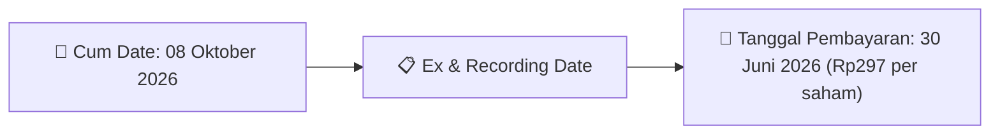
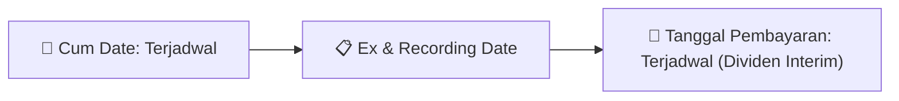

# Ikhtisar Pasar Harian (Daily Digest) - 2026-09-30

📅 **2026-09-30 (Daily Digest)**

## 1. Radar Pasar & Sentimen Harian (Executive Dashboard)
> [!NOTE]
> Terdeteksi sebanyak **182 pengumuman baru** dari 60 emiten pantauan pada (2026-09-30).

| Metric | Jumlah | Status Radar |
| :--- | :---: | :--- |
| **🟢 Sentimen Bullish / Positif** | `5` | [[Dividen Interim]], [[Mandatory Tender Offer]], Kinerja Positif |
| **⚪ Sentimen Netral / Routine** | `84` | [[Tanggapan Penjelasan Bursa]], [[RUPS]], [[Pendaftaran Unit]] |
| **🔴 Sentimen Bearish / Alert** | `3` | Sengketa Hukum, Defisit / Gugatan (Nihil hari ini) |
| **📄 [[Laporan Keuangan]] Baru** | `14` | Memicu Analisis Keuangan Otomatis |

> [!IMPORTANT]
> **Ditemukan Laporan Keuangan Baru Hari Ini:**
> - **FMFN**: FinancialStatement-2026-II-FMFN ([Buka PDF](file:///g:/My Drive/Model2/reports/raw/FMFN/20260929_FMFN_FinancialStatement-2026-II-FMFN.pdf))
- **FMFN**: FinancialStatement-2026-II-FMFN. ([Buka PDF](file:///g:/My Drive/Model2/reports/raw/FMFN/20260929_FMFN_FinancialStatement-2026-II-FMFN.xlsx))
- **MDIA**: FinancialStatement-2026-II-MDIA ([Buka PDF](file:///g:/My Drive/Model2/reports/raw/MDIA/20260929_MDIA_FinancialStatement-2026-II-MDIA.pdf))
- **MDIA**: FinancialStatement-2026-II-MDIA. ([Buka PDF](file:///g:/My Drive/Model2/reports/raw/MDIA/20260929_MDIA_FinancialStatement-2026-II-MDIA.xlsx))
- **PADA**: FinancialStatement-2026-II-PADA ([Buka PDF](file:///g:/My Drive/Model2/reports/raw/PADA/20260929_PADA_FinancialStatement-2026-II-PADA.pdf))
- **PADA**: FinancialStatement-2026-II-PADA. ([Buka PDF](file:///g:/My Drive/Model2/reports/raw/PADA/20260929_PADA_FinancialStatement-2026-II-PADA.xlsx))
- **AMMS**: FinancialStatement-2026-II-AMMS ([Buka PDF](file:///g:/My Drive/Model2/reports/raw/AMMS/20260929_AMMS_FinancialStatement-2026-II-AMMS.pdf))
- **AMMS**: FinancialStatement-2026-II-AMMS. ([Buka PDF](file:///g:/My Drive/Model2/reports/raw/AMMS/20260929_AMMS_FinancialStatement-2026-II-AMMS.xlsx))
- **TGRA**: FinancialStatement-2026-II-TGRA ([Buka PDF](file:///g:/My Drive/Model2/reports/raw/TGRA/20260929_TGRA_FinancialStatement-2026-II-TGRA.pdf))
- **TGRA**: FinancialStatement-2026-II-TGRA. ([Buka PDF](file:///g:/My Drive/Model2/reports/raw/TGRA/20260929_TGRA_FinancialStatement-2026-II-TGRA.xlsx))
- **TGRA**: FinancialStatement-2026-I-TGRA ([Buka PDF](file:///g:/My Drive/Model2/reports/raw/TGRA/20260929_TGRA_FinancialStatement-2026-I-TGRA.pdf))
- **TGRA**: FinancialStatement-2026-I-TGRA. ([Buka PDF](file:///g:/My Drive/Model2/reports/raw/TGRA/20260929_TGRA_FinancialStatement-2026-I-TGRA.xlsx))
- **VIVA**: FinancialStatement-2026-II-VIVA ([Buka PDF](file:///g:/My Drive/Model2/reports/raw/VIVA/20260929_VIVA_FinancialStatement-2026-II-VIVA.pdf))
- **VIVA**: FinancialStatement-2026-II-VIVA. ([Buka PDF](file:///g:/My Drive/Model2/reports/raw/VIVA/20260929_VIVA_FinancialStatement-2026-II-VIVA.xlsx))
> 
> *Tugas Swarm Agent:* Lakukan analisis laporan keuangan mendalam per emiten secara terpisah untuk berkas-berkas di atas.

---

## 2. Sorotan Utama & Watchlist Strategis (Strategic Watchlist)
#### 💰 Watchlist Dividen & Distribution
- **[[ASGR]]**: Nominal Dividen = Rp297 per saham
- **[[ASGR]]**: Total Dividen = Rp400.05 Miliar
- **[[ASGR]]**: Cum Date = 08 Oktober 2026
- **[[ASGR]]**: Ex Date = 09 Oktober 2026
- **[[ASGR]]**: Recording Date = 07 Oktober 2026
- **[[ASGR]]**: Tanggal Pembayaran = 30 Juni 2026

#### 📈 Watchlist Konversi Waran & Potensi Dilusi
- **[[CSIS]]**: Jumlah Waran Dikonversi = 80 lembar
- **[[CSIS]]**: Jumlah Saham Setelah Konversi = 1,829,804,528 lembar
- **[[CSIS]]**: Sisa Waran = 80 lembar
- **[[INET]]**: Jumlah Waran Dikonversi = 9,628 lembar
- **[[INET]]**: Jumlah Saham Setelah Konversi = 22,378,257,992 lembar
- **[[INET]]**: Sisa Waran = 9,628 lembar

#### 👥 Watchlist Transaksi Orang Dalam & Kepemilikan Saham (Insider / Repo Moves)
- **[[RAAM]]**: Nama Insider = RAM JETHMAL PUNJABI
- **[[IMPC]]**: Nama Insider = TUNGGAL JAYA INVESTAMA
- **[[IMPC]]**: Jabatan = Tidak
- **[[NSSS]]**: Nama Insider = SAMUEL SEKURITAS INDONESIA
- **[[KDTN]]**: Nama Insider = PUTRASAKTI MANDIRI
- **[[KDTN]]**: Jabatan = Tidak
- **[[BKSL]]**: Nama Insider = SAMUEL SEKURITAS INDONESIA
- **[[JECX]]**: Nama Insider = JOHAN A M M HUTAURUK

---

## 3. Matriks Pengumuman Pasar (Announcements Intelligence Table)
| Emiten | Sentimen | Jenis Pengumuman | Judul Pengumuman | Berkas |
| :--- | :---: | :--- | :--- | :--- |
| **[[CSIS]]** | ⚪ NEUTRAL | Aksi Korporasi | Pencatatan Saham Tambahan dari Konversi | [Utama](file:///g:/My%20Drive/Model2/reports/raw/CSIS/20260929_CSIS_20260929_CSIS_Pencatatan Saham Tambahan dari Konversi_32161705.pdf) |
| **[[RAAM]]** | ⚪ NEUTRAL | Kepemilikan Saham (Insider) | LK-29092026-0060-00 | [Utama](file:///g:/My%20Drive/Model2/reports/raw/RAAM/20260929_RAAM_LK-29092026-0060-00.pdf) |
| **[[INET]]** | ⚪ NEUTRAL | Aksi Korporasi | Pencatatan Saham Tambahan dari Konversi | [Utama](file:///g:/My%20Drive/Model2/reports/raw/INET/20260929_INET_20260929_INET_Pencatatan Saham Tambahan dari Konversi_32161720.pdf) |
| **[[ISAP]]** | ⚪ NEUTRAL | Aksi Korporasi | Pencatatan Saham Tambahan dari Konversi | [Utama](file:///g:/My%20Drive/Model2/reports/raw/ISAP/20260929_ISAP_20260928_ISAP_Pencatatan Saham Tambahan dari Konversi_32161432.pdf) |
| **[[FMFN]]** | ⚪ NEUTRAL | Laporan Keuangan | FinancialStatement-2026-II-FMFN | [Utama](file:///g:/My%20Drive/Model2/reports/raw/FMFN/20260929_FMFN_FinancialStatement-2026-II-FMFN.pdf) |
| **[[FMFN]]** | ⚪ NEUTRAL | Laporan Keuangan | FinancialStatement-2026-II-FMFN. | [Utama](file:///g:/My%20Drive/Model2/reports/raw/FMFN/20260929_FMFN_FinancialStatement-2026-II-FMFN.xlsx) |
| **[[FMFN]]** | ⚪ NEUTRAL | Aksi Korporasi | LKTT KB FMF 30 June 2026 | [Utama](file:///g:/My%20Drive/Model2/reports/raw/FMFN/20260929_FMFN_LKTT KB FMF 30 June 2026.pdf) |
| **[[FMFN]]** | ⚪ NEUTRAL | Aksi Korporasi | Penjelasan Perubahan Aset dan Liabilitas | [Utama](file:///g:/My%20Drive/Model2/reports/raw/FMFN/20260929_FMFN_Penjelasan Perubahan Aset dan Liabilitas.pdf) |
| **[[FMFN]]** | ⚪ NEUTRAL | Aksi Korporasi | Surat Pengantar LKTT 2026 | [Utama](file:///g:/My%20Drive/Model2/reports/raw/FMFN/20260929_FMFN_Surat Pengantar LKTT 2026.pdf) |
| **[[FMFN]]** | ⚪ NEUTRAL | Aksi Korporasi | Surat Pernyataan Direksi LKTT 2026 | [Utama](file:///g:/My%20Drive/Model2/reports/raw/FMFN/20260929_FMFN_Surat Pernyataan Direksi LKTT 2026.pdf) |
| **[[IMPC]]** | ⚪ NEUTRAL | Kepemilikan Saham (Insider) | LK-29092026-9157-00 | [Utama](file:///g:/My%20Drive/Model2/reports/raw/IMPC/20260929_IMPC_LK-29092026-9157-00.pdf) |
| **[[NIRO]]** | ⚪ NEUTRAL | Aksi Korporasi | Laporan Informasi dan Fakta Material | [Utama](file:///g:/My%20Drive/Model2/reports/raw/NIRO/20260929_NIRO_20260929_NIRO_Laporan Informasi dan Fakta Material_32161805.pdf) · [Lamp 3](file:///g:/My%20Drive/Model2/reports/raw/NIRO/20260929_NIRO_20260929_NIRO_Laporan Informasi dan Fakta Material_32161805_lamp3.pdf) · [Lamp 2](file:///g:/My%20Drive/Model2/reports/raw/NIRO/20260929_NIRO_20260929_NIRO_Laporan Informasi dan Fakta Material_32161805_lamp2.pdf) · [Lamp 1](file:///g:/My%20Drive/Model2/reports/raw/NIRO/20260929_NIRO_20260929_NIRO_Laporan Informasi dan Fakta Material_32161805_lamp1.pdf) |
| **[[TBIG]]** | ⚪ NEUTRAL | Aksi Korporasi | Penyampaian ProspektusInformasi Tambahan | [Utama](file:///g:/My%20Drive/Model2/reports/raw/TBIG/20260929_TBIG_20260929_TBIG_Penyampaian ProspektusInformasi Tambahan_32161920.pdf) · [Lamp 2](file:///g:/My%20Drive/Model2/reports/raw/TBIG/20260929_TBIG_20260929_TBIG_Penyampaian ProspektusInformasi Tambahan_32161920_lamp2.pdf) |
| **[[NSSS]]** | ⚪ NEUTRAL | Kepemilikan Saham (Insider) | LK-29092026-8225-00 | [Utama](file:///g:/My%20Drive/Model2/reports/raw/NSSS/20260929_NSSS_LK-29092026-8225-00.pdf) |
| **[[SMFP]]** | ⚪ NEUTRAL | Aksi Korporasi | Laporan Informasi dan Fakta Material | [Utama](file:///g:/My%20Drive/Model2/reports/raw/SMFP/20260929_SMFP_20260929_SMFP_Laporan Informasi dan Fakta Material_32161787.pdf) · [Lamp 1](file:///g:/My%20Drive/Model2/reports/raw/SMFP/20260929_SMFP_20260929_SMFP_Laporan Informasi dan Fakta Material_32161787_lamp1.pdf) |
| **[[CYBR]]** | ⚪ NEUTRAL | Aksi Korporasi | Pencatatan Saham Tambahan dari Konversi | [Utama](file:///g:/My%20Drive/Model2/reports/raw/CYBR/20260929_CYBR_20260929_CYBR_Pencatatan Saham Tambahan dari Konversi_32161622.pdf) · [Lamp 1](file:///g:/My%20Drive/Model2/reports/raw/CYBR/20260929_CYBR_20260929_CYBR_Pencatatan Saham Tambahan dari Konversi_32161622_lamp1.pdf) |
| **[[KDTN]]** | ⚪ NEUTRAL | Kepemilikan Saham (Insider) | LK-29092026-9349-00 | [Utama](file:///g:/My%20Drive/Model2/reports/raw/KDTN/20260929_KDTN_LK-29092026-9349-00.pdf) |
| **[[BABY]]** | ⚪ NEUTRAL | Aksi Korporasi | Laporan Penggunaan Dana Hasil Penawaran Umum | [Utama](file:///g:/My%20Drive/Model2/reports/raw/BABY/20260929_BABY_20260929_BABY_Laporan Penggunaan Dana Hasil Penawaran Umum_32161798.pdf) · [Lamp 1](file:///g:/My%20Drive/Model2/reports/raw/BABY/20260929_BABY_20260929_BABY_Laporan Penggunaan Dana Hasil Penawaran Umum_32161798_lamp1.pdf) · [Lamp 2](file:///g:/My%20Drive/Model2/reports/raw/BABY/20260929_BABY_20260929_BABY_Laporan Penggunaan Dana Hasil Penawaran Umum_32161798_lamp2.pdf) |
| **[[PACK]]** | ⚪ NEUTRAL | Aksi Korporasi | Pencatatan Saham Tambahan dari Konversi | [Utama](file:///g:/My%20Drive/Model2/reports/raw/PACK/20260929_PACK_20260929_PACK_Pencatatan Saham Tambahan dari Konversi_32161784.pdf) |
| **[[PJHB]]** | ⚪ NEUTRAL | Aksi Korporasi | Pencatatan Saham Tambahan dari Konversi | [Utama](file:///g:/My%20Drive/Model2/reports/raw/PJHB/20260929_PJHB_20260929_PJHB_Pencatatan Saham Tambahan dari Konversi_32161701.pdf) |
| **[[MANG]]** | ⚪ NEUTRAL | Aksi Korporasi | Pencatatan Saham Tambahan dari Konversi | [Utama](file:///g:/My%20Drive/Model2/reports/raw/MANG/20260929_MANG_20260929_MANG_Pencatatan Saham Tambahan dari Konversi_32161618.pdf) · [Lamp 1](file:///g:/My%20Drive/Model2/reports/raw/MANG/20260929_MANG_20260929_MANG_Pencatatan Saham Tambahan dari Konversi_32161618_lamp1.pdf) |
| **[[EMAS]]** | ⚪ NEUTRAL | Aksi Korporasi | Laporan Informasi dan Fakta Material | [Utama](file:///g:/My%20Drive/Model2/reports/raw/EMAS/20260929_EMAS_20260929_EMAS_Laporan Informasi dan Fakta Material_32161816.pdf) · [Lamp 1](file:///g:/My%20Drive/Model2/reports/raw/EMAS/20260929_EMAS_20260929_EMAS_Laporan Informasi dan Fakta Material_32161816_lamp1.pdf) |
| **[[BKSL]]** | ⚪ NEUTRAL | Kepemilikan Saham (Insider) | LK-29092026-1682-00 | [Utama](file:///g:/My%20Drive/Model2/reports/raw/BKSL/20260929_BKSL_LK-29092026-1682-00.pdf) |
| **[[FILM]]** | ⚪ NEUTRAL | Aksi Korporasi | Laporan Informasi dan Fakta Material | [Utama](file:///g:/My%20Drive/Model2/reports/raw/FILM/20260929_FILM_20260929_FILM_Laporan Informasi dan Fakta Material_32161885.pdf) · [Lamp 2](file:///g:/My%20Drive/Model2/reports/raw/FILM/20260929_FILM_20260929_FILM_Laporan Informasi dan Fakta Material_32161885_lamp2.pdf) · [Lamp 1](file:///g:/My%20Drive/Model2/reports/raw/FILM/20260929_FILM_20260929_FILM_Laporan Informasi dan Fakta Material_32161885_lamp1.pdf) |
| **[[PADI]]** | ⚪ NEUTRAL | Aksi Korporasi | Tanggapan atas Permintaan Penjelasan Bursa | [Utama](file:///g:/My%20Drive/Model2/reports/raw/PADI/20260929_PADI_20260929_PADI_Tanggapan atas Permintaan Penjelasan Bursa_32161806.pdf) · [Lamp 1](file:///g:/My%20Drive/Model2/reports/raw/PADI/20260929_PADI_20260929_PADI_Tanggapan atas Permintaan Penjelasan Bursa_32161806_lamp1.pdf) |
| **[[PYFA]]** | ⚪ NEUTRAL | Aksi Korporasi | Pencatatan Saham Tambahan dari Konversi | [Utama](file:///g:/My%20Drive/Model2/reports/raw/PYFA/20260929_PYFA_20260929_PYFA_Pencatatan Saham Tambahan dari Konversi_32161742.pdf) |
| **[[BEXI]]** | ⚪ NEUTRAL | Aksi Korporasi | Laporan Informasi dan Fakta Material | [Utama](file:///g:/My%20Drive/Model2/reports/raw/BEXI/20260929_BEXI_20260929_BEXI_Laporan Informasi dan Fakta Material_32161892.pdf) |
| **[[PGEO]]** | ⚪ NEUTRAL | Aksi Korporasi | Pencatatan Saham Tambahan dari Konversi | [Utama](file:///g:/My%20Drive/Model2/reports/raw/PGEO/20260929_PGEO_20260929_PGEO_Pencatatan Saham Tambahan dari Konversi_32161686.pdf) |
| **[[BALI]]** | ⚪ NEUTRAL | Aksi Korporasi | Laporan Informasi dan Fakta Material | [Utama](file:///g:/My%20Drive/Model2/reports/raw/BALI/20260929_BALI_20260929_BALI_Laporan Informasi dan Fakta Material_32161766.pdf) |
| **[[NICE]]** | ⚪ NEUTRAL | Aksi Korporasi | Tanggapan atas Permintaan Penjelasan Bursa | [Utama](file:///g:/My%20Drive/Model2/reports/raw/NICE/20260929_NICE_20260929_NICE_Tanggapan atas Permintaan Penjelasan Bursa_32161851.pdf) |
| **[[MDIA]]** | ⚪ NEUTRAL | Laporan Keuangan | FinancialStatement-2026-II-MDIA | [Utama](file:///g:/My%20Drive/Model2/reports/raw/MDIA/20260929_MDIA_FinancialStatement-2026-II-MDIA.pdf) |
| **[[MDIA]]** | ⚪ NEUTRAL | Laporan Keuangan | FinancialStatement-2026-II-MDIA. | [Utama](file:///g:/My%20Drive/Model2/reports/raw/MDIA/20260929_MDIA_FinancialStatement-2026-II-MDIA.xlsx) |
| **[[MDIA]]** | ⚪ NEUTRAL | Aksi Korporasi | IMC Checklist Pengungkapan LK 30 Jun 2026 | [Utama](file:///g:/My%20Drive/Model2/reports/raw/MDIA/20260929_MDIA_IMC_Checklist Pengungkapan LK_30 Jun 2026.pdf) |
| **[[MDIA]]** | 🔴 BEARISH | Aksi Korporasi | Intermedia Capital 30 Jun 2026 Final | [Utama](file:///g:/My%20Drive/Model2/reports/raw/MDIA/20260929_MDIA_Intermedia Capital 30 Jun 2026 Final.pdf) |
| **[[MDIA]]** | ⚪ NEUTRAL | Aksi Korporasi | Penyampaian LK Interim Tengah Tahun MDIA | [Utama](file:///g:/My%20Drive/Model2/reports/raw/MDIA/20260929_MDIA_Penyampaian LK Interim Tengah Tahun MDIA.pdf) |
| **[[LAND]]** | ⚪ NEUTRAL | Aksi Korporasi | Tanggapan atas Permintaan Penjelasan Bursa | [Utama](file:///g:/My%20Drive/Model2/reports/raw/LAND/20260929_LAND_20260929_LAND_Tanggapan atas Permintaan Penjelasan Bursa_32161789.pdf) |
| **[[JECX]]** | ⚪ NEUTRAL | Kepemilikan Saham (Insider) | LK-29092026-5023-00 | [Utama](file:///g:/My%20Drive/Model2/reports/raw/JECX/20260929_JECX_LK-29092026-5023-00.pdf) |
| **[[BNLI]]** | ⚪ NEUTRAL | Aksi Korporasi | Laporan Informasi dan Fakta Material | [Utama](file:///g:/My%20Drive/Model2/reports/raw/BNLI/20260929_BNLI_20260929_BNLI_Laporan Informasi dan Fakta Material_32161782.pdf) |
| **[[BINO]]** | ⚪ NEUTRAL | Aksi Korporasi | Laporan Informasi dan Fakta Material | [Utama](file:///g:/My%20Drive/Model2/reports/raw/BINO/20260929_BINO_20260928_BINO_Laporan Informasi dan Fakta Material_32161438.pdf) · [Lamp 1](file:///g:/My%20Drive/Model2/reports/raw/BINO/20260929_BINO_20260928_BINO_Laporan Informasi dan Fakta Material_32161438_lamp1.pdf) |
| **[[SMMA]]** | ⚪ NEUTRAL | Aksi Korporasi | Laporan Informasi dan Fakta Material | [Utama](file:///g:/My%20Drive/Model2/reports/raw/SMMA/20260929_SMMA_20260929_SMMA_Laporan Informasi dan Fakta Material_32161820.pdf) |
| **[[KOCI]]** | ⚪ NEUTRAL | Aksi Korporasi | Pencatatan Saham Tambahan dari Konversi | [Utama](file:///g:/My%20Drive/Model2/reports/raw/KOCI/20260929_KOCI_20260929_KOCI_Pencatatan Saham Tambahan dari Konversi_32161683.pdf) · [Lamp 1](file:///g:/My%20Drive/Model2/reports/raw/KOCI/20260929_KOCI_20260929_KOCI_Pencatatan Saham Tambahan dari Konversi_32161683_lamp1.pdf) |
| **[[BMTP]]** | ⚪ NEUTRAL | Aksi Korporasi | Pembayaran KuponBagi HasilIjarahPokok | [Utama](file:///g:/My%20Drive/Model2/reports/raw/BMTP/20260929_BMTP_20260929_BMTP_Pembayaran KuponBagi HasilIjarahPokok_32161558.pdf) |
| **[[SINI]]** | ⚪ NEUTRAL | Aksi Korporasi | Tanggapan atas Permintaan Penjelasan Bursa | [Utama](file:///g:/My%20Drive/Model2/reports/raw/SINI/20260929_SINI_20260929_SINI_Tanggapan atas Permintaan Penjelasan Bursa_32161911.pdf) · [Lamp 2](file:///g:/My%20Drive/Model2/reports/raw/SINI/20260929_SINI_20260929_SINI_Tanggapan atas Permintaan Penjelasan Bursa_32161911_lamp2.pdf) |
| **[[WIFI]]** | ⚪ NEUTRAL | Aksi Korporasi | Laporan Informasi dan Fakta Material | [Utama](file:///g:/My%20Drive/Model2/reports/raw/WIFI/20260929_WIFI_20260929_WIFI_Laporan Informasi dan Fakta Material_32161901.pdf) · [Lamp 1](file:///g:/My%20Drive/Model2/reports/raw/WIFI/20260929_WIFI_20260929_WIFI_Laporan Informasi dan Fakta Material_32161901_lamp1.pdf) |
| **[[WIFI]]** | ⚪ NEUTRAL | RUPS | Pemanggilan RUPS | [Utama](file:///g:/My%20Drive/Model2/reports/raw/WIFI/20260929_WIFI_20260929_WIFI_Pemanggilan RUPS_32161675.pdf) · [Lamp 1](file:///g:/My%20Drive/Model2/reports/raw/WIFI/20260929_WIFI_20260929_WIFI_Pemanggilan RUPS_32161675_lamp1.pdf) |
| **[[INTP]]** | ⚪ NEUTRAL | Aksi Korporasi | Laporan Informasi dan Fakta Material | [Utama](file:///g:/My%20Drive/Model2/reports/raw/INTP/20260929_INTP_20260929_INTP_Laporan Informasi dan Fakta Material_32161774.pdf) |
| **[[PNGO]]** | ⚪ NEUTRAL | Aksi Korporasi | Laporan Informasi dan Fakta Material | [Utama](file:///g:/My%20Drive/Model2/reports/raw/PNGO/20260929_PNGO_20260929_PNGO_Laporan Informasi dan Fakta Material_32161773.pdf) · [Lamp 1](file:///g:/My%20Drive/Model2/reports/raw/PNGO/20260929_PNGO_20260929_PNGO_Laporan Informasi dan Fakta Material_32161773_lamp1.pdf) |
| **[[DPNS]]** | 🔴 BEARISH | Aksi Korporasi | Suspensi dan Pembukaan Suspensi | [Utama](file:///g:/My%20Drive/Model2/reports/raw/DPNS/20260929_DPNS_20260929_Suspensi dan Pembukaan Suspensi_32161904.pdf) · [Lamp 1](file:///g:/My%20Drive/Model2/reports/raw/DPNS/20260929_DPNS_20260929_Suspensi dan Pembukaan Suspensi_32161904_lamp1.pdf) |
| **[[PADA]]** | ⚪ NEUTRAL | Aksi Korporasi | Laporan Informasi dan Fakta Material | [Utama](file:///g:/My%20Drive/Model2/reports/raw/PADA/20260929_PADA_20260929_PADA_Laporan Informasi dan Fakta Material_32161602.pdf) |
| **[[PADA]]** | 🟢 BULLISH | Laporan Keuangan | FinancialStatement-2026-II-PADA | [Utama](file:///g:/My%20Drive/Model2/reports/raw/PADA/20260929_PADA_FinancialStatement-2026-II-PADA.pdf) |
| **[[PADA]]** | ⚪ NEUTRAL | Aksi Korporasi | 2026 Ceklist OJK - PADA Juni 2026 | [Utama](file:///g:/My%20Drive/Model2/reports/raw/PADA/20260929_PADA_2026_Ceklist OJK - PADA Juni 2026.pdf) |
| **[[PADA]]** | ⚪ NEUTRAL | Aksi Korporasi | 2026 Penjelasan kenaikan Aset Liabilitas 1H 2026 | [Utama](file:///g:/My%20Drive/Model2/reports/raw/PADA/20260929_PADA_2026_Penjelasan kenaikan Aset Liabilitas 1H 2026.pdf) |
| **[[PADA]]** | ⚪ NEUTRAL | Aksi Korporasi | 2026 SPD PT Personel Alih Daya 30 Juni 2026.pdf | [Utama](file:///g:/My%20Drive/Model2/reports/raw/PADA/20260929_PADA_2026_SPD_PT Personel Alih Daya 30 Juni 2026.pdf.pdf) |
| **[[PADA]]** | ⚪ NEUTRAL | Laporan Keuangan | FinancialStatement-2026-II-PADA. | [Utama](file:///g:/My%20Drive/Model2/reports/raw/PADA/20260929_PADA_FinancialStatement-2026-II-PADA.xlsx) |
| **[[PADA]]** | ⚪ NEUTRAL | Aksi Korporasi | Report PT Personel Alih Daya Tbk 30 Juni 2026 | [Utama](file:///g:/My%20Drive/Model2/reports/raw/PADA/20260929_PADA_Report PT Personel Alih Daya Tbk 30 Juni 2026.pdf) |
| **[[BMRI]]** | ⚪ NEUTRAL | Aksi Korporasi | Pengumuman Jatuh Tempo Obligasi dan Sukuk | [Utama](file:///g:/My%20Drive/Model2/reports/raw/BMRI/20260929_BMRI_20260929_BMRI_Pengumuman Jatuh Tempo Obligasi dan Sukuk_32161591.pdf) |
| **[[ARKO]]** | ⚪ NEUTRAL | RUPS | Transaksi Material Tanpa Persetujuan RUPS | [Utama](file:///g:/My%20Drive/Model2/reports/raw/ARKO/20260929_ARKO_20260929_ARKO_Transaksi Material Tanpa Persetujuan RUPS_32161809.pdf) |
| **[[FORU]]** | ⚪ NEUTRAL | Aksi Korporasi | Pencatatan Saham Tambahan dari Konversi | [Utama](file:///g:/My%20Drive/Model2/reports/raw/FORU/20260929_FORU_20260929_FORU_Pencatatan Saham Tambahan dari Konversi_32161786.pdf) |
| **[[SMAR]]** | ⚪ NEUTRAL | Aksi Korporasi | Laporan Informasi dan Fakta Material | [Utama](file:///g:/My%20Drive/Model2/reports/raw/SMAR/20260929_SMAR_20260924_SMAR_Laporan Informasi dan Fakta Material_32150850.pdf) · [Lamp 3](file:///g:/My%20Drive/Model2/reports/raw/SMAR/20260929_SMAR_20260924_SMAR_Laporan Informasi dan Fakta Material_32150850_lamp3.pdf) · [Lamp 2](file:///g:/My%20Drive/Model2/reports/raw/SMAR/20260929_SMAR_20260924_SMAR_Laporan Informasi dan Fakta Material_32150850_lamp2.pdf) |
| **[[GTBO]]** | ⚪ NEUTRAL | Aksi Korporasi | Laporan Informasi dan Fakta Material | [Utama](file:///g:/My%20Drive/Model2/reports/raw/GTBO/20260929_GTBO_20260929_GTBO_Laporan Informasi dan Fakta Material_32161915.pdf) |
| **[[GTBO]]** | ⚪ NEUTRAL | Aksi Korporasi | Tanggapan atas Permintaan Penjelasan Bursa | [Utama](file:///g:/My%20Drive/Model2/reports/raw/GTBO/20260929_GTBO_20260929_GTBO_Tanggapan atas Permintaan Penjelasan Bursa_32161913.pdf) · [Lamp 1](file:///g:/My%20Drive/Model2/reports/raw/GTBO/20260929_GTBO_20260929_GTBO_Tanggapan atas Permintaan Penjelasan Bursa_32161913_lamp1.pdf) |
| **[[INKP]]** | ⚪ NEUTRAL | Aksi Korporasi | Pengumuman Jatuh Tempo Obligasi dan Sukuk | [Utama](file:///g:/My%20Drive/Model2/reports/raw/INKP/20260929_INKP_20260929_INKP_Pengumuman Jatuh Tempo Obligasi dan Sukuk_32161712.pdf) · [Lamp 2](file:///g:/My%20Drive/Model2/reports/raw/INKP/20260929_INKP_20260929_INKP_Pengumuman Jatuh Tempo Obligasi dan Sukuk_32161712_lamp2.pdf) |
| **[[ASGR]]** | 🟢 BULLISH | Dividen | Jadwal Aksi Korporasi (Khusus Penyampaian Dividen Interim) | [Utama](file:///g:/My%20Drive/Model2/reports/raw/ASGR/20260929_ASGR_20260929_ASGR_Jadwal Aksi Korporasi (Khusus Penyampaian Dividen Interim)_32161732.pdf) |
| **[[ASGR]]** | 🟢 BULLISH | Dividen | Laporan Informasi dan Fakta Material | [Utama](file:///g:/My%20Drive/Model2/reports/raw/ASGR/20260929_ASGR_20260929_ASGR_Laporan Informasi dan Fakta Material_32161717.pdf) |
| **[[RLCO]]** | ⚪ NEUTRAL | Kepemilikan Saham (Insider) | LK-29092026-2226-00 | [Utama](file:///g:/My%20Drive/Model2/reports/raw/RLCO/20260929_RLCO_LK-29092026-2226-00.pdf) |
| **[[DGIK]]** | ⚪ NEUTRAL | Kepemilikan Saham (Insider) | LK-29092026-6471-00 | [Utama](file:///g:/My%20Drive/Model2/reports/raw/DGIK/20260929_DGIK_LK-29092026-6471-00.pdf) |
| **[[VKTR]]** | ⚪ NEUTRAL | Aksi Korporasi | Keterbukaan Informasi terkait Aksi Korporasi | [Utama](file:///g:/My%20Drive/Model2/reports/raw/VKTR/20260929_VKTR_20260929_VKTR_Keterbukaan Informasi terkait Aksi Korporasi_32161709.pdf) · [Lamp 1](file:///g:/My%20Drive/Model2/reports/raw/VKTR/20260929_VKTR_20260929_VKTR_Keterbukaan Informasi terkait Aksi Korporasi_32161834_lamp1.pdf) · [Lamp 1](file:///g:/My%20Drive/Model2/reports/raw/VKTR/20260929_VKTR_20260929_VKTR_Keterbukaan Informasi terkait Aksi Korporasi_32161709_lamp1.pdf) |
| **[[VKTR]]** | 🟢 BULLISH | Aksi Korporasi | Penyampaian ProspektusInformasi Tambahan | [Utama](file:///g:/My%20Drive/Model2/reports/raw/VKTR/20260929_VKTR_20260929_VKTR_Penyampaian ProspektusInformasi Tambahan_32161669.pdf) · [Lamp 2](file:///g:/My%20Drive/Model2/reports/raw/VKTR/20260929_VKTR_20260929_VKTR_Penyampaian ProspektusInformasi Tambahan_32161792_lamp2.pdf) · [Lamp 1](file:///g:/My%20Drive/Model2/reports/raw/VKTR/20260929_VKTR_20260929_VKTR_Penyampaian ProspektusInformasi Tambahan_32161792_lamp1.pdf) · [Lamp 2](file:///g:/My%20Drive/Model2/reports/raw/VKTR/20260929_VKTR_20260929_VKTR_Penyampaian ProspektusInformasi Tambahan_32161669_lamp2.pdf) |
| **[[AMMS]]** | 🟢 BULLISH | Laporan Keuangan | FinancialStatement-2026-II-AMMS | [Utama](file:///g:/My%20Drive/Model2/reports/raw/AMMS/20260929_AMMS_FinancialStatement-2026-II-AMMS.pdf) |
| **[[AMMS]]** | ⚪ NEUTRAL | Laporan Keuangan | FinancialStatement-2026-II-AMMS. | [Utama](file:///g:/My%20Drive/Model2/reports/raw/AMMS/20260929_AMMS_FinancialStatement-2026-II-AMMS.xlsx) |
| **[[AMMS]]** | ⚪ NEUTRAL | Aksi Korporasi | LKTT 30 Juni 2026 | [Utama](file:///g:/My%20Drive/Model2/reports/raw/AMMS/20260929_AMMS_LKTT 30 Juni 2026.pdf) |
| **[[AMMS]]** | ⚪ NEUTRAL | Aksi Korporasi | srt perubahan aset dan liabilitas 30 Juni 2026 | [Utama](file:///g:/My%20Drive/Model2/reports/raw/AMMS/20260929_AMMS_srt perubahan aset dan liabilitas 30 Juni 2026.pdf) |
| **[[MICE]]** | ⚪ NEUTRAL | Kepemilikan Saham (Insider) | LK-29092026-2753-00 | [Utama](file:///g:/My%20Drive/Model2/reports/raw/MICE/20260929_MICE_LK-29092026-2753-00.pdf) |
| **[[MICE]]** | ⚪ NEUTRAL | Kepemilikan Saham (Insider) | LK-29092026-5679-00 | [Utama](file:///g:/My%20Drive/Model2/reports/raw/MICE/20260929_MICE_LK-29092026-5679-00.pdf) |
| **[[APAI]]** | ⚪ NEUTRAL | Aksi Korporasi | Pembayaran KuponBagi HasilIjarahPokok | [Utama](file:///g:/My%20Drive/Model2/reports/raw/APAI/20260929_APAI_20260929_APAI_Pembayaran KuponBagi HasilIjarahPokok_32161620.pdf) · [Lamp 1](file:///g:/My%20Drive/Model2/reports/raw/APAI/20260929_APAI_20260929_APAI_Pembayaran KuponBagi HasilIjarahPokok_32161616_lamp1.pdf) · [Lamp 1](file:///g:/My%20Drive/Model2/reports/raw/APAI/20260929_APAI_20260929_APAI_Pembayaran KuponBagi HasilIjarahPokok_32161620_lamp1.pdf) |
| **[[PART]]** | ⚪ NEUTRAL | Aksi Korporasi | Laporan Informasi dan Fakta Material | [Utama](file:///g:/My%20Drive/Model2/reports/raw/PART/20260929_PART_20260929_PART_Laporan Informasi dan Fakta Material_32161644.pdf) · [Lamp 1](file:///g:/My%20Drive/Model2/reports/raw/PART/20260929_PART_20260929_PART_Laporan Informasi dan Fakta Material_32161644_lamp1.pdf) |
| **[[SMLE]]** | ⚪ NEUTRAL | Public Expose | Public Expose | [Utama](file:///g:/My%20Drive/Model2/reports/raw/SMLE/20260929_SMLE_20260929_SMLE_Public Expose_32161778.pdf) |
| **[[TGRA]]** | ⚪ NEUTRAL | Laporan Keuangan | FinancialStatement-2026-II-TGRA | [Utama](file:///g:/My%20Drive/Model2/reports/raw/TGRA/20260929_TGRA_FinancialStatement-2026-II-TGRA.pdf) |
| **[[TGRA]]** | ⚪ NEUTRAL | Laporan Keuangan | FinancialStatement-2026-II-TGRA. | [Utama](file:///g:/My%20Drive/Model2/reports/raw/TGRA/20260929_TGRA_FinancialStatement-2026-II-TGRA.xlsx) |
| **[[TGRA]]** | ⚪ NEUTRAL | Aksi Korporasi | TGRA - Report Q2 2026 | [Utama](file:///g:/My%20Drive/Model2/reports/raw/TGRA/20260929_TGRA_TGRA - Report Q2 2026.pdf) |
| **[[TGRA]]** | ⚪ NEUTRAL | Laporan Keuangan | FinancialStatement-2026-I-TGRA | [Utama](file:///g:/My%20Drive/Model2/reports/raw/TGRA/20260929_TGRA_FinancialStatement-2026-I-TGRA.pdf) |
| **[[TGRA]]** | ⚪ NEUTRAL | Laporan Keuangan | FinancialStatement-2026-I-TGRA. | [Utama](file:///g:/My%20Drive/Model2/reports/raw/TGRA/20260929_TGRA_FinancialStatement-2026-I-TGRA.xlsx) |
| **[[TGRA]]** | ⚪ NEUTRAL | Aksi Korporasi | TGRA - Report Q1 2026 | [Utama](file:///g:/My%20Drive/Model2/reports/raw/TGRA/20260929_TGRA_TGRA - Report Q1 2026.pdf) |
| **[[SCNP]]** | ⚪ NEUTRAL | Aksi Korporasi | Laporan Informasi dan Fakta Material | [Utama](file:///g:/My%20Drive/Model2/reports/raw/SCNP/20260929_SCNP_20260929_SCNP_Laporan Informasi dan Fakta Material_32161730.pdf) · [Lamp 1](file:///g:/My%20Drive/Model2/reports/raw/SCNP/20260929_SCNP_20260929_SCNP_Laporan Informasi dan Fakta Material_32161730_lamp1.pdf) |
| **[[IDEA]]** | ⚪ NEUTRAL | Aksi Korporasi | Tanggapan atas Permintaan Penjelasan Bursa | [Utama](file:///g:/My%20Drive/Model2/reports/raw/IDEA/20260929_IDEA_20260929_IDEA_Tanggapan atas Permintaan Penjelasan Bursa_32161909.pdf) · [Lamp 2](file:///g:/My%20Drive/Model2/reports/raw/IDEA/20260929_IDEA_20260929_IDEA_Tanggapan atas Permintaan Penjelasan Bursa_32161909_lamp2.pdf) · [Lamp 1](file:///g:/My%20Drive/Model2/reports/raw/IDEA/20260929_IDEA_20260929_IDEA_Tanggapan atas Permintaan Penjelasan Bursa_32161909_lamp1.pdf) |
| **[[CANI]]** | ⚪ NEUTRAL | Aksi Korporasi | Laporan Informasi dan Fakta Material | [Utama](file:///g:/My%20Drive/Model2/reports/raw/CANI/20260929_CANI_20260929_CANI_Laporan Informasi dan Fakta Material_32161821.pdf) · [Lamp 1](file:///g:/My%20Drive/Model2/reports/raw/CANI/20260929_CANI_20260929_CANI_Laporan Informasi dan Fakta Material_32161821_lamp1.pdf) |
| **[[STTP]]** | ⚪ NEUTRAL | Aksi Korporasi | Tanggapan atas Permintaan Penjelasan Bursa | [Utama](file:///g:/My%20Drive/Model2/reports/raw/STTP/20260929_STTP_20260929_STTP_Tanggapan atas Permintaan Penjelasan Bursa_32161780.pdf) |
| **[[VIVA]]** | ⚪ NEUTRAL | Laporan Keuangan | FinancialStatement-2026-II-VIVA | [Utama](file:///g:/My%20Drive/Model2/reports/raw/VIVA/20260929_VIVA_FinancialStatement-2026-II-VIVA.pdf) |
| **[[VIVA]]** | ⚪ NEUTRAL | Laporan Keuangan | FinancialStatement-2026-II-VIVA. | [Utama](file:///g:/My%20Drive/Model2/reports/raw/VIVA/20260929_VIVA_FinancialStatement-2026-II-VIVA.xlsx) |
| **[[VIVA]]** | ⚪ NEUTRAL | Aksi Korporasi | Surat Pengantar LKTT VIVA 2026 | [Utama](file:///g:/My%20Drive/Model2/reports/raw/VIVA/20260929_VIVA_Surat Pengantar LKTT VIVA 2026.pdf) |
| **[[VIVA]]** | 🔴 BEARISH | Aksi Korporasi | Visi Media Asia 30 Jun 2026 Final | [Utama](file:///g:/My%20Drive/Model2/reports/raw/VIVA/20260929_VIVA_Visi Media Asia 30 Jun 2026 Final.pdf) |
| **[[VIVA]]** | ⚪ NEUTRAL | Aksi Korporasi | VMA Check Pengung LK 30 Jun 2026 | [Utama](file:///g:/My%20Drive/Model2/reports/raw/VIVA/20260929_VIVA_VMA_Check Pengung LK 30 Jun 2026.pdf) |

---

## 4. Detail Informasi per Emiten (Grouped by Emiten)
### 📋 4.2. Detail Emiten Lain (Non-Watchlist)

#### 🔵 [[CSIS]]
- **[Aksi Korporasi]** [Pencatatan Saham Tambahan dari Konversi](file:///g:/My%20Drive/Model2/reports/raw/CSIS/20260929_CSIS_20260929_CSIS_Pencatatan Saham Tambahan dari Konversi_32161705.pdf)
  - 📌 *Deskripsi*: Pencatatan saham tambahan hasil konversi waran CSIS.
  - 📊 **Fakta Material**:
    - **Jumlah Waran Dikonversi**: 80 lembar
    - **Jumlah Saham Setelah Konversi**: 1,829,804,528 lembar
    - **Sisa Waran**: 80 lembar
    - **Tanggal Pencatatan**: 30 September 2026

#### 🔵 [[RAAM]]
- **[Kepemilikan Saham (Insider)]** [LK-29092026-0060-00](file:///g:/My%20Drive/Model2/reports/raw/RAAM/20260929_RAAM_LK-29092026-0060-00.pdf)
  - 📌 *Deskripsi*: Laporan perubahan kepemilikan saham insider RAAM.
  - 📊 **Fakta Material**:
    - **Nama Insider**: RAM JETHMAL PUNJABI

#### 🔵 [[INET]]
- **[Aksi Korporasi]** [Pencatatan Saham Tambahan dari Konversi](file:///g:/My%20Drive/Model2/reports/raw/INET/20260929_INET_20260929_INET_Pencatatan Saham Tambahan dari Konversi_32161720.pdf)
  - 📌 *Deskripsi*: Pencatatan saham tambahan hasil konversi waran INET.
  - 📊 **Fakta Material**:
    - **Jumlah Waran Dikonversi**: 9,628 lembar
    - **Jumlah Saham Setelah Konversi**: 22,378,257,992 lembar
    - **Sisa Waran**: 9,628 lembar
    - **Tanggal Pencatatan**: 30 September 2026

#### 🔵 [[ISAP]]
- **[Aksi Korporasi]** [Pencatatan Saham Tambahan dari Konversi](file:///g:/My%20Drive/Model2/reports/raw/ISAP/20260929_ISAP_20260928_ISAP_Pencatatan Saham Tambahan dari Konversi_32161432.pdf)
  - 📌 *Deskripsi*: Pencatatan saham tambahan hasil konversi waran ISAP.
  - 📊 **Fakta Material**:
    - **Jumlah Waran Dikonversi**: 52 lembar
    - **Jumlah Saham Setelah Konversi**: 4,020,378,024 lembar
    - **Sisa Waran**: 52 lembar
    - **Tanggal Pencatatan**: 30 September 2026

#### 🔵 [[FMFN]]
- **[Laporan Keuangan]** [FinancialStatement-2026-II-FMFN](file:///g:/My%20Drive/Model2/reports/raw/FMFN/20260929_FMFN_FinancialStatement-2026-II-FMFN.pdf)
  - 📌 *Deskripsi*: Pencatatan unit tambahan ETF / Reksa Dana FMFN.
- **[Laporan Keuangan]** [FinancialStatement-2026-II-FMFN.](file:///g:/My%20Drive/Model2/reports/raw/FMFN/20260929_FMFN_FinancialStatement-2026-II-FMFN.xlsx)
  - 📌 *Deskripsi*: Informasi dan fakta material FMFN: [8697000_BD] Notes to the financial statements - Bank Loans by Order of Liquidity Interest Information (breakdown) - Financing Industry CurrentYearInstant Catatan utang bank berdasarkan tingkat likuiditas | Notes for bank loans by order of liquidity Catatan utang bank berdasarkan tingkat likuiditas [baris komponen] Utang bank berdasarkan tingkat likuiditas, nilai dalam mata uang asing | Jatuh tempo utang bank | Bunga Bank Central Asia Tbk | IDR AUD CAD CNY EUR HKD GBP JPY SGD THB
  - 📊 **Fakta Material**:
    - **Uraian Kejadian**: [8697000_BD] Notes to the financial statements - Bank Loans by Order of Liquidity Interest Information (breakdown) - Financing Industry CurrentYearInstant Catatan utang bank berdasarkan tingkat likuiditas | Notes for bank loans by order of liquidity Catatan utang bank berdasarkan tingkat likuiditas [baris komponen] Utang bank berdasarkan tingkat likuiditas, nilai dalam mata uang asing | Jatuh tempo utang bank | Bunga Bank Central Asia Tbk | IDR AUD CAD CNY EUR HKD GBP JPY SGD THB
- **[Aksi Korporasi]** [LKTT KB FMF 30 June 2026](file:///g:/My%20Drive/Model2/reports/raw/FMFN/20260929_FMFN_LKTT KB FMF 30 June 2026.pdf)
  - 📌 *Deskripsi*: Informasi dan fakta material FMFN: PT KB Finansia Multi Finance Laporan Keuangan Interim/ Interim Financial Statements 30 Juni 2026 dan Untuk Periode Enam-Bulan yang Berakhir pada tanggal tersebut/ June 30, 2026 and For the Six-Month Period then Ended PT KB FINANSIA MULTI FINANCE DAFTAR ISI/TABLE OF CONTENTS Halaman/ Page Laporan Auditor Independen/Independent Auditors’ Report Surat Pernyataan Direksi tentang Tanggung Jawab atas Laporan Keuangan PT KB Finansia Multi Finance pada tanggal 30 Juni 2026 dan untuk Periode Enam-Bulan y
  - 📊 **Fakta Material**:
    - **Uraian Kejadian**: PT KB Finansia Multi Finance Laporan Keuangan Interim/ Interim Financial Statements 30 Juni 2026 dan Untuk Periode Enam-Bulan yang Berakhir pada tanggal tersebut/ June 30, 2026 and For the Six-Month Period then Ended PT KB FINANSIA MULTI FINANCE DAFTAR ISI/TABLE OF CONTENTS Halaman/ Page Laporan Auditor Independen/Independent Auditors’ Report Surat Pernyataan Direksi tentang Tanggung Jawab atas Laporan Keuangan PT KB Finansia Multi Finance pada tanggal 30 Juni 2026 dan untuk Periode Enam-Bulan y
- **[Aksi Korporasi]** [Penjelasan Perubahan Aset dan Liabilitas](file:///g:/My%20Drive/Model2/reports/raw/FMFN/20260929_FMFN_Penjelasan Perubahan Aset dan Liabilitas.pdf)
  - 📌 *Deskripsi*: Informasi dan fakta material FMFN:
- **[Aksi Korporasi]** [Surat Pengantar LKTT 2026](file:///g:/My%20Drive/Model2/reports/raw/FMFN/20260929_FMFN_Surat Pengantar LKTT 2026.pdf)
  - 📌 *Deskripsi*: Informasi dan fakta material FMFN:
- **[Aksi Korporasi]** [Surat Pernyataan Direksi LKTT 2026](file:///g:/My%20Drive/Model2/reports/raw/FMFN/20260929_FMFN_Surat Pernyataan Direksi LKTT 2026.pdf)
  - 📌 *Deskripsi*: Informasi dan fakta material FMFN:

#### 🔵 [[IMPC]]
- **[Kepemilikan Saham (Insider)]** [LK-29092026-9157-00](file:///g:/My%20Drive/Model2/reports/raw/IMPC/20260929_IMPC_LK-29092026-9157-00.pdf)
  - 📌 *Deskripsi*: Laporan perubahan kepemilikan saham insider IMPC.
  - 📊 **Fakta Material**:
    - **Nama Insider**: TUNGGAL JAYA INVESTAMA
    - **Jabatan**: Tidak

#### 🔵 [[NIRO]]
- **[Aksi Korporasi]** [Laporan Informasi dan Fakta Material](file:///g:/My%20Drive/Model2/reports/raw/NIRO/20260929_NIRO_20260929_NIRO_Laporan Informasi dan Fakta Material_32161805.pdf) *(Attachment: [Lamp 3](file:///g:/My%20Drive/Model2/reports/raw/NIRO/20260929_NIRO_20260929_NIRO_Laporan Informasi dan Fakta Material_32161805_lamp3.pdf) · [Lamp 2](file:///g:/My%20Drive/Model2/reports/raw/NIRO/20260929_NIRO_20260929_NIRO_Laporan Informasi dan Fakta Material_32161805_lamp2.pdf) · [Lamp 1](file:///g:/My%20Drive/Model2/reports/raw/NIRO/20260929_NIRO_20260929_NIRO_Laporan Informasi dan Fakta Material_32161805_lamp1.pdf))*
  - 📌 *Deskripsi*: Informasi dan fakta material NIRO: PT City Retail Developments Tbk dan entitas anaknya/and its subsidiaries Informasi keuangan konsolidasian interim proforma yang tidak diaudit tanggal 30 Juni 2026 dan untuk periode enam bulan yang berakhir pada tanggal tersebut beserta laporan asurans praktisi independen/ Unaudited pro forma interim consolidated financial information as of June 30, 2026 and for the six-month period then ended with independent practitioner’s assurance report The original pro forma interim consolidated financial s
  - 📊 **Fakta Material**:
    - **Uraian Kejadian**: PT City Retail Developments Tbk dan entitas anaknya/and its subsidiaries Informasi keuangan konsolidasian interim proforma yang tidak diaudit tanggal 30 Juni 2026 dan untuk periode enam bulan yang berakhir pada tanggal tersebut beserta laporan asurans praktisi independen/ Unaudited pro forma interim consolidated financial information as of June 30, 2026 and for the six-month period then ended with independent practitioner’s assurance report The original pro forma interim consolidated financial s

#### 🔵 [[TBIG]]
- **[Aksi Korporasi]** [Penyampaian ProspektusInformasi Tambahan](file:///g:/My%20Drive/Model2/reports/raw/TBIG/20260929_TBIG_20260929_TBIG_Penyampaian ProspektusInformasi Tambahan_32161920.pdf) *(Attachment: [Lamp 2](file:///g:/My%20Drive/Model2/reports/raw/TBIG/20260929_TBIG_20260929_TBIG_Penyampaian ProspektusInformasi Tambahan_32161920_lamp2.pdf))*
  - 📌 *Deskripsi*: Pencatatan saham tambahan hasil konversi waran TBIG.

#### 🔵 [[NSSS]]
- **[Kepemilikan Saham (Insider)]** [LK-29092026-8225-00](file:///g:/My%20Drive/Model2/reports/raw/NSSS/20260929_NSSS_LK-29092026-8225-00.pdf)
  - 📌 *Deskripsi*: Laporan perubahan kepemilikan saham insider NSSS.
  - 📊 **Fakta Material**:
    - **Nama Insider**: SAMUEL SEKURITAS INDONESIA

#### 🔵 [[SMFP]]
- **[Aksi Korporasi]** [Laporan Informasi dan Fakta Material](file:///g:/My%20Drive/Model2/reports/raw/SMFP/20260929_SMFP_20260929_SMFP_Laporan Informasi dan Fakta Material_32161787.pdf) *(Attachment: [Lamp 1](file:///g:/My%20Drive/Model2/reports/raw/SMFP/20260929_SMFP_20260929_SMFP_Laporan Informasi dan Fakta Material_32161787_lamp1.pdf))*
  - 📌 *Deskripsi*: Informasi dan fakta material SMFP: Nomor : S-2305/DIR/SMF/IX/2026 29 September 2026 : 1 Set Kepada Yth PT Bursa Efek Indonesia Jakarta 12190 U.P : Bapak Jeffrey Hendrik - Direktur Utama : Penyampaian Perubahan Anggota Direksi PT Sarana Multigriya Finansial (Persero) Dengan hormat, Merujuk surat kami nomor S-2106/DIR/SMF/IX/2026 Penyampaian Perubahan Anggota Direksi PT Sarana Multigriya Finansial (Persero) bersama ini kami sampaikan Keputusan Menteri Keuangan Republik Indonesia Nomor 206.1 Tahun 2026 tentang Pemberhentian dan Peng
  - 📊 **Fakta Material**:
    - **Uraian Kejadian**: Nomor : S-2305/DIR/SMF/IX/2026 29 September 2026 : 1 Set Kepada Yth PT Bursa Efek Indonesia Jakarta 12190 U.P : Bapak Jeffrey Hendrik - Direktur Utama : Penyampaian Perubahan Anggota Direksi PT Sarana Multigriya Finansial (Persero) Dengan hormat, Merujuk surat kami nomor S-2106/DIR/SMF/IX/2026 Penyampaian Perubahan Anggota Direksi PT Sarana Multigriya Finansial (Persero) bersama ini kami sampaikan Keputusan Menteri Keuangan Republik Indonesia Nomor 206.1 Tahun 2026 tentang Pemberhentian dan Peng

#### 🔵 [[CYBR]]
- **[Aksi Korporasi]** [Pencatatan Saham Tambahan dari Konversi](file:///g:/My%20Drive/Model2/reports/raw/CYBR/20260929_CYBR_20260929_CYBR_Pencatatan Saham Tambahan dari Konversi_32161622.pdf) *(Attachment: [Lamp 1](file:///g:/My%20Drive/Model2/reports/raw/CYBR/20260929_CYBR_20260929_CYBR_Pencatatan Saham Tambahan dari Konversi_32161622_lamp1.pdf))*
  - 📌 *Deskripsi*: Pencatatan saham tambahan hasil konversi waran CYBR.
  - 📊 **Fakta Material**:
    - **Jumlah Waran Dikonversi**: 242,600 lembar
    - **Jumlah Saham Setelah Konversi**: 13,488,175,809 lembar
    - **Sisa Waran**: 242,600 lembar
    - **Tanggal Pencatatan**: 30 September 2026

#### 🔵 [[KDTN]]
- **[Kepemilikan Saham (Insider)]** [LK-29092026-9349-00](file:///g:/My%20Drive/Model2/reports/raw/KDTN/20260929_KDTN_LK-29092026-9349-00.pdf)
  - 📌 *Deskripsi*: Laporan perubahan kepemilikan saham insider KDTN.
  - 📊 **Fakta Material**:
    - **Nama Insider**: PUTRASAKTI MANDIRI
    - **Jabatan**: Tidak

#### 🔵 [[BABY]]
- **[Aksi Korporasi]** [Laporan Penggunaan Dana Hasil Penawaran Umum](file:///g:/My%20Drive/Model2/reports/raw/BABY/20260929_BABY_20260929_BABY_Laporan Penggunaan Dana Hasil Penawaran Umum_32161798.pdf) *(Attachment: [Lamp 1](file:///g:/My%20Drive/Model2/reports/raw/BABY/20260929_BABY_20260929_BABY_Laporan Penggunaan Dana Hasil Penawaran Umum_32161798_lamp1.pdf) · [Lamp 2](file:///g:/My%20Drive/Model2/reports/raw/BABY/20260929_BABY_20260929_BABY_Laporan Penggunaan Dana Hasil Penawaran Umum_32161798_lamp2.pdf))*
  - 📌 *Deskripsi*: Pencatatan saham tambahan hasil konversi waran BABY.

#### 🔵 [[PACK]]
- **[Aksi Korporasi]** [Pencatatan Saham Tambahan dari Konversi](file:///g:/My%20Drive/Model2/reports/raw/PACK/20260929_PACK_20260929_PACK_Pencatatan Saham Tambahan dari Konversi_32161784.pdf)
  - 📌 *Deskripsi*: Informasi dan fakta material PACK: PT Abadi Nusantara Hijau Investama Tbk (PACK) PENGUMUMAN BURSA Pencatatan Saham Papan Pencatatan Akselerasi Dengan ini Bursa mengumumkan sebagai berikut: Obligasi Wajib Konversi Sisa Obligasi Wajib Konversi 30 September 2026 Jumlah Saham Setelah Pencatatan Saham Hasil Pelaksanaan Obligasi Wajib Konversi 34.118.231.991 66.106.353 Tanggal Pencatatan Penambahan Saham 1.795.200 PT. Bursa Efek Indonesia Martin Satria D. Bako P.H. Kadiv POP PT Bursa Efek Indonesia PH Kepala Divisi PP1 Aditya Nugraha 1
  - 📊 **Fakta Material**:
    - **Uraian Kejadian**: PT Abadi Nusantara Hijau Investama Tbk (PACK) PENGUMUMAN BURSA Pencatatan Saham Papan Pencatatan Akselerasi Dengan ini Bursa mengumumkan sebagai berikut: Obligasi Wajib Konversi Sisa Obligasi Wajib Konversi 30 September 2026 Jumlah Saham Setelah Pencatatan Saham Hasil Pelaksanaan Obligasi Wajib Konversi 34.118.231.991 66.106.353 Tanggal Pencatatan Penambahan Saham 1.795.200 PT. Bursa Efek Indonesia Martin Satria D. Bako P.H. Kadiv POP PT Bursa Efek Indonesia PH Kepala Divisi PP1 Aditya Nugraha 1

#### 🔵 [[PJHB]]
- **[Aksi Korporasi]** [Pencatatan Saham Tambahan dari Konversi](file:///g:/My%20Drive/Model2/reports/raw/PJHB/20260929_PJHB_20260929_PJHB_Pencatatan Saham Tambahan dari Konversi_32161701.pdf)
  - 📌 *Deskripsi*: Pencatatan saham tambahan hasil konversi waran PJHB.
  - 📊 **Fakta Material**:
    - **Jumlah Waran Dikonversi**: 1,902 lembar
    - **Jumlah Saham Setelah Konversi**: 1,921,082,401 lembar
    - **Sisa Waran**: 1,902 lembar
    - **Tanggal Pencatatan**: 30 September 2026

#### 🔵 [[MANG]]
- **[Aksi Korporasi]** [Pencatatan Saham Tambahan dari Konversi](file:///g:/My%20Drive/Model2/reports/raw/MANG/20260929_MANG_20260929_MANG_Pencatatan Saham Tambahan dari Konversi_32161618.pdf) *(Attachment: [Lamp 1](file:///g:/My%20Drive/Model2/reports/raw/MANG/20260929_MANG_20260929_MANG_Pencatatan Saham Tambahan dari Konversi_32161618_lamp1.pdf))*
  - 📌 *Deskripsi*: Pencatatan saham tambahan hasil konversi waran MANG.
  - 📊 **Fakta Material**:
    - **Jumlah Waran Dikonversi**: 62 lembar
    - **Jumlah Saham Setelah Konversi**: 3,812,606,182 lembar
    - **Sisa Waran**: 62 lembar
    - **Tanggal Pencatatan**: 30 September 2026

#### 🔵 [[EMAS]]
- **[Aksi Korporasi]** [Laporan Informasi dan Fakta Material](file:///g:/My%20Drive/Model2/reports/raw/EMAS/20260929_EMAS_20260929_EMAS_Laporan Informasi dan Fakta Material_32161816.pdf) *(Attachment: [Lamp 1](file:///g:/My%20Drive/Model2/reports/raw/EMAS/20260929_EMAS_20260929_EMAS_Laporan Informasi dan Fakta Material_32161816_lamp1.pdf))*
  - 📌 *Deskripsi*: Informasi dan fakta material EMAS: 1 Keterbukaan Informasi PT Merdeka Gold Resources Tbk/ Information Disclosure of PT Merdeka Gold Resources Tbk KETERBUKAAN INFORMASI KEPADA PEMEGANG SAHAM MENGENAI TRANSAKSI MATERIAL YANG MERUPAKAN TRANSAKSI AFILIASI PT MERDEKA GOLD RESOURCES TBK (“PERSEROAN”) INFORMATION DISCLOSURE TO SHAREHOLDERS REGARDING A MATERIAL TRANSACTION CONSTITUTING AN AFFILIATED TRANSACTION PT MERDEKA GOLD RESOURCES TBK (the “COMPANY”) Keterbukaan Informasi ini disampaikan kepada para Pemegang Saham dan publik dalam
  - 📊 **Fakta Material**:
    - **Uraian Kejadian**: 1 Keterbukaan Informasi PT Merdeka Gold Resources Tbk/ Information Disclosure of PT Merdeka Gold Resources Tbk KETERBUKAAN INFORMASI KEPADA PEMEGANG SAHAM MENGENAI TRANSAKSI MATERIAL YANG MERUPAKAN TRANSAKSI AFILIASI PT MERDEKA GOLD RESOURCES TBK (“PERSEROAN”) INFORMATION DISCLOSURE TO SHAREHOLDERS REGARDING A MATERIAL TRANSACTION CONSTITUTING AN AFFILIATED TRANSACTION PT MERDEKA GOLD RESOURCES TBK (the “COMPANY”) Keterbukaan Informasi ini disampaikan kepada para Pemegang Saham dan publik dalam

#### 🔵 [[BKSL]]
- **[Kepemilikan Saham (Insider)]** [LK-29092026-1682-00](file:///g:/My%20Drive/Model2/reports/raw/BKSL/20260929_BKSL_LK-29092026-1682-00.pdf)
  - 📌 *Deskripsi*: Laporan perubahan kepemilikan saham insider BKSL.
  - 📊 **Fakta Material**:
    - **Nama Insider**: SAMUEL SEKURITAS INDONESIA

#### 🔵 [[FILM]]
- **[Aksi Korporasi]** [Laporan Informasi dan Fakta Material](file:///g:/My%20Drive/Model2/reports/raw/FILM/20260929_FILM_20260929_FILM_Laporan Informasi dan Fakta Material_32161885.pdf) *(Attachment: [Lamp 2](file:///g:/My%20Drive/Model2/reports/raw/FILM/20260929_FILM_20260929_FILM_Laporan Informasi dan Fakta Material_32161885_lamp2.pdf) · [Lamp 1](file:///g:/My%20Drive/Model2/reports/raw/FILM/20260929_FILM_20260929_FILM_Laporan Informasi dan Fakta Material_32161885_lamp1.pdf))*
  - 📌 *Deskripsi*: Rencana Penambahan Modal HMETD (Rights Issue / PMHMETD) oleh FILM.
  - 📊 **Fakta Material**:
    - **Jenis Aksi Korporasi**: Penambahan Modal HMETD (Rights Issue)

#### 🔵 [[PADI]]
- **[Aksi Korporasi]** [Tanggapan atas Permintaan Penjelasan Bursa](file:///g:/My%20Drive/Model2/reports/raw/PADI/20260929_PADI_20260929_PADI_Tanggapan atas Permintaan Penjelasan Bursa_32161806.pdf) *(Attachment: [Lamp 1](file:///g:/My%20Drive/Model2/reports/raw/PADI/20260929_PADI_20260929_PADI_Tanggapan atas Permintaan Penjelasan Bursa_32161806_lamp1.pdf))*
  - 📌 *Deskripsi*: Perseroan mengonfirmasi TIDAK MENGETAHUI adanya informasi/fakta material lain atau rencana aksi korporasi yang mempengaruhi volatilitas saham.

#### 🔵 [[PYFA]]
- **[Aksi Korporasi]** [Pencatatan Saham Tambahan dari Konversi](file:///g:/My%20Drive/Model2/reports/raw/PYFA/20260929_PYFA_20260929_PYFA_Pencatatan Saham Tambahan dari Konversi_32161742.pdf)
  - 📌 *Deskripsi*: Pencatatan saham tambahan hasil konversi waran PYFA.
  - 📊 **Fakta Material**:
    - **Jumlah Waran Dikonversi**: 64 lembar
    - **Jumlah Saham Setelah Konversi**: 11,236,751,452 lembar
    - **Sisa Waran**: 64 lembar
    - **Tanggal Pencatatan**: 30 September 2026

#### 🔵 [[BEXI]]
- **[Aksi Korporasi]** [Laporan Informasi dan Fakta Material](file:///g:/My%20Drive/Model2/reports/raw/BEXI/20260929_BEXI_20260929_BEXI_Laporan Informasi dan Fakta Material_32161892.pdf)
  - 📌 *Deskripsi*: Informasi dan fakta material BEXI: BS.0117/MDI/09/2026 Indonesia Eximbank BEXI 1 Pemberitahuan Perubahan Alamat Kantor Wilayah Surabaya Lembaga pembiayaan Ekspor Indonesia (LPEI) Dengan ini kami untuk dan atas menyampaikan Laporan Informasi atau Fakta Material sebagai berikut: Nama Emiten atau Perusahaan Publik Indonesia Eximbank Bidang Usaha Lembaga Keuangan Telepon (021) 39503600 Faksimili (021) 39503699 Alamat Surat Elektronik (email) corpsec@indonesiaeximbank.go.id Tanggal Kejadian 28 September 2026 Jenis Informasi atau Fakta
  - 📊 **Fakta Material**:
    - **Uraian Kejadian**: BS.0117/MDI/09/2026 Indonesia Eximbank BEXI 1 Pemberitahuan Perubahan Alamat Kantor Wilayah Surabaya Lembaga pembiayaan Ekspor Indonesia (LPEI) Dengan ini kami untuk dan atas menyampaikan Laporan Informasi atau Fakta Material sebagai berikut: Nama Emiten atau Perusahaan Publik Indonesia Eximbank Bidang Usaha Lembaga Keuangan Telepon (021) 39503600 Faksimili (021) 39503699 Alamat Surat Elektronik (email) corpsec@indonesiaeximbank.go.id Tanggal Kejadian 28 September 2026 Jenis Informasi atau Fakta

#### 🔵 [[PGEO]]
- **[Aksi Korporasi]** [Pencatatan Saham Tambahan dari Konversi](file:///g:/My%20Drive/Model2/reports/raw/PGEO/20260929_PGEO_20260929_PGEO_Pencatatan Saham Tambahan dari Konversi_32161686.pdf)
  - 📌 *Deskripsi*: Informasi dan fakta material PGEO: PT Pertamina Geothermal Energy Tbk (PGEO) PENGUMUMAN BURSA Pencatatan Saham Papan Pencatatan Utama Dengan ini Bursa mengumumkan sebagai berikut: ESOP/MSOP Tahapan Jumlah Saham Tanggal pencatatan dan perdagangan Jumlah saham setelah pencatatatan Sisa ESOP/MSOP Tahap I 867,903 30 September 2026 41,946,755,487 13,268,970 Tahap III 550,985 30 September 2026 41,947,306,472 10,610,470 PT. Bursa Efek Indonesia Martin Satria D. Bako P.H. Kadiv POP PT Bursa Efek Indonesia Kadiv Penilaian Perusahaan 3 Lid
  - 📊 **Fakta Material**:
    - **Uraian Kejadian**: PT Pertamina Geothermal Energy Tbk (PGEO) PENGUMUMAN BURSA Pencatatan Saham Papan Pencatatan Utama Dengan ini Bursa mengumumkan sebagai berikut: ESOP/MSOP Tahapan Jumlah Saham Tanggal pencatatan dan perdagangan Jumlah saham setelah pencatatatan Sisa ESOP/MSOP Tahap I 867,903 30 September 2026 41,946,755,487 13,268,970 Tahap III 550,985 30 September 2026 41,947,306,472 10,610,470 PT. Bursa Efek Indonesia Martin Satria D. Bako P.H. Kadiv POP PT Bursa Efek Indonesia Kadiv Penilaian Perusahaan 3 Lid

#### 🔵 [[BALI]]
- **[Aksi Korporasi]** [Laporan Informasi dan Fakta Material](file:///g:/My%20Drive/Model2/reports/raw/BALI/20260929_BALI_20260929_BALI_Laporan Informasi dan Fakta Material_32161766.pdf)
  - 📌 *Deskripsi*: Laporan perubahan kepemilikan saham insider BALI.

#### 🔵 [[NICE]]
- **[Aksi Korporasi]** [Tanggapan atas Permintaan Penjelasan Bursa](file:///g:/My%20Drive/Model2/reports/raw/NICE/20260929_NICE_20260929_NICE_Tanggapan atas Permintaan Penjelasan Bursa_32161851.pdf)
  - 📌 *Deskripsi*: Perseroan mengonfirmasi TIDAK MENGETAHUI adanya informasi/fakta material lain atau rencana aksi korporasi yang mempengaruhi volatilitas saham.

#### 🔵 [[MDIA]]
- **[Laporan Keuangan]** [FinancialStatement-2026-II-MDIA](file:///g:/My%20Drive/Model2/reports/raw/MDIA/20260929_MDIA_FinancialStatement-2026-II-MDIA.pdf)
  - 📌 *Deskripsi*: Informasi dan fakta material MDIA: Perseroan dengan ini menyampaikan laporan keuangan untuk periode 6 Bulan yang berakhir pada 30/06/2026 dengan ikhtisar sebagai berikut : Informasi mengenai anak perusahaan Perseroan sebagai berikut : 0048/CORSEC/MDIA/IX/2026 Nama Emiten PT Intermedia Capital Tbk. MDIA Penyampaian Laporan Keuangan Interim Yang Tidak Diaudit No Nama Kegiatan Usaha Lokasi Tahun Komersil Status Operasi Jumlah Aset Satuan Mata Uang Persentase (%) 1 PT Cakrawala Andalas Televisi Pekanbaru dan/ and Papua Penyiaran tele
  - 📊 **Fakta Material**:
    - **Uraian Kejadian**: Perseroan dengan ini menyampaikan laporan keuangan untuk periode 6 Bulan yang berakhir pada 30/06/2026 dengan ikhtisar sebagai berikut : Informasi mengenai anak perusahaan Perseroan sebagai berikut : 0048/CORSEC/MDIA/IX/2026 Nama Emiten PT Intermedia Capital Tbk. MDIA Penyampaian Laporan Keuangan Interim Yang Tidak Diaudit No Nama Kegiatan Usaha Lokasi Tahun Komersil Status Operasi Jumlah Aset Satuan Mata Uang Persentase (%) 1 PT Cakrawala Andalas Televisi Pekanbaru dan/ and Papua Penyiaran tele
- **[Laporan Keuangan]** [FinancialStatement-2026-II-MDIA.](file:///g:/My%20Drive/Model2/reports/raw/MDIA/20260929_MDIA_FinancialStatement-2026-II-MDIA.xlsx)
  - 📌 *Deskripsi*: Informasi dan fakta material MDIA: [1697000_BD] Notes to the financial statements - Bank Loans by Order of Liquidity Interest Information (breakdown) - General Industry CurrentYearInstant Catatan utang bank berdasarkan tingkat likuiditas | Notes for bank loans by order of liquidity Catatan utang bank berdasarkan tingkat likuiditas [baris komponen] Utang bank berdasarkan tingkat likuiditas, nilai dalam mata uang asing | Jatuh tempo utang bank | Bunga Bank Central Asia Tbk | IDR AUD CAD CNY EUR HKD GBP JPY SGD THB
  - 📊 **Fakta Material**:
    - **Uraian Kejadian**: [1697000_BD] Notes to the financial statements - Bank Loans by Order of Liquidity Interest Information (breakdown) - General Industry CurrentYearInstant Catatan utang bank berdasarkan tingkat likuiditas | Notes for bank loans by order of liquidity Catatan utang bank berdasarkan tingkat likuiditas [baris komponen] Utang bank berdasarkan tingkat likuiditas, nilai dalam mata uang asing | Jatuh tempo utang bank | Bunga Bank Central Asia Tbk | IDR AUD CAD CNY EUR HKD GBP JPY SGD THB
- **[Aksi Korporasi]** [IMC Checklist Pengungkapan LK 30 Jun 2026](file:///g:/My%20Drive/Model2/reports/raw/MDIA/20260929_MDIA_IMC_Checklist Pengungkapan LK_30 Jun 2026.pdf)
  - 📌 *Deskripsi*: Pencatatan saham tambahan hasil konversi waran MDIA.
- **[Aksi Korporasi]** [Intermedia Capital 30 Jun 2026 Final](file:///g:/My%20Drive/Model2/reports/raw/MDIA/20260929_MDIA_Intermedia Capital 30 Jun 2026 Final.pdf)
  - 📌 *Deskripsi*: Informasi dan fakta material MDIA: V270416 Laporan Keuangan Konsolidasian Tanggal 30 Juni 2026 Dan untuk Periode Enam Bulan yang Berakhir pada Tanggal tersebut PT INTERMEDIA CAPITAL Tbk DAN ENTITAS ANAK Consolidated Financial Statements As of June 30, 2026 And for the Six-Month Period then Ended PT INTERMEDIA CAPITAL Tbk AND SUBSIDIARIES Daftar Isi Table of Contents Halaman/ P a g e Surat pernyataan direksi Laporan posisi keuangan konsolidasian Laporan laba rugi dan penghasilan komprehensif lain konsolidasian Laporan perubahan ek
  - 📊 **Fakta Material**:
    - **Uraian Kejadian**: V270416 Laporan Keuangan Konsolidasian Tanggal 30 Juni 2026 Dan untuk Periode Enam Bulan yang Berakhir pada Tanggal tersebut PT INTERMEDIA CAPITAL Tbk DAN ENTITAS ANAK Consolidated Financial Statements As of June 30, 2026 And for the Six-Month Period then Ended PT INTERMEDIA CAPITAL Tbk AND SUBSIDIARIES Daftar Isi Table of Contents Halaman/ P a g e Surat pernyataan direksi Laporan posisi keuangan konsolidasian Laporan laba rugi dan penghasilan komprehensif lain konsolidasian Laporan perubahan ek
- **[Aksi Korporasi]** [Penyampaian LK Interim Tengah Tahun MDIA](file:///g:/My%20Drive/Model2/reports/raw/MDIA/20260929_MDIA_Penyampaian LK Interim Tengah Tahun MDIA.pdf)
  - 📌 *Deskripsi*: Informasi dan fakta material MDIA: PT INTERMEDIA CAPITAL Tbk. mdia The Convergence Indonesia Building, 27th Floor Kawasan Rosuna Epicentrum, JI. HR. Rasuna Said Karet Kuningan, Setiabudi, Jakarta Selatan 12940 Jakarta, 29 September 2026 No: 0048/CORSEC/MDIA/IX/2026 Kepada Yth. Otoritas Jasa Keuangan Republik Indonesia JI. Lapangan Banteng Timur 1-4 Jakarta 10710 © +62 21 299 121 82 Up : Kepala Eksekutif Pengawas Pasar Modal Otoritas Jasa Keuangan Peri ha I : Penyampaian Laporan Keuangan Konsolidasian Interim Tengah Tahunan PT lnt
  - 📊 **Fakta Material**:
    - **Uraian Kejadian**: PT INTERMEDIA CAPITAL Tbk. mdia The Convergence Indonesia Building, 27th Floor Kawasan Rosuna Epicentrum, JI. HR. Rasuna Said Karet Kuningan, Setiabudi, Jakarta Selatan 12940 Jakarta, 29 September 2026 No: 0048/CORSEC/MDIA/IX/2026 Kepada Yth. Otoritas Jasa Keuangan Republik Indonesia JI. Lapangan Banteng Timur 1-4 Jakarta 10710 © +62 21 299 121 82 Up : Kepala Eksekutif Pengawas Pasar Modal Otoritas Jasa Keuangan Peri ha I : Penyampaian Laporan Keuangan Konsolidasian Interim Tengah Tahunan PT lnt

#### 🔵 [[LAND]]
- **[Aksi Korporasi]** [Tanggapan atas Permintaan Penjelasan Bursa](file:///g:/My%20Drive/Model2/reports/raw/LAND/20260929_LAND_20260929_LAND_Tanggapan atas Permintaan Penjelasan Bursa_32161789.pdf)
  - 📌 *Deskripsi*: Tanggapan Penjelasan Bursa LAND [FAKTA MATERIAL DITEMUKAN]
  - 📊 **Fakta Material**:
    - **Pernyataan Emiten**: Perseroan, maka Perseroan akan senantiasa memenuhi kewajiban Keterbukaan Informasi sesuai dengan

#### 🔵 [[JECX]]
- **[Kepemilikan Saham (Insider)]** [LK-29092026-5023-00](file:///g:/My%20Drive/Model2/reports/raw/JECX/20260929_JECX_LK-29092026-5023-00.pdf)
  - 📌 *Deskripsi*: Laporan perubahan kepemilikan saham insider JECX.
  - 📊 **Fakta Material**:
    - **Nama Insider**: JOHAN A M M HUTAURUK

#### 🔵 [[BNLI]]
- **[Aksi Korporasi]** [Laporan Informasi dan Fakta Material](file:///g:/My%20Drive/Model2/reports/raw/BNLI/20260929_BNLI_20260929_BNLI_Laporan Informasi dan Fakta Material_32161782.pdf)
  - 📌 *Deskripsi*: Informasi dan fakta material BNLI: 045/BP/CSG/IX/2026 Bank Permata Tbk BNLI 1 Penandatangan Akta Jual Beli Saham Dengan ini kami untuk dan atas menyampaikan Laporan Informasi atau Fakta Material sebagai berikut: Nama Emiten atau Perusahaan Publik Bank Permata Tbk Bidang Usaha Perbankan Telepon 021-5237788 Faksimili - Alamat Surat Elektronik (email) - Tanggal Kejadian 29 September 2026 Jenis Informasi atau Fakta Material Penandatangan Akta Jual Beli Saham Uraian Informasi atau Fakta Material Informasi sebagaimana dalam surat terla
  - 📊 **Fakta Material**:
    - **Uraian Kejadian**: 045/BP/CSG/IX/2026 Bank Permata Tbk BNLI 1 Penandatangan Akta Jual Beli Saham Dengan ini kami untuk dan atas menyampaikan Laporan Informasi atau Fakta Material sebagai berikut: Nama Emiten atau Perusahaan Publik Bank Permata Tbk Bidang Usaha Perbankan Telepon 021-5237788 Faksimili - Alamat Surat Elektronik (email) - Tanggal Kejadian 29 September 2026 Jenis Informasi atau Fakta Material Penandatangan Akta Jual Beli Saham Uraian Informasi atau Fakta Material Informasi sebagaimana dalam surat terla

#### 🔵 [[BINO]]
- **[Aksi Korporasi]** [Laporan Informasi dan Fakta Material](file:///g:/My%20Drive/Model2/reports/raw/BINO/20260929_BINO_20260928_BINO_Laporan Informasi dan Fakta Material_32161438.pdf) *(Attachment: [Lamp 1](file:///g:/My%20Drive/Model2/reports/raw/BINO/20260929_BINO_20260928_BINO_Laporan Informasi dan Fakta Material_32161438_lamp1.pdf))*
  - 📌 *Deskripsi*: Informasi dan fakta material BINO: 396/CORSEC/BINO/IX/2026 PT Perma Plasindo Tbk BINO 1 Pembayaran Bunga Pinjaman kepada Pemegang Saham Pengendali Periode Agustus - Desember 2025 Dengan ini kami untuk dan atas menyampaikan Laporan Informasi atau Fakta Material sebagai berikut: Nama Emiten atau Perusahaan Publik PT Perma Plasindo Tbk Bidang Usaha holding company Telepon (021) 4507929 Faksimili (021) 4516178 Alamat Surat Elektronik (email) corporate@bantex.co.id Tanggal Kejadian 25 September 2026 Jenis Informasi atau Fakta Material
  - 📊 **Fakta Material**:
    - **Uraian Kejadian**: 396/CORSEC/BINO/IX/2026 PT Perma Plasindo Tbk BINO 1 Pembayaran Bunga Pinjaman kepada Pemegang Saham Pengendali Periode Agustus - Desember 2025 Dengan ini kami untuk dan atas menyampaikan Laporan Informasi atau Fakta Material sebagai berikut: Nama Emiten atau Perusahaan Publik PT Perma Plasindo Tbk Bidang Usaha holding company Telepon (021) 4507929 Faksimili (021) 4516178 Alamat Surat Elektronik (email) corporate@bantex.co.id Tanggal Kejadian 25 September 2026 Jenis Informasi atau Fakta Material

#### 🔵 [[SMMA]]
- **[Aksi Korporasi]** [Laporan Informasi dan Fakta Material](file:///g:/My%20Drive/Model2/reports/raw/SMMA/20260929_SMMA_20260929_SMMA_Laporan Informasi dan Fakta Material_32161820.pdf)
  - 📌 *Deskripsi*: Informasi dan fakta material SMMA: 179/SMMA/IX/2026 PT Sinar Mas Multiartha Tbk SMMA 1 Keterbukaan Informasi Kepada Publik Dengan ini kami untuk dan atas menyampaikan Laporan Informasi atau Fakta Material sebagai berikut: Nama Emiten atau Perusahaan Publik PT Sinar Mas Multiartha Tbk Bidang Usaha Investment Company Telepon (021) 3925660 Faksimili (021 ) 3925788 Alamat Surat Elektronik (email) multiartha@smma.co.id Tanggal Kejadian 25 September 2026 Jenis Informasi atau Fakta Material Keterbukaan Informasi Kepada Publik Uraian Inf
  - 📊 **Fakta Material**:
    - **Uraian Kejadian**: 179/SMMA/IX/2026 PT Sinar Mas Multiartha Tbk SMMA 1 Keterbukaan Informasi Kepada Publik Dengan ini kami untuk dan atas menyampaikan Laporan Informasi atau Fakta Material sebagai berikut: Nama Emiten atau Perusahaan Publik PT Sinar Mas Multiartha Tbk Bidang Usaha Investment Company Telepon (021) 3925660 Faksimili (021 ) 3925788 Alamat Surat Elektronik (email) multiartha@smma.co.id Tanggal Kejadian 25 September 2026 Jenis Informasi atau Fakta Material Keterbukaan Informasi Kepada Publik Uraian Inf

#### 🔵 [[KOCI]]
- **[Aksi Korporasi]** [Pencatatan Saham Tambahan dari Konversi](file:///g:/My%20Drive/Model2/reports/raw/KOCI/20260929_KOCI_20260929_KOCI_Pencatatan Saham Tambahan dari Konversi_32161683.pdf) *(Attachment: [Lamp 1](file:///g:/My%20Drive/Model2/reports/raw/KOCI/20260929_KOCI_20260929_KOCI_Pencatatan Saham Tambahan dari Konversi_32161683_lamp1.pdf))*
  - 📌 *Deskripsi*: Pencatatan saham tambahan hasil konversi waran KOCI.
  - 📊 **Fakta Material**:
    - **Jumlah Waran Dikonversi**: 203,337 lembar
    - **Jumlah Saham Setelah Konversi**: 4,468,656,707 lembar
    - **Sisa Waran**: 203,337 lembar
    - **Tanggal Pencatatan**: 30 September 2026

#### 🔵 [[BMTP]]
- **[Aksi Korporasi]** [Pembayaran KuponBagi HasilIjarahPokok](file:///g:/My%20Drive/Model2/reports/raw/BMTP/20260929_BMTP_20260929_BMTP_Pembayaran KuponBagi HasilIjarahPokok_32161558.pdf)
  - 📌 *Deskripsi*: Informasi dan fakta material BMTP: DIR/578/2026 PT Bank Mandiri Taspen BMTP 0 Informasi Kupon Direksi PT Bank Mandiri Taspen memberitahukan kepada para pemegang efek bahwa sehubungan dengan pelaksanaan pembayaran Kupon , berikut kami informasikan sebagai berikut Nama Obligasi Tipe ke Tingkat Bunga / Bagi Hasil / Ijarah Mata Uang Nilai Nominal Tanggal Pembayaran Obligasi Berkelanjutan II Bank Mandiri Taspen Tahap I Tahun 2025 Seri A Kupon 5 6,65 IDR 13,300,000,000 02 Oktober 2026 Obligasi Berkelanjutan II Bank Mandiri Taspen Tahap
  - 📊 **Fakta Material**:
    - **Uraian Kejadian**: DIR/578/2026 PT Bank Mandiri Taspen BMTP 0 Informasi Kupon Direksi PT Bank Mandiri Taspen memberitahukan kepada para pemegang efek bahwa sehubungan dengan pelaksanaan pembayaran Kupon , berikut kami informasikan sebagai berikut Nama Obligasi Tipe ke Tingkat Bunga / Bagi Hasil / Ijarah Mata Uang Nilai Nominal Tanggal Pembayaran Obligasi Berkelanjutan II Bank Mandiri Taspen Tahap I Tahun 2025 Seri A Kupon 5 6,65 IDR 13,300,000,000 02 Oktober 2026 Obligasi Berkelanjutan II Bank Mandiri Taspen Tahap

#### 🔵 [[SINI]]
- **[Aksi Korporasi]** [Tanggapan atas Permintaan Penjelasan Bursa](file:///g:/My%20Drive/Model2/reports/raw/SINI/20260929_SINI_20260929_SINI_Tanggapan atas Permintaan Penjelasan Bursa_32161911.pdf) *(Attachment: [Lamp 2](file:///g:/My%20Drive/Model2/reports/raw/SINI/20260929_SINI_20260929_SINI_Tanggapan atas Permintaan Penjelasan Bursa_32161911_lamp2.pdf))*
  - 📌 *Deskripsi*: Tanggapan Penjelasan Bursa SINI [FAKTA MATERIAL DITEMUKAN]
  - 📊 **Fakta Material**:
    - **Pernyataan Emiten**: Perseroan juga dilakukan melalui akuisisi PT Kemilau Mulia Sakti (KMS). KMS · Perseroan yang dapat mempengaruhi prospek usaha Perseroan kedepannya?

#### 🔵 [[WIFI]]
- **[Aksi Korporasi]** [Laporan Informasi dan Fakta Material](file:///g:/My%20Drive/Model2/reports/raw/WIFI/20260929_WIFI_20260929_WIFI_Laporan Informasi dan Fakta Material_32161901.pdf) *(Attachment: [Lamp 1](file:///g:/My%20Drive/Model2/reports/raw/WIFI/20260929_WIFI_20260929_WIFI_Laporan Informasi dan Fakta Material_32161901_lamp1.pdf))*
  - 📌 *Deskripsi*: Informasi dan fakta material WIFI: Jakarta, 29 September 2026 No : 121/CORSEC/SSD/IX/2026 : Keterbukaan Informasi atas Pembayaran Bunga dan Imbalan Efek Obligasi Berkelanjutan I dan Sukuk Ijarah Berkelanjutan I Solusi Sinergi Digital Tahun 2026 SR A-C ke-1 (satu) : - Kepada Yth.: Otoritas Jasa Keuangan UP.: Kepala Eksekutif Pengawas Pasar Modal PT Bursa Efek Indonesia Dengan Hormat, Sehubungan dengan pemenuhan Peraturan Otoritas Jasa Keuangan Nomor 31/POJK.04/2015 tentang Keterbukaan Atas Informasi atau Fakta Material oleh Emiten
  - 📊 **Fakta Material**:
    - **Uraian Kejadian**: Jakarta, 29 September 2026 No : 121/CORSEC/SSD/IX/2026 : Keterbukaan Informasi atas Pembayaran Bunga dan Imbalan Efek Obligasi Berkelanjutan I dan Sukuk Ijarah Berkelanjutan I Solusi Sinergi Digital Tahun 2026 SR A-C ke-1 (satu) : - Kepada Yth.: Otoritas Jasa Keuangan UP.: Kepala Eksekutif Pengawas Pasar Modal PT Bursa Efek Indonesia Dengan Hormat, Sehubungan dengan pemenuhan Peraturan Otoritas Jasa Keuangan Nomor 31/POJK.04/2015 tentang Keterbukaan Atas Informasi atau Fakta Material oleh Emiten
- **[RUPS]** [Pemanggilan RUPS](file:///g:/My%20Drive/Model2/reports/raw/WIFI/20260929_WIFI_20260929_WIFI_Pemanggilan RUPS_32161675.pdf) *(Attachment: [Lamp 1](file:///g:/My%20Drive/Model2/reports/raw/WIFI/20260929_WIFI_20260929_WIFI_Pemanggilan RUPS_32161675_lamp1.pdf))*
  - 📌 *Deskripsi*: Informasi dan fakta material WIFI: 119/CORSEC/SSD/IX/2026 PT Solusi Sinergi Digital Tbk WIFI 1 Pemanggilan Rapat Umum Pemegang Saham Luar Biasa Merujuk pada surat Perseroan Nomor 117/CORSEC/SSD/IX/2026 , Tanggal 28 September 2026, Perseroan menyampaikan pemberitahuan penyelenggaraan Rapat Umum Pemegang Saham pada Pemanggilan Rencana RUPS Lokasi Penyelenggaraan RUPS (bila sudah dapat diumumkan dan sesuai iklan) : Hari/Tanggal/Waktu : Waktu : 21 Oktober 2026 14:00 Novotel Jakarta Mangga Dua Square, Ballroom Wakatobi, Lantai 3. Jl.
  - 📊 **Fakta Material**:
    - **Uraian Kejadian**: 119/CORSEC/SSD/IX/2026 PT Solusi Sinergi Digital Tbk WIFI 1 Pemanggilan Rapat Umum Pemegang Saham Luar Biasa Merujuk pada surat Perseroan Nomor 117/CORSEC/SSD/IX/2026 , Tanggal 28 September 2026, Perseroan menyampaikan pemberitahuan penyelenggaraan Rapat Umum Pemegang Saham pada Pemanggilan Rencana RUPS Lokasi Penyelenggaraan RUPS (bila sudah dapat diumumkan dan sesuai iklan) : Hari/Tanggal/Waktu : Waktu : 21 Oktober 2026 14:00 Novotel Jakarta Mangga Dua Square, Ballroom Wakatobi, Lantai 3. Jl.

#### 🔵 [[INTP]]
- **[Aksi Korporasi]** [Laporan Informasi dan Fakta Material](file:///g:/My%20Drive/Model2/reports/raw/INTP/20260929_INTP_20260929_INTP_Laporan Informasi dan Fakta Material_32161774.pdf)
  - 📌 *Deskripsi*: Laporan perubahan kepemilikan saham insider INTP.

#### 🔵 [[PNGO]]
- **[Aksi Korporasi]** [Laporan Informasi dan Fakta Material](file:///g:/My%20Drive/Model2/reports/raw/PNGO/20260929_PNGO_20260929_PNGO_Laporan Informasi dan Fakta Material_32161773.pdf) *(Attachment: [Lamp 1](file:///g:/My%20Drive/Model2/reports/raw/PNGO/20260929_PNGO_20260929_PNGO_Laporan Informasi dan Fakta Material_32161773_lamp1.pdf))*
  - 📌 *Deskripsi*: Informasi dan fakta material PNGO: / Description of Material Information or Facts: Sehubungan dengan telah efektifnya perubahan Nama Perseroan PT AEP Pinago Plantations Tbk (“Perseroan”), maka Direksi menginformasikan bahwa Logo Perseroan berubah menjadi/In connection with the effective change of the Company’s Name of PT AEP Pinago Plantations Tbk ("the Company"), the Board of Directors hereby informs that the Company's Logo has changed to: Semula/ Previously : Menjadi/ Changed to : Perubahan Logo Perseroan ini efektif sejak tanggal surat ini disampaikan./ The change of the Company's logo shall be effective as of the date of this notification. hukum, kondisi keuangan, atau kelangsungan usaha Emiten atau Perusahaan Publik untuk perubahan nama perseroan./ Impact of the Material Event, Information or Fact on the Operational Activities, Legal Aspects, Financial Condition, or Business Continuity of the Issuer or Public Company Dampak Kegiatan Operasional/ Operational Impact: Dengan logo baru Perseroan memberikan identitas baru untuk Manajemen dan Karyawan Perseroan sebagai bagian dari perusahaan AEP Plantations Group/ The Company's new logo represents a new
  - 📊 **Fakta Material**:
    - **Uraian Kejadian**: / Description of Material Information or Facts: Sehubungan dengan telah efektifnya perubahan Nama Perseroan PT AEP Pinago Plantations Tbk (“Perseroan”), maka Direksi menginformasikan bahwa Logo Perseroan berubah menjadi/In connection with the effective change of the Company’s Name of PT AEP Pinago Plantations Tbk ("the Company"), the Board of Directors hereby informs that the Company's Logo has changed to: Semula/ Previously : Menjadi/ Changed to : Perubahan Logo Perseroan ini efektif sejak tanggal surat ini disampaikan./ The change of the Company's logo shall be effective as of the date of this notification. hukum, kondisi keuangan, atau kelangsungan usaha Emiten atau Perusahaan Publik untuk perubahan nama perseroan./ Impact of the Material Event, Information or Fact on the Operational Activities, Legal Aspects, Financial Condition, or Business Continuity of the Issuer or Public Company Dampak Kegiatan Operasional/ Operational Impact: Dengan logo baru Perseroan memberikan identitas baru untuk Manajemen dan Karyawan Perseroan sebagai bagian dari perusahaan AEP Plantations Group/ The Company's new logo represents a new

#### 🔵 [[DPNS]]
- **[Aksi Korporasi]** [Suspensi dan Pembukaan Suspensi](file:///g:/My%20Drive/Model2/reports/raw/DPNS/20260929_DPNS_20260929_Suspensi dan Pembukaan Suspensi_32161904.pdf) *(Attachment: [Lamp 1](file:///g:/My%20Drive/Model2/reports/raw/DPNS/20260929_DPNS_20260929_Suspensi dan Pembukaan Suspensi_32161904_lamp1.pdf))*
  - 📌 *Deskripsi*: Informasi dan fakta material DPNS: PENGUMUMAN Penghentian Sementara Perdagangan Efek atas Sanksi Penyampaian Laporan Keuangan Interim per 31 Maret 2026 No.: Peng-S-00031/BEI.PLP/09-2026 Sehubungan dengan kewajiban penyampaian Laporan Keuangan Interim per 31 Maret 2026 yang Diaudit oleh Akuntan Publik bagi Perusahaan Tercatat yang mencatatkan Saham, serta sesuai dengan ketentuan II.6.3. Peraturan Bursa Nomor I-H tentang Sanksi, Bursa telah memberikan Peringatan Tertulis III dan Denda sebesar Rp150.000.000,00 kepada Perusahaan Terc
  - 📊 **Fakta Material**:
    - **Uraian Kejadian**: PENGUMUMAN Penghentian Sementara Perdagangan Efek atas Sanksi Penyampaian Laporan Keuangan Interim per 31 Maret 2026 No.: Peng-S-00031/BEI.PLP/09-2026 Sehubungan dengan kewajiban penyampaian Laporan Keuangan Interim per 31 Maret 2026 yang Diaudit oleh Akuntan Publik bagi Perusahaan Tercatat yang mencatatkan Saham, serta sesuai dengan ketentuan II.6.3. Peraturan Bursa Nomor I-H tentang Sanksi, Bursa telah memberikan Peringatan Tertulis III dan Denda sebesar Rp150.000.000,00 kepada Perusahaan Terc

#### 🔵 [[PADA]]
- **[Aksi Korporasi]** [Laporan Informasi dan Fakta Material](file:///g:/My%20Drive/Model2/reports/raw/PADA/20260929_PADA_20260929_PADA_Laporan Informasi dan Fakta Material_32161602.pdf)
  - 📌 *Deskripsi*: Siaran pers kinerja keuangan & update bisnis PADA Periode 2026.
- **[Laporan Keuangan]** [FinancialStatement-2026-II-PADA](file:///g:/My%20Drive/Model2/reports/raw/PADA/20260929_PADA_FinancialStatement-2026-II-PADA.pdf)
  - 📌 *Deskripsi*: Pembagian dividen tunai PADA.
- **[Aksi Korporasi]** [2026 Ceklist OJK - PADA Juni 2026](file:///g:/My%20Drive/Model2/reports/raw/PADA/20260929_PADA_2026_Ceklist OJK - PADA Juni 2026.pdf)
  - 📌 *Deskripsi*: Siaran pers kinerja keuangan & update bisnis PADA Periode 2026.
- **[Aksi Korporasi]** [2026 Penjelasan kenaikan Aset Liabilitas 1H 2026](file:///g:/My%20Drive/Model2/reports/raw/PADA/20260929_PADA_2026_Penjelasan kenaikan Aset Liabilitas 1H 2026.pdf)
  - 📌 *Deskripsi*: Informasi dan fakta material PADA:
- **[Aksi Korporasi]** [2026 SPD PT Personel Alih Daya 30 Juni 2026.pdf](file:///g:/My%20Drive/Model2/reports/raw/PADA/20260929_PADA_2026_SPD_PT Personel Alih Daya 30 Juni 2026.pdf.pdf)
  - 📌 *Deskripsi*: Informasi dan fakta material PADA:
- **[Laporan Keuangan]** [FinancialStatement-2026-II-PADA.](file:///g:/My%20Drive/Model2/reports/raw/PADA/20260929_PADA_FinancialStatement-2026-II-PADA.xlsx)
  - 📌 *Deskripsi*: Informasi dan fakta material PADA: [1697000_BD] Notes to the financial statements - Bank Loans by Order of Liquidity Interest Information (breakdown) - General Industry CurrentYearInstant Catatan utang bank berdasarkan tingkat likuiditas | Notes for bank loans by order of liquidity Catatan utang bank berdasarkan tingkat likuiditas [baris komponen] Utang bank berdasarkan tingkat likuiditas, nilai dalam mata uang asing | Jatuh tempo utang bank | Bunga Bank Central Asia Tbk | IDR AUD CAD CNY EUR HKD GBP JPY SGD THB
  - 📊 **Fakta Material**:
    - **Uraian Kejadian**: [1697000_BD] Notes to the financial statements - Bank Loans by Order of Liquidity Interest Information (breakdown) - General Industry CurrentYearInstant Catatan utang bank berdasarkan tingkat likuiditas | Notes for bank loans by order of liquidity Catatan utang bank berdasarkan tingkat likuiditas [baris komponen] Utang bank berdasarkan tingkat likuiditas, nilai dalam mata uang asing | Jatuh tempo utang bank | Bunga Bank Central Asia Tbk | IDR AUD CAD CNY EUR HKD GBP JPY SGD THB
- **[Aksi Korporasi]** [Report PT Personel Alih Daya Tbk 30 Juni 2026](file:///g:/My%20Drive/Model2/reports/raw/PADA/20260929_PADA_Report PT Personel Alih Daya Tbk 30 Juni 2026.pdf)
  - 📌 *Deskripsi*: Informasi dan fakta material PADA: PT PERSONEL ALIH DAYA Tbk LAPORAN KEUANGAN INTERIM/ INTERIM FINANCIAL STATEMENTS UNTUK PERIODE ENAM BULAN YANG BERAKHIR 30 JUNI 2026/ FOR THE SIX-MONTH PERIOD ENDED JUNE 30, 2026 DAN/AND LAPORAN AUDITOR INDEPENDEN/ INDEPENDENT AUDITORS’ REPORT PT PERSONEL ALIH DAYA Tbk LAPORAN KEUANGAN INTERIM UNTUK PERIODE ENAM BULAN YANG BERAKHIR 30 JUNI 2026 PT PERSONEL ALIH DAYA Tbk INTERIM FINANCIAL STATEMENTS FOR THE SIX-MONTH PERIOD ENDED JUNE 30, 2026 D A F T A R I S I T A B L E O F C O N T E N T S Lapor
  - 📊 **Fakta Material**:
    - **Uraian Kejadian**: PT PERSONEL ALIH DAYA Tbk LAPORAN KEUANGAN INTERIM/ INTERIM FINANCIAL STATEMENTS UNTUK PERIODE ENAM BULAN YANG BERAKHIR 30 JUNI 2026/ FOR THE SIX-MONTH PERIOD ENDED JUNE 30, 2026 DAN/AND LAPORAN AUDITOR INDEPENDEN/ INDEPENDENT AUDITORS’ REPORT PT PERSONEL ALIH DAYA Tbk LAPORAN KEUANGAN INTERIM UNTUK PERIODE ENAM BULAN YANG BERAKHIR 30 JUNI 2026 PT PERSONEL ALIH DAYA Tbk INTERIM FINANCIAL STATEMENTS FOR THE SIX-MONTH PERIOD ENDED JUNE 30, 2026 D A F T A R I S I T A B L E O F C O N T E N T S Lapor

#### 🔵 [[BMRI]]
- **[Aksi Korporasi]** [Pengumuman Jatuh Tempo Obligasi dan Sukuk](file:///g:/My%20Drive/Model2/reports/raw/BMRI/20260929_BMRI_20260929_BMRI_Pengumuman Jatuh Tempo Obligasi dan Sukuk_32161591.pdf)
  - 📌 *Deskripsi*: Informasi dan fakta material BMRI: PENGUMUMAN BURSA Jatuh Tempo OBLIGASI / SUKUK KORPORASI PT Bank Mandiri (Persero) Tbk (BMRI) Obligasi Berkelanjutan I Bank Mandiri Tahap I Tahun 2016 Seri C OBLIGASI / SUKUK KORPORASI Bersama ini diumumkan sebagai berikut: Mulai tanggal 30 September 2026 maka efek sebagai berikut tidak tercatat dan tidak dapat diperdagangkan lagi melalui Bursa Efek Indonesia: Prospektus Tanggal Prospektus Kode Seri Nilai Seri [Jutaan] Tanggal Terbit Tanggal Jatuh Tempo Obligasi Berkelanjutan I Bank Mandiri Tahap
  - 📊 **Fakta Material**:
    - **Uraian Kejadian**: PENGUMUMAN BURSA Jatuh Tempo OBLIGASI / SUKUK KORPORASI PT Bank Mandiri (Persero) Tbk (BMRI) Obligasi Berkelanjutan I Bank Mandiri Tahap I Tahun 2016 Seri C OBLIGASI / SUKUK KORPORASI Bersama ini diumumkan sebagai berikut: Mulai tanggal 30 September 2026 maka efek sebagai berikut tidak tercatat dan tidak dapat diperdagangkan lagi melalui Bursa Efek Indonesia: Prospektus Tanggal Prospektus Kode Seri Nilai Seri [Jutaan] Tanggal Terbit Tanggal Jatuh Tempo Obligasi Berkelanjutan I Bank Mandiri Tahap

#### 🔵 [[ARKO]]
- **[RUPS]** [Transaksi Material Tanpa Persetujuan RUPS](file:///g:/My%20Drive/Model2/reports/raw/ARKO/20260929_ARKO_20260929_ARKO_Transaksi Material Tanpa Persetujuan RUPS_32161809.pdf)
  - 📌 *Deskripsi*: Informasi dan fakta material ARKO: 344/06/CS-AH/IX/2026 PT Arkora Hydro Tbk. ARKO 1 Transaksi Material Tanpa Persetujuan RUPS Perseroan menyampaikan informasi tentang Transaksi Material Tanpa Persetujuan RUPS sebagai berikut : Ya Apakah transaksi ini termasuk yang dikecualikan dari kewajiban penggunaan Penilai? 2. Transaksi pinjaman yang diterima secara langsung dari bank, perusahaan modal ventura, perusahaan pembiayaan, atau perusahaan pembiayaan infrastruktur baik dari dalam negeri maupun luar negeri Uraian singkat mengenai Tra
  - 📊 **Fakta Material**:
    - **Uraian Kejadian**: 344/06/CS-AH/IX/2026 PT Arkora Hydro Tbk. ARKO 1 Transaksi Material Tanpa Persetujuan RUPS Perseroan menyampaikan informasi tentang Transaksi Material Tanpa Persetujuan RUPS sebagai berikut : Ya Apakah transaksi ini termasuk yang dikecualikan dari kewajiban penggunaan Penilai? 2. Transaksi pinjaman yang diterima secara langsung dari bank, perusahaan modal ventura, perusahaan pembiayaan, atau perusahaan pembiayaan infrastruktur baik dari dalam negeri maupun luar negeri Uraian singkat mengenai Tra

#### 🔵 [[FORU]]
- **[Aksi Korporasi]** [Pencatatan Saham Tambahan dari Konversi](file:///g:/My%20Drive/Model2/reports/raw/FORU/20260929_FORU_20260929_FORU_Pencatatan Saham Tambahan dari Konversi_32161786.pdf)
  - 📌 *Deskripsi*: Rencana Penambahan Modal HMETD (Rights Issue / PMHMETD) oleh FORU.
  - 📊 **Fakta Material**:
    - **Jenis Aksi Korporasi**: Penambahan Modal HMETD (Rights Issue)

#### 🔵 [[SMAR]]
- **[Aksi Korporasi]** [Laporan Informasi dan Fakta Material](file:///g:/My%20Drive/Model2/reports/raw/SMAR/20260929_SMAR_20260924_SMAR_Laporan Informasi dan Fakta Material_32150850.pdf) *(Attachment: [Lamp 3](file:///g:/My%20Drive/Model2/reports/raw/SMAR/20260929_SMAR_20260924_SMAR_Laporan Informasi dan Fakta Material_32150850_lamp3.pdf) · [Lamp 2](file:///g:/My%20Drive/Model2/reports/raw/SMAR/20260929_SMAR_20260924_SMAR_Laporan Informasi dan Fakta Material_32150850_lamp2.pdf))*
  - 📌 *Deskripsi*: Informasi dan fakta material SMAR: PT Sinar Mas Agro Resources and Technology Tbk (Entitas Induk) Laporan Keuangan (Sesaat Sebelum Penggabungan Usaha) Untuk Periode yang Berakhir 21 Mei 2026 PT SINAR MAS AGRO RESOURCES AND TECHNOLOGY Tbk (Entitas Induk) (Sesaat Sebelum Penggabungan Usaha) DAFTAR ISI Halaman Surat Pernyataan Direksi tentang Tanggung Jawab atas Laporan Keuangan PT Sinar Mas Agro Resources and Technology Tbk untuk Periode yang Berakhir 21 Mei 2026 LAPORAN KEUANGAN - Untuk Periode yang Berakhir 21 Mei 2026 Laporan Po
  - 📊 **Fakta Material**:
    - **Uraian Kejadian**: PT Sinar Mas Agro Resources and Technology Tbk (Entitas Induk) Laporan Keuangan (Sesaat Sebelum Penggabungan Usaha) Untuk Periode yang Berakhir 21 Mei 2026 PT SINAR MAS AGRO RESOURCES AND TECHNOLOGY Tbk (Entitas Induk) (Sesaat Sebelum Penggabungan Usaha) DAFTAR ISI Halaman Surat Pernyataan Direksi tentang Tanggung Jawab atas Laporan Keuangan PT Sinar Mas Agro Resources and Technology Tbk untuk Periode yang Berakhir 21 Mei 2026 LAPORAN KEUANGAN - Untuk Periode yang Berakhir 21 Mei 2026 Laporan Po

#### 🔵 [[GTBO]]
- **[Aksi Korporasi]** [Laporan Informasi dan Fakta Material](file:///g:/My%20Drive/Model2/reports/raw/GTBO/20260929_GTBO_20260929_GTBO_Laporan Informasi dan Fakta Material_32161915.pdf)
  - 📌 *Deskripsi*: Informasi dan fakta material GTBO: 038KeterbukaanInformasiRKAB Garda Tujuh Buana Tbk GTBO 1 Persetujuan RKAB Dengan ini kami untuk dan atas menyampaikan Laporan Informasi atau Fakta Material sebagai berikut: Nama Emiten atau Perusahaan Publik Garda Tujuh Buana Tbk Bidang Usaha Pertambangan Batubara(Coal Mining) Telepon 021- 7943947 Faksimili 021- 7942650 Alamat Surat Elektronik (email) corsec@gtb.co.id Tanggal Kejadian 25 September 2026 Jenis Informasi atau Fakta Material Persetujuan RKAB Uraian Informasi atau Fakta Material terl
  - 📊 **Fakta Material**:
    - **Uraian Kejadian**: 038KeterbukaanInformasiRKAB Garda Tujuh Buana Tbk GTBO 1 Persetujuan RKAB Dengan ini kami untuk dan atas menyampaikan Laporan Informasi atau Fakta Material sebagai berikut: Nama Emiten atau Perusahaan Publik Garda Tujuh Buana Tbk Bidang Usaha Pertambangan Batubara(Coal Mining) Telepon 021- 7943947 Faksimili 021- 7942650 Alamat Surat Elektronik (email) corsec@gtb.co.id Tanggal Kejadian 25 September 2026 Jenis Informasi atau Fakta Material Persetujuan RKAB Uraian Informasi atau Fakta Material terl
- **[Aksi Korporasi]** [Tanggapan atas Permintaan Penjelasan Bursa](file:///g:/My%20Drive/Model2/reports/raw/GTBO/20260929_GTBO_20260929_GTBO_Tanggapan atas Permintaan Penjelasan Bursa_32161913.pdf) *(Attachment: [Lamp 1](file:///g:/My%20Drive/Model2/reports/raw/GTBO/20260929_GTBO_20260929_GTBO_Tanggapan atas Permintaan Penjelasan Bursa_32161913_lamp1.pdf))*
  - 📌 *Deskripsi*: Tanggapan Penjelasan Bursa GTBO [FAKTA MATERIAL DITEMUKAN]
  - 📊 **Fakta Material**:
    - **Pernyataan Emiten**: tidak dapat dilanjutkan karena kondisi ekonomi dan

#### 🔵 [[INKP]]
- **[Aksi Korporasi]** [Pengumuman Jatuh Tempo Obligasi dan Sukuk](file:///g:/My%20Drive/Model2/reports/raw/INKP/20260929_INKP_20260929_INKP_Pengumuman Jatuh Tempo Obligasi dan Sukuk_32161712.pdf) *(Attachment: [Lamp 2](file:///g:/My%20Drive/Model2/reports/raw/INKP/20260929_INKP_20260929_INKP_Pengumuman Jatuh Tempo Obligasi dan Sukuk_32161712_lamp2.pdf))*
  - 📌 *Deskripsi*: Informasi dan fakta material INKP: PENGUMUMAN BURSA Jatuh Tempo OBLIGASI / SUKUK KORPORASI Indah Kiat Pulp & Paper Tbk (INKP) Obligasi Berkelanjutan II Indah Kiat Pulp & Paper Tahap I Tahun 2021 Seri C; Sukuk Mudharabah Berkelanjutan I Indah Kiat Pulp & Paper Tahap I Tahun 2021 Seri C OBLIGASI / SUKUK KORPORASI Bersama ini diumumkan sebagai berikut: Mulai tanggal 30 September 2026 maka efek sebagai berikut tidak tercatat dan tidak dapat diperdagangkan lagi melalui Bursa Efek Indonesia: Prospektus Tanggal Prospektus Kode Seri Nila
  - 📊 **Fakta Material**:
    - **Uraian Kejadian**: PENGUMUMAN BURSA Jatuh Tempo OBLIGASI / SUKUK KORPORASI Indah Kiat Pulp & Paper Tbk (INKP) Obligasi Berkelanjutan II Indah Kiat Pulp & Paper Tahap I Tahun 2021 Seri C; Sukuk Mudharabah Berkelanjutan I Indah Kiat Pulp & Paper Tahap I Tahun 2021 Seri C OBLIGASI / SUKUK KORPORASI Bersama ini diumumkan sebagai berikut: Mulai tanggal 30 September 2026 maka efek sebagai berikut tidak tercatat dan tidak dapat diperdagangkan lagi melalui Bursa Efek Indonesia: Prospektus Tanggal Prospektus Kode Seri Nila

#### 🔵 [[ASGR]]
- **[Dividen]** [Jadwal Aksi Korporasi (Khusus Penyampaian Dividen Interim)](file:///g:/My%20Drive/Model2/reports/raw/ASGR/20260929_ASGR_20260929_ASGR_Jadwal Aksi Korporasi (Khusus Penyampaian Dividen Interim)_32161732.pdf)
  - 📌 *Deskripsi*: Pembagian dividen tunai ASGR.
  - 📊 **Fakta Material**:
    - **Nominal Dividen**: Rp297 per saham
    - **Total Dividen**: Rp400.05 Miliar
    - **Cum Date**: 08 Oktober 2026
    - **Ex Date**: 09 Oktober 2026
    - **Recording Date**: 07 Oktober 2026
    - **Tanggal Pembayaran**: 30 Juni 2026

- **[Dividen]** [Laporan Informasi dan Fakta Material](file:///g:/My%20Drive/Model2/reports/raw/ASGR/20260929_ASGR_20260929_ASGR_Laporan Informasi dan Fakta Material_32161717.pdf)
  - 📌 *Deskripsi*: Pembagian dividen tunai ASGR.

#### 🔵 [[RLCO]]
- **[Kepemilikan Saham (Insider)]** [LK-29092026-2226-00](file:///g:/My%20Drive/Model2/reports/raw/RLCO/20260929_RLCO_LK-29092026-2226-00.pdf)
  - 📌 *Deskripsi*: Laporan perubahan kepemilikan saham insider RLCO.
  - 📊 **Fakta Material**:
    - **Nama Insider**: SAMUEL SEKURITAS INDONESIA

#### 🔵 [[DGIK]]
- **[Kepemilikan Saham (Insider)]** [LK-29092026-6471-00](file:///g:/My%20Drive/Model2/reports/raw/DGIK/20260929_DGIK_LK-29092026-6471-00.pdf)
  - 📌 *Deskripsi*: Laporan perubahan kepemilikan saham insider DGIK.
  - 📊 **Fakta Material**:
    - **Nama Insider**: DRS. HENDRO MARTOWARDOJO

#### 🔵 [[VKTR]]
- **[Aksi Korporasi]** [Keterbukaan Informasi terkait Aksi Korporasi](file:///g:/My%20Drive/Model2/reports/raw/VKTR/20260929_VKTR_20260929_VKTR_Keterbukaan Informasi terkait Aksi Korporasi_32161709.pdf) *(Attachment: [Lamp 1](file:///g:/My%20Drive/Model2/reports/raw/VKTR/20260929_VKTR_20260929_VKTR_Keterbukaan Informasi terkait Aksi Korporasi_32161834_lamp1.pdf) · [Lamp 1](file:///g:/My%20Drive/Model2/reports/raw/VKTR/20260929_VKTR_20260929_VKTR_Keterbukaan Informasi terkait Aksi Korporasi_32161709_lamp1.pdf))*
  - 📌 *Deskripsi*: Rencana Penambahan Modal HMETD (Rights Issue / PMHMETD) oleh VKTR.
  - 📊 **Fakta Material**:
    - **Jenis Aksi Korporasi**: Penambahan Modal HMETD (Rights Issue)
    - **📅 Cum HMETD**: Cum HMETD – Pasar Reguler & Negosiasi 6 Oktober 2026 Selasa 8 Tanggal
- **[Aksi Korporasi]** [Penyampaian ProspektusInformasi Tambahan](file:///g:/My%20Drive/Model2/reports/raw/VKTR/20260929_VKTR_20260929_VKTR_Penyampaian ProspektusInformasi Tambahan_32161669.pdf) *(Attachment: [Lamp 2](file:///g:/My%20Drive/Model2/reports/raw/VKTR/20260929_VKTR_20260929_VKTR_Penyampaian ProspektusInformasi Tambahan_32161792_lamp2.pdf) · [Lamp 1](file:///g:/My%20Drive/Model2/reports/raw/VKTR/20260929_VKTR_20260929_VKTR_Penyampaian ProspektusInformasi Tambahan_32161792_lamp1.pdf) · [Lamp 2](file:///g:/My%20Drive/Model2/reports/raw/VKTR/20260929_VKTR_20260929_VKTR_Penyampaian ProspektusInformasi Tambahan_32161669_lamp2.pdf))*
  - 📌 *Deskripsi*: Pembagian dividen tunai VKTR.
  - 📊 **Fakta Material**:
    - **Nominal Dividen**: nominal Rp10
    - **Cum Date**: 19 Oktober 2026
    - **Ex Date**: 23 Oktober 2026
    - **Recording Date**: 16 Oktober 2026
    - **Tanggal Pembayaran**: 22 Desember 2015

#### 🔵 [[AMMS]]
- **[Laporan Keuangan]** [FinancialStatement-2026-II-AMMS](file:///g:/My%20Drive/Model2/reports/raw/AMMS/20260929_AMMS_FinancialStatement-2026-II-AMMS.pdf)
  - 📌 *Deskripsi*: Pembagian dividen tunai AMMS.
- **[Laporan Keuangan]** [FinancialStatement-2026-II-AMMS.](file:///g:/My%20Drive/Model2/reports/raw/AMMS/20260929_AMMS_FinancialStatement-2026-II-AMMS.xlsx)
  - 📌 *Deskripsi*: Informasi dan fakta material AMMS: [1697000_BD] Notes to the financial statements - Bank Loans by Order of Liquidity Interest Information (breakdown) - General Industry CurrentYearInstant Catatan utang bank berdasarkan tingkat likuiditas | Notes for bank loans by order of liquidity Catatan utang bank berdasarkan tingkat likuiditas [baris komponen] Utang bank berdasarkan tingkat likuiditas, nilai dalam mata uang asing | Jatuh tempo utang bank | Bunga Bank Central Asia Tbk | IDR AUD CAD CNY EUR HKD GBP JPY SGD THB
  - 📊 **Fakta Material**:
    - **Uraian Kejadian**: [1697000_BD] Notes to the financial statements - Bank Loans by Order of Liquidity Interest Information (breakdown) - General Industry CurrentYearInstant Catatan utang bank berdasarkan tingkat likuiditas | Notes for bank loans by order of liquidity Catatan utang bank berdasarkan tingkat likuiditas [baris komponen] Utang bank berdasarkan tingkat likuiditas, nilai dalam mata uang asing | Jatuh tempo utang bank | Bunga Bank Central Asia Tbk | IDR AUD CAD CNY EUR HKD GBP JPY SGD THB
- **[Aksi Korporasi]** [LKTT 30 Juni 2026](file:///g:/My%20Drive/Model2/reports/raw/AMMS/20260929_AMMS_LKTT 30 Juni 2026.pdf)
  - 📌 *Deskripsi*: Siaran pers kinerja keuangan & update bisnis AMMS Periode 2026.
- **[Aksi Korporasi]** [srt perubahan aset dan liabilitas 30 Juni 2026](file:///g:/My%20Drive/Model2/reports/raw/AMMS/20260929_AMMS_srt perubahan aset dan liabilitas 30 Juni 2026.pdf)
  - 📌 *Deskripsi*: Informasi dan fakta material AMMS:

#### 🔵 [[MICE]]
- **[Kepemilikan Saham (Insider)]** [LK-29092026-2753-00](file:///g:/My%20Drive/Model2/reports/raw/MICE/20260929_MICE_LK-29092026-2753-00.pdf)
  - 📌 *Deskripsi*: Laporan perubahan kepemilikan saham insider MICE.
  - 📊 **Fakta Material**:
    - **Nama Insider**: SIWIE HONORIS
    - **Jabatan**: Tidak
- **[Kepemilikan Saham (Insider)]** [LK-29092026-5679-00](file:///g:/My%20Drive/Model2/reports/raw/MICE/20260929_MICE_LK-29092026-5679-00.pdf)
  - 📌 *Deskripsi*: Laporan perubahan kepemilikan saham insider MICE.
  - 📊 **Fakta Material**:
    - **Nama Insider**: BUANA GRAHA UTAMA
    - **Jabatan**: Tidak

#### 🔵 [[APAI]]
- **[Aksi Korporasi]** [Pembayaran KuponBagi HasilIjarahPokok](file:///g:/My%20Drive/Model2/reports/raw/APAI/20260929_APAI_20260929_APAI_Pembayaran KuponBagi HasilIjarahPokok_32161620.pdf) *(Attachment: [Lamp 1](file:///g:/My%20Drive/Model2/reports/raw/APAI/20260929_APAI_20260929_APAI_Pembayaran KuponBagi HasilIjarahPokok_32161616_lamp1.pdf) · [Lamp 1](file:///g:/My%20Drive/Model2/reports/raw/APAI/20260929_APAI_20260929_APAI_Pembayaran KuponBagi HasilIjarahPokok_32161620_lamp1.pdf))*
  - 📌 *Deskripsi*: Informasi dan fakta material APAI: Tangerang, 28 September 2026 Nomor : API.35784/KU.11/2026/HO-B : 1 Berkas : Penyampaian Laporan Kesiapan Dana Untuk Pembayaran Sisa Imbalan Ijarah Seri C dan/atau Cicilan Imbalan Ijarah Ke-40 (Empat Puluh) Sukuk Ijarah I Angkasa Pura I Tahun 2016 Seri C Kepada Yth. PT BURSA EFEK INDONESIA (INDONESIA STOCK EXCHANGE) DIVISI PENILAIAN PERUSAHAAN – GROUP 2 UP. PIMPINAN DIVISI Di - Dengan hormat, Berdasarkan Surat Keputusan Direksi PT Bursa Efek Indonesia Nomor Kep-00066/BEI/09-2022 Perubahan Peratur
  - 📊 **Fakta Material**:
    - **Uraian Kejadian**: Tangerang, 28 September 2026 Nomor : API.35784/KU.11/2026/HO-B : 1 Berkas : Penyampaian Laporan Kesiapan Dana Untuk Pembayaran Sisa Imbalan Ijarah Seri C dan/atau Cicilan Imbalan Ijarah Ke-40 (Empat Puluh) Sukuk Ijarah I Angkasa Pura I Tahun 2016 Seri C Kepada Yth. PT BURSA EFEK INDONESIA (INDONESIA STOCK EXCHANGE) DIVISI PENILAIAN PERUSAHAAN – GROUP 2 UP. PIMPINAN DIVISI Di - Dengan hormat, Berdasarkan Surat Keputusan Direksi PT Bursa Efek Indonesia Nomor Kep-00066/BEI/09-2022 Perubahan Peratur

#### 🔵 [[PART]]
- **[Aksi Korporasi]** [Laporan Informasi dan Fakta Material](file:///g:/My%20Drive/Model2/reports/raw/PART/20260929_PART_20260929_PART_Laporan Informasi dan Fakta Material_32161644.pdf) *(Attachment: [Lamp 1](file:///g:/My%20Drive/Model2/reports/raw/PART/20260929_PART_20260929_PART_Laporan Informasi dan Fakta Material_32161644_lamp1.pdf))*
  - 📌 *Deskripsi*: Rencana Penambahan Modal HMETD (Rights Issue / PMHMETD) oleh PART.
  - 📊 **Fakta Material**:
    - **Jenis Aksi Korporasi**: Penambahan Modal HMETD (Rights Issue)

#### 🔵 [[SMLE]]
- **[Public Expose]** [Public Expose](file:///g:/My%20Drive/Model2/reports/raw/SMLE/20260929_SMLE_20260929_SMLE_Public Expose_32161778.pdf)
  - 📌 *Deskripsi*: Informasi dan fakta material SMLE: 00102/P-DIR/SMLE/IX/2026 PT Sinergi Multi Lestarindo Tbk SMLE 1 Rencana Penyelenggaraan Public Expose Insidentil Perseroan melaporkan rencana Public Expose Insidentil sebagai berikut: Rencana Penyelenggaraan Public Expose Latar Belakang Pelaksanaan Sukarela Permintaan Bursa Permintaan Otoritas Jasa Keuangan ( OJK) X Tempat : Online melalui Zoom Webinar (link pendaftaran : https://bit.ly/PublicExposeInsidentilSMLE2026) Hari/Tanggal : 13 Oktober 2026 Waktu 09:10 : Agenda : Rencana Transaksi Akuisi
  - 📊 **Fakta Material**:
    - **Uraian Kejadian**: 00102/P-DIR/SMLE/IX/2026 PT Sinergi Multi Lestarindo Tbk SMLE 1 Rencana Penyelenggaraan Public Expose Insidentil Perseroan melaporkan rencana Public Expose Insidentil sebagai berikut: Rencana Penyelenggaraan Public Expose Latar Belakang Pelaksanaan Sukarela Permintaan Bursa Permintaan Otoritas Jasa Keuangan ( OJK) X Tempat : Online melalui Zoom Webinar (link pendaftaran : https://bit.ly/PublicExposeInsidentilSMLE2026) Hari/Tanggal : 13 Oktober 2026 Waktu 09:10 : Agenda : Rencana Transaksi Akuisi

#### 🔵 [[TGRA]]
- **[Laporan Keuangan]** [FinancialStatement-2026-II-TGRA](file:///g:/My%20Drive/Model2/reports/raw/TGRA/20260929_TGRA_FinancialStatement-2026-II-TGRA.pdf)
  - 📌 *Deskripsi*: Siaran pers kinerja keuangan & update bisnis TGRA (Anak Perusahaan Pers) Periode 2026.
- **[Laporan Keuangan]** [FinancialStatement-2026-II-TGRA.](file:///g:/My%20Drive/Model2/reports/raw/TGRA/20260929_TGRA_FinancialStatement-2026-II-TGRA.xlsx)
  - 📌 *Deskripsi*: Informasi dan fakta material TGRA: [3697000_BD] Notes to the financial statements - Bank Loans by Order of Liquidity Interest Information (breakdown) - Infrastructure Industry CurrentYearInstant Catatan utang bank berdasarkan tingkat likuiditas | Notes for bank loans by order of liquidity Catatan utang bank berdasarkan tingkat likuiditas [baris komponen] Utang bank berdasarkan tingkat likuiditas, nilai dalam mata uang asing | Jatuh tempo utang bank | Bunga Bank Central Asia Tbk | IDR AUD CAD CNY EUR HKD GBP JPY SGD THB
  - 📊 **Fakta Material**:
    - **Uraian Kejadian**: [3697000_BD] Notes to the financial statements - Bank Loans by Order of Liquidity Interest Information (breakdown) - Infrastructure Industry CurrentYearInstant Catatan utang bank berdasarkan tingkat likuiditas | Notes for bank loans by order of liquidity Catatan utang bank berdasarkan tingkat likuiditas [baris komponen] Utang bank berdasarkan tingkat likuiditas, nilai dalam mata uang asing | Jatuh tempo utang bank | Bunga Bank Central Asia Tbk | IDR AUD CAD CNY EUR HKD GBP JPY SGD THB
- **[Aksi Korporasi]** [TGRA - Report Q2 2026](file:///g:/My%20Drive/Model2/reports/raw/TGRA/20260929_TGRA_TGRA - Report Q2 2026.pdf)
  - 📌 *Deskripsi*: Informasi dan fakta material TGRA: PT TERREGRA ASIA ENERGY Tbk DAN ENTITAS ANAK/ AND ITS SUBSIDIARIES LAPORAN KEUANGAN KONSOLIDASIAN/ CONSOLIDATED FINANCIAL STATEMENTS Pada tanggal 30 Juni 2026 (Tidak Diaudit) dan 31 Desember 2025 (Diaudit) Serta Untuk Periode-Periode Enam Bulan yang Berakhir 30 Juni 2026 dan 2025 (Tidak Diaudit)/ As of June 30, 2026 (Unaudited) and December 31, 2025 (Audited) And for the Six-Month Periods Ended June 30, 2026 and 2025 (Unaudited) PT TERREGRA ASIA ENERGY Tbk DAN ENTITAS ANAK/ PT TERREGRA ASIA ENER
  - 📊 **Fakta Material**:
    - **Uraian Kejadian**: PT TERREGRA ASIA ENERGY Tbk DAN ENTITAS ANAK/ AND ITS SUBSIDIARIES LAPORAN KEUANGAN KONSOLIDASIAN/ CONSOLIDATED FINANCIAL STATEMENTS Pada tanggal 30 Juni 2026 (Tidak Diaudit) dan 31 Desember 2025 (Diaudit) Serta Untuk Periode-Periode Enam Bulan yang Berakhir 30 Juni 2026 dan 2025 (Tidak Diaudit)/ As of June 30, 2026 (Unaudited) and December 31, 2025 (Audited) And for the Six-Month Periods Ended June 30, 2026 and 2025 (Unaudited) PT TERREGRA ASIA ENERGY Tbk DAN ENTITAS ANAK/ PT TERREGRA ASIA ENER
- **[Laporan Keuangan]** [FinancialStatement-2026-I-TGRA](file:///g:/My%20Drive/Model2/reports/raw/TGRA/20260929_TGRA_FinancialStatement-2026-I-TGRA.pdf)
  - 📌 *Deskripsi*: Siaran pers kinerja keuangan & update bisnis TGRA (Anak Perusahaan Pers) Periode 2026.
- **[Laporan Keuangan]** [FinancialStatement-2026-I-TGRA.](file:///g:/My%20Drive/Model2/reports/raw/TGRA/20260929_TGRA_FinancialStatement-2026-I-TGRA.xlsx)
  - 📌 *Deskripsi*: Informasi dan fakta material TGRA: [3697000_BD] Notes to the financial statements - Bank Loans by Order of Liquidity Interest Information (breakdown) - Infrastructure Industry CurrentYearInstant Catatan utang bank berdasarkan tingkat likuiditas | Notes for bank loans by order of liquidity Catatan utang bank berdasarkan tingkat likuiditas [baris komponen] Utang bank berdasarkan tingkat likuiditas, nilai dalam mata uang asing | Jatuh tempo utang bank | Bunga Bank Central Asia Tbk | IDR AUD CAD CNY EUR HKD GBP JPY SGD THB
  - 📊 **Fakta Material**:
    - **Uraian Kejadian**: [3697000_BD] Notes to the financial statements - Bank Loans by Order of Liquidity Interest Information (breakdown) - Infrastructure Industry CurrentYearInstant Catatan utang bank berdasarkan tingkat likuiditas | Notes for bank loans by order of liquidity Catatan utang bank berdasarkan tingkat likuiditas [baris komponen] Utang bank berdasarkan tingkat likuiditas, nilai dalam mata uang asing | Jatuh tempo utang bank | Bunga Bank Central Asia Tbk | IDR AUD CAD CNY EUR HKD GBP JPY SGD THB
- **[Aksi Korporasi]** [TGRA - Report Q1 2026](file:///g:/My%20Drive/Model2/reports/raw/TGRA/20260929_TGRA_TGRA - Report Q1 2026.pdf)
  - 📌 *Deskripsi*: Informasi dan fakta material TGRA: PT TERREGRA ASIA ENERGY Tbk DAN ENTITAS ANAK/ AND ITS SUBSIDIARIES LAPORAN KEUANGAN KONSOLIDASIAN/ CONSOLIDATED FINANCIAL STATEMENTS Pada tanggal 31 Maret 2026 (Tidak Diaudit) dan 31 Desember 2025 (Diaudit) Serta Untuk Periode-Periode Tiga Bulan yang Berakhir 31 Maret 2026 dan 2025 (Tidak Diaudit)/ As of March 31, 2026 (Unaudited) and December 31, 2025 (Audited) And for the Three-Month Periods Ended March 31, 2026 and 2025 (Unaudited) PT TERREGRA ASIA ENERGY Tbk DAN ENTITAS ANAK/ PT TERREGRA ASI
  - 📊 **Fakta Material**:
    - **Uraian Kejadian**: PT TERREGRA ASIA ENERGY Tbk DAN ENTITAS ANAK/ AND ITS SUBSIDIARIES LAPORAN KEUANGAN KONSOLIDASIAN/ CONSOLIDATED FINANCIAL STATEMENTS Pada tanggal 31 Maret 2026 (Tidak Diaudit) dan 31 Desember 2025 (Diaudit) Serta Untuk Periode-Periode Tiga Bulan yang Berakhir 31 Maret 2026 dan 2025 (Tidak Diaudit)/ As of March 31, 2026 (Unaudited) and December 31, 2025 (Audited) And for the Three-Month Periods Ended March 31, 2026 and 2025 (Unaudited) PT TERREGRA ASIA ENERGY Tbk DAN ENTITAS ANAK/ PT TERREGRA ASI

#### 🔵 [[SCNP]]
- **[Aksi Korporasi]** [Laporan Informasi dan Fakta Material](file:///g:/My%20Drive/Model2/reports/raw/SCNP/20260929_SCNP_20260929_SCNP_Laporan Informasi dan Fakta Material_32161730.pdf) *(Attachment: [Lamp 1](file:///g:/My%20Drive/Model2/reports/raw/SCNP/20260929_SCNP_20260929_SCNP_Laporan Informasi dan Fakta Material_32161730_lamp1.pdf))*
  - 📌 *Deskripsi*: Pencatatan unit tambahan ETF / Reksa Dana SCNP.

#### 🔵 [[IDEA]]
- **[Aksi Korporasi]** [Tanggapan atas Permintaan Penjelasan Bursa](file:///g:/My%20Drive/Model2/reports/raw/IDEA/20260929_IDEA_20260929_IDEA_Tanggapan atas Permintaan Penjelasan Bursa_32161909.pdf) *(Attachment: [Lamp 2](file:///g:/My%20Drive/Model2/reports/raw/IDEA/20260929_IDEA_20260929_IDEA_Tanggapan atas Permintaan Penjelasan Bursa_32161909_lamp2.pdf) · [Lamp 1](file:///g:/My%20Drive/Model2/reports/raw/IDEA/20260929_IDEA_20260929_IDEA_Tanggapan atas Permintaan Penjelasan Bursa_32161909_lamp1.pdf))*
  - 📌 *Deskripsi*: Tanggapan Penjelasan Bursa IDEA [FAKTA MATERIAL DITEMUKAN]
  - 📊 **Fakta Material**:
    - **Pernyataan Emiten**: Perseroan untuk berekspansi secara efisien tanpa memerlukan alokasi belanja modal (capital · Perseroan menjalin kerja sama strategis dengan P3MI terpercaya untuk memperluas jaringan

#### 🔵 [[CANI]]
- **[Aksi Korporasi]** [Laporan Informasi dan Fakta Material](file:///g:/My%20Drive/Model2/reports/raw/CANI/20260929_CANI_20260929_CANI_Laporan Informasi dan Fakta Material_32161821.pdf) *(Attachment: [Lamp 1](file:///g:/My%20Drive/Model2/reports/raw/CANI/20260929_CANI_20260929_CANI_Laporan Informasi dan Fakta Material_32161821_lamp1.pdf))*
  - 📌 *Deskripsi*: Informasi dan fakta material CANI: Jakarta, 29 September 2026 Nomor/ Number : 207/CNI-JKT/CORSEC-IX/26-Rd / Subject : Keterbukaan Informasi PT Capitol Nusantara Indonesia Tbk/ Disclosure of Information of PT Capitol Nusantara Indonesia Tbk / Attachment: - Kepada Yth./ To. Otoritas Jasa Keuangan Jakarta 10710 U.p. Yth./ Attn. to : Kepala Eksekutif Pengawas Pasar Modal Executive Head of Capital Market PT Bursa Efek Indonesia Jakarta Stock Exchange Building JI. Jend. Sudirman Kav.52-53 Jakarta 12190 U.p. Yth./ Attn. to : Direktur Pe
  - 📊 **Fakta Material**:
    - **Uraian Kejadian**: Jakarta, 29 September 2026 Nomor/ Number : 207/CNI-JKT/CORSEC-IX/26-Rd / Subject : Keterbukaan Informasi PT Capitol Nusantara Indonesia Tbk/ Disclosure of Information of PT Capitol Nusantara Indonesia Tbk / Attachment: - Kepada Yth./ To. Otoritas Jasa Keuangan Jakarta 10710 U.p. Yth./ Attn. to : Kepala Eksekutif Pengawas Pasar Modal Executive Head of Capital Market PT Bursa Efek Indonesia Jakarta Stock Exchange Building JI. Jend. Sudirman Kav.52-53 Jakarta 12190 U.p. Yth./ Attn. to : Direktur Pe
    - **Dampak Kejadian**: Direksi PT Capitol Nusantara Indonesia Tbk/ Board of Director PT Capitol Nusantara Indonesia Tbk

#### 🔵 [[STTP]]
- **[Aksi Korporasi]** [Tanggapan atas Permintaan Penjelasan Bursa](file:///g:/My%20Drive/Model2/reports/raw/STTP/20260929_STTP_20260929_STTP_Tanggapan atas Permintaan Penjelasan Bursa_32161780.pdf)
  - 📌 *Deskripsi*: Tanggapan Penjelasan Bursa STTP [FAKTA MATERIAL DITEMUKAN]
  - 📊 **Fakta Material**:
    - **Pernyataan Emiten**: Perseroan sampai saat ini tidak memiliki informasi/fakta/kejadian penting lainnya yang material dan dapat · pemegang saham utama terkait kepemilikan sahamnya dalam Perseroan

#### 🔵 [[VIVA]]
- **[Laporan Keuangan]** [FinancialStatement-2026-II-VIVA](file:///g:/My%20Drive/Model2/reports/raw/VIVA/20260929_VIVA_FinancialStatement-2026-II-VIVA.pdf)
  - 📌 *Deskripsi*: Informasi dan fakta material VIVA: Perseroan dengan ini menyampaikan laporan keuangan untuk periode 6 Bulan yang berakhir pada 30/06/2026 dengan ikhtisar sebagai berikut : Informasi mengenai anak perusahaan Perseroan sebagai berikut : 0082/GLRCC/VMA/IX/2026 Nama Emiten PT Visi Media Asia Tbk VIVA Penyampaian Laporan Keuangan Interim Yang Tidak Diaudit No Nama Kegiatan Usaha Lokasi Tahun Komersil Status Operasi Jumlah Aset Satuan Mata Uang Persentase (%) 1 PT Cakrawala Andalas Televisi - Semarang dan/and Palangkaraya Jasa industri
  - 📊 **Fakta Material**:
    - **Uraian Kejadian**: Perseroan dengan ini menyampaikan laporan keuangan untuk periode 6 Bulan yang berakhir pada 30/06/2026 dengan ikhtisar sebagai berikut : Informasi mengenai anak perusahaan Perseroan sebagai berikut : 0082/GLRCC/VMA/IX/2026 Nama Emiten PT Visi Media Asia Tbk VIVA Penyampaian Laporan Keuangan Interim Yang Tidak Diaudit No Nama Kegiatan Usaha Lokasi Tahun Komersil Status Operasi Jumlah Aset Satuan Mata Uang Persentase (%) 1 PT Cakrawala Andalas Televisi - Semarang dan/and Palangkaraya Jasa industri
- **[Laporan Keuangan]** [FinancialStatement-2026-II-VIVA.](file:///g:/My%20Drive/Model2/reports/raw/VIVA/20260929_VIVA_FinancialStatement-2026-II-VIVA.xlsx)
  - 📌 *Deskripsi*: Informasi dan fakta material VIVA: [1697000_BD] Notes to the financial statements - Bank Loans by Order of Liquidity Interest Information (breakdown) - General Industry CurrentYearInstant Catatan utang bank berdasarkan tingkat likuiditas | Notes for bank loans by order of liquidity Catatan utang bank berdasarkan tingkat likuiditas [baris komponen] Utang bank berdasarkan tingkat likuiditas, nilai dalam mata uang asing | Jatuh tempo utang bank | Bunga Bank Central Asia Tbk | IDR AUD CAD CNY EUR HKD GBP JPY SGD THB
  - 📊 **Fakta Material**:
    - **Uraian Kejadian**: [1697000_BD] Notes to the financial statements - Bank Loans by Order of Liquidity Interest Information (breakdown) - General Industry CurrentYearInstant Catatan utang bank berdasarkan tingkat likuiditas | Notes for bank loans by order of liquidity Catatan utang bank berdasarkan tingkat likuiditas [baris komponen] Utang bank berdasarkan tingkat likuiditas, nilai dalam mata uang asing | Jatuh tempo utang bank | Bunga Bank Central Asia Tbk | IDR AUD CAD CNY EUR HKD GBP JPY SGD THB
- **[Aksi Korporasi]** [Surat Pengantar LKTT VIVA 2026](file:///g:/My%20Drive/Model2/reports/raw/VIVA/20260929_VIVA_Surat Pengantar LKTT VIVA 2026.pdf)
  - 📌 *Deskripsi*: Informasi dan fakta material VIVA:
- **[Aksi Korporasi]** [Visi Media Asia 30 Jun 2026 Final](file:///g:/My%20Drive/Model2/reports/raw/VIVA/20260929_VIVA_Visi Media Asia 30 Jun 2026 Final.pdf)
  - 📌 *Deskripsi*: Informasi dan fakta material VIVA: V100516 Laporan Keuangan Konsolidasian Tanggal 30 Juni 2026 Dan untuk Periode Enam Bulan yang Berakhir pada Tanggal tersebut PT VISI MEDIA ASIA Tbk DAN ENTITAS ANAK Consolidated Financial Statements As of June 30, 2026 And for the Six Months Period then Ended PT VISI MEDIA ASIA Tbk AND SUBSIDIARIES V100516 Daftar Isi Table of Contents Halaman/ P a g e Surat pernyataan direksi Laporan posisi keuangan konsolidasian Laporan laba rugi dan penghasilan komprehensif lain konsolidasian Laporan perubahan
  - 📊 **Fakta Material**:
    - **Uraian Kejadian**: V100516 Laporan Keuangan Konsolidasian Tanggal 30 Juni 2026 Dan untuk Periode Enam Bulan yang Berakhir pada Tanggal tersebut PT VISI MEDIA ASIA Tbk DAN ENTITAS ANAK Consolidated Financial Statements As of June 30, 2026 And for the Six Months Period then Ended PT VISI MEDIA ASIA Tbk AND SUBSIDIARIES V100516 Daftar Isi Table of Contents Halaman/ P a g e Surat pernyataan direksi Laporan posisi keuangan konsolidasian Laporan laba rugi dan penghasilan komprehensif lain konsolidasian Laporan perubahan
- **[Aksi Korporasi]** [VMA Check Pengung LK 30 Jun 2026](file:///g:/My%20Drive/Model2/reports/raw/VIVA/20260929_VIVA_VMA_Check Pengung LK 30 Jun 2026.pdf)
  - 📌 *Deskripsi*: Pencatatan saham tambahan hasil konversi waran VIVA.

---

## 5. Rekomendasi & Langkah Analisis Selanjutnya (Next Steps)
> [!TIP]
> **Instruksi Otomatis Swarm Agent**:
> 1. **Dividen Action**: Pantau *Recording Date & Payment Date* untuk emiten pembagi [[Dividen Interim]] (`[[TAPG]]`, `[[AMAR]]`).
> 2. **Tender Offer Action**: Pantau keterbukaan informasi lanjutan untuk `[[MAPI]]` terkait harga [[Mandatory Tender Offer]] oleh `[[Pacific Universal Investments Pte. Ltd.]]`.
> 3. **Financial Statement Deep-Dive**: Jika ada [[Laporan Keuangan]] baru di Section 1, jalankan agen `financial-summarizer-agent` untuk menghitung margin dan rasio valuasi.
