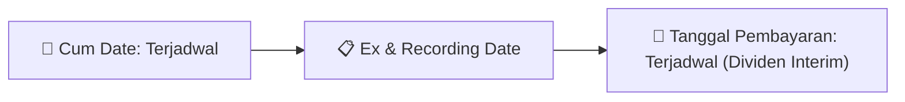

# Ikhtisar Akhir Pekan (Weekend Digest) - 2026-09-14

📅 **2026-09-14 (Weekend Digest)**

## 1. Radar Pasar & Sentimen Akhir Pekan (Executive Weekend Dashboard)
> [!NOTE]
> Terdeteksi sebanyak **135 pengumuman baru** dari 48 emiten pantauan pada (2026-09-14).

| Metric | Jumlah | Status Radar |
| :--- | :---: | :--- |
| **🟢 Sentimen Bullish / Positif** | `3` | [[Dividen Interim]], [[Mandatory Tender Offer]], Kinerja Positif |
| **⚪ Sentimen Netral / Routine** | `51` | [[Tanggapan Penjelasan Bursa]], [[RUPS]], [[Pendaftaran Unit]] |
| **🔴 Sentimen Bearish / Alert** | `4` | Sengketa Hukum, Defisit / Gugatan (Nihil hari ini) |
| **📄 [[Laporan Keuangan]] Baru** | `3` | Memicu Analisis Keuangan Otomatis |

> [!IMPORTANT]
> **Ditemukan Laporan Keuangan Baru Hari Ini:**
> - **INET**: FinancialStatement-2026-II-INET ([Buka PDF](file:///g:/My Drive/Model2/reports/raw/INET/20260911_INET_FinancialStatement-2026-II-INET.pdf))
- **INET**: FinancialStatement-2026-II-INET. ([Buka PDF](file:///g:/My Drive/Model2/reports/raw/INET/20260911_INET_FinancialStatement-2026-II-INET.xlsx))
- **SWAT**: FinancialStatement-2025-Tahunan-SWAT. ([Buka PDF](file:///g:/My Drive/Model2/reports/raw/SWAT/20260911_SWAT_FinancialStatement-2025-Tahunan-SWAT.xlsx))
> 
> *Tugas Swarm Agent:* Lakukan analisis laporan keuangan mendalam per emiten secara terpisah untuk berkas-berkas di atas.

---

## 2. Sorotan Utama & Watchlist Strategis (Strategic Watchlist)
#### 💰 Watchlist Dividen & Distribution
- **[[TAXI]]**: Tanggal RUPS = 2026-09-09
- **[[TAXI]]**: Kuorum Kehadiran = 21,14% (2.161.370.539 saham)
- **[[TAXI]]**: Agenda 1 - Persetujuan Laporan Tahunan dan Laporan Keuangan = Disetujui dengan 99,954% suara setuju
- **[[TAXI]]**: Agenda 2 - Penggunaan Laba Bersih = Disetujui, tidak ada pembagian dividen tunai
- **[[TAXI]]**: Agenda 3 - Penunjukan Akuntan Publik = Disetujui, wewenang diberikan kepada Dewan Komisaris
- **[[TAXI]]**: Agenda 4 - Remunerasi Dewan Komisaris dan Direksi = Disetujui, honorarium Dewan Komisaris maksimal Rp120.000.000 per tahun

#### 🎯 Watchlist Penawaran Tender Wajib (MTO) & Strategis
- **[[KING]]**: Rencana Pemegang Saham Utama dan Pengendali = [[Belum terdapat rencana]]
- **[[NIRO]]**: Rencana Pemegang Saham Utama dan Pengendali = [[Belum ada]]
- **[[FORU]]**: Pemegang Saham Pengendali = [[IMR Asia Holding Pte Ltd (IMR AH)]]
- **[[CCSI]]**: Rencana Pemegang Saham Utama/Pengendali = [[Tidak ada]]

#### 📈 Watchlist Konversi Waran & Potensi Dilusi
- **[[CSIS]]**: Jumlah Waran yang Dikonversi = 106
- **[[CSIS]]**: Jumlah Saham Hasil Konversi = 1.829.803.817
- **[[CSIS]]**: Total Saham Setelah Konversi = Tidak disebutkan secara eksplisit
- **[[CSIS]]**: Nama Waran = CSIS-W
- **[[CSIS]]**: Sisa Waran Setelah Konversi = 52.276.121
- **[[INET]]**: Nama Waran = INET-W2

#### 👥 Watchlist Transaksi Orang Dalam & Kepemilikan Saham (Insider / Repo Moves)
- **[[INET]]**: Mata Uang Pelaporan = Rupiah / IDR
- **[[INET]]**: Periode Pelaporan = 2026-09-11
- **[[PACK]]**: Tanggal Pelaporan = 2026-09-12
- **[[WIKA]]**: Nama Pejabat Pelapor = Ngatemin (Corporate Secretariat)
- **[[NICE]]**: Tanggal dan Waktu Pelaporan = 2026-09-11 18:34
- **[[KING]]**: Tanggal Pelaporan = 11-09-2026
- **[[AKRA]]**: Tanggal Pelaporan = 2026-09-11
- **[[AKRA]]**: Nama Pelapor = Arum P. Handayani

---

## 3. Matriks Pengumuman Pasar (Announcements Intelligence Table)
| Emiten | Sentimen | Jenis Pengumuman | Judul Pengumuman | Berkas |
| :--- | :---: | :--- | :--- | :--- |
| **[[CSIS]]** | ⚪ NEUTRAL | Aksi Korporasi | Pencatatan Saham Tambahan dari Konversi | [Utama](file:///g:/My%20Drive/Model2/reports/raw/CSIS/20260911_CSIS_20260911_CSIS_Pencatatan Saham Tambahan dari Konversi_32147885.pdf) |
| **[[ANTM]]** | 🟢 BULLISH | Aksi Korporasi | Laporan Informasi dan Fakta Material | [Utama](file:///g:/My%20Drive/Model2/reports/raw/ANTM/20260911_ANTM_20260911_ANTM_Laporan Informasi dan Fakta Material_32148083.pdf) · [Lamp 2](file:///g:/My%20Drive/Model2/reports/raw/ANTM/20260911_ANTM_20260911_ANTM_Laporan Informasi dan Fakta Material_32148083_lamp2.pdf) · [Lamp 1](file:///g:/My%20Drive/Model2/reports/raw/ANTM/20260911_ANTM_20260911_ANTM_Laporan Informasi dan Fakta Material_32148083_lamp1.pdf) |
| **[[INET]]** | ⚪ NEUTRAL | Laporan Keuangan | FinancialStatement-2026-II-INET | [Utama](file:///g:/My%20Drive/Model2/reports/raw/INET/20260911_INET_FinancialStatement-2026-II-INET.pdf) |
| **[[INET]]** | ⚪ NEUTRAL | Laporan Keuangan | FinancialStatement-2026-II-INET. | [Utama](file:///g:/My%20Drive/Model2/reports/raw/INET/20260911_INET_FinancialStatement-2026-II-INET.xlsx) |
| **[[INET]]** | ⚪ NEUTRAL | Aksi Korporasi | Pencatatan Saham Tambahan dari Konversi | [Utama](file:///g:/My%20Drive/Model2/reports/raw/INET/20260911_INET_20260911_INET_Pencatatan Saham Tambahan dari Konversi_32147886.pdf) |
| **[[CYBR]]** | ⚪ NEUTRAL | Aksi Korporasi | Pencatatan Saham Tambahan dari Konversi | [Utama](file:///g:/My%20Drive/Model2/reports/raw/CYBR/20260911_CYBR_20260911_CYBR_Pencatatan Saham Tambahan dari Konversi_32147859.pdf) |
| **[[DJPU]]** | ⚪ NEUTRAL | Aksi Korporasi | Pengumuman Pencatatan Awal Obligasi dan Sukuk | [Utama](file:///g:/My%20Drive/Model2/reports/raw/DJPU/20260911_DJPU_20260910_DJPU_Pengumuman Pencatatan Awal Obligasi dan Sukuk_32147681.pdf) · [Lamp 2](file:///g:/My%20Drive/Model2/reports/raw/DJPU/20260911_DJPU_20260910_DJPU_Pengumuman Pencatatan Awal Obligasi dan Sukuk_32147681_lamp2.pdf) · [Lamp 1](file:///g:/My%20Drive/Model2/reports/raw/DJPU/20260911_DJPU_20260910_DJPU_Pengumuman Pencatatan Awal Obligasi dan Sukuk_32147681_lamp1.pdf) |
| **[[PACK]]** | ⚪ NEUTRAL | Aksi Korporasi | Pencatatan Saham Tambahan dari Konversi | [Utama](file:///g:/My%20Drive/Model2/reports/raw/PACK/20260911_PACK_20260911_PACK_Pencatatan Saham Tambahan dari Konversi_32147908.pdf) |
| **[[PACK]]** | ⚪ NEUTRAL | Public Expose | Public Expose | [Utama](file:///g:/My%20Drive/Model2/reports/raw/PACK/20260912_PACK_20260912_PACK_Public Expose_32148106.pdf) · [Lamp 1](file:///g:/My%20Drive/Model2/reports/raw/PACK/20260912_PACK_20260912_PACK_Public Expose_32148106_lamp1.pdf) |
| **[[PJHB]]** | ⚪ NEUTRAL | Aksi Korporasi | Pencatatan Saham Tambahan dari Konversi | [Utama](file:///g:/My%20Drive/Model2/reports/raw/PJHB/20260911_PJHB_20260911_PJHB_Pencatatan Saham Tambahan dari Konversi_32147902.pdf) |
| **[[MANG]]** | ⚪ NEUTRAL | Aksi Korporasi | Pencatatan Saham Tambahan dari Konversi | [Utama](file:///g:/My%20Drive/Model2/reports/raw/MANG/20260911_MANG_20260910_MANG_Pencatatan Saham Tambahan dari Konversi_32147009.pdf) · [Lamp 1](file:///g:/My%20Drive/Model2/reports/raw/MANG/20260911_MANG_20260910_MANG_Pencatatan Saham Tambahan dari Konversi_32147009_lamp1.pdf) |
| **[[WIKA]]** | 🔴 BEARISH | Aksi Korporasi | Laporan Hasil Pemeringkatan | [Utama](file:///g:/My%20Drive/Model2/reports/raw/WIKA/20260911_WIKA_20260911_WIKA_Laporan Hasil Pemeringkatan_32147888.pdf) · [Lamp 1](file:///g:/My%20Drive/Model2/reports/raw/WIKA/20260911_WIKA_20260911_WIKA_Laporan Hasil Pemeringkatan_32147888_lamp1.pdf) |
| **[[PYFA]]** | ⚪ NEUTRAL | Aksi Korporasi | Pencatatan Saham Tambahan dari Konversi | [Utama](file:///g:/My%20Drive/Model2/reports/raw/PYFA/20260911_PYFA_20260911_PYFA_Pencatatan Saham Tambahan dari Konversi_32147855.pdf) |
| **[[NICE]]** | ⚪ NEUTRAL | Aksi Korporasi | Tanggapan atas Permintaan Penjelasan Bursa | [Utama](file:///g:/My%20Drive/Model2/reports/raw/NICE/20260911_NICE_20260911_NICE_Tanggapan atas Permintaan Penjelasan Bursa_32148010.pdf) |
| **[[WTON]]** | ⚪ NEUTRAL | Public Expose | Public Expose | [Utama](file:///g:/My%20Drive/Model2/reports/raw/WTON/20260911_WTON_20260911_WTON_Public Expose_32148087.pdf) · [Lamp 1](file:///g:/My%20Drive/Model2/reports/raw/WTON/20260911_WTON_20260911_WTON_Public Expose_32148087_lamp1.pdf) |
| **[[PPGD]]** | ⚪ NEUTRAL | Aksi Korporasi | Pengumuman Jatuh Tempo Obligasi dan Sukuk | [Utama](file:///g:/My%20Drive/Model2/reports/raw/PPGD/20260911_PPGD_20260911_PPGD_Pengumuman Jatuh Tempo Obligasi dan Sukuk_32147933.pdf) |
| **[[KOCI]]** | ⚪ NEUTRAL | Aksi Korporasi | Pencatatan Saham Tambahan dari Konversi | [Utama](file:///g:/My%20Drive/Model2/reports/raw/KOCI/20260911_KOCI_20260911_KOCI_Pencatatan Saham Tambahan dari Konversi_32147905.pdf) |
| **[[BMTP]]** | ⚪ NEUTRAL | Aksi Korporasi | Laporan Informasi dan Fakta Material | [Utama](file:///g:/My%20Drive/Model2/reports/raw/BMTP/20260911_BMTP_20260910_BMTP_Laporan Informasi dan Fakta Material_32147056.pdf) |
| **[[SWAT]]** | ⚪ NEUTRAL | Laporan Keuangan | FinancialStatement-2025-Tahunan-SWAT. | [Utama](file:///g:/My%20Drive/Model2/reports/raw/SWAT/20260911_SWAT_FinancialStatement-2025-Tahunan-SWAT.xlsx) |
| **[[SWAT]]** | ⚪ NEUTRAL | Public Expose | Public Expose | [Utama](file:///g:/My%20Drive/Model2/reports/raw/SWAT/20260913_SWAT_20260913_SWAT_Public Expose_32148114.pdf) · [Lamp 2](file:///g:/My%20Drive/Model2/reports/raw/SWAT/20260913_SWAT_20260913_SWAT_Public Expose_32148114_lamp2.pdf) |
| **[[SWAT]]** | ⚪ NEUTRAL | RUPS | Ringkasan RisalahRisalah RUPS | [Utama](file:///g:/My%20Drive/Model2/reports/raw/SWAT/20260913_SWAT_20260913_SWAT_Ringkasan RisalahRisalah RUPS_32148113.pdf) · [Lamp 2](file:///g:/My%20Drive/Model2/reports/raw/SWAT/20260913_SWAT_20260913_SWAT_Ringkasan RisalahRisalah RUPS_32148113_lamp2.pdf) |
| **[[DIVA]]** | ⚪ NEUTRAL | Aksi Korporasi | Laporan Penggunaan Dana Hasil Penawaran Umum | [Utama](file:///g:/My%20Drive/Model2/reports/raw/DIVA/20260911_DIVA_20260911_DIVA_Laporan Penggunaan Dana Hasil Penawaran Umum_32148075.pdf) · [Lamp 1](file:///g:/My%20Drive/Model2/reports/raw/DIVA/20260911_DIVA_20260911_DIVA_Laporan Penggunaan Dana Hasil Penawaran Umum_32148075_lamp1.pdf) |
| **[[SINI]]** | ⚪ NEUTRAL | Public Expose | Public Expose | [Utama](file:///g:/My%20Drive/Model2/reports/raw/SINI/20260911_SINI_20260911_SINI_Public Expose_32148060.pdf) |
| **[[BBTN]]** | ⚪ NEUTRAL | Aksi Korporasi | Laporan Informasi dan Fakta Material | [Utama](file:///g:/My%20Drive/Model2/reports/raw/BBTN/20260911_BBTN_20260911_BBTN_Laporan Informasi dan Fakta Material_32148094.pdf) · [Lamp 1](file:///g:/My%20Drive/Model2/reports/raw/BBTN/20260911_BBTN_20260911_BBTN_Laporan Informasi dan Fakta Material_32148094_lamp1.pdf) |
| **[[TAXI]]** | 🟢 BULLISH | Dividen | Ringkasan RisalahRisalah RUPS | [Utama](file:///g:/My%20Drive/Model2/reports/raw/TAXI/20260911_TAXI_20260911_TAXI_Ringkasan RisalahRisalah RUPS_32148043.pdf) |
| **[[SMDR]]** | ⚪ NEUTRAL | Aksi Korporasi | Laporan Informasi dan Fakta Material | [Utama](file:///g:/My%20Drive/Model2/reports/raw/SMDR/20260911_SMDR_20260911_SMDR_Laporan Informasi dan Fakta Material_32147919.pdf) |
| **[[KING]]** | ⚪ NEUTRAL | Aksi Korporasi | Tanggapan atas Permintaan Penjelasan Bursa | [Utama](file:///g:/My%20Drive/Model2/reports/raw/KING/20260911_KING_20260911_KING_Tanggapan atas Permintaan Penjelasan Bursa_32148067.pdf) |
| **[[BMTR]]** | ⚪ NEUTRAL | Aksi Korporasi | Pengumuman Jatuh Tempo Obligasi dan Sukuk | [Utama](file:///g:/My%20Drive/Model2/reports/raw/BMTR/20260911_BMTR_20260910_BMTR_Pengumuman Jatuh Tempo Obligasi dan Sukuk_32147458.pdf) · [Lamp 2](file:///g:/My%20Drive/Model2/reports/raw/BMTR/20260911_BMTR_20260910_BMTR_Pengumuman Jatuh Tempo Obligasi dan Sukuk_32147458_lamp2.pdf) |
| **[[AKRA]]** | ⚪ NEUTRAL | Public Expose | Public Expose | [Utama](file:///g:/My%20Drive/Model2/reports/raw/AKRA/20260911_AKRA_20260911_AKRA_Public Expose_32148000.pdf) |
| **[[SMGR]]** | ⚪ NEUTRAL | Public Expose | Public Expose | [Utama](file:///g:/My%20Drive/Model2/reports/raw/SMGR/20260911_SMGR_20260911_SMGR_Public Expose_32147987.pdf) · [Lamp 1](file:///g:/My%20Drive/Model2/reports/raw/SMGR/20260911_SMGR_20260911_SMGR_Public Expose_32147987_lamp1.pdf) |
| **[[HRME]]** | 🔴 BEARISH | Aksi Korporasi | Laporan Informasi dan Fakta Material | [Utama](file:///g:/My%20Drive/Model2/reports/raw/HRME/20260911_HRME_20260911_HRME_Laporan Informasi dan Fakta Material_32148082.pdf) · [Lamp 1](file:///g:/My%20Drive/Model2/reports/raw/HRME/20260911_HRME_20260911_HRME_Laporan Informasi dan Fakta Material_32148082_lamp1.pdf) |
| **[[AGII]]** | ⚪ NEUTRAL | Aksi Korporasi | Laporan Hasil Pemeringkatan | [Utama](file:///g:/My%20Drive/Model2/reports/raw/AGII/20260911_AGII_20260911_AGII_Laporan Hasil Pemeringkatan_32148050.pdf) · [Lamp 2](file:///g:/My%20Drive/Model2/reports/raw/AGII/20260911_AGII_20260911_AGII_Laporan Hasil Pemeringkatan_32148050_lamp2.pdf) · [Lamp 1](file:///g:/My%20Drive/Model2/reports/raw/AGII/20260911_AGII_20260911_AGII_Laporan Hasil Pemeringkatan_32148050_lamp1.pdf) |
| **[[VICI]]** | ⚪ NEUTRAL | Aksi Korporasi | Laporan Informasi dan Fakta Material | [Utama](file:///g:/My%20Drive/Model2/reports/raw/VICI/20260911_VICI_20260911_VICI_Laporan Informasi dan Fakta Material_32147929.pdf) · [Lamp 2](file:///g:/My%20Drive/Model2/reports/raw/VICI/20260911_VICI_20260911_VICI_Laporan Informasi dan Fakta Material_32147929_lamp2.pdf) |
| **[[CNAF]]** | ⚪ NEUTRAL | Aksi Korporasi | Pengumuman Jatuh Tempo Obligasi dan Sukuk | [Utama](file:///g:/My%20Drive/Model2/reports/raw/CNAF/20260911_CNAF_20260911_CNAF_Pengumuman Jatuh Tempo Obligasi dan Sukuk_32147918.pdf) · [Lamp 1](file:///g:/My%20Drive/Model2/reports/raw/CNAF/20260911_CNAF_20260911_CNAF_Pengumuman Jatuh Tempo Obligasi dan Sukuk_32147918_lamp1.pdf) |
| **[[PPRI]]** | ⚪ NEUTRAL | Kepemilikan Saham (Insider) | LK-11092026-2151-00 | [Utama](file:///g:/My%20Drive/Model2/reports/raw/PPRI/20260911_PPRI_LK-11092026-2151-00.pdf) |
| **[[NIRO]]** | ⚪ NEUTRAL | Aksi Korporasi | Tanggapan atas Permintaan Penjelasan Bursa | [Utama](file:///g:/My%20Drive/Model2/reports/raw/NIRO/20260914_NIRO_20260911_NIRO_Tanggapan atas Permintaan Penjelasan Bursa_32148068.pdf) |
| **[[SMFP]]** | ⚪ NEUTRAL | Aksi Korporasi | Laporan Informasi dan Fakta Material | [Utama](file:///g:/My%20Drive/Model2/reports/raw/SMFP/20260914_SMFP_20260911_SMFP_Laporan Informasi dan Fakta Material_32148096.pdf) · [Lamp 1](file:///g:/My%20Drive/Model2/reports/raw/SMFP/20260914_SMFP_20260911_SMFP_Laporan Informasi dan Fakta Material_32148096_lamp1.pdf) |
| **[[MKNT]]** | ⚪ NEUTRAL | Aksi Korporasi | Laporan Informasi dan Fakta Material | [Utama](file:///g:/My%20Drive/Model2/reports/raw/MKNT/20260914_MKNT_20260914_MKNT_Laporan Informasi dan Fakta Material_32148153.pdf) · [Lamp 1](file:///g:/My%20Drive/Model2/reports/raw/MKNT/20260914_MKNT_20260914_MKNT_Laporan Informasi dan Fakta Material_32148153_lamp1.pdf) |
| **[[TAPG]]** | 🔴 BEARISH | Kepemilikan Saham (Insider) | LK-14092026-8217-00 | [Utama](file:///g:/My%20Drive/Model2/reports/raw/TAPG/20260914_TAPG_LK-14092026-8217-00.pdf) |
| **[[MDLA]]** | ⚪ NEUTRAL | Public Expose | Public Expose | [Utama](file:///g:/My%20Drive/Model2/reports/raw/MDLA/20260914_MDLA_20260914_MDLA_Public Expose_32148133.pdf) · [Lamp 2](file:///g:/My%20Drive/Model2/reports/raw/MDLA/20260914_MDLA_20260914_MDLA_Public Expose_32148133_lamp2.pdf) |
| **[[WGSH]]** | ⚪ NEUTRAL | RUPS | Pengumuman RUPS | [Utama](file:///g:/My%20Drive/Model2/reports/raw/WGSH/20260914_WGSH_20260914_WGSH_Pengumuman RUPS_32148148.pdf) · [Lamp 1](file:///g:/My%20Drive/Model2/reports/raw/WGSH/20260914_WGSH_20260914_WGSH_Pengumuman RUPS_32148148_lamp1.pdf) · [Lamp 2](file:///g:/My%20Drive/Model2/reports/raw/WGSH/20260914_WGSH_20260914_WGSH_Pengumuman RUPS_32148148_lamp2.pdf) |
| **[[SMSM]]** | ⚪ NEUTRAL | Public Expose | Public Expose | [Utama](file:///g:/My%20Drive/Model2/reports/raw/SMSM/20260914_SMSM_20260914_SMSM_Public Expose_32148212.pdf) · [Lamp 2](file:///g:/My%20Drive/Model2/reports/raw/SMSM/20260914_SMSM_20260914_SMSM_Public Expose_32148212_lamp2.pdf) |
| **[[NASA]]** | ⚪ NEUTRAL | Aksi Korporasi | Tanggapan atas Permintaan Penjelasan Bursa | [Utama](file:///g:/My%20Drive/Model2/reports/raw/NASA/20260914_NASA_20260914_NASA_Tanggapan atas Permintaan Penjelasan Bursa_32148186.pdf) |
| **[[CASA]]** | ⚪ NEUTRAL | Aksi Korporasi | Tanggapan atas Permintaan Penjelasan Bursa | [Utama](file:///g:/My%20Drive/Model2/reports/raw/CASA/20260914_CASA_20260914_CASA_Tanggapan atas Permintaan Penjelasan Bursa_32148206.pdf) |
| **[[ITMG]]** | 🔴 BEARISH | Public Expose | Public Expose | [Utama](file:///g:/My%20Drive/Model2/reports/raw/ITMG/20260914_ITMG_20260914_ITMG_Public Expose_32148139.pdf) · [Lamp 1](file:///g:/My%20Drive/Model2/reports/raw/ITMG/20260914_ITMG_20260914_ITMG_Public Expose_32148139_lamp1.pdf) |
| **[[BAJA]]** | ⚪ NEUTRAL | Kepemilikan Saham (Insider) | LK-14092026-8980-00 | [Utama](file:///g:/My%20Drive/Model2/reports/raw/BAJA/20260914_BAJA_LK-14092026-8980-00.pdf) |
| **[[FORU]]** | ⚪ NEUTRAL | Aksi Korporasi | Keterbukaan Informasi terkait Aksi Korporasi | [Utama](file:///g:/My%20Drive/Model2/reports/raw/FORU/20260914_FORU_20260914_FORU_Keterbukaan Informasi terkait Aksi Korporasi_32148137.pdf) · [Lamp 1](file:///g:/My%20Drive/Model2/reports/raw/FORU/20260914_FORU_20260914_FORU_Keterbukaan Informasi terkait Aksi Korporasi_32148188_lamp1.pdf) |
| **[[FORU]]** | ⚪ NEUTRAL | Aksi Korporasi | Penyampaian ProspektusInformasi Tambahan | [Utama](file:///g:/My%20Drive/Model2/reports/raw/FORU/20260914_FORU_20260910_FORU_Penyampaian ProspektusInformasi Tambahan_32147731.pdf) · [Lamp 1](file:///g:/My%20Drive/Model2/reports/raw/FORU/20260914_FORU_20260910_FORU_Penyampaian ProspektusInformasi Tambahan_32147731_lamp1.pdf) |
| **[[FORU]]** | ⚪ NEUTRAL | Aksi Korporasi | Laporan Informasi dan Fakta Material | [Utama](file:///g:/My%20Drive/Model2/reports/raw/FORU/20260914_FORU_20260914_FORU_Laporan Informasi dan Fakta Material_32148117.pdf) |
| **[[CCSI]]** | ⚪ NEUTRAL | Aksi Korporasi | Tanggapan atas Permintaan Penjelasan Bursa | [Utama](file:///g:/My%20Drive/Model2/reports/raw/CCSI/20260914_CCSI_20260914_CCSI_Tanggapan atas Permintaan Penjelasan Bursa_32148167.pdf) |
| **[[ATLA]]** | ⚪ NEUTRAL | Kepemilikan Saham (Insider) | LK-14092026-0165-00 | [Utama](file:///g:/My%20Drive/Model2/reports/raw/ATLA/20260914_ATLA_LK-14092026-0165-00.pdf) |
| **[[ATLA]]** | ⚪ NEUTRAL | Kepemilikan Saham (Insider) | LK-14092026-6686-00 | [Utama](file:///g:/My%20Drive/Model2/reports/raw/ATLA/20260914_ATLA_LK-14092026-6686-00.pdf) |
| **[[ATLA]]** | ⚪ NEUTRAL | Kepemilikan Saham (Insider) | LK-14092026-4130-00 | [Utama](file:///g:/My%20Drive/Model2/reports/raw/ATLA/20260914_ATLA_LK-14092026-4130-00.pdf) |
| **[[DSSA]]** | ⚪ NEUTRAL | Aksi Korporasi | Laporan Informasi dan Fakta Material | [Utama](file:///g:/My%20Drive/Model2/reports/raw/DSSA/20260912_DSSA_20260911_DSSA_Laporan Informasi dan Fakta Material_32148011.pdf) |
| **[[DSSA]]** | ⚪ NEUTRAL | RUPS | Ringkasan RisalahRisalah RUPS | [Utama](file:///g:/My%20Drive/Model2/reports/raw/DSSA/20260912_DSSA_20260911_DSSA_Ringkasan RisalahRisalah RUPS_32147999.pdf) · [Lamp 1](file:///g:/My%20Drive/Model2/reports/raw/DSSA/20260912_DSSA_20260911_DSSA_Ringkasan RisalahRisalah RUPS_32147999_lamp1.pdf) |
| **[[BUVA]]** | ⚪ NEUTRAL | Aksi Korporasi | Informasi Transaksi Afiliasi | [Utama](file:///g:/My%20Drive/Model2/reports/raw/BUVA/20260912_BUVA_20260911_BUVA_Informasi Transaksi Afiliasi_32148049.pdf) |
| **[[GRIA]]** | 🟢 BULLISH | RUPS | Ringkasan RisalahRisalah RUPS | [Utama](file:///g:/My%20Drive/Model2/reports/raw/GRIA/20260912_GRIA_20260912_GRIA_Ringkasan RisalahRisalah RUPS_32148107.pdf) |
| **[[WSKT]]** | ⚪ NEUTRAL | Aksi Korporasi | Laporan Hasil Pemeringkatan | [Utama](file:///g:/My%20Drive/Model2/reports/raw/WSKT/20260913_WSKT_20260911_WSKT_Laporan Hasil Pemeringkatan_32147986.pdf) · [Lamp 1](file:///g:/My%20Drive/Model2/reports/raw/WSKT/20260913_WSKT_20260911_WSKT_Laporan Hasil Pemeringkatan_32147986_lamp1.pdf) |

---

## 4. Detail Informasi per Emiten (Grouped by Emiten)
### ⭐ 4.1. Detail Emiten Pantauan (Watchlist)

#### 🔵 [[DSSA]]
- **[Aksi Korporasi]** [Laporan Informasi dan Fakta Material](file:///g:/My%20Drive/Model2/reports/raw/DSSA/20260912_DSSA_20260911_DSSA_Laporan Informasi dan Fakta Material_32148011.pdf)
  - 📌 *Deskripsi*: PT Dian Swastatika Sentosa Tbk (DSSA) melaporkan informasi material mengenai susunan Komite Nominasi dan Remunerasi perusahaan. Perubahan susunan komite ini diumumkan melalui laporan resmi dengan nomor referensi 158/CSDSS-09/2026 dan berlaku efektif pada tanggal 10 September 2026.
  - 📊 **Fakta Material**:
    - **Nomor Referensi Laporan**: 158/CSDSS-09/2026
    - **Jenis Informasi Material**: Susunan Komite Nominasi dan Remunerasi
    - **Tanggal Kejadian**: 10 September 2026
    - **Bidang Usaha**: Energi & Infrastruktur
    - **Nama Pengirim Laporan**: Susan Chandra
    - **Tanggal Pelaporan**: 12 September 2026
- **[RUPS]** [Ringkasan RisalahRisalah RUPS](file:///g:/My%20Drive/Model2/reports/raw/DSSA/20260912_DSSA_20260911_DSSA_Ringkasan RisalahRisalah RUPS_32147999.pdf) *(Attachment: [Lamp 1](file:///g:/My%20Drive/Model2/reports/raw/DSSA/20260912_DSSA_20260911_DSSA_Ringkasan RisalahRisalah RUPS_32147999_lamp1.pdf))*
  - 📌 *Deskripsi*: PT Dian Swastatika Sentosa Tbk (DSSA) menyelenggarakan Rapat Umum Pemegang Saham Luar Biasa (RUPSLB) pada 10 September 2026. Rapat dihadiri pemegang saham yang mewakili 94,67% dari total saham dengan hak suara yang sah. Agenda utama rapat adalah persetujuan pengurangan modal melalui penarikan kembali saham hasil pembelian kembali (treasury stock) dan perubahan susunan anggota Dewan Komisaris dan Direksi Perseroan.
  - 📊 **Fakta Material**:
    - **Jenis Rapat**: Rapat Umum Pemegang Saham Luar Biasa (RUPSLB)
    - **Tanggal Rapat**: 10 September 2026
    - **Waktu Rapat**: 14.48 WIB - 15.14 WIB
    - **Tempat Rapat**: Grand On Thamrin Ballroom Hotel Pullman Jakarta, Jalan M.H. Thamrin Kav. 59, Jakarta Pusat
    - **Ketua Rapat**: Evita Herawati Legowo (Komisaris Independen)
    - **Jumlah Saham Hadir**: 147.750.868.617 saham
    - **Persentase Saham Hadir**: 94,67%
    - **Total Saham dengan Hak Suara Sah**: 156.062.123.250 saham
    - **Rekam Daftar Pemegang Saham (RDPS)**: 11 Agustus 2026
    - **Mata Acara 1**: Persetujuan atas pengurangan modal Perseroan melalui penarikan kembali saham hasil pembelian kembali dan penyesuaian Anggaran Dasar Perseroan sehubungan dengan pelaksanaan pengurangan modal tersebut
    - **Mata Acara 2**: Persetujuan atas perubahan susunan anggota Dewan Komisaris dan Direksi Perseroan

---

### 📋 4.2. Detail Emiten Lain (Non-Watchlist)

#### 🔵 [[CSIS]]
- **[Aksi Korporasi]** [Pencatatan Saham Tambahan dari Konversi](file:///g:/My%20Drive/Model2/reports/raw/CSIS/20260911_CSIS_20260911_CSIS_Pencatatan Saham Tambahan dari Konversi_32147885.pdf)
  - 📌 *Deskripsi*: Bursa Efek Indonesia mengumumkan pencatatan saham tambahan hasil konversi waran CSIS-W. Sebanyak 106 waran dikonversi menjadi 1.829.803.817 saham, dengan total saham setelah konversi tercatat. Pencatatan dan perdagangan saham hasil konversi dimulai pada 14 September 2026. Sisa waran setelah konversi adalah 52.276.121.
  - 📊 **Fakta Material**:
    - **Jumlah Waran yang Dikonversi**: 106
    - **Jumlah Saham Hasil Konversi**: 1.829.803.817
    - **Total Saham Setelah Konversi**: Tidak disebutkan secara eksplisit
    - **Tanggal Pencatatan dan Perdagangan**: 14 September 2026
    - **Nama Waran**: CSIS-W
    - **Sisa Waran Setelah Konversi**: 52.276.121

#### 🔵 [[ANTM]]
- **[Aksi Korporasi]** [Laporan Informasi dan Fakta Material](file:///g:/My%20Drive/Model2/reports/raw/ANTM/20260911_ANTM_20260911_ANTM_Laporan Informasi dan Fakta Material_32148083.pdf) *(Attachment: [Lamp 2](file:///g:/My%20Drive/Model2/reports/raw/ANTM/20260911_ANTM_20260911_ANTM_Laporan Informasi dan Fakta Material_32148083_lamp2.pdf) · [Lamp 1](file:///g:/My%20Drive/Model2/reports/raw/ANTM/20260911_ANTM_20260911_ANTM_Laporan Informasi dan Fakta Material_32148083_lamp1.pdf))*
  - 📌 *Deskripsi*: ANTAM melaporkan kinerja keuangan semester pertama 2026 dengan laba bersih Rp6,91 triliun dan penjualan bersih Rp62,71 triliun. Perusahaan terus memperkuat fundamental bisnis melalui optimalisasi operasional, pengelolaan portofolio komoditas, dan pengembangan hilirisasi di tiga komoditas utama: emas, nikel, dan bauksit. Kinerja positif didukung oleh kontribusi bisnis emas dengan volume penjualan 18,1 ton dan pendapatan Rp50,39 triliun, serta pengembangan hilirisasi nikel dan integrasi rantai nilai bauksit-alumina.
  - 📊 **Fakta Material**:
    - **Laba Bersih 1H26**: Rp6,91 triliun
    - **Penjualan Bersih 1H26**: Rp62,71 triliun
    - **Volume Penjualan Emas 1H26**: 18,1 ton
    - **Pendapatan Bisnis Emas 1H26**: Rp50,39 triliun
    - **Produksi Bijih Nikel 1H26**: 7,78 juta wmt
    - **Volume Penjualan Bijih Nikel 1H26**: 6,77 juta wmt
    - **Kapasitas Terpasang Fasilitas CGA**: 300 ribu ton per tahun
    - **Kapasitas Terpasang Fasilitas SGA Mempawah**: 1 juta ton per tahun
    - **Total Aset 1H26**: Rp61,27 triliun
    - **Total Ekuitas 1H26**: Rp38,53 triliun
    - **Kas dan Setara Kas 1H26**: Rp9,23 triliun
    - **Proyeksi Kapasitas Fasilitas Logam Mulia Gresik**: 30 ton per tahun
    - **Tahap Pengembangan Fasilitas Logam Mulia Gresik**: Pra-konstruksi

#### 🔵 [[INET]]
- **[Laporan Keuangan]** [FinancialStatement-2026-II-INET](file:///g:/My%20Drive/Model2/reports/raw/INET/20260911_INET_FinancialStatement-2026-II-INET.pdf)
  - 📌 *Deskripsi*: PT Sinergi Inti Andalan Prima Tbk. (INET) menyampaikan laporan keuangan interim audited untuk periode enam bulan yang berakhir pada 30 Juni 2026. Laporan ini mencakup informasi anak perusahaan, dengan total aset yang signifikan dari beberapa entitas anak, serta menggunakan standar akuntansi PSAK dan mata uang pelaporan Rupiah. Laporan keuangan diaudit dengan opini Wajar Tanpa Modifikasian.
  - 📊 **Fakta Material**:
    - **Periode Laporan Keuangan**: 6 Bulan berakhir 30/06/2026
    - **Tanggal Awal Periode Berjalan**: 2026-01-01
    - **Tanggal Akhir Periode Berjalan**: 2026-06-30
    - **Tanggal Akhir Tahun Sebelumnya**: 2025-12-31
    - **Tanggal Surat Pernyataan Direksi**: 2026-09-09
    - **Nomor Surat Penyampaian**: 167/INET-OJK/IX/2026
    - **Jenis Laporan**: Diaudit
    - **Opini Auditor**: Wajar Tanpa Modifikasian
    - **Standar Akuntansi**: PSAK
    - **Mata Uang Pelaporan**: Rupiah / IDR
    - **Jenis Papan Perdagangan**: Pengembangan
    - **Jenis Efek yang Dicatatkan**: Saham dan Obligasi
    - **Jumlah Aset Anak Perusahaan Terbesar (PT Garuda Prima Internetindo)**: 3.014.782.438 RIBUAN IDR
    - **Persentase Kepemilikan di PT Garuda Prima Internetindo**: 99.96%
    - **Jumlah Aset Anak Perusahaan Terkecil (PT Internet Anak Bangsa)**: 1.796.752 RIBUAN IDR
    - **Persentase Kepemilikan di PT Internet Anak Bangsa**: 99.0%
- **[Laporan Keuangan]** [FinancialStatement-2026-II-INET.](file:///g:/My%20Drive/Model2/reports/raw/INET/20260911_INET_FinancialStatement-2026-II-INET.xlsx)
  - 📌 *Deskripsi*: Laporan keuangan interim periode II tahun 2026 untuk emiten INET, mencakup catatan atas laporan keuangan terkait utang bank berdasarkan tingkat likuiditas, dengan rincian jatuh tempo dan informasi bunga dari Bank Central Asia Tbk, serta nilai dalam berbagai mata uang asing.
  - 📊 **Fakta Material**:
    - **Jenis Laporan**: Laporan Keuangan Interim II 2026
    - **Periode Pelaporan**: 2026-09-11
    - **Utang Bank Berdasarkan Tingkat Likuiditas**: Tersedia, dengan rincian jatuh tempo
    - **Kreditur**: Bank Central Asia Tbk
    - **Mata Uang Asing yang Digunakan**: IDR, AUD, CAD, CNY, EUR, HKD, GBP, JPY, SGD, THB
- **[Aksi Korporasi]** [Pencatatan Saham Tambahan dari Konversi](file:///g:/My%20Drive/Model2/reports/raw/INET/20260911_INET_20260911_INET_Pencatatan Saham Tambahan dari Konversi_32147886.pdf)
  - 📌 *Deskripsi*: Bursa Efek Indonesia mengumumkan pencatatan saham tambahan dari konversi waran INET-W2 oleh PT Sinergi Inti Andalan Prima Tbk. (INET). Sebanyak 85.343 waran dikonversi menjadi 22.377.679.086 saham, sehingga total saham setelah konversi menjadi 22.377.679.086. Pencatatan dan perdagangan saham hasil konversi akan dimulai pada 14 September 2026.
  - 📊 **Fakta Material**:
    - **Nama Waran**: INET-W2
    - **Jumlah Waran yang Dikonversi**: 85.343
    - **Jumlah Saham Hasil Konversi**: 22.377.679.086
    - **Total Saham Setelah Konversi**: 22.377.679.086
    - **Sisa Waran Setelah Konversi**: 2.297.047.503
    - **Tanggal Pencatatan dan Perdagangan**: 14 September 2026

#### 🔵 [[CYBR]]
- **[Aksi Korporasi]** [Pencatatan Saham Tambahan dari Konversi](file:///g:/My%20Drive/Model2/reports/raw/CYBR/20260911_CYBR_20260911_CYBR_Pencatatan Saham Tambahan dari Konversi_32147859.pdf)
  - 📌 *Deskripsi*: PT ITSEC Asia Tbk. (CYBR) mengumumkan pencatatan saham tambahan di Bursa Efek Indonesia (BEI) sebagai hasil konversi waran. Sebanyak 1.001.000 waran CYBR-W dikonversi menjadi 1.001.000 saham baru, sehingga total saham setelah konversi menjadi 13.486.058.905 lembar. Pencatatan dan perdagangan saham tambahan tersebut akan dimulai pada tanggal 14 September 2026.
  - 📊 **Fakta Material**:
    - **Jumlah Saham Hasil Konversi**: 1.001.000
    - **Total Saham Setelah Konversi**: 13.486.058.905
    - **Tanggal Pencatatan dan Perdagangan**: 14 September 2026
    - **Nama Waran**: CYBR-W
    - **Jumlah Waran yang Dikonversi**: 1.001.000
    - **Sisa Waran Setelah Konversi**: 421.825.299

#### 🔵 [[DJPU]]
- **[Aksi Korporasi]** [Pengumuman Pencatatan Awal Obligasi dan Sukuk](file:///g:/My%20Drive/Model2/reports/raw/DJPU/20260911_DJPU_20260910_DJPU_Pengumuman Pencatatan Awal Obligasi dan Sukuk_32147681.pdf) *(Attachment: [Lamp 2](file:///g:/My%20Drive/Model2/reports/raw/DJPU/20260911_DJPU_20260910_DJPU_Pengumuman Pencatatan Awal Obligasi dan Sukuk_32147681_lamp2.pdf) · [Lamp 1](file:///g:/My%20Drive/Model2/reports/raw/DJPU/20260911_DJPU_20260910_DJPU_Pengumuman Pencatatan Awal Obligasi dan Sukuk_32147681_lamp1.pdf))*
  - 📌 *Deskripsi*: Pemerintah Indonesia melalui Direktorat Jenderal Pengelolaan Pembiayaan dan Risiko (DJPPR) Kementerian Keuangan telah melaksanakan lelang Surat Berharga Syariah Negara (SBSN) pada tanggal 8 September 2026. Terdapat 8 seri SBSN yang ditawarkan, dengan total penawaran masuk sebesar Rp26,14 triliun dan total dimenangkan sebesar Rp12 triliun. Rincian hasil lelang mencakup seri SPNS12102026, SPNS01032027, SPNS07062027, PBS030, PBS040, PBSG002, PBS034, dan PBS038, dengan imbal hasil rata-rata tertimbang berkisar antara 6,50% hingga 7,16%.
  - 📊 **Fakta Material**:
    - **Tanggal Lelang**: 2026-09-08
    - **Total Penawaran Masuk**: Rp26.139.400.000.000
    - **Total Dimenangkan**: Rp12.000.000.000.000
    - **Jumlah Seri yang Ditawarkan**: 8 seri
    - **Seri SPNS12102026 - Jumlah Dimenangkan**: Rp1,3687 triliun
    - **Seri SPNS12102026 - Imbal Hasil Rata-rata Tertimbang**: 6,50000%
    - **Seri SPNS01032027 - Jumlah Dimenangkan**: Rp5,445 triliun
    - **Seri SPNS01032027 - Imbal Hasil Rata-rata Tertimbang**: 6,65000%
    - **Seri SPNS07062027 - Jumlah Dimenangkan**: Rp6,850 triliun
    - **Seri SPNS07062027 - Imbal Hasil Rata-rata Tertimbang**: 6,80000%
    - **Seri PBS030 - Jumlah Dimenangkan**: Rp3,112 triliun
    - **Seri PBS030 - Imbal Hasil Rata-rata Tertimbang**: 6,80733%
    - **Seri PBS040 - Jumlah Dimenangkan**: Rp3,767 triliun
    - **Seri PBS040 - Imbal Hasil Rata-rata Tertimbang**: 6,90869%
    - **Seri PBSG002 - Jumlah Dimenangkan**: Rp1,173 triliun
    - **Seri PBSG002 - Imbal Hasil Rata-rata Tertimbang**: 7,02000%
    - **Seri PBS034 - Jumlah Dimenangkan**: Rp2,213 triliun
    - **Seri PBS034 - Imbal Hasil Rata-rata Tertimbang**: 7,13726%
    - **Seri PBS038 - Jumlah Dimenangkan**: Rp2,2107 triliun
    - **Seri PBS038 - Imbal Hasil Rata-rata Tertimbang**: 7,15980%
    - **Tanggal Setelmen**: 2026-09-10

#### 🔵 [[PACK]]
- **[Aksi Korporasi]** [Pencatatan Saham Tambahan dari Konversi](file:///g:/My%20Drive/Model2/reports/raw/PACK/20260911_PACK_20260911_PACK_Pencatatan Saham Tambahan dari Konversi_32147908.pdf)
  - 📌 *Deskripsi*: Bursa Efek Indonesia mengumumkan pencatatan saham tambahan dari hasil pelaksanaan Obligasi Wajib Konversi (OWK) pada Papan Pencatatan Akselerasi untuk PT Abadi Nusantara Hijau Investama Tbk (PACK). Terdapat penambahan saham sebesar 896.500 lembar, dengan total saham setelah pencatatan menjadi 34.113.700.751 lembar. Sisa OWK yang belum dikonversi adalah 70.637.593 lembar, dan tanggal pencatatan penambahan saham adalah 14 September 2026.
  - 📊 **Fakta Material**:
    - **Jumlah Saham Tambahan**: 896.500 lembar
    - **Jumlah Saham Setelah Pencatatan**: 34.113.700.751 lembar
    - **Sisa Obligasi Wajib Konversi**: 70.637.593 lembar
    - **Tanggal Pencatatan Penambahan Saham**: 14 September 2026
    - **Papan Pencatatan**: Akselerasi
- **[Public Expose]** [Public Expose](file:///g:/My%20Drive/Model2/reports/raw/PACK/20260912_PACK_20260912_PACK_Public Expose_32148106.pdf) *(Attachment: [Lamp 1](file:///g:/My%20Drive/Model2/reports/raw/PACK/20260912_PACK_20260912_PACK_Public Expose_32148106_lamp1.pdf))*
  - 📌 *Deskripsi*: PT Abadi Nusantara Hijau Investama Tbk (PACK) menyelenggarakan Public Expose Insidentil pada 10 September 2026 secara sukarela, bukan atas permintaan Bursa atau OJK. Acara dihadiri oleh 258 peserta (tidak termasuk manajemen dan karyawan). Laporan hasil public expose disampaikan pada 12 September 2026.
  - 📊 **Fakta Material**:
    - **Nomor Surat**: 004/CORSEC-ANHI/IX/2026
    - **Tanggal Pelaksanaan Public Expose**: 2026-09-10
    - **Jumlah Peserta**: 258 orang
    - **Latar Belakang Pelaksanaan**: Sukarela
    - **Permintaan Bursa**: Tidak
    - **Permintaan OJK**: Tidak
    - **Nama Pengirim**: Donnie Holman Partogi Manurung
    - **Jabatan Pengirim**: Direktur
    - **Tanggal Pelaporan**: 2026-09-12

#### 🔵 [[PJHB]]
- **[Aksi Korporasi]** [Pencatatan Saham Tambahan dari Konversi](file:///g:/My%20Drive/Model2/reports/raw/PJHB/20260911_PJHB_20260911_PJHB_Pencatatan Saham Tambahan dari Konversi_32147902.pdf)
  - 📌 *Deskripsi*: PT Pelayaran Jaya Hidup Baru Tbk (PJHB) mengumumkan pencatatan saham tambahan hasil konversi waran. Sebanyak 2.189 waran dikonversi menjadi 1.921.018.605 saham baru, sehingga total saham setelah konversi menjadi 1.921.018.605. Pencatatan dan perdagangan saham hasil konversi akan dimulai pada 14 September 2026. Sisa waran setelah konversi adalah 238.981.395.
  - 📊 **Fakta Material**:
    - **Jumlah Waran yang Dikonversi**: 2.189
    - **Jumlah Saham Hasil Konversi**: 1.921.018.605
    - **Total Saham Setelah Konversi**: 1.921.018.605
    - **Tanggal Pencatatan dan Perdagangan**: 14 September 2026
    - **Nama Waran**: PJHB - W
    - **Sisa Waran Setelah Konversi**: 238.981.395

#### 🔵 [[MANG]]
- **[Aksi Korporasi]** [Pencatatan Saham Tambahan dari Konversi](file:///g:/My%20Drive/Model2/reports/raw/MANG/20260911_MANG_20260910_MANG_Pencatatan Saham Tambahan dari Konversi_32147009.pdf) *(Attachment: [Lamp 1](file:///g:/My%20Drive/Model2/reports/raw/MANG/20260911_MANG_20260910_MANG_Pencatatan Saham Tambahan dari Konversi_32147009_lamp1.pdf))*
  - 📌 *Deskripsi*: PT Manggung Polahraya Tbk (MANG) melaporkan pelaksanaan Waran Seri I menjadi saham pada tanggal 09 September 2026 sebanyak 91 waran yang menghasilkan 91 saham baru. Penerbitan saham baru tersebut dicatatkan pada tanggal 10 September 2026. Setelah pelaksanaan, total saham meningkat dari 3.812.605.738 menjadi 3.812.605.829, dan sisa Waran Seri I berkurang dari 228.644.262 menjadi 228.644.171.
  - 📊 **Fakta Material**:
    - **Tanggal Pelaksanaan Waran**: 2026-09-09
    - **Tanggal Penerbitan Saham**: 2026-09-10
    - **Total Saham Sebelum Pelaksanaan**: 3.812.605.738
    - **Total Saham Setelah Pelaksanaan**: 3.812.605.829
    - **Sisa Waran Seri I Sebelum Pelaksanaan**: 228.644.262
    - **Sisa Waran Seri I Setelah Pelaksanaan**: 228.644.171

#### 🔵 [[WIKA]]
- **[Aksi Korporasi]** [Laporan Hasil Pemeringkatan](file:///g:/My%20Drive/Model2/reports/raw/WIKA/20260911_WIKA_20260911_WIKA_Laporan Hasil Pemeringkatan_32147888.pdf) *(Attachment: [Lamp 1](file:///g:/My%20Drive/Model2/reports/raw/WIKA/20260911_WIKA_20260911_WIKA_Laporan Hasil Pemeringkatan_32147888_lamp1.pdf))*
  - 📌 *Deskripsi*: PT Wijaya Karya (Persero) Tbk melaporkan hasil pemeringkatan efek bersifat utang oleh Pefindo. Peringkat Obligasi Berkelanjutan II Tahap I diturunkan menjadi idD dari idCCC, dan Sukuk Mudharabah Berkelanjutan II Tahap I menjadi idD(sy) dari idCCC(sy). Penurunan peringkat ini merupakan tindak lanjut atas penangguhan pembayaran jatuh tempo pokok serta kupon yang jatuh tempo pada 8 September 2026. Perseroan akan berkomunikasi intensif dengan Wali Amanat dan pemegang Obligasi/Sukuk untuk mencapai kesepakatan penyelesaian kewajiban.
  - 📊 **Fakta Material**:
    - **Nomor Surat**: SE.01.00/A.CORSEC.00302/2026
    - **Tanggal Laporan**: 11 September 2026
    - **Lembaga Pemeringkat**: Pefindo
    - **Peringkat Obligasi Berkelanjutan II Tahap I (Sebelum)**: idCCC
    - **Peringkat Obligasi Berkelanjutan II Tahap I (Sesudah)**: idD
    - **Peringkat Sukuk Mudharabah Berkelanjutan II Tahap I (Sebelum)**: idCCC(sy)
    - **Peringkat Sukuk Mudharabah Berkelanjutan II Tahap I (Sesudah)**: idD(sy)
    - **Tanggal Jatuh Tempo Pembayaran**: 8 September 2026
    - **Jenis Pemantauan**: Pemantauan khusus (special review)
    - **Alasan Penurunan Peringkat**: Penangguhan pembayaran jatuh tempo pokok serta kupon Obligasi dan Sukuk
    - **Referensi Keterbukaan Informasi Sebelumnya**: SE.01.00/A.CORSEC.00239/2026 tanggal 31 Juli 2026
    - **Nama Pejabat Pelapor**: Ngatemin (Corporate Secretariat)

#### 🔵 [[PYFA]]
- **[Aksi Korporasi]** [Pencatatan Saham Tambahan dari Konversi](file:///g:/My%20Drive/Model2/reports/raw/PYFA/20260911_PYFA_20260911_PYFA_Pencatatan Saham Tambahan dari Konversi_32147855.pdf)
  - 📌 *Deskripsi*: Bursa Efek Indonesia mengumumkan pencatatan saham tambahan hasil konversi waran PT Pyridam Farma Tbk (PYFA) pada Papan Pencatatan Pengembangan. Sebanyak 28 waran dikonversi menjadi 11.236.750.948 saham, dengan total saham setelah konversi menjadi 11.236.750.948. Pencatatan dan perdagangan saham hasil konversi akan dimulai pada 14 September 2026. Sisa waran setelah konversi adalah 178.288.551.
  - 📊 **Fakta Material**:
    - **Jumlah Saham Hasil Konversi**: 11.236.750.948
    - **Total Saham Setelah Konversi**: 11.236.750.948
    - **Tanggal Pencatatan dan Perdagangan**: 14 September 2026
    - **Nama Waran**: PYFA-W
    - **Sisa Waran Setelah Konversi**: 178.288.551

#### 🔵 [[NICE]]
- **[Aksi Korporasi]** [Tanggapan atas Permintaan Penjelasan Bursa](file:///g:/My%20Drive/Model2/reports/raw/NICE/20260911_NICE_20260911_NICE_Tanggapan atas Permintaan Penjelasan Bursa_32148010.pdf)
  - 📌 *Deskripsi*: PT Adhi Kartiko Pratama Tbk (NICE) menanggapi permintaan penjelasan dari Bursa Efek Indonesia (BEI) terkait Laporan Keuangan 1H-2026, sesuai Surat BEI No. S-11334/BEI.PP2/09-2026 tertanggal 3 September 2026. Tanggapan disampaikan oleh Direktur Yeon Ho Choi pada 11 September 2026.
  - 📊 **Fakta Material**:
    - **Nomor Surat Tanggapan**: 140/AKP-Corsec/Rep/IX/2026
    - **Nomor Surat BEI**: S-11334/BEI.PP2/09-2026
    - **Tanggal Surat BEI**: 2026-09-03
    - **Tanggal Penerimaan Surat BEI**: 2026-09-03
    - **Nama Pengirim Tanggapan**: PT Adhi Kartiko Pratama Tbk
    - **Nama Penandatangan**: Yeon Ho Choi
    - **Jabatan Penandatangan**: Direktur
    - **Tanggal dan Waktu Pelaporan**: 2026-09-11 18:34
    - **Lampiran**: NICE - Tanggapan atas PP IDX LK 1H-2026 (E023).pdf

#### 🔵 [[WTON]]
- **[Public Expose]** [Public Expose](file:///g:/My%20Drive/Model2/reports/raw/WTON/20260911_WTON_20260911_WTON_Public Expose_32148087.pdf) *(Attachment: [Lamp 1](file:///g:/My%20Drive/Model2/reports/raw/WTON/20260911_WTON_20260911_WTON_Public Expose_32148087_lamp1.pdf))*
  - 📌 *Deskripsi*: Public Expose Live 2026 PT Wijaya Karya Beton Tbk (WTON) diselenggarakan pada 9 September 2026 secara virtual melalui Zoom Webinar, dihadiri 110 peserta dan seluruh manajemen. Paparan mencakup gambaran umum, ikhtisar keuangan per Juli 2026, strategi, dan inisiatif ESG. Manajemen menjawab pertanyaan seputar segmen pendukung laba, strategi peningkatan profitabilitas, dan inovasi produk seperti WHome.
  - 📊 **Fakta Material**:
    - **Tanggal Pelaksanaan**: 9 September 2026
    - **Jumlah Peserta**: 110 peserta
    - **Direktur Utama**: Kuntjara
    - **Direktur Pemasaran dan Pengembangan**: Rija Judaswara
    - **Direktur Keuangan, Human Capital dan Manajemen Risiko**: Syailendra Ogan
    - **Direktur Teknik dan Produksi**: Verly Widiantoro
    - **Net Profit Margin Kuartal II 2026**: 0,07%
    - **Jumlah Pabrik**: 13 pabrik
    - **Inovasi Produk**: Rumah WHome dengan fitur kecepatan, tahan gempa, dapat dikembangkan, dan ramah lingkungan

#### 🔵 [[PPGD]]
- **[Aksi Korporasi]** [Pengumuman Jatuh Tempo Obligasi dan Sukuk](file:///g:/My%20Drive/Model2/reports/raw/PPGD/20260911_PPGD_20260911_PPGD_Pengumuman Jatuh Tempo Obligasi dan Sukuk_32147933.pdf)
  - 📌 *Deskripsi*: PT Pegadaian (Persero) mengumumkan jatuh tempo Obligasi Berkelanjutan VI Pegadaian Tahap III Tahun 2025 Seri A dan Sukuk Mudharabah Berkelanjutan III Pegadaian Tahap V Tahun 2025 Seri A. Efek tersebut akan dihapus pencatatannya dan tidak dapat diperdagangkan lagi di Bursa Efek Indonesia mulai 14 September 2026.
  - 📊 **Fakta Material**:
    - **Nama Efek**: Obligasi Berkelanjutan VI Pegadaian Tahap III Tahun 2025 Seri A
    - **Kode Seri Obligasi**: PPGD06ACN3
    - **Nilai Seri Obligasi (Jutaan)**: 1.869.775
    - **Tanggal Terbit Obligasi**: 2025-09-03
    - **Tanggal Jatuh Tempo Obligasi**: 2026-09-13
    - **Nama Sukuk**: Sukuk Mudharabah Berkelanjutan III Pegadaian Tahap V Tahun 2025 Seri A
    - **Kode Seri Sukuk**: SMPPGD03ACN5
    - **Nilai Seri Sukuk (Jutaan)**: 1.454.130
    - **Tanggal Terbit Sukuk**: 2025-09-03
    - **Tanggal Jatuh Tempo Sukuk**: 2026-09-13
    - **Tanggal Efek Tidak Tercatat**: 2026-09-14
    - **Tanggal Prospektus**: 2025-08-27

#### 🔵 [[KOCI]]
- **[Aksi Korporasi]** [Pencatatan Saham Tambahan dari Konversi](file:///g:/My%20Drive/Model2/reports/raw/KOCI/20260911_KOCI_20260911_KOCI_Pencatatan Saham Tambahan dari Konversi_32147905.pdf)
  - 📌 *Deskripsi*: Bursa Efek Indonesia mengumumkan pencatatan saham tambahan dari konversi waran KOCI-W. Sebanyak 20.100 waran dikonversi menjadi 4.467.555.405 saham, sehingga total saham setelah konversi menjadi 4.467.555.405. Pencatatan dan perdagangan saham hasil konversi akan dimulai pada 14 September 2026. Sisa waran yang belum dikonversi adalah 398.034.595.
  - 📊 **Fakta Material**:
    - **Jumlah Waran yang Dikonversi**: 20.100
    - **Jumlah Saham Hasil Konversi**: 4.467.555.405
    - **Total Saham Setelah Konversi**: 4.467.555.405
    - **Tanggal Pencatatan dan Perdagangan**: 14 September 2026
    - **Nama Waran**: KOCI-W
    - **Sisa Waran Setelah Konversi**: 398.034.595

#### 🔵 [[BMTP]]
- **[Aksi Korporasi]** [Laporan Informasi dan Fakta Material](file:///g:/My%20Drive/Model2/reports/raw/BMTP/20260911_BMTP_20260910_BMTP_Laporan Informasi dan Fakta Material_32147056.pdf)
  - 📌 *Deskripsi*: PT Bank Mandiri Taspen (BMTP) mengumumkan pembentukan 10 Regional CEO (Kantor Wilayah) yang telah disetujui Otoritas Jasa Keuangan (OJK) untuk memperkuat tata kelola organisasi, meningkatkan independensi fungsi, dan mempertajam fokus bisnis. Perubahan ini tidak berdampak negatif terhadap kegiatan operasional, aspek hukum, kondisi keuangan, maupun kelangsungan usaha perusahaan.
  - 📊 **Fakta Material**:
    - **Jenis Informasi atau Fakta Material**: Pembentukan Regional CEO I sampai dengan X
    - **Tanggal Kejadian**: 09 September 2026
    - **Jumlah Regional CEO yang Dibentuk**: 10 (sepuluh)
    - **Daftar Regional CEO**: Regional CEO I Medan, Regional CEO II Palembang, Regional CEO III Jakarta, Regional CEO IV Bandung, Regional CEO V Semarang, Regional CEO VI Surabaya, Regional CEO VII Denpasar, Regional CEO VIII Banjarmasin, Regional CEO IX Makassar, Regional CEO X Jayapura
    - **Persetujuan Otoritas Jasa Keuangan (OJK)**: Telah mendapatkan persetujuan
    - **Dampak terhadap Kegiatan Operasional, Hukum, Kondisi Keuangan, dan Kelangsungan Usaha**: Tidak berdampak negatif
    - **Tujuan Pembentukan**: Memperkuat tata kelola organisasi, meningkatkan independensi fungsi, mempertajam fokus bisnis, dan memperkuat hubungan strategis dengan seluruh pemangku kepentingan

#### 🔵 [[SWAT]]
- **[Laporan Keuangan]** [FinancialStatement-2025-Tahunan-SWAT.](file:///g:/My%20Drive/Model2/reports/raw/SWAT/20260911_SWAT_FinancialStatement-2025-Tahunan-SWAT.xlsx)
- **[Public Expose]** [Public Expose](file:///g:/My%20Drive/Model2/reports/raw/SWAT/20260913_SWAT_20260913_SWAT_Public Expose_32148114.pdf) *(Attachment: [Lamp 2](file:///g:/My%20Drive/Model2/reports/raw/SWAT/20260913_SWAT_20260913_SWAT_Public Expose_32148114_lamp2.pdf))*
  - 📌 *Deskripsi*: Public Expose PT Sriwahana Adityakarta Tbk (SWAT) diselenggarakan pada 11 September 2026 di Hotel Aston Solo, dihadiri 10 peserta. Acara membahas profil perusahaan dan kinerja keuangan 2025, dipaparkan oleh Komisaris Utama Sri Hetti Turinani. Tidak ada pertanyaan dari peserta, dan acara ditutup pada 11:15 WIB.
  - 📊 **Fakta Material**:
    - **Tanggal Pelaksanaan**: 2026-09-11
    - **Waktu Pelaksanaan**: 10.40 - 11.15 WIB
    - **Tempat Pelaksanaan**: Hotel Aston Solo, Jl. Brigjen Slamet Riyadi No. 373, Laweyan, Surakarta
    - **Jumlah Peserta**: 10 orang (tidak termasuk manajemen dan karyawan)
    - **Pembicara**: Sri Hetti Turinani (Komisaris Utama)
    - **Direktur Utama Hadir**: Berhalangan hadir
    - **Materi yang Dibahas**: Profil Perusahaan dan Kinerja Keuangan Tahun 2025
    - **Sesi Tanya Jawab**: Tidak ada pertanyaan dari peserta
    - **Tanggal Risalah**: 2026-09-12
- **[RUPS]** [Ringkasan RisalahRisalah RUPS](file:///g:/My%20Drive/Model2/reports/raw/SWAT/20260913_SWAT_20260913_SWAT_Ringkasan RisalahRisalah RUPS_32148113.pdf) *(Attachment: [Lamp 2](file:///g:/My%20Drive/Model2/reports/raw/SWAT/20260913_SWAT_20260913_SWAT_Ringkasan RisalahRisalah RUPS_32148113_lamp2.pdf))*
  - 📌 *Deskripsi*: Rapat Umum Pemegang Saham Tahunan (RUPST) PT Sriwahana Adityakarta Tbk (SWAT) diselenggarakan pada 11 September 2026 di Hotel Aston Solo. Rapat dihadiri oleh 2.397.384.400 saham (79,40% dari total saham dengan hak suara sah), sehingga kuorum tercapai. Seluruh mata acara disetujui dengan suara bulat, termasuk persetujuan Laporan Tahunan dan Laporan Keuangan tahun buku 2025 serta pemberian pelunasan dan pembebasan tanggung jawab (acquit et de charge) kepada Direksi dan Dewan Komisaris.
  - 📊 **Fakta Material**:
    - **Tanggal Rapat**: 2026-09-11
    - **Waktu Rapat**: 10.14 - 10.37 WIB
    - **Tempat Rapat**: Hotel Aston Solo, Jl. Brigjen Slamet Riyadi No. 373, Laweyan, Surakarta, Jawa Tengah
    - **Kuorum Kehadiran**: 2.397.384.400 saham (79,40%)
    - **Mata Acara**: Persetujuan Laporan Tahunan dan Laporan Keuangan tahun buku 2025, serta acquit et de charge kepada Direksi dan Dewan Komisaris
    - **Hasil Keputusan**: Disetujui dengan suara bulat (musyawarah mufakat)
    - **Kehadiran Komisaris Utama**: Sri Hetti Turinani (hadir fisik)
    - **Kehadiran Direktur Utama**: Berhalangan hadir
    - **Pihak Independen**: Notaris Ina Megahwati, SH; BAE PT Adimitra Jasa Korpora; KAP Herman Dody Tanumihardja & Rekan

#### 🔵 [[DIVA]]
- **[Aksi Korporasi]** [Laporan Penggunaan Dana Hasil Penawaran Umum](file:///g:/My%20Drive/Model2/reports/raw/DIVA/20260911_DIVA_20260911_DIVA_Laporan Penggunaan Dana Hasil Penawaran Umum_32148075.pdf) *(Attachment: [Lamp 1](file:///g:/My%20Drive/Model2/reports/raw/DIVA/20260911_DIVA_20260911_DIVA_Laporan Penggunaan Dana Hasil Penawaran Umum_32148075_lamp1.pdf))*
  - 📌 *Deskripsi*: Pencatatan saham tambahan hasil konversi waran DIVA.

#### 🔵 [[SINI]]
- **[Public Expose]** [Public Expose](file:///g:/My%20Drive/Model2/reports/raw/SINI/20260911_SINI_20260911_SINI_Public Expose_32148060.pdf)
  - 📌 *Deskripsi*: PT Singaraja Putra Tbk. (SINI) menyampaikan laporan hasil Public Expose Insidentil yang diselenggarakan pada tanggal 10 September 2026. Public expose ini bersifat sukarela dan dihadiri oleh 81 peserta. Laporan ini ditandatangani oleh Direktur Utama, Amir Antolis, dan disampaikan pada tanggal 11 September 2026.
  - 📊 **Fakta Material**:
    - **Nomor Surat**: 04/SP/IX/2026
    - **Jenis Public Expose**: Insidentil
    - **Sifat Pelaksanaan**: Sukarela
    - **Tanggal Pelaksanaan Public Expose**: 2026-09-10
    - **Jumlah Peserta Hadir**: 81 orang
    - **Nama Penanggung Jawab**: Amir Antolis
    - **Jabatan Penanggung Jawab**: Direktur Utama

#### 🔵 [[BBTN]]
- **[Aksi Korporasi]** [Laporan Informasi dan Fakta Material](file:///g:/My%20Drive/Model2/reports/raw/BBTN/20260911_BBTN_20260911_BBTN_Laporan Informasi dan Fakta Material_32148094.pdf) *(Attachment: [Lamp 1](file:///g:/My%20Drive/Model2/reports/raw/BBTN/20260911_BBTN_20260911_BBTN_Laporan Informasi dan Fakta Material_32148094_lamp1.pdf))*
  - 📌 *Deskripsi*: PT Bank Tabungan Negara (Persero) Tbk melaporkan hasil pemeringkatan efek bersifat utang dan pemeringkatan korporasi oleh PT Pemeringkat Efek Indonesia (Pefindo) untuk periode 4 September 2026 sampai dengan 1 September 2027. Peringkat yang diberikan adalah idAAA/Stable untuk peringkat korporasi, idAAA untuk Obligasi Berwawasan Sosial Berkelanjutan I Tahap I Tahun 2025, dan idAA untuk Obligasi Subordinasi Berkelanjutan I Tahap I Tahun 2025.
  - 📊 **Fakta Material**:
    - **Peringkat General Obligation (Korporasi)**: idAAA/Stable
    - **Periode Berlaku Peringkat Korporasi**: 4 September 2026 – 1 September 2027
    - **Peringkat Obligasi Berwawasan Sosial Berkelanjutan I Tahap I Tahun 2025**: idAAA
    - **Periode Berlaku Peringkat Obligasi Berwawasan Sosial Berkelanjutan I Tahap I Tahun 2025**: 4 September 2026 – 1 September 2027
    - **Peringkat Obligasi Subordinasi Berkelanjutan I Tahap I Tahun 2025**: idAA
    - **Periode Berlaku Peringkat Obligasi Subordinasi Berkelanjutan I Tahap I Tahun 2025**: 4 September 2026 – 1 September 2027
    - **Lembaga Pemeringkat**: PT Pemeringkat Efek Indonesia (Pefindo)
    - **Nomor Surat Pefindo**: RC-1176/PEF-DIR/IX/2026, RC-1177/PEF-DIR/IX/2026, RC-1178/PEF-DIR/IX/2026
    - **Tanggal Surat Pefindo**: 7 September 2026

#### 🔵 [[TAXI]]
- **[Dividen]** [Ringkasan RisalahRisalah RUPS](file:///g:/My%20Drive/Model2/reports/raw/TAXI/20260911_TAXI_20260911_TAXI_Ringkasan RisalahRisalah RUPS_32148043.pdf)
  - 📌 *Deskripsi*: Rapat Umum Pemegang Saham Tahunan (RUPST) PT Express Transindo Utama Tbk (TAXI) diselenggarakan pada 9 September 2026 dengan kuorum kehadiran 21,14% dari total saham dengan hak suara sah. Rapat menyetujui seluruh agenda, termasuk persetujuan laporan tahunan dan laporan keuangan tahun buku 2025, penetapan penggunaan laba bersih tanpa pembagian dividen tunai, pemberian wewenang kepada Dewan Komisaris untuk menunjuk akuntan publik untuk audit tahun buku 2026, serta penetapan remunerasi Dewan Komisaris dan Direksi untuk tahun buku 2026. Susunan Direksi dan Dewan Komisaris periode 2022-2027 tetap dipertahankan.
  - 📊 **Fakta Material**:
    - **Tanggal RUPS**: 2026-09-09
    - **Kuorum Kehadiran**: 21,14% (2.161.370.539 saham)
    - **Agenda 1 - Persetujuan Laporan Tahunan dan Laporan Keuangan**: Disetujui dengan 99,954% suara setuju
    - **Agenda 2 - Penggunaan Laba Bersih**: Disetujui, tidak ada pembagian dividen tunai
    - **Agenda 3 - Penunjukan Akuntan Publik**: Disetujui, wewenang diberikan kepada Dewan Komisaris
    - **Agenda 4 - Remunerasi Dewan Komisaris dan Direksi**: Disetujui, honorarium Dewan Komisaris maksimal Rp120.000.000 per tahun
    - **Laporan Keuangan Tahun Buku 2025**: Opini Wajar Tanpa Pengecualian oleh KAP Heroe Pramono dan Rekan
    - **Susunan Direksi**: Johannes B.E. Triatmojo (Direktur Utama), Jannes Philipus Chuang (Direktur), Shafruhan Sinungan (Direktur)
    - **Susunan Dewan Komisaris**: Ari Daryata Singgih (Komisaris Utama), M. Alfan Baharudin (Komisaris)

#### 🔵 [[SMDR]]
- **[Aksi Korporasi]** [Laporan Informasi dan Fakta Material](file:///g:/My%20Drive/Model2/reports/raw/SMDR/20260911_SMDR_20260911_SMDR_Laporan Informasi dan Fakta Material_32147919.pdf)
  - 📌 *Deskripsi*: Samudera Indonesia Tbk (SMDR) melaporkan berakhirnya periode pelaksanaan Penawaran Umum Berkelanjutan Sukuk Ijarah Berkelanjutan I (PUB I Sukuk Ijarah) yang efektif sejak 25 Juli 2023. Total dana yang dihimpun adalah Rp1,75 triliun dari target Rp2 triliun. Alasan tidak tercapainya target adalah pertimbangan situasi global dan evaluasi proyek potensial. Tidak ada dampak material terhadap operasional, hukum, kondisi keuangan, atau kelangsungan usaha.
  - 📊 **Fakta Material**:
    - **Jenis Informasi**: Penyampaian Informasi Berakhirnya Periode Pelaksanaan Penawaran Umum Berkelanjutan Sukuk Ijarah Berkelanjutan I Samudera Indonesia
    - **Tanggal Kejadian**: 09 September 2026
    - **Tanggal Efektif PUB I Sukuk Ijarah**: 25 Juli 2023
    - **Total Dana Dihimpun**: Rp1.750.000.000.000
    - **Target Dana**: Rp2.000.000.000.000
    - **Alasan Tidak Tercapainya Target**: Perseroan mempertimbangkan perkembangan situasi global dan masih berjalannya proses evaluasi proyek-proyek potensial yang akan didanai ke depan
    - **Dampak Terhadap Kegiatan Operasional, Hukum, Kondisi Keuangan, atau Kelangsungan Usaha**: Tidak Ada
    - **Nama Pengirim**: Idaman Putri Erwin
    - **Jabatan Pengirim**: Corporate Secretary

#### 🔵 [[KING]]
- **[Aksi Korporasi]** [Tanggapan atas Permintaan Penjelasan Bursa](file:///g:/My%20Drive/Model2/reports/raw/KING/20260911_KING_20260911_KING_Tanggapan atas Permintaan Penjelasan Bursa_32148067.pdf)
  - 📌 *Deskripsi*: PT Hoffmen Cleanindo Tbk (KING) memberikan tanggapan atas permintaan penjelasan Bursa Efek Indonesia (BEI) terkait volatilitas transaksi efek. Perseroan menyatakan tidak memiliki informasi atau fakta material yang belum diungkapkan, tidak mengetahui aktivitas pemegang saham tertentu, dan tidak memiliki rencana aksi korporasi dalam waktu dekat (3 bulan).
  - 📊 **Fakta Material**:
    - **Nomor Surat Permintaan BEI**: S-11515/BEI.PP1/09-2026
    - **Nomor Surat Tanggapan Perseroan**: HO/DIR/IX/2026/00261
    - **Informasi atau Fakta Material yang Mempengaruhi Nilai Efek**: Tidak ada, selain yang telah disampaikan dalam keterbukaan informasi
    - **Pengetahuan atas Aktivitas Pemegang Saham Tertentu**: Tidak mengetahui
    - **Rencana Aksi Korporasi dalam 3 Bulan Mendatang**: Tidak ada rencana
    - **Rencana Pemegang Saham Utama dan Pengendali**: Belum terdapat rencana
    - **Nama Penanggung Jawab**: Rudy Japarto
    - **Jabatan Penanggung Jawab**: Presiden Direktur
    - **Tanggal Pelaporan**: 11-09-2026

#### 🔵 [[BMTR]]
- **[Aksi Korporasi]** [Pengumuman Jatuh Tempo Obligasi dan Sukuk](file:///g:/My%20Drive/Model2/reports/raw/BMTR/20260911_BMTR_20260910_BMTR_Pengumuman Jatuh Tempo Obligasi dan Sukuk_32147458.pdf) *(Attachment: [Lamp 2](file:///g:/My%20Drive/Model2/reports/raw/BMTR/20260911_BMTR_20260910_BMTR_Pengumuman Jatuh Tempo Obligasi dan Sukuk_32147458_lamp2.pdf))*
  - 📌 *Deskripsi*: PT Global Mediacom Tbk (emiten dengan kode BMTR) mengumumkan informasi tambahan terkait Obligasi Berkelanjutan II Global Mediacom Tahap II Tahun 2021 dan Sukuk Ijarah Berkelanjutan II Global Mediacom Tahap II Tahun 2021. Dokumen ini memuat jadwal penerbitan, rincian obligasi (seri A, B, C) dengan jumlah pokok, tingkat bunga, dan jangka waktu, serta mekanisme penjaminan emisi.
  - 📊 **Fakta Material**:
    - **Tanggal Efektif**: 31 Agustus 2020
    - **Tanggal Pengembalian Dana**: 14 September 2021
    - **Masa Penawaran Umum**: 6 – 9 September 2021
    - **Tanggal Distribusi Efek Secara Elektronik (Tanggal Emisi)**: 14 September 2021
    - **Tanggal Penjatahan**: 10 September 2021
    - **Tanggal Pencatatan pada Bursa Efek Indonesia**: 15 September 2021
    - **Target Dana Obligasi Berkelanjutan II**: Rp1.400.000.000.000
    - **Jumlah Pokok Obligasi Tahap I Tahun 2020**: Rp700.000.000.000
    - **Jumlah Pokok Obligasi Tahap II Tahun 2021 (maksimum)**: Rp700.000.000.000
    - **Target Dana Sukuk Ijarah Berkelanjutan II**: Rp600.000.000.000
    - **Sisa Imbalan Ijarah Sukuk Tahap I Tahun 2020**: Rp300.000.000.000
    - **Sisa Imbalan Ijarah Sukuk Tahap II Tahun 2021 (maksimum)**: Rp300.000.000.000
    - **Jumlah Pokok Obligasi yang Ditawarkan (Full Commitment)**: Rp603.100.000.000
    - **Jumlah Pokok Obligasi Seri A**: Rp574.140.000.000
    - **Tingkat Bunga Tetap Seri A**: 9,40% per tahun
    - **Jangka Waktu Obligasi Seri A**: 370 Hari Kalender sejak Tanggal Emisi
    - **Jumlah Pokok Obligasi Seri B**: Rp18.405.000.000
    - **Tingkat Bunga Tetap Seri B**: 10,30% per tahun
    - **Jangka Waktu Obligasi Seri B**: 3 tahun sejak Tanggal Emisi
    - **Jumlah Pokok Obligasi Seri C**: Rp10.555.000.000
    - **Tingkat Bunga Tetap Seri C**: 11,00% per tahun
    - **Jangka Waktu Obligasi Seri C**: 5 tahun sejak Tanggal Emisi
    - **Sisa Jumlah Pokok Obligasi (Best Effort)**: Rp96.900.000.000

#### 🔵 [[AKRA]]
- **[Public Expose]** [Public Expose](file:///g:/My%20Drive/Model2/reports/raw/AKRA/20260911_AKRA_20260911_AKRA_Public Expose_32148000.pdf)
  - 📌 *Deskripsi*: PT AKR Corporindo Tbk. menyampaikan laporan hasil Public Expose Tahunan yang diselenggarakan pada tanggal 03 September 2026. Acara tersebut dihadiri oleh 100 orang peserta (tidak termasuk manajemen dan karyawan Perseroan). Laporan ini merujuk pada surat pengajuan materi Public Expose No. 072/L-AKR-CS/2026.
  - 📊 **Fakta Material**:
    - **Nomor Surat Laporan**: 079/L-AKR-CS/2026
    - **Nomor Surat Pengajuan Materi**: 072/L-AKR-CS/2026
    - **Tanggal Penyelenggaraan Public Expose**: 2026-09-03
    - **Jumlah Peserta Hadir**: 100 orang
    - **Tanggal Pelaporan**: 2026-09-11
    - **Nama Pelapor**: Arum P. Handayani
    - **Alamat Perseroan**: AKR Tower Lt.26, Jl. Panjang No.5 Kebon Jeruk, Jakarta Barat 11530

#### 🔵 [[SMGR]]
- **[Public Expose]** [Public Expose](file:///g:/My%20Drive/Model2/reports/raw/SMGR/20260911_SMGR_20260911_SMGR_Public Expose_32147987.pdf) *(Attachment: [Lamp 1](file:///g:/My%20Drive/Model2/reports/raw/SMGR/20260911_SMGR_20260911_SMGR_Public Expose_32147987_lamp1.pdf))*
  - 📌 *Deskripsi*: Laporan pelaksanaan Public Expose Live 2026 PT Semen Indonesia (Persero) Tbk yang diselenggarakan secara virtual pada 8 September 2026. Acara dihadiri oleh manajemen kunci dan membahas strategi menghadapi persaingan pasar, pendorong pertumbuhan volume penjualan 2026, serta pandangan terhadap industri semen ke depan.
  - 📊 **Fakta Material**:
    - **Tanggal Pelaksanaan Public Expose**: 2026-09-08
    - **Waktu Pelaksanaan**: 14:00 - 15.00 WIB
    - **Media Pelaksanaan**: https://pubexlive.idx.co.id/
    - **Direktur Utama yang Hadir**: Indrieffouny Indra
    - **Wakil Direktur Utama yang Hadir**: Andriano Hosny Panangian
    - **Direktur Keuangan dan Risk Management yang Hadir**: Sigit Prastowo
    - **Direktur Sales dan Marketing yang Hadir**: Dicky Saelan
    - **Pendorong Pertumbuhan Volume Penjualan**: Transformasi bisnis sejak Juli 2025, fokus pada penetrasi retail sales, dan program pemerintah (Koperasi Merah Putih, sekolah rakyat, kampung nelayan, 3 juta rumah)
    - **Strategi Menghadapi Persaingan**: Penguatan ekuitas brand, multi brand strategy, memastikan ketersediaan produk, dan kedekatan dengan konsumen

#### 🔵 [[HRME]]
- **[Aksi Korporasi]** [Laporan Informasi dan Fakta Material](file:///g:/My%20Drive/Model2/reports/raw/HRME/20260911_HRME_20260911_HRME_Laporan Informasi dan Fakta Material_32148082.pdf) *(Attachment: [Lamp 1](file:///g:/My%20Drive/Model2/reports/raw/HRME/20260911_HRME_20260911_HRME_Laporan Informasi dan Fakta Material_32148082_lamp1.pdf))*
  - 📌 *Deskripsi*: PT Menteng Heritage Realty Tbk. (HRME) melaporkan adanya perkara hukum berupa pengumuman Lelang Eksekusi Hak Tanggungan oleh PT EURO TANADA melalui KPKNL Jakarta V atas 2 bidang tanah SHGB No. 4035/Kel. Menteng dan SHGB No. 4269/Kel. Menteng yang dijadwalkan pada 15 September 2026. Perseroan telah mengambil langkah hukum dengan menerbitkan pengumuman peringatan di Harian Bisnis Indonesia dan Rakyat Merdeka pada 11 September 2026 karena objek lelang masih dalam sengketa hukum. Perkara ini tidak berdampak pada kondisi keuangan dan kelangsungan usaha Perseroan.
  - 📊 **Fakta Material**:
    - **Nomor Surat**: 059/HRME-CORSEC/IX/2026
    - **Jenis Informasi atau Fakta Material**: Perkara hukum terhadap Emiten atau Perusahaan Publik dan/atau anggota Direksi dan anggota Dewan Komisaris Emiten atau Perusahaan Publik yang berdampak Material
    - **Tanggal Kejadian**: 11 September 2026
    - **Pihak Penggugat/Pemohon Lelang**: PT EURO TANADA melalui KPKNL Jakarta V
    - **Jadwal Lelang Eksekusi Hak Tanggungan**: Selasa, 15 September 2026
    - **Objek Lelang**: 2 bidang tanah SHGB No. 4035/Kel. Menteng dan SHGB No. 4269/Kel. Menteng
    - **Langkah Hukum Perseroan**: Pemberitahuan dan peringatan hukum melalui pengumuman di Harian Bisnis Indonesia dan Rakyat Merdeka pada 11 September 2026
    - **Alasan Langkah Hukum**: Objek lelang masih terdapat sengketa hukum
    - **Dampak terhadap Kondisi Keuangan dan Kelangsungan Usaha**: Tidak memiliki dampak material
    - **Pelapor**: Budi Kurniawan, Direktur Utama

#### 🔵 [[AGII]]
- **[Aksi Korporasi]** [Laporan Hasil Pemeringkatan](file:///g:/My%20Drive/Model2/reports/raw/AGII/20260911_AGII_20260911_AGII_Laporan Hasil Pemeringkatan_32148050.pdf) *(Attachment: [Lamp 2](file:///g:/My%20Drive/Model2/reports/raw/AGII/20260911_AGII_20260911_AGII_Laporan Hasil Pemeringkatan_32148050_lamp2.pdf) · [Lamp 1](file:///g:/My%20Drive/Model2/reports/raw/AGII/20260911_AGII_20260911_AGII_Laporan Hasil Pemeringkatan_32148050_lamp1.pdf))*
  - 📌 *Deskripsi*: PT Samator Indo Gas Tbk (AGII) melaporkan hasil pemeringkatan oleh PT Fitch Ratings Indonesia. Fitch mengafirmasi Peringkat Nasional Jangka Panjang di 'A(idn)' dengan Outlook Stabil untuk Perseroan, serta untuk berbagai obligasi dan sukuk ijarah berkelanjutan yang diterbitkan.
  - 📊 **Fakta Material**:
    - **Lembaga Pemeringkat**: PT Fitch Ratings Indonesia
    - **Peringkat Nasional Jangka Panjang (Perseroan)**: A(idn); Outlook Stabil
    - **Peringkat Obligasi Berkelanjutan II Aneka Gas Industri Tahap I, III, IV**: A(idn)
    - **Peringkat Sukuk Ijarah Berkelanjutan II Aneka Gas Industri Tahap III, IV, V**: A(idn)
    - **Peringkat Obligasi Berkelanjutan III Samator Indo Gas Tahap I**: A(idn)
    - **Peringkat Sukuk Ijarah Berkelanjutan III Samator Indo Gas Tahap I**: A(idn)
    - **Definisi Peringkat 'A'**: Ekspektasi tingkat risiko gagal bayar yang rendah relatif terhadap emiten atau obligasi lain di negara atau serikat moneter yang sama

#### 🔵 [[VICI]]
- **[Aksi Korporasi]** [Laporan Informasi dan Fakta Material](file:///g:/My%20Drive/Model2/reports/raw/VICI/20260911_VICI_20260911_VICI_Laporan Informasi dan Fakta Material_32147929.pdf) *(Attachment: [Lamp 2](file:///g:/My%20Drive/Model2/reports/raw/VICI/20260911_VICI_20260911_VICI_Laporan Informasi dan Fakta Material_32147929_lamp2.pdf))*
  - 📌 *Deskripsi*: PT Victoria Care Indonesia Tbk (VICI) melaporkan keterbukaan informasi pengecualian transaksi material terkait penandatanganan fasilitas kredit dengan PT Bank Negara Indonesia (Persero) Tbk. Transaksi ini tidak berdampak pada kegiatan operasional, hukum, kondisi keuangan, atau kelangsungan usaha perusahaan.
  - 📊 **Fakta Material**:
    - **Tanggal Kejadian**: 2026-09-09
    - **Jenis Informasi**: Keterbukaan Informasi Pengecualian Transaksi Material: Penandatanganan Fasilitas Kredit dengan PT BANK NEGARA INDONESIA (Persero) Tbk.
    - **Nama Kreditur**: PT Bank Negara Indonesia (Persero) Tbk
    - **Jenis Transaksi**: Penandatanganan Fasilitas Kredit
    - **Dampak terhadap Operasional**: Tidak ada
    - **Dampak terhadap Hukum**: Tidak ada
    - **Dampak terhadap Kondisi Keuangan**: Tidak ada
    - **Dampak terhadap Kelangsungan Usaha**: Tidak ada
    - **Nomor Surat**: 025/VICI-CORSEC/IX/2026
    - **Pelapor**: Erwan Irawan Noer (Direktur)

#### 🔵 [[CNAF]]
- **[Aksi Korporasi]** [Pengumuman Jatuh Tempo Obligasi dan Sukuk](file:///g:/My%20Drive/Model2/reports/raw/CNAF/20260911_CNAF_20260911_CNAF_Pengumuman Jatuh Tempo Obligasi dan Sukuk_32147918.pdf) *(Attachment: [Lamp 1](file:///g:/My%20Drive/Model2/reports/raw/CNAF/20260911_CNAF_20260911_CNAF_Pengumuman Jatuh Tempo Obligasi dan Sukuk_32147918_lamp1.pdf))*
  - 📌 *Deskripsi*: PT CIMB Niaga Auto Finance (CNAF) mengumumkan informasi tambahan terkait Penawaran Umum Berkelanjutan Sukuk Wakalah Bi Al-Istitsmar I, khususnya Tahap III Tahun 2025. Sukuk Tahap III ini ditawarkan dengan target dana sebesar Rp1.500.000.000.000 (Satu Triliun Lima Ratus Miliar Rupiah) dan terdiri dari dua seri: Seri A dengan imbal hasil 6,15% per tahun dan jangka waktu 370 hari kalender, serta Seri B dengan imbal hasil 6,50% per tahun dan jangka waktu 3 tahun. Dokumen ini juga memuat jadwal lengkap penawaran, mulai dari masa penawaran hingga tanggal pencatatan di Bursa Efek Indonesia.
  - 📊 **Fakta Material**:
    - **Jenis Efek**: Sukuk Wakalah Bi Al-Istitsmar Berkelanjutan I CIMB Niaga Auto Finance Tahap III Tahun 2025
    - **Target Dana Tahap III**: Rp1.500.000.000.000 (Satu Triliun Lima Ratus Miliar Rupiah)
    - **Jumlah Dana Modal Investasi Seri A**: Rp1.105.000.000.000 (Satu Triliun Seratus Lima Miliar Rupiah)
    - **Imbal Hasil Wakalah Seri A**: 6,15% per tahun (Rp67.957.500.000 per tahun)
    - **Jangka Waktu Seri A**: 370 Hari Kalender sejak Tanggal Emisi
    - **Jumlah Dana Modal Investasi Seri B**: Rp395.000.000.000 (Tiga Ratus Sembilan Puluh Lima Miliar Rupiah)
    - **Imbal Hasil Wakalah Seri B**: 6,50% per tahun (Rp25.675.000.000 per tahun)
    - **Jangka Waktu Seri B**: 3 (tiga) tahun sejak Tanggal Emisi
    - **Tanggal Efektif**: 26 Juni 2024
    - **Masa Penawaran Umum**: 25-29 Agustus 2025
    - **Tanggal Penjatahan**: 1 September 2025
    - **Tanggal Pengembalian Uang Pemesanan**: 3 September 2025
    - **Tanggal Distribusi Sukuk Wakalah Secara Elektronik**: 3 September 2025
    - **Tanggal Pencatatan di Bursa Efek Indonesia**: 4 September 2025
    - **Tanggal Pembayaran Imbal Hasil Wakalah Pertama**: 3 Desember 2025
    - **Tanggal Pembayaran Imbal Hasil Wakalah Terakhir Seri A**: 13 September 2026
    - **Tanggal Pembayaran Imbal Hasil Wakalah Terakhir Seri B**: 3 September 2028
    - **Jaminan**: Seluruh harta kekayaan Perseroan (Pasal 1131 dan 1132 KUHPerdata)

#### 🔵 [[PPRI]]
- **[Kepemilikan Saham (Insider)]** [LK-11092026-2151-00](file:///g:/My%20Drive/Model2/reports/raw/PPRI/20260911_PPRI_LK-11092026-2151-00.pdf)
  - 📌 *Deskripsi*: Budi Aditya Erna Mulyanto, Dewan Komisaris PT Paperocks Indonesia Tbk (PPRI), melaporkan perubahan kepemilikan saham melalui transaksi Repurchase Agreement (penjualan) pada 9 September 2026. Jumlah sahamnya berkurang dari 147.171.500 unit (13,69% hak suara) menjadi 137.171.500 unit (12,76% hak suara), dengan total transaksi 10.000.000.000 unit saham biasa pada harga Rp197 per saham. Tujuan transaksi adalah divestasi.
  - 📊 **Fakta Material**:
    - **Nama Pelapor**: BUDI ADITYA ERNA MULYANTO
    - **Jabatan**: Dewan Komisaris
    - **Jumlah Saham Sebelum Transaksi**: 147.171.500,00 Unit
    - **Hak Suara Sebelum Transaksi**: 13,69%
    - **Jumlah Saham Setelah Transaksi**: 137.171.500,00 Unit
    - **Hak Suara Setelah Transaksi**: 12,76%
    - **Jenis Transaksi**: Repurchase Agreement
    - **Jumlah Saham Transaksi**: 10.000.000.000,00 Unit
    - **Klasifikasi Saham**: Saham Biasa
    - **Harga Transaksi**: 197,00
    - **Tanggal Transaksi**: 09-Sep-2026
    - **Tujuan Transaksi**: Divestasi
    - **Status Kepemilikan**: Tidak Langsung

#### 🔵 [[NIRO]]
- **[Aksi Korporasi]** [Tanggapan atas Permintaan Penjelasan Bursa](file:///g:/My%20Drive/Model2/reports/raw/NIRO/20260914_NIRO_20260911_NIRO_Tanggapan atas Permintaan Penjelasan Bursa_32148068.pdf)
  - 📌 *Deskripsi*: PT City Retail Developments Tbk (NIRO) menanggapi permintaan penjelasan Bursa Efek Indonesia (BEI) terkait volatilitas transaksi efek. Perseroan menyatakan tidak mengetahui adanya informasi atau fakta material yang mempengaruhi nilai efek, tidak mengetahui aktivitas pemegang saham tertentu, tidak memiliki rencana aksi korporasi dalam waktu dekat (3 bulan), dan tidak ada informasi material lainnya yang belum diungkapkan kepada publik.
  - 📊 **Fakta Material**:
    - **Nomor Surat Tanggapan**: 035/CRD-CS/IX/2026
    - **Nomor Surat Permintaan Penjelasan BEI**: S-11906/BEI.PP1/09-2026
    - **Pengetahuan Informasi/Fakta Material (POJK 31/2015)**: Tidak mengetahui
    - **Pengetahuan Informasi/Fakta Material (Peraturan I-E)**: Tidak mengetahui
    - **Pengetahuan Aktivitas Pemegang Saham Tertentu**: Tidak mengetahui
    - **Rencana Aksi Korporasi (3 Bulan Mendatang)**: Tidak ada rencana
    - **Informasi/Fakta Material Lainnya yang Belum Diungkap**: Tidak ada
    - **Rencana Pemegang Saham Utama dan Pengendali**: Belum ada
    - **Nama Pengirim**: Musa Sinambela
    - **Jabatan Pengirim**: Corporate Secretary

#### 🔵 [[SMFP]]
- **[Aksi Korporasi]** [Laporan Informasi dan Fakta Material](file:///g:/My%20Drive/Model2/reports/raw/SMFP/20260914_SMFP_20260911_SMFP_Laporan Informasi dan Fakta Material_32148096.pdf) *(Attachment: [Lamp 1](file:///g:/My%20Drive/Model2/reports/raw/SMFP/20260914_SMFP_20260911_SMFP_Laporan Informasi dan Fakta Material_32148096_lamp1.pdf))*
  - 📌 *Deskripsi*: PT Sarana Multigriya Finansial (Persero) menyampaikan perubahan anggota Direksi berdasarkan keputusan Menteri Keuangan selaku Pemegang Saham pada tanggal 10 September 2026. Perubahan tersebut meliputi pemberhentian dengan hormat Sdr. Ananta Wiyogo sebagai Plt. Direktur Utama dan pengangkatan Sdr. Budi Susanto sebagai Direktur Utama. Susunan Direksi terbaru terdiri dari Budi Susanto (Direktur Utama), Heliantopo (Pelaksana Tugas Direktur), dan Bonai Subiakto (Direktur). Perubahan berlaku sejak 10 September 2026, dan salinan keputusan masih dalam proses internal Kementerian Keuangan.
  - 📊 **Fakta Material**:
    - **Nomor Surat**: S-2106/DIR/SMF/IX/2026
    - **Tanggal Surat**: 11 September 2026
    - **Tanggal Penetapan Perubahan**: 10 September 2026
    - **Pihak yang Diberhentikan**: Ananta Wiyogo (Plt. Direktur Utama)
    - **Pihak yang Diangkat**: Budi Susanto (Direktur Utama)
    - **Susunan Direksi - Direktur Utama**: Budi Susanto
    - **Susunan Direksi - Pelaksana Tugas Direktur**: Heliantopo
    - **Susunan Direksi - Direktur**: Bonai Subiakto
    - **Pemegang Saham Pengambil Keputusan**: Menteri Keuangan Republik Indonesia
    - **Status Salinan Keputusan**: Belum diterima, masih dalam proses internal Kementerian Keuangan

#### 🔵 [[MKNT]]
- **[Aksi Korporasi]** [Laporan Informasi dan Fakta Material](file:///g:/My%20Drive/Model2/reports/raw/MKNT/20260914_MKNT_20260914_MKNT_Laporan Informasi dan Fakta Material_32148153.pdf) *(Attachment: [Lamp 1](file:///g:/My%20Drive/Model2/reports/raw/MKNT/20260914_MKNT_20260914_MKNT_Laporan Informasi dan Fakta Material_32148153_lamp1.pdf))*
  - 📌 *Deskripsi*: PT Mitra Komunikasi Nusantara Tbk. (MKNT) melaporkan pengunduran diri jajaran Direksi dan Komisaris perusahaan. Pengunduran diri ini disampaikan melalui surat resmi dan dilaporkan ke OJK pada tanggal 14 September 2026. Terdapat 5 lampiran surat pengunduran diri yang mencakup seluruh jajaran direksi dan komisaris.
  - 📊 **Fakta Material**:
    - **Nomor Surat**: 164/MKNT-OJK/IX/2026
    - **Jenis Informasi Material**: Pengunduran Diri Direksi dan Komisaris
    - **Tanggal Kejadian**: 10 September 2026
    - **Tanggal Pelaporan**: 14 September 2026
    - **Pengirim Laporan**: JEFRI JUNAEDI
    - **Jumlah Lampiran**: 5 dokumen
    - **Rincian Lampiran**: 1. Surat Pengunduran Diri Jajaran Dirkom; 2. Surat Pengunduran Diri Komisaris; 3. Surat Pengunduran Diri Dirut; 4. Surat Pengunduran Diri Komut dan Independen; 5. Surat Pengunduran Diri Direktur
    - **Bidang Usaha**: Perdagangan smartphone, gadget dan pulsa isi ulang

#### 🔵 [[TAPG]]
- **[Kepemilikan Saham (Insider)]** [LK-14092026-8217-00](file:///g:/My%20Drive/Model2/reports/raw/TAPG/20260914_TAPG_LK-14092026-8217-00.pdf)
  - 📌 *Deskripsi*: Laporan kepemilikan saham oleh George Oetomo, anggota Direksi PT Triputra Agro Persada Tbk (TAPG), terkait transaksi Repurchase Agreement pada 9-10 September 2026. Terjadi penjualan 800.000 saham biasa dengan harga Rp2.410 dan pembelian 250.000 saham biasa dengan harga Rp2.310, mengakibatkan penurunan kepemilikan dari 51.006.100 unit (0,2569% hak suara) menjadi 50.456.100 unit (0,2542% hak suara).
  - 📊 **Fakta Material**:
    - **Nama Pelapor**: George Oetomo
    - **Jabatan**: Direksi
    - **Jumlah Saham Sebelum Transaksi**: 51.006.100 unit
    - **Hak Suara Sebelum Transaksi**: 0,2569%
    - **Jumlah Saham Setelah Transaksi**: 50.456.100 unit
    - **Hak Suara Setelah Transaksi**: 0,2542%
    - **Jenis Transaksi**: Repurchase Agreement
    - **Transaksi Penjualan - Jumlah Saham**: 800.000 unit
    - **Transaksi Penjualan - Harga**: Rp2.410,00
    - **Transaksi Penjualan - Tanggal**: 09 September 2026
    - **Transaksi Penjualan - Tujuan**: Divestasi
    - **Transaksi Pembelian - Jumlah Saham**: 250.000 unit
    - **Transaksi Pembelian - Harga**: Rp2.310,00
    - **Transaksi Pembelian - Tanggal**: 10 September 2026
    - **Transaksi Pembelian - Tujuan**: Investasi
    - **Nomor Laporan**: LK/14092026/0002/1

#### 🔵 [[MDLA]]
- **[Public Expose]** [Public Expose](file:///g:/My%20Drive/Model2/reports/raw/MDLA/20260914_MDLA_20260914_MDLA_Public Expose_32148133.pdf) *(Attachment: [Lamp 2](file:///g:/My%20Drive/Model2/reports/raw/MDLA/20260914_MDLA_20260914_MDLA_Public Expose_32148133_lamp2.pdf))*
  - 📌 *Deskripsi*: PT Medela Potentia Tbk (MDLA) menyampaikan laporan hasil Public Expose Tahunan yang dikoreksi, merujuk pada surat nomor 050/IX/DIR/MP/2026-E tanggal 11 September 2026. Public Expose diselenggarakan berdasarkan surat materi No. 049/VIII/DIR/MP/2026-E tanggal 03 September 2026, dengan jumlah peserta hadir sebanyak 68 orang (tidak termasuk manajemen dan karyawan). Laporan ditandatangani oleh Direktur Utama, Juliwaty, pada 14 September 2026.
  - 📊 **Fakta Material**:
    - **Nomor Surat Pengumuman**: 050a/IX/DIR/MP/2026-E
    - **Nomor Surat Sebelumnya (Dikoreksi)**: 050/IX/DIR/MP/2026-E
    - **Tanggal Surat Sebelumnya (Dikoreksi)**: 2026-09-11
    - **Nomor Surat Materi Public Expose**: 049/VIII/DIR/MP/2026-E
    - **Tanggal Surat Materi Public Expose**: 2026-09-03
    - **Tanggal Penyelenggaraan Public Expose**: 2026-09-03
    - **Jumlah Peserta Hadir**: 68 orang
    - **Nama Penanggung Jawab / Direktur Utama**: Juliwaty
    - **Tanggal Pelaporan**: 2026-09-14

#### 🔵 [[WGSH]]
- **[RUPS]** [Pengumuman RUPS](file:///g:/My%20Drive/Model2/reports/raw/WGSH/20260914_WGSH_20260914_WGSH_Pengumuman RUPS_32148148.pdf) *(Attachment: [Lamp 1](file:///g:/My%20Drive/Model2/reports/raw/WGSH/20260914_WGSH_20260914_WGSH_Pengumuman RUPS_32148148_lamp1.pdf) · [Lamp 2](file:///g:/My%20Drive/Model2/reports/raw/WGSH/20260914_WGSH_20260914_WGSH_Pengumuman RUPS_32148148_lamp2.pdf))*
  - 📌 *Deskripsi*: PT Wira Global Solusi Tbk (WGSH) mengumumkan rencana penyelenggaraan Rapat Umum Pemegang Saham Luar Biasa (RUPSLB) yang akan diadakan pada Rabu, 21 Oktober 2026, pukul 09:30, bertempat di Babakan Ciparay, Kec. Babakan Ciparay. Tanggal Daftar Pemegang Saham (DPS) yang berhak hadir ditetapkan pada 28 September 2026. Pengumuman ini disampaikan melalui surat nomor 04/SK-WIRA/IX-10/2026 dan ditandatangani oleh Direktur Utama, Hendy Rusli.
  - 📊 **Fakta Material**:
    - **Nomor Surat Pengumuman**: 04/SK-WIRA/IX-10/2026
    - **Jenis Rapat**: Rapat Umum Pemegang Saham Luar Biasa (RUPSLB)
    - **Tanggal Penyelenggaraan RUPS**: 2026-10-21
    - **Waktu Penyelenggaraan RUPS**: 09:30
    - **Lokasi Penyelenggaraan RUPS**: Babakan Ciparay, Kec. Babakan Ciparay
    - **Tanggal Daftar Pemegang Saham (DPS)**: 2026-09-28
    - **Nama Pengirim / Penandatangan**: Hendy Rusli
    - **Jabatan Pengirim**: Direktur Utama
    - **Tanggal Pengumuman**: 2026-09-14

#### 🔵 [[SMSM]]
- **[Public Expose]** [Public Expose](file:///g:/My%20Drive/Model2/reports/raw/SMSM/20260914_SMSM_20260914_SMSM_Public Expose_32148212.pdf) *(Attachment: [Lamp 2](file:///g:/My%20Drive/Model2/reports/raw/SMSM/20260914_SMSM_20260914_SMSM_Public Expose_32148212_lamp2.pdf))*
  - 📌 *Deskripsi*: Laporan kehadiran Public Expose Live 2026 PT Selamat Sempurna Tbk (SMSM) yang diselenggarakan pada 9 September 2026 melalui webinar. Acara dihadiri oleh panelis dari IDX dan manajemen SMSM, serta diikuti oleh puluhan peserta dari berbagai wilayah. Dokumen ini berisi rincian peserta, waktu bergabung, dan durasi kehadiran.
  - 📊 **Fakta Material**:
    - **Nama Acara**: PUBEX LIVE 2026 PT Selamat Sempurna Tbk [SMSM]
    - **Tanggal Pelaksanaan**: 9 September 2026
    - **Waktu Mulai**: 09:19 WIB
    - **Waktu Selesai**: 10:48 WIB
    - **Webinar ID**: 940 6567 6200
    - **Jumlah Panelis**: 9 orang
    - **Jumlah Peserta (Attendee)**: 39 orang
    - **Perwakilan IDX**: Sulthan Hanif
    - **Perwakilan Manajemen SMSM**: Stefany, Lidiana Widjojo, Ang Andri Pribadi, Loviana, Sumarni
    - **Negara Peserta**: Indonesia, Qatar, Singapura

#### 🔵 [[NASA]]
- **[Aksi Korporasi]** [Tanggapan atas Permintaan Penjelasan Bursa](file:///g:/My%20Drive/Model2/reports/raw/NASA/20260914_NASA_20260914_NASA_Tanggapan atas Permintaan Penjelasan Bursa_32148186.pdf)
  - 📌 *Deskripsi*: PT Andalan Perkasa Abadi Tbk (NASA) menanggapi permintaan penjelasan dari Bursa Efek Indonesia (BEI) terkait volatilitas transaksi efek. Perseroan menyatakan tidak mengetahui adanya informasi atau fakta material yang mempengaruhi nilai efek, tidak mengetahui aktivitas pemegang saham tertentu, belum memiliki rencana aksi korporasi dalam 3 bulan mendatang, tidak ada informasi material lain yang belum diungkapkan, dan tidak ada rencana pemegang saham utama terkait kepemilikan sahamnya.
  - 📊 **Fakta Material**:
    - **Nomor Surat BEI**: S-11899/BEI.PP3/09-2026
    - **Tanggal Surat BEI**: 2026-09-11
    - **Pengetahuan Informasi Material (POJK 31/POJK.04/2015)**: Tidak mengetahui adanya informasi atau fakta material
    - **Pengetahuan Informasi Material (Peraturan I-E, Kep-00087/BEI/12-2025)**: Tidak mengetahui adanya informasi atau fakta material
    - **Pengetahuan Aktivitas Pemegang Saham Tertentu**: Tidak mengetahui aktivitas pemegang saham tertentu
    - **Rencana Aksi Korporasi (3 Bulan Mendatang)**: Belum memiliki rencana aksi korporasi
    - **Informasi Material Lainnya yang Belum Diungkapkan**: Belum ada informasi material lainnya
    - **Rencana Pemegang Saham Utama**: Belum ada rencana pemegang saham utama
    - **Nama Pengirim**: Erwin Kusnadi
    - **Jabatan Pengirim**: Direktur Utama
    - **Nomor Dokumen**: 033/Corsec-NASA/IX/2026

#### 🔵 [[CASA]]
- **[Aksi Korporasi]** [Tanggapan atas Permintaan Penjelasan Bursa](file:///g:/My%20Drive/Model2/reports/raw/CASA/20260914_CASA_20260914_CASA_Tanggapan atas Permintaan Penjelasan Bursa_32148206.pdf)
  - 📌 *Deskripsi*: PT Capital Financial Indonesia Tbk (CASA) menanggapi permintaan penjelasan Bursa Efek Indonesia (BEI) terkait volatilitas transaksi efek. Perseroan menyatakan tidak mengetahui adanya informasi atau fakta material yang mempengaruhi nilai efek, tidak mengetahui aktivitas pemegang saham tertentu, tidak memiliki rencana aksi korporasi dalam 3 bulan mendatang, tidak ada informasi material lain yang belum diungkap, dan pemegang saham utama tidak memiliki rencana perubahan kepemilikan saham.
  - 📊 **Fakta Material**:
    - **Nomor Surat Permintaan Penjelasan BEI**: S-11902/BEI.PP3/09-2026
    - **Nomor Surat Tanggapan**: 035/CFI-IDXSPE/IX/2026
    - **Pengetahuan Informasi/Fakta Material (POJK 31/POJK.04/2015)**: Tidak mengetahui
    - **Pengetahuan Informasi/Fakta Material (Peraturan I-E, Kep-00087/BEI/12-2025)**: Tidak mengetahui
    - **Pengetahuan Aktivitas Pemegang Saham Tertentu**: Tidak mengetahui
    - **Rencana Aksi Korporasi dalam 3 Bulan Mendatang**: Tidak ada
    - **Informasi/Fakta Material Lain yang Belum Diungkap**: Tidak ada
    - **Rencana Pemegang Saham Utama Terkait Kepemilikan Saham**: Belum ada rencana
    - **Nama Pengirim**: Aidil Fathany
    - **Jabatan Pengirim**: Direktur

#### 🔵 [[ITMG]]
- **[Public Expose]** [Public Expose](file:///g:/My%20Drive/Model2/reports/raw/ITMG/20260914_ITMG_20260914_ITMG_Public Expose_32148139.pdf) *(Attachment: [Lamp 1](file:///g:/My%20Drive/Model2/reports/raw/ITMG/20260914_ITMG_20260914_ITMG_Public Expose_32148139_lamp1.pdf))*
  - 📌 *Deskripsi*: PT Indo Tambangraya Megah Tbk (ITMG) menyelenggarakan Public Expose Tahunan pada 9 September 2026 yang difasilitasi oleh Bursa Efek Indonesia. Manajemen menjawab pertanyaan investor terkait dampak penurunan debit air Sungai Mahakam terhadap kapasitas pemuatan tongkang (berkurang 30-40%), potensi stock split (belum ada rencana), strategi menghadapi kenaikan harga solar, dan target strip ratio 10,3x-10,5x. Perseroan optimis target penjualan tahunan tetap tercapai meskipun ada tantangan operasional.
  - 📊 **Fakta Material**:
    - **Tanggal Pelaksanaan Public Expose**: 9 September 2026
    - **Waktu Pelaksanaan**: 09.00 WIB - 10.00 WIB
    - **Penurunan Kapasitas Pemuatan Tongkang akibat Low Water Level**: 30% - 40%
    - **Target Strip Ratio FY26**: 10,3x - 10,5x
    - **Rencana Stock Split**: Belum ada rencana
    - **Dampak Biaya Operasional**: Dampak terbatas karena hanya sebagian volume penjualan yang terdampak

#### 🔵 [[BAJA]]
- **[Kepemilikan Saham (Insider)]** [LK-14092026-8980-00](file:///g:/My%20Drive/Model2/reports/raw/BAJA/20260914_BAJA_LK-14092026-8980-00.pdf)
  - 📌 *Deskripsi*: Laporan perubahan kepemilikan saham insider BAJA.
  - 📊 **Fakta Material**:
    - **Nama Insider**: IBNU SUSANTO

#### 🔵 [[FORU]]
- **[Aksi Korporasi]** [Keterbukaan Informasi terkait Aksi Korporasi](file:///g:/My%20Drive/Model2/reports/raw/FORU/20260914_FORU_20260914_FORU_Keterbukaan Informasi terkait Aksi Korporasi_32148137.pdf) *(Attachment: [Lamp 1](file:///g:/My%20Drive/Model2/reports/raw/FORU/20260914_FORU_20260914_FORU_Keterbukaan Informasi terkait Aksi Korporasi_32148188_lamp1.pdf))*
  - 📌 *Deskripsi*: Fortune Indonesia Tbk (FORU) mengumumkan rencana Penambahan Modal dengan Hak Memesan Efek Terlebih Dahulu (PMHMETD) atau rights issue, berdasarkan hasil Rapat Umum Pemegang Saham (RUPS) tanggal 22 Juli 2026. Perusahaan akan menerbitkan sebanyak-banyaknya 215.096.316.400 saham baru dengan nilai nominal IDR 100 per saham. Rasio HMETD adalah 46.235 HMETD untuk setiap 100 saham lama yang dimiliki, dengan harga pelaksanaan IDR 126 per saham. Seluruh dana hasil PMHMETD akan digunakan untuk penyertaan saham Perseroan dalam BP. Jadwal pelaksanaan dimulai dengan tanggal efektif pada 11 September 2026, cum dan ex HMETD di pasar reguler dan negosiasi pada 21-22 September 2026, serta periode perdagangan dan pelaksanaan HMETD pada 25 September hingga 6 Oktober 2026.
  - 📊 **Fakta Material**:
    - **Jumlah Saham Baru yang Diterbitkan**: 215.096.316.400 saham
    - **Nilai Nominal Saham Baru**: IDR 100 per saham
    - **Rasio HMETD**: 46.235 HMETD untuk setiap 100 saham lama
    - **Harga Pelaksanaan HMETD**: IDR 126 per saham
    - **Rencana Penggunaan Dana**: Penyertaan saham Perseroan dalam BP
    - **Tanggal Efektif**: 11 September 2026
    - **Tanggal Cum HMETD di Pasar Reguler dan Negosiasi**: 21 September 2026
    - **Tanggal Ex HMETD di Pasar Reguler dan Negosiasi**: 22 September 2026
    - **Tanggal Cum HMETD di Pasar Tunai**: 23 September 2026
    - **Tanggal Ex HMETD di Pasar Tunai**: 24 September 2026
    - **Tanggal Distribusi HMETD**: 24 September 2026
    - **Tanggal Pencatatan Efek di BEI**: 25 September 2026
    - **Periode Perdagangan HMETD**: 25 September 2026 - 06 Oktober 2026
    - **Periode Pelaksanaan HMETD**: 25 September 2026 - 06 Oktober 2026
    - **Periode Penyerahan Efek**: 28 September 2026 - 08 Oktober 2026
    - **Tanggal Akhir Pembayaran Pesanan Efek Tambahan**: 07 Oktober 2026
    - **Tanggal Penjatahan**: 08 Oktober 2026
    - **Tanggal Pengembalian Kelebihan Uang Pesanan**: 09 Oktober 2026
    - **Penerbitan Waran**: Tidak
- **[Aksi Korporasi]** [Penyampaian ProspektusInformasi Tambahan](file:///g:/My%20Drive/Model2/reports/raw/FORU/20260914_FORU_20260910_FORU_Penyampaian ProspektusInformasi Tambahan_32147731.pdf) *(Attachment: [Lamp 1](file:///g:/My%20Drive/Model2/reports/raw/FORU/20260914_FORU_20260910_FORU_Penyampaian ProspektusInformasi Tambahan_32147731_lamp1.pdf))*
  - 📌 *Deskripsi*: PT Fortune Indonesia Tbk (FORU) menyampaikan perubahan dan/atau tambahan informasi sehubungan dengan Penambahan Modal dengan Memberikan Hak Memesan Efek Terlebih Dahulu I (PMHMETD I). Perseroan menawarkan sebanyak-banyaknya 215.096.316.400 saham baru dengan nilai nominal Rp100 per saham, atau sebesar 99,79% dari modal ditempatkan dan disetor penuh setelah PMHMETD I. Setiap pemegang 100 saham lama berhak atas 46.235 HMETD, dengan harga pelaksanaan Rp126 per saham. Pengendali Perseroan, IMR Asia Holding Pte Ltd, akan melaksanakan HMETD melalui penyetoran inbreng berupa kepemilikan 49% saham PT Borneo Prima senilai Rp20.817.311.151.042. Total dana yang akan diterima Perseroan maksimum Rp27.102.135.866.400. Pemegang saham yang tidak melaksanakan HMETD akan mengalami dilusi maksimum sebesar 99,79%.
  - 📊 **Fakta Material**:
    - **Jumlah Saham Baru yang Ditawarkan**: 215.096.316.400 saham
    - **Nilai Nominal Saham**: Rp100 per saham
    - **Persentase Modal Setelah PMHMETD I**: 99,79%
    - **Rasio HMETD**: Setiap 100 saham lama berhak atas 46.235 HMETD
    - **Harga Pelaksanaan**: Rp126 per saham
    - **Tanggal Daftar Pemegang Saham (Recording Date)**: 23 September 2026 pukul 16.00 WIB
    - **Periode Perdagangan HMETD**: 25 September 2026 - 6 Oktober 2026
    - **Tanggal Pencatatan Saham Baru di BEI**: 25 September 2026
    - **Total Dana yang Diterima Perseroan**: Rp27.102.135.866.400
    - **Pemegang Saham Pengendali**: IMR Asia Holding Pte Ltd (IMR AH)
    - **Kepemilikan Saham IMR AH**: 357.342.600 saham (76,81%)
    - **Jumlah HMETD IMR AH**: 165.217.351.110 HMETD
    - **Jumlah HMETD yang Akan Dilaksanakan IMR AH**: 165.216.755.166 HMETD
    - **Bentuk Penyetoran IMR AH**: Inbreng (saham dalam bentuk lain selain uang)
    - **Aset Inbreng**: 49% saham PT Borneo Prima (10.780 saham Seri A)
    - **Nilai Inbreng**: Rp20.817.311.151.042
    - **Dilusi Maksimum bagi Pemegang Saham yang Tidak Melaksanakan HMETD**: 99,79%
    - **Tanggal Persetujuan RUPSLB**: 22 Juli 2026 (Akta No. 104)
    - **Tanggal Surat Pernyataan IMR AH**: 20 Juli 2026
- **[Aksi Korporasi]** [Laporan Informasi dan Fakta Material](file:///g:/My%20Drive/Model2/reports/raw/FORU/20260914_FORU_20260914_FORU_Laporan Informasi dan Fakta Material_32148117.pdf)
  - 📌 *Deskripsi*: Fortune Indonesia Tbk menyampaikan laporan informasi dan fakta material sehubungan dengan Penambahan Modal dengan Memberikan Hak Memesan Efek Terlebih Dahulu I (PMHMETD I). Dokumen ini berisi penyampaian prospektus ringkas dan jadwal pelaksanaan PMHMETD I. Tidak ada dampak negatif yang disebutkan terhadap kegiatan operasional, hukum, kondisi keuangan, atau kelangsungan usaha perusahaan.
  - 📊 **Fakta Material**:
    - **Nomor Surat**: 071/FORU-CS/IX/2026
    - **Tanggal Kejadian**: 14 September 2026
    - **Jenis Informasi atau Fakta Material**: Laporan Informasi dan Fakta Material Sehubungan Dengan Penambahan Modal Dengan Memberikan Hak Memesan Efek Terlebih Dahulu I (PMHMETD I)
    - **Uraian Informasi atau Fakta Material**: Penyampaian Prospektus Ringkas dan Jadwal Sehubungan Dengan Penambahan Modal Dengan Memberikan Hak Memesan Efek Terlebih Dahulu I (PMHMETD I)
    - **Dampak terhadap Operasional, Hukum, Keuangan, atau Kelangsungan Usaha**: Tidak ada dampak negatif yang dilaporkan
    - **Lampiran**: 1. Prospektus Ringkas - Final.pdf; 2. Jadwal PMHMETD I FORU.pdf

#### 🔵 [[CCSI]]
- **[Aksi Korporasi]** [Tanggapan atas Permintaan Penjelasan Bursa](file:///g:/My%20Drive/Model2/reports/raw/CCSI/20260914_CCSI_20260914_CCSI_Tanggapan atas Permintaan Penjelasan Bursa_32148167.pdf)
  - 📌 *Deskripsi*: PT Communication Cable Systems Indonesia Tbk. (CCSI) menanggapi permintaan penjelasan Bursa Efek Indonesia (BEI) terkait volatilitas transaksi efek. Perseroan menyatakan tidak mengetahui adanya informasi atau fakta material yang mempengaruhi nilai efek atau keputusan investasi, tidak mengetahui aktivitas pemegang saham tertentu, dan tidak memiliki rencana aksi korporasi yang berdampak pada pencatatan saham dalam 3 bulan mendatang. Namun, Perseroan mengungkapkan bahwa telah memperoleh persetujuan pemegang saham untuk melaksanakan Penambahan Modal dengan Hak Memesan Efek Terlebih Dahulu (Rights Issue) yang saat ini dalam tahap persiapan.
  - 📊 **Fakta Material**:
    - **Nomor Surat**: 074/CCSI-IDX/IX/2026
    - **Nomor Surat BEI**: S-11907/BEI.PP1/09-2026
    - **Informasi atau Fakta Material (POJK 31/2015)**: Tidak ada
    - **Informasi atau Fakta Material (Peraturan I-E)**: Tidak ada
    - **Aktivitas Pemegang Saham Tertentu**: Tidak ada
    - **Rencana Aksi Korporasi (3 bulan mendatang)**: Tidak ada
    - **Rencana Rights Issue**: Dalam tahap persiapan (disetujui RUPS sebelumnya)
    - **Informasi/Fakta Material Lainnya**: Tidak ada
    - **Rencana Pemegang Saham Utama/Pengendali**: Tidak ada
    - **Nama Pengirim**: GIOVANO MATINDAS SUMAKUL
    - **Jabatan Pengirim**: Tidak tercantum

#### 🔵 [[ATLA]]
- **[Kepemilikan Saham (Insider)]** [LK-14092026-0165-00](file:///g:/My%20Drive/Model2/reports/raw/ATLA/20260914_ATLA_LK-14092026-0165-00.pdf)
  - 📌 *Deskripsi*: Dokumen ini adalah laporan kepemilikan saham oleh Rudi R Sutantra, Dewan Komisaris ATLANTIS SUBSEA INDONESIA Tbk, terkait transaksi penjualan saham melalui Repurchase Agreement pada 14 Agustus 2026. Jumlah saham yang dimiliki berkurang dari 2.696.254.200 unit (43,49% hak suara) menjadi 2.681.254.200 unit (43,25% hak suara) setelah transaksi.
  - 📊 **Fakta Material**:
    - **Nama Pelapor**: RUDI R SUTANTRA
    - **Jabatan**: Dewan Komisaris
    - **Jumlah Saham Sebelum Transaksi**: 2.696.254.200 unit
    - **Hak Suara Sebelum Transaksi**: 43,49%
    - **Jumlah Saham Setelah Transaksi**: 2.681.254.200 unit
    - **Hak Suara Setelah Transaksi**: 43,25%
    - **Jenis Transaksi**: Repurchase Agreement
    - **Tanggal Transaksi**: 2026-08-14
    - **Jumlah Saham yang Ditransaksikan**: 15.000.000 unit
    - **Klasifikasi Saham**: Saham Biasa
    - **Harga Saham**: Rp 50,00
    - **Tujuan Transaksi**: Penjualan
    - **Status Kepemilikan**: Tidak Langsung
- **[Kepemilikan Saham (Insider)]** [LK-14092026-6686-00](file:///g:/My%20Drive/Model2/reports/raw/ATLA/20260914_ATLA_LK-14092026-6686-00.pdf)
  - 📌 *Deskripsi*: Rudi R Sutantra, Dewan Komisaris PT Atlantis Subsea Indonesia Tbk (ATLA), melaporkan perubahan kepemilikan sahamnya. Sebelum transaksi, ia memiliki 2.701.254.200 unit saham (43,57% hak suara), dan setelah transaksi menjadi 2.696.254.200 unit (43,49% hak suara). Transaksi berupa penjualan tidak langsung sebanyak 5.000.000 saham biasa dengan harga Rp50 per saham pada tanggal 13 Agustus 2026.
  - 📊 **Fakta Material**:
    - **Nama Pelapor**: RUDI R SUTANTRA
    - **Jabatan**: Dewan Komisaris
    - **Jumlah Saham Sebelum Transaksi**: 2.701.254.200 unit
    - **Hak Suara Sebelum Transaksi**: 43,57%
    - **Jumlah Saham Setelah Transaksi**: 2.696.254.200 unit
    - **Hak Suara Setelah Transaksi**: 43,49%
    - **Jenis Transaksi**: Penjualan Tidak Langsung
    - **Jumlah Saham yang Ditransaksikan**: 5.000.000 unit
    - **Klasifikasi Saham**: Saham Biasa
    - **Harga Transaksi**: Rp50,00 per saham
    - **Tanggal Transaksi**: 2026-08-13
    - **Tanggal Pelaporan**: 2026-09-14
- **[Kepemilikan Saham (Insider)]** [LK-14092026-4130-00](file:///g:/My%20Drive/Model2/reports/raw/ATLA/20260914_ATLA_LK-14092026-4130-00.pdf)
  - 📌 *Deskripsi*: Dokumen ini adalah laporan kepemilikan saham oleh Rudi R Sutantra, Dewan Komisaris PT Atlantis Subsea Indonesia Tbk (ATLA), yang melaporkan transaksi penjualan saham melalui Repurchase Agreement pada tanggal 27 Juli 2026. Jumlah saham yang dimiliki berkurang dari 2.711.254.200 unit menjadi 2.701.254.200 unit, dengan hak suara menurun dari 43,73% menjadi 43,57%.
  - 📊 **Fakta Material**:
    - **Nama Pelapor**: RUDI R SUTANTRA
    - **Jabatan**: Dewan Komisaris
    - **Jumlah Saham Sebelum Transaksi**: 2.711.254.200 unit
    - **Hak Suara Sebelum Transaksi**: 43,73%
    - **Jumlah Saham Setelah Transaksi**: 2.701.254.200 unit
    - **Hak Suara Setelah Transaksi**: 43,57%
    - **Jenis Transaksi**: Repurchase Agreement
    - **Tanggal Transaksi**: 27-Jul-2026
    - **Jumlah Saham yang Ditransaksikan**: 10.000.000 unit
    - **Klasifikasi Saham**: Saham Biasa
    - **Harga Saham**: Rp 50,00
    - **Tujuan Transaksi**: Penjualan
    - **Status Kepemilikan**: Tidak Langsung
    - **Nomor Laporan**: LK/14092026/0003/1

#### 🔵 [[BUVA]]
- **[Aksi Korporasi]** [Informasi Transaksi Afiliasi](file:///g:/My%20Drive/Model2/reports/raw/BUVA/20260912_BUVA_20260911_BUVA_Informasi Transaksi Afiliasi_32148049.pdf)
  - 📌 *Deskripsi*: PT Bukit Uluwatu Villa Tbk (BUVA) mengumumkan transaksi afiliasi berupa Adendum Perjanjian Pinjaman dengan PT Bukit Bali Permai (BPP), yang merupakan entitas anak atau dikendalikan oleh pihak yang sama. Nilai transaksi mencapai Rp27.000.000.000 dan dilakukan pada tanggal 9 September 2026. Laporan ini disampaikan kepada Bursa Efek Indonesia pada tanggal 12 September 2026.
  - 📊 **Fakta Material**:
    - **Tanggal Transaksi**: 09 September 2026
    - **Obyek Transaksi**: Adendum Perjanjian Pinjaman
    - **Nilai Transaksi**: 27.000.000.000
    - **Nama Pihak yang Bertransaksi**: PT Bukit Uluwatu Villa Tbk dan PT Bukit Bali Permai
    - **Sifat Hubungan Afiliasi**: Entitas Anak/dikendalikan oleh pihak yang sama
    - **Tanggal Pelaporan ke BEI**: 12 September 2026

#### 🔵 [[GRIA]]
- **[RUPS]** [Ringkasan RisalahRisalah RUPS](file:///g:/My%20Drive/Model2/reports/raw/GRIA/20260912_GRIA_20260912_GRIA_Ringkasan RisalahRisalah RUPS_32148107.pdf)
  - 📌 *Deskripsi*: PT Ingria Pratama Capitalindo Tbk menyelenggarakan RUPS Tahunan pada 30 Juni 2026 yang dihadiri 81,19% pemegang saham. RUPS menyetujui seluruh agenda: pengesahan laporan tahunan 2025, pemberian acquit et de charge, tidak membagikan dividen, penunjukan akuntan publik untuk tahun buku 2026, pemberian wewenang penetapan honorarium, dan perubahan anggaran dasar terkait restrukturisasi direksi. Terjadi perubahan susunan direksi: pemberhentian Direktur Pemasaran dan Direktur Operasional, serta pengangkatan Bambang Eko Prabowo sebagai Direktur Operasional.
  - 📊 **Fakta Material**:
    - **Tanggal RUPS**: 30 Juni 2026
    - **Kuorum Kehadiran**: 81,19% (5.988.029.074 saham)
    - **Agenda 1 - Laporan Tahunan dan Keuangan 2025**: Disetujui, acquit et de charge diberikan
    - **Dividen Tahun Buku 2025**: Tidak dibagikan
    - **Agenda 2 - Penunjukan Akuntan Publik**: Disetujui, wewenang diberikan kepada Dewan Komisaris
    - **Agenda 3 - Honorarium dan Tunjangan**: Disetujui, wewenang diberikan kepada Dewan Komisaris
    - **Agenda 4 - Perubahan Anggaran Dasar**: Disetujui, restrukturisasi direksi
    - **Perubahan Direksi**: Pemberhentian Irwansyah Hakim Noor (Direktur Pemasaran) dan Moch Dody Supriyadi (Direktur Operasional); Pengangkatan Bambang Eko Prabowo sebagai Direktur Operasional
    - **Susunan Direksi Baru**: Direktur Utama: Khufran Hakim Noor; Direktur Keuangan: Hugofeber Parluhutan Silalahi; Direktur Operasional: Bambang Eko Prabowo

#### 🔵 [[WSKT]]
- **[Aksi Korporasi]** [Laporan Hasil Pemeringkatan](file:///g:/My%20Drive/Model2/reports/raw/WSKT/20260913_WSKT_20260911_WSKT_Laporan Hasil Pemeringkatan_32147986.pdf) *(Attachment: [Lamp 1](file:///g:/My%20Drive/Model2/reports/raw/WSKT/20260913_WSKT_20260911_WSKT_Laporan Hasil Pemeringkatan_32147986_lamp1.pdf))*
  - 📌 *Deskripsi*: PT Waskita Karya (Persero) Tbk melaporkan hasil pemeringkatan efek oleh PEFINDO yang dilakukan karena terdapat fakta material. Pemeringkatan mencakup beberapa obligasi dan sukuk dengan rating yang bervariasi, yaitu idAAA(gg) dan idAAA(sy)(gg) untuk efek dengan jatuh tempo 2026-2029, serta idB untuk efek dengan jatuh tempo 2023-2024. Seluruh efek memperoleh outlook POSITIVE. Hasil pemeringkatan diterbitkan pada 09 September 2026 dan diumumkan pada 11 September 2026.
  - 📊 **Fakta Material**:
    - **Lembaga Pemeringkat**: PEFINDO
    - **Tanggal Hasil Pemeringkatan**: 2026-09-09
    - **Tanggal Penerimaan Hasil Pemeringkatan oleh Emiten**: 2026-09-10
    - **Tanggal Penerbitan Publikasi**: 2026-09-11
    - **Nomor Surat Hasil Pemeringkatan**: RC-1242/PEF-DIR/IX/2026
    - **Rating Obligasi III Waskita Karya Tahun 2021 Seri A (Jatuh Tempo 24-Sep-26)**: idAAA(gg) / POSITIVE
    - **Rating Obligasi III Waskita Karya Tahun 2021 Seri B (Jatuh Tempo 24-Sep-28)**: idAAA(gg) / POSITIVE
    - **Rating Obligasi IV Waskita Karya Tahun 2022 Seri A (Jatuh Tempo 12-May-27)**: idAAA(gg) / POSITIVE
    - **Rating Obligasi IV Waskita Karya Tahun 2022 Seri B (Jatuh Tempo 12-May-29)**: idAAA(gg) / POSITIVE
    - **Rating Sukuk Mudharabah I Waskita Karya Tahun 2022 Seri A (Jatuh Tempo 12-May-27)**: idAAA(sy)(gg) / POSITIVE
    - **Rating Sukuk Mudharabah I Waskita Karya Tahun 2022 Seri B (Jatuh Tempo 12-May-29)**: idAAA(sy)(gg) / POSITIVE
    - **Rating Obligasi Berkelanjutan III Waskita Karya Tahap II Tahun 2018 Seri B (Jatuh Tempo 16-Jun-23)**: idB / POSITIVE
    - **Rating Obligasi Berkelanjutan III Waskita Karya Tahap III Tahun 2018 Seri B (Jatuh Tempo 28-Sep-23)**: idB / POSITIVE
    - **Rating Obligasi Berkelanjutan IV Waskita Karya Tahap I Tahun 2020 (Jatuh Tempo 06-Aug-23)**: idB / POSITIVE
    - **Rating Obligasi Berkelanjutan III Waskita Karya Tahap IV Tahun 2019 Seri B (Jatuh Tempo 16-May-24)**: idB / POSITIVE

---

## 5. Rekomendasi & Langkah Analisis Selanjutnya (Next Steps)
> [!TIP]
> **Instruksi Otomatis Swarm Agent**:
> 1. **Dividen Action**: Pantau *Recording Date & Payment Date* untuk emiten pembagi [[Dividen Interim]] (`[[TAPG]]`, `[[AMAR]]`).
> 2. **Tender Offer Action**: Pantau keterbukaan informasi lanjutan untuk `[[MAPI]]` terkait harga [[Mandatory Tender Offer]] oleh `[[Pacific Universal Investments Pte. Ltd.]]`.
> 3. **Financial Statement Deep-Dive**: Jika ada [[Laporan Keuangan]] baru di Section 1, jalankan agen `financial-summarizer-agent` untuk menghitung margin dan rasio valuasi.
