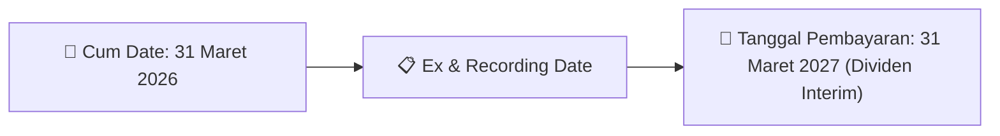
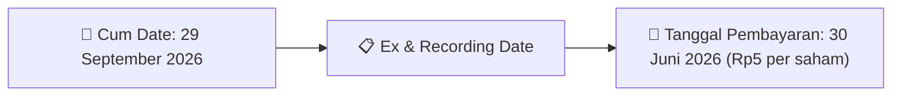

# Ikhtisar Akhir Pekan (Weekend Digest) - 2026-09-21

📅 **2026-09-21 (Weekend Digest)**

## 1. Radar Pasar & Sentimen Akhir Pekan (Executive Weekend Dashboard)
> [!NOTE]
> Terdeteksi sebanyak **212 pengumuman baru** dari 78 emiten pantauan pada (2026-09-21).

| Metric | Jumlah | Status Radar |
| :--- | :---: | :--- |
| **🟢 Sentimen Bullish / Positif** | `6` | [[Dividen Interim]], [[Mandatory Tender Offer]], Kinerja Positif |
| **⚪ Sentimen Netral / Routine** | `95` | [[Tanggapan Penjelasan Bursa]], [[RUPS]], [[Pendaftaran Unit]] |
| **🔴 Sentimen Bearish / Alert** | `2` | Sengketa Hukum, Defisit / Gugatan (Nihil hari ini) |
| **📄 [[Laporan Keuangan]] Baru** | `7` | Memicu Analisis Keuangan Otomatis |

> [!IMPORTANT]
> **Ditemukan Laporan Keuangan Baru Hari Ini:**
> - **BBKP**: FinancialStatement-2026-II-BBKP ([Buka PDF](file:///g:/My Drive/Model2/reports/raw/BBKP/20260918_BBKP_FinancialStatement-2026-II-BBKP.pdf))
- **BBKP**: FinancialStatement-2026-II-BBKP. ([Buka PDF](file:///g:/My Drive/Model2/reports/raw/BBKP/20260918_BBKP_FinancialStatement-2026-II-BBKP.xlsx))
- **TRUE**: FinancialStatement-2026-II-TRUE ([Buka PDF](file:///g:/My Drive/Model2/reports/raw/TRUE/20260918_TRUE_FinancialStatement-2026-II-TRUE.pdf))
- **TRUE**: FinancialStatement-2026-II-TRUE. ([Buka PDF](file:///g:/My Drive/Model2/reports/raw/TRUE/20260918_TRUE_FinancialStatement-2026-II-TRUE.xlsx))
- **TRUE**: TRUE - Laporan Keuangan Q2 2026 ([Buka PDF](file:///g:/My Drive/Model2/reports/raw/TRUE/20260918_TRUE_TRUE - Laporan Keuangan Q2 2026.pdf))
- **OBMD**: FinancialStatement-2025-Tahunan-OBMD ([Buka PDF](file:///g:/My Drive/Model2/reports/raw/OBMD/20260918_OBMD_FinancialStatement-2025-Tahunan-OBMD.pdf))
- **OBMD**: FinancialStatement-2025-Tahunan-OBMD. ([Buka PDF](file:///g:/My Drive/Model2/reports/raw/OBMD/20260918_OBMD_FinancialStatement-2025-Tahunan-OBMD.xlsx))
> 
> *Tugas Swarm Agent:* Lakukan analisis laporan keuangan mendalam per emiten secara terpisah untuk berkas-berkas di atas.

---

## 2. Sorotan Utama & Watchlist Strategis (Strategic Watchlist)
#### 💰 Watchlist Dividen & Distribution
- **[[HEXA]]**: Cum Date = 31 Maret 2026
- **[[HEXA]]**: Ex Date = 31 Maret 2026
- **[[HEXA]]**: Recording Date = 31 Maret 2026
- **[[HEXA]]**: Tanggal Pembayaran = 31 Maret 2027
- **[[IFII]]**: Nominal Dividen = Rp5 per saham
- **[[IFII]]**: Total Dividen = Rp47.06 Miliar

#### 📈 Watchlist Konversi Waran & Potensi Dilusi
- **[[CSIS]]**: Jumlah Waran Dikonversi = 100 lembar
- **[[CSIS]]**: Jumlah Saham Setelah Konversi = 1,829,804,156 lembar
- **[[CSIS]]**: Sisa Waran = 100 lembar
- **[[INET]]**: Jumlah Waran Dikonversi = 23,528 lembar
- **[[INET]]**: Jumlah Saham Setelah Konversi = 22,377,810,262 lembar
- **[[INET]]**: Sisa Waran = 23,528 lembar

#### 👥 Watchlist Transaksi Orang Dalam & Kepemilikan Saham (Insider / Repo Moves)
- **[[IMPC]]**: Nama Insider = TUNGGAL JAYA INVESTAMA
- **[[IMPC]]**: Jabatan = Tidak
- **[[SRTG]]**: Nama Insider = EDWIN SOERYADJAYA
- **[[NSSS]]**: Nama Insider = SAMUEL SEKURITAS INDONESIA
- **[[WINR]]**: Nama Insider = PEMENANG NUSANTARA INTERNASIONAL
- **[[WINR]]**: Jabatan = Tidak
- **[[WINR]]**: Nama Insider = PEMENANG NUSANTARA INTERNASIONAL
- **[[WINR]]**: Jabatan = Tidak

---

## 3. Matriks Pengumuman Pasar (Announcements Intelligence Table)
| Emiten | Sentimen | Jenis Pengumuman | Judul Pengumuman | Berkas |
| :--- | :---: | :--- | :--- | :--- |
| **[[TLKM]]** | ⚪ NEUTRAL | Aksi Korporasi | Laporan Informasi dan Fakta Material | [Utama](file:///g:/My%20Drive/Model2/reports/raw/TLKM/20260918_TLKM_20260917_TLKM_Laporan Informasi dan Fakta Material_32149591.pdf) · [Lamp 1](file:///g:/My%20Drive/Model2/reports/raw/TLKM/20260918_TLKM_20260917_TLKM_Laporan Informasi dan Fakta Material_32149591_lamp1.pdf) · [Lamp 2](file:///g:/My%20Drive/Model2/reports/raw/TLKM/20260918_TLKM_20260917_TLKM_Laporan Informasi dan Fakta Material_32149591_lamp2.pdf) |
| **[[CSIS]]** | ⚪ NEUTRAL | Aksi Korporasi | Pencatatan Saham Tambahan dari Konversi | [Utama](file:///g:/My%20Drive/Model2/reports/raw/CSIS/20260918_CSIS_20260918_CSIS_Pencatatan Saham Tambahan dari Konversi_32149707.pdf) |
| **[[HEXA]]** | 🟢 BULLISH | Dividen | Ringkasan RisalahRisalah RUPS | [Utama](file:///g:/My%20Drive/Model2/reports/raw/HEXA/20260921_HEXA_20260919_HEXA_Ringkasan RisalahRisalah RUPS_32149908.pdf) · [Lamp 5](file:///g:/My%20Drive/Model2/reports/raw/HEXA/20260921_HEXA_20260919_HEXA_Ringkasan RisalahRisalah RUPS_32149908_lamp5.pdf) · [Lamp 6](file:///g:/My%20Drive/Model2/reports/raw/HEXA/20260921_HEXA_20260919_HEXA_Ringkasan RisalahRisalah RUPS_32149908_lamp6.pdf) · [Lamp 4](file:///g:/My%20Drive/Model2/reports/raw/HEXA/20260921_HEXA_20260919_HEXA_Ringkasan RisalahRisalah RUPS_32149908_lamp4.pdf) · [Lamp 3](file:///g:/My%20Drive/Model2/reports/raw/HEXA/20260921_HEXA_20260919_HEXA_Ringkasan RisalahRisalah RUPS_32149908_lamp3.pdf) |
| **[[HEXA]]** | ⚪ NEUTRAL | Aksi Korporasi | Laporan Informasi dan Fakta Material | [Utama](file:///g:/My%20Drive/Model2/reports/raw/HEXA/20260918_HEXA_20260917_HEXA_Laporan Informasi dan Fakta Material_32149595.pdf) |
| **[[INET]]** | ⚪ NEUTRAL | Aksi Korporasi | Pencatatan Saham Tambahan dari Konversi | [Utama](file:///g:/My%20Drive/Model2/reports/raw/INET/20260918_INET_20260918_INET_Pencatatan Saham Tambahan dari Konversi_32149722.pdf) |
| **[[ISAP]]** | ⚪ NEUTRAL | Aksi Korporasi | Pencatatan Saham Tambahan dari Konversi | [Utama](file:///g:/My%20Drive/Model2/reports/raw/ISAP/20260918_ISAP_20260918_ISAP_Pencatatan Saham Tambahan dari Konversi_32149668.pdf) |
| **[[ASDF]]** | ⚪ NEUTRAL | Aksi Korporasi | Pengumuman Pencatatan Awal Obligasi dan Sukuk | [Utama](file:///g:/My%20Drive/Model2/reports/raw/ASDF/20260918_ASDF_20260918_ASDF_Pengumuman Pencatatan Awal Obligasi dan Sukuk_32149745.pdf) · [Lamp 1](file:///g:/My%20Drive/Model2/reports/raw/ASDF/20260918_ASDF_20260918_ASDF_Pengumuman Pencatatan Awal Obligasi dan Sukuk_32149745_lamp1.pdf) |
| **[[MGNA]]** | ⚪ NEUTRAL | Aksi Korporasi | Pencatatan Saham Tambahan dari Konversi | [Utama](file:///g:/My%20Drive/Model2/reports/raw/MGNA/20260918_MGNA_20260917_MGNA_Pencatatan Saham Tambahan dari Konversi_32149322.pdf) · [Lamp 1](file:///g:/My%20Drive/Model2/reports/raw/MGNA/20260921_MGNA_20260918_MGNA_Pencatatan Saham Tambahan dari Konversi_32149690_lamp1.pdf) · [Lamp 1](file:///g:/My%20Drive/Model2/reports/raw/MGNA/20260918_MGNA_20260917_MGNA_Pencatatan Saham Tambahan dari Konversi_32149322_lamp1.pdf) |
| **[[IMPC]]** | ⚪ NEUTRAL | Kepemilikan Saham (Insider) | LK-18092026-6972-00 | [Utama](file:///g:/My%20Drive/Model2/reports/raw/IMPC/20260918_IMPC_LK-18092026-6972-00.pdf) |
| **[[NISP]]** | ⚪ NEUTRAL | Aksi Korporasi | Laporan Informasi dan Fakta Material | [Utama](file:///g:/My%20Drive/Model2/reports/raw/NISP/20260918_NISP_20260918_NISP_Laporan Informasi dan Fakta Material_32149815.pdf) · [Lamp 1](file:///g:/My%20Drive/Model2/reports/raw/NISP/20260918_NISP_20260918_NISP_Laporan Informasi dan Fakta Material_32149815_lamp1.pdf) |
| **[[SRTG]]** | ⚪ NEUTRAL | Kepemilikan Saham (Insider) | LK-18092026-4386-00 | [Utama](file:///g:/My%20Drive/Model2/reports/raw/SRTG/20260918_SRTG_LK-18092026-4386-00.pdf) |
| **[[UVCR]]** | ⚪ NEUTRAL | Aksi Korporasi | Laporan Informasi dan Fakta Material | [Utama](file:///g:/My%20Drive/Model2/reports/raw/UVCR/20260918_UVCR_20260918_UVCR_Laporan Informasi dan Fakta Material_32149767.pdf) · [Lamp 1](file:///g:/My%20Drive/Model2/reports/raw/UVCR/20260918_UVCR_20260918_UVCR_Laporan Informasi dan Fakta Material_32149767_lamp1.pdf) |
| **[[UVCR]]** | ⚪ NEUTRAL | RUPS | Pengumuman RUPS | [Utama](file:///g:/My%20Drive/Model2/reports/raw/UVCR/20260918_UVCR_20260918_UVCR_Pengumuman RUPS_32149754.pdf) · [Lamp 1](file:///g:/My%20Drive/Model2/reports/raw/UVCR/20260918_UVCR_20260918_UVCR_Pengumuman RUPS_32149754_lamp1.pdf) |
| **[[SKBM]]** | ⚪ NEUTRAL | Aksi Korporasi | Laporan Informasi dan Fakta Material | [Utama](file:///g:/My%20Drive/Model2/reports/raw/SKBM/20260918_SKBM_20260918_SKBM_Laporan Informasi dan Fakta Material_32149616.pdf) · [Lamp 1](file:///g:/My%20Drive/Model2/reports/raw/SKBM/20260918_SKBM_20260918_SKBM_Laporan Informasi dan Fakta Material_32149616_lamp1.pdf) |
| **[[NSSS]]** | ⚪ NEUTRAL | Kepemilikan Saham (Insider) | LK-18092026-7390-00 | [Utama](file:///g:/My%20Drive/Model2/reports/raw/NSSS/20260918_NSSS_LK-18092026-7390-00.pdf) |
| **[[CYBR]]** | ⚪ NEUTRAL | Aksi Korporasi | Pencatatan Saham Tambahan dari Konversi | [Utama](file:///g:/My%20Drive/Model2/reports/raw/CYBR/20260918_CYBR_20260918_CYBR_Pencatatan Saham Tambahan dari Konversi_32149665.pdf) · [Lamp 1](file:///g:/My%20Drive/Model2/reports/raw/CYBR/20260918_CYBR_20260918_CYBR_Pencatatan Saham Tambahan dari Konversi_32149665_lamp1.pdf) |
| **[[SMRA]]** | ⚪ NEUTRAL | Aksi Korporasi | Tanggapan atas Permintaan Penjelasan Bursa | [Utama](file:///g:/My%20Drive/Model2/reports/raw/SMRA/20260918_SMRA_20260918_SMRA_Tanggapan atas Permintaan Penjelasan Bursa_32149633.pdf) · [Lamp 1](file:///g:/My%20Drive/Model2/reports/raw/SMRA/20260918_SMRA_20260918_SMRA_Tanggapan atas Permintaan Penjelasan Bursa_32149633_lamp1.pdf) |
| **[[BBKP]]** | ⚪ NEUTRAL | Aksi Korporasi | Laporan Informasi dan Fakta Material | [Utama](file:///g:/My%20Drive/Model2/reports/raw/BBKP/20260918_BBKP_20260918_BBKP_Laporan Informasi dan Fakta Material_32149893.pdf) · [Lamp 2](file:///g:/My%20Drive/Model2/reports/raw/BBKP/20260918_BBKP_20260918_BBKP_Laporan Informasi dan Fakta Material_32149893_lamp2.pdf) · [Lamp 1](file:///g:/My%20Drive/Model2/reports/raw/BBKP/20260918_BBKP_20260918_BBKP_Laporan Informasi dan Fakta Material_32149893_lamp1.pdf) |
| **[[BBKP]]** | ⚪ NEUTRAL | Laporan Keuangan | FinancialStatement-2026-II-BBKP | [Utama](file:///g:/My%20Drive/Model2/reports/raw/BBKP/20260918_BBKP_FinancialStatement-2026-II-BBKP.pdf) |
| **[[BBKP]]** | ⚪ NEUTRAL | Laporan Keuangan | FinancialStatement-2026-II-BBKP. | [Utama](file:///g:/My%20Drive/Model2/reports/raw/BBKP/20260918_BBKP_FinancialStatement-2026-II-BBKP.xlsx) |
| **[[BBKP]]** | ⚪ NEUTRAL | Aksi Korporasi | PT Bank KB Indonesia Tbk 30June26 Final Released | [Utama](file:///g:/My%20Drive/Model2/reports/raw/BBKP/20260918_BBKP_PT Bank KB Indonesia Tbk_30June26_Final_Released.pdf) |
| **[[BAFI]]** | ⚪ NEUTRAL | Aksi Korporasi | Laporan Informasi dan Fakta Material | [Utama](file:///g:/My%20Drive/Model2/reports/raw/BAFI/20260918_BAFI_20260918_BAFI_Laporan Informasi dan Fakta Material_32149639.pdf) · [Lamp 1](file:///g:/My%20Drive/Model2/reports/raw/BAFI/20260918_BAFI_20260918_BAFI_Laporan Informasi dan Fakta Material_32149639_lamp1.pdf) |
| **[[BAFI]]** | ⚪ NEUTRAL | Aksi Korporasi | Perubahan Pengurus | [Utama](file:///g:/My%20Drive/Model2/reports/raw/BAFI/20260918_BAFI_20260918_BAFI_Perubahan Pengurus_32149651.pdf) |
| **[[BABY]]** | ⚪ NEUTRAL | Aksi Korporasi | Laporan Informasi dan Fakta Material | [Utama](file:///g:/My%20Drive/Model2/reports/raw/BABY/20260918_BABY_20260918_BABY_Laporan Informasi dan Fakta Material_32149731.pdf) · [Lamp 1](file:///g:/My%20Drive/Model2/reports/raw/BABY/20260918_BABY_20260918_BABY_Laporan Informasi dan Fakta Material_32149731_lamp1.pdf) |
| **[[WINR]]** | ⚪ NEUTRAL | Kepemilikan Saham (Insider) | LK-20092026-3558-00 | [Utama](file:///g:/My%20Drive/Model2/reports/raw/WINR/20260920_WINR_LK-20092026-3558-00.pdf) |
| **[[WINR]]** | ⚪ NEUTRAL | Kepemilikan Saham (Insider) | LK-19092026-7762-00 | [Utama](file:///g:/My%20Drive/Model2/reports/raw/WINR/20260919_WINR_LK-19092026-7762-00.pdf) |
| **[[DEFI]]** | ⚪ NEUTRAL | Aksi Korporasi | Tanggapan atas Permintaan Penjelasan Bursa | [Utama](file:///g:/My%20Drive/Model2/reports/raw/DEFI/20260918_DEFI_20260917_DEFI_Tanggapan atas Permintaan Penjelasan Bursa_32149455.pdf) · [Lamp 1](file:///g:/My%20Drive/Model2/reports/raw/DEFI/20260918_DEFI_20260917_DEFI_Tanggapan atas Permintaan Penjelasan Bursa_32149455_lamp1.pdf) |
| **[[DJPU]]** | ⚪ NEUTRAL | Aksi Korporasi | Pengumuman Bursa | [Utama](file:///g:/My%20Drive/Model2/reports/raw/DJPU/20260918_DJPU_20260918_DJPU_Pengumuman Bursa_32149742.pdf) · [Lamp 1](file:///g:/My%20Drive/Model2/reports/raw/DJPU/20260918_DJPU_20260918_DJPU_Pengumuman Bursa_32149742_lamp1.pdf) · [Lamp 2](file:///g:/My%20Drive/Model2/reports/raw/DJPU/20260918_DJPU_20260918_DJPU_Pengumuman Bursa_32149742_lamp2.pdf) |
| **[[PJHB]]** | ⚪ NEUTRAL | Aksi Korporasi | Pencatatan Saham Tambahan dari Konversi | [Utama](file:///g:/My%20Drive/Model2/reports/raw/PJHB/20260918_PJHB_20260918_PJHB_Pencatatan Saham Tambahan dari Konversi_32149706.pdf) |
| **[[DOID]]** | ⚪ NEUTRAL | RUPS | Transaksi Material Tanpa Persetujuan RUPS | [Utama](file:///g:/My%20Drive/Model2/reports/raw/DOID/20260918_DOID_20260918_DOID_Transaksi Material Tanpa Persetujuan RUPS_32149758.pdf) |
| **[[WIKA]]** | 🔴 BEARISH | Aksi Korporasi | Suspensi dan Pembukaan Suspensi | [Utama](file:///g:/My%20Drive/Model2/reports/raw/WIKA/20260918_WIKA_20260918_Suspensi dan Pembukaan Suspensi_32149711.pdf) · [Lamp 1](file:///g:/My%20Drive/Model2/reports/raw/WIKA/20260918_WIKA_20260918_Suspensi dan Pembukaan Suspensi_32149711_lamp1.pdf) |
| **[[MKNT]]** | ⚪ NEUTRAL | Aksi Korporasi | Perubahan Pengurus | [Utama](file:///g:/My%20Drive/Model2/reports/raw/MKNT/20260919_MKNT_20260919_MKNT_Perubahan Pengurus_32149906.pdf) · [Lamp 1](file:///g:/My%20Drive/Model2/reports/raw/MKNT/20260919_MKNT_20260919_MKNT_Perubahan Pengurus_32149906_lamp1.pdf) |
| **[[PGLI]]** | ⚪ NEUTRAL | Aksi Korporasi | Tanggapan atas Permintaan Penjelasan Bursa | [Utama](file:///g:/My%20Drive/Model2/reports/raw/PGLI/20260921_PGLI_20260918_PGLI_Tanggapan atas Permintaan Penjelasan Bursa_32149806.pdf) |
| **[[IFII]]** | 🟢 BULLISH | Dividen | Jadwal Aksi Korporasi (Khusus Penyampaian Dividen Interim) | [Utama](file:///g:/My%20Drive/Model2/reports/raw/IFII/20260918_IFII_20260917_IFII_Jadwal Aksi Korporasi (Khusus Penyampaian Dividen Interim)_32149394.pdf) · [Lamp 2](file:///g:/My%20Drive/Model2/reports/raw/IFII/20260918_IFII_20260917_IFII_Jadwal Aksi Korporasi (Khusus Penyampaian Dividen Interim)_32149394_lamp2.pdf) |
| **[[TOWR]]** | ⚪ NEUTRAL | Kepemilikan Saham (Insider) | LK-18092026-3007-00 | [Utama](file:///g:/My%20Drive/Model2/reports/raw/TOWR/20260918_TOWR_LK-18092026-3007-00.pdf) |
| **[[TOWR]]** | ⚪ NEUTRAL | Kepemilikan Saham (Insider) | LK-18092026-8160-00 | [Utama](file:///g:/My%20Drive/Model2/reports/raw/TOWR/20260918_TOWR_LK-18092026-8160-00.pdf) |
| **[[TOWR]]** | ⚪ NEUTRAL | Kepemilikan Saham (Insider) | LK-18092026-6018-00 | [Utama](file:///g:/My%20Drive/Model2/reports/raw/TOWR/20260918_TOWR_LK-18092026-6018-00.pdf) |
| **[[TOWR]]** | ⚪ NEUTRAL | Kepemilikan Saham (Insider) | LK-18092026-8351-00 | [Utama](file:///g:/My%20Drive/Model2/reports/raw/TOWR/20260918_TOWR_LK-18092026-8351-00.pdf) |
| **[[TOWR]]** | ⚪ NEUTRAL | Kepemilikan Saham (Insider) | LK-18092026-4128-00 | [Utama](file:///g:/My%20Drive/Model2/reports/raw/TOWR/20260918_TOWR_LK-18092026-4128-00.pdf) |
| **[[TOWR]]** | ⚪ NEUTRAL | Kepemilikan Saham (Insider) | LK-18092026-6867-00 | [Utama](file:///g:/My%20Drive/Model2/reports/raw/TOWR/20260918_TOWR_LK-18092026-6867-00.pdf) |
| **[[MGLV]]** | ⚪ NEUTRAL | Kepemilikan Saham (Insider) | LK-18092026-7714-00 | [Utama](file:///g:/My%20Drive/Model2/reports/raw/MGLV/20260918_MGLV_LK-18092026-7714-00.pdf) |
| **[[PYFA]]** | ⚪ NEUTRAL | Aksi Korporasi | Pencatatan Saham Tambahan dari Konversi | [Utama](file:///g:/My%20Drive/Model2/reports/raw/PYFA/20260918_PYFA_20260917_PYFA_Pencatatan Saham Tambahan dari Konversi_32149383.pdf) |
| **[[SOFA]]** | ⚪ NEUTRAL | Aksi Korporasi | Tanggapan atas Permintaan Penjelasan Bursa | [Utama](file:///g:/My%20Drive/Model2/reports/raw/SOFA/20260918_SOFA_20260918_SOFA_Tanggapan atas Permintaan Penjelasan Bursa_32149896.pdf) · [Lamp 1](file:///g:/My%20Drive/Model2/reports/raw/SOFA/20260918_SOFA_20260918_SOFA_Tanggapan atas Permintaan Penjelasan Bursa_32149896_lamp1.pdf) |
| **[[PGEO]]** | ⚪ NEUTRAL | Aksi Korporasi | Pencatatan Saham Tambahan dari Konversi | [Utama](file:///g:/My%20Drive/Model2/reports/raw/PGEO/20260918_PGEO_20260917_PGEO_Pencatatan Saham Tambahan dari Konversi_32149370.pdf) |
| **[[PTPP]]** | ⚪ NEUTRAL | Aksi Korporasi | Laporan Informasi dan Fakta Material | [Utama](file:///g:/My%20Drive/Model2/reports/raw/PTPP/20260918_PTPP_20260918_PTPP_Laporan Informasi dan Fakta Material_32149839.pdf) · [Lamp 1](file:///g:/My%20Drive/Model2/reports/raw/PTPP/20260918_PTPP_20260918_PTPP_Laporan Informasi dan Fakta Material_32149839_lamp1.pdf) |
| **[[BIKE]]** | ⚪ NEUTRAL | Aksi Korporasi | Laporan Informasi dan Fakta Material | [Utama](file:///g:/My%20Drive/Model2/reports/raw/BIKE/20260918_BIKE_20260918_BIKE_Laporan Informasi dan Fakta Material_32149895.pdf) · [Lamp 1](file:///g:/My%20Drive/Model2/reports/raw/BIKE/20260918_BIKE_20260918_BIKE_Laporan Informasi dan Fakta Material_32149895_lamp1.pdf) |
| **[[TEBE]]** | ⚪ NEUTRAL | Kepemilikan Saham (Insider) | LK-18092026-7561-00 | [Utama](file:///g:/My%20Drive/Model2/reports/raw/TEBE/20260918_TEBE_LK-18092026-7561-00.pdf) |
| **[[SCCO]]** | ⚪ NEUTRAL | Aksi Korporasi | Tanggapan atas Permintaan Penjelasan Bursa | [Utama](file:///g:/My%20Drive/Model2/reports/raw/SCCO/20260918_SCCO_20260918_SCCO_Tanggapan atas Permintaan Penjelasan Bursa_32149607.pdf) · [Lamp 1](file:///g:/My%20Drive/Model2/reports/raw/SCCO/20260918_SCCO_20260918_SCCO_Tanggapan atas Permintaan Penjelasan Bursa_32149607_lamp1.pdf) |
| **[[KOCI]]** | ⚪ NEUTRAL | Aksi Korporasi | Pencatatan Saham Tambahan dari Konversi | [Utama](file:///g:/My%20Drive/Model2/reports/raw/KOCI/20260918_KOCI_20260917_KOCI_Pencatatan Saham Tambahan dari Konversi_32149295.pdf) · [Lamp 1](file:///g:/My%20Drive/Model2/reports/raw/KOCI/20260918_KOCI_20260918_KOCI_Pencatatan Saham Tambahan dari Konversi_32149660_lamp1.pdf) · [Lamp 1](file:///g:/My%20Drive/Model2/reports/raw/KOCI/20260918_KOCI_20260917_KOCI_Pencatatan Saham Tambahan dari Konversi_32149295_lamp1.pdf) |
| **[[LFLO]]** | ⚪ NEUTRAL | Aksi Korporasi | Tanggapan atas Permintaan Penjelasan Bursa | [Utama](file:///g:/My%20Drive/Model2/reports/raw/LFLO/20260918_LFLO_20260918_LFLO_Tanggapan atas Permintaan Penjelasan Bursa_32149682.pdf) |
| **[[CINT]]** | ⚪ NEUTRAL | Aksi Korporasi | Tanggapan atas Permintaan Penjelasan Bursa | [Utama](file:///g:/My%20Drive/Model2/reports/raw/CINT/20260918_CINT_20260918_CINT_Tanggapan atas Permintaan Penjelasan Bursa_32149694.pdf) |
| **[[RGAS]]** | ⚪ NEUTRAL | Aksi Korporasi | Tanggapan atas Permintaan Penjelasan Bursa | [Utama](file:///g:/My%20Drive/Model2/reports/raw/RGAS/20260918_RGAS_20260918_RGAS_Tanggapan atas Permintaan Penjelasan Bursa_32149846.pdf) · [Lamp 1](file:///g:/My%20Drive/Model2/reports/raw/RGAS/20260918_RGAS_20260918_RGAS_Tanggapan atas Permintaan Penjelasan Bursa_32149846_lamp1.pdf) |
| **[[PRDA]]** | 🟢 BULLISH | Buyback | Laporan Informasi dan Fakta Material | [Utama](file:///g:/My%20Drive/Model2/reports/raw/PRDA/20260918_PRDA_20260918_PRDA_Laporan Informasi dan Fakta Material_32149811.pdf) · [Lamp 1](file:///g:/My%20Drive/Model2/reports/raw/PRDA/20260918_PRDA_20260918_PRDA_Laporan Informasi dan Fakta Material_32149811_lamp1.pdf) |
| **[[KBLI]]** | ⚪ NEUTRAL | Aksi Korporasi | Tanggapan atas Permintaan Penjelasan Bursa | [Utama](file:///g:/My%20Drive/Model2/reports/raw/KBLI/20260918_KBLI_20260918_KBLI_Tanggapan atas Permintaan Penjelasan Bursa_32149875.pdf) · [Lamp 1](file:///g:/My%20Drive/Model2/reports/raw/KBLI/20260918_KBLI_20260918_KBLI_Tanggapan atas Permintaan Penjelasan Bursa_32149875_lamp1.pdf) |
| **[[SILO]]** | ⚪ NEUTRAL | Aksi Korporasi | Perubahan danatau Tambahan Keterbukaan Informasi terkait Aksi Korporasi | [Utama](file:///g:/My%20Drive/Model2/reports/raw/SILO/20260918_SILO_20260918_SILO_Perubahan danatau Tambahan Keterbukaan Informasi terkait Aksi Korporasi_32149889.pdf) · [Lamp 2](file:///g:/My%20Drive/Model2/reports/raw/SILO/20260918_SILO_20260918_SILO_Perubahan danatau Tambahan Keterbukaan Informasi terkait Aksi Korporasi_32149889_lamp2.pdf) · [Lamp 4](file:///g:/My%20Drive/Model2/reports/raw/SILO/20260918_SILO_20260918_SILO_Perubahan danatau Tambahan Keterbukaan Informasi terkait Aksi Korporasi_32149889_lamp4.pdf) · [Lamp 3](file:///g:/My%20Drive/Model2/reports/raw/SILO/20260918_SILO_20260918_SILO_Perubahan danatau Tambahan Keterbukaan Informasi terkait Aksi Korporasi_32149889_lamp3.pdf) · [Lamp 1](file:///g:/My%20Drive/Model2/reports/raw/SILO/20260918_SILO_20260918_SILO_Perubahan danatau Tambahan Keterbukaan Informasi terkait Aksi Korporasi_32149889_lamp1.pdf) |
| **[[MPRO]]** | ⚪ NEUTRAL | Aksi Korporasi | Tanggapan atas Permintaan Penjelasan Bursa | [Utama](file:///g:/My%20Drive/Model2/reports/raw/MPRO/20260918_MPRO_20260918_MPRO_Tanggapan atas Permintaan Penjelasan Bursa_32149691.pdf) |
| **[[BVIC]]** | ⚪ NEUTRAL | Aksi Korporasi | Pembayaran KuponBagi HasilIjarahPokok | [Utama](file:///g:/My%20Drive/Model2/reports/raw/BVIC/20260918_BVIC_20260918_BVIC_Pembayaran KuponBagi HasilIjarahPokok_32149757.pdf) |
| **[[BAYU]]** | ⚪ NEUTRAL | Aksi Korporasi | Pengumuman Bursa | [Utama](file:///g:/My%20Drive/Model2/reports/raw/BAYU/20260918_BAYU_20260918_BAYU_Pengumuman Bursa_32149675.pdf) · [Lamp 1](file:///g:/My%20Drive/Model2/reports/raw/BAYU/20260918_BAYU_20260918_BAYU_Pengumuman Bursa_32149675_lamp1.pdf) |
| **[[BMRI]]** | ⚪ NEUTRAL | Kepemilikan Saham (Insider) | LK-20092026-5560-00 | [Utama](file:///g:/My%20Drive/Model2/reports/raw/BMRI/20260920_BMRI_LK-20092026-5560-00.pdf) |
| **[[BMRI]]** | ⚪ NEUTRAL | Kepemilikan Saham (Insider) | LK-18092026-9305-00 | [Utama](file:///g:/My%20Drive/Model2/reports/raw/BMRI/20260918_BMRI_LK-18092026-9305-00.pdf) |
| **[[TGKA]]** | ⚪ NEUTRAL | Aksi Korporasi | Pengumuman Bursa | [Utama](file:///g:/My%20Drive/Model2/reports/raw/TGKA/20260918_TGKA_20260918_TGKA_Pengumuman Bursa_32149677.pdf) · [Lamp 1](file:///g:/My%20Drive/Model2/reports/raw/TGKA/20260918_TGKA_20260918_TGKA_Pengumuman Bursa_32149677_lamp1.pdf) |
| **[[MTMH]]** | ⚪ NEUTRAL | Aksi Korporasi | Laporan Informasi dan Fakta Material | [Utama](file:///g:/My%20Drive/Model2/reports/raw/MTMH/20260918_MTMH_20260918_MTMH_Laporan Informasi dan Fakta Material_32149774.pdf) |
| **[[BMBL]]** | ⚪ NEUTRAL | Kepemilikan Saham (Insider) | LK-20092026-5384-00 | [Utama](file:///g:/My%20Drive/Model2/reports/raw/BMBL/20260920_BMBL_LK-20092026-5384-00.pdf) |
| **[[EXCL]]** | ⚪ NEUTRAL | RUPS | Pemanggilan RUPS | [Utama](file:///g:/My%20Drive/Model2/reports/raw/EXCL/20260918_EXCL_20260917_EXCL_Pemanggilan RUPS_32149519.pdf) · [Lamp 2](file:///g:/My%20Drive/Model2/reports/raw/EXCL/20260918_EXCL_20260917_EXCL_Pemanggilan RUPS_32149519_lamp2.pdf) · [Lamp 1](file:///g:/My%20Drive/Model2/reports/raw/EXCL/20260918_EXCL_20260917_EXCL_Pemanggilan RUPS_32149519_lamp1.pdf) |
| **[[APEX]]** | ⚪ NEUTRAL | Aksi Korporasi | Tanggapan atas Permintaan Penjelasan Bursa | [Utama](file:///g:/My%20Drive/Model2/reports/raw/APEX/20260918_APEX_20260918_APEX_Tanggapan atas Permintaan Penjelasan Bursa_32149721.pdf) |
| **[[APEX]]** | ⚪ NEUTRAL | Aksi Korporasi | Perubahan Corsec Komite Audit Alamat NPWP Internal Audit | [Utama](file:///g:/My%20Drive/Model2/reports/raw/APEX/20260918_APEX_20260918_APEX_Perubahan Corsec Komite Audit Alamat NPWP Internal Audit_32149705.pdf) |
| **[[JMAS]]** | ⚪ NEUTRAL | Aksi Korporasi | Tanggapan atas Permintaan Penjelasan Bursa | [Utama](file:///g:/My%20Drive/Model2/reports/raw/JMAS/20260918_JMAS_20260918_JMAS_Tanggapan atas Permintaan Penjelasan Bursa_32149867.pdf) |
| **[[JMAS]]** | ⚪ NEUTRAL | Aksi Korporasi | Laporan Informasi dan Fakta Material | [Utama](file:///g:/My%20Drive/Model2/reports/raw/JMAS/20260918_JMAS_20260918_JMAS_Laporan Informasi dan Fakta Material_32149869.pdf) · [Lamp 2](file:///g:/My%20Drive/Model2/reports/raw/JMAS/20260918_JMAS_20260918_JMAS_Laporan Informasi dan Fakta Material_32149869_lamp2.pdf) |
| **[[CRAB]]** | ⚪ NEUTRAL | Public Expose | Public Expose | [Utama](file:///g:/My%20Drive/Model2/reports/raw/CRAB/20260921_CRAB_20260919_CRAB_Public Expose_32149905.pdf) · [Lamp 2](file:///g:/My%20Drive/Model2/reports/raw/CRAB/20260921_CRAB_20260919_CRAB_Public Expose_32149905_lamp2.pdf) · [Lamp 1](file:///g:/My%20Drive/Model2/reports/raw/CRAB/20260921_CRAB_20260919_CRAB_Public Expose_32149905_lamp1.pdf) |
| **[[BAJA]]** | ⚪ NEUTRAL | Aksi Korporasi | Keterbukaan Informasi terkait Aksi Korporasi | [Utama](file:///g:/My%20Drive/Model2/reports/raw/BAJA/20260918_BAJA_20260918_BAJA_Keterbukaan Informasi terkait Aksi Korporasi_32149698.pdf) · [Lamp 1](file:///g:/My%20Drive/Model2/reports/raw/BAJA/20260918_BAJA_20260918_BAJA_Keterbukaan Informasi terkait Aksi Korporasi_32149698_lamp1.pdf) |
| **[[BAJA]]** | 🟢 BULLISH | Aksi Korporasi | Penyampaian ProspektusInformasi Tambahan | [Utama](file:///g:/My%20Drive/Model2/reports/raw/BAJA/20260918_BAJA_20260918_BAJA_Penyampaian ProspektusInformasi Tambahan_32149631.pdf) · [Lamp 2](file:///g:/My%20Drive/Model2/reports/raw/BAJA/20260918_BAJA_20260918_BAJA_Penyampaian ProspektusInformasi Tambahan_32149631_lamp2.pdf) · [Lamp 1](file:///g:/My%20Drive/Model2/reports/raw/BAJA/20260918_BAJA_20260918_BAJA_Penyampaian ProspektusInformasi Tambahan_32149631_lamp1.pdf) |
| **[[ULTJ]]** | ⚪ NEUTRAL | Aksi Korporasi | Tanggapan atas Permintaan Penjelasan Bursa | [Utama](file:///g:/My%20Drive/Model2/reports/raw/ULTJ/20260918_ULTJ_20260918_ULTJ_Tanggapan atas Permintaan Penjelasan Bursa_32149733.pdf) |
| **[[ULTJ]]** | ⚪ NEUTRAL | RUPS | Rencana Transaksi Material Dengan Persetujuan RUPS | [Utama](file:///g:/My%20Drive/Model2/reports/raw/ULTJ/20260918_ULTJ_20260918_ULTJ_Rencana Transaksi Material Dengan Persetujuan RUPS_32149697.pdf) · [Lamp 2](file:///g:/My%20Drive/Model2/reports/raw/ULTJ/20260918_ULTJ_20260918_ULTJ_Rencana Transaksi Material Dengan Persetujuan RUPS_32149697_lamp2.pdf) |
| **[[ULTJ]]** | ⚪ NEUTRAL | RUPS | Pengumuman RUPS | [Utama](file:///g:/My%20Drive/Model2/reports/raw/ULTJ/20260918_ULTJ_20260918_ULTJ_Pengumuman RUPS_32149685.pdf) |
| **[[KIOS]]** | ⚪ NEUTRAL | RUPS | Pengumuman RUPS | [Utama](file:///g:/My%20Drive/Model2/reports/raw/KIOS/20260918_KIOS_20260918_KIOS_Pengumuman RUPS_32149628.pdf) · [Lamp 1](file:///g:/My%20Drive/Model2/reports/raw/KIOS/20260918_KIOS_20260918_KIOS_Pengumuman RUPS_32149628_lamp1.pdf) · [Lamp 2](file:///g:/My%20Drive/Model2/reports/raw/KIOS/20260918_KIOS_20260918_KIOS_Pengumuman RUPS_32149628_lamp2.pdf) |
| **[[ERAL]]** | ⚪ NEUTRAL | Aksi Korporasi | Laporan Informasi dan Fakta Material | [Utama](file:///g:/My%20Drive/Model2/reports/raw/ERAL/20260918_ERAL_20260918_ERAL_Laporan Informasi dan Fakta Material_32149781.pdf) · [Lamp 1](file:///g:/My%20Drive/Model2/reports/raw/ERAL/20260918_ERAL_20260918_ERAL_Laporan Informasi dan Fakta Material_32149781_lamp1.pdf) |
| **[[ADMF]]** | ⚪ NEUTRAL | Aksi Korporasi | Penyampaian ProspektusInformasi Tambahan | [Utama](file:///g:/My%20Drive/Model2/reports/raw/ADMF/20260918_ADMF_20260918_ADMF_Penyampaian ProspektusInformasi Tambahan_32149863.pdf) · [Lamp 2](file:///g:/My%20Drive/Model2/reports/raw/ADMF/20260918_ADMF_20260918_ADMF_Penyampaian ProspektusInformasi Tambahan_32149863_lamp2.pdf) · [Lamp 1](file:///g:/My%20Drive/Model2/reports/raw/ADMF/20260918_ADMF_20260918_ADMF_Penyampaian ProspektusInformasi Tambahan_32149863_lamp1.pdf) |
| **[[ADHI]]** | ⚪ NEUTRAL | Aksi Korporasi | Laporan Informasi dan Fakta Material | [Utama](file:///g:/My%20Drive/Model2/reports/raw/ADHI/20260920_ADHI_20260920_ADHI_Laporan Informasi dan Fakta Material_32149909.pdf) · [Lamp 1](file:///g:/My%20Drive/Model2/reports/raw/ADHI/20260920_ADHI_20260920_ADHI_Laporan Informasi dan Fakta Material_32149911_lamp1.pdf) · [Lamp 1](file:///g:/My%20Drive/Model2/reports/raw/ADHI/20260920_ADHI_20260920_ADHI_Laporan Informasi dan Fakta Material_32149909_lamp1.pdf) |
| **[[ADHI]]** | ⚪ NEUTRAL | Aksi Korporasi | Laporan Hasil Pemeringkatan | [Utama](file:///g:/My%20Drive/Model2/reports/raw/ADHI/20260918_ADHI_20260918_ADHI_Laporan Hasil Pemeringkatan_32149855.pdf) |
| **[[SMDR]]** | ⚪ NEUTRAL | Aksi Korporasi | Informasi Transaksi Afiliasi | [Utama](file:///g:/My%20Drive/Model2/reports/raw/SMDR/20260918_SMDR_20260918_SMDR_Informasi Transaksi Afiliasi_32149720.pdf) |
| **[[PPGL]]** | ⚪ NEUTRAL | Aksi Korporasi | Tanggapan atas Permintaan Penjelasan Bursa | [Utama](file:///g:/My%20Drive/Model2/reports/raw/PPGL/20260918_PPGL_20260918_PPGL_Tanggapan atas Permintaan Penjelasan Bursa_32149792.pdf) · [Lamp 1](file:///g:/My%20Drive/Model2/reports/raw/PPGL/20260918_PPGL_20260918_PPGL_Tanggapan atas Permintaan Penjelasan Bursa_32149792_lamp1.pdf) |
| **[[CHEK]]** | 🟢 BULLISH | Buyback | Laporan Informasi dan Fakta Material | [Utama](file:///g:/My%20Drive/Model2/reports/raw/CHEK/20260918_CHEK_20260918_CHEK_Laporan Informasi dan Fakta Material_32149816.pdf) |
| **[[HRUM]]** | ⚪ NEUTRAL | Kepemilikan Saham (Insider) | LK-18092026-4173-00 | [Utama](file:///g:/My%20Drive/Model2/reports/raw/HRUM/20260918_HRUM_LK-18092026-4173-00.pdf) |
| **[[TRUE]]** | ⚪ NEUTRAL | Laporan Keuangan | FinancialStatement-2026-II-TRUE | [Utama](file:///g:/My%20Drive/Model2/reports/raw/TRUE/20260918_TRUE_FinancialStatement-2026-II-TRUE.pdf) |
| **[[TRUE]]** | ⚪ NEUTRAL | Laporan Keuangan | FinancialStatement-2026-II-TRUE. | [Utama](file:///g:/My%20Drive/Model2/reports/raw/TRUE/20260918_TRUE_FinancialStatement-2026-II-TRUE.xlsx) |
| **[[TRUE]]** | 🔴 BEARISH | Laporan Keuangan | TRUE - Laporan Keuangan Q2 2026 | [Utama](file:///g:/My%20Drive/Model2/reports/raw/TRUE/20260918_TRUE_TRUE - Laporan Keuangan Q2 2026.pdf) |
| **[[LOPI]]** | ⚪ NEUTRAL | Kepemilikan Saham (Insider) | LK-18092026-7238-00 | [Utama](file:///g:/My%20Drive/Model2/reports/raw/LOPI/20260918_LOPI_LK-18092026-7238-00.pdf) |
| **[[LOPI]]** | ⚪ NEUTRAL | Kepemilikan Saham (Insider) | LK-18092026-8647-00 | [Utama](file:///g:/My%20Drive/Model2/reports/raw/LOPI/20260918_LOPI_LK-18092026-8647-00.pdf) |
| **[[REFI]]** | ⚪ NEUTRAL | Aksi Korporasi | Sanksi | [Utama](file:///g:/My%20Drive/Model2/reports/raw/REFI/20260918_REFI_20260918_REFI_Sanksi_32149749.pdf) · [Lamp 1](file:///g:/My%20Drive/Model2/reports/raw/REFI/20260918_REFI_20260918_REFI_Sanksi_32149749_lamp1.pdf) · [Lamp 2](file:///g:/My%20Drive/Model2/reports/raw/REFI/20260918_REFI_20260918_REFI_Sanksi_32149749_lamp2.pdf) |
| **[[APIA]]** | ⚪ NEUTRAL | Aksi Korporasi | Perubahan Pengurus | [Utama](file:///g:/My%20Drive/Model2/reports/raw/APIA/20260919_APIA_20260918_APIA_Perubahan Pengurus_32149674.pdf) · [Lamp 1](file:///g:/My%20Drive/Model2/reports/raw/APIA/20260919_APIA_20260918_APIA_Perubahan Pengurus_32149674_lamp1.pdf) |
| **[[PTSN]]** | ⚪ NEUTRAL | Aksi Korporasi | Tanggapan atas Permintaan Penjelasan Bursa | [Utama](file:///g:/My%20Drive/Model2/reports/raw/PTSN/20260918_PTSN_20260918_PTSN_Tanggapan atas Permintaan Penjelasan Bursa_32149622.pdf) |
| **[[OBMD]]** | 🟢 BULLISH | Laporan Keuangan | FinancialStatement-2025-Tahunan-OBMD | [Utama](file:///g:/My%20Drive/Model2/reports/raw/OBMD/20260918_OBMD_FinancialStatement-2025-Tahunan-OBMD.pdf) |
| **[[OBMD]]** | ⚪ NEUTRAL | Laporan Keuangan | FinancialStatement-2025-Tahunan-OBMD. | [Utama](file:///g:/My%20Drive/Model2/reports/raw/OBMD/20260918_OBMD_FinancialStatement-2025-Tahunan-OBMD.xlsx) |
| **[[OBMD]]** | ⚪ NEUTRAL | Aksi Korporasi | LAI PT OBM DRILCHEM PER 311225 Final | [Utama](file:///g:/My%20Drive/Model2/reports/raw/OBMD/20260918_OBMD_LAI PT OBM DRILCHEM PER 311225_Final.pdf) |
| **[[OBMD]]** | ⚪ NEUTRAL | Aksi Korporasi | SURAT PERNYATAAN DIREKSI Q4-2025 - 30 | [Utama](file:///g:/My%20Drive/Model2/reports/raw/OBMD/20260918_OBMD_SURAT PERNYATAAN DIREKSI Q4-2025 - 30.pdf) |
| **[[DMND]]** | ⚪ NEUTRAL | Aksi Korporasi | Tanggapan atas Permintaan Penjelasan Bursa | [Utama](file:///g:/My%20Drive/Model2/reports/raw/DMND/20260918_DMND_20260918_DMND_Tanggapan atas Permintaan Penjelasan Bursa_32149831.pdf) · [Lamp 1](file:///g:/My%20Drive/Model2/reports/raw/DMND/20260918_DMND_20260918_DMND_Tanggapan atas Permintaan Penjelasan Bursa_32149831_lamp1.pdf) |
| **[[TNCA]]** | ⚪ NEUTRAL | RUPS | Pemanggilan RUPS | [Utama](file:///g:/My%20Drive/Model2/reports/raw/TNCA/20260921_TNCA_20260918_TNCA_Pemanggilan RUPS_32149838.pdf) · [Lamp 1](file:///g:/My%20Drive/Model2/reports/raw/TNCA/20260921_TNCA_20260918_TNCA_Pemanggilan RUPS_32149838_lamp1.pdf) |
| **[[CPIN]]** | ⚪ NEUTRAL | Kepemilikan Saham (Insider) | LK-18092026-7771-00 | [Utama](file:///g:/My%20Drive/Model2/reports/raw/CPIN/20260918_CPIN_LK-18092026-7771-00.pdf) |
| **[[SCNP]]** | ⚪ NEUTRAL | Aksi Korporasi | Laporan Informasi dan Fakta Material | [Utama](file:///g:/My%20Drive/Model2/reports/raw/SCNP/20260918_SCNP_20260918_SCNP_Laporan Informasi dan Fakta Material_32149667.pdf) |
| **[[MKPI]]** | ⚪ NEUTRAL | RUPS | Pengumuman RUPS | [Utama](file:///g:/My%20Drive/Model2/reports/raw/MKPI/20260918_MKPI_20260918_MKPI_Pengumuman RUPS_32149610.pdf) |
| **[[ASPI]]** | ⚪ NEUTRAL | Aksi Korporasi | Tanggapan atas Permintaan Penjelasan Bursa | [Utama](file:///g:/My%20Drive/Model2/reports/raw/ASPI/20260918_ASPI_20260918_ASPI_Tanggapan atas Permintaan Penjelasan Bursa_32149844.pdf) · [Lamp 1](file:///g:/My%20Drive/Model2/reports/raw/ASPI/20260918_ASPI_20260918_ASPI_Tanggapan atas Permintaan Penjelasan Bursa_32149844_lamp1.pdf) |
| **[[PNMP]]** | ⚪ NEUTRAL | Aksi Korporasi | Pengumuman Pencatatan Awal Obligasi dan Sukuk | [Utama](file:///g:/My%20Drive/Model2/reports/raw/PNMP/20260918_PNMP_20260918_PNMP_Pengumuman Pencatatan Awal Obligasi dan Sukuk_32149750.pdf) · [Lamp 1](file:///g:/My%20Drive/Model2/reports/raw/PNMP/20260918_PNMP_20260918_PNMP_Pengumuman Pencatatan Awal Obligasi dan Sukuk_32149750_lamp1.pdf) |
| **[[DFAM]]** | ⚪ NEUTRAL | Aksi Korporasi | Tanggapan atas Permintaan Penjelasan Bursa | [Utama](file:///g:/My%20Drive/Model2/reports/raw/DFAM/20260918_DFAM_20260918_DFAM_Tanggapan atas Permintaan Penjelasan Bursa_32149799.pdf) |

---

## 4. Detail Informasi per Emiten (Grouped by Emiten)
### ⭐ 4.1. Detail Emiten Pantauan (Watchlist)

#### 🔵 [[TLKM]]
- **[Aksi Korporasi]** [Laporan Informasi dan Fakta Material](file:///g:/My%20Drive/Model2/reports/raw/TLKM/20260918_TLKM_20260917_TLKM_Laporan Informasi dan Fakta Material_32149591.pdf) *(Attachment: [Lamp 1](file:///g:/My%20Drive/Model2/reports/raw/TLKM/20260918_TLKM_20260917_TLKM_Laporan Informasi dan Fakta Material_32149591_lamp1.pdf) · [Lamp 2](file:///g:/My%20Drive/Model2/reports/raw/TLKM/20260918_TLKM_20260917_TLKM_Laporan Informasi dan Fakta Material_32149591_lamp2.pdf))*
  - 📌 *Deskripsi*: Informasi dan fakta material TLKM: Number : Tel.80/LP 000/COP-M0000000/2026 Jakarta, September 18, 2026 To Board of Commissioners of the Indonesian Financial Services Authority Attn. Chief Executive of Capital Market Supervision, Derivative Finance and Carbon Exchanges Sumitro Djojohadikusumo Building Jakarta 10710 Re : Share Purchase Transaction for All Shares of PT Sigma Cipta Caraka in PT Telkom Data Ekosistem by PT Telkom Indonesia (Persero) Tbk Dear Sir/Madam, In compliance with the Indonesian Financial Service Authority’s (
  - 📊 **Fakta Material**:
    - **Uraian Kejadian**: Number : Tel.80/LP 000/COP-M0000000/2026 Jakarta, September 18, 2026 To Board of Commissioners of the Indonesian Financial Services Authority Attn. Chief Executive of Capital Market Supervision, Derivative Finance and Carbon Exchanges Sumitro Djojohadikusumo Building Jakarta 10710 Re : Share Purchase Transaction for All Shares of PT Sigma Cipta Caraka in PT Telkom Data Ekosistem by PT Telkom Indonesia (Persero) Tbk Dear Sir/Madam, In compliance with the Indonesian Financial Service Authority’s (

---

### 📋 4.2. Detail Emiten Lain (Non-Watchlist)

#### 🔵 [[CSIS]]
- **[Aksi Korporasi]** [Pencatatan Saham Tambahan dari Konversi](file:///g:/My%20Drive/Model2/reports/raw/CSIS/20260918_CSIS_20260918_CSIS_Pencatatan Saham Tambahan dari Konversi_32149707.pdf)
  - 📌 *Deskripsi*: Pencatatan saham tambahan hasil konversi waran CSIS.
  - 📊 **Fakta Material**:
    - **Jumlah Waran Dikonversi**: 100 lembar
    - **Jumlah Saham Setelah Konversi**: 1,829,804,156 lembar
    - **Sisa Waran**: 100 lembar
    - **Tanggal Pencatatan**: 21 September 2026

#### 🔵 [[HEXA]]
- **[Dividen]** [Ringkasan RisalahRisalah RUPS](file:///g:/My%20Drive/Model2/reports/raw/HEXA/20260921_HEXA_20260919_HEXA_Ringkasan RisalahRisalah RUPS_32149908.pdf) *(Attachment: [Lamp 5](file:///g:/My%20Drive/Model2/reports/raw/HEXA/20260921_HEXA_20260919_HEXA_Ringkasan RisalahRisalah RUPS_32149908_lamp5.pdf) · [Lamp 6](file:///g:/My%20Drive/Model2/reports/raw/HEXA/20260921_HEXA_20260919_HEXA_Ringkasan RisalahRisalah RUPS_32149908_lamp6.pdf) · [Lamp 4](file:///g:/My%20Drive/Model2/reports/raw/HEXA/20260921_HEXA_20260919_HEXA_Ringkasan RisalahRisalah RUPS_32149908_lamp4.pdf) · [Lamp 3](file:///g:/My%20Drive/Model2/reports/raw/HEXA/20260921_HEXA_20260919_HEXA_Ringkasan RisalahRisalah RUPS_32149908_lamp3.pdf))*
  - 📌 *Deskripsi*: Pembagian dividen tunai HEXA.
  - 📊 **Fakta Material**:
    - **Cum Date**: 31 Maret 2026
    - **Ex Date**: 31 Maret 2026
    - **Recording Date**: 31 Maret 2026
    - **Tanggal Pembayaran**: 31 Maret 2027

- **[Aksi Korporasi]** [Laporan Informasi dan Fakta Material](file:///g:/My%20Drive/Model2/reports/raw/HEXA/20260918_HEXA_20260917_HEXA_Laporan Informasi dan Fakta Material_32149595.pdf)
  - 📌 *Deskripsi*: Informasi dan fakta material HEXA: 049/HEXA/9034/IX/2026 Hexindo Adiperkasa Tbk HEXA 1 Perubahan anggota Direksi dan/atau anggota Dewan Komisaris Dengan ini kami untuk dan atas menyampaikan Laporan Informasi atau Fakta Material sebagai berikut: Nama Emiten atau Perusahaan Publik Hexindo Adiperkasa Tbk Bidang Usaha Perdagangan Alat Berat Telepon 021-4611688 Faksimili 021-4611686 Alamat Surat Elektronik (email) corporate@hexindo-tbk.co.id Tanggal Kejadian 17 September 2026 Jenis Informasi atau Fakta Material Perubahan anggota Direk
  - 📊 **Fakta Material**:
    - **Uraian Kejadian**: 049/HEXA/9034/IX/2026 Hexindo Adiperkasa Tbk HEXA 1 Perubahan anggota Direksi dan/atau anggota Dewan Komisaris Dengan ini kami untuk dan atas menyampaikan Laporan Informasi atau Fakta Material sebagai berikut: Nama Emiten atau Perusahaan Publik Hexindo Adiperkasa Tbk Bidang Usaha Perdagangan Alat Berat Telepon 021-4611688 Faksimili 021-4611686 Alamat Surat Elektronik (email) corporate@hexindo-tbk.co.id Tanggal Kejadian 17 September 2026 Jenis Informasi atau Fakta Material Perubahan anggota Direk

#### 🔵 [[INET]]
- **[Aksi Korporasi]** [Pencatatan Saham Tambahan dari Konversi](file:///g:/My%20Drive/Model2/reports/raw/INET/20260918_INET_20260918_INET_Pencatatan Saham Tambahan dari Konversi_32149722.pdf)
  - 📌 *Deskripsi*: Pencatatan saham tambahan hasil konversi waran INET.
  - 📊 **Fakta Material**:
    - **Jumlah Waran Dikonversi**: 23,528 lembar
    - **Jumlah Saham Setelah Konversi**: 22,377,810,262 lembar
    - **Sisa Waran**: 23,528 lembar
    - **Tanggal Pencatatan**: 21 September 2026

#### 🔵 [[ISAP]]
- **[Aksi Korporasi]** [Pencatatan Saham Tambahan dari Konversi](file:///g:/My%20Drive/Model2/reports/raw/ISAP/20260918_ISAP_20260918_ISAP_Pencatatan Saham Tambahan dari Konversi_32149668.pdf)
  - 📌 *Deskripsi*: Pencatatan saham tambahan hasil konversi waran ISAP.
  - 📊 **Fakta Material**:
    - **Jumlah Waran Dikonversi**: 50 lembar
    - **Jumlah Saham Setelah Konversi**: 4,020,377,752 lembar
    - **Sisa Waran**: 50 lembar
    - **Tanggal Pencatatan**: 21 September 2026

#### 🔵 [[ASDF]]
- **[Aksi Korporasi]** [Pengumuman Pencatatan Awal Obligasi dan Sukuk](file:///g:/My%20Drive/Model2/reports/raw/ASDF/20260918_ASDF_20260918_ASDF_Pengumuman Pencatatan Awal Obligasi dan Sukuk_32149745.pdf) *(Attachment: [Lamp 1](file:///g:/My%20Drive/Model2/reports/raw/ASDF/20260918_ASDF_20260918_ASDF_Pengumuman Pencatatan Awal Obligasi dan Sukuk_32149745_lamp1.pdf))*
  - 📌 *Deskripsi*: Pencatatan saham tambahan hasil konversi waran ASDF.
  - 📊 **Fakta Material**:
    - **Tanggal Pencatatan**: 21 September 2026

#### 🔵 [[MGNA]]
- **[Aksi Korporasi]** [Pencatatan Saham Tambahan dari Konversi](file:///g:/My%20Drive/Model2/reports/raw/MGNA/20260918_MGNA_20260917_MGNA_Pencatatan Saham Tambahan dari Konversi_32149322.pdf) *(Attachment: [Lamp 1](file:///g:/My%20Drive/Model2/reports/raw/MGNA/20260921_MGNA_20260918_MGNA_Pencatatan Saham Tambahan dari Konversi_32149690_lamp1.pdf) · [Lamp 1](file:///g:/My%20Drive/Model2/reports/raw/MGNA/20260918_MGNA_20260917_MGNA_Pencatatan Saham Tambahan dari Konversi_32149322_lamp1.pdf))*
  - 📌 *Deskripsi*: Pencatatan saham tambahan hasil konversi waran MGNA.
  - 📊 **Fakta Material**:
    - **Jumlah Waran Dikonversi**: 500 lembar
    - **Jumlah Saham Setelah Konversi**: 3,411,125,435 lembar
    - **Sisa Waran**: 500 lembar
    - **Tanggal Pencatatan**: 18 September 2026

#### 🔵 [[IMPC]]
- **[Kepemilikan Saham (Insider)]** [LK-18092026-6972-00](file:///g:/My%20Drive/Model2/reports/raw/IMPC/20260918_IMPC_LK-18092026-6972-00.pdf)
  - 📌 *Deskripsi*: Laporan perubahan kepemilikan saham insider IMPC.
  - 📊 **Fakta Material**:
    - **Nama Insider**: TUNGGAL JAYA INVESTAMA
    - **Jabatan**: Tidak

#### 🔵 [[NISP]]
- **[Aksi Korporasi]** [Laporan Informasi dan Fakta Material](file:///g:/My%20Drive/Model2/reports/raw/NISP/20260918_NISP_20260918_NISP_Laporan Informasi dan Fakta Material_32149815.pdf) *(Attachment: [Lamp 1](file:///g:/My%20Drive/Model2/reports/raw/NISP/20260918_NISP_20260918_NISP_Laporan Informasi dan Fakta Material_32149815_lamp1.pdf))*
  - 📌 *Deskripsi*: Informasi dan fakta material NISP: Jakarta, 18 September 2026 Nomor : 211/UUS-KP/MK-IRB/IX/2026 : - : Laporan Informasi atau Fakta Material Kepada Yth. Departemen Pengawasan Bank Syariah Direktorat Pengawasan Bank Syariah 2 Otoritas Jasa Keuangan Menara Radius Prawiro Lantai 22 Komplek Perkantoran Bank Indonesia Jakarta 10350 Dengan ini kami untuk dan atas menyampaikan Laporan Informasi atau Fakta Material sebagai berikut: Nama Emiten atau Perusahaan : PT Bank OCBC NISP Tbk Bidang Usaha : Jasa Perbankan Telepon / Faksimili : 021-
  - 📊 **Fakta Material**:
    - **Uraian Kejadian**: Jakarta, 18 September 2026 Nomor : 211/UUS-KP/MK-IRB/IX/2026 : - : Laporan Informasi atau Fakta Material Kepada Yth. Departemen Pengawasan Bank Syariah Direktorat Pengawasan Bank Syariah 2 Otoritas Jasa Keuangan Menara Radius Prawiro Lantai 22 Komplek Perkantoran Bank Indonesia Jakarta 10350 Dengan ini kami untuk dan atas menyampaikan Laporan Informasi atau Fakta Material sebagai berikut: Nama Emiten atau Perusahaan : PT Bank OCBC NISP Tbk Bidang Usaha : Jasa Perbankan Telepon / Faksimili : 021-
    - **Dampak Kejadian**: - Kepala Eksekutif Pengawas Pasar Modal, Keuangan Derivatif, dan Bursa Karbon OJK Digitally signed by MURTI KUSUMA DEWI date : 18-09-2026 16:01:32 PUBLIC

#### 🔵 [[SRTG]]
- **[Kepemilikan Saham (Insider)]** [LK-18092026-4386-00](file:///g:/My%20Drive/Model2/reports/raw/SRTG/20260918_SRTG_LK-18092026-4386-00.pdf)
  - 📌 *Deskripsi*: Laporan perubahan kepemilikan saham insider SRTG.
  - 📊 **Fakta Material**:
    - **Nama Insider**: EDWIN SOERYADJAYA

#### 🔵 [[UVCR]]
- **[Aksi Korporasi]** [Laporan Informasi dan Fakta Material](file:///g:/My%20Drive/Model2/reports/raw/UVCR/20260918_UVCR_20260918_UVCR_Laporan Informasi dan Fakta Material_32149767.pdf) *(Attachment: [Lamp 1](file:///g:/My%20Drive/Model2/reports/raw/UVCR/20260918_UVCR_20260918_UVCR_Laporan Informasi dan Fakta Material_32149767_lamp1.pdf))*
  - 📌 *Deskripsi*: Rencana Penambahan Modal HMETD (Rights Issue / PMHMETD) oleh UVCR.
  - 📊 **Fakta Material**:
    - **Jenis Aksi Korporasi**: Penambahan Modal HMETD (Rights Issue)
- **[RUPS]** [Pengumuman RUPS](file:///g:/My%20Drive/Model2/reports/raw/UVCR/20260918_UVCR_20260918_UVCR_Pengumuman RUPS_32149754.pdf) *(Attachment: [Lamp 1](file:///g:/My%20Drive/Model2/reports/raw/UVCR/20260918_UVCR_20260918_UVCR_Pengumuman RUPS_32149754_lamp1.pdf))*
  - 📌 *Deskripsi*: Informasi dan fakta material UVCR: PT TRIMEGAH KARYA PRATAMA TBK ​ (“Perseroan”) ​ PENGUMUMAN KEPADA PARA PEMEGANG SAHAM RAPAT UMUM PEMEGANG SAHAM LUAR BIASA Dengan ini diumumkan kepada Para Pemegang Saham PT TRIMEGAH KARYA PRATAMA Tbk (“Perseroan”), bahwa Perseroan akan mengadakan Rapat Umum Pemegang Saham Luar Biasa (“Rapat”) pada hari Selasa, tanggal 27 Oktober 2026. Sesuai dengan ketentuan Peraturan Otoritas Jasa Keuangan Nomor 15/POJK.04/2020 tentang Rencana dan Penyelenggaraan Rapat Umum Pemegang Saham Perusahaan Terbuka se
  - 📊 **Fakta Material**:
    - **Uraian Kejadian**: PT TRIMEGAH KARYA PRATAMA TBK ​ (“Perseroan”) ​ PENGUMUMAN KEPADA PARA PEMEGANG SAHAM RAPAT UMUM PEMEGANG SAHAM LUAR BIASA Dengan ini diumumkan kepada Para Pemegang Saham PT TRIMEGAH KARYA PRATAMA Tbk (“Perseroan”), bahwa Perseroan akan mengadakan Rapat Umum Pemegang Saham Luar Biasa (“Rapat”) pada hari Selasa, tanggal 27 Oktober 2026. Sesuai dengan ketentuan Peraturan Otoritas Jasa Keuangan Nomor 15/POJK.04/2020 tentang Rencana dan Penyelenggaraan Rapat Umum Pemegang Saham Perusahaan Terbuka se

#### 🔵 [[SKBM]]
- **[Aksi Korporasi]** [Laporan Informasi dan Fakta Material](file:///g:/My%20Drive/Model2/reports/raw/SKBM/20260918_SKBM_20260918_SKBM_Laporan Informasi dan Fakta Material_32149616.pdf) *(Attachment: [Lamp 1](file:///g:/My%20Drive/Model2/reports/raw/SKBM/20260918_SKBM_20260918_SKBM_Laporan Informasi dan Fakta Material_32149616_lamp1.pdf))*
  - 📌 *Deskripsi*: Informasi dan fakta material SKBM: KETERBUKAAN INFORMASI Dalam rangka memenuhi ketentuan Peraturan No. 31/POJK.04/2015 tanggal 16 Desember 2015 tentang Keterbukaan atas Informasi atau Fakta Material oleh Emiten atau Perusahaan Publik jo. Peraturan No. 45 Tahun 2024 tanggal 27 Desember 2024 tentang Pengembangan dan Penguatan Emiten dan Perusahaan Publik Nama Emiten atau Perusahaan Publik : PT Sekar Bumi Tbk (“Perseroan”) Bidang Usaha : Bergerak dalam bidang usaha pengolahan hasil perikanan laut dan darat, dan peternakan serta peny
  - 📊 **Fakta Material**:
    - **Uraian Kejadian**: KETERBUKAAN INFORMASI Dalam rangka memenuhi ketentuan Peraturan No. 31/POJK.04/2015 tanggal 16 Desember 2015 tentang Keterbukaan atas Informasi atau Fakta Material oleh Emiten atau Perusahaan Publik jo. Peraturan No. 45 Tahun 2024 tanggal 27 Desember 2024 tentang Pengembangan dan Penguatan Emiten dan Perusahaan Publik Nama Emiten atau Perusahaan Publik : PT Sekar Bumi Tbk (“Perseroan”) Bidang Usaha : Bergerak dalam bidang usaha pengolahan hasil perikanan laut dan darat, dan peternakan serta peny
    - **Dampak Kejadian**: Sampai dengan tanggal keterbukaan informasi ini, kejadian kebakaran tersebut belum berdampak material terhadap kegiatan hukum Perseroan. Perseroan terus berkoordinasi dengan pihak berwenang dan akan menyampaikan informasi lebih lanjut apabila terdapat perkembangan yang material. Dampak Kejadian, Informasi atau Fakta Material Tersebut Terhadap Kegiatan Kondisi Keuangan atau Keberlangsungan Usaha Emiten atau Perusahaan Publik : Sampai dengan tanggal keterbukaan informasi ini, Perseroan masih melakukan evaluasi internal terhadap dampak kejadian kebakaran terhadap kondisi keuangan dan kegiatan operasional Perseroan. Demikian laporan ini disampaikan. Informasi yang sama telah diumumkan dalam situs web Perseroan. Jakarta, 18 September 2026 Direksi PT Sekar Bumi Tbk

#### 🔵 [[NSSS]]
- **[Kepemilikan Saham (Insider)]** [LK-18092026-7390-00](file:///g:/My%20Drive/Model2/reports/raw/NSSS/20260918_NSSS_LK-18092026-7390-00.pdf)
  - 📌 *Deskripsi*: Laporan perubahan kepemilikan saham insider NSSS.
  - 📊 **Fakta Material**:
    - **Nama Insider**: SAMUEL SEKURITAS INDONESIA

#### 🔵 [[CYBR]]
- **[Aksi Korporasi]** [Pencatatan Saham Tambahan dari Konversi](file:///g:/My%20Drive/Model2/reports/raw/CYBR/20260918_CYBR_20260918_CYBR_Pencatatan Saham Tambahan dari Konversi_32149665.pdf) *(Attachment: [Lamp 1](file:///g:/My%20Drive/Model2/reports/raw/CYBR/20260918_CYBR_20260918_CYBR_Pencatatan Saham Tambahan dari Konversi_32149665_lamp1.pdf))*
  - 📌 *Deskripsi*: Pencatatan saham tambahan hasil konversi waran CYBR.
  - 📊 **Fakta Material**:
    - **Jumlah Waran Dikonversi**: 400 lembar
    - **Jumlah Saham Setelah Konversi**: 13,487,260,505 lembar
    - **Sisa Waran**: 400 lembar
    - **Tanggal Pencatatan**: 21 September 2026

#### 🔵 [[SMRA]]
- **[Aksi Korporasi]** [Tanggapan atas Permintaan Penjelasan Bursa](file:///g:/My%20Drive/Model2/reports/raw/SMRA/20260918_SMRA_20260918_SMRA_Tanggapan atas Permintaan Penjelasan Bursa_32149633.pdf) *(Attachment: [Lamp 1](file:///g:/My%20Drive/Model2/reports/raw/SMRA/20260918_SMRA_20260918_SMRA_Tanggapan atas Permintaan Penjelasan Bursa_32149633_lamp1.pdf))*
  - 📌 *Deskripsi*: Tanggapan Penjelasan Bursa SMRA [FAKTA MATERIAL DITEMUKAN]
  - 📊 **Fakta Material**:
    - **Pernyataan Emiten**: Perseroan di Bursa (paling tidak dalam 3 bulan mendatang)? · pemegang saham utama dalam menjawab konfirmasi tersebut.

#### 🔵 [[BBKP]]
- **[Aksi Korporasi]** [Laporan Informasi dan Fakta Material](file:///g:/My%20Drive/Model2/reports/raw/BBKP/20260918_BBKP_20260918_BBKP_Laporan Informasi dan Fakta Material_32149893.pdf) *(Attachment: [Lamp 2](file:///g:/My%20Drive/Model2/reports/raw/BBKP/20260918_BBKP_20260918_BBKP_Laporan Informasi dan Fakta Material_32149893_lamp2.pdf) · [Lamp 1](file:///g:/My%20Drive/Model2/reports/raw/BBKP/20260918_BBKP_20260918_BBKP_Laporan Informasi dan Fakta Material_32149893_lamp1.pdf))*
  - 📌 *Deskripsi*: Informasi dan fakta material BBKP: PRESS RELEASE KB Bank Strengthens Business Fundamentals as Assets and Funding Record Solid Growth in the First Half of 2026 Jakarta, September 18, 2026 — PT Bank KB Indonesia Tbk (KB Bank) continued to strengthen its business fundamentals and maintain the momentum of its transformation in the first half of 2026. This progress was reflected in asset and funding growth, an increase in low-cost funds through Current Account and Savings Account (CASA), growth in Net Interest Income (NII), an improve
  - 📊 **Fakta Material**:
    - **Uraian Kejadian**: PRESS RELEASE KB Bank Strengthens Business Fundamentals as Assets and Funding Record Solid Growth in the First Half of 2026 Jakarta, September 18, 2026 — PT Bank KB Indonesia Tbk (KB Bank) continued to strengthen its business fundamentals and maintain the momentum of its transformation in the first half of 2026. This progress was reflected in asset and funding growth, an increase in low-cost funds through Current Account and Savings Account (CASA), growth in Net Interest Income (NII), an improve
- **[Laporan Keuangan]** [FinancialStatement-2026-II-BBKP](file:///g:/My%20Drive/Model2/reports/raw/BBKP/20260918_BBKP_FinancialStatement-2026-II-BBKP.pdf)
  - 📌 *Deskripsi*: Informasi dan fakta material BBKP: Perseroan dengan ini menyampaikan laporan keuangan untuk periode 6 Bulan yang berakhir pada 30/06/2026 dengan ikhtisar sebagai berikut : Informasi mengenai anak perusahaan Perseroan sebagai berikut : Bank KB Indonesia Tbk bertanggung jawab penuh atas informasi tertera di dalam dokumen ini. 20665/FDI/IX/2026 Nama Emiten PT Bank KB Indonesia Tbk BBKP Penyampaian Laporan Keuangan Interim Auditan No Nama Kegiatan Usaha Lokasi Tahun Komersil Status Operasi Jumlah Aset Satuan Mata Uang Persentase (%)
  - 📊 **Fakta Material**:
    - **Uraian Kejadian**: Perseroan dengan ini menyampaikan laporan keuangan untuk periode 6 Bulan yang berakhir pada 30/06/2026 dengan ikhtisar sebagai berikut : Informasi mengenai anak perusahaan Perseroan sebagai berikut : Bank KB Indonesia Tbk bertanggung jawab penuh atas informasi tertera di dalam dokumen ini. 20665/FDI/IX/2026 Nama Emiten PT Bank KB Indonesia Tbk BBKP Penyampaian Laporan Keuangan Interim Auditan No Nama Kegiatan Usaha Lokasi Tahun Komersil Status Operasi Jumlah Aset Satuan Mata Uang Persentase (%)
- **[Laporan Keuangan]** [FinancialStatement-2026-II-BBKP.](file:///g:/My%20Drive/Model2/reports/raw/BBKP/20260918_BBKP_FinancialStatement-2026-II-BBKP.xlsx)
  - 📌 *Deskripsi*: Informasi dan fakta material BBKP: [4695100] Disclosure of Notes to the financial statements - Borrowings - Financial and Sharia Industry Pengungkapan | Disclosure CurrentYearDuration Pengungkapan | Disclosure Pengungkapan catatan atas pinjaman | Disclosure of notes for borrowings
  - 📊 **Fakta Material**:
    - **Uraian Kejadian**: [4695100] Disclosure of Notes to the financial statements - Borrowings - Financial and Sharia Industry Pengungkapan | Disclosure CurrentYearDuration Pengungkapan | Disclosure Pengungkapan catatan atas pinjaman | Disclosure of notes for borrowings
- **[Aksi Korporasi]** [PT Bank KB Indonesia Tbk 30June26 Final Released](file:///g:/My%20Drive/Model2/reports/raw/BBKP/20260918_BBKP_PT Bank KB Indonesia Tbk_30June26_Final_Released.pdf)
  - 📌 *Deskripsi*: Informasi dan fakta material BBKP: PT Bank KB Indonesia Tbk Dan Entitas Anak/And Subsidiaries Laporan Keuangan Konsolidasian/ Consolidated Financial Statements 30 Juni 2026, 31 Desember 2025 dan 2024 dan Untuk Periode Enam-Bulan yang Berakhir pada Tanggal 30 Juni 2026 dan 2025 (tidak diaudit), serta untuk Tahun-tahun yang Berakhir pada Tanggal 31 Desember 2025 dan 2024/ June 30, 2026, December 31, 2025 and 2024 and For the Sixth-Month Period Ended as at June 30, 2026 and 2025 (unaudited) for the Years Ended as at December 31, 202
  - 📊 **Fakta Material**:
    - **Uraian Kejadian**: PT Bank KB Indonesia Tbk Dan Entitas Anak/And Subsidiaries Laporan Keuangan Konsolidasian/ Consolidated Financial Statements 30 Juni 2026, 31 Desember 2025 dan 2024 dan Untuk Periode Enam-Bulan yang Berakhir pada Tanggal 30 Juni 2026 dan 2025 (tidak diaudit), serta untuk Tahun-tahun yang Berakhir pada Tanggal 31 Desember 2025 dan 2024/ June 30, 2026, December 31, 2025 and 2024 and For the Sixth-Month Period Ended as at June 30, 2026 and 2025 (unaudited) for the Years Ended as at December 31, 202

#### 🔵 [[BAFI]]
- **[Aksi Korporasi]** [Laporan Informasi dan Fakta Material](file:///g:/My%20Drive/Model2/reports/raw/BAFI/20260918_BAFI_20260918_BAFI_Laporan Informasi dan Fakta Material_32149639.pdf) *(Attachment: [Lamp 1](file:///g:/My%20Drive/Model2/reports/raw/BAFI/20260918_BAFI_20260918_BAFI_Laporan Informasi dan Fakta Material_32149639_lamp1.pdf))*
  - 📌 *Deskripsi*: Informasi dan fakta material BAFI: Jakarta, 18 September 2026 No. BAF/541/CP/IX/2026 Kepada Yth Otoritas Jasa Keuangan (“OJK”) Jakarta 10710 Up. : Bapak Hasan Fawzi Kepala Eksekutif Pengawas Pasar Modal, Keuangan Derivatif, dan Bursa Karbon Otoritas Jasa Keuangan Up. : Mr. Hasan Fawzi Executive Head of Capital Market, Derivative Finance, and Carbon Exchange Supervision of Financial Service Authority : Keterbukaan Informasi atas Persetujuan Pemegang Saham terkait Perubahan Susunan Direksi Perseroan PT Bussan Auto Finance (“Persero
  - 📊 **Fakta Material**:
    - **Uraian Kejadian**: Jakarta, 18 September 2026 No. BAF/541/CP/IX/2026 Kepada Yth Otoritas Jasa Keuangan (“OJK”) Jakarta 10710 Up. : Bapak Hasan Fawzi Kepala Eksekutif Pengawas Pasar Modal, Keuangan Derivatif, dan Bursa Karbon Otoritas Jasa Keuangan Up. : Mr. Hasan Fawzi Executive Head of Capital Market, Derivative Finance, and Carbon Exchange Supervision of Financial Service Authority : Keterbukaan Informasi atas Persetujuan Pemegang Saham terkait Perubahan Susunan Direksi Perseroan PT Bussan Auto Finance (“Persero
    - **Dampak Kejadian**: 1. Direktur Penilaian Perusahaan – PT Bursa Efek Indonesia; 2. PT Kustodian Sentral Efek Indonesia selaku Agent Pembayaran; 3. PT Bank Mandiri Tbk (Persero) selaku Wali Amanat. 4. PT Fitch Ratings Indonesia selaku Lembaga Pemeringkat; 5. PT Pemeringkat Efek Indonesia selaku Lembaga Pemeringkat.
- **[Aksi Korporasi]** [Perubahan Pengurus](file:///g:/My%20Drive/Model2/reports/raw/BAFI/20260918_BAFI_20260918_BAFI_Perubahan Pengurus_32149651.pdf)
  - 📌 *Deskripsi*: Informasi dan fakta material BAFI: BAF/541/CP/IX/2026. PT Bussan Auto Finance BAFI 1 Informasi Perubahan Pengurus Pengurus PT Bussan Auto Finance memberitahukan kepada para pemegang efek bahwa sehubungan dengan perubahan pengurus, berikut kami informasikan perubahan pengurus sebagai berikut : Nama Pengurus Saat ini Jabatan Tanggal Pengangkatan Nama Pengurus Sebelumnya Independen Keterangan Yu Oyama WAKIL PRESIDEN DIREKTUR 05 Februari 2026 Yu Oyama - Koji Kato PRESIDEN DIREKTUR 30 September 2025 Koji Kato - Sigit Sembodo WAKIL PRE
  - 📊 **Fakta Material**:
    - **Uraian Kejadian**: BAF/541/CP/IX/2026. PT Bussan Auto Finance BAFI 1 Informasi Perubahan Pengurus Pengurus PT Bussan Auto Finance memberitahukan kepada para pemegang efek bahwa sehubungan dengan perubahan pengurus, berikut kami informasikan perubahan pengurus sebagai berikut : Nama Pengurus Saat ini Jabatan Tanggal Pengangkatan Nama Pengurus Sebelumnya Independen Keterangan Yu Oyama WAKIL PRESIDEN DIREKTUR 05 Februari 2026 Yu Oyama - Koji Kato PRESIDEN DIREKTUR 30 September 2025 Koji Kato - Sigit Sembodo WAKIL PRE

#### 🔵 [[BABY]]
- **[Aksi Korporasi]** [Laporan Informasi dan Fakta Material](file:///g:/My%20Drive/Model2/reports/raw/BABY/20260918_BABY_20260918_BABY_Laporan Informasi dan Fakta Material_32149731.pdf) *(Attachment: [Lamp 1](file:///g:/My%20Drive/Model2/reports/raw/BABY/20260918_BABY_20260918_BABY_Laporan Informasi dan Fakta Material_32149731_lamp1.pdf))*
  - 📌 *Deskripsi*: Pencatatan unit tambahan ETF / Reksa Dana BABY.

#### 🔵 [[WINR]]
- **[Kepemilikan Saham (Insider)]** [LK-20092026-3558-00](file:///g:/My%20Drive/Model2/reports/raw/WINR/20260920_WINR_LK-20092026-3558-00.pdf)
  - 📌 *Deskripsi*: Laporan perubahan kepemilikan saham insider WINR.
  - 📊 **Fakta Material**:
    - **Nama Insider**: PEMENANG NUSANTARA INTERNASIONAL
    - **Jabatan**: Tidak
- **[Kepemilikan Saham (Insider)]** [LK-19092026-7762-00](file:///g:/My%20Drive/Model2/reports/raw/WINR/20260919_WINR_LK-19092026-7762-00.pdf)
  - 📌 *Deskripsi*: Laporan perubahan kepemilikan saham insider WINR.
  - 📊 **Fakta Material**:
    - **Nama Insider**: PEMENANG NUSANTARA INTERNASIONAL
    - **Jabatan**: Tidak

#### 🔵 [[DEFI]]
- **[Aksi Korporasi]** [Tanggapan atas Permintaan Penjelasan Bursa](file:///g:/My%20Drive/Model2/reports/raw/DEFI/20260918_DEFI_20260917_DEFI_Tanggapan atas Permintaan Penjelasan Bursa_32149455.pdf) *(Attachment: [Lamp 1](file:///g:/My%20Drive/Model2/reports/raw/DEFI/20260918_DEFI_20260917_DEFI_Tanggapan atas Permintaan Penjelasan Bursa_32149455_lamp1.pdf))*
  - 📌 *Deskripsi*: Tanggapan Penjelasan Bursa DEFI [FAKTA MATERIAL DITEMUKAN]
  - 📊 **Fakta Material**:
    - **Pernyataan Emiten**: Perseroan. · Perseroan? Dalam hal ini, mohon kiranya Corporate Secretary menanyakan terlebih dahulu

#### 🔵 [[DJPU]]
- **[Aksi Korporasi]** [Pengumuman Bursa](file:///g:/My%20Drive/Model2/reports/raw/DJPU/20260918_DJPU_20260918_DJPU_Pengumuman Bursa_32149742.pdf) *(Attachment: [Lamp 1](file:///g:/My%20Drive/Model2/reports/raw/DJPU/20260918_DJPU_20260918_DJPU_Pengumuman Bursa_32149742_lamp1.pdf) · [Lamp 2](file:///g:/My%20Drive/Model2/reports/raw/DJPU/20260918_DJPU_20260918_DJPU_Pengumuman Bursa_32149742_lamp2.pdf))*
  - 📌 *Deskripsi*: Pengumuman pencatatan / jatuh tempo Obligasi & Sukuk Negara RI (DJPU Kemenkeu).
  - 📊 **Fakta Material**:
    - **Kategori Efek**: Surat Berharga Negara (SBN) RI
    - **Penerbit**: Direktorat Jenderal Pengelolaan Pembiayaan dan Risiko (DJPU) Kemenkeu

#### 🔵 [[PJHB]]
- **[Aksi Korporasi]** [Pencatatan Saham Tambahan dari Konversi](file:///g:/My%20Drive/Model2/reports/raw/PJHB/20260918_PJHB_20260918_PJHB_Pencatatan Saham Tambahan dari Konversi_32149706.pdf)
  - 📌 *Deskripsi*: Pencatatan saham tambahan hasil konversi waran PJHB.
  - 📊 **Fakta Material**:
    - **Jumlah Waran Dikonversi**: 2,125 lembar
    - **Jumlah Saham Setelah Konversi**: 1,921,048,830 lembar
    - **Sisa Waran**: 2,125 lembar
    - **Tanggal Pencatatan**: 21 September 2026

#### 🔵 [[DOID]]
- **[RUPS]** [Transaksi Material Tanpa Persetujuan RUPS](file:///g:/My%20Drive/Model2/reports/raw/DOID/20260918_DOID_20260918_DOID_Transaksi Material Tanpa Persetujuan RUPS_32149758.pdf)
  - 📌 *Deskripsi*: Informasi dan fakta material DOID: 267/BIG/CORSEC/IX/2026 PT BUMA Internasional Grup Tbk DOID 1 Transaksi Material Tanpa Persetujuan RUPS Perseroan menyampaikan informasi tentang Transaksi Material Tanpa Persetujuan RUPS sebagai berikut : Ya Apakah transaksi ini termasuk yang dikecualikan dari kewajiban penggunaan Penilai? 1. Transaksi dengan Perusahaan Terkendali yang sahamnya dimiliki paling sedikit 99% (sembilan puluh sembilan persen) dari modal disetor Perusahaan Terkendali atau transaksi yang dilakukan antara sesama Perusaha
  - 📊 **Fakta Material**:
    - **Uraian Kejadian**: 267/BIG/CORSEC/IX/2026 PT BUMA Internasional Grup Tbk DOID 1 Transaksi Material Tanpa Persetujuan RUPS Perseroan menyampaikan informasi tentang Transaksi Material Tanpa Persetujuan RUPS sebagai berikut : Ya Apakah transaksi ini termasuk yang dikecualikan dari kewajiban penggunaan Penilai? 1. Transaksi dengan Perusahaan Terkendali yang sahamnya dimiliki paling sedikit 99% (sembilan puluh sembilan persen) dari modal disetor Perusahaan Terkendali atau transaksi yang dilakukan antara sesama Perusaha

#### 🔵 [[WIKA]]
- **[Aksi Korporasi]** [Suspensi dan Pembukaan Suspensi](file:///g:/My%20Drive/Model2/reports/raw/WIKA/20260918_WIKA_20260918_Suspensi dan Pembukaan Suspensi_32149711.pdf) *(Attachment: [Lamp 1](file:///g:/My%20Drive/Model2/reports/raw/WIKA/20260918_WIKA_20260918_Suspensi dan Pembukaan Suspensi_32149711_lamp1.pdf))*
  - 📌 *Deskripsi*: Informasi dan fakta material WIKA: PENGUMUMAN BURSA Penghentian Sementara Perdagangan Efek Bursa Mengumumkan Penghentian Sementara Perdagangan Efek sebagai berikut Penghentian Sementara Perdagangan Efek Kode Efek Nama Emiten Penyebab Suspensi Penyebab Lain Tanggal Mulai Suspensi Sesi Mulai Suspensi Jenis Pasar Keterangan WIKA PT Wijaya Karya (Persero) Tbk Tidak bayar Kupon Bunga 18 September 2026 Sesi I Seluruh Pasar Melanjutkan Suspensi PT. Bursa Efek Indonesia PT Bursa Efek Indonesia Adi Pratomo Aryanto Kadiv Penilaian Perusaha
  - 📊 **Fakta Material**:
    - **Uraian Kejadian**: PENGUMUMAN BURSA Penghentian Sementara Perdagangan Efek Bursa Mengumumkan Penghentian Sementara Perdagangan Efek sebagai berikut Penghentian Sementara Perdagangan Efek Kode Efek Nama Emiten Penyebab Suspensi Penyebab Lain Tanggal Mulai Suspensi Sesi Mulai Suspensi Jenis Pasar Keterangan WIKA PT Wijaya Karya (Persero) Tbk Tidak bayar Kupon Bunga 18 September 2026 Sesi I Seluruh Pasar Melanjutkan Suspensi PT. Bursa Efek Indonesia PT Bursa Efek Indonesia Adi Pratomo Aryanto Kadiv Penilaian Perusaha

#### 🔵 [[MKNT]]
- **[Aksi Korporasi]** [Perubahan Pengurus](file:///g:/My%20Drive/Model2/reports/raw/MKNT/20260919_MKNT_20260919_MKNT_Perubahan Pengurus_32149906.pdf) *(Attachment: [Lamp 1](file:///g:/My%20Drive/Model2/reports/raw/MKNT/20260919_MKNT_20260919_MKNT_Perubahan Pengurus_32149906_lamp1.pdf))*
  - 📌 *Deskripsi*: Informasi dan fakta material MKNT: No.: 004/MKNT/EXT/CORSEC/IX/2026 Jakarta, 19 September/September 2026 Kepada Yth./To: Kepala Eksekutif Pengawas Pasar Modal, Keuangan Derivatif, dan Bursa Karbon Otoritas Jasa Keuangan Jakarta 10710 Up./Attention: Direktur Penilaian Keuangan Perusahaan Sektor Riil Kepada Yth./To: Direksi PT Bursa Efek Indonesia Jakarta 12190 Up./Attention: Kepala Divisi Penilaian Perusahaan 1 : Keterbukaan Informasi mengenai Perubahan Susunan Anggota Direksi dan Dewan Komisaris PT Mitra Komunikasi Nusantara Tbk
  - 📊 **Fakta Material**:
    - **Uraian Kejadian**: No.: 004/MKNT/EXT/CORSEC/IX/2026 Jakarta, 19 September/September 2026 Kepada Yth./To: Kepala Eksekutif Pengawas Pasar Modal, Keuangan Derivatif, dan Bursa Karbon Otoritas Jasa Keuangan Jakarta 10710 Up./Attention: Direktur Penilaian Keuangan Perusahaan Sektor Riil Kepada Yth./To: Direksi PT Bursa Efek Indonesia Jakarta 12190 Up./Attention: Kepala Divisi Penilaian Perusahaan 1 : Keterbukaan Informasi mengenai Perubahan Susunan Anggota Direksi dan Dewan Komisaris PT Mitra Komunikasi Nusantara Tbk

#### 🔵 [[PGLI]]
- **[Aksi Korporasi]** [Tanggapan atas Permintaan Penjelasan Bursa](file:///g:/My%20Drive/Model2/reports/raw/PGLI/20260921_PGLI_20260918_PGLI_Tanggapan atas Permintaan Penjelasan Bursa_32149806.pdf)
  - 📌 *Deskripsi*: Tanggapan Penjelasan Bursa PGLI [FAKTA MATERIAL DITEMUKAN]
  - 📊 **Fakta Material**:
    - **Pernyataan Emiten**: Perseroan sudah melakukan konfirmasi kepada pemegang saham utama Perseroan dan disampaikan oleh

#### 🔵 [[IFII]]
- **[Dividen]** [Jadwal Aksi Korporasi (Khusus Penyampaian Dividen Interim)](file:///g:/My%20Drive/Model2/reports/raw/IFII/20260918_IFII_20260917_IFII_Jadwal Aksi Korporasi (Khusus Penyampaian Dividen Interim)_32149394.pdf) *(Attachment: [Lamp 2](file:///g:/My%20Drive/Model2/reports/raw/IFII/20260918_IFII_20260917_IFII_Jadwal Aksi Korporasi (Khusus Penyampaian Dividen Interim)_32149394_lamp2.pdf))*
  - 📌 *Deskripsi*: Pembagian dividen tunai IFII.
  - 📊 **Fakta Material**:
    - **Nominal Dividen**: Rp5 per saham
    - **Total Dividen**: Rp47.06 Miliar
    - **Cum Date**: 29 September 2026
    - **Ex Date**: 30 September 2026
    - **Recording Date**: 28 September 2026
    - **Tanggal Pembayaran**: 30 Juni 2026

#### 🔵 [[TOWR]]
- **[Kepemilikan Saham (Insider)]** [LK-18092026-3007-00](file:///g:/My%20Drive/Model2/reports/raw/TOWR/20260918_TOWR_LK-18092026-3007-00.pdf)
  - 📌 *Deskripsi*: Laporan perubahan kepemilikan saham insider TOWR.
  - 📊 **Fakta Material**:
    - **Nama Insider**: INDRA GUNAWAN
- **[Kepemilikan Saham (Insider)]** [LK-18092026-8160-00](file:///g:/My%20Drive/Model2/reports/raw/TOWR/20260918_TOWR_LK-18092026-8160-00.pdf)
  - 📌 *Deskripsi*: Laporan perubahan kepemilikan saham insider TOWR.
  - 📊 **Fakta Material**:
    - **Nama Insider**: ANITA ANWAR
- **[Kepemilikan Saham (Insider)]** [LK-18092026-6018-00](file:///g:/My%20Drive/Model2/reports/raw/TOWR/20260918_TOWR_LK-18092026-6018-00.pdf)
  - 📌 *Deskripsi*: Laporan perubahan kepemilikan saham insider TOWR.
  - 📊 **Fakta Material**:
    - **Nama Insider**: FERDINANDUS AMING SANTOSO
- **[Kepemilikan Saham (Insider)]** [LK-18092026-8351-00](file:///g:/My%20Drive/Model2/reports/raw/TOWR/20260918_TOWR_LK-18092026-8351-00.pdf)
  - 📌 *Deskripsi*: Laporan perubahan kepemilikan saham insider TOWR.
  - 📊 **Fakta Material**:
    - **Nama Insider**: ARIO WIBISONO
- **[Kepemilikan Saham (Insider)]** [LK-18092026-4128-00](file:///g:/My%20Drive/Model2/reports/raw/TOWR/20260918_TOWR_LK-18092026-4128-00.pdf)
  - 📌 *Deskripsi*: Laporan perubahan kepemilikan saham insider TOWR.
  - 📊 **Fakta Material**:
    - **Nama Insider**: KENNY HARJO
- **[Kepemilikan Saham (Insider)]** [LK-18092026-6867-00](file:///g:/My%20Drive/Model2/reports/raw/TOWR/20260918_TOWR_LK-18092026-6867-00.pdf)
  - 📌 *Deskripsi*: Laporan perubahan kepemilikan saham insider TOWR.
  - 📊 **Fakta Material**:
    - **Nama Insider**: EKO SANTOSO HADIPRODJO

#### 🔵 [[MGLV]]
- **[Kepemilikan Saham (Insider)]** [LK-18092026-7714-00](file:///g:/My%20Drive/Model2/reports/raw/MGLV/20260918_MGLV_LK-18092026-7714-00.pdf)
  - 📌 *Deskripsi*: Laporan perubahan kepemilikan saham insider MGLV.
  - 📊 **Fakta Material**:
    - **Nama Insider**: PT NEXTIER DATAMATE CENTER
    - **Jabatan**: Tidak

#### 🔵 [[PYFA]]
- **[Aksi Korporasi]** [Pencatatan Saham Tambahan dari Konversi](file:///g:/My%20Drive/Model2/reports/raw/PYFA/20260918_PYFA_20260917_PYFA_Pencatatan Saham Tambahan dari Konversi_32149383.pdf)
  - 📌 *Deskripsi*: Pencatatan saham tambahan hasil konversi waran PYFA.
  - 📊 **Fakta Material**:
    - **Jumlah Waran Dikonversi**: 10 lembar
    - **Jumlah Saham Setelah Konversi**: 11,236,750,980 lembar
    - **Sisa Waran**: 10 lembar
    - **Tanggal Pencatatan**: 18 September 2026

#### 🔵 [[SOFA]]
- **[Aksi Korporasi]** [Tanggapan atas Permintaan Penjelasan Bursa](file:///g:/My%20Drive/Model2/reports/raw/SOFA/20260918_SOFA_20260918_SOFA_Tanggapan atas Permintaan Penjelasan Bursa_32149896.pdf) *(Attachment: [Lamp 1](file:///g:/My%20Drive/Model2/reports/raw/SOFA/20260918_SOFA_20260918_SOFA_Tanggapan atas Permintaan Penjelasan Bursa_32149896_lamp1.pdf))*
  - 📌 *Deskripsi*: Tanggapan Penjelasan Bursa SOFA [FAKTA MATERIAL DITEMUKAN]
  - 📊 **Fakta Material**:
    - **Pernyataan Emiten**: tidak memperhitungkan adanya perpanjangan PPA setelah berakhirnya jangka waktu PPA.

#### 🔵 [[PGEO]]
- **[Aksi Korporasi]** [Pencatatan Saham Tambahan dari Konversi](file:///g:/My%20Drive/Model2/reports/raw/PGEO/20260918_PGEO_20260917_PGEO_Pencatatan Saham Tambahan dari Konversi_32149370.pdf)
  - 📌 *Deskripsi*: Informasi dan fakta material PGEO: PT Pertamina Geothermal Energy Tbk (PGEO) PENGUMUMAN BURSA Pencatatan Saham Papan Pencatatan Utama Dengan ini Bursa mengumumkan sebagai berikut: ESOP/MSOP Tahapan Jumlah Saham Tanggal pencatatan dan perdagangan Jumlah saham setelah pencatatatan Sisa ESOP/MSOP Tahap I 439,761 18 September 2026 41,921,231,083 31,154,393 Tahap III 117,404 18 September 2026 41,921,348,487 18,683,032 PT. Bursa Efek Indonesia Pande Made Kusuma Ari A Kadiv Pengaturan & Operasional Perdagangan PT Bursa Efek Indonesia Ka
  - 📊 **Fakta Material**:
    - **Uraian Kejadian**: PT Pertamina Geothermal Energy Tbk (PGEO) PENGUMUMAN BURSA Pencatatan Saham Papan Pencatatan Utama Dengan ini Bursa mengumumkan sebagai berikut: ESOP/MSOP Tahapan Jumlah Saham Tanggal pencatatan dan perdagangan Jumlah saham setelah pencatatatan Sisa ESOP/MSOP Tahap I 439,761 18 September 2026 41,921,231,083 31,154,393 Tahap III 117,404 18 September 2026 41,921,348,487 18,683,032 PT. Bursa Efek Indonesia Pande Made Kusuma Ari A Kadiv Pengaturan & Operasional Perdagangan PT Bursa Efek Indonesia Ka

#### 🔵 [[PTPP]]
- **[Aksi Korporasi]** [Laporan Informasi dan Fakta Material](file:///g:/My%20Drive/Model2/reports/raw/PTPP/20260918_PTPP_20260918_PTPP_Laporan Informasi dan Fakta Material_32149839.pdf) *(Attachment: [Lamp 1](file:///g:/My%20Drive/Model2/reports/raw/PTPP/20260918_PTPP_20260918_PTPP_Laporan Informasi dan Fakta Material_32149839_lamp1.pdf))*
  - 📌 *Deskripsi*: Informasi dan fakta material PTPP: LEGAL CORSEC Hal. 1 dari 5 T +62 21 840 3883 (hunting) F +62 21 840 3936 +62 21 840 3890 PT PP (Persero) Tbk Plaza PP – Wisma Subiyanto Pasar Rebo, Jakarta 13760 Nomor : 2977/EXT/PP/DK/2026 18 September 2026 : 1 (satu) dokumen Kepada : Otoritas Jasa Keuangan 2. Yth. Direktur Utama PT Bursa Efek Indonesia : Penyampaian Keterbukaan Informasi atau Fakta Material yang perlu diketahui publik Dengan hormat, Dalam rangka memenuhi ketentuan Peraturan Otoritas Jasa Keuangan ("POJK") Nomor 31/POJK.04/2015
  - 📊 **Fakta Material**:
    - **Uraian Kejadian**: LEGAL CORSEC Hal. 1 dari 5 T +62 21 840 3883 (hunting) F +62 21 840 3936 +62 21 840 3890 PT PP (Persero) Tbk Plaza PP – Wisma Subiyanto Pasar Rebo, Jakarta 13760 Nomor : 2977/EXT/PP/DK/2026 18 September 2026 : 1 (satu) dokumen Kepada : Otoritas Jasa Keuangan 2. Yth. Direktur Utama PT Bursa Efek Indonesia : Penyampaian Keterbukaan Informasi atau Fakta Material yang perlu diketahui publik Dengan hormat, Dalam rangka memenuhi ketentuan Peraturan Otoritas Jasa Keuangan ("POJK") Nomor 31/POJK.04/2015
    - **Dampak Kejadian**: rektur Keuangan

#### 🔵 [[BIKE]]
- **[Aksi Korporasi]** [Laporan Informasi dan Fakta Material](file:///g:/My%20Drive/Model2/reports/raw/BIKE/20260918_BIKE_20260918_BIKE_Laporan Informasi dan Fakta Material_32149895.pdf) *(Attachment: [Lamp 1](file:///g:/My%20Drive/Model2/reports/raw/BIKE/20260918_BIKE_20260918_BIKE_Laporan Informasi dan Fakta Material_32149895_lamp1.pdf))*
  - 📌 *Deskripsi*: PT Bhineka Inovasi Ketahanan Energi Tbk (BIKE) melaporkan penandatanganan MOU dengan Perumda Pasar Jaya pada 17 September 2026. Laporan disampaikan ke BEI pada 18 September 2026 oleh Direktur Winston Mulyadi. Uraian dan dampak kejadian tercantum pada lampiran.
  - 📊 **Fakta Material**:
    - **Nama Emiten**: PT Bhineka Inovasi Ketahanan Energi Tbk
    - **Kode Emiten**: BIKE
    - **Jenis Informasi atau Fakta Material**: Menandatangani MOU dengan Perumda Pasar Jaya
    - **Tanggal Kejadian**: 17 September 2026
    - **Pihak dalam MOU**: Perumda Pasar Jaya
    - **Tanggal dan Waktu Pelaporan**: 18-09-2026 23:01
    - **Pengirim Laporan**: Winston Mulyadi
    - **Jabatan Pengirim**: Direktur
    - **Lampiran**: KI Perseroan Signing MoU Perumda Pasar Jaya.pdf
    - **Dampak Kejadian**: Terlampir

#### 🔵 [[TEBE]]
- **[Kepemilikan Saham (Insider)]** [LK-18092026-7561-00](file:///g:/My%20Drive/Model2/reports/raw/TEBE/20260918_TEBE_LK-18092026-7561-00.pdf)
  - 📌 *Deskripsi*: Laporan perubahan kepemilikan saham insider TEBE.
  - 📊 **Fakta Material**:
    - **Nama Insider**: GT.DENNY RAMDHANI

#### 🔵 [[SCCO]]
- **[Aksi Korporasi]** [Tanggapan atas Permintaan Penjelasan Bursa](file:///g:/My%20Drive/Model2/reports/raw/SCCO/20260918_SCCO_20260918_SCCO_Tanggapan atas Permintaan Penjelasan Bursa_32149607.pdf) *(Attachment: [Lamp 1](file:///g:/My%20Drive/Model2/reports/raw/SCCO/20260918_SCCO_20260918_SCCO_Tanggapan atas Permintaan Penjelasan Bursa_32149607_lamp1.pdf))*
  - 📌 *Deskripsi*: Tanggapan Penjelasan Bursa SCCO [FAKTA MATERIAL DITEMUKAN]
  - 📊 **Fakta Material**:
    - **Pernyataan Emiten**: Perseroan tidak memiliki rencana untuk melakukan tindakan korporasi dalam waktu dekat, · Tidak ada informasi/fakta/kejadian penting lainnya yang material dan dapat mempengaruhi

#### 🔵 [[KOCI]]
- **[Aksi Korporasi]** [Pencatatan Saham Tambahan dari Konversi](file:///g:/My%20Drive/Model2/reports/raw/KOCI/20260918_KOCI_20260917_KOCI_Pencatatan Saham Tambahan dari Konversi_32149295.pdf) *(Attachment: [Lamp 1](file:///g:/My%20Drive/Model2/reports/raw/KOCI/20260918_KOCI_20260918_KOCI_Pencatatan Saham Tambahan dari Konversi_32149660_lamp1.pdf) · [Lamp 1](file:///g:/My%20Drive/Model2/reports/raw/KOCI/20260918_KOCI_20260917_KOCI_Pencatatan Saham Tambahan dari Konversi_32149295_lamp1.pdf))*
  - 📌 *Deskripsi*: Pencatatan saham tambahan hasil konversi waran KOCI.
  - 📊 **Fakta Material**:
    - **Jumlah Waran Dikonversi**: 20,975 lembar
    - **Jumlah Saham Setelah Konversi**: 4,467,651,512 lembar
    - **Sisa Waran**: 20,975 lembar
    - **Tanggal Pencatatan**: 18 September 2026

#### 🔵 [[LFLO]]
- **[Aksi Korporasi]** [Tanggapan atas Permintaan Penjelasan Bursa](file:///g:/My%20Drive/Model2/reports/raw/LFLO/20260918_LFLO_20260918_LFLO_Tanggapan atas Permintaan Penjelasan Bursa_32149682.pdf)
  - 📌 *Deskripsi*: Tanggapan Penjelasan Bursa LFLO [FAKTA MATERIAL DITEMUKAN]
  - 📊 **Fakta Material**:
    - **Pernyataan Emiten**: Perseroan dan/atau keputusan investasi pemodal sebagaimana dimaksud dalam ketentuan III.2.1 Peraturan · Perseroan senantiasa berkomitmen untuk memenuhi kewajiban keterbukaan informasi sesuai dengan

#### 🔵 [[CINT]]
- **[Aksi Korporasi]** [Tanggapan atas Permintaan Penjelasan Bursa](file:///g:/My%20Drive/Model2/reports/raw/CINT/20260918_CINT_20260918_CINT_Tanggapan atas Permintaan Penjelasan Bursa_32149694.pdf)
  - 📌 *Deskripsi*: Tanggapan Penjelasan Bursa CINT [FAKTA MATERIAL DITEMUKAN]
  - 📊 **Fakta Material**:
    - **Pernyataan Emiten**: Perseroan tidak memiliki informasi/fakta/kejadian penting lainnya yang material dan dapat mempengaruhi · Perseroan? Dalam hal ini, mohon kiranya Corporate Secretary menanyakan terlebih dahulu kepada

#### 🔵 [[RGAS]]
- **[Aksi Korporasi]** [Tanggapan atas Permintaan Penjelasan Bursa](file:///g:/My%20Drive/Model2/reports/raw/RGAS/20260918_RGAS_20260918_RGAS_Tanggapan atas Permintaan Penjelasan Bursa_32149846.pdf) *(Attachment: [Lamp 1](file:///g:/My%20Drive/Model2/reports/raw/RGAS/20260918_RGAS_20260918_RGAS_Tanggapan atas Permintaan Penjelasan Bursa_32149846_lamp1.pdf))*
  - 📌 *Deskripsi*: Tanggapan Penjelasan Bursa RGAS [FAKTA MATERIAL DITEMUKAN]
  - 📊 **Fakta Material**:
    - **Pernyataan Emiten**: Perseroan yang disertai dengan penerbitan faktur pajak. Penurunan saldo piutang

#### 🔵 [[PRDA]]
- **[Buyback]** [Laporan Informasi dan Fakta Material](file:///g:/My%20Drive/Model2/reports/raw/PRDA/20260918_PRDA_20260918_PRDA_Laporan Informasi dan Fakta Material_32149811.pdf) *(Attachment: [Lamp 1](file:///g:/My%20Drive/Model2/reports/raw/PRDA/20260918_PRDA_20260918_PRDA_Laporan Informasi dan Fakta Material_32149811_lamp1.pdf))*
  - 📌 *Deskripsi*: Informasi dan fakta material PRDA: ​ Nomor / Number: 122/CORSEC/EKS/IX/2026 18 September 2026​ Kepada Yth / To: 1.​ Kepala Eksekutif Pengawas Pasar Modal, Keuangan Derivatif dan Bursa Karbon / ​ Chief Executive of Capital Market, Financial Derivative, and Carbon Exchange Supervision of Financial Services Authority Departemen Keuangan RI Lantai 1 2.​ Direksi PT Bursa Efek Indonesia / Board of Directors of PT Bursa Efek Indonesia​ Jakarta 12190​ / Re : Laporan Hasil Pelaksanaan Pembelian Kembali Saham/​ Report on Shares Buyback Imp
  - 📊 **Fakta Material**:
    - **Uraian Kejadian**: ​ Nomor / Number: 122/CORSEC/EKS/IX/2026 18 September 2026​ Kepada Yth / To: 1.​ Kepala Eksekutif Pengawas Pasar Modal, Keuangan Derivatif dan Bursa Karbon / ​ Chief Executive of Capital Market, Financial Derivative, and Carbon Exchange Supervision of Financial Services Authority Departemen Keuangan RI Lantai 1 2.​ Direksi PT Bursa Efek Indonesia / Board of Directors of PT Bursa Efek Indonesia​ Jakarta 12190​ / Re : Laporan Hasil Pelaksanaan Pembelian Kembali Saham/​ Report on Shares Buyback Imp

#### 🔵 [[KBLI]]
- **[Aksi Korporasi]** [Tanggapan atas Permintaan Penjelasan Bursa](file:///g:/My%20Drive/Model2/reports/raw/KBLI/20260918_KBLI_20260918_KBLI_Tanggapan atas Permintaan Penjelasan Bursa_32149875.pdf) *(Attachment: [Lamp 1](file:///g:/My%20Drive/Model2/reports/raw/KBLI/20260918_KBLI_20260918_KBLI_Tanggapan atas Permintaan Penjelasan Bursa_32149875_lamp1.pdf))*
  - 📌 *Deskripsi*: Tanggapan Penjelasan Bursa KBLI [FAKTA MATERIAL DITEMUKAN]
  - 📊 **Fakta Material**:
    - **Pernyataan Emiten**: Tidak ida rencana pemegang saham utama terkait dengan

#### 🔵 [[SILO]]
- **[Aksi Korporasi]** [Perubahan danatau Tambahan Keterbukaan Informasi terkait Aksi Korporasi](file:///g:/My%20Drive/Model2/reports/raw/SILO/20260918_SILO_20260918_SILO_Perubahan danatau Tambahan Keterbukaan Informasi terkait Aksi Korporasi_32149889.pdf) *(Attachment: [Lamp 2](file:///g:/My%20Drive/Model2/reports/raw/SILO/20260918_SILO_20260918_SILO_Perubahan danatau Tambahan Keterbukaan Informasi terkait Aksi Korporasi_32149889_lamp2.pdf) · [Lamp 4](file:///g:/My%20Drive/Model2/reports/raw/SILO/20260918_SILO_20260918_SILO_Perubahan danatau Tambahan Keterbukaan Informasi terkait Aksi Korporasi_32149889_lamp4.pdf) · [Lamp 3](file:///g:/My%20Drive/Model2/reports/raw/SILO/20260918_SILO_20260918_SILO_Perubahan danatau Tambahan Keterbukaan Informasi terkait Aksi Korporasi_32149889_lamp3.pdf) · [Lamp 1](file:///g:/My%20Drive/Model2/reports/raw/SILO/20260918_SILO_20260918_SILO_Perubahan danatau Tambahan Keterbukaan Informasi terkait Aksi Korporasi_32149889_lamp1.pdf))*
  - 📌 *Deskripsi*: PT Siloam International Hospitals Tbk (SILO) menyampaikan perubahan dan/atau tambahan keterbukaan informasi terkait rencana transaksi material dengan persetujuan RUPS, disertai laporan final dan fairness opinion KJPP BEST.
  - 📊 **Fakta Material**:
    - **Nomor Surat**: 130/Corsec-SIH/IX/2026
    - **Perihal**: Perubahan dan/atau Tambahan Keterbukaan Informasi terkait Aksi Korporasi
    - **Topik**: Penyampaian Informasi rencana Transaksi material, Rencana Transaksi Material Dengan Persetujuan RUPS
    - **Nama Pengirim**: PT Siloam International Hospitals Tbk.
    - **Jabatan Pengirim**: Lewi Aga Basoeki
    - **Tanggal dan Waktu Pelaporan**: 18-09-2026 23:44
    - **Lampiran 1**: Final Report Reissued SILO.pdf
    - **Lampiran 2**: Short Report Fairness Opinion KJPP BEST.pdf
    - **Lampiran 3**: Full Report Fairness Opinion KJPP BEST.pdf
    - **Lampiran 4**: 202609_SIGHT-POJK17_Tambahan_OJK-vFINAL02 (1).pdf

#### 🔵 [[MPRO]]
- **[Aksi Korporasi]** [Tanggapan atas Permintaan Penjelasan Bursa](file:///g:/My%20Drive/Model2/reports/raw/MPRO/20260918_MPRO_20260918_MPRO_Tanggapan atas Permintaan Penjelasan Bursa_32149691.pdf)
  - 📌 *Deskripsi*: PT Maha Properti Indonesia Tbk. (MPRO) menyampaikan tanggapan atas Permintaan Penjelasan dan Pemberitahuan Site Visit dari Bursa Efek Indonesia tertanggal 16 September 2026. Surat tanggapan bernomor 049/MPRO/IDX/IX/2026 dikirim pada 18 September 2026 pukul 15:50 oleh Iwan Kurniawan, dengan lampiran dokumen tanggapan.
  - 📊 **Fakta Material**:
    - **Nama Emiten**: PT Maha Properti Indonesia Tbk.
    - **Kode Emiten**: MPRO
    - **Nomor Surat**: 049/MPRO/IDX/IX/2026
    - **Tanggal Surat**: 2026-09-18
    - **Waktu Pelaporan**: 15:50
    - **Perihal**: Penjelasan atas Permintaan Penjelasan Bursa
    - **Tanggal Permintaan Bursa**: 2026-09-16
    - **Isi Permintaan Bursa**: Permintaan Penjelasan dan Pemberitahuan Site Visit
    - **Pengirim**: Iwan Kurniawan
    - **Jabatan Pengirim**: Fungsi
    - **Lampiran**: Tanggapan atas Permintaan Penjelasan Bursa 1-11.pdf

#### 🔵 [[BVIC]]
- **[Aksi Korporasi]** [Pembayaran KuponBagi HasilIjarahPokok](file:///g:/My%20Drive/Model2/reports/raw/BVIC/20260918_BVIC_20260918_BVIC_Pembayaran KuponBagi HasilIjarahPokok_32149757.pdf)
  - 📌 *Deskripsi*: Informasi dan fakta material BVIC: 006/CORSEC-EKS/09/26 Bank Victoria International Tbk BVIC 0 Informasi Kupon Direksi Bank Victoria International Tbk memberitahukan kepada para pemegang efek bahwa sehubungan dengan pelaksanaan pembayaran Kupon , berikut kami informasikan sebagai berikut Nama Obligasi Tipe ke Tingkat Bunga / Bagi Hasil / Ijarah Mata Uang Nilai Nominal Tanggal Pembayaran Obligasi Berkelanjutan V Bank Victoria Tahap I Tahun 2026 Kupon 1 8,75% IDR 13,125,000,000 01 Oktober 2026 Graha BIP Lantai 10, Jl. Gatot Subroto
  - 📊 **Fakta Material**:
    - **Uraian Kejadian**: 006/CORSEC-EKS/09/26 Bank Victoria International Tbk BVIC 0 Informasi Kupon Direksi Bank Victoria International Tbk memberitahukan kepada para pemegang efek bahwa sehubungan dengan pelaksanaan pembayaran Kupon , berikut kami informasikan sebagai berikut Nama Obligasi Tipe ke Tingkat Bunga / Bagi Hasil / Ijarah Mata Uang Nilai Nominal Tanggal Pembayaran Obligasi Berkelanjutan V Bank Victoria Tahap I Tahun 2026 Kupon 1 8,75% IDR 13,125,000,000 01 Oktober 2026 Graha BIP Lantai 10, Jl. Gatot Subroto

#### 🔵 [[BAYU]]
- **[Aksi Korporasi]** [Pengumuman Bursa](file:///g:/My%20Drive/Model2/reports/raw/BAYU/20260918_BAYU_20260918_BAYU_Pengumuman Bursa_32149675.pdf) *(Attachment: [Lamp 1](file:///g:/My%20Drive/Model2/reports/raw/BAYU/20260918_BAYU_20260918_BAYU_Pengumuman Bursa_32149675_lamp1.pdf))*
  - 📌 *Deskripsi*: PT Bursa Efek Indonesia mengumumkan informasi saham hilang PT Bayu Buana Tbk (BAYU) di Papan Pencatatan Utama. Pengumuman ini terkait permohonan pengumuman saham hilang BAYU dan disampaikan secara elektronik pada 18-09-2026 16:42.
  - 📊 **Fakta Material**:
    - **Emiten**: Bayu Buana Tbk (BAYU)
    - **Papan Pencatatan**: Utama
    - **Topik**: Saham Hilang
    - **Tanggal dan Waktu Pengumuman**: 18-09-2026 16:42
    - **Lampiran**: 20260917_Permohonan Pengumuman Saham Hilang BAYU.pdf
    - **Pihak Pengumum**: PT Bursa Efek Indonesia
    - **Kadiv Penilaian Perusahaan 2**: Adi Pratomo Aryanto
    - **Kadiv Peraturan dan Layanan Perusahaan Tercatat**: Teuku Fahmi Ariandar

#### 🔵 [[BMRI]]
- **[Kepemilikan Saham (Insider)]** [LK-20092026-5560-00](file:///g:/My%20Drive/Model2/reports/raw/BMRI/20260920_BMRI_LK-20092026-5560-00.pdf)
  - 📌 *Deskripsi*: Laporan perubahan kepemilikan saham insider BMRI.
  - 📊 **Fakta Material**:
    - **Nama Insider**: MUHAMMAD HAIKAL HI BAYAN
- **[Kepemilikan Saham (Insider)]** [LK-18092026-9305-00](file:///g:/My%20Drive/Model2/reports/raw/BMRI/20260918_BMRI_LK-18092026-9305-00.pdf)
  - 📌 *Deskripsi*: Laporan perubahan kepemilikan saham insider BMRI.
  - 📊 **Fakta Material**:
    - **Nama Insider**: MUHAMMAD HAIKAL HI BAYAN

#### 🔵 [[TGKA]]
- **[Aksi Korporasi]** [Pengumuman Bursa](file:///g:/My%20Drive/Model2/reports/raw/TGKA/20260918_TGKA_20260918_TGKA_Pengumuman Bursa_32149677.pdf) *(Attachment: [Lamp 1](file:///g:/My%20Drive/Model2/reports/raw/TGKA/20260918_TGKA_20260918_TGKA_Pengumuman Bursa_32149677_lamp1.pdf))*
  - 📌 *Deskripsi*: Informasi dan fakta material TGKA: Nomor Jakarta, 18 September 2026 : - : Penerbitan Duplikat Pengganti Saham Hilang TGKA Kepada Yth. Direksi PT Bursa Efek Indonesia di Dengan hormat, Sehubungan dengan tidak adanya pihak-pihak yang berkeberatan atas laporan saham hilang tanggal 27 dan 31 Agustus 2026, bersama ini kami selaku BAE dari PT Tigaraksa Satria Tbk akan menerbitkan SKS pengganti dari SKS tersebut sebagai berikut : SKS yang Hilang : No. No. SKS No. Seri Awal No. Seri Akhir Denom Nominal Nama & Alamat 1 29514 18289101 1828
  - 📊 **Fakta Material**:
    - **Uraian Kejadian**: Nomor Jakarta, 18 September 2026 : - : Penerbitan Duplikat Pengganti Saham Hilang TGKA Kepada Yth. Direksi PT Bursa Efek Indonesia di Dengan hormat, Sehubungan dengan tidak adanya pihak-pihak yang berkeberatan atas laporan saham hilang tanggal 27 dan 31 Agustus 2026, bersama ini kami selaku BAE dari PT Tigaraksa Satria Tbk akan menerbitkan SKS pengganti dari SKS tersebut sebagai berikut : SKS yang Hilang : No. No. SKS No. Seri Awal No. Seri Akhir Denom Nominal Nama & Alamat 1 29514 18289101 1828

#### 🔵 [[MTMH]]
- **[Aksi Korporasi]** [Laporan Informasi dan Fakta Material](file:///g:/My%20Drive/Model2/reports/raw/MTMH/20260918_MTMH_20260918_MTMH_Laporan Informasi dan Fakta Material_32149774.pdf)
  - 📌 *Deskripsi*: Informasi dan fakta material MTMH: 080/MS-Dir/CS/IX/2026 PT Murni Sadar Tbk MTMH 1 Perseroan telah menandatangani Perubahan Atas Perjanjian Kredit tertanggal 17 September 2026 oleh dan antara Perseroan beserta Entitas anak dengan PT Bank Central Asia Tbk (BCA) Dengan ini kami untuk dan atas menyampaikan Laporan Informasi atau Fakta Material sebagai berikut: Nama Emiten atau Perusahaan Publik PT Murni Sadar Tbk Bidang Usaha Aktivitas Rumah Sakit Swasta Telepon (+62) 61 8050 1888 Faksimili (+62) 61 8050 1800 Alamat Surat Elektronik
  - 📊 **Fakta Material**:
    - **Uraian Kejadian**: 080/MS-Dir/CS/IX/2026 PT Murni Sadar Tbk MTMH 1 Perseroan telah menandatangani Perubahan Atas Perjanjian Kredit tertanggal 17 September 2026 oleh dan antara Perseroan beserta Entitas anak dengan PT Bank Central Asia Tbk (BCA) Dengan ini kami untuk dan atas menyampaikan Laporan Informasi atau Fakta Material sebagai berikut: Nama Emiten atau Perusahaan Publik PT Murni Sadar Tbk Bidang Usaha Aktivitas Rumah Sakit Swasta Telepon (+62) 61 8050 1888 Faksimili (+62) 61 8050 1800 Alamat Surat Elektronik

#### 🔵 [[BMBL]]
- **[Kepemilikan Saham (Insider)]** [LK-20092026-5384-00](file:///g:/My%20Drive/Model2/reports/raw/BMBL/20260920_BMBL_LK-20092026-5384-00.pdf)
  - 📌 *Deskripsi*: Laporan perubahan kepemilikan saham insider BMBL.
  - 📊 **Fakta Material**:
    - **Nama Insider**: SENTRA INVESTA MAKSIMA

#### 🔵 [[EXCL]]
- **[RUPS]** [Pemanggilan RUPS](file:///g:/My%20Drive/Model2/reports/raw/EXCL/20260918_EXCL_20260917_EXCL_Pemanggilan RUPS_32149519.pdf) *(Attachment: [Lamp 2](file:///g:/My%20Drive/Model2/reports/raw/EXCL/20260918_EXCL_20260917_EXCL_Pemanggilan RUPS_32149519_lamp2.pdf) · [Lamp 1](file:///g:/My%20Drive/Model2/reports/raw/EXCL/20260918_EXCL_20260917_EXCL_Pemanggilan RUPS_32149519_lamp1.pdf))*
  - 📌 *Deskripsi*: Informasi dan fakta material EXCL: PEMANGGILAN RAPAT UMUM PEMEGANG SAHAM LUAR BIASA PT XL SMART Telecom Sejahtera Tbk (yang dilakukan secara hybrid ) Direksi PT XL SMART Telecom Sejahtera Tbk (“ Perseroan ”) dengan ini mengundang para Pemegang Saham Perseroan ("Pemegang Saham ”) untuk menghadiri Rapat Umum Pemegang Saham Luar Biasa Perseroan (“ Rapat ”) yang akan dilaksanakan pada waktu dan tanggal sebagai berikut : Hari/Tanggal : Senin, 12 Oktober 2026 Waktu Tempat : : Pukul 09 .0 0 – 10.30 WIB XLSMART Tower, Jl. H. R. Rasuna Sa
  - 📊 **Fakta Material**:
    - **Uraian Kejadian**: PEMANGGILAN RAPAT UMUM PEMEGANG SAHAM LUAR BIASA PT XL SMART Telecom Sejahtera Tbk (yang dilakukan secara hybrid ) Direksi PT XL SMART Telecom Sejahtera Tbk (“ Perseroan ”) dengan ini mengundang para Pemegang Saham Perseroan ("Pemegang Saham ”) untuk menghadiri Rapat Umum Pemegang Saham Luar Biasa Perseroan (“ Rapat ”) yang akan dilaksanakan pada waktu dan tanggal sebagai berikut : Hari/Tanggal : Senin, 12 Oktober 2026 Waktu Tempat : : Pukul 09 .0 0 – 10.30 WIB XLSMART Tower, Jl. H. R. Rasuna Sa

#### 🔵 [[APEX]]
- **[Aksi Korporasi]** [Tanggapan atas Permintaan Penjelasan Bursa](file:///g:/My%20Drive/Model2/reports/raw/APEX/20260918_APEX_20260918_APEX_Tanggapan atas Permintaan Penjelasan Bursa_32149721.pdf)
  - 📌 *Deskripsi*: Perseroan mengonfirmasi TIDAK MENGETAHUI adanya informasi/fakta material lain atau rencana aksi korporasi yang mempengaruhi volatilitas saham.
- **[Aksi Korporasi]** [Perubahan Corsec Komite Audit Alamat NPWP Internal Audit](file:///g:/My%20Drive/Model2/reports/raw/APEX/20260918_APEX_20260918_APEX_Perubahan Corsec Komite Audit Alamat NPWP Internal Audit_32149705.pdf)
  - 📌 *Deskripsi*: Informasi dan fakta material APEX: 264/DIR-IX/2026 Apexindo Pratama Duta Tbk APEX 1 Perubahan Komite Audit Perubahan Komite Audit Bersama ini kami sampaikan pemberitahuanPerubahanKomite Audit Perseroan yang efektif pada 17 September 2026Sebagai Berikut : Jenis Baru Lama Periode KETUA Robinson P. Simbolon Robinson P. Simbolon Periode Ke-2 ANGGOTA Alex Siswandi Dedy Basri Periode Ke-1 ANGGOTA Irmayanti Irmayanti Periode Ke-1 Nama Pengirim Apexindo Pratama Duta Tbk Frieda Salvantina Apexindo Pratama Duta Tbk Frieda Salvantina Jabata
  - 📊 **Fakta Material**:
    - **Uraian Kejadian**: 264/DIR-IX/2026 Apexindo Pratama Duta Tbk APEX 1 Perubahan Komite Audit Perubahan Komite Audit Bersama ini kami sampaikan pemberitahuanPerubahanKomite Audit Perseroan yang efektif pada 17 September 2026Sebagai Berikut : Jenis Baru Lama Periode KETUA Robinson P. Simbolon Robinson P. Simbolon Periode Ke-2 ANGGOTA Alex Siswandi Dedy Basri Periode Ke-1 ANGGOTA Irmayanti Irmayanti Periode Ke-1 Nama Pengirim Apexindo Pratama Duta Tbk Frieda Salvantina Apexindo Pratama Duta Tbk Frieda Salvantina Jabata

#### 🔵 [[JMAS]]
- **[Aksi Korporasi]** [Tanggapan atas Permintaan Penjelasan Bursa](file:///g:/My%20Drive/Model2/reports/raw/JMAS/20260918_JMAS_20260918_JMAS_Tanggapan atas Permintaan Penjelasan Bursa_32149867.pdf)
  - 📌 *Deskripsi*: Tanggapan Penjelasan Bursa JMAS [FAKTA MATERIAL DITEMUKAN]
  - 📊 **Fakta Material**:
    - **Pernyataan Emiten**: Perseroan menyampaikan penjelasan terkait dengan hal tersebut di atas berikut hasil pemindaian surat Perseroan · Perseroan menyampaikan penjelasan terkait dengan hal tersebut di atas berikut hasil pemindaian surat Perseroan
- **[Aksi Korporasi]** [Laporan Informasi dan Fakta Material](file:///g:/My%20Drive/Model2/reports/raw/JMAS/20260918_JMAS_20260918_JMAS_Laporan Informasi dan Fakta Material_32149869.pdf) *(Attachment: [Lamp 2](file:///g:/My%20Drive/Model2/reports/raw/JMAS/20260918_JMAS_20260918_JMAS_Laporan Informasi dan Fakta Material_32149869_lamp2.pdf))*
  - 📌 *Deskripsi*: Informasi dan fakta material JMAS: PT ASURANSI JIWA SYARIAH JASA MITRA ABADI TBK Laporan Keuangan Interim Tanggal 30 September 2025 (Tidak Diaudit) dan 31 Desember 2024 (Diaudit) Serta untuk Periode yang Berakhir 30 September 2025 dan 2024 (Tidak Diaudit) Interim Financial Statements As of September 30, 2025, (Unaudited) and December 31, 2024 (Audited), and for the Period Ended September 30, 2025 and 2024 (Unaudited) PT ASURANSI JIWA SYARIAH JASA MITRA ABADI TBK DAFTAR ISI Halaman/ Page TABLE OF CONTENTS Surat Pernyataan Direksi
  - 📊 **Fakta Material**:
    - **Uraian Kejadian**: PT ASURANSI JIWA SYARIAH JASA MITRA ABADI TBK Laporan Keuangan Interim Tanggal 30 September 2025 (Tidak Diaudit) dan 31 Desember 2024 (Diaudit) Serta untuk Periode yang Berakhir 30 September 2025 dan 2024 (Tidak Diaudit) Interim Financial Statements As of September 30, 2025, (Unaudited) and December 31, 2024 (Audited), and for the Period Ended September 30, 2025 and 2024 (Unaudited) PT ASURANSI JIWA SYARIAH JASA MITRA ABADI TBK DAFTAR ISI Halaman/ Page TABLE OF CONTENTS Surat Pernyataan Direksi

#### 🔵 [[CRAB]]
- **[Public Expose]** [Public Expose](file:///g:/My%20Drive/Model2/reports/raw/CRAB/20260921_CRAB_20260919_CRAB_Public Expose_32149905.pdf) *(Attachment: [Lamp 2](file:///g:/My%20Drive/Model2/reports/raw/CRAB/20260921_CRAB_20260919_CRAB_Public Expose_32149905_lamp2.pdf) · [Lamp 1](file:///g:/My%20Drive/Model2/reports/raw/CRAB/20260921_CRAB_20260919_CRAB_Public Expose_32149905_lamp1.pdf))*
  - 📌 *Deskripsi*: Informasi dan fakta material CRAB: PTTOBA SURIMI INDUS丁RIES Tbk Office : Kompiek Cema「a As「i BIok C6, No.12, SampaIi - Pe「cut Sei Tuan, Deli Serdang, Medan, indonesia Factolγ :几PuIau Pinang 2, Kawasan Industri Medan Il, Saentis-DeIi Serdang, Medan 2 0 3 7 1 - Sumatera Utara - 1ndonesia TeIp.62-61 6871022 Fa職. 6Z-61 6871007 JI. Pulau Sumatera, Kelurahan Maba「, Kec. Medan Deii. Kawa§an Indust'i Medan I. Medan 2 0 2 4 2 - Sumate闘Utara - Indonesia TeIp. 62-61 6857332 Emaii :marketiれg@toba§u「imi.id. pt.書obasurimiindustries@gmail.com W
  - 📊 **Fakta Material**:
    - **Uraian Kejadian**: PTTOBA SURIMI INDUS丁RIES Tbk Office : Kompiek Cema「a As「i BIok C6, No.12, SampaIi - Pe「cut Sei Tuan, Deli Serdang, Medan, indonesia Factolγ :几PuIau Pinang 2, Kawasan Industri Medan Il, Saentis-DeIi Serdang, Medan 2 0 3 7 1 - Sumatera Utara - 1ndonesia TeIp.62-61 6871022 Fa職. 6Z-61 6871007 JI. Pulau Sumatera, Kelurahan Maba「, Kec. Medan Deii. Kawa§an Indust'i Medan I. Medan 2 0 2 4 2 - Sumate闘Utara - Indonesia TeIp. 62-61 6857332 Emaii :marketiれg@toba§u「imi.id. pt.書obasurimiindustries@gmail.com W

#### 🔵 [[BAJA]]
- **[Aksi Korporasi]** [Keterbukaan Informasi terkait Aksi Korporasi](file:///g:/My%20Drive/Model2/reports/raw/BAJA/20260918_BAJA_20260918_BAJA_Keterbukaan Informasi terkait Aksi Korporasi_32149698.pdf) *(Attachment: [Lamp 1](file:///g:/My%20Drive/Model2/reports/raw/BAJA/20260918_BAJA_20260918_BAJA_Keterbukaan Informasi terkait Aksi Korporasi_32149698_lamp1.pdf))*
  - 📌 *Deskripsi*: Rencana Penambahan Modal HMETD (Rights Issue / PMHMETD) oleh BAJA.
  - 📊 **Fakta Material**:
    - **Jenis Aksi Korporasi**: Penambahan Modal HMETD (Rights Issue)
- **[Aksi Korporasi]** [Penyampaian ProspektusInformasi Tambahan](file:///g:/My%20Drive/Model2/reports/raw/BAJA/20260918_BAJA_20260918_BAJA_Penyampaian ProspektusInformasi Tambahan_32149631.pdf) *(Attachment: [Lamp 2](file:///g:/My%20Drive/Model2/reports/raw/BAJA/20260918_BAJA_20260918_BAJA_Penyampaian ProspektusInformasi Tambahan_32149631_lamp2.pdf) · [Lamp 1](file:///g:/My%20Drive/Model2/reports/raw/BAJA/20260918_BAJA_20260918_BAJA_Penyampaian ProspektusInformasi Tambahan_32149631_lamp1.pdf))*
  - 📌 *Deskripsi*: Pembagian dividen tunai BAJA.
  - 📊 **Fakta Material**:
    - **Nominal Dividen**: nominal Rp100,
    - **Cum Date**: 1 Oktober 2026
    - **Ex Date**: 29 September 2026
    - **Recording Date**: 17 September 2026
    - **Tanggal Pembayaran**: 1 Oktober 2026

#### 🔵 [[ULTJ]]
- **[Aksi Korporasi]** [Tanggapan atas Permintaan Penjelasan Bursa](file:///g:/My%20Drive/Model2/reports/raw/ULTJ/20260918_ULTJ_20260918_ULTJ_Tanggapan atas Permintaan Penjelasan Bursa_32149733.pdf)
  - 📌 *Deskripsi*: Perseroan mengonfirmasi TIDAK MENGETAHUI adanya informasi/fakta material lain atau rencana aksi korporasi yang mempengaruhi volatilitas saham.
- **[RUPS]** [Rencana Transaksi Material Dengan Persetujuan RUPS](file:///g:/My%20Drive/Model2/reports/raw/ULTJ/20260918_ULTJ_20260918_ULTJ_Rencana Transaksi Material Dengan Persetujuan RUPS_32149697.pdf) *(Attachment: [Lamp 2](file:///g:/My%20Drive/Model2/reports/raw/ULTJ/20260918_ULTJ_20260918_ULTJ_Rencana Transaksi Material Dengan Persetujuan RUPS_32149697_lamp2.pdf))*
  - 📌 *Deskripsi*: Rencana Penambahan Modal HMETD (Rights Issue / PMHMETD) oleh ULTJ.
  - 📊 **Fakta Material**:
    - **Jenis Aksi Korporasi**: Penambahan Modal HMETD (Rights Issue)
- **[RUPS]** [Pengumuman RUPS](file:///g:/My%20Drive/Model2/reports/raw/ULTJ/20260918_ULTJ_20260918_ULTJ_Pengumuman RUPS_32149685.pdf)
  - 📌 *Deskripsi*: PT Ultrajaya Milk Industry & Trading Company Tbk (ULTJ) mengumumkan rencana penyelenggaraan Rapat Umum Pemegang Saham Luar Biasa (RUPSLB). RUPSLB dijadwalkan pada Selasa, 27 Oktober 2026 pukul 10:00 di Kantor Perseroan, Jalan Raya Cimareme No. 131, Bandung Barat, Jawa Barat. Tanggal Daftar Pemegang Saham (DPS) yang berhak hadir adalah 02 September 2026.
  - 📊 **Fakta Material**:
    - **Jenis RUPS**: Rapat Umum Pemegang Saham Luar Biasa (RUPSLB)
    - **Nomor Surat**: 262026/ultj-cs/idxnet-speojk/ix/2026
    - **Tanggal Pengumuman**: 18-09-2026
    - **Hari/Tanggal RUPS**: Selasa, 27 Oktober 2026
    - **Waktu RUPS**: 10:00
    - **Lokasi RUPS**: Kantor Perseroan, Jalan Raya Cimareme No 131 Bandung Barat, Jawa Barat
    - **Tanggal Daftar Pemegang Saham (DPS)**: 02 September 2026
    - **Nama Pengirim**: Helina Widayani
    - **Jabatan Pengirim**: PT Ultrajaya Milk Industry & Trading Company Tbk
    - **Lampiran**: 20260918_Pengumuman RUPSLB_Announcement EGMS 2026.pdf

#### 🔵 [[KIOS]]
- **[RUPS]** [Pengumuman RUPS](file:///g:/My%20Drive/Model2/reports/raw/KIOS/20260918_KIOS_20260918_KIOS_Pengumuman RUPS_32149628.pdf) *(Attachment: [Lamp 1](file:///g:/My%20Drive/Model2/reports/raw/KIOS/20260918_KIOS_20260918_KIOS_Pengumuman RUPS_32149628_lamp1.pdf) · [Lamp 2](file:///g:/My%20Drive/Model2/reports/raw/KIOS/20260918_KIOS_20260918_KIOS_Pengumuman RUPS_32149628_lamp2.pdf))*
  - 📌 *Deskripsi*: Informasi dan fakta material KIOS: PENGUMUMAN RAPAT UMUM RAPAT UMUM PEMEGANG SAHAM LUAR BIASA PT KIOSON KOMERSIAL INDONESIA Tbk (“Perseroan”) Dengan ini diumumkan kepada para Pemegang Saham Perseroan bahwa Perseroan akan menyelenggarakan Rapat Umum Pemegang Saham Luar Biasa (Rapat), yang akan diselenggarakan di Jakarta, pada hari Selasa, tanggal 27 Oktober 2026. Sesuai dengan ketentuan Pasal 52 ayat (1) Peraturan Otoritas Jasa Keuangan No. 15/POJK.04/2020 tentang Rencana dan Penyelenggaraan Rapat Umum Pemegang Saham Perusahaan Te
  - 📊 **Fakta Material**:
    - **Uraian Kejadian**: PENGUMUMAN RAPAT UMUM RAPAT UMUM PEMEGANG SAHAM LUAR BIASA PT KIOSON KOMERSIAL INDONESIA Tbk (“Perseroan”) Dengan ini diumumkan kepada para Pemegang Saham Perseroan bahwa Perseroan akan menyelenggarakan Rapat Umum Pemegang Saham Luar Biasa (Rapat), yang akan diselenggarakan di Jakarta, pada hari Selasa, tanggal 27 Oktober 2026. Sesuai dengan ketentuan Pasal 52 ayat (1) Peraturan Otoritas Jasa Keuangan No. 15/POJK.04/2020 tentang Rencana dan Penyelenggaraan Rapat Umum Pemegang Saham Perusahaan Te

#### 🔵 [[ERAL]]
- **[Aksi Korporasi]** [Laporan Informasi dan Fakta Material](file:///g:/My%20Drive/Model2/reports/raw/ERAL/20260918_ERAL_20260918_ERAL_Laporan Informasi dan Fakta Material_32149781.pdf) *(Attachment: [Lamp 1](file:///g:/My%20Drive/Model2/reports/raw/ERAL/20260918_ERAL_20260918_ERAL_Laporan Informasi dan Fakta Material_32149781_lamp1.pdf))*
  - 📌 *Deskripsi*: PT Sinar Eka Selaras Tbk (ERAL) melaporkan penandatanganan perjanjian penambahan fasilitas kredit antara Perseroan dan entitas anak Perseroan dengan PT Bank Central Asia Tbk. Peristiwa terjadi pada 16 September 2026 dan laporan disampaikan pada 18 September 2026. Perseroan menyatakan tidak ada dampak material terhadap kegiatan operasional, hukum, kondisi keuangan, atau kelangsungan usaha.
  - 📊 **Fakta Material**:
    - **Nomor Laporan**: 043/ERAL/CS/IX/2026
    - **Nama Emiten atau Perusahaan Publik**: PT Sinar Eka Selaras Tbk
    - **Kode Emiten**: ERAL
    - **Tanggal Kejadian**: 16 September 2026
    - **Jenis Informasi atau Fakta Material**: Penandatanganan Perjanjian Penambahan Fasilitas Kredit antara Perseroan dan Entitas Anak Perseroan dengan PT Bank Central Asia Tbk
    - **Pihak dalam Perjanjian**: Perseroan dan Entitas Anak Perseroan dengan PT Bank Central Asia Tbk
    - **Dampak terhadap Kegiatan Operasional, Hukum, Kondisi Keuangan, atau Kelangsungan Usaha**: Tidak Ada
    - **Nama Pengirim**: Badar Teguh Mancik Alam
    - **Jabatan Pengirim**: PT Sinar Eka Selaras Tbk
    - **Tanggal dan Waktu Pelaporan**: 18-09-2026 16:12
    - **Lampiran**: ERAL - KI Penambahan Fasilitas Kredit Bank BCA.pdf

#### 🔵 [[ADMF]]
- **[Aksi Korporasi]** [Penyampaian ProspektusInformasi Tambahan](file:///g:/My%20Drive/Model2/reports/raw/ADMF/20260918_ADMF_20260918_ADMF_Penyampaian ProspektusInformasi Tambahan_32149863.pdf) *(Attachment: [Lamp 2](file:///g:/My%20Drive/Model2/reports/raw/ADMF/20260918_ADMF_20260918_ADMF_Penyampaian ProspektusInformasi Tambahan_32149863_lamp2.pdf) · [Lamp 1](file:///g:/My%20Drive/Model2/reports/raw/ADMF/20260918_ADMF_20260918_ADMF_Penyampaian ProspektusInformasi Tambahan_32149863_lamp1.pdf))*
  - 📌 *Deskripsi*: Pencatatan saham tambahan hasil konversi waran ADMF.

#### 🔵 [[ADHI]]
- **[Aksi Korporasi]** [Laporan Informasi dan Fakta Material](file:///g:/My%20Drive/Model2/reports/raw/ADHI/20260920_ADHI_20260920_ADHI_Laporan Informasi dan Fakta Material_32149909.pdf) *(Attachment: [Lamp 1](file:///g:/My%20Drive/Model2/reports/raw/ADHI/20260920_ADHI_20260920_ADHI_Laporan Informasi dan Fakta Material_32149911_lamp1.pdf) · [Lamp 1](file:///g:/My%20Drive/Model2/reports/raw/ADHI/20260920_ADHI_20260920_ADHI_Laporan Informasi dan Fakta Material_32149909_lamp1.pdf))*
  - 📌 *Deskripsi*: PT Adhi Karya (Persero) Tbk. (ADHI) melaporkan penandatanganan Master Restructuring Agreement (MRA) untuk tujuan restrukturisasi. Tanggal kejadian tercatat 18 September 2026, dengan laporan disampaikan pada 20 September 2026.
  - 📊 **Fakta Material**:
    - **Nama Emiten atau Perusahaan Publik**: PT Adhi Karya (Persero) Tbk.
    - **Kode Emiten**: ADHI
    - **Bidang Usaha**: Konstruksi
    - **Jenis Informasi atau Fakta Material**: Laporan Informasi atau Fakta Material Penandatanganan Master Restructuring Agreement (MRA) untuk Tujuan Restrukturisasi
    - **Tanggal Kejadian**: 18 September 2026
    - **Peristiwa**: Penandatanganan Master Restructuring Agreement (MRA) untuk tujuan restrukturisasi
    - **Nama Pengirim**: Siswanto
    - **Jabatan Pengirim**: PT Adhi Karya (Persero) Tbk.
    - **Tanggal dan Waktu Pelaporan**: 20-09-2026 18:42
    - **Lampiran**: Surat KI MRA_ADHI Signed.pdf
- **[Aksi Korporasi]** [Laporan Hasil Pemeringkatan](file:///g:/My%20Drive/Model2/reports/raw/ADHI/20260918_ADHI_20260918_ADHI_Laporan Hasil Pemeringkatan_32149855.pdf)
  - 📌 *Deskripsi*: Informasi dan fakta material ADHI: 407/SP-IX/2026 PT Adhi Karya (Persero) Tbk. ADHI 1 Laporan Hasil Pemeringkatan Pemeringkatan Karena Terdapat Fakta Material Nama Efek Jumlah Pokok Tanggal Jatuh Tempo Efek Lembaga Pemeringkat Pemeringkat Rating Outlook Periode Rating Obligasi Berkelanjutan III Adhi Karya Tahap III Tahun 2022 Seri B 667.500.0 00.000 24-May-27 PEFINDO D LAIN-LAIN 15 September 2026 01 Maret 2027 Obligasi Berkelanjutan III Adhi Karya Tahap III Tahun 2022 Seri C 1.796.300. 000.000 24-May-29 PEFINDO D LAIN-LAIN 15 Sep
  - 📊 **Fakta Material**:
    - **Uraian Kejadian**: 407/SP-IX/2026 PT Adhi Karya (Persero) Tbk. ADHI 1 Laporan Hasil Pemeringkatan Pemeringkatan Karena Terdapat Fakta Material Nama Efek Jumlah Pokok Tanggal Jatuh Tempo Efek Lembaga Pemeringkat Pemeringkat Rating Outlook Periode Rating Obligasi Berkelanjutan III Adhi Karya Tahap III Tahun 2022 Seri B 667.500.0 00.000 24-May-27 PEFINDO D LAIN-LAIN 15 September 2026 01 Maret 2027 Obligasi Berkelanjutan III Adhi Karya Tahap III Tahun 2022 Seri C 1.796.300. 000.000 24-May-29 PEFINDO D LAIN-LAIN 15 Sep

#### 🔵 [[SMDR]]
- **[Aksi Korporasi]** [Informasi Transaksi Afiliasi](file:///g:/My%20Drive/Model2/reports/raw/SMDR/20260918_SMDR_20260918_SMDR_Informasi Transaksi Afiliasi_32149720.pdf)
  - 📌 *Deskripsi*: PT Samudera Indonesia Tbk (SMDR) menyampaikan informasi Transaksi Afiliasi berupa transaksi penambahan modal dengan nilai transaksi Rp33.700.000.000 pada tanggal 16 September 2026. Transaksi melibatkan PT Samudera Indonesia Tbk sebagai induk perusahaan dan PT Samudera Properti Indonesia sebagai anak perusahaan.
  - 📊 **Fakta Material**:
    - **Nomor Surat**: SR.26.09.052/CS/SI
    - **Tanggal Transaksi**: 16 September 2026
    - **Tanggal Pelaporan**: 18-09-2026
    - **Obyek Transaksi**: Transaksi Penambahan Modal
    - **Nilai Transaksi**: 33.700.000.000
    - **Pihak yang Bertransaksi**: PT Samudera Indonesia Tbk dan PT Samudera Properti Indonesia
    - **Sifat Hubungan Afiliasi**: PT Samudera Indonesia Tbk adalah Induk Perusahaan; PT Samudera Properti Indonesia adalah Anak Perusahaan
    - **Lampiran**: SMDR - KI Transaksi Afiliasi PT SPI.pdf

#### 🔵 [[PPGL]]
- **[Aksi Korporasi]** [Tanggapan atas Permintaan Penjelasan Bursa](file:///g:/My%20Drive/Model2/reports/raw/PPGL/20260918_PPGL_20260918_PPGL_Tanggapan atas Permintaan Penjelasan Bursa_32149792.pdf) *(Attachment: [Lamp 1](file:///g:/My%20Drive/Model2/reports/raw/PPGL/20260918_PPGL_20260918_PPGL_Tanggapan atas Permintaan Penjelasan Bursa_32149792_lamp1.pdf))*
  - 📌 *Deskripsi*: Tanggapan Penjelasan Bursa PPGL [FAKTA MATERIAL DITEMUKAN]
  - 📊 **Fakta Material**:
    - **Pernyataan Emiten**: Perseroan mencatatkan penurunan kas dari Rp10,13 miliar mejadi Rp4 miliar pada 30 Juni 2026 ,

#### 🔵 [[CHEK]]
- **[Buyback]** [Laporan Informasi dan Fakta Material](file:///g:/My%20Drive/Model2/reports/raw/CHEK/20260918_CHEK_20260918_CHEK_Laporan Informasi dan Fakta Material_32149816.pdf)
  - 📌 *Deskripsi*: Informasi dan fakta material CHEK: 139/DIR/DB/IX/2026 PT Diastika Biotekindo Tbk CHEK 1 Laporan Informasi atau Fakta Material terkait Realisasi dan Penyelesaian Transaksi Pembelian Kembali Saham (Buyback) Tahun 2026 PT Diastika Biotekindo Tbk Dengan ini kami untuk dan atas menyampaikan Laporan Informasi atau Fakta Material sebagai berikut: Nama Emiten atau Perusahaan Publik PT Diastika Biotekindo Tbk Bidang Usaha Distributor Alat Kesehatan Telepon (021)38865038 Faksimili (021)4754707 Alamat Surat Elektronik (email) corpsec@diasti
  - 📊 **Fakta Material**:
    - **Uraian Kejadian**: 139/DIR/DB/IX/2026 PT Diastika Biotekindo Tbk CHEK 1 Laporan Informasi atau Fakta Material terkait Realisasi dan Penyelesaian Transaksi Pembelian Kembali Saham (Buyback) Tahun 2026 PT Diastika Biotekindo Tbk Dengan ini kami untuk dan atas menyampaikan Laporan Informasi atau Fakta Material sebagai berikut: Nama Emiten atau Perusahaan Publik PT Diastika Biotekindo Tbk Bidang Usaha Distributor Alat Kesehatan Telepon (021)38865038 Faksimili (021)4754707 Alamat Surat Elektronik (email) corpsec@diasti

#### 🔵 [[HRUM]]
- **[Kepemilikan Saham (Insider)]** [LK-18092026-4173-00](file:///g:/My%20Drive/Model2/reports/raw/HRUM/20260918_HRUM_LK-18092026-4173-00.pdf)
  - 📌 *Deskripsi*: Laporan perubahan kepemilikan saham insider HRUM.
  - 📊 **Fakta Material**:
    - **Nama Insider**: STEPHANUS E D SUTANTIO

#### 🔵 [[TRUE]]
- **[Laporan Keuangan]** [FinancialStatement-2026-II-TRUE](file:///g:/My%20Drive/Model2/reports/raw/TRUE/20260918_TRUE_FinancialStatement-2026-II-TRUE.pdf)
  - 📌 *Deskripsi*: Siaran pers kinerja keuangan & update bisnis TRUE (Anak Perusahaan Pers) Periode 2026.
- **[Laporan Keuangan]** [FinancialStatement-2026-II-TRUE.](file:///g:/My%20Drive/Model2/reports/raw/TRUE/20260918_TRUE_FinancialStatement-2026-II-TRUE.xlsx)
  - 📌 *Deskripsi*: Informasi dan fakta material TRUE: [2697000_BD] Notes to the financial statements - Bank Loans by Order of Liquidity Interest Information (breakdown) - Property Industry CurrentYearInstant Catatan utang bank berdasarkan tingkat likuiditas | Notes for bank loans by order of liquidity Catatan utang bank berdasarkan tingkat likuiditas [baris komponen] Utang bank berdasarkan tingkat likuiditas, nilai dalam mata uang asing | Jatuh tempo utang bank | Bunga Bank Central Asia Tbk | IDR AUD CAD CNY EUR HKD GBP JPY SGD THB
  - 📊 **Fakta Material**:
    - **Uraian Kejadian**: [2697000_BD] Notes to the financial statements - Bank Loans by Order of Liquidity Interest Information (breakdown) - Property Industry CurrentYearInstant Catatan utang bank berdasarkan tingkat likuiditas | Notes for bank loans by order of liquidity Catatan utang bank berdasarkan tingkat likuiditas [baris komponen] Utang bank berdasarkan tingkat likuiditas, nilai dalam mata uang asing | Jatuh tempo utang bank | Bunga Bank Central Asia Tbk | IDR AUD CAD CNY EUR HKD GBP JPY SGD THB
- **[Laporan Keuangan]** [TRUE - Laporan Keuangan Q2 2026](file:///g:/My%20Drive/Model2/reports/raw/TRUE/20260918_TRUE_TRUE - Laporan Keuangan Q2 2026.pdf)
  - 📌 *Deskripsi*: Informasi dan fakta material TRUE: PT TRINITI DINAMIK Tbk DAN ENTITAS ANAK Laporan Keuangan Konsolidasian Periode 30 Juni 2026 dan 31 Desember 2025 Serta Untuk Periode Enam Bulan yang Berakhir 30 Juni 2026 dan 2025 PT TRINITI DINAMIK Tbk AND ITS SUBSIDIARIES Consolidated Financial Statements As of June 30, 2026 and December 31, 2025 And For For Six-Month Period Ended Junue 30, 2026 and 2025 Daftar Isi Table of Contents Halaman/ P a g e Surat pernyataan direksi Laporan posisi keuangan konsolidasian Laporan laba rugi dan penghasila
  - 📊 **Fakta Material**:
    - **Uraian Kejadian**: PT TRINITI DINAMIK Tbk DAN ENTITAS ANAK Laporan Keuangan Konsolidasian Periode 30 Juni 2026 dan 31 Desember 2025 Serta Untuk Periode Enam Bulan yang Berakhir 30 Juni 2026 dan 2025 PT TRINITI DINAMIK Tbk AND ITS SUBSIDIARIES Consolidated Financial Statements As of June 30, 2026 and December 31, 2025 And For For Six-Month Period Ended Junue 30, 2026 and 2025 Daftar Isi Table of Contents Halaman/ P a g e Surat pernyataan direksi Laporan posisi keuangan konsolidasian Laporan laba rugi dan penghasila

#### 🔵 [[LOPI]]
- **[Kepemilikan Saham (Insider)]** [LK-18092026-7238-00](file:///g:/My%20Drive/Model2/reports/raw/LOPI/20260918_LOPI_LK-18092026-7238-00.pdf)
  - 📌 *Deskripsi*: Laporan perubahan kepemilikan saham insider LOPI.
  - 📊 **Fakta Material**:
    - **Nama Insider**: SENTRA AMANAH VENTURA
    - **Jabatan**: Tidak
- **[Kepemilikan Saham (Insider)]** [LK-18092026-8647-00](file:///g:/My%20Drive/Model2/reports/raw/LOPI/20260918_LOPI_LK-18092026-8647-00.pdf)
  - 📌 *Deskripsi*: Laporan perubahan kepemilikan saham insider LOPI.
  - 📊 **Fakta Material**:
    - **Nama Insider**: SENTRA AMANAH VENTURA
    - **Jabatan**: Tidak

#### 🔵 [[REFI]]
- **[Aksi Korporasi]** [Sanksi](file:///g:/My%20Drive/Model2/reports/raw/REFI/20260918_REFI_20260918_REFI_Sanksi_32149749.pdf) *(Attachment: [Lamp 1](file:///g:/My%20Drive/Model2/reports/raw/REFI/20260918_REFI_20260918_REFI_Sanksi_32149749_lamp1.pdf) · [Lamp 2](file:///g:/My%20Drive/Model2/reports/raw/REFI/20260918_REFI_20260918_REFI_Sanksi_32149749_lamp2.pdf))*
  - 📌 *Deskripsi*: Pencatatan unit tambahan ETF / Reksa Dana REFI.
  - 📊 **Fakta Material**:
    - **Nama KIK**: ) tidak wajib menyampaikan Laporan Keuangan Tengah Tahunan p

#### 🔵 [[APIA]]
- **[Aksi Korporasi]** [Perubahan Pengurus](file:///g:/My%20Drive/Model2/reports/raw/APIA/20260919_APIA_20260918_APIA_Perubahan Pengurus_32149674.pdf) *(Attachment: [Lamp 1](file:///g:/My%20Drive/Model2/reports/raw/APIA/20260919_APIA_20260918_APIA_Perubahan Pengurus_32149674_lamp1.pdf))*
  - 📌 *Deskripsi*: Informasi dan fakta material APIA: Tangerang, 18 September 2026 Nomor : API.33938/HM.03/2026/HO-B : 1 Berkas : Penyampaian Informasi Perubahan Pengurus (Dewan Komisaris) PT Angkasa Pura Indonesia (Persero) Kepada Yth. KEPALA DIREKTORAT PENGEMBANGAN PASAR MODAL, KEUANGAN DERIVATIF DAN BURSA KARBON DAN PASAR MODAL SYARIAH OTORITAS JASA KEUANGAN Di - TEMPAT Dengan hormat, Dengan ini kami atas menyampaikan Laporan Informasi atau Fakta Material sebagai berikut: Nama Emiten : PT Angkasa Pura Indonesia (Persero) Bidang Usaha : Pelayanan
  - 📊 **Fakta Material**:
    - **Uraian Kejadian**: Tangerang, 18 September 2026 Nomor : API.33938/HM.03/2026/HO-B : 1 Berkas : Penyampaian Informasi Perubahan Pengurus (Dewan Komisaris) PT Angkasa Pura Indonesia (Persero) Kepada Yth. KEPALA DIREKTORAT PENGEMBANGAN PASAR MODAL, KEUANGAN DERIVATIF DAN BURSA KARBON DAN PASAR MODAL SYARIAH OTORITAS JASA KEUANGAN Di - TEMPAT Dengan hormat, Dengan ini kami atas menyampaikan Laporan Informasi atau Fakta Material sebagai berikut: Nama Emiten : PT Angkasa Pura Indonesia (Persero) Bidang Usaha : Pelayanan

#### 🔵 [[PTSN]]
- **[Aksi Korporasi]** [Tanggapan atas Permintaan Penjelasan Bursa](file:///g:/My%20Drive/Model2/reports/raw/PTSN/20260918_PTSN_20260918_PTSN_Tanggapan atas Permintaan Penjelasan Bursa_32149622.pdf)
  - 📌 *Deskripsi*: Perseroan mengonfirmasi TIDAK MENGETAHUI adanya informasi/fakta material lain atau rencana aksi korporasi yang mempengaruhi volatilitas saham.

#### 🔵 [[OBMD]]
- **[Laporan Keuangan]** [FinancialStatement-2025-Tahunan-OBMD](file:///g:/My%20Drive/Model2/reports/raw/OBMD/20260918_OBMD_FinancialStatement-2025-Tahunan-OBMD.pdf)
  - 📌 *Deskripsi*: Pembagian dividen tunai OBMD.
- **[Laporan Keuangan]** [FinancialStatement-2025-Tahunan-OBMD.](file:///g:/My%20Drive/Model2/reports/raw/OBMD/20260918_OBMD_FinancialStatement-2025-Tahunan-OBMD.xlsx)
  - 📌 *Deskripsi*: Informasi dan fakta material OBMD: [1697000_BD] Notes to the financial statements - Bank Loans by Order of Liquidity Interest Information (breakdown) - General Industry CurrentYearInstant Catatan utang bank berdasarkan tingkat likuiditas | Notes for bank loans by order of liquidity Catatan utang bank berdasarkan tingkat likuiditas [baris komponen] Utang bank berdasarkan tingkat likuiditas, nilai dalam mata uang asing | Jatuh tempo utang bank | Bunga Bank Central Asia Tbk | IDR AUD CAD CNY EUR HKD GBP JPY SGD THB
  - 📊 **Fakta Material**:
    - **Uraian Kejadian**: [1697000_BD] Notes to the financial statements - Bank Loans by Order of Liquidity Interest Information (breakdown) - General Industry CurrentYearInstant Catatan utang bank berdasarkan tingkat likuiditas | Notes for bank loans by order of liquidity Catatan utang bank berdasarkan tingkat likuiditas [baris komponen] Utang bank berdasarkan tingkat likuiditas, nilai dalam mata uang asing | Jatuh tempo utang bank | Bunga Bank Central Asia Tbk | IDR AUD CAD CNY EUR HKD GBP JPY SGD THB
- **[Aksi Korporasi]** [LAI PT OBM DRILCHEM PER 311225 Final](file:///g:/My%20Drive/Model2/reports/raw/OBMD/20260918_OBMD_LAI PT OBM DRILCHEM PER 311225_Final.pdf)
  - 📌 *Deskripsi*: Siaran pers kinerja keuangan & update bisnis OBMD Periode 2025.
- **[Aksi Korporasi]** [SURAT PERNYATAAN DIREKSI Q4-2025 - 30](file:///g:/My%20Drive/Model2/reports/raw/OBMD/20260918_OBMD_SURAT PERNYATAAN DIREKSI Q4-2025 - 30.pdf)
  - 📌 *Deskripsi*: Tidak dapat dilakukan ekstraksi karena teks mentah dokumen tidak tersedia.

#### 🔵 [[DMND]]
- **[Aksi Korporasi]** [Tanggapan atas Permintaan Penjelasan Bursa](file:///g:/My%20Drive/Model2/reports/raw/DMND/20260918_DMND_20260918_DMND_Tanggapan atas Permintaan Penjelasan Bursa_32149831.pdf) *(Attachment: [Lamp 1](file:///g:/My%20Drive/Model2/reports/raw/DMND/20260918_DMND_20260918_DMND_Tanggapan atas Permintaan Penjelasan Bursa_32149831_lamp1.pdf))*
  - 📌 *Deskripsi*: Tanggapan Penjelasan Bursa DMND [FAKTA MATERIAL DITEMUKAN]
  - 📊 **Fakta Material**:
    - **Pernyataan Emiten**: Perseroan, yaitu Bapak Chen Tsen Nan, dan dapat disampaikan bahwa pemegang saham mayoritas

#### 🔵 [[TNCA]]
- **[RUPS]** [Pemanggilan RUPS](file:///g:/My%20Drive/Model2/reports/raw/TNCA/20260921_TNCA_20260918_TNCA_Pemanggilan RUPS_32149838.pdf) *(Attachment: [Lamp 1](file:///g:/My%20Drive/Model2/reports/raw/TNCA/20260921_TNCA_20260918_TNCA_Pemanggilan RUPS_32149838_lamp1.pdf))*
  - 📌 *Deskripsi*: Informasi dan fakta material TNCA: PT TRIMUDA NUANSA CITRA, Tbk 1/8 Wisma Intra Asia, Ground Floor Ph. +62 (21) 837 03700/03800 – Fax +62 (21) 837 00023 PT TRIMUDA NUANSA CITRA TBK (“PERSEROAN”) PEMANGGILAN RAPAT UMUM PEMEGANG SAHAM LUAR BIASA KEDUA PT TRIMUDA NUANSA CITRA TBK (“THE COMPANY”) INVITATION THE SECOND EXTRAORDINARY GENERAL MEETING OF SHAREHOLDERS Direksi Perseroan dengan ini menyampaikan kepada para Pemegang Saham Perseroan bahwa pada tanggal 16 September 2026 telah diselenggarakan Rapat Umum Pemegang Saham Luar Bias
  - 📊 **Fakta Material**:
    - **Uraian Kejadian**: PT TRIMUDA NUANSA CITRA, Tbk 1/8 Wisma Intra Asia, Ground Floor Ph. +62 (21) 837 03700/03800 – Fax +62 (21) 837 00023 PT TRIMUDA NUANSA CITRA TBK (“PERSEROAN”) PEMANGGILAN RAPAT UMUM PEMEGANG SAHAM LUAR BIASA KEDUA PT TRIMUDA NUANSA CITRA TBK (“THE COMPANY”) INVITATION THE SECOND EXTRAORDINARY GENERAL MEETING OF SHAREHOLDERS Direksi Perseroan dengan ini menyampaikan kepada para Pemegang Saham Perseroan bahwa pada tanggal 16 September 2026 telah diselenggarakan Rapat Umum Pemegang Saham Luar Bias

#### 🔵 [[CPIN]]
- **[Kepemilikan Saham (Insider)]** [LK-18092026-7771-00](file:///g:/My%20Drive/Model2/reports/raw/CPIN/20260918_CPIN_LK-18092026-7771-00.pdf)
  - 📌 *Deskripsi*: Laporan perubahan kepemilikan saham insider CPIN.
  - 📊 **Fakta Material**:
    - **Nama Insider**: UBS AG LDN BRANCH A/C CLIENT
    - **Jabatan**: Tidak

#### 🔵 [[SCNP]]
- **[Aksi Korporasi]** [Laporan Informasi dan Fakta Material](file:///g:/My%20Drive/Model2/reports/raw/SCNP/20260918_SCNP_20260918_SCNP_Laporan Informasi dan Fakta Material_32149667.pdf)
  - 📌 *Deskripsi*: Informasi dan fakta material SCNP: 076/E019-LGL/POJK/IX/2026 PT Selaras Citra Nusantara Perkasa Tbk SCNP 3 Laporan Informasi atau Fakta Material terkait Penunjukan Akuntan Publik dan Kantor Akuntan Publik (AP dan KAP) Dalam Rangka Pelaksanaan Kegiatan Audit Laporan Keuangan Tahun 2026 PT. Selaras Citra Nusantara Perkasa Tbk Dengan ini kami untuk dan atas menyampaikan Laporan Informasi atau Fakta Material sebagai berikut: Nama Emiten atau Perusahaan Publik PT Selaras Citra Nusantara Perkasa Tbk Bidang Usaha Industri Peralatan Elek
  - 📊 **Fakta Material**:
    - **Uraian Kejadian**: 076/E019-LGL/POJK/IX/2026 PT Selaras Citra Nusantara Perkasa Tbk SCNP 3 Laporan Informasi atau Fakta Material terkait Penunjukan Akuntan Publik dan Kantor Akuntan Publik (AP dan KAP) Dalam Rangka Pelaksanaan Kegiatan Audit Laporan Keuangan Tahun 2026 PT. Selaras Citra Nusantara Perkasa Tbk Dengan ini kami untuk dan atas menyampaikan Laporan Informasi atau Fakta Material sebagai berikut: Nama Emiten atau Perusahaan Publik PT Selaras Citra Nusantara Perkasa Tbk Bidang Usaha Industri Peralatan Elek

#### 🔵 [[MKPI]]
- **[RUPS]** [Pengumuman RUPS](file:///g:/My%20Drive/Model2/reports/raw/MKPI/20260918_MKPI_20260918_MKPI_Pengumuman RUPS_32149610.pdf)
  - 📌 *Deskripsi*: Metropolitan Kentjana Tbk (MKPI) menyampaikan pemberitahuan rencana Rapat Umum Pemegang Saham Luar Biasa (RUPSLB) yang akan diselenggarakan pada Selasa, 27 Oktober 2026 pukul 14:00 di Pondok Indah Office Tower-3, Ruang Duta - Lantai LG, Jln Iskandar Muda Kav. V-TA. Tanggal Daftar Pemegang Saham yang berhak hadir adalah 02 Oktober 2026.
  - 📊 **Fakta Material**:
    - **Jenis RUPS**: Rapat Umum Pemegang Saham Luar Biasa
    - **Nomor Pengumuman**: 0881/CS/MK/IX/2026
    - **Surat Referensi**: 0859/CS/MK/IX/2026
    - **Tanggal RUPS**: 2026-10-27
    - **Hari RUPS**: Selasa
    - **Waktu RUPS**: 14:00
    - **Lokasi RUPS**: Pondok Indah Office Tower-3, Ruang Duta - Lantai LG, Jln Iskandar Muda Kav. V-TA
    - **Tanggal Daftar Pemegang Saham (DPS)**: 2026-10-02
    - **Nama Pengirim**: Jeffri Sandra Tanudjaja
    - **Jabatan Pengirim**: Metropolitan Kentjana Tbk
    - **Tanggal Pelaporan**: 2026-09-18

#### 🔵 [[ASPI]]
- **[Aksi Korporasi]** [Tanggapan atas Permintaan Penjelasan Bursa](file:///g:/My%20Drive/Model2/reports/raw/ASPI/20260918_ASPI_20260918_ASPI_Tanggapan atas Permintaan Penjelasan Bursa_32149844.pdf) *(Attachment: [Lamp 1](file:///g:/My%20Drive/Model2/reports/raw/ASPI/20260918_ASPI_20260918_ASPI_Tanggapan atas Permintaan Penjelasan Bursa_32149844_lamp1.pdf))*
  - 📌 *Deskripsi*: Tanggapan Penjelasan Bursa ASPI [FAKTA MATERIAL DITEMUKAN]
  - 📊 **Fakta Material**:
    - **Pernyataan Emiten**: Perseroan MENGETAHUI adanya informasi atau fakta material yang dapat · Perseroan MENGETAHUI adanya informasi atau fakta material yang dapat

#### 🔵 [[PNMP]]
- **[Aksi Korporasi]** [Pengumuman Pencatatan Awal Obligasi dan Sukuk](file:///g:/My%20Drive/Model2/reports/raw/PNMP/20260918_PNMP_20260918_PNMP_Pengumuman Pencatatan Awal Obligasi dan Sukuk_32149750.pdf) *(Attachment: [Lamp 1](file:///g:/My%20Drive/Model2/reports/raw/PNMP/20260918_PNMP_20260918_PNMP_Pengumuman Pencatatan Awal Obligasi dan Sukuk_32149750_lamp1.pdf))*
  - 📌 *Deskripsi*: Pencatatan saham tambahan hasil konversi waran PNMP.
  - 📊 **Fakta Material**:
    - **Tanggal Pencatatan**: 21 September 2026

#### 🔵 [[DFAM]]
- **[Aksi Korporasi]** [Tanggapan atas Permintaan Penjelasan Bursa](file:///g:/My%20Drive/Model2/reports/raw/DFAM/20260918_DFAM_20260918_DFAM_Tanggapan atas Permintaan Penjelasan Bursa_32149799.pdf)
  - 📌 *Deskripsi*: Tanggapan Penjelasan Bursa DFAM [FAKTA MATERIAL DITEMUKAN]
  - 📊 **Fakta Material**:
    - **Pernyataan Emiten**: Perseroan mengetahui adanya POJK Nomor 31/POJK.04/2015 Tentang Keterbukaan Informasi Atau Fakta · Perseroan yang berpengaruh pada keputusan investasi pemodal atau pemegang saham.

---

## 5. Rekomendasi & Langkah Analisis Selanjutnya (Next Steps)
> [!TIP]
> **Instruksi Otomatis Swarm Agent**:
> 1. **Dividen Action**: Pantau *Recording Date & Payment Date* untuk emiten pembagi [[Dividen Interim]] (`[[TAPG]]`, `[[AMAR]]`).
> 2. **Tender Offer Action**: Pantau keterbukaan informasi lanjutan untuk `[[MAPI]]` terkait harga [[Mandatory Tender Offer]] oleh `[[Pacific Universal Investments Pte. Ltd.]]`.
> 3. **Financial Statement Deep-Dive**: Jika ada [[Laporan Keuangan]] baru di Section 1, jalankan agen `financial-summarizer-agent` untuk menghitung margin dan rasio valuasi.
