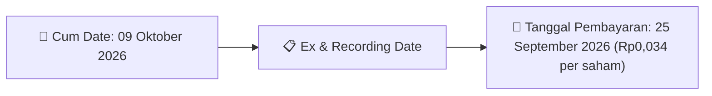
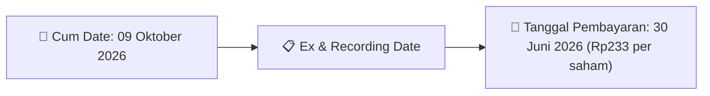

# Ikhtisar Pasar Harian (Daily Digest) - 2026-10-01

📅 **2026-10-01 (Daily Digest)**

## 1. Radar Pasar & Sentimen Harian (Executive Dashboard)
> [!NOTE]
> Terdeteksi sebanyak **313 pengumuman baru** dari 88 emiten pantauan pada (2026-10-01).

| Metric | Jumlah | Status Radar |
| :--- | :---: | :--- |
| **🟢 Sentimen Bullish / Positif** | `10` | [[Dividen Interim]], [[Mandatory Tender Offer]], Kinerja Positif |
| **⚪ Sentimen Netral / Routine** | `140` | [[Tanggapan Penjelasan Bursa]], [[RUPS]], [[Pendaftaran Unit]] |
| **🔴 Sentimen Bearish / Alert** | `4` | Sengketa Hukum, Defisit / Gugatan (Nihil hari ini) |
| **📄 [[Laporan Keuangan]] Baru** | `28` | Memicu Analisis Keuangan Otomatis |

> [!IMPORTANT]
> **Ditemukan Laporan Keuangan Baru Hari Ini:**
> - **KLIN**: FinancialStatement-2026-II-KLIN ([Buka PDF](file:///g:/My Drive/Model2/reports/raw/KLIN/20260930_KLIN_FinancialStatement-2026-II-KLIN.pdf))
- **KLIN**: FinancialStatement-2026-II-KLIN. ([Buka PDF](file:///g:/My Drive/Model2/reports/raw/KLIN/20260930_KLIN_FinancialStatement-2026-II-KLIN.xlsx))
- **DSSA**: FinancialStatement-2026-II-DSSA ([Buka PDF](file:///g:/My Drive/Model2/reports/raw/DSSA/20260930_DSSA_FinancialStatement-2026-II-DSSA.pdf))
- **DSSA**: FinancialStatement-2026-II-DSSA. ([Buka PDF](file:///g:/My Drive/Model2/reports/raw/DSSA/20260930_DSSA_FinancialStatement-2026-II-DSSA.xlsx))
- **DSSA**: FS DSSA Juni 2026 ([Buka PDF](file:///g:/My Drive/Model2/reports/raw/DSSA/20260930_DSSA_FS DSSA Juni 2026.pdf))
- **BOGA**: FinancialStatement-2026-II-BOGA ([Buka PDF](file:///g:/My Drive/Model2/reports/raw/BOGA/20260930_BOGA_FinancialStatement-2026-II-BOGA.pdf))
- **BOGA**: FinancialStatement-2026-II-BOGA. ([Buka PDF](file:///g:/My Drive/Model2/reports/raw/BOGA/20260930_BOGA_FinancialStatement-2026-II-BOGA.xlsx))
- **LAPD**: FinancialStatement-2026-II-LAPD ([Buka PDF](file:///g:/My Drive/Model2/reports/raw/LAPD/20260930_LAPD_FinancialStatement-2026-II-LAPD.pdf))
- **LAPD**: FinancialStatement-2026-II-LAPD. ([Buka PDF](file:///g:/My Drive/Model2/reports/raw/LAPD/20260930_LAPD_FinancialStatement-2026-II-LAPD.xlsx))
- **VKTR**: FinancialStatement-2026-II-VKTR ([Buka PDF](file:///g:/My Drive/Model2/reports/raw/VKTR/20260930_VKTR_FinancialStatement-2026-II-VKTR.pdf))
- **VKTR**: FinancialStatement-2026-II-VKTR. ([Buka PDF](file:///g:/My Drive/Model2/reports/raw/VKTR/20260930_VKTR_FinancialStatement-2026-II-VKTR.xlsx))
- **SMGA**: FinancialStatement-2026-II-SMGA ([Buka PDF](file:///g:/My Drive/Model2/reports/raw/SMGA/20260930_SMGA_FinancialStatement-2026-II-SMGA.pdf))
- **SMGA**: FinancialStatement-2026-II-SMGA. ([Buka PDF](file:///g:/My Drive/Model2/reports/raw/SMGA/20260930_SMGA_FinancialStatement-2026-II-SMGA.xlsx))
- **IJEE**: FinancialStatement-2026-II-IJEE ([Buka PDF](file:///g:/My Drive/Model2/reports/raw/IJEE/20260930_IJEE_FinancialStatement-2026-II-IJEE.pdf))
- **IJEE**: FinancialStatement-2026-II-IJEE. ([Buka PDF](file:///g:/My Drive/Model2/reports/raw/IJEE/20260930_IJEE_FinancialStatement-2026-II-IJEE.xlsx))
- **SMLE**: FinancialStatement-2026-II-SMLE ([Buka PDF](file:///g:/My Drive/Model2/reports/raw/SMLE/20260930_SMLE_FinancialStatement-2026-II-SMLE.pdf))
- **SMLE**: FinancialStatement-2026-II-SMLE. ([Buka PDF](file:///g:/My Drive/Model2/reports/raw/SMLE/20260930_SMLE_FinancialStatement-2026-II-SMLE.xlsx))
- **SMLE**: SMLE - Laporan Keuangan Konsolidasian 30 Jun 2026 ([Buka PDF](file:///g:/My Drive/Model2/reports/raw/SMLE/20260930_SMLE_SMLE - Laporan Keuangan Konsolidasian 30 Jun 2026.pdf))
- **SMLE**: SMLE - SPD Laporan Keuangan T2 2026 ([Buka PDF](file:///g:/My Drive/Model2/reports/raw/SMLE/20260930_SMLE_SMLE - SPD Laporan Keuangan T2 2026.pdf))
- **CANI**: FinancialStatement-2025-Tahunan-CANI ([Buka PDF](file:///g:/My Drive/Model2/reports/raw/CANI/20260930_CANI_FinancialStatement-2025-Tahunan-CANI.pdf))
- **CANI**: FinancialStatement-2025-Tahunan-CANI. ([Buka PDF](file:///g:/My Drive/Model2/reports/raw/CANI/20260930_CANI_FinancialStatement-2025-Tahunan-CANI.xlsx))
- **PPAP**: FinancialStatement-2026-II-PPAP ([Buka PDF](file:///g:/My Drive/Model2/reports/raw/PPAP/20260930_PPAP_FinancialStatement-2026-II-PPAP.pdf))
- **PPAP**: FinancialStatement-2026-II-PPAP. ([Buka PDF](file:///g:/My Drive/Model2/reports/raw/PPAP/20260930_PPAP_FinancialStatement-2026-II-PPAP.xlsx))
- **DMIG**: FinancialStatement-2026-II-DMIG ([Buka PDF](file:///g:/My Drive/Model2/reports/raw/DMIG/20260930_DMIG_FinancialStatement-2026-II-DMIG.pdf))
- **DMIG**: FinancialStatement-2026-II-DMIG. ([Buka PDF](file:///g:/My Drive/Model2/reports/raw/DMIG/20260930_DMIG_FinancialStatement-2026-II-DMIG.xlsx))
- **DMIG**: Laporan Keuangan Audited Interim 2026 ([Buka PDF](file:///g:/My Drive/Model2/reports/raw/DMIG/20260930_DMIG_Laporan Keuangan Audited Interim 2026.pdf))
- **DMIG**: Pengumuman Laporan Keuangan Koran Juni 2026 ([Buka PDF](file:///g:/My Drive/Model2/reports/raw/DMIG/20260930_DMIG_Pengumuman Laporan Keuangan Koran Juni 2026.pdf))
- **DMIG**: Surat Pengantar Laporan Keuangan Interim 2026 ([Buka PDF](file:///g:/My Drive/Model2/reports/raw/DMIG/20260930_DMIG_Surat Pengantar Laporan Keuangan Interim 2026.pdf))
> 
> *Tugas Swarm Agent:* Lakukan analisis laporan keuangan mendalam per emiten secara terpisah untuk berkas-berkas di atas.

---

## 2. Sorotan Utama & Watchlist Strategis (Strategic Watchlist)
#### 💰 Watchlist Dividen & Distribution
- **[[GEMS]]**: Nominal Dividen = Rp0,034 per saham
- **[[GEMS]]**: Total Dividen = Rp200.000.000
- **[[GEMS]]**: Cum Date = 09 Oktober 2026
- **[[GEMS]]**: Ex Date = 12 Oktober 2026
- **[[GEMS]]**: Recording Date = 08 Oktober 2026
- **[[GEMS]]**: Tanggal Pembayaran = 25 September 2026

#### 📈 Watchlist Konversi Waran & Potensi Dilusi
- **[[ISAP]]**: Jumlah Waran Dikonversi = 29 lembar
- **[[ISAP]]**: Jumlah Saham Setelah Konversi = 4,020,378,053 lembar
- **[[ISAP]]**: Sisa Waran = 29 lembar
- **[[CYBR]]**: Jumlah Waran Dikonversi = 220,000 lembar
- **[[CYBR]]**: Jumlah Saham Setelah Konversi = 13,488,395,809 lembar
- **[[CYBR]]**: Sisa Waran = 220,000 lembar

#### 👥 Watchlist Transaksi Orang Dalam & Kepemilikan Saham (Insider / Repo Moves)
- **[[APIA]]**: Tanggal dan Waktu Pelaporan = 29-09-2026 22:53
- **[[SRTG]]**: Nama Insider = EDWIN SOERYADJAYA
- **[[MRAT]]**: Nama Insider = JODI ANDREA SURYO KUSUMO
- **[[NSSS]]**: Nama Insider = SAMUEL SEKURITAS INDONESIA
- **[[NSSS]]**: Nama Insider = SAMUEL INTERNATIONAL
- **[[NSSS]]**: Nama Insider = SAMUEL INTERNATIONAL
- **[[NSSS]]**: Nama Insider = SAMUEL INTERNATIONAL
- **[[NSSS]]**: Nama Insider = SAMUEL TUMBUH BERSAMA

---

## 3. Matriks Pengumuman Pasar (Announcements Intelligence Table)
| Emiten | Sentimen | Jenis Pengumuman | Judul Pengumuman | Berkas |
| :--- | :---: | :--- | :--- | :--- |
| **[[ISAT]]** | ⚪ NEUTRAL | RUPS | Ringkasan RisalahRisalah RUPS | [Utama](file:///g:/My%20Drive/Model2/reports/raw/ISAT/20260929_ISAT_20260929_ISAT_Ringkasan RisalahRisalah RUPS_32161919.pdf) · [Lamp 1](file:///g:/My%20Drive/Model2/reports/raw/ISAT/20260929_ISAT_20260929_ISAT_Ringkasan RisalahRisalah RUPS_32161919_lamp1.pdf) |
| **[[APIA]]** | ⚪ NEUTRAL | Aksi Korporasi | Laporan Informasi dan Fakta Material | [Utama](file:///g:/My%20Drive/Model2/reports/raw/APIA/20260929_APIA_20260929_APIA_Laporan Informasi dan Fakta Material_32161935.pdf) · [Lamp 1](file:///g:/My%20Drive/Model2/reports/raw/APIA/20260929_APIA_20260929_APIA_Laporan Informasi dan Fakta Material_32161935_lamp1.pdf) |
| **[[BULL]]** | ⚪ NEUTRAL | Aksi Korporasi | ESG2025-BULL | [Utama](file:///g:/My%20Drive/Model2/reports/raw/BULL/20260930_BULL_ESG2025-BULL.pdf) |
| **[[BULL]]** | ⚪ NEUTRAL | Aksi Korporasi | AnnualReport2025-BULL-att1 | [Utama](file:///g:/My%20Drive/Model2/reports/raw/BULL/20260930_BULL_AnnualReport2025-BULL-att1.pdf) |
| **[[BULL]]** | ⚪ NEUTRAL | Aksi Korporasi | AnnualReport2025-BULL-att4 | [Utama](file:///g:/My%20Drive/Model2/reports/raw/BULL/20260930_BULL_AnnualReport2025-BULL-att4.pdf) |
| **[[BNII]]** | ⚪ NEUTRAL | Aksi Korporasi | Informasi Transaksi Afiliasi | [Utama](file:///g:/My%20Drive/Model2/reports/raw/BNII/20260930_BNII_20260930_BNII_Informasi Transaksi Afiliasi_32162102.pdf) |
| **[[ISAP]]** | ⚪ NEUTRAL | Aksi Korporasi | Pencatatan Saham Tambahan dari Konversi | [Utama](file:///g:/My%20Drive/Model2/reports/raw/ISAP/20260930_ISAP_20260930_ISAP_Pencatatan Saham Tambahan dari Konversi_32162019.pdf) |
| **[[KLIN]]** | 🟢 BULLISH | Laporan Keuangan | FinancialStatement-2026-II-KLIN | [Utama](file:///g:/My%20Drive/Model2/reports/raw/KLIN/20260930_KLIN_FinancialStatement-2026-II-KLIN.pdf) |
| **[[KLIN]]** | ⚪ NEUTRAL | Aksi Korporasi | CHECKLIST LAPORAN KEUANGAN Jun 2026 KLINK) | [Utama](file:///g:/My%20Drive/Model2/reports/raw/KLIN/20260930_KLIN_CHECKLIST_LAPORAN_KEUANGAN_Jun 2026 KLINK).pdf) |
| **[[KLIN]]** | ⚪ NEUTRAL | Laporan Keuangan | FinancialStatement-2026-II-KLIN. | [Utama](file:///g:/My%20Drive/Model2/reports/raw/KLIN/20260930_KLIN_FinancialStatement-2026-II-KLIN.xlsx) |
| **[[KLIN]]** | ⚪ NEUTRAL | Aksi Korporasi | Report Audit PT Klinko Karya Imaji per 30 Jun 26 | [Utama](file:///g:/My%20Drive/Model2/reports/raw/KLIN/20260930_KLIN_Report Audit PT Klinko Karya Imaji per 30 Jun 26.pdf) |
| **[[NISP]]** | ⚪ NEUTRAL | Aksi Korporasi | Laporan Hasil Pemeringkatan | [Utama](file:///g:/My%20Drive/Model2/reports/raw/NISP/20260930_NISP_20260930_NISP_Laporan Hasil Pemeringkatan_32162085.pdf) · [Lamp 2](file:///g:/My%20Drive/Model2/reports/raw/NISP/20260930_NISP_20260930_NISP_Laporan Hasil Pemeringkatan_32162085_lamp2.pdf) |
| **[[SRTG]]** | ⚪ NEUTRAL | Kepemilikan Saham (Insider) | LK-30092026-4641-00 | [Utama](file:///g:/My%20Drive/Model2/reports/raw/SRTG/20260930_SRTG_LK-30092026-4641-00.pdf) |
| **[[MRAT]]** | ⚪ NEUTRAL | Kepemilikan Saham (Insider) | LK-30092026-7912-00 | [Utama](file:///g:/My%20Drive/Model2/reports/raw/MRAT/20260930_MRAT_LK-30092026-7912-00.pdf) |
| **[[NSSS]]** | ⚪ NEUTRAL | Kepemilikan Saham (Insider) | LK-30092026-3475-00 | [Utama](file:///g:/My%20Drive/Model2/reports/raw/NSSS/20260930_NSSS_LK-30092026-3475-00.pdf) |
| **[[NSSS]]** | ⚪ NEUTRAL | Kepemilikan Saham (Insider) | LK-30092026-8059-00 | [Utama](file:///g:/My%20Drive/Model2/reports/raw/NSSS/20260930_NSSS_LK-30092026-8059-00.pdf) |
| **[[NSSS]]** | ⚪ NEUTRAL | Kepemilikan Saham (Insider) | LK-30092026-7379-00 | [Utama](file:///g:/My%20Drive/Model2/reports/raw/NSSS/20260930_NSSS_LK-30092026-7379-00.pdf) |
| **[[NSSS]]** | ⚪ NEUTRAL | Kepemilikan Saham (Insider) | LK-30092026-2196-00 | [Utama](file:///g:/My%20Drive/Model2/reports/raw/NSSS/20260930_NSSS_LK-30092026-2196-00.pdf) |
| **[[NSSS]]** | ⚪ NEUTRAL | Kepemilikan Saham (Insider) | LK-30092026-4006-00 | [Utama](file:///g:/My%20Drive/Model2/reports/raw/NSSS/20260930_NSSS_LK-30092026-4006-00.pdf) |
| **[[NSSS]]** | ⚪ NEUTRAL | Kepemilikan Saham (Insider) | LK-30092026-6908-00 | [Utama](file:///g:/My%20Drive/Model2/reports/raw/NSSS/20260930_NSSS_LK-30092026-6908-00.pdf) |
| **[[NSSS]]** | ⚪ NEUTRAL | Kepemilikan Saham (Insider) | LK-30092026-5824-00 | [Utama](file:///g:/My%20Drive/Model2/reports/raw/NSSS/20260930_NSSS_LK-30092026-5824-00.pdf) |
| **[[SMFP]]** | 🟢 BULLISH | Aksi Korporasi | Laporan Informasi dan Fakta Material | [Utama](file:///g:/My%20Drive/Model2/reports/raw/SMFP/20260930_SMFP_20260930_SMFP_Laporan Informasi dan Fakta Material_32162016.pdf) · [Lamp 2](file:///g:/My%20Drive/Model2/reports/raw/SMFP/20260930_SMFP_20260930_SMFP_Laporan Informasi dan Fakta Material_32162038_lamp2.pdf) · [Lamp 1](file:///g:/My%20Drive/Model2/reports/raw/SMFP/20260930_SMFP_20260930_SMFP_Laporan Informasi dan Fakta Material_32162038_lamp1.pdf) · [Lamp 1](file:///g:/My%20Drive/Model2/reports/raw/SMFP/20260930_SMFP_20260930_SMFP_Laporan Informasi dan Fakta Material_32162032_lamp1.pdf) · [Lamp 2](file:///g:/My%20Drive/Model2/reports/raw/SMFP/20260930_SMFP_20260930_SMFP_Laporan Informasi dan Fakta Material_32162032_lamp2.pdf) · [Lamp 1](file:///g:/My%20Drive/Model2/reports/raw/SMFP/20260930_SMFP_20260930_SMFP_Laporan Informasi dan Fakta Material_32162026_lamp1.pdf) · [Lamp 2](file:///g:/My%20Drive/Model2/reports/raw/SMFP/20260930_SMFP_20260930_SMFP_Laporan Informasi dan Fakta Material_32162026_lamp2.pdf) · [Lamp 1](file:///g:/My%20Drive/Model2/reports/raw/SMFP/20260930_SMFP_20260930_SMFP_Laporan Informasi dan Fakta Material_32162025_lamp1.pdf) · [Lamp 2](file:///g:/My%20Drive/Model2/reports/raw/SMFP/20260930_SMFP_20260930_SMFP_Laporan Informasi dan Fakta Material_32162025_lamp2.pdf) · [Lamp 1](file:///g:/My%20Drive/Model2/reports/raw/SMFP/20260930_SMFP_20260930_SMFP_Laporan Informasi dan Fakta Material_32162022_lamp1.pdf) · [Lamp 2](file:///g:/My%20Drive/Model2/reports/raw/SMFP/20260930_SMFP_20260930_SMFP_Laporan Informasi dan Fakta Material_32162022_lamp2.pdf) · [Lamp 1](file:///g:/My%20Drive/Model2/reports/raw/SMFP/20260930_SMFP_20260930_SMFP_Laporan Informasi dan Fakta Material_32162020_lamp1.pdf) · [Lamp 2](file:///g:/My%20Drive/Model2/reports/raw/SMFP/20260930_SMFP_20260930_SMFP_Laporan Informasi dan Fakta Material_32162020_lamp2.pdf) · [Lamp 1](file:///g:/My%20Drive/Model2/reports/raw/SMFP/20260930_SMFP_20260930_SMFP_Laporan Informasi dan Fakta Material_32162016_lamp1.pdf) · [Lamp 2](file:///g:/My%20Drive/Model2/reports/raw/SMFP/20260930_SMFP_20260930_SMFP_Laporan Informasi dan Fakta Material_32162016_lamp2.pdf) |
| **[[CYBR]]** | ⚪ NEUTRAL | Aksi Korporasi | Pencatatan Saham Tambahan dari Konversi | [Utama](file:///g:/My%20Drive/Model2/reports/raw/CYBR/20260930_CYBR_20260930_CYBR_Pencatatan Saham Tambahan dari Konversi_32162029.pdf) · [Lamp 1](file:///g:/My%20Drive/Model2/reports/raw/CYBR/20260930_CYBR_20260930_CYBR_Pencatatan Saham Tambahan dari Konversi_32162029_lamp1.pdf) |
| **[[PPRO]]** | ⚪ NEUTRAL | RUPS | Pemanggilan RUPS | [Utama](file:///g:/My%20Drive/Model2/reports/raw/PPRO/20260930_PPRO_20260930_PPRO_Pemanggilan RUPS_32161985.pdf) · [Lamp 1](file:///g:/My%20Drive/Model2/reports/raw/PPRO/20260930_PPRO_20260930_PPRO_Pemanggilan RUPS_32161985_lamp1.pdf) |
| **[[KDTN]]** | ⚪ NEUTRAL | RUPS | Pengumuman RUPS | [Utama](file:///g:/My%20Drive/Model2/reports/raw/KDTN/20260930_KDTN_20260930_KDTN_Pengumuman RUPS_32162185.pdf) |
| **[[CASH]]** | ⚪ NEUTRAL | Aksi Korporasi | Laporan Informasi dan Fakta Material | [Utama](file:///g:/My%20Drive/Model2/reports/raw/CASH/20260930_CASH_20260930_CASH_Laporan Informasi dan Fakta Material_32162219.pdf) · [Lamp 1](file:///g:/My%20Drive/Model2/reports/raw/CASH/20260930_CASH_20260930_CASH_Laporan Informasi dan Fakta Material_32162219_lamp1.pdf) · [Lamp 2](file:///g:/My%20Drive/Model2/reports/raw/CASH/20260930_CASH_20260930_CASH_Laporan Informasi dan Fakta Material_32162219_lamp2.pdf) |
| **[[PPLN]]** | ⚪ NEUTRAL | Aksi Korporasi | Pengumuman Jatuh Tempo Obligasi dan Sukuk | [Utama](file:///g:/My%20Drive/Model2/reports/raw/PPLN/20260930_PPLN_20260930_PPLN_Pengumuman Jatuh Tempo Obligasi dan Sukuk_32161958.pdf) · [Lamp 1](file:///g:/My%20Drive/Model2/reports/raw/PPLN/20260930_PPLN_20260930_PPLN_Pengumuman Jatuh Tempo Obligasi dan Sukuk_32161958_lamp1.pdf) · [Lamp 2](file:///g:/My%20Drive/Model2/reports/raw/PPLN/20260930_PPLN_20260930_PPLN_Pengumuman Jatuh Tempo Obligasi dan Sukuk_32161958_lamp2.pdf) |
| **[[PACK]]** | ⚪ NEUTRAL | Aksi Korporasi | Pencatatan Saham Tambahan dari Konversi | [Utama](file:///g:/My%20Drive/Model2/reports/raw/PACK/20260930_PACK_20260930_PACK_Pencatatan Saham Tambahan dari Konversi_32162034.pdf) |
| **[[PJHB]]** | ⚪ NEUTRAL | Aksi Korporasi | Pencatatan Saham Tambahan dari Konversi | [Utama](file:///g:/My%20Drive/Model2/reports/raw/PJHB/20260930_PJHB_20260930_PJHB_Pencatatan Saham Tambahan dari Konversi_32162073.pdf) |
| **[[MANG]]** | ⚪ NEUTRAL | Aksi Korporasi | Pencatatan Saham Tambahan dari Konversi | [Utama](file:///g:/My%20Drive/Model2/reports/raw/MANG/20260930_MANG_20260930_MANG_Pencatatan Saham Tambahan dari Konversi_32161978.pdf) · [Lamp 1](file:///g:/My%20Drive/Model2/reports/raw/MANG/20260930_MANG_20260930_MANG_Pencatatan Saham Tambahan dari Konversi_32161978_lamp1.pdf) |
| **[[DSSA]]** | ⚪ NEUTRAL | Laporan Keuangan | FinancialStatement-2026-II-DSSA | [Utama](file:///g:/My%20Drive/Model2/reports/raw/DSSA/20260930_DSSA_FinancialStatement-2026-II-DSSA.pdf) |
| **[[DSSA]]** | ⚪ NEUTRAL | Laporan Keuangan | FinancialStatement-2026-II-DSSA. | [Utama](file:///g:/My%20Drive/Model2/reports/raw/DSSA/20260930_DSSA_FinancialStatement-2026-II-DSSA.xlsx) |
| **[[DSSA]]** | ⚪ NEUTRAL | Laporan Keuangan | FS DSSA Juni 2026 | [Utama](file:///g:/My%20Drive/Model2/reports/raw/DSSA/20260930_DSSA_FS DSSA Juni 2026.pdf) |
| **[[DSSA]]** | ⚪ NEUTRAL | Aksi Korporasi | SPD DSS Juni 2026 | [Utama](file:///g:/My%20Drive/Model2/reports/raw/DSSA/20260930_DSSA_SPD DSS Juni 2026.pdf) |
| **[[DSSA]]** | ⚪ NEUTRAL | Aksi Korporasi | Surat Kenaikan 20 Persen | [Utama](file:///g:/My%20Drive/Model2/reports/raw/DSSA/20260930_DSSA_Surat Kenaikan 20 Persen.pdf) |
| **[[NICK]]** | ⚪ NEUTRAL | Aksi Korporasi | Tanggapan atas Permintaan Penjelasan Bursa | [Utama](file:///g:/My%20Drive/Model2/reports/raw/NICK/20260930_NICK_20260930_NICK_Tanggapan atas Permintaan Penjelasan Bursa_32162080.pdf) · [Lamp 1](file:///g:/My%20Drive/Model2/reports/raw/NICK/20260930_NICK_20260930_NICK_Tanggapan atas Permintaan Penjelasan Bursa_32162080_lamp1.pdf) |
| **[[TOWR]]** | 🟢 BULLISH | Buyback | Laporan Informasi dan Fakta Material | [Utama](file:///g:/My%20Drive/Model2/reports/raw/TOWR/20260930_TOWR_20260930_TOWR_Laporan Informasi dan Fakta Material_32161976.pdf) · [Lamp 2](file:///g:/My%20Drive/Model2/reports/raw/TOWR/20260930_TOWR_20260930_TOWR_Laporan Informasi dan Fakta Material_32161976_lamp2.pdf) · [Lamp 3](file:///g:/My%20Drive/Model2/reports/raw/TOWR/20260930_TOWR_20260930_TOWR_Laporan Informasi dan Fakta Material_32161976_lamp3.pdf) |
| **[[PYFA]]** | ⚪ NEUTRAL | Aksi Korporasi | Pencatatan Saham Tambahan dari Konversi | [Utama](file:///g:/My%20Drive/Model2/reports/raw/PYFA/20260930_PYFA_20260930_PYFA_Pencatatan Saham Tambahan dari Konversi_32162030.pdf) |
| **[[SMSM]]** | 🟢 BULLISH | Aksi Korporasi | Laporan Informasi dan Fakta Material | [Utama](file:///g:/My%20Drive/Model2/reports/raw/SMSM/20260930_SMSM_20260930_SMSM_Laporan Informasi dan Fakta Material_32162172.pdf) |
| **[[BIKE]]** | ⚪ NEUTRAL | Aksi Korporasi | Pengumuman Bursa | [Utama](file:///g:/My%20Drive/Model2/reports/raw/BIKE/20260930_BIKE_20260930_BIKE_Pengumuman Bursa_32162271.pdf) · [Lamp 1](file:///g:/My%20Drive/Model2/reports/raw/BIKE/20260930_BIKE_20260930_BIKE_Pengumuman Bursa_32162271_lamp1.pdf) |
| **[[MIRA]]** | ⚪ NEUTRAL | Aksi Korporasi | Tanggapan atas Permintaan Penjelasan Bursa | [Utama](file:///g:/My%20Drive/Model2/reports/raw/MIRA/20260930_MIRA_20260930_MIRA_Tanggapan atas Permintaan Penjelasan Bursa_32161984.pdf) · [Lamp 2](file:///g:/My%20Drive/Model2/reports/raw/MIRA/20260930_MIRA_20260930_MIRA_Tanggapan atas Permintaan Penjelasan Bursa_32161984_lamp2.pdf) |
| **[[ADCP]]** | 🔴 BEARISH | Aksi Korporasi | Laporan Informasi dan Fakta Material | [Utama](file:///g:/My%20Drive/Model2/reports/raw/ADCP/20260930_ADCP_20260930_ADCP_Laporan Informasi dan Fakta Material_32162178.pdf) · [Lamp 1](file:///g:/My%20Drive/Model2/reports/raw/ADCP/20260930_ADCP_20260930_ADCP_Laporan Informasi dan Fakta Material_32162178_lamp1.pdf) |
| **[[PNBS]]** | ⚪ NEUTRAL | Aksi Korporasi | Tanggapan atas Permintaan Penjelasan Bursa | [Utama](file:///g:/My%20Drive/Model2/reports/raw/PNBS/20260930_PNBS_20260930_PNBS_Tanggapan atas Permintaan Penjelasan Bursa_32162017.pdf) |
| **[[ADES]]** | ⚪ NEUTRAL | Aksi Korporasi | Tanggapan atas Permintaan Penjelasan Bursa | [Utama](file:///g:/My%20Drive/Model2/reports/raw/ADES/20260930_ADES_20260930_ADES_Tanggapan atas Permintaan Penjelasan Bursa_32161986.pdf) |
| **[[MITI]]** | ⚪ NEUTRAL | Aksi Korporasi | Laporan Informasi dan Fakta Material | [Utama](file:///g:/My%20Drive/Model2/reports/raw/MITI/20260930_MITI_20260929_MITI_Laporan Informasi dan Fakta Material_32161819.pdf) |
| **[[EDGE]]** | ⚪ NEUTRAL | Aksi Korporasi | Informasi Transaksi Afiliasi | [Utama](file:///g:/My%20Drive/Model2/reports/raw/EDGE/20260930_EDGE_20260930_EDGE_Informasi Transaksi Afiliasi_32161961.pdf) · [Lamp 1](file:///g:/My%20Drive/Model2/reports/raw/EDGE/20260930_EDGE_20260930_EDGE_Informasi Transaksi Afiliasi_32161961_lamp1.pdf) |
| **[[BBRM]]** | ⚪ NEUTRAL | Aksi Korporasi | Laporan Informasi dan Fakta Material | [Utama](file:///g:/My%20Drive/Model2/reports/raw/BBRM/20260930_BBRM_20260930_BBRM_Laporan Informasi dan Fakta Material_32162044.pdf) · [Lamp 2](file:///g:/My%20Drive/Model2/reports/raw/BBRM/20260930_BBRM_20260930_BBRM_Laporan Informasi dan Fakta Material_32162044_lamp2.pdf) · [Lamp 1](file:///g:/My%20Drive/Model2/reports/raw/BBRM/20260930_BBRM_20260930_BBRM_Laporan Informasi dan Fakta Material_32162044_lamp1.pdf) |
| **[[LPKR]]** | ⚪ NEUTRAL | Aksi Korporasi | Tanggapan atas Permintaan Penjelasan Bursa | [Utama](file:///g:/My%20Drive/Model2/reports/raw/LPKR/20260930_LPKR_20260929_LPKR_Tanggapan atas Permintaan Penjelasan Bursa_32161871.pdf) · [Lamp 1](file:///g:/My%20Drive/Model2/reports/raw/LPKR/20260930_LPKR_20260929_LPKR_Tanggapan atas Permintaan Penjelasan Bursa_32161871_lamp1.pdf) |
| **[[SRSN]]** | ⚪ NEUTRAL | Aksi Korporasi | Laporan Informasi dan Fakta Material | [Utama](file:///g:/My%20Drive/Model2/reports/raw/SRSN/20260930_SRSN_20260929_SRSN_Laporan Informasi dan Fakta Material_32161600.pdf) · [Lamp 1](file:///g:/My%20Drive/Model2/reports/raw/SRSN/20260930_SRSN_20260929_SRSN_Laporan Informasi dan Fakta Material_32161600_lamp1.pdf) |
| **[[DPNS]]** | ⚪ NEUTRAL | Aksi Korporasi | Laporan Informasi dan Fakta Material | [Utama](file:///g:/My%20Drive/Model2/reports/raw/DPNS/20260930_DPNS_20260930_DPNS_Laporan Informasi dan Fakta Material_32162299.pdf) · [Lamp 2](file:///g:/My%20Drive/Model2/reports/raw/DPNS/20260930_DPNS_20260930_DPNS_Laporan Informasi dan Fakta Material_32162299_lamp2.pdf) · [Lamp 1](file:///g:/My%20Drive/Model2/reports/raw/DPNS/20260930_DPNS_20260930_DPNS_Laporan Informasi dan Fakta Material_32162299_lamp1.pdf) |
| **[[CMNT]]** | ⚪ NEUTRAL | Aksi Korporasi | Laporan Bulanan Aktivitas Eksplorasi | [Utama](file:///g:/My%20Drive/Model2/reports/raw/CMNT/20260930_CMNT_20260930_CMNT_Laporan Bulanan Aktivitas Eksplorasi_32162037.pdf) |
| **[[BVIC]]** | ⚪ NEUTRAL | Aksi Korporasi | Pembayaran KuponBagi HasilIjarahPokok | [Utama](file:///g:/My%20Drive/Model2/reports/raw/BVIC/20260930_BVIC_20260930_BVIC_Pembayaran KuponBagi HasilIjarahPokok_32162040.pdf) |
| **[[KETR]]** | ⚪ NEUTRAL | Kepemilikan Saham (Insider) | LK-30092026-0726-00 | [Utama](file:///g:/My%20Drive/Model2/reports/raw/KETR/20260930_KETR_LK-30092026-0726-00.pdf) |
| **[[BOGA]]** | ⚪ NEUTRAL | Laporan Keuangan | FinancialStatement-2026-II-BOGA | [Utama](file:///g:/My%20Drive/Model2/reports/raw/BOGA/20260930_BOGA_FinancialStatement-2026-II-BOGA.pdf) |
| **[[BOGA]]** | ⚪ NEUTRAL | Aksi Korporasi | BOGA 30 Juni 2026- audited | [Utama](file:///g:/My%20Drive/Model2/reports/raw/BOGA/20260930_BOGA_BOGA 30 Juni 2026- audited.pdf) |
| **[[BOGA]]** | ⚪ NEUTRAL | Aksi Korporasi | Checklist Laporan Keu OJK BOGA  30 Juni 2026 | [Utama](file:///g:/My%20Drive/Model2/reports/raw/BOGA/20260930_BOGA_Checklist Laporan Keu OJK BOGA  30 Juni 2026.pdf) |
| **[[BOGA]]** | ⚪ NEUTRAL | Laporan Keuangan | FinancialStatement-2026-II-BOGA. | [Utama](file:///g:/My%20Drive/Model2/reports/raw/BOGA/20260930_BOGA_FinancialStatement-2026-II-BOGA.xlsx) |
| **[[BOGA]]** | ⚪ NEUTRAL | Aksi Korporasi | Penjelasan perubahan aset liabilitas boga | [Utama](file:///g:/My%20Drive/Model2/reports/raw/BOGA/20260930_BOGA_Penjelasan perubahan aset liabilitas boga.pdf) |
| **[[MTFN]]** | ⚪ NEUTRAL | RUPS | Pengumuman RUPS | [Utama](file:///g:/My%20Drive/Model2/reports/raw/MTFN/20260930_MTFN_20260929_MTFN_Pengumuman RUPS_32161603.pdf) · [Lamp 1](file:///g:/My%20Drive/Model2/reports/raw/MTFN/20260930_MTFN_20260929_MTFN_Pengumuman RUPS_32161603_lamp1.pdf) |
| **[[IPCC]]** | ⚪ NEUTRAL | Aksi Korporasi | Laporan Informasi dan Fakta Material | [Utama](file:///g:/My%20Drive/Model2/reports/raw/IPCC/20260930_IPCC_20260930_IPCC_Laporan Informasi dan Fakta Material_32162041.pdf) · [Lamp 1](file:///g:/My%20Drive/Model2/reports/raw/IPCC/20260930_IPCC_20260930_IPCC_Laporan Informasi dan Fakta Material_32162041_lamp1.pdf) |
| **[[GEMS]]** | 🟢 BULLISH | Dividen | Jadwal Aksi Korporasi (Khusus Penyampaian Dividen Interim) | [Utama](file:///g:/My%20Drive/Model2/reports/raw/GEMS/20260930_GEMS_20260930_GEMS_Jadwal Aksi Korporasi (Khusus Penyampaian Dividen Interim)_32162142.pdf) · [Lamp 2](file:///g:/My%20Drive/Model2/reports/raw/GEMS/20260930_GEMS_20260930_GEMS_Jadwal Aksi Korporasi (Khusus Penyampaian Dividen Interim)_32162142_lamp2.pdf) · [Lamp 1](file:///g:/My%20Drive/Model2/reports/raw/GEMS/20260930_GEMS_20260930_GEMS_Jadwal Aksi Korporasi (Khusus Penyampaian Dividen Interim)_32162142_lamp1.pdf) |
| **[[GEMA]]** | ⚪ NEUTRAL | Aksi Korporasi | Laporan Informasi dan Fakta Material | [Utama](file:///g:/My%20Drive/Model2/reports/raw/GEMA/20260930_GEMA_20260930_GEMA_Laporan Informasi dan Fakta Material_32161982.pdf) |
| **[[UNTR]]** | 🟢 BULLISH | Buyback | Laporan Informasi dan Fakta Material | [Utama](file:///g:/My%20Drive/Model2/reports/raw/UNTR/20260930_UNTR_20260930_UNTR_Laporan Informasi dan Fakta Material_32162234.pdf) |
| **[[LAPD]]** | ⚪ NEUTRAL | Laporan Keuangan | FinancialStatement-2026-II-LAPD | [Utama](file:///g:/My%20Drive/Model2/reports/raw/LAPD/20260930_LAPD_FinancialStatement-2026-II-LAPD.pdf) |
| **[[LAPD]]** | ⚪ NEUTRAL | Laporan Keuangan | FinancialStatement-2026-II-LAPD. | [Utama](file:///g:/My%20Drive/Model2/reports/raw/LAPD/20260930_LAPD_FinancialStatement-2026-II-LAPD.xlsx) |
| **[[LAPD]]** | ⚪ NEUTRAL | Aksi Korporasi | LK PT LAPD Juni 2026 | [Utama](file:///g:/My%20Drive/Model2/reports/raw/LAPD/20260930_LAPD_LK_PT LAPD_Juni 2026.pdf) |
| **[[LAPD]]** | ⚪ NEUTRAL | Aksi Korporasi | Surat Penjelasan Perubahan Aset | [Utama](file:///g:/My%20Drive/Model2/reports/raw/LAPD/20260930_LAPD_Surat Penjelasan Perubahan Aset.pdf) |
| **[[KBAG]]** | ⚪ NEUTRAL | RUPS | Ringkasan RisalahRisalah RUPS | [Utama](file:///g:/My%20Drive/Model2/reports/raw/KBAG/20260930_KBAG_20260930_KBAG_Ringkasan RisalahRisalah RUPS_32162055.pdf) |
| **[[MSJA]]** | ⚪ NEUTRAL | Aksi Korporasi | Pengumuman Bursa | [Utama](file:///g:/My%20Drive/Model2/reports/raw/MSJA/20260930_MSJA_20260929_MSJA_Pengumuman Bursa_32161906.pdf) · [Lamp 1](file:///g:/My%20Drive/Model2/reports/raw/MSJA/20260930_MSJA_20260929_MSJA_Pengumuman Bursa_32161906_lamp1.pdf) |
| **[[BAJA]]** | ⚪ NEUTRAL | Aksi Korporasi | Pencatatan Efek Bersifat Ekuitas dan Pra Pencatatan Saham | [Utama](file:///g:/My%20Drive/Model2/reports/raw/BAJA/20260930_BAJA_20260930_BAJA_Pencatatan Efek Bersifat Ekuitas dan Pra Pencatatan Saham_32161967.pdf) |
| **[[FORU]]** | ⚪ NEUTRAL | Aksi Korporasi | Pencatatan Saham Tambahan dari Konversi | [Utama](file:///g:/My%20Drive/Model2/reports/raw/FORU/20260930_FORU_20260930_FORU_Pencatatan Saham Tambahan dari Konversi_32162018.pdf) |
| **[[JPFA]]** | ⚪ NEUTRAL | Aksi Korporasi | Laporan Informasi dan Fakta Material | [Utama](file:///g:/My%20Drive/Model2/reports/raw/JPFA/20260930_JPFA_20260930_JPFA_Laporan Informasi dan Fakta Material_32162131.pdf) · [Lamp 1](file:///g:/My%20Drive/Model2/reports/raw/JPFA/20260930_JPFA_20260930_JPFA_Laporan Informasi dan Fakta Material_32162131_lamp1.pdf) |
| **[[BRIS]]** | ⚪ NEUTRAL | Aksi Korporasi | Keterbukaan Informasi terkait Aksi Korporasi | [Utama](file:///g:/My%20Drive/Model2/reports/raw/BRIS/20260930_BRIS_20260930_BRIS_Keterbukaan Informasi terkait Aksi Korporasi_32162265.pdf) · [Lamp 1](file:///g:/My%20Drive/Model2/reports/raw/BRIS/20260930_BRIS_20260930_BRIS_Keterbukaan Informasi terkait Aksi Korporasi_32162265_lamp1.pdf) · [Lamp 2](file:///g:/My%20Drive/Model2/reports/raw/BRIS/20260930_BRIS_20260930_BRIS_Keterbukaan Informasi terkait Aksi Korporasi_32162265_lamp2.pdf) |
| **[[BRIS]]** | ⚪ NEUTRAL | Aksi Korporasi | Laporan Informasi dan Fakta Material | [Utama](file:///g:/My%20Drive/Model2/reports/raw/BRIS/20260930_BRIS_20260930_BRIS_Laporan Informasi dan Fakta Material_32161955.pdf) |
| **[[BRIS]]** | ⚪ NEUTRAL | RUPS | Pengumuman RUPS | [Utama](file:///g:/My%20Drive/Model2/reports/raw/BRIS/20260930_BRIS_20260930_BRIS_Pengumuman RUPS_32161948.pdf) · [Lamp 1](file:///g:/My%20Drive/Model2/reports/raw/BRIS/20260930_BRIS_20260930_BRIS_Pengumuman RUPS_32161948_lamp1.pdf) · [Lamp 2](file:///g:/My%20Drive/Model2/reports/raw/BRIS/20260930_BRIS_20260930_BRIS_Pengumuman RUPS_32161948_lamp2.pdf) |
| **[[PEGE]]** | ⚪ NEUTRAL | Kepemilikan Saham (Insider) | LK-30092026-3534-00 | [Utama](file:///g:/My%20Drive/Model2/reports/raw/PEGE/20260930_PEGE_LK-30092026-3534-00.pdf) |
| **[[BBTN]]** | ⚪ NEUTRAL | Aksi Korporasi | Penyampaian ProspektusInformasi Tambahan | [Utama](file:///g:/My%20Drive/Model2/reports/raw/BBTN/20260930_BBTN_20260930_BBTN_Penyampaian ProspektusInformasi Tambahan_32161939.pdf) · [Lamp 2](file:///g:/My%20Drive/Model2/reports/raw/BBTN/20260930_BBTN_20260930_BBTN_Penyampaian ProspektusInformasi Tambahan_32161939_lamp2.pdf) |
| **[[BACH]]** | ⚪ NEUTRAL | Kepemilikan Saham (Insider) | LK-30092026-9281-00 | [Utama](file:///g:/My%20Drive/Model2/reports/raw/BACH/20260930_BACH_LK-30092026-9281-00.pdf) |
| **[[NELY]]** | ⚪ NEUTRAL | Aksi Korporasi | Laporan Informasi dan Fakta Material | [Utama](file:///g:/My%20Drive/Model2/reports/raw/NELY/20260930_NELY_20260930_NELY_Laporan Informasi dan Fakta Material_32162147.pdf) |
| **[[INPS]]** | ⚪ NEUTRAL | RUPS | Pengumuman RUPS | [Utama](file:///g:/My%20Drive/Model2/reports/raw/INPS/20260930_INPS_20260930_INPS_Pengumuman RUPS_32162138.pdf) |
| **[[TAXI]]** | ⚪ NEUTRAL | Aksi Korporasi | Tanggapan atas Permintaan Penjelasan Bursa | [Utama](file:///g:/My%20Drive/Model2/reports/raw/TAXI/20260930_TAXI_20260930_TAXI_Tanggapan atas Permintaan Penjelasan Bursa_32162152.pdf) · [Lamp 1](file:///g:/My%20Drive/Model2/reports/raw/TAXI/20260930_TAXI_20260930_TAXI_Tanggapan atas Permintaan Penjelasan Bursa_32162152_lamp1.pdf) |
| **[[BELI]]** | ⚪ NEUTRAL | Public Expose | Public Expose | [Utama](file:///g:/My%20Drive/Model2/reports/raw/BELI/20260930_BELI_20260928_BELI_Public Expose_32161410.pdf) · [Lamp 1](file:///g:/My%20Drive/Model2/reports/raw/BELI/20260930_BELI_20260928_BELI_Public Expose_32161410_lamp1.pdf) |
| **[[RLCO]]** | ⚪ NEUTRAL | Kepemilikan Saham (Insider) | LK-30092026-8549-00 | [Utama](file:///g:/My%20Drive/Model2/reports/raw/RLCO/20260930_RLCO_LK-30092026-8549-00.pdf) |
| **[[DGIK]]** | ⚪ NEUTRAL | Kepemilikan Saham (Insider) | LK-30092026-9725-00 | [Utama](file:///g:/My%20Drive/Model2/reports/raw/DGIK/20260930_DGIK_LK-30092026-9725-00.pdf) |
| **[[VKTR]]** | ⚪ NEUTRAL | Laporan Keuangan | FinancialStatement-2026-II-VKTR | [Utama](file:///g:/My%20Drive/Model2/reports/raw/VKTR/20260930_VKTR_FinancialStatement-2026-II-VKTR.pdf) |
| **[[VKTR]]** | ⚪ NEUTRAL | Laporan Keuangan | FinancialStatement-2026-II-VKTR. | [Utama](file:///g:/My%20Drive/Model2/reports/raw/VKTR/20260930_VKTR_FinancialStatement-2026-II-VKTR.xlsx) |
| **[[VKTR]]** | ⚪ NEUTRAL | Aksi Korporasi | June 30 2026 Final Audited | [Utama](file:///g:/My%20Drive/Model2/reports/raw/VKTR/20260930_VKTR_VKTR_ June 30 2026_Final Audited.pdf) |
| **[[VKTR]]** | ⚪ NEUTRAL | Aksi Korporasi | Kenaikan 20 persen aset Q2 Audited | [Utama](file:///g:/My%20Drive/Model2/reports/raw/VKTR/20260930_VKTR_VKTR_Kenaikan 20 persen aset Q2 Audited.pdf) |
| **[[VKTR]]** | ⚪ NEUTRAL | Aksi Korporasi | OJK Checklist LK Audit Juni 2026 | [Utama](file:///g:/My%20Drive/Model2/reports/raw/VKTR/20260930_VKTR_VKTR_OJK Checklist LK Audit Juni 2026.pdf) |
| **[[VKTR]]** | ⚪ NEUTRAL | Aksi Korporasi | Pengantar LK Q2 Audited-2026 | [Utama](file:///g:/My%20Drive/Model2/reports/raw/VKTR/20260930_VKTR_VKTR_Pengantar LK Q2 Audited-2026.pdf) |
| **[[VKTR]]** | ⚪ NEUTRAL | Aksi Korporasi | SPD Audit LK Juni 2026 (Audited) | [Utama](file:///g:/My%20Drive/Model2/reports/raw/VKTR/20260930_VKTR_VKTR_SPD Audit LK Juni 2026 (Audited).pdf) |
| **[[MNCN]]** | ⚪ NEUTRAL | Aksi Korporasi | Tanggapan atas Permintaan Penjelasan Bursa | [Utama](file:///g:/My%20Drive/Model2/reports/raw/MNCN/20260930_MNCN_20260930_MNCN_Tanggapan atas Permintaan Penjelasan Bursa_32162108.pdf) |
| **[[DKFT]]** | ⚪ NEUTRAL | Aksi Korporasi | Laporan Informasi dan Fakta Material | [Utama](file:///g:/My%20Drive/Model2/reports/raw/DKFT/20260930_DKFT_20260930_DKFT_Laporan Informasi dan Fakta Material_32162043.pdf) |
| **[[SMGA]]** | ⚪ NEUTRAL | Laporan Keuangan | FinancialStatement-2026-II-SMGA | [Utama](file:///g:/My%20Drive/Model2/reports/raw/SMGA/20260930_SMGA_FinancialStatement-2026-II-SMGA.pdf) |
| **[[SMGA]]** | ⚪ NEUTRAL | Laporan Keuangan | FinancialStatement-2026-II-SMGA. | [Utama](file:///g:/My%20Drive/Model2/reports/raw/SMGA/20260930_SMGA_FinancialStatement-2026-II-SMGA.xlsx) |
| **[[SMGA]]** | ⚪ NEUTRAL | Aksi Korporasi | LK SMGA Q2 2026 Audited | [Utama](file:///g:/My%20Drive/Model2/reports/raw/SMGA/20260930_SMGA_LK SMGA Q2 2026 Audited.pdf) |
| **[[SMGA]]** | 🔴 BEARISH | Aksi Korporasi | Penjelasan Kenaikan Aset SMGA Q2 2026 | [Utama](file:///g:/My%20Drive/Model2/reports/raw/SMGA/20260930_SMGA_Penjelasan Kenaikan Aset SMGA Q2 2026.pdf) |
| **[[SMGA]]** | ⚪ NEUTRAL | Aksi Korporasi | Surat Pengantar SMGA Q2 2026 | [Utama](file:///g:/My%20Drive/Model2/reports/raw/SMGA/20260930_SMGA_Surat Pengantar SMGA Q2 2026.pdf) |
| **[[SFAN]]** | ⚪ NEUTRAL | Aksi Korporasi | Laporan Informasi dan Fakta Material | [Utama](file:///g:/My%20Drive/Model2/reports/raw/SFAN/20260930_SFAN_20260930_SFAN_Laporan Informasi dan Fakta Material_32161940.pdf) · [Lamp 6](file:///g:/My%20Drive/Model2/reports/raw/SFAN/20260930_SFAN_20260930_SFAN_Laporan Informasi dan Fakta Material_32161940_lamp6.pdf) · [Lamp 3](file:///g:/My%20Drive/Model2/reports/raw/SFAN/20260930_SFAN_20260930_SFAN_Laporan Informasi dan Fakta Material_32161940_lamp3.pdf) · [Lamp 1](file:///g:/My%20Drive/Model2/reports/raw/SFAN/20260930_SFAN_20260930_SFAN_Laporan Informasi dan Fakta Material_32161940_lamp1.pdf) · [Lamp 4](file:///g:/My%20Drive/Model2/reports/raw/SFAN/20260930_SFAN_20260930_SFAN_Laporan Informasi dan Fakta Material_32161940_lamp4.pdf) · [Lamp 2](file:///g:/My%20Drive/Model2/reports/raw/SFAN/20260930_SFAN_20260930_SFAN_Laporan Informasi dan Fakta Material_32161940_lamp2.pdf) |
| **[[ASLI]]** | ⚪ NEUTRAL | Aksi Korporasi | Tanggapan atas Permintaan Penjelasan Bursa | [Utama](file:///g:/My%20Drive/Model2/reports/raw/ASLI/20260930_ASLI_20260930_ASLI_Tanggapan atas Permintaan Penjelasan Bursa_32162285.pdf) · [Lamp 1](file:///g:/My%20Drive/Model2/reports/raw/ASLI/20260930_ASLI_20260930_ASLI_Tanggapan atas Permintaan Penjelasan Bursa_32162285_lamp1.pdf) |
| **[[INDS]]** | ⚪ NEUTRAL | Aksi Korporasi | Informasi Transaksi Afiliasi | [Utama](file:///g:/My%20Drive/Model2/reports/raw/INDS/20260930_INDS_20260929_INDS_Informasi Transaksi Afiliasi_32161565.pdf) |
| **[[WSBP]]** | ⚪ NEUTRAL | Aksi Korporasi | Laporan Hasil Pemeringkatan | [Utama](file:///g:/My%20Drive/Model2/reports/raw/WSBP/20260930_WSBP_20260930_WSBP_Laporan Hasil Pemeringkatan_32162283.pdf) · [Lamp 1](file:///g:/My%20Drive/Model2/reports/raw/WSBP/20260930_WSBP_20260930_WSBP_Laporan Hasil Pemeringkatan_32162283_lamp1.pdf) |
| **[[WSBP]]** | ⚪ NEUTRAL | Aksi Korporasi | Laporan Informasi dan Fakta Material | [Utama](file:///g:/My%20Drive/Model2/reports/raw/WSBP/20260930_WSBP_20260930_WSBP_Laporan Informasi dan Fakta Material_32162003.pdf) |
| **[[WSBP]]** | ⚪ NEUTRAL | Aksi Korporasi | Perubahan danatau Tambahan Keterbukaan Informasi terkait Aksi Korporasi | [Utama](file:///g:/My%20Drive/Model2/reports/raw/WSBP/20260930_WSBP_20260930_WSBP_Perubahan danatau Tambahan Keterbukaan Informasi terkait Aksi Korporasi_32162277.pdf) |
| **[[WSBP]]** | ⚪ NEUTRAL | RUPS | Pemanggilan RUPS | [Utama](file:///g:/My%20Drive/Model2/reports/raw/WSBP/20260930_WSBP_20260930_WSBP_Pemanggilan RUPS_32162242.pdf) |
| **[[LPPI]]** | ⚪ NEUTRAL | Aksi Korporasi | Laporan Hasil Pemeringkatan | [Utama](file:///g:/My%20Drive/Model2/reports/raw/LPPI/20260930_LPPI_20260930_LPPI_Laporan Hasil Pemeringkatan_32162072.pdf) · [Lamp 2](file:///g:/My%20Drive/Model2/reports/raw/LPPI/20260930_LPPI_20260930_LPPI_Laporan Hasil Pemeringkatan_32162072_lamp2.pdf) |
| **[[LPPI]]** | ⚪ NEUTRAL | Aksi Korporasi | Pengumuman Pencatatan Awal Obligasi dan Sukuk | [Utama](file:///g:/My%20Drive/Model2/reports/raw/LPPI/20260930_LPPI_20260930_LPPI_Pengumuman Pencatatan Awal Obligasi dan Sukuk_32162007.pdf) · [Lamp 2](file:///g:/My%20Drive/Model2/reports/raw/LPPI/20260930_LPPI_20260930_LPPI_Pengumuman Pencatatan Awal Obligasi dan Sukuk_32162007_lamp2.pdf) · [Lamp 1](file:///g:/My%20Drive/Model2/reports/raw/LPPI/20260930_LPPI_20260930_LPPI_Pengumuman Pencatatan Awal Obligasi dan Sukuk_32162007_lamp1.pdf) |
| **[[CENT]]** | ⚪ NEUTRAL | Aksi Korporasi | Laporan Informasi dan Fakta Material | [Utama](file:///g:/My%20Drive/Model2/reports/raw/CENT/20260930_CENT_20260930_CENT_Laporan Informasi dan Fakta Material_32162021.pdf) · [Lamp 1](file:///g:/My%20Drive/Model2/reports/raw/CENT/20260930_CENT_20260930_CENT_Laporan Informasi dan Fakta Material_32162021_lamp1.pdf) |
| **[[IJEE]]** | 🟢 BULLISH | Laporan Keuangan | FinancialStatement-2026-II-IJEE | [Utama](file:///g:/My%20Drive/Model2/reports/raw/IJEE/20260930_IJEE_FinancialStatement-2026-II-IJEE.pdf) |
| **[[IJEE]]** | ⚪ NEUTRAL | Aksi Korporasi | Final Report PT IJE Audit 30 Juni 2026 | [Utama](file:///g:/My%20Drive/Model2/reports/raw/IJEE/20260930_IJEE_Final Report_PT IJE_Audit 30 Juni 2026.pdf) |
| **[[IJEE]]** | ⚪ NEUTRAL | Laporan Keuangan | FinancialStatement-2026-II-IJEE. | [Utama](file:///g:/My%20Drive/Model2/reports/raw/IJEE/20260930_IJEE_FinancialStatement-2026-II-IJEE.xlsx) |
| **[[IJEE]]** | ⚪ NEUTRAL | Aksi Korporasi | Kenaikan Aset Liabilitas IJE 30 Juni 2026 | [Utama](file:///g:/My%20Drive/Model2/reports/raw/IJEE/20260930_IJEE_Kenaikan Aset Liabilitas IJE 30 Juni 2026.pdf) |
| **[[SMLE]]** | ⚪ NEUTRAL | Laporan Keuangan | FinancialStatement-2026-II-SMLE | [Utama](file:///g:/My%20Drive/Model2/reports/raw/SMLE/20260930_SMLE_FinancialStatement-2026-II-SMLE.pdf) |
| **[[SMLE]]** | ⚪ NEUTRAL | Laporan Keuangan | FinancialStatement-2026-II-SMLE. | [Utama](file:///g:/My%20Drive/Model2/reports/raw/SMLE/20260930_SMLE_FinancialStatement-2026-II-SMLE.xlsx) |
| **[[SMLE]]** | ⚪ NEUTRAL | Laporan Keuangan | SMLE - Laporan Keuangan Konsolidasian 30 Jun 2026 | [Utama](file:///g:/My%20Drive/Model2/reports/raw/SMLE/20260930_SMLE_SMLE - Laporan Keuangan Konsolidasian 30 Jun 2026.pdf) |
| **[[SMLE]]** | ⚪ NEUTRAL | Laporan Keuangan | SMLE - SPD Laporan Keuangan T2 2026 | [Utama](file:///g:/My%20Drive/Model2/reports/raw/SMLE/20260930_SMLE_SMLE - SPD Laporan Keuangan T2 2026.pdf) |
| **[[SMLE]]** | ⚪ NEUTRAL | Aksi Korporasi | SMLE - Surat Pengantar LK T2 2026 | [Utama](file:///g:/My%20Drive/Model2/reports/raw/SMLE/20260930_SMLE_SMLE - Surat Pengantar LK T2 2026.pdf) |
| **[[ROCK]]** | ⚪ NEUTRAL | Aksi Korporasi | Tanggapan atas Permintaan Penjelasan Bursa | [Utama](file:///g:/My%20Drive/Model2/reports/raw/ROCK/20260930_ROCK_20260930_ROCK_Tanggapan atas Permintaan Penjelasan Bursa_32161980.pdf) |
| **[[MORA]]** | ⚪ NEUTRAL | Aksi Korporasi | Laporan Informasi dan Fakta Material | [Utama](file:///g:/My%20Drive/Model2/reports/raw/MORA/20260930_MORA_20260930_MORA_Laporan Informasi dan Fakta Material_32162049.pdf) |
| **[[GRPM]]** | ⚪ NEUTRAL | Aksi Korporasi | Tanggapan atas Permintaan Penjelasan Bursa | [Utama](file:///g:/My%20Drive/Model2/reports/raw/GRPM/20260930_GRPM_20260930_GRPM_Tanggapan atas Permintaan Penjelasan Bursa_32162124.pdf) · [Lamp 1](file:///g:/My%20Drive/Model2/reports/raw/GRPM/20260930_GRPM_20260930_GRPM_Tanggapan atas Permintaan Penjelasan Bursa_32162124_lamp1.pdf) |
| **[[PKPK]]** | ⚪ NEUTRAL | Kepemilikan Saham (Insider) | LK-30092026-5503-00 | [Utama](file:///g:/My%20Drive/Model2/reports/raw/PKPK/20260930_PKPK_LK-30092026-5503-00.pdf) |
| **[[CANI]]** | ⚪ NEUTRAL | Laporan Keuangan | FinancialStatement-2025-Tahunan-CANI | [Utama](file:///g:/My%20Drive/Model2/reports/raw/CANI/20260930_CANI_FinancialStatement-2025-Tahunan-CANI.pdf) |
| **[[CANI]]** | ⚪ NEUTRAL | Aksi Korporasi | CANI 0626 OPINI AUDIT | [Utama](file:///g:/My%20Drive/Model2/reports/raw/CANI/20260930_CANI_CANI 0626_OPINI AUDIT.pdf) |
| **[[CANI]]** | ⚪ NEUTRAL | Aksi Korporasi | CANI 0626 SPD | [Utama](file:///g:/My%20Drive/Model2/reports/raw/CANI/20260930_CANI_CANI 0626_SPD.pdf) |
| **[[CANI]]** | ⚪ NEUTRAL | Aksi Korporasi | LKT  30 Jun 2026 (Audited) | [Utama](file:///g:/My%20Drive/Model2/reports/raw/CANI/20260930_CANI_CANI_LKT  30 Jun 2026 (Audited).pdf) |
| **[[CANI]]** | ⚪ NEUTRAL | Aksi Korporasi | Perubahan lbh dari 20 persen 30 Jun 26 | [Utama](file:///g:/My%20Drive/Model2/reports/raw/CANI/20260930_CANI_CANI_Perubahan lbh dari 20 persen_30 Jun 26.pdf) |
| **[[CANI]]** | ⚪ NEUTRAL | Aksi Korporasi | Surat Kw IV (IDX) 30 Jun 2026 | [Utama](file:///g:/My%20Drive/Model2/reports/raw/CANI/20260930_CANI_CANI_Surat Kw IV (IDX)_30 Jun 2026.pdf) |
| **[[CANI]]** | ⚪ NEUTRAL | Aksi Korporasi | Surat Kw IV (OJK) 30 Jun 2026 | [Utama](file:///g:/My%20Drive/Model2/reports/raw/CANI/20260930_CANI_CANI_Surat Kw IV (OJK)_30 Jun 2026.pdf) |
| **[[CANI]]** | ⚪ NEUTRAL | Laporan Keuangan | FinancialStatement-2025-Tahunan-CANI. | [Utama](file:///g:/My%20Drive/Model2/reports/raw/CANI/20260930_CANI_FinancialStatement-2025-Tahunan-CANI.xlsx) |
| **[[ASPI]]** | ⚪ NEUTRAL | Public Expose | Public Expose | [Utama](file:///g:/My%20Drive/Model2/reports/raw/ASPI/20260930_ASPI_20260930_ASPI_Public Expose_32162096.pdf) · [Lamp 1](file:///g:/My%20Drive/Model2/reports/raw/ASPI/20260930_ASPI_20260930_ASPI_Public Expose_32162096_lamp1.pdf) |
| **[[SEMA]]** | ⚪ NEUTRAL | Aksi Korporasi | Tanggapan atas Permintaan Penjelasan Bursa | [Utama](file:///g:/My%20Drive/Model2/reports/raw/SEMA/20260930_SEMA_20260930_SEMA_Tanggapan atas Permintaan Penjelasan Bursa_32162297.pdf) · [Lamp 1](file:///g:/My%20Drive/Model2/reports/raw/SEMA/20260930_SEMA_20260930_SEMA_Tanggapan atas Permintaan Penjelasan Bursa_32162297_lamp1.pdf) |
| **[[TRIN]]** | ⚪ NEUTRAL | Kepemilikan Saham (Insider) | LK-30092026-7983-00 | [Utama](file:///g:/My%20Drive/Model2/reports/raw/TRIN/20260930_TRIN_LK-30092026-7983-00.pdf) |
| **[[TRIN]]** | ⚪ NEUTRAL | Kepemilikan Saham (Insider) | LK-30092026-3409-00 | [Utama](file:///g:/My%20Drive/Model2/reports/raw/TRIN/20260930_TRIN_LK-30092026-3409-00.pdf) |
| **[[PPAP]]** | ⚪ NEUTRAL | Laporan Keuangan | FinancialStatement-2026-II-PPAP | [Utama](file:///g:/My%20Drive/Model2/reports/raw/PPAP/20260930_PPAP_FinancialStatement-2026-II-PPAP.pdf) |
| **[[PPAP]]** | ⚪ NEUTRAL | Laporan Keuangan | FinancialStatement-2026-II-PPAP. | [Utama](file:///g:/My%20Drive/Model2/reports/raw/PPAP/20260930_PPAP_FinancialStatement-2026-II-PPAP.xlsx) |
| **[[PPAP]]** | ⚪ NEUTRAL | Aksi Korporasi | Perusahaan Pengelola Aset (Persero) 30 Jun 2026 | [Utama](file:///g:/My%20Drive/Model2/reports/raw/PPAP/20260930_PPAP_Perusahaan Pengelola Aset (Persero) 30 Jun 2026.pdf) |
| **[[PPAP]]** | ⚪ NEUTRAL | Aksi Korporasi | S-3789.PPA.DSPKT-DU.0926 -OJK | [Utama](file:///g:/My%20Drive/Model2/reports/raw/PPAP/20260930_PPAP_S-3789.PPA.DSPKT-DU.0926 -OJK.pdf) |
| **[[PPAP]]** | ⚪ NEUTRAL | Aksi Korporasi | S-3790.PPA.DSPKT-DU.0926 -BEI | [Utama](file:///g:/My%20Drive/Model2/reports/raw/PPAP/20260930_PPAP_S-3790.PPA.DSPKT-DU.0926 -BEI.pdf) |
| **[[KBIE]]** | ⚪ NEUTRAL | Aksi Korporasi | Penetapan Periode Kontrak Futures - IDX30 - September 2026-.POP09-2026 | [Utama](file:///g:/My%20Drive/Model2/reports/raw/KBIE/20260930_KBIE_Penetapan Periode Kontrak Futures - IDX30 - September 2026-No. Peng-00182BEI.POP09-2026.pdf) |
| **[[KBIE]]** | ⚪ NEUTRAL | Aksi Korporasi | Penetapan Periode Kontrak Futures - LQ45 - September 2026-.POP09-2026 | [Utama](file:///g:/My%20Drive/Model2/reports/raw/KBIE/20260930_KBIE_Penetapan Periode Kontrak Futures - LQ45 - September 2026-No. Peng-00181BEI.POP09-2026.pdf) |
| **[[KBIA]]** | ⚪ NEUTRAL | Aksi Korporasi | Penetapan Periode Kontrak Futures - MSLCHK - September 2026-.POP09-2026 | [Utama](file:///g:/My%20Drive/Model2/reports/raw/KBIA/20260930_KBIA_Penetapan Periode Kontrak Futures - MSLCHK - September 2026-No. Peng-00179BEI.POP09-2026.pdf) |
| **[[PURE]]** | 🔴 BEARISH | Aksi Korporasi | Suspensi dan Pembukaan Suspensi | [Utama](file:///g:/My%20Drive/Model2/reports/raw/PURE/20260930_PURE_20260930_Suspensi dan Pembukaan Suspensi_32162081.pdf) · [Lamp 1](file:///g:/My%20Drive/Model2/reports/raw/PURE/20260930_PURE_20260930_Suspensi dan Pembukaan Suspensi_32162081_lamp1.pdf) |
| **[[AALI]]** | 🟢 BULLISH | Dividen | Jadwal Aksi Korporasi (Khusus Penyampaian Dividen Interim) | [Utama](file:///g:/My%20Drive/Model2/reports/raw/AALI/20260930_AALI_20260930_AALI_Jadwal Aksi Korporasi (Khusus Penyampaian Dividen Interim)_32162157.pdf) · [Lamp 2](file:///g:/My%20Drive/Model2/reports/raw/AALI/20260930_AALI_20260930_AALI_Jadwal Aksi Korporasi (Khusus Penyampaian Dividen Interim)_32162157_lamp2.pdf) · [Lamp 1](file:///g:/My%20Drive/Model2/reports/raw/AALI/20260930_AALI_20260930_AALI_Jadwal Aksi Korporasi (Khusus Penyampaian Dividen Interim)_32162157_lamp1.pdf) |
| **[[CMPP]]** | 🔴 BEARISH | Aksi Korporasi | Laporan Informasi dan Fakta Material | [Utama](file:///g:/My%20Drive/Model2/reports/raw/CMPP/20260930_CMPP_20260930_CMPP_Laporan Informasi dan Fakta Material_32162015.pdf) |
| **[[DMIG]]** | 🟢 BULLISH | Laporan Keuangan | FinancialStatement-2026-II-DMIG | [Utama](file:///g:/My%20Drive/Model2/reports/raw/DMIG/20260930_DMIG_FinancialStatement-2026-II-DMIG.pdf) |
| **[[DMIG]]** | ⚪ NEUTRAL | Laporan Keuangan | FinancialStatement-2026-II-DMIG. | [Utama](file:///g:/My%20Drive/Model2/reports/raw/DMIG/20260930_DMIG_FinancialStatement-2026-II-DMIG.xlsx) |
| **[[DMIG]]** | ⚪ NEUTRAL | Laporan Keuangan | Laporan Keuangan Audited Interim 2026 | [Utama](file:///g:/My%20Drive/Model2/reports/raw/DMIG/20260930_DMIG_Laporan Keuangan Audited Interim 2026.pdf) |
| **[[DMIG]]** | ⚪ NEUTRAL | Aksi Korporasi | MRL - Management Representation Letter Juni 2026 | [Utama](file:///g:/My%20Drive/Model2/reports/raw/DMIG/20260930_DMIG_MRL - Management Representation Letter Juni 2026.pdf) |
| **[[DMIG]]** | 🟢 BULLISH | Laporan Keuangan | Pengumuman Laporan Keuangan Koran Juni 2026 | [Utama](file:///g:/My%20Drive/Model2/reports/raw/DMIG/20260930_DMIG_Pengumuman Laporan Keuangan Koran Juni 2026.pdf) |
| **[[DMIG]]** | ⚪ NEUTRAL | Aksi Korporasi | PMPJ - Formulir Hubungan Usaha Juni 2026 | [Utama](file:///g:/My%20Drive/Model2/reports/raw/DMIG/20260930_DMIG_PMPJ - Formulir Hubungan Usaha Juni 2026.pdf) |
| **[[DMIG]]** | ⚪ NEUTRAL | Aksi Korporasi | SP2PK - Juni 2026 | [Utama](file:///g:/My%20Drive/Model2/reports/raw/DMIG/20260930_DMIG_SP2PK - Juni 2026.pdf) |
| **[[DMIG]]** | ⚪ NEUTRAL | Laporan Keuangan | Surat Pengantar Laporan Keuangan Interim 2026 | [Utama](file:///g:/My%20Drive/Model2/reports/raw/DMIG/20260930_DMIG_Surat Pengantar Laporan Keuangan Interim 2026.pdf) |
| **[[DMIG]]** | ⚪ NEUTRAL | Aksi Korporasi | Surat Pernyataan Direksi - Juni 2026 | [Utama](file:///g:/My%20Drive/Model2/reports/raw/DMIG/20260930_DMIG_Surat Pernyataan Direksi - Juni 2026.pdf) |
| **[[ESIP]]** | ⚪ NEUTRAL | Aksi Korporasi | Tanggapan atas Permintaan Penjelasan Bursa | [Utama](file:///g:/My%20Drive/Model2/reports/raw/ESIP/20260930_ESIP_20260930_ESIP_Tanggapan atas Permintaan Penjelasan Bursa_32161936.pdf) |

---

## 4. Detail Informasi per Emiten (Grouped by Emiten)
### ⭐ 4.1. Detail Emiten Pantauan (Watchlist)

#### 🔵 [[DSSA]]
- **[Laporan Keuangan]** [FinancialStatement-2026-II-DSSA](file:///g:/My%20Drive/Model2/reports/raw/DSSA/20260930_DSSA_FinancialStatement-2026-II-DSSA.pdf)
  - 📌 *Deskripsi*: Informasi dan fakta material DSSA: Perseroan dengan ini menyampaikan laporan keuangan untuk periode 6 Bulan yang berakhir pada 30/06/2026 dengan ikhtisar sebagai berikut : Informasi mengenai anak perusahaan Perseroan sebagai berikut : 164/CSDSS-09/2026 Nama Emiten Dian Swastatika Sentosa Tbk DSSA Penyampaian Laporan Keuangan Interim Auditan No Nama Kegiatan Usaha Lokasi Tahun Komersil Status Operasi Jumlah Aset Satuan Mata Uang Persentase (%) 1 PT Bungo Bara Makmur Pertambanga n Batubara Jambi 2019 YA 20.378.521 PENUH USD 51.0 2
  - 📊 **Fakta Material**:
    - **Uraian Kejadian**: Perseroan dengan ini menyampaikan laporan keuangan untuk periode 6 Bulan yang berakhir pada 30/06/2026 dengan ikhtisar sebagai berikut : Informasi mengenai anak perusahaan Perseroan sebagai berikut : 164/CSDSS-09/2026 Nama Emiten Dian Swastatika Sentosa Tbk DSSA Penyampaian Laporan Keuangan Interim Auditan No Nama Kegiatan Usaha Lokasi Tahun Komersil Status Operasi Jumlah Aset Satuan Mata Uang Persentase (%) 1 PT Bungo Bara Makmur Pertambanga n Batubara Jambi 2019 YA 20.378.521 PENUH USD 51.0 2
- **[Laporan Keuangan]** [FinancialStatement-2026-II-DSSA.](file:///g:/My%20Drive/Model2/reports/raw/DSSA/20260930_DSSA_FinancialStatement-2026-II-DSSA.xlsx)
  - 📌 *Deskripsi*: Informasi dan fakta material DSSA: [1697000_BD] Notes to the financial statements - Bank Loans by Order of Liquidity Interest Information (breakdown) - General Industry CurrentYearInstant Catatan utang bank berdasarkan tingkat likuiditas | Notes for bank loans by order of liquidity Catatan utang bank berdasarkan tingkat likuiditas [baris komponen] Utang bank berdasarkan tingkat likuiditas, nilai dalam mata uang asing | Jatuh tempo utang bank | Bunga Bank Central Asia Tbk | IDR AUD CAD CNY EUR HKD GBP JPY SGD THB
  - 📊 **Fakta Material**:
    - **Uraian Kejadian**: [1697000_BD] Notes to the financial statements - Bank Loans by Order of Liquidity Interest Information (breakdown) - General Industry CurrentYearInstant Catatan utang bank berdasarkan tingkat likuiditas | Notes for bank loans by order of liquidity Catatan utang bank berdasarkan tingkat likuiditas [baris komponen] Utang bank berdasarkan tingkat likuiditas, nilai dalam mata uang asing | Jatuh tempo utang bank | Bunga Bank Central Asia Tbk | IDR AUD CAD CNY EUR HKD GBP JPY SGD THB
- **[Laporan Keuangan]** [FS DSSA Juni 2026](file:///g:/My%20Drive/Model2/reports/raw/DSSA/20260930_DSSA_FS DSSA Juni 2026.pdf)
  - 📌 *Deskripsi*: Siaran pers kinerja keuangan & update bisnis DSSA Periode 2026.
- **[Aksi Korporasi]** [SPD DSS Juni 2026](file:///g:/My%20Drive/Model2/reports/raw/DSSA/20260930_DSSA_SPD DSS Juni 2026.pdf)
  - 📌 *Deskripsi*: Informasi dan fakta material DSSA:
- **[Aksi Korporasi]** [Surat Kenaikan 20 Persen](file:///g:/My%20Drive/Model2/reports/raw/DSSA/20260930_DSSA_Surat Kenaikan 20 Persen.pdf)
  - 📌 *Deskripsi*: Informasi dan fakta material DSSA:

---

### 📋 4.2. Detail Emiten Lain (Non-Watchlist)

#### 🔵 [[ISAT]]
- **[RUPS]** [Ringkasan RisalahRisalah RUPS](file:///g:/My%20Drive/Model2/reports/raw/ISAT/20260929_ISAT_20260929_ISAT_Ringkasan RisalahRisalah RUPS_32161919.pdf) *(Attachment: [Lamp 1](file:///g:/My%20Drive/Model2/reports/raw/ISAT/20260929_ISAT_20260929_ISAT_Ringkasan RisalahRisalah RUPS_32161919_lamp1.pdf))*
  - 📌 *Deskripsi*: Rencana Penambahan Modal HMETD (Rights Issue / PMHMETD) oleh ISAT.
  - 📊 **Fakta Material**:
    - **Jenis Aksi Korporasi**: Penambahan Modal HMETD (Rights Issue)

#### 🔵 [[APIA]]
- **[Aksi Korporasi]** [Laporan Informasi dan Fakta Material](file:///g:/My%20Drive/Model2/reports/raw/APIA/20260929_APIA_20260929_APIA_Laporan Informasi dan Fakta Material_32161935.pdf) *(Attachment: [Lamp 1](file:///g:/My%20Drive/Model2/reports/raw/APIA/20260929_APIA_20260929_APIA_Laporan Informasi dan Fakta Material_32161935_lamp1.pdf))*
  - 📌 *Deskripsi*: PT Angkasa Pura Indonesia (Persero) melaporkan perubahan bandar udara yang dikelola. Berdasarkan Keputusan Direktur Jenderal Perhubungan Udara Nomor KP-DJPU 216 Tahun 2026 dan KP-DJPU 217 Tahun 2026 tanggal 25 September 2026, Bandar Udara Dhoho di Kabupaten Kediri, Provinsi Jawa Timur, ditetapkan sebagai bandar udara yang dikelola oleh PT Surya Dhoho Investama.
  - 📊 **Fakta Material**:
    - **Nama Emiten atau Perusahaan Publik**: PT Angkasa Pura Indonesia (Persero)
    - **Bidang Usaha**: Pelayanan jasa kebandarudaraan dan pelayanan jasa terkait bandar udara
    - **Tanggal Kejadian**: 25 September 2026
    - **Jenis Informasi atau Fakta Material**: Perubahan Bandar Udara yang Dikelola oleh PT Angkasa Pura Indonesia (Persero)
    - **Dasar Keputusan 1**: Keputusan Direktur Jenderal Perhubungan Udara Nomor KP-DJPU 216 Tahun 2026 tentang Penetapan Bandar Udara yang Dikelola oleh PT Surya Dhoho Investama tanggal 25 September 2026
    - **Dasar Keputusan 2**: Keputusan Direktur Jenderal Perhubungan Udara Nomor KP-DJPU 217 Tahun 2026 tentang Perubahan Atas Keputusan Direktur Jenderal Perhubungan Udara Nomor KP 204 DJPU Tahun 2024 tentang Penetapan Bandar Udara yang Dikelola oleh PT Angkasa Pura Indonesia (Persero) tanggal 25 September 2026
    - **Bandar Udara yang Berubah Pengelolaan**: Bandar Udara Dhoho di Kabupaten Kediri, Provinsi Jawa Timur
    - **Pengelola Baru Bandar Udara Dhoho**: PT Surya Dhoho Investama
    - **Nama Pengirim**: Anak Agung Ngurah Pranajaya
    - **Jabatan Pengirim**: Corporate BOD Office Support Division Head
    - **Tanggal dan Waktu Pelaporan**: 29-09-2026 22:53

#### 🔵 [[BULL]]
- **[Aksi Korporasi]** [ESG2025-BULL](file:///g:/My%20Drive/Model2/reports/raw/BULL/20260930_BULL_ESG2025-BULL.pdf)
  - 📌 *Deskripsi*: Siaran pers kinerja keuangan & update bisnis BULL (Anak Perusahaan yang) Periode 2026.
- **[Aksi Korporasi]** [AnnualReport2025-BULL-att1](file:///g:/My%20Drive/Model2/reports/raw/BULL/20260930_BULL_AnnualReport2025-BULL-att1.pdf)
  - 📌 *Deskripsi*: Informasi dan fakta material BULL: Batasan Pelaporan Reporting Boundaries Laporan ini memberikan ringkasan tentang data dan informasi yang berkaitan dengan kapal dan aset kami, yang dikelola sesuai dengan standar Quality, Health, Safety, and Environment (QHSE) Perseroan dan Kode Manajemen Keselamatan Internasional (ISM) untuk anak perusahaan kami. Penting untuk dicatat bahwa kami membatasi data yang disertakan dalam laporan ini hanya pada kapal dan aset yang langsung dikelola oleh Perseroan, tanpa aset yang operasinya dikelola ol
  - 📊 **Fakta Material**:
    - **Uraian Kejadian**: Batasan Pelaporan Reporting Boundaries Laporan ini memberikan ringkasan tentang data dan informasi yang berkaitan dengan kapal dan aset kami, yang dikelola sesuai dengan standar Quality, Health, Safety, and Environment (QHSE) Perseroan dan Kode Manajemen Keselamatan Internasional (ISM) untuk anak perusahaan kami. Penting untuk dicatat bahwa kami membatasi data yang disertakan dalam laporan ini hanya pada kapal dan aset yang langsung dikelola oleh Perseroan, tanpa aset yang operasinya dikelola ol
- **[Aksi Korporasi]** [AnnualReport2025-BULL-att4](file:///g:/My%20Drive/Model2/reports/raw/BULL/20260930_BULL_AnnualReport2025-BULL-att4.pdf)
  - 📌 *Deskripsi*: Siaran pers kinerja keuangan & update bisnis BULL Periode 2025.

#### 🔵 [[BNII]]
- **[Aksi Korporasi]** [Informasi Transaksi Afiliasi](file:///g:/My%20Drive/Model2/reports/raw/BNII/20260930_BNII_20260930_BNII_Informasi Transaksi Afiliasi_32162102.pdf)
  - 📌 *Deskripsi*: Informasi dan fakta material BNII: S.2026.251/MBI/DIRCOMPLIANCE PT Bank Maybank Indonesia Tbk BNII 5 Transaksi Afiliasi Perseroan menyampaikan informasi tentang Transaksi Afiliasi sebagai berikut : Tanggal Transaksi Obyek Transaksi Nilai Transaksi 28 September 2026 144.000.000 Penandatangan Perjanjian Pinjam Pakai 5 (lima) Transaksi Afiliasi Penjelasan, pertimbangan, dan alasan dilakukannya Transaksi Afiliasi Nama Pihak Sifat Hubungan Afiliasi (jika ada) PT Bank Maybank Indonesia Tbk MSI dan Perseroan dikendalikan oleh pihak yang
  - 📊 **Fakta Material**:
    - **Uraian Kejadian**: S.2026.251/MBI/DIRCOMPLIANCE PT Bank Maybank Indonesia Tbk BNII 5 Transaksi Afiliasi Perseroan menyampaikan informasi tentang Transaksi Afiliasi sebagai berikut : Tanggal Transaksi Obyek Transaksi Nilai Transaksi 28 September 2026 144.000.000 Penandatangan Perjanjian Pinjam Pakai 5 (lima) Transaksi Afiliasi Penjelasan, pertimbangan, dan alasan dilakukannya Transaksi Afiliasi Nama Pihak Sifat Hubungan Afiliasi (jika ada) PT Bank Maybank Indonesia Tbk MSI dan Perseroan dikendalikan oleh pihak yang

#### 🔵 [[ISAP]]
- **[Aksi Korporasi]** [Pencatatan Saham Tambahan dari Konversi](file:///g:/My%20Drive/Model2/reports/raw/ISAP/20260930_ISAP_20260930_ISAP_Pencatatan Saham Tambahan dari Konversi_32162019.pdf)
  - 📌 *Deskripsi*: Pencatatan saham tambahan hasil konversi waran ISAP.
  - 📊 **Fakta Material**:
    - **Jumlah Waran Dikonversi**: 29 lembar
    - **Jumlah Saham Setelah Konversi**: 4,020,378,053 lembar
    - **Sisa Waran**: 29 lembar
    - **Tanggal Pencatatan**: 01 Oktober 2026

#### 🔵 [[KLIN]]
- **[Laporan Keuangan]** [FinancialStatement-2026-II-KLIN](file:///g:/My%20Drive/Model2/reports/raw/KLIN/20260930_KLIN_FinancialStatement-2026-II-KLIN.pdf)
  - 📌 *Deskripsi*: Pembagian dividen tunai KLIN.
- **[Aksi Korporasi]** [CHECKLIST LAPORAN KEUANGAN Jun 2026 KLINK)](file:///g:/My%20Drive/Model2/reports/raw/KLIN/20260930_KLIN_CHECKLIST_LAPORAN_KEUANGAN_Jun 2026 KLINK).pdf)
  - 📌 *Deskripsi*: Informasi dan fakta material KLIN:
- **[Laporan Keuangan]** [FinancialStatement-2026-II-KLIN.](file:///g:/My%20Drive/Model2/reports/raw/KLIN/20260930_KLIN_FinancialStatement-2026-II-KLIN.xlsx)
  - 📌 *Deskripsi*: Informasi dan fakta material KLIN: [1697000_BD] Notes to the financial statements - Bank Loans by Order of Liquidity Interest Information (breakdown) - General Industry CurrentYearInstant Catatan utang bank berdasarkan tingkat likuiditas | Notes for bank loans by order of liquidity Catatan utang bank berdasarkan tingkat likuiditas [baris komponen] Utang bank berdasarkan tingkat likuiditas, nilai dalam mata uang asing | Jatuh tempo utang bank | Bunga Bank Central Asia Tbk | IDR AUD CAD CNY EUR HKD GBP JPY SGD THB
  - 📊 **Fakta Material**:
    - **Uraian Kejadian**: [1697000_BD] Notes to the financial statements - Bank Loans by Order of Liquidity Interest Information (breakdown) - General Industry CurrentYearInstant Catatan utang bank berdasarkan tingkat likuiditas | Notes for bank loans by order of liquidity Catatan utang bank berdasarkan tingkat likuiditas [baris komponen] Utang bank berdasarkan tingkat likuiditas, nilai dalam mata uang asing | Jatuh tempo utang bank | Bunga Bank Central Asia Tbk | IDR AUD CAD CNY EUR HKD GBP JPY SGD THB
- **[Aksi Korporasi]** [Report Audit PT Klinko Karya Imaji per 30 Jun 26](file:///g:/My%20Drive/Model2/reports/raw/KLIN/20260930_KLIN_Report Audit PT Klinko Karya Imaji per 30 Jun 26.pdf)
  - 📌 *Deskripsi*: Siaran pers kinerja keuangan & update bisnis KLIN Periode 2026.

#### 🔵 [[NISP]]
- **[Aksi Korporasi]** [Laporan Hasil Pemeringkatan](file:///g:/My%20Drive/Model2/reports/raw/NISP/20260930_NISP_20260930_NISP_Laporan Hasil Pemeringkatan_32162085.pdf) *(Attachment: [Lamp 2](file:///g:/My%20Drive/Model2/reports/raw/NISP/20260930_NISP_20260930_NISP_Laporan Hasil Pemeringkatan_32162085_lamp2.pdf))*
  - 📌 *Deskripsi*: Informasi dan fakta material NISP: 009/IR-FINANCE/JT/OJK/IX/2026 PT Bank OCBC NISP Tbk NISP 2 Laporan Hasil Pemeringkatan Pemeringkatan Tahunan Nama Efek Jumlah Pokok Tanggal Jatuh Tempo Efek Lembaga Pemeringkat Pemeringkat Rating Outlook Periode Rating Obligasi Berkelanjutan IV OCBC Tahap I Tahun 2025 Seri B 537.930.0 00.000 03-Jul-28 FITCH RATING INDONESIA AAA STABLE 24 September 2026 24 September 2027 Obligasi Berkelanjutan IV OCBC Tahap I Tahun 2025 Seri C 213.505.0 00.000 03-Jul-30 FITCH RATING INDONESIA AAA STABLE 24 Septem
  - 📊 **Fakta Material**:
    - **Uraian Kejadian**: 009/IR-FINANCE/JT/OJK/IX/2026 PT Bank OCBC NISP Tbk NISP 2 Laporan Hasil Pemeringkatan Pemeringkatan Tahunan Nama Efek Jumlah Pokok Tanggal Jatuh Tempo Efek Lembaga Pemeringkat Pemeringkat Rating Outlook Periode Rating Obligasi Berkelanjutan IV OCBC Tahap I Tahun 2025 Seri B 537.930.0 00.000 03-Jul-28 FITCH RATING INDONESIA AAA STABLE 24 September 2026 24 September 2027 Obligasi Berkelanjutan IV OCBC Tahap I Tahun 2025 Seri C 213.505.0 00.000 03-Jul-30 FITCH RATING INDONESIA AAA STABLE 24 Septem

#### 🔵 [[SRTG]]
- **[Kepemilikan Saham (Insider)]** [LK-30092026-4641-00](file:///g:/My%20Drive/Model2/reports/raw/SRTG/20260930_SRTG_LK-30092026-4641-00.pdf)
  - 📌 *Deskripsi*: Laporan perubahan kepemilikan saham insider SRTG.
  - 📊 **Fakta Material**:
    - **Nama Insider**: EDWIN SOERYADJAYA

#### 🔵 [[MRAT]]
- **[Kepemilikan Saham (Insider)]** [LK-30092026-7912-00](file:///g:/My%20Drive/Model2/reports/raw/MRAT/20260930_MRAT_LK-30092026-7912-00.pdf)
  - 📌 *Deskripsi*: Laporan perubahan kepemilikan saham insider MRAT.
  - 📊 **Fakta Material**:
    - **Nama Insider**: JODI ANDREA SURYO KUSUMO

#### 🔵 [[NSSS]]
- **[Kepemilikan Saham (Insider)]** [LK-30092026-3475-00](file:///g:/My%20Drive/Model2/reports/raw/NSSS/20260930_NSSS_LK-30092026-3475-00.pdf)
  - 📌 *Deskripsi*: Laporan perubahan kepemilikan saham insider NSSS.
  - 📊 **Fakta Material**:
    - **Nama Insider**: SAMUEL SEKURITAS INDONESIA
- **[Kepemilikan Saham (Insider)]** [LK-30092026-8059-00](file:///g:/My%20Drive/Model2/reports/raw/NSSS/20260930_NSSS_LK-30092026-8059-00.pdf)
  - 📌 *Deskripsi*: Laporan perubahan kepemilikan saham insider NSSS.
  - 📊 **Fakta Material**:
    - **Nama Insider**: SAMUEL INTERNATIONAL
- **[Kepemilikan Saham (Insider)]** [LK-30092026-7379-00](file:///g:/My%20Drive/Model2/reports/raw/NSSS/20260930_NSSS_LK-30092026-7379-00.pdf)
  - 📌 *Deskripsi*: Laporan perubahan kepemilikan saham insider NSSS.
  - 📊 **Fakta Material**:
    - **Nama Insider**: SAMUEL INTERNATIONAL
- **[Kepemilikan Saham (Insider)]** [LK-30092026-2196-00](file:///g:/My%20Drive/Model2/reports/raw/NSSS/20260930_NSSS_LK-30092026-2196-00.pdf)
  - 📌 *Deskripsi*: Laporan perubahan kepemilikan saham insider NSSS.
  - 📊 **Fakta Material**:
    - **Nama Insider**: SAMUEL INTERNATIONAL
- **[Kepemilikan Saham (Insider)]** [LK-30092026-4006-00](file:///g:/My%20Drive/Model2/reports/raw/NSSS/20260930_NSSS_LK-30092026-4006-00.pdf)
  - 📌 *Deskripsi*: Laporan perubahan kepemilikan saham insider NSSS.
  - 📊 **Fakta Material**:
    - **Nama Insider**: SAMUEL TUMBUH BERSAMA
- **[Kepemilikan Saham (Insider)]** [LK-30092026-6908-00](file:///g:/My%20Drive/Model2/reports/raw/NSSS/20260930_NSSS_LK-30092026-6908-00.pdf)
  - 📌 *Deskripsi*: Laporan perubahan kepemilikan saham insider NSSS.
  - 📊 **Fakta Material**:
    - **Nama Insider**: SAMUEL TUMBUH BERSAMA
- **[Kepemilikan Saham (Insider)]** [LK-30092026-5824-00](file:///g:/My%20Drive/Model2/reports/raw/NSSS/20260930_NSSS_LK-30092026-5824-00.pdf)
  - 📌 *Deskripsi*: Laporan perubahan kepemilikan saham insider NSSS.
  - 📊 **Fakta Material**:
    - **Nama Insider**: SAMUEL INTERNATIONAL

#### 🔵 [[SMFP]]
- **[Aksi Korporasi]** [Laporan Informasi dan Fakta Material](file:///g:/My%20Drive/Model2/reports/raw/SMFP/20260930_SMFP_20260930_SMFP_Laporan Informasi dan Fakta Material_32162016.pdf) *(Attachment: [Lamp 2](file:///g:/My%20Drive/Model2/reports/raw/SMFP/20260930_SMFP_20260930_SMFP_Laporan Informasi dan Fakta Material_32162038_lamp2.pdf) · [Lamp 1](file:///g:/My%20Drive/Model2/reports/raw/SMFP/20260930_SMFP_20260930_SMFP_Laporan Informasi dan Fakta Material_32162038_lamp1.pdf) · [Lamp 1](file:///g:/My%20Drive/Model2/reports/raw/SMFP/20260930_SMFP_20260930_SMFP_Laporan Informasi dan Fakta Material_32162032_lamp1.pdf) · [Lamp 2](file:///g:/My%20Drive/Model2/reports/raw/SMFP/20260930_SMFP_20260930_SMFP_Laporan Informasi dan Fakta Material_32162032_lamp2.pdf) · [Lamp 1](file:///g:/My%20Drive/Model2/reports/raw/SMFP/20260930_SMFP_20260930_SMFP_Laporan Informasi dan Fakta Material_32162026_lamp1.pdf) · [Lamp 2](file:///g:/My%20Drive/Model2/reports/raw/SMFP/20260930_SMFP_20260930_SMFP_Laporan Informasi dan Fakta Material_32162026_lamp2.pdf) · [Lamp 1](file:///g:/My%20Drive/Model2/reports/raw/SMFP/20260930_SMFP_20260930_SMFP_Laporan Informasi dan Fakta Material_32162025_lamp1.pdf) · [Lamp 2](file:///g:/My%20Drive/Model2/reports/raw/SMFP/20260930_SMFP_20260930_SMFP_Laporan Informasi dan Fakta Material_32162025_lamp2.pdf) · [Lamp 1](file:///g:/My%20Drive/Model2/reports/raw/SMFP/20260930_SMFP_20260930_SMFP_Laporan Informasi dan Fakta Material_32162022_lamp1.pdf) · [Lamp 2](file:///g:/My%20Drive/Model2/reports/raw/SMFP/20260930_SMFP_20260930_SMFP_Laporan Informasi dan Fakta Material_32162022_lamp2.pdf) · [Lamp 1](file:///g:/My%20Drive/Model2/reports/raw/SMFP/20260930_SMFP_20260930_SMFP_Laporan Informasi dan Fakta Material_32162020_lamp1.pdf) · [Lamp 2](file:///g:/My%20Drive/Model2/reports/raw/SMFP/20260930_SMFP_20260930_SMFP_Laporan Informasi dan Fakta Material_32162020_lamp2.pdf) · [Lamp 1](file:///g:/My%20Drive/Model2/reports/raw/SMFP/20260930_SMFP_20260930_SMFP_Laporan Informasi dan Fakta Material_32162016_lamp1.pdf) · [Lamp 2](file:///g:/My%20Drive/Model2/reports/raw/SMFP/20260930_SMFP_20260930_SMFP_Laporan Informasi dan Fakta Material_32162016_lamp2.pdf))*
  - 📌 *Deskripsi*: Pembagian dividen tunai SMFP.
  - 📊 **Fakta Material**:
    - **Cum Date**: 30 Juni 2026
    - **Ex Date**: 30 Juni 2026
    - **Recording Date**: 19 November 2014
    - **Tanggal Pembayaran**: 30 Juni 2026

#### 🔵 [[CYBR]]
- **[Aksi Korporasi]** [Pencatatan Saham Tambahan dari Konversi](file:///g:/My%20Drive/Model2/reports/raw/CYBR/20260930_CYBR_20260930_CYBR_Pencatatan Saham Tambahan dari Konversi_32162029.pdf) *(Attachment: [Lamp 1](file:///g:/My%20Drive/Model2/reports/raw/CYBR/20260930_CYBR_20260930_CYBR_Pencatatan Saham Tambahan dari Konversi_32162029_lamp1.pdf))*
  - 📌 *Deskripsi*: Pencatatan saham tambahan hasil konversi waran CYBR.
  - 📊 **Fakta Material**:
    - **Jumlah Waran Dikonversi**: 220,000 lembar
    - **Jumlah Saham Setelah Konversi**: 13,488,395,809 lembar
    - **Sisa Waran**: 220,000 lembar
    - **Tanggal Pencatatan**: 01 Oktober 2026

#### 🔵 [[PPRO]]
- **[RUPS]** [Pemanggilan RUPS](file:///g:/My%20Drive/Model2/reports/raw/PPRO/20260930_PPRO_20260930_PPRO_Pemanggilan RUPS_32161985.pdf) *(Attachment: [Lamp 1](file:///g:/My%20Drive/Model2/reports/raw/PPRO/20260930_PPRO_20260930_PPRO_Pemanggilan RUPS_32161985_lamp1.pdf))*
  - 📌 *Deskripsi*: Informasi dan fakta material PPRO: 557/EXT/DIR/PPRO/2026 PT PP Properti Tbk. PPRO 1 Pemanggilan Rapat Umum Pemegang Saham Luar Biasa Merujuk pada surat Perseroan Nomor 489/EXT/DIR/PPRO/2026 , Tanggal 15 September 2026, Perseroan menyampaikan pemberitahuan penyelenggaraan Rapat Umum Pemegang Saham pada Pemanggilan Rencana RUPS Lokasi Penyelenggaraan RUPS (bila sudah dapat diumumkan dan sesuai iklan) : Hari/Tanggal/Waktu : Waktu : 22 Oktober 2026 14:00 Plaza PP - Auditorium Wisma Subiyanto Pasar Rebo, Jakarta Timur 13760 Tanggal Da
  - 📊 **Fakta Material**:
    - **Uraian Kejadian**: 557/EXT/DIR/PPRO/2026 PT PP Properti Tbk. PPRO 1 Pemanggilan Rapat Umum Pemegang Saham Luar Biasa Merujuk pada surat Perseroan Nomor 489/EXT/DIR/PPRO/2026 , Tanggal 15 September 2026, Perseroan menyampaikan pemberitahuan penyelenggaraan Rapat Umum Pemegang Saham pada Pemanggilan Rencana RUPS Lokasi Penyelenggaraan RUPS (bila sudah dapat diumumkan dan sesuai iklan) : Hari/Tanggal/Waktu : Waktu : 22 Oktober 2026 14:00 Plaza PP - Auditorium Wisma Subiyanto Pasar Rebo, Jakarta Timur 13760 Tanggal Da

#### 🔵 [[KDTN]]
- **[RUPS]** [Pengumuman RUPS](file:///g:/My%20Drive/Model2/reports/raw/KDTN/20260930_KDTN_20260930_KDTN_Pengumuman RUPS_32162185.pdf)
  - 📌 *Deskripsi*: Informasi dan fakta material KDTN: 119/PSP-CORSEC/LO/IX/2026 PT Puri Sentul Permai Tbk KDTN 1 Pemberitahuan Rencana Rapat Umum Pemegang Saham Luar Biasa Pengumuman Rencana RUPS Merujuk pada surat : 118/PSP-CORSEC/LO/IX/2026 Perseroan menyampaikan permberitahuan penyelenggaraan Rapat Umum Pemegang Saham pada : Lokasi Penyelenggaraan RUPS (bila sudah dapat diumumkan dan sesuai iklan) : Tanggal Daftar Pemegang Saham (DPS) yang berhak hadir dalam RUPS PT Puri Sentul Permai Tbk 14 Oktober 2026 : Hari/Tanggal/Waktu : Jumat, 06 November
  - 📊 **Fakta Material**:
    - **Uraian Kejadian**: 119/PSP-CORSEC/LO/IX/2026 PT Puri Sentul Permai Tbk KDTN 1 Pemberitahuan Rencana Rapat Umum Pemegang Saham Luar Biasa Pengumuman Rencana RUPS Merujuk pada surat : 118/PSP-CORSEC/LO/IX/2026 Perseroan menyampaikan permberitahuan penyelenggaraan Rapat Umum Pemegang Saham pada : Lokasi Penyelenggaraan RUPS (bila sudah dapat diumumkan dan sesuai iklan) : Tanggal Daftar Pemegang Saham (DPS) yang berhak hadir dalam RUPS PT Puri Sentul Permai Tbk 14 Oktober 2026 : Hari/Tanggal/Waktu : Jumat, 06 November

#### 🔵 [[CASH]]
- **[Aksi Korporasi]** [Laporan Informasi dan Fakta Material](file:///g:/My%20Drive/Model2/reports/raw/CASH/20260930_CASH_20260930_CASH_Laporan Informasi dan Fakta Material_32162219.pdf) *(Attachment: [Lamp 1](file:///g:/My%20Drive/Model2/reports/raw/CASH/20260930_CASH_20260930_CASH_Laporan Informasi dan Fakta Material_32162219_lamp1.pdf) · [Lamp 2](file:///g:/My%20Drive/Model2/reports/raw/CASH/20260930_CASH_20260930_CASH_Laporan Informasi dan Fakta Material_32162219_lamp2.pdf))*
  - 📌 *Deskripsi*: Informasi dan fakta material CASH: PT CASHLEZ WORLDWIDE INDONESIA TBK DAN ENTITAS ANAK/AND ITS SUBSIDIARY Laporan Keuangan Konsolidasi Interim pada tanggal 31 Agustus 2026 dan 31 Desember 2025 dan untuk periode-periode delapan bulan yang berakhir pada tanggal 31 Agustus 2026 dan 2025 Interim Consolidated Financial Statements as of August 31, 2026 and December 31, 2025 And for the eight-month periods ended as of August 31, 2026 and 2025 2 | P a g e DAFTAR ISI TABLE OF CONTENTS Halaman/ Pages SURAT PERNYATAAN DIREKSI DIRECTOR’S STA
  - 📊 **Fakta Material**:
    - **Uraian Kejadian**: PT CASHLEZ WORLDWIDE INDONESIA TBK DAN ENTITAS ANAK/AND ITS SUBSIDIARY Laporan Keuangan Konsolidasi Interim pada tanggal 31 Agustus 2026 dan 31 Desember 2025 dan untuk periode-periode delapan bulan yang berakhir pada tanggal 31 Agustus 2026 dan 2025 Interim Consolidated Financial Statements as of August 31, 2026 and December 31, 2025 And for the eight-month periods ended as of August 31, 2026 and 2025 2 | P a g e DAFTAR ISI TABLE OF CONTENTS Halaman/ Pages SURAT PERNYATAAN DIREKSI DIRECTOR’S STA

#### 🔵 [[PPLN]]
- **[Aksi Korporasi]** [Pengumuman Jatuh Tempo Obligasi dan Sukuk](file:///g:/My%20Drive/Model2/reports/raw/PPLN/20260930_PPLN_20260930_PPLN_Pengumuman Jatuh Tempo Obligasi dan Sukuk_32161958.pdf) *(Attachment: [Lamp 1](file:///g:/My%20Drive/Model2/reports/raw/PPLN/20260930_PPLN_20260930_PPLN_Pengumuman Jatuh Tempo Obligasi dan Sukuk_32161958_lamp1.pdf) · [Lamp 2](file:///g:/My%20Drive/Model2/reports/raw/PPLN/20260930_PPLN_20260930_PPLN_Pengumuman Jatuh Tempo Obligasi dan Sukuk_32161958_lamp2.pdf))*
  - 📌 *Deskripsi*: Informasi dan fakta material PPLN: Nomor : 46245/MRK.01.04/F01000100/2026 2 September 2026 : 1 Set Sifat : Segera - Terbatas : Konfirmasi Kesiapan Dana Pembayaran Kewajiban atas Obligasi dan Sukuk Ijarah PLN Kepada Yth. Direksi PT Bursa Efek Indonesia Tower 1 Lt.6 Merujuk pada Surat Keputusan Direksi PT Bursa Efek Indonesia No. Kep 00066/BEI/09- 2022 Perubahan Peraturan Nomor I-E tentang Kewajiban Penyampaian Informasi yang berlaku efektif sejak 1 Oktober 2022, dengan ini kami sampaikan bahwa PT PLN (Persero) telah menyiapkan dan
  - 📊 **Fakta Material**:
    - **Uraian Kejadian**: Nomor : 46245/MRK.01.04/F01000100/2026 2 September 2026 : 1 Set Sifat : Segera - Terbatas : Konfirmasi Kesiapan Dana Pembayaran Kewajiban atas Obligasi dan Sukuk Ijarah PLN Kepada Yth. Direksi PT Bursa Efek Indonesia Tower 1 Lt.6 Merujuk pada Surat Keputusan Direksi PT Bursa Efek Indonesia No. Kep 00066/BEI/09- 2022 Perubahan Peraturan Nomor I-E tentang Kewajiban Penyampaian Informasi yang berlaku efektif sejak 1 Oktober 2022, dengan ini kami sampaikan bahwa PT PLN (Persero) telah menyiapkan dan

#### 🔵 [[PACK]]
- **[Aksi Korporasi]** [Pencatatan Saham Tambahan dari Konversi](file:///g:/My%20Drive/Model2/reports/raw/PACK/20260930_PACK_20260930_PACK_Pencatatan Saham Tambahan dari Konversi_32162034.pdf)
  - 📌 *Deskripsi*: Informasi dan fakta material PACK: PT Abadi Nusantara Hijau Investama Tbk (PACK) PENGUMUMAN BURSA Pencatatan Saham Papan Pencatatan Akselerasi Dengan ini Bursa mengumumkan sebagai berikut: Obligasi Wajib Konversi Sisa Obligasi Wajib Konversi 01 Oktober 2026 Jumlah Saham Setelah Pencatatan Saham Hasil Pelaksanaan Obligasi Wajib Konversi 34.118.287.071 66.051.273 Tanggal Pencatatan Penambahan Saham 55.080 PT. Bursa Efek Indonesia Martin Satria D. Bako P.H. Kadiv POP PT Bursa Efek Indonesia PH Kepala Divisi PP1 Aditya Nugraha 1. Srt
  - 📊 **Fakta Material**:
    - **Uraian Kejadian**: PT Abadi Nusantara Hijau Investama Tbk (PACK) PENGUMUMAN BURSA Pencatatan Saham Papan Pencatatan Akselerasi Dengan ini Bursa mengumumkan sebagai berikut: Obligasi Wajib Konversi Sisa Obligasi Wajib Konversi 01 Oktober 2026 Jumlah Saham Setelah Pencatatan Saham Hasil Pelaksanaan Obligasi Wajib Konversi 34.118.287.071 66.051.273 Tanggal Pencatatan Penambahan Saham 55.080 PT. Bursa Efek Indonesia Martin Satria D. Bako P.H. Kadiv POP PT Bursa Efek Indonesia PH Kepala Divisi PP1 Aditya Nugraha 1. Srt

#### 🔵 [[PJHB]]
- **[Aksi Korporasi]** [Pencatatan Saham Tambahan dari Konversi](file:///g:/My%20Drive/Model2/reports/raw/PJHB/20260930_PJHB_20260930_PJHB_Pencatatan Saham Tambahan dari Konversi_32162073.pdf)
  - 📌 *Deskripsi*: Pencatatan saham tambahan hasil konversi waran PJHB.
  - 📊 **Fakta Material**:
    - **Jumlah Waran Dikonversi**: 2,306 lembar
    - **Jumlah Saham Setelah Konversi**: 1,921,084,707 lembar
    - **Sisa Waran**: 2,306 lembar
    - **Tanggal Pencatatan**: 01 Oktober 2026

#### 🔵 [[MANG]]
- **[Aksi Korporasi]** [Pencatatan Saham Tambahan dari Konversi](file:///g:/My%20Drive/Model2/reports/raw/MANG/20260930_MANG_20260930_MANG_Pencatatan Saham Tambahan dari Konversi_32161978.pdf) *(Attachment: [Lamp 1](file:///g:/My%20Drive/Model2/reports/raw/MANG/20260930_MANG_20260930_MANG_Pencatatan Saham Tambahan dari Konversi_32161978_lamp1.pdf))*
  - 📌 *Deskripsi*: Pencatatan saham tambahan hasil konversi waran MANG.
  - 📊 **Fakta Material**:
    - **Jumlah Waran Dikonversi**: 1,302 lembar
    - **Jumlah Saham Setelah Konversi**: 3,812,607,484 lembar
    - **Sisa Waran**: 1,302 lembar
    - **Tanggal Pencatatan**: 01 Oktober 2026

#### 🔵 [[NICK]]
- **[Aksi Korporasi]** [Tanggapan atas Permintaan Penjelasan Bursa](file:///g:/My%20Drive/Model2/reports/raw/NICK/20260930_NICK_20260930_NICK_Tanggapan atas Permintaan Penjelasan Bursa_32162080.pdf) *(Attachment: [Lamp 1](file:///g:/My%20Drive/Model2/reports/raw/NICK/20260930_NICK_20260930_NICK_Tanggapan atas Permintaan Penjelasan Bursa_32162080_lamp1.pdf))*
  - 📌 *Deskripsi*: Tanggapan Penjelasan Bursa NICK [FAKTA MATERIAL DITEMUKAN]
  - 📊 **Fakta Material**:
    - **Pernyataan Emiten**: Perseroan melihat peluang pengembangan bisnis ke arah green business sejalan dengan · Perseroan menggunakan modal sendiri (kas internal) untuk meng-akuisisi PT Okansa Pacific.

#### 🔵 [[TOWR]]
- **[Buyback]** [Laporan Informasi dan Fakta Material](file:///g:/My%20Drive/Model2/reports/raw/TOWR/20260930_TOWR_20260930_TOWR_Laporan Informasi dan Fakta Material_32161976.pdf) *(Attachment: [Lamp 2](file:///g:/My%20Drive/Model2/reports/raw/TOWR/20260930_TOWR_20260930_TOWR_Laporan Informasi dan Fakta Material_32161976_lamp2.pdf) · [Lamp 3](file:///g:/My%20Drive/Model2/reports/raw/TOWR/20260930_TOWR_20260930_TOWR_Laporan Informasi dan Fakta Material_32161976_lamp3.pdf))*
  - 📌 *Deskripsi*: Informasi dan fakta material TOWR: Unofficial Translation 1 DISCLOSURE OF INFORMATION TO SHAREHOLDERS IN CONNECTION WITH THE PROPOSED SHARE BUYBACK BY THE COMPANY UNDER SIGNIFICANTLY FLUCTUATING MARKET CONDITIONS (“DISCLOSURE OF INFORMATION”) This Disclosure of Information is made and intended to comply with the Financial Services Authority (Otoritas Jasa Keuangan/“OJK”) Regulation No. 13 of 2023, OJK Regulation No. 29 of 2023, and OJK Letter No. S-112/D.04/2026 dated 9 September 2026 concerning Implementation Policies for Buybac
  - 📊 **Fakta Material**:
    - **Uraian Kejadian**: Unofficial Translation 1 DISCLOSURE OF INFORMATION TO SHAREHOLDERS IN CONNECTION WITH THE PROPOSED SHARE BUYBACK BY THE COMPANY UNDER SIGNIFICANTLY FLUCTUATING MARKET CONDITIONS (“DISCLOSURE OF INFORMATION”) This Disclosure of Information is made and intended to comply with the Financial Services Authority (Otoritas Jasa Keuangan/“OJK”) Regulation No. 13 of 2023, OJK Regulation No. 29 of 2023, and OJK Letter No. S-112/D.04/2026 dated 9 September 2026 concerning Implementation Policies for Buybac

#### 🔵 [[PYFA]]
- **[Aksi Korporasi]** [Pencatatan Saham Tambahan dari Konversi](file:///g:/My%20Drive/Model2/reports/raw/PYFA/20260930_PYFA_20260930_PYFA_Pencatatan Saham Tambahan dari Konversi_32162030.pdf)
  - 📌 *Deskripsi*: Pencatatan saham tambahan hasil konversi waran PYFA.
  - 📊 **Fakta Material**:
    - **Jumlah Waran Dikonversi**: 6 lembar
    - **Jumlah Saham Setelah Konversi**: 11,236,751,458 lembar
    - **Sisa Waran**: 6 lembar
    - **Tanggal Pencatatan**: 01 Oktober 2026

#### 🔵 [[SMSM]]
- **[Aksi Korporasi]** [Laporan Informasi dan Fakta Material](file:///g:/My%20Drive/Model2/reports/raw/SMSM/20260930_SMSM_20260930_SMSM_Laporan Informasi dan Fakta Material_32162172.pdf)
  - 📌 *Deskripsi*: Pembagian dividen tunai SMSM.

#### 🔵 [[BIKE]]
- **[Aksi Korporasi]** [Pengumuman Bursa](file:///g:/My%20Drive/Model2/reports/raw/BIKE/20260930_BIKE_20260930_BIKE_Pengumuman Bursa_32162271.pdf) *(Attachment: [Lamp 1](file:///g:/My%20Drive/Model2/reports/raw/BIKE/20260930_BIKE_20260930_BIKE_Pengumuman Bursa_32162271_lamp1.pdf))*
  - 📌 *Deskripsi*: Laporan perubahan kepemilikan saham insider BIKE.

#### 🔵 [[MIRA]]
- **[Aksi Korporasi]** [Tanggapan atas Permintaan Penjelasan Bursa](file:///g:/My%20Drive/Model2/reports/raw/MIRA/20260930_MIRA_20260930_MIRA_Tanggapan atas Permintaan Penjelasan Bursa_32161984.pdf) *(Attachment: [Lamp 2](file:///g:/My%20Drive/Model2/reports/raw/MIRA/20260930_MIRA_20260930_MIRA_Tanggapan atas Permintaan Penjelasan Bursa_32161984_lamp2.pdf))*
  - 📌 *Deskripsi*: Tanggapan Penjelasan Bursa MIRA [FAKTA MATERIAL DITEMUKAN]
  - 📊 **Fakta Material**:
    - **Pernyataan Emiten**: Perseroan yang belum diungkapkan kepada public

#### 🔵 [[ADCP]]
- **[Aksi Korporasi]** [Laporan Informasi dan Fakta Material](file:///g:/My%20Drive/Model2/reports/raw/ADCP/20260930_ADCP_20260930_ADCP_Laporan Informasi dan Fakta Material_32162178.pdf) *(Attachment: [Lamp 1](file:///g:/My%20Drive/Model2/reports/raw/ADCP/20260930_ADCP_20260930_ADCP_Laporan Informasi dan Fakta Material_32162178_lamp1.pdf))*
  - 📌 *Deskripsi*: Informasi dan fakta material ADCP: 458/ADCP-IX/2026 PT Adhi Commuter Properti Tbk ADCP 1 Penyampaian Perkembangan Realisasi Rencana Pemulihan Kondisi atau Penyebab Suspensi PT Adhi Commuter Properti Tbk Dengan ini kami untuk dan atas menyampaikan Laporan Informasi atau Fakta Material sebagai berikut: Nama Emiten atau Perusahaan Publik PT Adhi Commuter Properti Tbk Bidang Usaha Perhotelan dan Real Estate Telepon (021) 228 229 80 Faksimili (021) 228 220 81 Alamat Surat Elektronik (email) corsec@adcp.co.id Tanggal Kejadian 30 Septem
  - 📊 **Fakta Material**:
    - **Uraian Kejadian**: 458/ADCP-IX/2026 PT Adhi Commuter Properti Tbk ADCP 1 Penyampaian Perkembangan Realisasi Rencana Pemulihan Kondisi atau Penyebab Suspensi PT Adhi Commuter Properti Tbk Dengan ini kami untuk dan atas menyampaikan Laporan Informasi atau Fakta Material sebagai berikut: Nama Emiten atau Perusahaan Publik PT Adhi Commuter Properti Tbk Bidang Usaha Perhotelan dan Real Estate Telepon (021) 228 229 80 Faksimili (021) 228 220 81 Alamat Surat Elektronik (email) corsec@adcp.co.id Tanggal Kejadian 30 Septem

#### 🔵 [[PNBS]]
- **[Aksi Korporasi]** [Tanggapan atas Permintaan Penjelasan Bursa](file:///g:/My%20Drive/Model2/reports/raw/PNBS/20260930_PNBS_20260930_PNBS_Tanggapan atas Permintaan Penjelasan Bursa_32162017.pdf)
  - 📌 *Deskripsi*: Tanggapan Penjelasan Bursa PNBS [FAKTA MATERIAL DITEMUKAN]
  - 📊 **Fakta Material**:
    - **Pernyataan Emiten**: pemegang saham utama dalam menjawab konfirmasi tersebut. · Perseroan tidak menerima info dari Pengendali dan/atau pemegang saham utama Perseroan terkait

#### 🔵 [[ADES]]
- **[Aksi Korporasi]** [Tanggapan atas Permintaan Penjelasan Bursa](file:///g:/My%20Drive/Model2/reports/raw/ADES/20260930_ADES_20260930_ADES_Tanggapan atas Permintaan Penjelasan Bursa_32161986.pdf)
  - 📌 *Deskripsi*: Tanggapan Penjelasan Bursa ADES [FAKTA MATERIAL DITEMUKAN]
  - 📊 **Fakta Material**:
    - **Pernyataan Emiten**: Perseroan senantiasa melakukan evaluasi dan mempertimbangkan berbagai alternatif rencana dan/atau · Perseroan maupun kelangsungan hidup Perseroan. Perseroan senantiasa berkomitmen untuk memenuhi

#### 🔵 [[MITI]]
- **[Aksi Korporasi]** [Laporan Informasi dan Fakta Material](file:///g:/My%20Drive/Model2/reports/raw/MITI/20260930_MITI_20260929_MITI_Laporan Informasi dan Fakta Material_32161819.pdf)
  - 📌 *Deskripsi*: Informasi dan fakta material MITI: 099/DIR-MI/IX/2026 Mitra Investindo Tbk MITI 1 Keterbukaan Informasi sehubungan dengan Penandatangan Memorandum of Understanding (MOU) antara PT Mitra Investindo Tbk dan PT CNEC Engineering Indonesia Dengan ini kami untuk dan atas menyampaikan Laporan Informasi atau Fakta Material sebagai berikut: Nama Emiten atau Perusahaan Publik Mitra Investindo Tbk Bidang Usaha Jasa Pelayaran dan Total Logistik Telepon (021) 29079558 Faksimili (021) 29079559 Alamat Surat Elektronik (email) corsec@mitra-inves
  - 📊 **Fakta Material**:
    - **Uraian Kejadian**: 099/DIR-MI/IX/2026 Mitra Investindo Tbk MITI 1 Keterbukaan Informasi sehubungan dengan Penandatangan Memorandum of Understanding (MOU) antara PT Mitra Investindo Tbk dan PT CNEC Engineering Indonesia Dengan ini kami untuk dan atas menyampaikan Laporan Informasi atau Fakta Material sebagai berikut: Nama Emiten atau Perusahaan Publik Mitra Investindo Tbk Bidang Usaha Jasa Pelayaran dan Total Logistik Telepon (021) 29079558 Faksimili (021) 29079559 Alamat Surat Elektronik (email) corsec@mitra-inves

#### 🔵 [[EDGE]]
- **[Aksi Korporasi]** [Informasi Transaksi Afiliasi](file:///g:/My%20Drive/Model2/reports/raw/EDGE/20260930_EDGE_20260930_EDGE_Informasi Transaksi Afiliasi_32161961.pdf) *(Attachment: [Lamp 1](file:///g:/My%20Drive/Model2/reports/raw/EDGE/20260930_EDGE_20260930_EDGE_Informasi Transaksi Afiliasi_32161961_lamp1.pdf))*
  - 📌 *Deskripsi*: Informasi dan fakta material EDGE: 057/Indonet-Corsec/Srt/IX/2026 PT Indointernet Tbk. EDGE 1 Transaksi Afiliasi Perseroan menyampaikan informasi tentang Transaksi Afiliasi sebagai berikut : Tanggal Transaksi Obyek Transaksi Nilai Transaksi 29 September 2026 5.000.000.000 Peningkatan Modal Transaksi Afiliasi Penjelasan, pertimbangan, dan alasan dilakukannya Transaksi Afiliasi Nama Pihak Sifat Hubungan Afiliasi (jika ada) PT Indointernet Tbk Perseroan PT Ekagrata Data Gemilang Perusahaan Terkendali PT Digital Gayana Ekakarsa Perus
  - 📊 **Fakta Material**:
    - **Uraian Kejadian**: 057/Indonet-Corsec/Srt/IX/2026 PT Indointernet Tbk. EDGE 1 Transaksi Afiliasi Perseroan menyampaikan informasi tentang Transaksi Afiliasi sebagai berikut : Tanggal Transaksi Obyek Transaksi Nilai Transaksi 29 September 2026 5.000.000.000 Peningkatan Modal Transaksi Afiliasi Penjelasan, pertimbangan, dan alasan dilakukannya Transaksi Afiliasi Nama Pihak Sifat Hubungan Afiliasi (jika ada) PT Indointernet Tbk Perseroan PT Ekagrata Data Gemilang Perusahaan Terkendali PT Digital Gayana Ekakarsa Perus

#### 🔵 [[BBRM]]
- **[Aksi Korporasi]** [Laporan Informasi dan Fakta Material](file:///g:/My%20Drive/Model2/reports/raw/BBRM/20260930_BBRM_20260930_BBRM_Laporan Informasi dan Fakta Material_32162044.pdf) *(Attachment: [Lamp 2](file:///g:/My%20Drive/Model2/reports/raw/BBRM/20260930_BBRM_20260930_BBRM_Laporan Informasi dan Fakta Material_32162044_lamp2.pdf) · [Lamp 1](file:///g:/My%20Drive/Model2/reports/raw/BBRM/20260930_BBRM_20260930_BBRM_Laporan Informasi dan Fakta Material_32162044_lamp1.pdf))*
  - 📌 *Deskripsi*: Informasi dan fakta material BBRM: Jakarta, 30 September 2026 No. 020/CORPSEC/BBR-JKT/IX/26 OTORITAS JASA KEUANGAN Jakarta 10170, Indonesia Up. Kepala Eksekutif Pengawas Pasar Modal PT BURSA EFEK INDONESIA Up. Direktur Penilaian dan Pencatatan Perusahaan Regarding : Second Submission of Disclosure of Information / Material Facts regarding the Transaction for the Purchase of 1 (One) Anchor Handling Tug Supply (AHTS) Vessel With Respect, We hereby submit the 2nd (Second) Material Fact in relation to the transaction for the purchase
  - 📊 **Fakta Material**:
    - **Uraian Kejadian**: Jakarta, 30 September 2026 No. 020/CORPSEC/BBR-JKT/IX/26 OTORITAS JASA KEUANGAN Jakarta 10170, Indonesia Up. Kepala Eksekutif Pengawas Pasar Modal PT BURSA EFEK INDONESIA Up. Direktur Penilaian dan Pencatatan Perusahaan Regarding : Second Submission of Disclosure of Information / Material Facts regarding the Transaction for the Purchase of 1 (One) Anchor Handling Tug Supply (AHTS) Vessel With Respect, We hereby submit the 2nd (Second) Material Fact in relation to the transaction for the purchase

#### 🔵 [[LPKR]]
- **[Aksi Korporasi]** [Tanggapan atas Permintaan Penjelasan Bursa](file:///g:/My%20Drive/Model2/reports/raw/LPKR/20260930_LPKR_20260929_LPKR_Tanggapan atas Permintaan Penjelasan Bursa_32161871.pdf) *(Attachment: [Lamp 1](file:///g:/My%20Drive/Model2/reports/raw/LPKR/20260930_LPKR_20260929_LPKR_Tanggapan atas Permintaan Penjelasan Bursa_32161871_lamp1.pdf))*
  - 📌 *Deskripsi*: Tanggapan Penjelasan Bursa LPKR [FAKTA MATERIAL DITEMUKAN]
  - 📊 **Fakta Material**:
    - **Pernyataan Emiten**: Perseroan tidak memiliki saham, pengendalian maupun hubungan afiliasi sebagaimana · tidak memiliki informasi terkait status hukum sebagaimana dimaksud.

#### 🔵 [[SRSN]]
- **[Aksi Korporasi]** [Laporan Informasi dan Fakta Material](file:///g:/My%20Drive/Model2/reports/raw/SRSN/20260930_SRSN_20260929_SRSN_Laporan Informasi dan Fakta Material_32161600.pdf) *(Attachment: [Lamp 1](file:///g:/My%20Drive/Model2/reports/raw/SRSN/20260930_SRSN_20260929_SRSN_Laporan Informasi dan Fakta Material_32161600_lamp1.pdf))*
  - 📌 *Deskripsi*: Informasi dan fakta material SRSN: Jakarta, 30 September 2026/ September 30, 2026 No. : SEC/LTR/26/IX/1355 /Attachment : - / Re : Laporan Informasi atau Fakta Material/ Report on Material Information of Facts Kepada/To:. (i) Otoritas Jasa Keuangan Jakarta 10710 u.p./attn. : Kepala Eksekutif Pengawas Pasar Modal, Keuangan Derivatif, dan Bursa Karbon/ Chief Executive of the Supervisory of Capital Markets, Financial Derivatives, and Carbon Exchange (ii) PT Bursa Efek Indonesia Jakarta 12190 u.p./attn. : Direktur Penilaian Perusahaan
  - 📊 **Fakta Material**:
    - **Uraian Kejadian**: Jakarta, 30 September 2026/ September 30, 2026 No. : SEC/LTR/26/IX/1355 /Attachment : - / Re : Laporan Informasi atau Fakta Material/ Report on Material Information of Facts Kepada/To:. (i) Otoritas Jasa Keuangan Jakarta 10710 u.p./attn. : Kepala Eksekutif Pengawas Pasar Modal, Keuangan Derivatif, dan Bursa Karbon/ Chief Executive of the Supervisory of Capital Markets, Financial Derivatives, and Carbon Exchange (ii) PT Bursa Efek Indonesia Jakarta 12190 u.p./attn. : Direktur Penilaian Perusahaan
    - **Dampak Kejadian**: Cahya Gumilang

#### 🔵 [[DPNS]]
- **[Aksi Korporasi]** [Laporan Informasi dan Fakta Material](file:///g:/My%20Drive/Model2/reports/raw/DPNS/20260930_DPNS_20260930_DPNS_Laporan Informasi dan Fakta Material_32162299.pdf) *(Attachment: [Lamp 2](file:///g:/My%20Drive/Model2/reports/raw/DPNS/20260930_DPNS_20260930_DPNS_Laporan Informasi dan Fakta Material_32162299_lamp2.pdf) · [Lamp 1](file:///g:/My%20Drive/Model2/reports/raw/DPNS/20260930_DPNS_20260930_DPNS_Laporan Informasi dan Fakta Material_32162299_lamp1.pdf))*
  - 📌 *Deskripsi*: Informasi dan fakta material DPNS: SURAT PEMBERITAHUAN Nomor : 072/DPN/PTK/IX/2026 : Pemberitahuan Putusan Pengadilan Negeri Pontianak Nomor 258/Pdt.G/2025/PN Ptk Kepada Yth. 1. Direksi PT Bursa Efek Indonesia UP. Ibu Lidia M Panjaitan – Kepala Divisi Penilaian Perusahaan 3 Jakarta 12190 2. Kepala Eksekutif Pengawas Pasar Modal, Keuangan Derivatif dan Bursa Karbon Otoritas Jasa Keuangan Up. Direktur Pengawasan Emiten dan Perusahaan Publik Jakarta 10350 Dengan hormat, Sehubungan dengan ketentuan peraturan perundang-undangan di bid
  - 📊 **Fakta Material**:
    - **Uraian Kejadian**: SURAT PEMBERITAHUAN Nomor : 072/DPN/PTK/IX/2026 : Pemberitahuan Putusan Pengadilan Negeri Pontianak Nomor 258/Pdt.G/2025/PN Ptk Kepada Yth. 1. Direksi PT Bursa Efek Indonesia UP. Ibu Lidia M Panjaitan – Kepala Divisi Penilaian Perusahaan 3 Jakarta 12190 2. Kepala Eksekutif Pengawas Pasar Modal, Keuangan Derivatif dan Bursa Karbon Otoritas Jasa Keuangan Up. Direktur Pengawasan Emiten dan Perusahaan Publik Jakarta 10350 Dengan hormat, Sehubungan dengan ketentuan peraturan perundang-undangan di bid

#### 🔵 [[CMNT]]
- **[Aksi Korporasi]** [Laporan Bulanan Aktivitas Eksplorasi](file:///g:/My%20Drive/Model2/reports/raw/CMNT/20260930_CMNT_20260930_CMNT_Laporan Bulanan Aktivitas Eksplorasi_32162037.pdf)
  - 📌 *Deskripsi*: Informasi dan fakta material CMNT: 559/CG-DIR/IX/2026 PT Cemindo Gemilang Tbk CMNT 1 Laporan Bulanan Aktivitas Eksplorasi Perseroan melaporkan aktivitas eksplorasi untuk OCT 2026 Sebagai Berikut : / Anak perusahaan Area yang dilakukan aktivitas eksplorasi Total biaya yang telah dikeluarkan Pihak yang melakukan eksplorasi Metode pengujian dan pemilihan area Hasil aktivitas eksplorasi hingga akhir periode pelaporan ini Rencana tindak lanjut PT LEBAK ENERGI NUSANTARA (Entitas Anak PT Cemindo Gemilang Tbk) Blok 3-8-9-1 di Mine Site:
  - 📊 **Fakta Material**:
    - **Uraian Kejadian**: 559/CG-DIR/IX/2026 PT Cemindo Gemilang Tbk CMNT 1 Laporan Bulanan Aktivitas Eksplorasi Perseroan melaporkan aktivitas eksplorasi untuk OCT 2026 Sebagai Berikut : / Anak perusahaan Area yang dilakukan aktivitas eksplorasi Total biaya yang telah dikeluarkan Pihak yang melakukan eksplorasi Metode pengujian dan pemilihan area Hasil aktivitas eksplorasi hingga akhir periode pelaporan ini Rencana tindak lanjut PT LEBAK ENERGI NUSANTARA (Entitas Anak PT Cemindo Gemilang Tbk) Blok 3-8-9-1 di Mine Site:

#### 🔵 [[BVIC]]
- **[Aksi Korporasi]** [Pembayaran KuponBagi HasilIjarahPokok](file:///g:/My%20Drive/Model2/reports/raw/BVIC/20260930_BVIC_20260930_BVIC_Pembayaran KuponBagi HasilIjarahPokok_32162040.pdf)
  - 📌 *Deskripsi*: Informasi dan fakta material BVIC: 009/CORSEC-EKS/09/26 Bank Victoria International Tbk BVIC 0 Informasi Kupon Direksi Bank Victoria International Tbk memberitahukan kepada para pemegang efek bahwa sehubungan dengan pelaksanaan pembayaran Kupon , berikut kami informasikan sebagai berikut Nama Obligasi Tipe ke Tingkat Bunga / Bagi Hasil / Ijarah Mata Uang Nilai Nominal Tanggal Pembayaran Obligasi Berkelanjutan III Bank Victoria Tahap II Tahun 2024 Kupon 9 9,5% IDR 11,875,000,000 12 Oktober 2026 Obligasi Subordinasi Berkelanjutan I
  - 📊 **Fakta Material**:
    - **Uraian Kejadian**: 009/CORSEC-EKS/09/26 Bank Victoria International Tbk BVIC 0 Informasi Kupon Direksi Bank Victoria International Tbk memberitahukan kepada para pemegang efek bahwa sehubungan dengan pelaksanaan pembayaran Kupon , berikut kami informasikan sebagai berikut Nama Obligasi Tipe ke Tingkat Bunga / Bagi Hasil / Ijarah Mata Uang Nilai Nominal Tanggal Pembayaran Obligasi Berkelanjutan III Bank Victoria Tahap II Tahun 2024 Kupon 9 9,5% IDR 11,875,000,000 12 Oktober 2026 Obligasi Subordinasi Berkelanjutan I

#### 🔵 [[KETR]]
- **[Kepemilikan Saham (Insider)]** [LK-30092026-0726-00](file:///g:/My%20Drive/Model2/reports/raw/KETR/20260930_KETR_LK-30092026-0726-00.pdf)
  - 📌 *Deskripsi*: Pencatatan saham tambahan hasil konversi waran KETR.

#### 🔵 [[BOGA]]
- **[Laporan Keuangan]** [FinancialStatement-2026-II-BOGA](file:///g:/My%20Drive/Model2/reports/raw/BOGA/20260930_BOGA_FinancialStatement-2026-II-BOGA.pdf)
  - 📌 *Deskripsi*: Informasi dan fakta material BOGA: Perseroan dengan ini menyampaikan laporan keuangan untuk periode 6 Bulan yang berakhir pada 30/06/2026 dengan ikhtisar sebagai berikut : Informasi mengenai anak perusahaan Perseroan sebagai berikut : 078/BOG-Corsec/IX/2026 Nama Emiten PT Apollo Global Interactive Tbk BOGA Penyampaian Laporan Keuangan Interim Auditan No Nama Kegiatan Usaha Lokasi Tahun Komersil Status Operasi Jumlah Aset Satuan Mata Uang Persentase (%) 1 PT Sumber Utama Niaga Perdagangan, pengangkutan , pembangunan , perindustria
  - 📊 **Fakta Material**:
    - **Uraian Kejadian**: Perseroan dengan ini menyampaikan laporan keuangan untuk periode 6 Bulan yang berakhir pada 30/06/2026 dengan ikhtisar sebagai berikut : Informasi mengenai anak perusahaan Perseroan sebagai berikut : 078/BOG-Corsec/IX/2026 Nama Emiten PT Apollo Global Interactive Tbk BOGA Penyampaian Laporan Keuangan Interim Auditan No Nama Kegiatan Usaha Lokasi Tahun Komersil Status Operasi Jumlah Aset Satuan Mata Uang Persentase (%) 1 PT Sumber Utama Niaga Perdagangan, pengangkutan , pembangunan , perindustria
- **[Aksi Korporasi]** [BOGA 30 Juni 2026- audited](file:///g:/My%20Drive/Model2/reports/raw/BOGA/20260930_BOGA_BOGA 30 Juni 2026- audited.pdf)
  - 📌 *Deskripsi*: Informasi dan fakta material BOGA: PT APOLLO GLOBAL INTERACTIVE Tbk (dahulu/ formerly PT BINTANG OTO GLOBAL Tbk) DAN ENTITAS ANAK/ AND ITS SUBSIDIARIES LAPORAN KEUANGAN KONSOLIDASIAN INTERIM/ INTERIM CONSOLIDATED FINANCIAL STATEMENTS UNTUK PERIODE ENAM BULAN YANG BERAKHIR PADA 30 JUNI 2026 (DIAUDIT) DAN 2025 (TIDAK DIAUDIT) SERTA UNTUK TAHUN-TAHUN YANG BERAKHIR PADA 31 DESEMBER 2025 DAN 2024 (DIAUDIT)/ FOR THE SIX-MONTH PERIODS ENDED JUNE 30, 2026 (AUDITED) AND 2025 (UNAUDITED) AND FOR THE YEARS ENDED DECEMBER 31, 2025 AND 2024 (
  - 📊 **Fakta Material**:
    - **Uraian Kejadian**: PT APOLLO GLOBAL INTERACTIVE Tbk (dahulu/ formerly PT BINTANG OTO GLOBAL Tbk) DAN ENTITAS ANAK/ AND ITS SUBSIDIARIES LAPORAN KEUANGAN KONSOLIDASIAN INTERIM/ INTERIM CONSOLIDATED FINANCIAL STATEMENTS UNTUK PERIODE ENAM BULAN YANG BERAKHIR PADA 30 JUNI 2026 (DIAUDIT) DAN 2025 (TIDAK DIAUDIT) SERTA UNTUK TAHUN-TAHUN YANG BERAKHIR PADA 31 DESEMBER 2025 DAN 2024 (DIAUDIT)/ FOR THE SIX-MONTH PERIODS ENDED JUNE 30, 2026 (AUDITED) AND 2025 (UNAUDITED) AND FOR THE YEARS ENDED DECEMBER 31, 2025 AND 2024 (
- **[Aksi Korporasi]** [Checklist Laporan Keu OJK BOGA  30 Juni 2026](file:///g:/My%20Drive/Model2/reports/raw/BOGA/20260930_BOGA_Checklist Laporan Keu OJK BOGA  30 Juni 2026.pdf)
  - 📌 *Deskripsi*: Pencatatan saham tambahan hasil konversi waran BOGA.
- **[Laporan Keuangan]** [FinancialStatement-2026-II-BOGA.](file:///g:/My%20Drive/Model2/reports/raw/BOGA/20260930_BOGA_FinancialStatement-2026-II-BOGA.xlsx)
  - 📌 *Deskripsi*: Informasi dan fakta material BOGA: [1697000_BD] Notes to the financial statements - Bank Loans by Order of Liquidity Interest Information (breakdown) - General Industry CurrentYearInstant Catatan utang bank berdasarkan tingkat likuiditas | Notes for bank loans by order of liquidity Catatan utang bank berdasarkan tingkat likuiditas [baris komponen] Utang bank berdasarkan tingkat likuiditas, nilai dalam mata uang asing | Jatuh tempo utang bank | Bunga Bank Central Asia Tbk | IDR AUD CAD CNY EUR HKD GBP JPY SGD THB
  - 📊 **Fakta Material**:
    - **Uraian Kejadian**: [1697000_BD] Notes to the financial statements - Bank Loans by Order of Liquidity Interest Information (breakdown) - General Industry CurrentYearInstant Catatan utang bank berdasarkan tingkat likuiditas | Notes for bank loans by order of liquidity Catatan utang bank berdasarkan tingkat likuiditas [baris komponen] Utang bank berdasarkan tingkat likuiditas, nilai dalam mata uang asing | Jatuh tempo utang bank | Bunga Bank Central Asia Tbk | IDR AUD CAD CNY EUR HKD GBP JPY SGD THB
- **[Aksi Korporasi]** [Penjelasan perubahan aset liabilitas boga](file:///g:/My%20Drive/Model2/reports/raw/BOGA/20260930_BOGA_Penjelasan perubahan aset liabilitas boga.pdf)
  - 📌 *Deskripsi*: Informasi dan fakta material BOGA: No. : 078/BOG-Corsec/IX/2026 Malang, 30 September 2026 Kepada Yth : Direktur Pencatatan PT BURSA EFEK INDONESIA Up. Divisi Penilaian Perusahaan Non Grup : Penjelasan Atas Perubahan Lebih Dari 20% (dua puluh persen) Pada Pos Aset dan Liabilitas pada Laporan Keuangan PT Apollo Global Interactive Tbk dan Entitas Anak. Dengan hormat, Menunjuk Peraturan PT Bursa Efek Jakarta, Peraturan Nomor I-E tentang Kewajiban Penyampaian Informasi, butir III.1.4 dimana pada Laporan Posisi Keuangan Konsolidasian p
  - 📊 **Fakta Material**:
    - **Uraian Kejadian**: No. : 078/BOG-Corsec/IX/2026 Malang, 30 September 2026 Kepada Yth : Direktur Pencatatan PT BURSA EFEK INDONESIA Up. Divisi Penilaian Perusahaan Non Grup : Penjelasan Atas Perubahan Lebih Dari 20% (dua puluh persen) Pada Pos Aset dan Liabilitas pada Laporan Keuangan PT Apollo Global Interactive Tbk dan Entitas Anak. Dengan hormat, Menunjuk Peraturan PT Bursa Efek Jakarta, Peraturan Nomor I-E tentang Kewajiban Penyampaian Informasi, butir III.1.4 dimana pada Laporan Posisi Keuangan Konsolidasian p

#### 🔵 [[MTFN]]
- **[RUPS]** [Pengumuman RUPS](file:///g:/My%20Drive/Model2/reports/raw/MTFN/20260930_MTFN_20260929_MTFN_Pengumuman RUPS_32161603.pdf) *(Attachment: [Lamp 1](file:///g:/My%20Drive/Model2/reports/raw/MTFN/20260930_MTFN_20260929_MTFN_Pengumuman RUPS_32161603_lamp1.pdf))*
  - 📌 *Deskripsi*: Informasi dan fakta material MTFN: PT CAPITALINC INVESTMENT TBK (“Perseroan”) PENGUMUMAN KEPADA PARA PEMEGANG SAHAM Dengan ini Direksi Perseroan memberitahukan kepada Para Pemegang Saham Perseroan, bahwa Perseroan akan menyelenggarakan Rapat Umum Pemegang Saham Tahunan (“Rapat”) pada: Hari/Tanggal : Jum’at, 6 November 2026 Waktu : 10.00 WIB - selesai Tempat : Kantor Taman E3.3 Unit D3A, Lantai 5 Agung, Kuningan Jakarta Selatan Pemegang Saham Perseroan yang berhak hadir atau diwakili dalam Rapat adalah: a. untuk saham‐saham yang t
  - 📊 **Fakta Material**:
    - **Uraian Kejadian**: PT CAPITALINC INVESTMENT TBK (“Perseroan”) PENGUMUMAN KEPADA PARA PEMEGANG SAHAM Dengan ini Direksi Perseroan memberitahukan kepada Para Pemegang Saham Perseroan, bahwa Perseroan akan menyelenggarakan Rapat Umum Pemegang Saham Tahunan (“Rapat”) pada: Hari/Tanggal : Jum’at, 6 November 2026 Waktu : 10.00 WIB - selesai Tempat : Kantor Taman E3.3 Unit D3A, Lantai 5 Agung, Kuningan Jakarta Selatan Pemegang Saham Perseroan yang berhak hadir atau diwakili dalam Rapat adalah: a. untuk saham‐saham yang t

#### 🔵 [[IPCC]]
- **[Aksi Korporasi]** [Laporan Informasi dan Fakta Material](file:///g:/My%20Drive/Model2/reports/raw/IPCC/20260930_IPCC_20260930_IPCC_Laporan Informasi dan Fakta Material_32162041.pdf) *(Attachment: [Lamp 1](file:///g:/My%20Drive/Model2/reports/raw/IPCC/20260930_IPCC_20260930_IPCC_Laporan Informasi dan Fakta Material_32162041_lamp1.pdf))*
  - 📌 *Deskripsi*: Informasi dan fakta material IPCC: IPCC TERMINAL KENDARAAN T (021) 43932251 | E corsec@indonesiacarterminal.com - Nomor : HK.03/30/9/1/HUKM/SKPR/IKT-26 Jakarta, 30 September 2026 : - : Laporan Informasi atau Fakta Material Karbon Otoritas Jasa Keuangan di Jakarta 10710 1. Menunjuk : a. Peraturan Otoritas Jasa Keuangan Nomor 31/POJK.04/2015 tentang Keterbukaan Atas Informasi Atau Fakta Material Oleh Emiten Atau Perusahaan Publik; b. Peraturan Otoritas Jasa Keuangan Republik Indonesia Nomor 45 Tahun 2024 Tentang Pengembangan Dan Pe
  - 📊 **Fakta Material**:
    - **Uraian Kejadian**: IPCC TERMINAL KENDARAAN T (021) 43932251 | E corsec@indonesiacarterminal.com - Nomor : HK.03/30/9/1/HUKM/SKPR/IKT-26 Jakarta, 30 September 2026 : - : Laporan Informasi atau Fakta Material Karbon Otoritas Jasa Keuangan di Jakarta 10710 1. Menunjuk : a. Peraturan Otoritas Jasa Keuangan Nomor 31/POJK.04/2015 tentang Keterbukaan Atas Informasi Atau Fakta Material Oleh Emiten Atau Perusahaan Publik; b. Peraturan Otoritas Jasa Keuangan Republik Indonesia Nomor 45 Tahun 2024 Tentang Pengembangan Dan Pe
    - **Dampak Kejadian**: 1. Direktur Utama PT Indonesia Kendaraan Terminal, Tbk 2. Direktur Operasi dan Teknik PT Indonesia Kendaraan Terminal, Tbk 3. Plt. Direktur Komersial dan Pengembangan Bisnis PT Indonesia Kendaraan Terminal, Tbk 4. Direktur Keuangan SDM dan Manajemen Risiko PT Indonesia Kendaraan Terminal, Tbk 5. Dewan Komisaris PT Indonesia Kendaraan Terminal Tbk 6. Direktur Penilaian Perusahaan PT Bursa Efek Indonesia 3 IND/SKTR/55/2026

#### 🔵 [[GEMS]]
- **[Dividen]** [Jadwal Aksi Korporasi (Khusus Penyampaian Dividen Interim)](file:///g:/My%20Drive/Model2/reports/raw/GEMS/20260930_GEMS_20260930_GEMS_Jadwal Aksi Korporasi (Khusus Penyampaian Dividen Interim)_32162142.pdf) *(Attachment: [Lamp 2](file:///g:/My%20Drive/Model2/reports/raw/GEMS/20260930_GEMS_20260930_GEMS_Jadwal Aksi Korporasi (Khusus Penyampaian Dividen Interim)_32162142_lamp2.pdf) · [Lamp 1](file:///g:/My%20Drive/Model2/reports/raw/GEMS/20260930_GEMS_20260930_GEMS_Jadwal Aksi Korporasi (Khusus Penyampaian Dividen Interim)_32162142_lamp1.pdf))*
  - 📌 *Deskripsi*: Pembagian dividen tunai GEMS.
  - 📊 **Fakta Material**:
    - **Nominal Dividen**: Rp0,034 per saham
    - **Total Dividen**: Rp200.000.000
    - **Cum Date**: 09 Oktober 2026
    - **Ex Date**: 12 Oktober 2026
    - **Recording Date**: 08 Oktober 2026
    - **Tanggal Pembayaran**: 25 September 2026

#### 🔵 [[GEMA]]
- **[Aksi Korporasi]** [Laporan Informasi dan Fakta Material](file:///g:/My%20Drive/Model2/reports/raw/GEMA/20260930_GEMA_20260930_GEMA_Laporan Informasi dan Fakta Material_32161982.pdf)
  - 📌 *Deskripsi*: Informasi dan fakta material GEMA: S-053/S-CORSEC/GEMA/IX/2026 Gema Grahasarana Tbk GEMA 1 Pengunduran Diri Anggota Komisaris Dengan ini kami untuk dan atas menyampaikan Laporan Informasi atau Fakta Material sebagai berikut: Nama Emiten atau Perusahaan Publik Gema Grahasarana Tbk Bidang Usaha Perdagangan Umum Telepon 021-50986988 Faksimili - Alamat Surat Elektronik (email) corporate.secretary@vivere.co.id Tanggal Kejadian 28 September 2026 Jenis Informasi atau Fakta Material Pengunduran Diri Anggota Komisaris Uraian Informasi ata
  - 📊 **Fakta Material**:
    - **Uraian Kejadian**: S-053/S-CORSEC/GEMA/IX/2026 Gema Grahasarana Tbk GEMA 1 Pengunduran Diri Anggota Komisaris Dengan ini kami untuk dan atas menyampaikan Laporan Informasi atau Fakta Material sebagai berikut: Nama Emiten atau Perusahaan Publik Gema Grahasarana Tbk Bidang Usaha Perdagangan Umum Telepon 021-50986988 Faksimili - Alamat Surat Elektronik (email) corporate.secretary@vivere.co.id Tanggal Kejadian 28 September 2026 Jenis Informasi atau Fakta Material Pengunduran Diri Anggota Komisaris Uraian Informasi ata

#### 🔵 [[UNTR]]
- **[Buyback]** [Laporan Informasi dan Fakta Material](file:///g:/My%20Drive/Model2/reports/raw/UNTR/20260930_UNTR_20260930_UNTR_Laporan Informasi dan Fakta Material_32162234.pdf)
  - 📌 *Deskripsi*: Informasi dan fakta material UNTR: 351/CORP/9981/IX/26 United Tractors Tbk UNTR 1 Laporan hasil pembelian kembali saham dalam kondisi pasar yang berfluktuasi secara signifikan dan penghentian pelaksanaan pembelian kembali saham Dengan ini kami untuk dan atas menyampaikan Laporan Informasi atau Fakta Material sebagai berikut: Nama Emiten atau Perusahaan Publik United Tractors Tbk Bidang Usaha Wholesale (Durable Goods) Telepon 4605959; 4605979 Faksimili 4600655 Alamat Surat Elektronik (email) ir@unitedtractors.com Tanggal Kejadian
  - 📊 **Fakta Material**:
    - **Uraian Kejadian**: 351/CORP/9981/IX/26 United Tractors Tbk UNTR 1 Laporan hasil pembelian kembali saham dalam kondisi pasar yang berfluktuasi secara signifikan dan penghentian pelaksanaan pembelian kembali saham Dengan ini kami untuk dan atas menyampaikan Laporan Informasi atau Fakta Material sebagai berikut: Nama Emiten atau Perusahaan Publik United Tractors Tbk Bidang Usaha Wholesale (Durable Goods) Telepon 4605959; 4605979 Faksimili 4600655 Alamat Surat Elektronik (email) ir@unitedtractors.com Tanggal Kejadian

#### 🔵 [[LAPD]]
- **[Laporan Keuangan]** [FinancialStatement-2026-II-LAPD](file:///g:/My%20Drive/Model2/reports/raw/LAPD/20260930_LAPD_FinancialStatement-2026-II-LAPD.pdf)
  - 📌 *Deskripsi*: Siaran pers kinerja keuangan & update bisnis LAPD (Anak Perusahaan Pers) Periode 2026.
- **[Laporan Keuangan]** [FinancialStatement-2026-II-LAPD.](file:///g:/My%20Drive/Model2/reports/raw/LAPD/20260930_LAPD_FinancialStatement-2026-II-LAPD.xlsx)
  - 📌 *Deskripsi*: Informasi dan fakta material LAPD: [1697000_BD] Notes to the financial statements - Bank Loans by Order of Liquidity Interest Information (breakdown) - General Industry CurrentYearInstant Catatan utang bank berdasarkan tingkat likuiditas | Notes for bank loans by order of liquidity Catatan utang bank berdasarkan tingkat likuiditas [baris komponen] Utang bank berdasarkan tingkat likuiditas, nilai dalam mata uang asing | Jatuh tempo utang bank | Bunga Bank Central Asia Tbk | IDR AUD CAD CNY EUR HKD GBP JPY SGD THB
  - 📊 **Fakta Material**:
    - **Uraian Kejadian**: [1697000_BD] Notes to the financial statements - Bank Loans by Order of Liquidity Interest Information (breakdown) - General Industry CurrentYearInstant Catatan utang bank berdasarkan tingkat likuiditas | Notes for bank loans by order of liquidity Catatan utang bank berdasarkan tingkat likuiditas [baris komponen] Utang bank berdasarkan tingkat likuiditas, nilai dalam mata uang asing | Jatuh tempo utang bank | Bunga Bank Central Asia Tbk | IDR AUD CAD CNY EUR HKD GBP JPY SGD THB
- **[Aksi Korporasi]** [LK PT LAPD Juni 2026](file:///g:/My%20Drive/Model2/reports/raw/LAPD/20260930_LAPD_LK_PT LAPD_Juni 2026.pdf)
  - 📌 *Deskripsi*: Siaran pers kinerja keuangan & update bisnis LAPD Periode 2026.
- **[Aksi Korporasi]** [Surat Penjelasan Perubahan Aset](file:///g:/My%20Drive/Model2/reports/raw/LAPD/20260930_LAPD_Surat Penjelasan Perubahan Aset.pdf)
  - 📌 *Deskripsi*: Informasi dan fakta material LAPD:

#### 🔵 [[KBAG]]
- **[RUPS]** [Ringkasan RisalahRisalah RUPS](file:///g:/My%20Drive/Model2/reports/raw/KBAG/20260930_KBAG_20260930_KBAG_Ringkasan RisalahRisalah RUPS_32162055.pdf)
  - 📌 *Deskripsi*: Pencatatan saham tambahan hasil konversi waran KBAG.

#### 🔵 [[MSJA]]
- **[Aksi Korporasi]** [Pengumuman Bursa](file:///g:/My%20Drive/Model2/reports/raw/MSJA/20260930_MSJA_20260929_MSJA_Pengumuman Bursa_32161906.pdf) *(Attachment: [Lamp 1](file:///g:/My%20Drive/Model2/reports/raw/MSJA/20260930_MSJA_20260929_MSJA_Pengumuman Bursa_32161906_lamp1.pdf))*
  - 📌 *Deskripsi*: Laporan perubahan kepemilikan saham insider MSJA.

#### 🔵 [[BAJA]]
- **[Aksi Korporasi]** [Pencatatan Efek Bersifat Ekuitas dan Pra Pencatatan Saham](file:///g:/My%20Drive/Model2/reports/raw/BAJA/20260930_BAJA_20260930_BAJA_Pencatatan Efek Bersifat Ekuitas dan Pra Pencatatan Saham_32161967.pdf)
  - 📌 *Deskripsi*: Rencana Penambahan Modal HMETD (Rights Issue / PMHMETD) oleh BAJA.
  - 📊 **Fakta Material**:
    - **Jenis Aksi Korporasi**: Penambahan Modal HMETD (Rights Issue)
    - **Harga Pelaksanaan**: Harga Pelaksanaan Saham PT

#### 🔵 [[FORU]]
- **[Aksi Korporasi]** [Pencatatan Saham Tambahan dari Konversi](file:///g:/My%20Drive/Model2/reports/raw/FORU/20260930_FORU_20260930_FORU_Pencatatan Saham Tambahan dari Konversi_32162018.pdf)
  - 📌 *Deskripsi*: Rencana Penambahan Modal HMETD (Rights Issue / PMHMETD) oleh FORU.
  - 📊 **Fakta Material**:
    - **Jenis Aksi Korporasi**: Penambahan Modal HMETD (Rights Issue)

#### 🔵 [[JPFA]]
- **[Aksi Korporasi]** [Laporan Informasi dan Fakta Material](file:///g:/My%20Drive/Model2/reports/raw/JPFA/20260930_JPFA_20260930_JPFA_Laporan Informasi dan Fakta Material_32162131.pdf) *(Attachment: [Lamp 1](file:///g:/My%20Drive/Model2/reports/raw/JPFA/20260930_JPFA_20260930_JPFA_Laporan Informasi dan Fakta Material_32162131_lamp1.pdf))*
  - 📌 *Deskripsi*: Informasi dan fakta material JPFA: 1 Unofficial English Translation KETERBUKAAN INFORMASI PT JAPFA COMFEED INDONESIA TBK. Berkedudukan di Jakarta Selatan (“PERSEROAN”) DISCLOSURE OF INFORMATION PT JAPFA COMFEED INDONESIA TBK. Domiciled in South Jakarta ("the Company") Keterbukaan Informasi ini dibuat dalam rangka memenuhi ketentuan Peraturan Otoritas Jasa Keuangan Republik Indonesia Nomor 42/POJK.04/2020 tentang Transaksi Afiliasi dan Transaksi Benturan Kepentingan (“POJK 42/2020”) dan Peraturan Otoritas Jasa Keuangan No. 31/POJK
  - 📊 **Fakta Material**:
    - **Uraian Kejadian**: 1 Unofficial English Translation KETERBUKAAN INFORMASI PT JAPFA COMFEED INDONESIA TBK. Berkedudukan di Jakarta Selatan (“PERSEROAN”) DISCLOSURE OF INFORMATION PT JAPFA COMFEED INDONESIA TBK. Domiciled in South Jakarta ("the Company") Keterbukaan Informasi ini dibuat dalam rangka memenuhi ketentuan Peraturan Otoritas Jasa Keuangan Republik Indonesia Nomor 42/POJK.04/2020 tentang Transaksi Afiliasi dan Transaksi Benturan Kepentingan (“POJK 42/2020”) dan Peraturan Otoritas Jasa Keuangan No. 31/POJK

#### 🔵 [[BRIS]]
- **[Aksi Korporasi]** [Keterbukaan Informasi terkait Aksi Korporasi](file:///g:/My%20Drive/Model2/reports/raw/BRIS/20260930_BRIS_20260930_BRIS_Keterbukaan Informasi terkait Aksi Korporasi_32162265.pdf) *(Attachment: [Lamp 1](file:///g:/My%20Drive/Model2/reports/raw/BRIS/20260930_BRIS_20260930_BRIS_Keterbukaan Informasi terkait Aksi Korporasi_32162265_lamp1.pdf) · [Lamp 2](file:///g:/My%20Drive/Model2/reports/raw/BRIS/20260930_BRIS_20260930_BRIS_Keterbukaan Informasi terkait Aksi Korporasi_32162265_lamp2.pdf))*
  - 📌 *Deskripsi*: Rencana Penambahan Modal HMETD (Rights Issue / PMHMETD) oleh BRIS.
  - 📊 **Fakta Material**:
    - **Jenis Aksi Korporasi**: Penambahan Modal HMETD (Rights Issue)
- **[Aksi Korporasi]** [Laporan Informasi dan Fakta Material](file:///g:/My%20Drive/Model2/reports/raw/BRIS/20260930_BRIS_20260930_BRIS_Laporan Informasi dan Fakta Material_32161955.pdf)
  - 📌 *Deskripsi*: Rencana Penambahan Modal HMETD (Rights Issue / PMHMETD) oleh BRIS.
  - 📊 **Fakta Material**:
    - **Jenis Aksi Korporasi**: Penambahan Modal HMETD (Rights Issue)
- **[RUPS]** [Pengumuman RUPS](file:///g:/My%20Drive/Model2/reports/raw/BRIS/20260930_BRIS_20260930_BRIS_Pengumuman RUPS_32161948.pdf) *(Attachment: [Lamp 1](file:///g:/My%20Drive/Model2/reports/raw/BRIS/20260930_BRIS_20260930_BRIS_Pengumuman RUPS_32161948_lamp1.pdf) · [Lamp 2](file:///g:/My%20Drive/Model2/reports/raw/BRIS/20260930_BRIS_20260930_BRIS_Pengumuman RUPS_32161948_lamp2.pdf))*
  - 📌 *Deskripsi*: Informasi dan fakta material BRIS: ANNOUNCEMENT EXTRAORDINARY GENERAL MEETING OF SHAREHOLDERS PT BANK SYARIAH INDONESIA (PERSERO) TBK PT Bank Syariah Indonesia (Persero) Tbk (hereinafter referred to as the “Company”) hereby announces to the Shareholders that the Company will convene an Extraordinary General Meeting of Shareholders (hereinafter referred to as the “Extraordinary GMS”) on Friday, November 6, 2026. In accordance with the provisions of the Company’s Articles of Association and by observing the Financial Services Autho
  - 📊 **Fakta Material**:
    - **Uraian Kejadian**: ANNOUNCEMENT EXTRAORDINARY GENERAL MEETING OF SHAREHOLDERS PT BANK SYARIAH INDONESIA (PERSERO) TBK PT Bank Syariah Indonesia (Persero) Tbk (hereinafter referred to as the “Company”) hereby announces to the Shareholders that the Company will convene an Extraordinary General Meeting of Shareholders (hereinafter referred to as the “Extraordinary GMS”) on Friday, November 6, 2026. In accordance with the provisions of the Company’s Articles of Association and by observing the Financial Services Autho

#### 🔵 [[PEGE]]
- **[Kepemilikan Saham (Insider)]** [LK-30092026-3534-00](file:///g:/My%20Drive/Model2/reports/raw/PEGE/20260930_PEGE_LK-30092026-3534-00.pdf)
  - 📌 *Deskripsi*: Laporan perubahan kepemilikan saham insider PEGE.
  - 📊 **Fakta Material**:
    - **Nama Insider**: RR CAPITAL GROUP PTE. LTD
    - **Jabatan**: Tidak

#### 🔵 [[BBTN]]
- **[Aksi Korporasi]** [Penyampaian ProspektusInformasi Tambahan](file:///g:/My%20Drive/Model2/reports/raw/BBTN/20260930_BBTN_20260930_BBTN_Penyampaian ProspektusInformasi Tambahan_32161939.pdf) *(Attachment: [Lamp 2](file:///g:/My%20Drive/Model2/reports/raw/BBTN/20260930_BBTN_20260930_BBTN_Penyampaian ProspektusInformasi Tambahan_32161939_lamp2.pdf))*
  - 📌 *Deskripsi*: Pencatatan saham tambahan hasil konversi waran BBTN.

#### 🔵 [[BACH]]
- **[Kepemilikan Saham (Insider)]** [LK-30092026-9281-00](file:///g:/My%20Drive/Model2/reports/raw/BACH/20260930_BACH_LK-30092026-9281-00.pdf)
  - 📌 *Deskripsi*: Laporan perubahan kepemilikan saham insider BACH.
  - 📊 **Fakta Material**:
    - **Nama Insider**: BUDI KURNIAWAN

#### 🔵 [[NELY]]
- **[Aksi Korporasi]** [Laporan Informasi dan Fakta Material](file:///g:/My%20Drive/Model2/reports/raw/NELY/20260930_NELY_20260930_NELY_Laporan Informasi dan Fakta Material_32162147.pdf)
  - 📌 *Deskripsi*: Informasi dan fakta material NELY: 106/PNDP-CS/IX/2026 Pelayaran Nelly Dwi Putri Tbk NELY 1 Perubahan modal dasar dan ditempatkan Dengan ini kami untuk dan atas menyampaikan Laporan Informasi atau Fakta Material sebagai berikut: Nama Emiten atau Perusahaan Publik Pelayaran Nelly Dwi Putri Tbk Bidang Usaha Pelayaran Telepon 021-3859649 Faksimili 021-3809280 Alamat Surat Elektronik (email) corsec@nellydwiputri.com Tanggal Kejadian 30 September 2026 Jenis Informasi atau Fakta Material Perubahan modal dasar dan ditempatkan Uraian Inf
  - 📊 **Fakta Material**:
    - **Uraian Kejadian**: 106/PNDP-CS/IX/2026 Pelayaran Nelly Dwi Putri Tbk NELY 1 Perubahan modal dasar dan ditempatkan Dengan ini kami untuk dan atas menyampaikan Laporan Informasi atau Fakta Material sebagai berikut: Nama Emiten atau Perusahaan Publik Pelayaran Nelly Dwi Putri Tbk Bidang Usaha Pelayaran Telepon 021-3859649 Faksimili 021-3809280 Alamat Surat Elektronik (email) corsec@nellydwiputri.com Tanggal Kejadian 30 September 2026 Jenis Informasi atau Fakta Material Perubahan modal dasar dan ditempatkan Uraian Inf

#### 🔵 [[INPS]]
- **[RUPS]** [Pengumuman RUPS](file:///g:/My%20Drive/Model2/reports/raw/INPS/20260930_INPS_20260930_INPS_Pengumuman RUPS_32162138.pdf)
  - 📌 *Deskripsi*: Informasi dan fakta material INPS: 023/INPS-OJK/IX/2026 PT Indah Prakasa Sentosa Tbk. INPS 2 Pemberitahuan Rencana Rapat Umum Pemegang Saham Luar Biasa (KOREKSI) Mengoreksi surat kami nomor : 020/INPS-OJK/IX/2026 tanggal 29 September 2026 Pemberitahuan Rencana Rapat Umum Pemegang Saham Luar Biasa, dengan ini perseroan menyampaikan hal sebagai berikut: Pengumuman Rencana RUPS Merujuk pada surat : 014/INPS-OJK/IX/2026 Perseroan menyampaikan permberitahuan penyelenggaraan Rapat Umum Pemegang Saham pada : Lokasi Penyelenggaraan RUPS
  - 📊 **Fakta Material**:
    - **Uraian Kejadian**: 023/INPS-OJK/IX/2026 PT Indah Prakasa Sentosa Tbk. INPS 2 Pemberitahuan Rencana Rapat Umum Pemegang Saham Luar Biasa (KOREKSI) Mengoreksi surat kami nomor : 020/INPS-OJK/IX/2026 tanggal 29 September 2026 Pemberitahuan Rencana Rapat Umum Pemegang Saham Luar Biasa, dengan ini perseroan menyampaikan hal sebagai berikut: Pengumuman Rencana RUPS Merujuk pada surat : 014/INPS-OJK/IX/2026 Perseroan menyampaikan permberitahuan penyelenggaraan Rapat Umum Pemegang Saham pada : Lokasi Penyelenggaraan RUPS

#### 🔵 [[TAXI]]
- **[Aksi Korporasi]** [Tanggapan atas Permintaan Penjelasan Bursa](file:///g:/My%20Drive/Model2/reports/raw/TAXI/20260930_TAXI_20260930_TAXI_Tanggapan atas Permintaan Penjelasan Bursa_32162152.pdf) *(Attachment: [Lamp 1](file:///g:/My%20Drive/Model2/reports/raw/TAXI/20260930_TAXI_20260930_TAXI_Tanggapan atas Permintaan Penjelasan Bursa_32162152_lamp1.pdf))*
  - 📌 *Deskripsi*: Tanggapan Penjelasan Bursa TAXI [FAKTA MATERIAL DITEMUKAN]
  - 📊 **Fakta Material**:
    - **Pernyataan Emiten**: Perseroan tidak memiliki informasi atau fakta material lainnya yang dapat mempengaruhi harga · Perseroan. Dalam hal ini, mohon kiranya Corporate Secretary menanyakan terlebih dahulu kepada

#### 🔵 [[BELI]]
- **[Public Expose]** [Public Expose](file:///g:/My%20Drive/Model2/reports/raw/BELI/20260930_BELI_20260928_BELI_Public Expose_32161410.pdf) *(Attachment: [Lamp 1](file:///g:/My%20Drive/Model2/reports/raw/BELI/20260930_BELI_20260928_BELI_Public Expose_32161410_lamp1.pdf))*
  - 📌 *Deskripsi*: Informasi dan fakta material BELI: 1 No.: 047/GDN-LEG/Corsec/SKL/IX/202 6 Jakarta, 30 September 202 6 Kepada Yth.: / To: Direktur Penilaian Perusahaan PT Bursa Efek Indonesia (“BEI” atau “IDX”) Jakarta 12190 / Regarding : Pemberitahuan Rencana Penyelenggaraan Paparan Publ ik (Public Expose ) Tahun 202 6 PT Global Digital Niaga Tbk (“Perseroan”) / Notification of Plan to Hold the Public Expose Year 202 6 of PT Global Digital Niaga Tbk (the “Company”) Dengan hormat, / Dear Sir/Madam, Merujuk pada ketentuan poin III.3 . Surat Keputu
  - 📊 **Fakta Material**:
    - **Uraian Kejadian**: 1 No.: 047/GDN-LEG/Corsec/SKL/IX/202 6 Jakarta, 30 September 202 6 Kepada Yth.: / To: Direktur Penilaian Perusahaan PT Bursa Efek Indonesia (“BEI” atau “IDX”) Jakarta 12190 / Regarding : Pemberitahuan Rencana Penyelenggaraan Paparan Publ ik (Public Expose ) Tahun 202 6 PT Global Digital Niaga Tbk (“Perseroan”) / Notification of Plan to Hold the Public Expose Year 202 6 of PT Global Digital Niaga Tbk (the “Company”) Dengan hormat, / Dear Sir/Madam, Merujuk pada ketentuan poin III.3 . Surat Keputu

#### 🔵 [[RLCO]]
- **[Kepemilikan Saham (Insider)]** [LK-30092026-8549-00](file:///g:/My%20Drive/Model2/reports/raw/RLCO/20260930_RLCO_LK-30092026-8549-00.pdf)
  - 📌 *Deskripsi*: Laporan perubahan kepemilikan saham insider RLCO.
  - 📊 **Fakta Material**:
    - **Nama Insider**: SAMUEL SEKURITAS INDONESIA

#### 🔵 [[DGIK]]
- **[Kepemilikan Saham (Insider)]** [LK-30092026-9725-00](file:///g:/My%20Drive/Model2/reports/raw/DGIK/20260930_DGIK_LK-30092026-9725-00.pdf)
  - 📌 *Deskripsi*: Laporan perubahan kepemilikan saham insider DGIK.
  - 📊 **Fakta Material**:
    - **Nama Insider**: DRS. HENDRO MARTOWARDOJO

#### 🔵 [[VKTR]]
- **[Laporan Keuangan]** [FinancialStatement-2026-II-VKTR](file:///g:/My%20Drive/Model2/reports/raw/VKTR/20260930_VKTR_FinancialStatement-2026-II-VKTR.pdf)
  - 📌 *Deskripsi*: Siaran pers kinerja keuangan & update bisnis VKTR (Anak Perusahaan Pers) Periode 2026.
- **[Laporan Keuangan]** [FinancialStatement-2026-II-VKTR.](file:///g:/My%20Drive/Model2/reports/raw/VKTR/20260930_VKTR_FinancialStatement-2026-II-VKTR.xlsx)
  - 📌 *Deskripsi*: Informasi dan fakta material VKTR: [1697000_BD] Notes to the financial statements - Bank Loans by Order of Liquidity Interest Information (breakdown) - General Industry CurrentYearInstant Catatan utang bank berdasarkan tingkat likuiditas | Notes for bank loans by order of liquidity Catatan utang bank berdasarkan tingkat likuiditas [baris komponen] Utang bank berdasarkan tingkat likuiditas, nilai dalam mata uang asing | Jatuh tempo utang bank | Bunga Bank Central Asia Tbk | IDR AUD CAD CNY EUR HKD GBP JPY SGD THB
  - 📊 **Fakta Material**:
    - **Uraian Kejadian**: [1697000_BD] Notes to the financial statements - Bank Loans by Order of Liquidity Interest Information (breakdown) - General Industry CurrentYearInstant Catatan utang bank berdasarkan tingkat likuiditas | Notes for bank loans by order of liquidity Catatan utang bank berdasarkan tingkat likuiditas [baris komponen] Utang bank berdasarkan tingkat likuiditas, nilai dalam mata uang asing | Jatuh tempo utang bank | Bunga Bank Central Asia Tbk | IDR AUD CAD CNY EUR HKD GBP JPY SGD THB
- **[Aksi Korporasi]** [June 30 2026 Final Audited](file:///g:/My%20Drive/Model2/reports/raw/VKTR/20260930_VKTR_VKTR_ June 30 2026_Final Audited.pdf)
  - 📌 *Deskripsi*: Siaran pers kinerja keuangan & update bisnis VKTR Periode 2026.
- **[Aksi Korporasi]** [Kenaikan 20 persen aset Q2 Audited](file:///g:/My%20Drive/Model2/reports/raw/VKTR/20260930_VKTR_VKTR_Kenaikan 20 persen aset Q2 Audited.pdf)
  - 📌 *Deskripsi*: Informasi dan fakta material VKTR:
- **[Aksi Korporasi]** [OJK Checklist LK Audit Juni 2026](file:///g:/My%20Drive/Model2/reports/raw/VKTR/20260930_VKTR_VKTR_OJK Checklist LK Audit Juni 2026.pdf)
  - 📌 *Deskripsi*: Informasi dan fakta material VKTR:
- **[Aksi Korporasi]** [Pengantar LK Q2 Audited-2026](file:///g:/My%20Drive/Model2/reports/raw/VKTR/20260930_VKTR_VKTR_Pengantar LK Q2 Audited-2026.pdf)
  - 📌 *Deskripsi*: Informasi dan fakta material VKTR:
- **[Aksi Korporasi]** [SPD Audit LK Juni 2026 (Audited)](file:///g:/My%20Drive/Model2/reports/raw/VKTR/20260930_VKTR_VKTR_SPD Audit LK Juni 2026 (Audited).pdf)
  - 📌 *Deskripsi*: Informasi dan fakta material VKTR:

#### 🔵 [[MNCN]]
- **[Aksi Korporasi]** [Tanggapan atas Permintaan Penjelasan Bursa](file:///g:/My%20Drive/Model2/reports/raw/MNCN/20260930_MNCN_20260930_MNCN_Tanggapan atas Permintaan Penjelasan Bursa_32162108.pdf)
  - 📌 *Deskripsi*: Perseroan mengonfirmasi TIDAK MENGETAHUI adanya informasi/fakta material lain atau rencana aksi korporasi yang mempengaruhi volatilitas saham.

#### 🔵 [[DKFT]]
- **[Aksi Korporasi]** [Laporan Informasi dan Fakta Material](file:///g:/My%20Drive/Model2/reports/raw/DKFT/20260930_DKFT_20260930_DKFT_Laporan Informasi dan Fakta Material_32162043.pdf)
  - 📌 *Deskripsi*: Siaran pers kinerja keuangan & update bisnis DKFT Periode 3533.

#### 🔵 [[SMGA]]
- **[Laporan Keuangan]** [FinancialStatement-2026-II-SMGA](file:///g:/My%20Drive/Model2/reports/raw/SMGA/20260930_SMGA_FinancialStatement-2026-II-SMGA.pdf)
  - 📌 *Deskripsi*: Siaran pers kinerja keuangan & update bisnis SMGA (Anak Perusahaan Pers) Periode 2026.
- **[Laporan Keuangan]** [FinancialStatement-2026-II-SMGA.](file:///g:/My%20Drive/Model2/reports/raw/SMGA/20260930_SMGA_FinancialStatement-2026-II-SMGA.xlsx)
  - 📌 *Deskripsi*: Informasi dan fakta material SMGA: [1697000_BD] Notes to the financial statements - Bank Loans by Order of Liquidity Interest Information (breakdown) - General Industry CurrentYearInstant Catatan utang bank berdasarkan tingkat likuiditas | Notes for bank loans by order of liquidity Catatan utang bank berdasarkan tingkat likuiditas [baris komponen] Utang bank berdasarkan tingkat likuiditas, nilai dalam mata uang asing | Jatuh tempo utang bank | Bunga Bank Central Asia Tbk | IDR AUD CAD CNY EUR HKD GBP JPY SGD THB
  - 📊 **Fakta Material**:
    - **Uraian Kejadian**: [1697000_BD] Notes to the financial statements - Bank Loans by Order of Liquidity Interest Information (breakdown) - General Industry CurrentYearInstant Catatan utang bank berdasarkan tingkat likuiditas | Notes for bank loans by order of liquidity Catatan utang bank berdasarkan tingkat likuiditas [baris komponen] Utang bank berdasarkan tingkat likuiditas, nilai dalam mata uang asing | Jatuh tempo utang bank | Bunga Bank Central Asia Tbk | IDR AUD CAD CNY EUR HKD GBP JPY SGD THB
- **[Aksi Korporasi]** [LK SMGA Q2 2026 Audited](file:///g:/My%20Drive/Model2/reports/raw/SMGA/20260930_SMGA_LK SMGA Q2 2026 Audited.pdf)
  - 📌 *Deskripsi*: Pencatatan unit tambahan ETF / Reksa Dana SMGA.
  - 📊 **Fakta Material**:
    - **Nama KIK**: i Hermawan Susilo Name Office address Alamat kantor Alamat d
- **[Aksi Korporasi]** [Penjelasan Kenaikan Aset SMGA Q2 2026](file:///g:/My%20Drive/Model2/reports/raw/SMGA/20260930_SMGA_Penjelasan Kenaikan Aset SMGA Q2 2026.pdf)
  - 📌 *Deskripsi*: Informasi dan fakta material SMGA: CURRENT ASSETS 30 Juni 2026 31 Desember 2025 Selisih Persentase Keterangan Piutang usaha 288.094.773.767,00 132.664.911.430,00 155.429.862.337 117,16% Kenaikan akun ini dikarenakan adanya peningkatan piutang hasil penjualan yang belum diterima sampai dengan akhir Juni 2026 Uang muka 461.671.635.513,89 611.213.369.194,00 -149.541.733.680 -24,47% Penurunan akun ini dikarenakan adanya realisasi pengiriman batu bara dari uang muka yang telah diberikan CURRENT LIABILITIES Utang usaha 156.924.274.433,
  - 📊 **Fakta Material**:
    - **Uraian Kejadian**: CURRENT ASSETS 30 Juni 2026 31 Desember 2025 Selisih Persentase Keterangan Piutang usaha 288.094.773.767,00 132.664.911.430,00 155.429.862.337 117,16% Kenaikan akun ini dikarenakan adanya peningkatan piutang hasil penjualan yang belum diterima sampai dengan akhir Juni 2026 Uang muka 461.671.635.513,89 611.213.369.194,00 -149.541.733.680 -24,47% Penurunan akun ini dikarenakan adanya realisasi pengiriman batu bara dari uang muka yang telah diberikan CURRENT LIABILITIES Utang usaha 156.924.274.433,
- **[Aksi Korporasi]** [Surat Pengantar SMGA Q2 2026](file:///g:/My%20Drive/Model2/reports/raw/SMGA/20260930_SMGA_Surat Pengantar SMGA Q2 2026.pdf)
  - 📌 *Deskripsi*: Informasi dan fakta material SMGA: Nomor : 169/SMGA/IX/2026 Jakarta, 29 September 2026 : 1 (satu) set Kepada Yth. Kepala Divisi Penilaian Perusahaan Sektor Jasa PT Bursa Efek Indonesia Kel. Senayan, Kec. Kby. Baru : Laporan Keuangan Triwulan 2 2026 Audited PT Sumber Mineral Global Abadi Tbk Periode 30 Juni 2026 Merujuk pada ketentuan III.1.1.5 Surat Keputusan Direksi PT Bursa Efek Indonesia Kep- 00087/BEI/12-2025 Peraturan Nomor I-E tentang Kewajiban Penyampaian Informasi, dengan ini PT Sumber Mineral Global Abadi Tbk (“Perseroan
  - 📊 **Fakta Material**:
    - **Uraian Kejadian**: Nomor : 169/SMGA/IX/2026 Jakarta, 29 September 2026 : 1 (satu) set Kepada Yth. Kepala Divisi Penilaian Perusahaan Sektor Jasa PT Bursa Efek Indonesia Kel. Senayan, Kec. Kby. Baru : Laporan Keuangan Triwulan 2 2026 Audited PT Sumber Mineral Global Abadi Tbk Periode 30 Juni 2026 Merujuk pada ketentuan III.1.1.5 Surat Keputusan Direksi PT Bursa Efek Indonesia Kep- 00087/BEI/12-2025 Peraturan Nomor I-E tentang Kewajiban Penyampaian Informasi, dengan ini PT Sumber Mineral Global Abadi Tbk (“Perseroan

#### 🔵 [[SFAN]]
- **[Aksi Korporasi]** [Laporan Informasi dan Fakta Material](file:///g:/My%20Drive/Model2/reports/raw/SFAN/20260930_SFAN_20260930_SFAN_Laporan Informasi dan Fakta Material_32161940.pdf) *(Attachment: [Lamp 6](file:///g:/My%20Drive/Model2/reports/raw/SFAN/20260930_SFAN_20260930_SFAN_Laporan Informasi dan Fakta Material_32161940_lamp6.pdf) · [Lamp 3](file:///g:/My%20Drive/Model2/reports/raw/SFAN/20260930_SFAN_20260930_SFAN_Laporan Informasi dan Fakta Material_32161940_lamp3.pdf) · [Lamp 1](file:///g:/My%20Drive/Model2/reports/raw/SFAN/20260930_SFAN_20260930_SFAN_Laporan Informasi dan Fakta Material_32161940_lamp1.pdf) · [Lamp 4](file:///g:/My%20Drive/Model2/reports/raw/SFAN/20260930_SFAN_20260930_SFAN_Laporan Informasi dan Fakta Material_32161940_lamp4.pdf) · [Lamp 2](file:///g:/My%20Drive/Model2/reports/raw/SFAN/20260930_SFAN_20260930_SFAN_Laporan Informasi dan Fakta Material_32161940_lamp2.pdf))*
  - 📌 *Deskripsi*: Informasi dan fakta material SFAN: 062/SFC-CS/IX/2026 PT Surya Fajar Capital Tbk SFAN 6 Keterbukaan Informasi Sehubungan Dengan Transaksi Material Dan Transaksi Afiliasi Dengan ini kami untuk dan atas menyampaikan Laporan Informasi atau Fakta Material sebagai berikut: Nama Emiten atau Perusahaan Publik PT Surya Fajar Capital Tbk Bidang Usaha Bergerak dalam bidang investasi, jasa, konsultasi manajemen dan bisnis, perdagangan dan keuangan serta bergerak Telepon +62 21 2251 3339 Faksimili +62 21 2598 1342 Alamat Surat Elektronik (em
  - 📊 **Fakta Material**:
    - **Uraian Kejadian**: 062/SFC-CS/IX/2026 PT Surya Fajar Capital Tbk SFAN 6 Keterbukaan Informasi Sehubungan Dengan Transaksi Material Dan Transaksi Afiliasi Dengan ini kami untuk dan atas menyampaikan Laporan Informasi atau Fakta Material sebagai berikut: Nama Emiten atau Perusahaan Publik PT Surya Fajar Capital Tbk Bidang Usaha Bergerak dalam bidang investasi, jasa, konsultasi manajemen dan bisnis, perdagangan dan keuangan serta bergerak Telepon +62 21 2251 3339 Faksimili +62 21 2598 1342 Alamat Surat Elektronik (em

#### 🔵 [[ASLI]]
- **[Aksi Korporasi]** [Tanggapan atas Permintaan Penjelasan Bursa](file:///g:/My%20Drive/Model2/reports/raw/ASLI/20260930_ASLI_20260930_ASLI_Tanggapan atas Permintaan Penjelasan Bursa_32162285.pdf) *(Attachment: [Lamp 1](file:///g:/My%20Drive/Model2/reports/raw/ASLI/20260930_ASLI_20260930_ASLI_Tanggapan atas Permintaan Penjelasan Bursa_32162285_lamp1.pdf))*
  - 📌 *Deskripsi*: Tanggapan Penjelasan Bursa ASLI [FAKTA MATERIAL DITEMUKAN]
  - 📊 **Fakta Material**:
    - **Pernyataan Emiten**: Perseroan terkini yang terakhir kali disampaikan ke Bursa. · Perseroan menegaskan bahwa kegiatan operasional, proyek konstruksi yang sedang berjalan, serta

#### 🔵 [[INDS]]
- **[Aksi Korporasi]** [Informasi Transaksi Afiliasi](file:///g:/My%20Drive/Model2/reports/raw/INDS/20260930_INDS_20260929_INDS_Informasi Transaksi Afiliasi_32161565.pdf)
  - 📌 *Deskripsi*: Laporan perubahan kepemilikan saham insider INDS.

#### 🔵 [[WSBP]]
- **[Aksi Korporasi]** [Laporan Hasil Pemeringkatan](file:///g:/My%20Drive/Model2/reports/raw/WSBP/20260930_WSBP_20260930_WSBP_Laporan Hasil Pemeringkatan_32162283.pdf) *(Attachment: [Lamp 1](file:///g:/My%20Drive/Model2/reports/raw/WSBP/20260930_WSBP_20260930_WSBP_Laporan Hasil Pemeringkatan_32162283_lamp1.pdf))*
  - 📌 *Deskripsi*: Informasi dan fakta material WSBP: September 2026 Ikhtisar Peringkat 30 September 2026 PT Waskita Beton Precast Tbk PEFINDO menegaskan peringkat idB dengan prospek Negatif untuk PT Waskita Beton Precast Tbk (WSBP), serta menegaskan peringkat idB atas Obligasi dan Obligasi Wajib Konversi (MCB) yang masih beredar. Penegasan peringkat tersebut dilakukan sehubungan dengan ketidakmampuan WSBP memenuhi kewajiban keuangan terkait pembayaran kupon ke-8 atas Obligasi I Tahun 2022 dan Obligasi II Tahun 2022 yang jatuh tempo pada 25 Septemb
  - 📊 **Fakta Material**:
    - **Uraian Kejadian**: September 2026 Ikhtisar Peringkat 30 September 2026 PT Waskita Beton Precast Tbk PEFINDO menegaskan peringkat idB dengan prospek Negatif untuk PT Waskita Beton Precast Tbk (WSBP), serta menegaskan peringkat idB atas Obligasi dan Obligasi Wajib Konversi (MCB) yang masih beredar. Penegasan peringkat tersebut dilakukan sehubungan dengan ketidakmampuan WSBP memenuhi kewajiban keuangan terkait pembayaran kupon ke-8 atas Obligasi I Tahun 2022 dan Obligasi II Tahun 2022 yang jatuh tempo pada 25 Septemb
- **[Aksi Korporasi]** [Laporan Informasi dan Fakta Material](file:///g:/My%20Drive/Model2/reports/raw/WSBP/20260930_WSBP_20260930_WSBP_Laporan Informasi dan Fakta Material_32162003.pdf)
  - 📌 *Deskripsi*: Tanggapan Penjelasan Bursa WSBP [FAKTA MATERIAL DITEMUKAN]
  - 📊 **Fakta Material**:
    - **Pernyataan Emiten**: Tidak ada
- **[Aksi Korporasi]** [Perubahan danatau Tambahan Keterbukaan Informasi terkait Aksi Korporasi](file:///g:/My%20Drive/Model2/reports/raw/WSBP/20260930_WSBP_20260930_WSBP_Perubahan danatau Tambahan Keterbukaan Informasi terkait Aksi Korporasi_32162277.pdf)
  - 📌 *Deskripsi*: Informasi dan fakta material WSBP: 822/WBP/DIR/2026 PT Waskita Beton Precast Tbk. WSBP 1 Keterbukaan Informasi terkait Aksi Korporasi Dengan ini Perusahaan Menyampaikan Penambahan modal tanpa HMETD, Pelunasan Utang dan / atau Konversi Utang Menjadi Saham Perseroan menyampaikan informasi mengenai Pelunasan Utang dan / atau Konversi Utang Menjadi Saham sebagaimana terlampir sebagai berikut: Konversi Hutang Menjadi Saham Tanggal Pengumuman Rapat Umum Pemegang Saham Tanggal Keterbukaan Informasi 26 Agustus 2026 26 Agustus 2026 Alasan
  - 📊 **Fakta Material**:
    - **Uraian Kejadian**: 822/WBP/DIR/2026 PT Waskita Beton Precast Tbk. WSBP 1 Keterbukaan Informasi terkait Aksi Korporasi Dengan ini Perusahaan Menyampaikan Penambahan modal tanpa HMETD, Pelunasan Utang dan / atau Konversi Utang Menjadi Saham Perseroan menyampaikan informasi mengenai Pelunasan Utang dan / atau Konversi Utang Menjadi Saham sebagaimana terlampir sebagai berikut: Konversi Hutang Menjadi Saham Tanggal Pengumuman Rapat Umum Pemegang Saham Tanggal Keterbukaan Informasi 26 Agustus 2026 26 Agustus 2026 Alasan
- **[RUPS]** [Pemanggilan RUPS](file:///g:/My%20Drive/Model2/reports/raw/WSBP/20260930_WSBP_20260930_WSBP_Pemanggilan RUPS_32162242.pdf)
  - 📌 *Deskripsi*: Rencana Penambahan Modal HMETD (Rights Issue / PMHMETD) oleh WSBP.
  - 📊 **Fakta Material**:
    - **Jenis Aksi Korporasi**: Penambahan Modal HMETD (Rights Issue)

#### 🔵 [[LPPI]]
- **[Aksi Korporasi]** [Laporan Hasil Pemeringkatan](file:///g:/My%20Drive/Model2/reports/raw/LPPI/20260930_LPPI_20260930_LPPI_Laporan Hasil Pemeringkatan_32162072.pdf) *(Attachment: [Lamp 2](file:///g:/My%20Drive/Model2/reports/raw/LPPI/20260930_LPPI_20260930_LPPI_Laporan Hasil Pemeringkatan_32162072_lamp2.pdf))*
  - 📌 *Deskripsi*: Informasi dan fakta material LPPI: 019/CRP/LP/IX/2026 PT Lontar Papyrus Pulp & Paper Industry LPPI 2 Laporan Hasil Pemeringkatan Pemeringkatan Tahunan Nama Efek Jumlah Pokok Tanggal Jatuh Tempo Efek Lembaga Pemeringkat Pemeringkat Rating Outlook Periode Rating Obligasi Berkelanjutan IV Lontar Papyrus Pulp & Paper Industry Tahap IV Tahun 2026 Seri A 744.815.0 00.000 30-Sep-29 PEFINDO Single A STABLE 04 Agustus 2026 01 Agustus 2027 Obligasi Berkelanjutan IV Lontar Papyrus Pulp & Paper Industry Tahap IV Tahun 2026 Seri B 255.185.0 0
  - 📊 **Fakta Material**:
    - **Uraian Kejadian**: 019/CRP/LP/IX/2026 PT Lontar Papyrus Pulp & Paper Industry LPPI 2 Laporan Hasil Pemeringkatan Pemeringkatan Tahunan Nama Efek Jumlah Pokok Tanggal Jatuh Tempo Efek Lembaga Pemeringkat Pemeringkat Rating Outlook Periode Rating Obligasi Berkelanjutan IV Lontar Papyrus Pulp & Paper Industry Tahap IV Tahun 2026 Seri A 744.815.0 00.000 30-Sep-29 PEFINDO Single A STABLE 04 Agustus 2026 01 Agustus 2027 Obligasi Berkelanjutan IV Lontar Papyrus Pulp & Paper Industry Tahap IV Tahun 2026 Seri B 255.185.0 0
- **[Aksi Korporasi]** [Pengumuman Pencatatan Awal Obligasi dan Sukuk](file:///g:/My%20Drive/Model2/reports/raw/LPPI/20260930_LPPI_20260930_LPPI_Pengumuman Pencatatan Awal Obligasi dan Sukuk_32162007.pdf) *(Attachment: [Lamp 2](file:///g:/My%20Drive/Model2/reports/raw/LPPI/20260930_LPPI_20260930_LPPI_Pengumuman Pencatatan Awal Obligasi dan Sukuk_32162007_lamp2.pdf) · [Lamp 1](file:///g:/My%20Drive/Model2/reports/raw/LPPI/20260930_LPPI_20260930_LPPI_Pengumuman Pencatatan Awal Obligasi dan Sukuk_32162007_lamp1.pdf))*
  - 📌 *Deskripsi*: Pencatatan saham tambahan hasil konversi waran LPPI.
  - 📊 **Fakta Material**:
    - **Tanggal Pencatatan**: 1 Oktober 2026

#### 🔵 [[CENT]]
- **[Aksi Korporasi]** [Laporan Informasi dan Fakta Material](file:///g:/My%20Drive/Model2/reports/raw/CENT/20260930_CENT_20260930_CENT_Laporan Informasi dan Fakta Material_32162021.pdf) *(Attachment: [Lamp 1](file:///g:/My%20Drive/Model2/reports/raw/CENT/20260930_CENT_20260930_CENT_Laporan Informasi dan Fakta Material_32162021_lamp1.pdf))*
  - 📌 *Deskripsi*: Informasi dan fakta material CENT: Kepada Yth/To: 1. Kepala Eksekutif Pengawas Pasar Modal Otoritas Jasa Keuangan/ Chief Executive of Capital Markets Financial Services Authority 2. Kepala Divisi Penilaian Perusahaan Grup 2 PT Bursa Efek Indonesia/ Head of Group 2 Company Valuation Division Indonesia Stock Exchange : Keterbukaan Informasi terkait Pengunduran Anggota Direksi PT Centratama Telekomunikasi Indonesia Tbk Dengan hormat, Subject : Information Disclosure regarding the Resignation of a Member of the Board Of Directors PT
  - 📊 **Fakta Material**:
    - **Uraian Kejadian**: Kepada Yth/To: 1. Kepala Eksekutif Pengawas Pasar Modal Otoritas Jasa Keuangan/ Chief Executive of Capital Markets Financial Services Authority 2. Kepala Divisi Penilaian Perusahaan Grup 2 PT Bursa Efek Indonesia/ Head of Group 2 Company Valuation Division Indonesia Stock Exchange : Keterbukaan Informasi terkait Pengunduran Anggota Direksi PT Centratama Telekomunikasi Indonesia Tbk Dengan hormat, Subject : Information Disclosure regarding the Resignation of a Member of the Board Of Directors PT
    - **Dampak Kejadian**: Tidak terdapat dampak material terhadap kegiatan operasional, hukum, kondisi keuangan, atau kelangsungan usaha Perseroan. There is no material impact on the operational activities, legal, financial condition, or business continuity of the Company. 5. Keterangan Lain-Lain Others : - Demikian kami sampaikan, atas perhatiannya kami mengucapkan terima kasih. Thus, we convey, thank you for your attention. PT Centratama Telekomunikasi Indonesia Tbk Daniel Pradipta

#### 🔵 [[IJEE]]
- **[Laporan Keuangan]** [FinancialStatement-2026-II-IJEE](file:///g:/My%20Drive/Model2/reports/raw/IJEE/20260930_IJEE_FinancialStatement-2026-II-IJEE.pdf)
  - 📌 *Deskripsi*: Pembagian dividen tunai IJEE.
- **[Aksi Korporasi]** [Final Report PT IJE Audit 30 Juni 2026](file:///g:/My%20Drive/Model2/reports/raw/IJEE/20260930_IJEE_Final Report_PT IJE_Audit 30 Juni 2026.pdf)
  - 📌 *Deskripsi*: Siaran pers kinerja keuangan & update bisnis IJEE Periode 2026.
- **[Laporan Keuangan]** [FinancialStatement-2026-II-IJEE.](file:///g:/My%20Drive/Model2/reports/raw/IJEE/20260930_IJEE_FinancialStatement-2026-II-IJEE.xlsx)
  - 📌 *Deskripsi*: Informasi dan fakta material IJEE: [1697000_BD] Notes to the financial statements - Bank Loans by Order of Liquidity Interest Information (breakdown) - General Industry CurrentYearInstant Catatan utang bank berdasarkan tingkat likuiditas | Notes for bank loans by order of liquidity Catatan utang bank berdasarkan tingkat likuiditas [baris komponen] Utang bank berdasarkan tingkat likuiditas, nilai dalam mata uang asing | Jatuh tempo utang bank | Bunga Bank Central Asia Tbk | IDR AUD CAD CNY EUR HKD GBP JPY SGD THB
  - 📊 **Fakta Material**:
    - **Uraian Kejadian**: [1697000_BD] Notes to the financial statements - Bank Loans by Order of Liquidity Interest Information (breakdown) - General Industry CurrentYearInstant Catatan utang bank berdasarkan tingkat likuiditas | Notes for bank loans by order of liquidity Catatan utang bank berdasarkan tingkat likuiditas [baris komponen] Utang bank berdasarkan tingkat likuiditas, nilai dalam mata uang asing | Jatuh tempo utang bank | Bunga Bank Central Asia Tbk | IDR AUD CAD CNY EUR HKD GBP JPY SGD THB
- **[Aksi Korporasi]** [Kenaikan Aset Liabilitas IJE 30 Juni 2026](file:///g:/My%20Drive/Model2/reports/raw/IJEE/20260930_IJEE_Kenaikan Aset Liabilitas IJE 30 Juni 2026.pdf)
  - 📌 *Deskripsi*: Informasi dan fakta material IJEE:

#### 🔵 [[SMLE]]
- **[Laporan Keuangan]** [FinancialStatement-2026-II-SMLE](file:///g:/My%20Drive/Model2/reports/raw/SMLE/20260930_SMLE_FinancialStatement-2026-II-SMLE.pdf)
  - 📌 *Deskripsi*: Siaran pers kinerja keuangan & update bisnis SMLE (Anak Perusahaan Pers) Periode 2026.
- **[Laporan Keuangan]** [FinancialStatement-2026-II-SMLE.](file:///g:/My%20Drive/Model2/reports/raw/SMLE/20260930_SMLE_FinancialStatement-2026-II-SMLE.xlsx)
  - 📌 *Deskripsi*: Informasi dan fakta material SMLE: [1697000_BD] Notes to the financial statements - Bank Loans by Order of Liquidity Interest Information (breakdown) - General Industry CurrentYearInstant Catatan utang bank berdasarkan tingkat likuiditas | Notes for bank loans by order of liquidity Catatan utang bank berdasarkan tingkat likuiditas [baris komponen] Utang bank berdasarkan tingkat likuiditas, nilai dalam mata uang asing | Jatuh tempo utang bank | Bunga Bank Central Asia Tbk | IDR AUD CAD CNY EUR HKD GBP JPY SGD THB
  - 📊 **Fakta Material**:
    - **Uraian Kejadian**: [1697000_BD] Notes to the financial statements - Bank Loans by Order of Liquidity Interest Information (breakdown) - General Industry CurrentYearInstant Catatan utang bank berdasarkan tingkat likuiditas | Notes for bank loans by order of liquidity Catatan utang bank berdasarkan tingkat likuiditas [baris komponen] Utang bank berdasarkan tingkat likuiditas, nilai dalam mata uang asing | Jatuh tempo utang bank | Bunga Bank Central Asia Tbk | IDR AUD CAD CNY EUR HKD GBP JPY SGD THB
- **[Laporan Keuangan]** [SMLE - Laporan Keuangan Konsolidasian 30 Jun 2026](file:///g:/My%20Drive/Model2/reports/raw/SMLE/20260930_SMLE_SMLE - Laporan Keuangan Konsolidasian 30 Jun 2026.pdf)
  - 📌 *Deskripsi*: Siaran pers kinerja keuangan & update bisnis SMLE (Anak Perusahaan Cons) Periode 2026.
- **[Laporan Keuangan]** [SMLE - SPD Laporan Keuangan T2 2026](file:///g:/My%20Drive/Model2/reports/raw/SMLE/20260930_SMLE_SMLE - SPD Laporan Keuangan T2 2026.pdf)
  - 📌 *Deskripsi*: Informasi dan fakta material SMLE:
- **[Aksi Korporasi]** [SMLE - Surat Pengantar LK T2 2026](file:///g:/My%20Drive/Model2/reports/raw/SMLE/20260930_SMLE_SMLE - Surat Pengantar LK T2 2026.pdf)
  - 📌 *Deskripsi*: Informasi dan fakta material SMLE:

#### 🔵 [[ROCK]]
- **[Aksi Korporasi]** [Tanggapan atas Permintaan Penjelasan Bursa](file:///g:/My%20Drive/Model2/reports/raw/ROCK/20260930_ROCK_20260930_ROCK_Tanggapan atas Permintaan Penjelasan Bursa_32161980.pdf)
  - 📌 *Deskripsi*: Perseroan mengonfirmasi TIDAK MENGETAHUI adanya informasi/fakta material lain atau rencana aksi korporasi yang mempengaruhi volatilitas saham.

#### 🔵 [[MORA]]
- **[Aksi Korporasi]** [Laporan Informasi dan Fakta Material](file:///g:/My%20Drive/Model2/reports/raw/MORA/20260930_MORA_20260930_MORA_Laporan Informasi dan Fakta Material_32162049.pdf)
  - 📌 *Deskripsi*: Pencatatan saham tambahan hasil konversi waran MORA.

#### 🔵 [[GRPM]]
- **[Aksi Korporasi]** [Tanggapan atas Permintaan Penjelasan Bursa](file:///g:/My%20Drive/Model2/reports/raw/GRPM/20260930_GRPM_20260930_GRPM_Tanggapan atas Permintaan Penjelasan Bursa_32162124.pdf) *(Attachment: [Lamp 1](file:///g:/My%20Drive/Model2/reports/raw/GRPM/20260930_GRPM_20260930_GRPM_Tanggapan atas Permintaan Penjelasan Bursa_32162124_lamp1.pdf))*
  - 📌 *Deskripsi*: Tanggapan Penjelasan Bursa GRPM [FAKTA MATERIAL DITEMUKAN]
  - 📊 **Fakta Material**:
    - **Pernyataan Emiten**: Perseroan telah mengetahui bahwa Pemegang Saham Utama dan Pengendali Perseroan · Perseroan. Dalam hal ini, mohon kiranya Corporate Secretary menanyakan terlebih dahulu

#### 🔵 [[PKPK]]
- **[Kepemilikan Saham (Insider)]** [LK-30092026-5503-00](file:///g:/My%20Drive/Model2/reports/raw/PKPK/20260930_PKPK_LK-30092026-5503-00.pdf)
  - 📌 *Deskripsi*: Laporan perubahan kepemilikan saham insider PKPK.
  - 📊 **Fakta Material**:
    - **Nama Insider**: HARYANTO SOFIAN

#### 🔵 [[CANI]]
- **[Laporan Keuangan]** [FinancialStatement-2025-Tahunan-CANI](file:///g:/My%20Drive/Model2/reports/raw/CANI/20260930_CANI_FinancialStatement-2025-Tahunan-CANI.pdf)
  - 📌 *Deskripsi*: Siaran pers kinerja keuangan & update bisnis CANI (Anak Perusahaan Pers) Periode 2026.
- **[Aksi Korporasi]** [CANI 0626 OPINI AUDIT](file:///g:/My%20Drive/Model2/reports/raw/CANI/20260930_CANI_CANI 0626_OPINI AUDIT.pdf)
  - 📌 *Deskripsi*: Informasi dan fakta material CANI:
- **[Aksi Korporasi]** [CANI 0626 SPD](file:///g:/My%20Drive/Model2/reports/raw/CANI/20260930_CANI_CANI 0626_SPD.pdf)
  - 📌 *Deskripsi*: Informasi dan fakta material CANI:
- **[Aksi Korporasi]** [LKT  30 Jun 2026 (Audited)](file:///g:/My%20Drive/Model2/reports/raw/CANI/20260930_CANI_CANI_LKT  30 Jun 2026 (Audited).pdf)
  - 📌 *Deskripsi*: Informasi dan fakta material CANI: PT Capitol Nusantara Indonesia Tbk Laporan Keuangan Pada Tanggal 30 Juni 2026 Dan Untuk Tahun Yang Berakhir Pada Tanggal 30 Juni 2026/ Financial Statements As of June 30, 2026 And For The Year Ended June 30, 2026 PT CAPITOL NUSANTARA INDONESIA Tbk LAPORAN KEUANGAN TANGGAL 30 JUNI 2026 DAN UNTUK TAHUN YANG BERAKHIR PADA TANGGAL TERSEBUT PT CAPITOL NUSANTARA INDONESIA Tbk FINANCIAL STATEMENTS AS OF JUNE 30, 2026 AND FOR THE YEAR THEN ENDED Daftar Isi/ Table of Contents Halaman/ Pages Surat Pernyat
  - 📊 **Fakta Material**:
    - **Uraian Kejadian**: PT Capitol Nusantara Indonesia Tbk Laporan Keuangan Pada Tanggal 30 Juni 2026 Dan Untuk Tahun Yang Berakhir Pada Tanggal 30 Juni 2026/ Financial Statements As of June 30, 2026 And For The Year Ended June 30, 2026 PT CAPITOL NUSANTARA INDONESIA Tbk LAPORAN KEUANGAN TANGGAL 30 JUNI 2026 DAN UNTUK TAHUN YANG BERAKHIR PADA TANGGAL TERSEBUT PT CAPITOL NUSANTARA INDONESIA Tbk FINANCIAL STATEMENTS AS OF JUNE 30, 2026 AND FOR THE YEAR THEN ENDED Daftar Isi/ Table of Contents Halaman/ Pages Surat Pernyat
- **[Aksi Korporasi]** [Perubahan lbh dari 20 persen 30 Jun 26](file:///g:/My%20Drive/Model2/reports/raw/CANI/20260930_CANI_CANI_Perubahan lbh dari 20 persen_30 Jun 26.pdf)
  - 📌 *Deskripsi*: Informasi dan fakta material CANI: Ref. No. 203/CNI-JKT/CORSEC-IX/26-Rd Jakarta, 30 September 2026 Kepada: PT Bursa Efek Indonesia Jakarta 12190 u.p.: Yth. Bpk Direktur Penilaian Perusahaan Hal : Perubahan lebih dari 20% pada pos Total Aset dan Total Liabilitas Pada tanggal 30 Juni 2026 dan 2025 Dengan hormat, Melengkapi laporan keuangan PT Capitol Nusantara Indonesia Tbk (untuk selanjutnya disebut sebagai “Perseroan”) pada tanggal 30 Juni 2026, dengan ini kami berikan penjelasan tambahan sehubungan dengan perubahan lebih dari 20
  - 📊 **Fakta Material**:
    - **Uraian Kejadian**: Ref. No. 203/CNI-JKT/CORSEC-IX/26-Rd Jakarta, 30 September 2026 Kepada: PT Bursa Efek Indonesia Jakarta 12190 u.p.: Yth. Bpk Direktur Penilaian Perusahaan Hal : Perubahan lebih dari 20% pada pos Total Aset dan Total Liabilitas Pada tanggal 30 Juni 2026 dan 2025 Dengan hormat, Melengkapi laporan keuangan PT Capitol Nusantara Indonesia Tbk (untuk selanjutnya disebut sebagai “Perseroan”) pada tanggal 30 Juni 2026, dengan ini kami berikan penjelasan tambahan sehubungan dengan perubahan lebih dari 20
- **[Aksi Korporasi]** [Surat Kw IV (IDX) 30 Jun 2026](file:///g:/My%20Drive/Model2/reports/raw/CANI/20260930_CANI_CANI_Surat Kw IV (IDX)_30 Jun 2026.pdf)
  - 📌 *Deskripsi*: Informasi dan fakta material CANI: No.: 201/CNI-JKT/CORSEC-IX/26-Rd Jakarta, 30 September 2026 Kepada: PT Bursa Efek Indonesia Jakarta 12190 u.p.: Yth. Direktur Penilaian Perusahaan Yth. Kepala Divisi Penilaian Perusahaan 3 : Penyampaian Laporan Keuangan Tahunan per 30 Juni 2026– PT Capitol Nusantara Indonesia Tbk Dengan hormat, Sesuai dengan ketentuan untuk kewajiban penyampaian informasi pelaporan keuangan tahunan pada tanggal dan untuk tahun yang berakhir pada tanggal 30 Juni 2026, maka berikut ini kami sampaikan laporan keuan
  - 📊 **Fakta Material**:
    - **Uraian Kejadian**: No.: 201/CNI-JKT/CORSEC-IX/26-Rd Jakarta, 30 September 2026 Kepada: PT Bursa Efek Indonesia Jakarta 12190 u.p.: Yth. Direktur Penilaian Perusahaan Yth. Kepala Divisi Penilaian Perusahaan 3 : Penyampaian Laporan Keuangan Tahunan per 30 Juni 2026– PT Capitol Nusantara Indonesia Tbk Dengan hormat, Sesuai dengan ketentuan untuk kewajiban penyampaian informasi pelaporan keuangan tahunan pada tanggal dan untuk tahun yang berakhir pada tanggal 30 Juni 2026, maka berikut ini kami sampaikan laporan keuan
- **[Aksi Korporasi]** [Surat Kw IV (OJK) 30 Jun 2026](file:///g:/My%20Drive/Model2/reports/raw/CANI/20260930_CANI_CANI_Surat Kw IV (OJK)_30 Jun 2026.pdf)
  - 📌 *Deskripsi*: Informasi dan fakta material CANI: No.: 200/CNI-JKT/CORSEC-IX/26-Rd Jakarta, 30 September 2026 Kepada Yth. KEPALA EKSEKUTIF PENGAWAS PASAR MODAL OTORITAS JASA KEUANGAN Jakarta 10170 : Penyampaian Laporan Keuangan Tahunan per 30 Juni 2026– PT Capitol Nusantara Indonesia Tbk Dengan hormat, Sesuai dengan ketentuan untuk kewajiban penyampaian informasi pelaporan keuangan tahunan pada tanggal dan untuk tahun yang berakhir pada tanggal 30 Juni 2026, maka berikut ini kami sampaikan laporan keuangan bentuk panjang (long-form) PT Capitol
  - 📊 **Fakta Material**:
    - **Uraian Kejadian**: No.: 200/CNI-JKT/CORSEC-IX/26-Rd Jakarta, 30 September 2026 Kepada Yth. KEPALA EKSEKUTIF PENGAWAS PASAR MODAL OTORITAS JASA KEUANGAN Jakarta 10170 : Penyampaian Laporan Keuangan Tahunan per 30 Juni 2026– PT Capitol Nusantara Indonesia Tbk Dengan hormat, Sesuai dengan ketentuan untuk kewajiban penyampaian informasi pelaporan keuangan tahunan pada tanggal dan untuk tahun yang berakhir pada tanggal 30 Juni 2026, maka berikut ini kami sampaikan laporan keuangan bentuk panjang (long-form) PT Capitol
- **[Laporan Keuangan]** [FinancialStatement-2025-Tahunan-CANI.](file:///g:/My%20Drive/Model2/reports/raw/CANI/20260930_CANI_FinancialStatement-2025-Tahunan-CANI.xlsx)
  - 📌 *Deskripsi*: Informasi dan fakta material CANI: [3697000_BD] Notes to the financial statements - Bank Loans by Order of Liquidity Interest Information (breakdown) - Infrastructure Industry CurrentYearInstant Catatan utang bank berdasarkan tingkat likuiditas | Notes for bank loans by order of liquidity Catatan utang bank berdasarkan tingkat likuiditas [baris komponen] Utang bank berdasarkan tingkat likuiditas, nilai dalam mata uang asing | Jatuh tempo utang bank | Bunga Bank Central Asia Tbk | IDR AUD CAD CNY EUR HKD GBP JPY SGD THB
  - 📊 **Fakta Material**:
    - **Uraian Kejadian**: [3697000_BD] Notes to the financial statements - Bank Loans by Order of Liquidity Interest Information (breakdown) - Infrastructure Industry CurrentYearInstant Catatan utang bank berdasarkan tingkat likuiditas | Notes for bank loans by order of liquidity Catatan utang bank berdasarkan tingkat likuiditas [baris komponen] Utang bank berdasarkan tingkat likuiditas, nilai dalam mata uang asing | Jatuh tempo utang bank | Bunga Bank Central Asia Tbk | IDR AUD CAD CNY EUR HKD GBP JPY SGD THB

#### 🔵 [[ASPI]]
- **[Public Expose]** [Public Expose](file:///g:/My%20Drive/Model2/reports/raw/ASPI/20260930_ASPI_20260930_ASPI_Public Expose_32162096.pdf) *(Attachment: [Lamp 1](file:///g:/My%20Drive/Model2/reports/raw/ASPI/20260930_ASPI_20260930_ASPI_Public Expose_32162096_lamp1.pdf))*
  - 📌 *Deskripsi*: Informasi dan fakta material ASPI: 0358ASPI PT Andalan Sakti Primaindo Tbk. ASPI 1 Laporan Hasil Public Expose Insidentil Latar Belakang Pelaksanaan Sukarela Permintaan Bursa Permintaan Otoritas Jasa Keuangan ( OJK) Merujuk pada rencana penyelenggaraan Public Expose No. 0357ASPI , Tanggal 28 September 2026, Perseroan menyampaikan hasil Public Expose Insidentil sebagai terlampir Peserta yang hadir dalam acara public expose tersebut (tidak termasuk manajemen dan karyawan Perseroan) adalah Penyampaian Hasil Public Expose sebanyak 18
  - 📊 **Fakta Material**:
    - **Uraian Kejadian**: 0358ASPI PT Andalan Sakti Primaindo Tbk. ASPI 1 Laporan Hasil Public Expose Insidentil Latar Belakang Pelaksanaan Sukarela Permintaan Bursa Permintaan Otoritas Jasa Keuangan ( OJK) Merujuk pada rencana penyelenggaraan Public Expose No. 0357ASPI , Tanggal 28 September 2026, Perseroan menyampaikan hasil Public Expose Insidentil sebagai terlampir Peserta yang hadir dalam acara public expose tersebut (tidak termasuk manajemen dan karyawan Perseroan) adalah Penyampaian Hasil Public Expose sebanyak 18

#### 🔵 [[SEMA]]
- **[Aksi Korporasi]** [Tanggapan atas Permintaan Penjelasan Bursa](file:///g:/My%20Drive/Model2/reports/raw/SEMA/20260930_SEMA_20260930_SEMA_Tanggapan atas Permintaan Penjelasan Bursa_32162297.pdf) *(Attachment: [Lamp 1](file:///g:/My%20Drive/Model2/reports/raw/SEMA/20260930_SEMA_20260930_SEMA_Tanggapan atas Permintaan Penjelasan Bursa_32162297_lamp1.pdf))*
  - 📌 *Deskripsi*: Tanggapan Penjelasan Bursa SEMA [FAKTA MATERIAL DITEMUKAN]
  - 📊 **Fakta Material**:
    - **Pernyataan Emiten**: Perseroan memperoleh kontrak terkait proyek Data Center CGK5 dan CGK7 berdasarkan hubungan · Perseroan untuk melindungi kelangsungan pelaksanaan proyek, hubungan bisnis, dan kepentingan

#### 🔵 [[TRIN]]
- **[Kepemilikan Saham (Insider)]** [LK-30092026-7983-00](file:///g:/My%20Drive/Model2/reports/raw/TRIN/20260930_TRIN_LK-30092026-7983-00.pdf)
  - 📌 *Deskripsi*: Laporan perubahan kepemilikan saham insider TRIN.
  - 📊 **Fakta Material**:
    - **Nama Insider**: PT INTAN INVESTAMA INTERNASIONAL
- **[Kepemilikan Saham (Insider)]** [LK-30092026-3409-00](file:///g:/My%20Drive/Model2/reports/raw/TRIN/20260930_TRIN_LK-30092026-3409-00.pdf)
  - 📌 *Deskripsi*: Laporan perubahan kepemilikan saham insider TRIN.
  - 📊 **Fakta Material**:
    - **Nama Insider**: PT KUNCI DAUD INDONESIA

#### 🔵 [[PPAP]]
- **[Laporan Keuangan]** [FinancialStatement-2026-II-PPAP](file:///g:/My%20Drive/Model2/reports/raw/PPAP/20260930_PPAP_FinancialStatement-2026-II-PPAP.pdf)
  - 📌 *Deskripsi*: Informasi dan fakta material PPAP: Perseroan dengan ini menyampaikan laporan keuangan untuk periode 6 Bulan yang berakhir pada 30/06/2026 dengan ikhtisar sebagai berikut : Informasi mengenai anak perusahaan Perseroan sebagai berikut : PT Perusahaan Pengelola Aset bertanggung jawab penuh atas informasi tertera di dalam dokumen ini. S-3790/PPA/DSPKT-DU/0926 Nama Emiten PT Perusahaan Pengelola Aset PPAP Penyampaian Laporan Keuangan Interim Auditan No Nama Kegiatan Usaha Lokasi Tahun Komersil Status Operasi Jumlah Aset Satuan Mata Ua
  - 📊 **Fakta Material**:
    - **Uraian Kejadian**: Perseroan dengan ini menyampaikan laporan keuangan untuk periode 6 Bulan yang berakhir pada 30/06/2026 dengan ikhtisar sebagai berikut : Informasi mengenai anak perusahaan Perseroan sebagai berikut : PT Perusahaan Pengelola Aset bertanggung jawab penuh atas informasi tertera di dalam dokumen ini. S-3790/PPA/DSPKT-DU/0926 Nama Emiten PT Perusahaan Pengelola Aset PPAP Penyampaian Laporan Keuangan Interim Auditan No Nama Kegiatan Usaha Lokasi Tahun Komersil Status Operasi Jumlah Aset Satuan Mata Ua
- **[Laporan Keuangan]** [FinancialStatement-2026-II-PPAP.](file:///g:/My%20Drive/Model2/reports/raw/PPAP/20260930_PPAP_FinancialStatement-2026-II-PPAP.xlsx)
  - 📌 *Deskripsi*: Informasi dan fakta material PPAP: [1697000_BD] Notes to the financial statements - Bank Loans by Order of Liquidity Interest Information (breakdown) - General Industry CurrentYearInstant Catatan utang bank berdasarkan tingkat likuiditas | Notes for bank loans by order of liquidity Catatan utang bank berdasarkan tingkat likuiditas [baris komponen] Utang bank berdasarkan tingkat likuiditas, nilai dalam mata uang asing | Jatuh tempo utang bank | Bunga Bank Central Asia Tbk | IDR AUD CAD CNY EUR HKD GBP JPY SGD THB
  - 📊 **Fakta Material**:
    - **Uraian Kejadian**: [1697000_BD] Notes to the financial statements - Bank Loans by Order of Liquidity Interest Information (breakdown) - General Industry CurrentYearInstant Catatan utang bank berdasarkan tingkat likuiditas | Notes for bank loans by order of liquidity Catatan utang bank berdasarkan tingkat likuiditas [baris komponen] Utang bank berdasarkan tingkat likuiditas, nilai dalam mata uang asing | Jatuh tempo utang bank | Bunga Bank Central Asia Tbk | IDR AUD CAD CNY EUR HKD GBP JPY SGD THB
- **[Aksi Korporasi]** [Perusahaan Pengelola Aset (Persero) 30 Jun 2026](file:///g:/My%20Drive/Model2/reports/raw/PPAP/20260930_PPAP_Perusahaan Pengelola Aset (Persero) 30 Jun 2026.pdf)
  - 📌 *Deskripsi*: Informasi dan fakta material PPAP: Approval for Printing Sign/ Paraf: PT PERUSAHAAN PENGELOLA ASET (PERSERO) DAN ENTITAS ANAK Laporan Keuangan Konsolidasian Interim Pada Tanggal 30 Juni 2026 Dan 31 Desember 2025 Serta Untuk Periode-Periode Enam Bulan yang Berakhir pada Tanggal 30 Juni 2026 dan 2025 (Tidak Diaudit) PT PERUSAHAAN PENGELOLA ASET (PERSERO) AND SUBSIDIARIES Interim Consolidated Financial Statements As of June 30, 2026 And December 31, 2025 And For The Six-Month Periods Ended June 30, 2026 and 2025 (Unaudited) Approval
  - 📊 **Fakta Material**:
    - **Uraian Kejadian**: Approval for Printing Sign/ Paraf: PT PERUSAHAAN PENGELOLA ASET (PERSERO) DAN ENTITAS ANAK Laporan Keuangan Konsolidasian Interim Pada Tanggal 30 Juni 2026 Dan 31 Desember 2025 Serta Untuk Periode-Periode Enam Bulan yang Berakhir pada Tanggal 30 Juni 2026 dan 2025 (Tidak Diaudit) PT PERUSAHAAN PENGELOLA ASET (PERSERO) AND SUBSIDIARIES Interim Consolidated Financial Statements As of June 30, 2026 And December 31, 2025 And For The Six-Month Periods Ended June 30, 2026 and 2025 (Unaudited) Approval
- **[Aksi Korporasi]** [S-3789.PPA.DSPKT-DU.0926 -OJK](file:///g:/My%20Drive/Model2/reports/raw/PPAP/20260930_PPAP_S-3789.PPA.DSPKT-DU.0926 -OJK.pdf)
  - 📌 *Deskripsi*: Informasi dan fakta material PPAP:
- **[Aksi Korporasi]** [S-3790.PPA.DSPKT-DU.0926 -BEI](file:///g:/My%20Drive/Model2/reports/raw/PPAP/20260930_PPAP_S-3790.PPA.DSPKT-DU.0926 -BEI.pdf)
  - 📌 *Deskripsi*: Informasi dan fakta material PPAP:

#### 🔵 [[KBIE]]
- **[Aksi Korporasi]** [Penetapan Periode Kontrak Futures - IDX30 - September 2026-.POP09-2026](file:///g:/My%20Drive/Model2/reports/raw/KBIE/20260930_KBIE_Penetapan Periode Kontrak Futures - IDX30 - September 2026-No. Peng-00182BEI.POP09-2026.pdf)
  - 📌 *Deskripsi*: Informasi dan fakta material KBIE: PENGUMUMAN Penetapan Periode Kontrak Berjangka IDX30 Oktober 2026 Sesuai dengan Peraturan Perdagangan PT Bursa Efek Indonesia No. II-E Tentang Perdagangan Kontrak Berjangka, maka kami mengumumkan Kontrak Berjangka baru yakni tipe kontrak IDX30Z6 dengan harga Spot 332,90. Berikut tipe kontrak berjangka yang akan berlaku pada bulan Oktober 2026: No. Tipe Kontrak Nama Kontrak Status 1 IDX30V6 Seri Kontrak Berjangka Indeks Efek IDX30 Oktober 2026 Aktif 2 IDX30X6 Seri Kontrak Berjangka Indeks Efek ID
  - 📊 **Fakta Material**:
    - **Uraian Kejadian**: PENGUMUMAN Penetapan Periode Kontrak Berjangka IDX30 Oktober 2026 Sesuai dengan Peraturan Perdagangan PT Bursa Efek Indonesia No. II-E Tentang Perdagangan Kontrak Berjangka, maka kami mengumumkan Kontrak Berjangka baru yakni tipe kontrak IDX30Z6 dengan harga Spot 332,90. Berikut tipe kontrak berjangka yang akan berlaku pada bulan Oktober 2026: No. Tipe Kontrak Nama Kontrak Status 1 IDX30V6 Seri Kontrak Berjangka Indeks Efek IDX30 Oktober 2026 Aktif 2 IDX30X6 Seri Kontrak Berjangka Indeks Efek ID
- **[Aksi Korporasi]** [Penetapan Periode Kontrak Futures - LQ45 - September 2026-.POP09-2026](file:///g:/My%20Drive/Model2/reports/raw/KBIE/20260930_KBIE_Penetapan Periode Kontrak Futures - LQ45 - September 2026-No. Peng-00181BEI.POP09-2026.pdf)
  - 📌 *Deskripsi*: Informasi dan fakta material KBIE: PENGUMUMAN Penetapan Periode Kontrak Berjangka LQ45 Oktober 2026 Sesuai dengan Peraturan Perdagangan PT Bursa Efek Indonesia No. II-E Tentang Perdagangan Kontrak Berjangka, maka kami mengumumkan Kontrak Berjangka baru yakni tipe kontrak LQ45Z6 dengan harga Spot 601,20. Berikut tipe kontrak berjangka yang akan berlaku pada bulan Oktober 2026: No. Tipe Kontrak Nama Kontrak Status 1 LQ45V6 Seri Kontrak Berjangka Indeks Efek LQ45 Oktober 2026 Aktif 2 LQ45X6 Seri Kontrak Berjangka Indeks Efek LQ45 No
  - 📊 **Fakta Material**:
    - **Uraian Kejadian**: PENGUMUMAN Penetapan Periode Kontrak Berjangka LQ45 Oktober 2026 Sesuai dengan Peraturan Perdagangan PT Bursa Efek Indonesia No. II-E Tentang Perdagangan Kontrak Berjangka, maka kami mengumumkan Kontrak Berjangka baru yakni tipe kontrak LQ45Z6 dengan harga Spot 601,20. Berikut tipe kontrak berjangka yang akan berlaku pada bulan Oktober 2026: No. Tipe Kontrak Nama Kontrak Status 1 LQ45V6 Seri Kontrak Berjangka Indeks Efek LQ45 Oktober 2026 Aktif 2 LQ45X6 Seri Kontrak Berjangka Indeks Efek LQ45 No

#### 🔵 [[KBIA]]
- **[Aksi Korporasi]** [Penetapan Periode Kontrak Futures - MSLCHK - September 2026-.POP09-2026](file:///g:/My%20Drive/Model2/reports/raw/KBIA/20260930_KBIA_Penetapan Periode Kontrak Futures - MSLCHK - September 2026-No. Peng-00179BEI.POP09-2026.pdf)
  - 📌 *Deskripsi*: Informasi dan fakta material KBIA: PENGUMUMAN Penetapan Periode Kontrak Berjangka Indeks Asing (KBIA) MSLCHK Oktober 2026 Sesuai dengan Peraturan Perdagangan PT Bursa Efek Indonesia No. II-E Tentang Perdagangan Kontrak Berjangka, maka kami mengumumkan Kontrak Berjangka baru yakni tipe kontrak MSLCHKZ6 dengan harga Spot 1.017,94. Berikut tipe kontrak berjangka yang akan berlaku pada bulan Oktober 2026: No. Tipe Kontrak Nama Kontrak Status 1 MSLCHKV6 MSCI Hong Kong Listed Large Cap Futures Oktober 2026 Aktif 2 MSLCHKX6 MSCI Hong Ko
  - 📊 **Fakta Material**:
    - **Uraian Kejadian**: PENGUMUMAN Penetapan Periode Kontrak Berjangka Indeks Asing (KBIA) MSLCHK Oktober 2026 Sesuai dengan Peraturan Perdagangan PT Bursa Efek Indonesia No. II-E Tentang Perdagangan Kontrak Berjangka, maka kami mengumumkan Kontrak Berjangka baru yakni tipe kontrak MSLCHKZ6 dengan harga Spot 1.017,94. Berikut tipe kontrak berjangka yang akan berlaku pada bulan Oktober 2026: No. Tipe Kontrak Nama Kontrak Status 1 MSLCHKV6 MSCI Hong Kong Listed Large Cap Futures Oktober 2026 Aktif 2 MSLCHKX6 MSCI Hong Ko

#### 🔵 [[PURE]]
- **[Aksi Korporasi]** [Suspensi dan Pembukaan Suspensi](file:///g:/My%20Drive/Model2/reports/raw/PURE/20260930_PURE_20260930_Suspensi dan Pembukaan Suspensi_32162081.pdf) *(Attachment: [Lamp 1](file:///g:/My%20Drive/Model2/reports/raw/PURE/20260930_PURE_20260930_Suspensi dan Pembukaan Suspensi_32162081_lamp1.pdf))*
  - 📌 *Deskripsi*: Perseroan mengonfirmasi TIDAK MENGETAHUI adanya informasi/fakta material lain atau rencana aksi korporasi yang mempengaruhi volatilitas saham.

#### 🔵 [[AALI]]
- **[Dividen]** [Jadwal Aksi Korporasi (Khusus Penyampaian Dividen Interim)](file:///g:/My%20Drive/Model2/reports/raw/AALI/20260930_AALI_20260930_AALI_Jadwal Aksi Korporasi (Khusus Penyampaian Dividen Interim)_32162157.pdf) *(Attachment: [Lamp 2](file:///g:/My%20Drive/Model2/reports/raw/AALI/20260930_AALI_20260930_AALI_Jadwal Aksi Korporasi (Khusus Penyampaian Dividen Interim)_32162157_lamp2.pdf) · [Lamp 1](file:///g:/My%20Drive/Model2/reports/raw/AALI/20260930_AALI_20260930_AALI_Jadwal Aksi Korporasi (Khusus Penyampaian Dividen Interim)_32162157_lamp1.pdf))*
  - 📌 *Deskripsi*: Pembagian dividen tunai AALI.
  - 📊 **Fakta Material**:
    - **Nominal Dividen**: Rp233 per saham
    - **Total Dividen**: Rp449.03 Miliar
    - **Cum Date**: 09 Oktober 2026
    - **Ex Date**: 12 Oktober 2026
    - **Recording Date**: 08 Oktober 2026
    - **Tanggal Pembayaran**: 30 Juni 2026

#### 🔵 [[CMPP]]
- **[Aksi Korporasi]** [Laporan Informasi dan Fakta Material](file:///g:/My%20Drive/Model2/reports/raw/CMPP/20260930_CMPP_20260930_CMPP_Laporan Informasi dan Fakta Material_32162015.pdf)
  - 📌 *Deskripsi*: Informasi dan fakta material CMPP: AAID/CORSEC/09-2026/031 PT AirAsia Indonesia Tbk CMPP 1 Penyampaian Keterbukaan Informasi Mengenai Rencana Pemulihan Kondisi yang Menyebabkan Suspensi PT AirAsia Indonesia Tbk. Dengan ini kami untuk dan atas menyampaikan Laporan Informasi atau Fakta Material sebagai berikut: Nama Emiten atau Perusahaan Publik PT AirAsia Indonesia Tbk Bidang Usaha Jasa konsultasi bisnis dan manejemen, perdagangan umum Telepon (021) 29850888 Faksimili (021) 29850889 Alamat Surat Elektronik (email) iaa_corporatesec
  - 📊 **Fakta Material**:
    - **Uraian Kejadian**: AAID/CORSEC/09-2026/031 PT AirAsia Indonesia Tbk CMPP 1 Penyampaian Keterbukaan Informasi Mengenai Rencana Pemulihan Kondisi yang Menyebabkan Suspensi PT AirAsia Indonesia Tbk. Dengan ini kami untuk dan atas menyampaikan Laporan Informasi atau Fakta Material sebagai berikut: Nama Emiten atau Perusahaan Publik PT AirAsia Indonesia Tbk Bidang Usaha Jasa konsultasi bisnis dan manejemen, perdagangan umum Telepon (021) 29850888 Faksimili (021) 29850889 Alamat Surat Elektronik (email) iaa_corporatesec

#### 🔵 [[DMIG]]
- **[Laporan Keuangan]** [FinancialStatement-2026-II-DMIG](file:///g:/My%20Drive/Model2/reports/raw/DMIG/20260930_DMIG_FinancialStatement-2026-II-DMIG.pdf)
  - 📌 *Deskripsi*: Pembagian dividen tunai DMIG.
- **[Laporan Keuangan]** [FinancialStatement-2026-II-DMIG.](file:///g:/My%20Drive/Model2/reports/raw/DMIG/20260930_DMIG_FinancialStatement-2026-II-DMIG.xlsx)
  - 📌 *Deskripsi*: Informasi dan fakta material DMIG: [1697000_BD] Notes to the financial statements - Bank Loans by Order of Liquidity Interest Information (breakdown) - General Industry CurrentYearInstant Catatan utang bank berdasarkan tingkat likuiditas | Notes for bank loans by order of liquidity Catatan utang bank berdasarkan tingkat likuiditas [baris komponen] Utang bank berdasarkan tingkat likuiditas, nilai dalam mata uang asing | Jatuh tempo utang bank | Bunga Bank Central Asia Tbk | IDR AUD CAD CNY EUR HKD GBP JPY SGD THB
  - 📊 **Fakta Material**:
    - **Uraian Kejadian**: [1697000_BD] Notes to the financial statements - Bank Loans by Order of Liquidity Interest Information (breakdown) - General Industry CurrentYearInstant Catatan utang bank berdasarkan tingkat likuiditas | Notes for bank loans by order of liquidity Catatan utang bank berdasarkan tingkat likuiditas [baris komponen] Utang bank berdasarkan tingkat likuiditas, nilai dalam mata uang asing | Jatuh tempo utang bank | Bunga Bank Central Asia Tbk | IDR AUD CAD CNY EUR HKD GBP JPY SGD THB
- **[Laporan Keuangan]** [Laporan Keuangan Audited Interim 2026](file:///g:/My%20Drive/Model2/reports/raw/DMIG/20260930_DMIG_Laporan Keuangan Audited Interim 2026.pdf)
  - 📌 *Deskripsi*: Siaran pers kinerja keuangan & update bisnis DMIG Periode 2026.
- **[Aksi Korporasi]** [MRL - Management Representation Letter Juni 2026](file:///g:/My%20Drive/Model2/reports/raw/DMIG/20260930_DMIG_MRL - Management Representation Letter Juni 2026.pdf)
  - 📌 *Deskripsi*: Informasi dan fakta material DMIG:
- **[Laporan Keuangan]** [Pengumuman Laporan Keuangan Koran Juni 2026](file:///g:/My%20Drive/Model2/reports/raw/DMIG/20260930_DMIG_Pengumuman Laporan Keuangan Koran Juni 2026.pdf)
  - 📌 *Deskripsi*: Pembagian dividen tunai DMIG.
  - 📊 **Fakta Material**:
    - **Cum Date**: 30 September 2026
    - **Ex Date**: 30 Juni 2026
    - **Recording Date**: 30 Juni 2026
    - **Tanggal Pembayaran**: 30 Juni 2025
- **[Aksi Korporasi]** [PMPJ - Formulir Hubungan Usaha Juni 2026](file:///g:/My%20Drive/Model2/reports/raw/DMIG/20260930_DMIG_PMPJ - Formulir Hubungan Usaha Juni 2026.pdf)
  - 📌 *Deskripsi*: Informasi dan fakta material DMIG:
- **[Aksi Korporasi]** [SP2PK - Juni 2026](file:///g:/My%20Drive/Model2/reports/raw/DMIG/20260930_DMIG_SP2PK - Juni 2026.pdf)
  - 📌 *Deskripsi*: Informasi dan fakta material DMIG:
- **[Laporan Keuangan]** [Surat Pengantar Laporan Keuangan Interim 2026](file:///g:/My%20Drive/Model2/reports/raw/DMIG/20260930_DMIG_Surat Pengantar Laporan Keuangan Interim 2026.pdf)
  - 📌 *Deskripsi*: Informasi dan fakta material DMIG:
- **[Aksi Korporasi]** [Surat Pernyataan Direksi - Juni 2026](file:///g:/My%20Drive/Model2/reports/raw/DMIG/20260930_DMIG_Surat Pernyataan Direksi - Juni 2026.pdf)
  - 📌 *Deskripsi*: Informasi dan fakta material DMIG:

#### 🔵 [[ESIP]]
- **[Aksi Korporasi]** [Tanggapan atas Permintaan Penjelasan Bursa](file:///g:/My%20Drive/Model2/reports/raw/ESIP/20260930_ESIP_20260930_ESIP_Tanggapan atas Permintaan Penjelasan Bursa_32161936.pdf)
  - 📌 *Deskripsi*: Tanggapan Penjelasan Bursa ESIP [FAKTA MATERIAL DITEMUKAN]
  - 📊 **Fakta Material**:
    - **Pernyataan Emiten**: Perseroan tidak memiliki Informasi/fakta/kejadian penting lainnya yang material dan dapat mempengaruhi · Perseroan tidak memiliki Informasi/fakta/kejadian penting lainnya yang material dan dapat mempengaruhi

---

## 5. Rekomendasi & Langkah Analisis Selanjutnya (Next Steps)
> [!TIP]
> **Instruksi Otomatis Swarm Agent**:
> 1. **Dividen Action**: Pantau *Recording Date & Payment Date* untuk emiten pembagi [[Dividen Interim]] (`[[TAPG]]`, `[[AMAR]]`).
> 2. **Tender Offer Action**: Pantau keterbukaan informasi lanjutan untuk `[[MAPI]]` terkait harga [[Mandatory Tender Offer]] oleh `[[Pacific Universal Investments Pte. Ltd.]]`.
> 3. **Financial Statement Deep-Dive**: Jika ada [[Laporan Keuangan]] baru di Section 1, jalankan agen `financial-summarizer-agent` untuk menghitung margin dan rasio valuasi.
