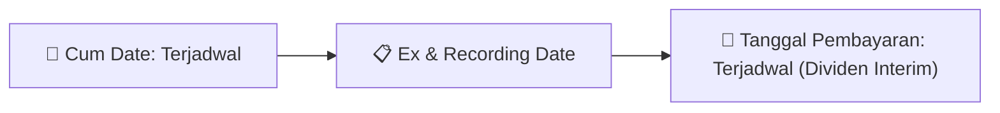

# Ikhtisar Pasar Harian (Daily Digest) - 2026-10-02

📅 **2026-10-02 (Daily Digest)**

## 1. Radar Pasar & Sentimen Harian (Executive Dashboard)
> [!NOTE]
> Terdeteksi sebanyak **285 pengumuman baru** dari 87 emiten pantauan pada (2026-10-02).

| Metric | Jumlah | Status Radar |
| :--- | :---: | :--- |
| **🟢 Sentimen Bullish / Positif** | `6` | [[Dividen Interim]], [[Mandatory Tender Offer]], Kinerja Positif |
| **⚪ Sentimen Netral / Routine** | `117` | [[Tanggapan Penjelasan Bursa]], [[RUPS]], [[Pendaftaran Unit]] |
| **🔴 Sentimen Bearish / Alert** | `4` | Sengketa Hukum, Defisit / Gugatan (Nihil hari ini) |
| **📄 [[Laporan Keuangan]] Baru** | `12` | Memicu Analisis Keuangan Otomatis |

> [!IMPORTANT]
> **Ditemukan Laporan Keuangan Baru Hari Ini:**
> - **BRIF**: FinancialStatement-2026-II-BRIF ([Buka PDF](file:///g:/My Drive/Model2/reports/raw/BRIF/20260930_BRIF_FinancialStatement-2026-II-BRIF.pdf))
- **BRIF**: FinancialStatement-2026-II-BRIF. ([Buka PDF](file:///g:/My Drive/Model2/reports/raw/BRIF/20260930_BRIF_FinancialStatement-2026-II-BRIF.xlsx))
- **GIAA**: FinancialStatement-2026-II-GIAA ([Buka PDF](file:///g:/My Drive/Model2/reports/raw/GIAA/20260930_GIAA_FinancialStatement-2026-II-GIAA.pdf))
- **GIAA**: FinancialStatement-2026-II-GIAA. ([Buka PDF](file:///g:/My Drive/Model2/reports/raw/GIAA/20260930_GIAA_FinancialStatement-2026-II-GIAA.xlsx))
- **BRNA**: FinancialStatement-2026-I-BRNA ([Buka PDF](file:///g:/My Drive/Model2/reports/raw/BRNA/20261001_BRNA_FinancialStatement-2026-I-BRNA.pdf))
- **BRNA**: FinancialStatement-2026-I-BRNA. ([Buka PDF](file:///g:/My Drive/Model2/reports/raw/BRNA/20261001_BRNA_FinancialStatement-2026-I-BRNA.xlsx))
- **ARTI**: FinancialStatement-2026-II-ARTI ([Buka PDF](file:///g:/My Drive/Model2/reports/raw/ARTI/20261001_ARTI_FinancialStatement-2026-II-ARTI.pdf))
- **ARTI**: FinancialStatement-2026-II-ARTI. ([Buka PDF](file:///g:/My Drive/Model2/reports/raw/ARTI/20261001_ARTI_FinancialStatement-2026-II-ARTI.xlsx))
- **APIC**: FinancialStatement-2026-II-APIC ([Buka PDF](file:///g:/My Drive/Model2/reports/raw/APIC/20261001_APIC_FinancialStatement-2026-II-APIC.pdf))
- **APIC**: FinancialStatement-2026-II-APIC. ([Buka PDF](file:///g:/My Drive/Model2/reports/raw/APIC/20261001_APIC_FinancialStatement-2026-II-APIC.xlsx))
- **BSSB**: FinancialStatement-2026-II-BSSB ([Buka PDF](file:///g:/My Drive/Model2/reports/raw/BSSB/20261001_BSSB_FinancialStatement-2026-II-BSSB.pdf))
- **BSSB**: FinancialStatement-2026-II-BSSB. ([Buka PDF](file:///g:/My Drive/Model2/reports/raw/BSSB/20261001_BSSB_FinancialStatement-2026-II-BSSB.xlsx))
> 
> *Tugas Swarm Agent:* Lakukan analisis laporan keuangan mendalam per emiten secara terpisah untuk berkas-berkas di atas.

---

## 2. Sorotan Utama & Watchlist Strategis (Strategic Watchlist)
#### 💰 Watchlist Dividen & Distribution
- **[[UNTR]]**: Jenis aksi korporasi = Pembelian kembali saham (share buyback)
- **[[UNTR]]**: Penerbit = PT United Tractors Tbk
- **[[UNTR]]**: Domisili = Jakarta Timur, DKI Jakarta, Indonesia
- **[[UNTR]]**: Kegiatan usaha = Perdagangan besar (distributor) alat berat
- **[[UNTR]]**: Dasar hukum = OJK Regulation No. 13 of 2023; OJK Letter No. S-112/D.04/2026 dated 9 September 2026; OJK Regulation No. 29 of 2023
- **[[UNTR]]**: Total nilai buyback maksimum = Rp2.000.000.000.000 (dua triliun Rupiah)

#### 🎯 Watchlist Penawaran Tender Wajib (MTO) & Strategis
- **[[BRIF]]**: Informasi pemegang saham pengendali = [[National Corporation]]
- **[[BCIC]]**: Pengendali = [[Tidak]]
- **[[BCIC]]**: Pengendali = [[Tidak]]
- **[[BCIC]]**: Pengendali = [[Tidak]]
- **[[LUCY]]**: Keterangan Pengendali = [[Tidak]]
- **[[BRNA]]**: Informasi pemegang saham pengendali = [[National Corporation]]

#### 📈 Watchlist Konversi Waran & Potensi Dilusi
- **[[BMRI]]**: Status Penawaran = Bukan merupakan penawaran umum dan bukan penawaran tanpa penawaran umum atas efek bersifat utang
- **[[CSIS]]**: Nama Waran = CSIS-W
- **[[CSIS]]**: Total Saham Setelah Konversi = 1.829.804.588
- **[[CSIS]]**: Sisa Waran Setelah Konversi = 52.275.350
- **[[INET]]**: Jumlah Waran Dikonversi = 2,810 lembar
- **[[INET]]**: Jumlah Saham Setelah Konversi = 22,378,260,802 lembar

#### 👥 Watchlist Transaksi Orang Dalam & Kepemilikan Saham (Insider / Repo Moves)
- **[[TLKM]]**: Waktu Pelaporan = 30-09-2026 23:34
- **[[BRIF]]**: Mata uang pelaporan = Rupiah / IDR
- **[[TUGU]]**: Tanggal Surat/Pelaporan = 30 September 2026
- **[[CPIN]]**: Nama Pemilik Saham (sesuai SID) = UBS AG LDN BRANCH A/C CLIENT
- **[[CPIN]]**: Anggota Direksi/Dewan Komisaris = Tidak
- **[[CPIN]]**: Kewarganegaraan = WNA
- **[[CPIN]]**: Emiten = CPIN - CHAROEN POKPHAND INDONESIA Tbk, PT
- **[[CPIN]]**: Jumlah Saham Sebelum Transaksi = 982.993.550,00 Unit

---

## 3. Matriks Pengumuman Pasar (Announcements Intelligence Table)
| Emiten | Sentimen | Jenis Pengumuman | Judul Pengumuman | Berkas |
| :--- | :---: | :--- | :--- | :--- |
| **[[TLKM]]** | ⚪ NEUTRAL | Aksi Korporasi | Laporan Informasi dan Fakta Material | [Utama](file:///g:/My%20Drive/Model2/reports/raw/TLKM/20260930_TLKM_20260930_TLKM_Laporan Informasi dan Fakta Material_32162298.pdf) · [Lamp 1](file:///g:/My%20Drive/Model2/reports/raw/TLKM/20260930_TLKM_20260930_TLKM_Laporan Informasi dan Fakta Material_32162298_lamp1.pdf) · [Lamp 2](file:///g:/My%20Drive/Model2/reports/raw/TLKM/20260930_TLKM_20260930_TLKM_Laporan Informasi dan Fakta Material_32162298_lamp2.pdf) |
| **[[BRIF]]** | 🔴 BEARISH | Laporan Keuangan | FinancialStatement-2026-II-BRIF | [Utama](file:///g:/My%20Drive/Model2/reports/raw/BRIF/20260930_BRIF_FinancialStatement-2026-II-BRIF.pdf) |
| **[[BRIF]]** | ⚪ NEUTRAL | Aksi Korporasi | brif billingual 30 juni 2026 released | [Utama](file:///g:/My%20Drive/Model2/reports/raw/BRIF/20260930_BRIF_brif_billingual_30 juni 2026_released.pdf) |
| **[[BRIF]]** | ⚪ NEUTRAL | Laporan Keuangan | FinancialStatement-2026-II-BRIF. | [Utama](file:///g:/My%20Drive/Model2/reports/raw/BRIF/20260930_BRIF_FinancialStatement-2026-II-BRIF.xlsx) |
| **[[BRIF]]** | ⚪ NEUTRAL | Aksi Korporasi | P.001 PenjelasanAsetLiabilitas2026 | [Utama](file:///g:/My%20Drive/Model2/reports/raw/BRIF/20260930_BRIF_P.001_PenjelasanAsetLiabilitas2026.pdf) |
| **[[BRIF]]** | ⚪ NEUTRAL | Aksi Korporasi | P.002 Surat Pengantar LK Jun 26 | [Utama](file:///g:/My%20Drive/Model2/reports/raw/BRIF/20260930_BRIF_P.002_Surat Pengantar LK Jun 26.pdf) |
| **[[BRIF]]** | ⚪ NEUTRAL | Aksi Korporasi | SPD LK Juni 2026 signed | [Utama](file:///g:/My%20Drive/Model2/reports/raw/BRIF/20260930_BRIF_SPD LK Juni 2026_signed.pdf) |
| **[[TUGU]]** | ⚪ NEUTRAL | Aksi Korporasi | Laporan Informasi dan Fakta Material | [Utama](file:///g:/My%20Drive/Model2/reports/raw/TUGU/20260930_TUGU_20260930_TUGU_Laporan Informasi dan Fakta Material_32162284.pdf) · [Lamp 1](file:///g:/My%20Drive/Model2/reports/raw/TUGU/20260930_TUGU_20260930_TUGU_Laporan Informasi dan Fakta Material_32162284_lamp1.pdf) |
| **[[TUGU]]** | ⚪ NEUTRAL | RUPS | Ringkasan RisalahRisalah RUPS | [Utama](file:///g:/My%20Drive/Model2/reports/raw/TUGU/20261001_TUGU_20261001_TUGU_Ringkasan RisalahRisalah RUPS_32162465.pdf) · [Lamp 3](file:///g:/My%20Drive/Model2/reports/raw/TUGU/20261001_TUGU_20261001_TUGU_Ringkasan RisalahRisalah RUPS_32162465_lamp3.pdf) · [Lamp 1](file:///g:/My%20Drive/Model2/reports/raw/TUGU/20261001_TUGU_20261001_TUGU_Ringkasan RisalahRisalah RUPS_32162465_lamp1.pdf) · [Lamp 2](file:///g:/My%20Drive/Model2/reports/raw/TUGU/20261001_TUGU_20261001_TUGU_Ringkasan RisalahRisalah RUPS_32162465_lamp2.pdf) |
| **[[MKNT]]** | ⚪ NEUTRAL | Aksi Korporasi | Pencatatan Saham Tambahan dari Konversi | [Utama](file:///g:/My%20Drive/Model2/reports/raw/MKNT/20260930_MKNT_20260929_MKNT_Pencatatan Saham Tambahan dari Konversi_32161934.pdf) |
| **[[BMRI]]** | ⚪ NEUTRAL | Aksi Korporasi | Laporan Informasi dan Fakta Material | [Utama](file:///g:/My%20Drive/Model2/reports/raw/BMRI/20260930_BMRI_20260930_BMRI_Laporan Informasi dan Fakta Material_32162295.pdf) |
| **[[UNTR]]** | 🟢 BULLISH | Dividen | Laporan Informasi dan Fakta Material | [Utama](file:///g:/My%20Drive/Model2/reports/raw/UNTR/20261001_UNTR_20260930_UNTR_Laporan Informasi dan Fakta Material_32162260.pdf) · [Lamp 3](file:///g:/My%20Drive/Model2/reports/raw/UNTR/20261001_UNTR_20261001_UNTR_Laporan Informasi dan Fakta Material_32162313_lamp3.pdf) · [Lamp 2](file:///g:/My%20Drive/Model2/reports/raw/UNTR/20261001_UNTR_20261001_UNTR_Laporan Informasi dan Fakta Material_32162313_lamp2.pdf) · [Lamp 1](file:///g:/My%20Drive/Model2/reports/raw/UNTR/20261001_UNTR_20260930_UNTR_Laporan Informasi dan Fakta Material_32162260_lamp1.pdf) |
| **[[UNTR]]** | ⚪ NEUTRAL | RUPS | Pengumuman RUPS | [Utama](file:///g:/My%20Drive/Model2/reports/raw/UNTR/20261001_UNTR_20261001_UNTR_Pengumuman RUPS_32162490.pdf) · [Lamp 2](file:///g:/My%20Drive/Model2/reports/raw/UNTR/20261001_UNTR_20261001_UNTR_Pengumuman RUPS_32162490_lamp2.pdf) · [Lamp 1](file:///g:/My%20Drive/Model2/reports/raw/UNTR/20261001_UNTR_20261001_UNTR_Pengumuman RUPS_32162490_lamp1.pdf) |
| **[[GIAA]]** | ⚪ NEUTRAL | Aksi Korporasi | Laporan Informasi dan Fakta Material | [Utama](file:///g:/My%20Drive/Model2/reports/raw/GIAA/20260930_GIAA_20260930_GIAA_Laporan Informasi dan Fakta Material_32162296.pdf) · [Lamp 2](file:///g:/My%20Drive/Model2/reports/raw/GIAA/20260930_GIAA_20260930_GIAA_Laporan Informasi dan Fakta Material_32162296_lamp2.pdf) · [Lamp 1](file:///g:/My%20Drive/Model2/reports/raw/GIAA/20260930_GIAA_20260930_GIAA_Laporan Informasi dan Fakta Material_32162296_lamp1.pdf) |
| **[[GIAA]]** | ⚪ NEUTRAL | RUPS | Pengumuman RUPS | [Utama](file:///g:/My%20Drive/Model2/reports/raw/GIAA/20260930_GIAA_20260930_GIAA_Pengumuman RUPS_32162112.pdf) · [Lamp 1](file:///g:/My%20Drive/Model2/reports/raw/GIAA/20260930_GIAA_20260930_GIAA_Pengumuman RUPS_32162112_lamp1.pdf) |
| **[[GIAA]]** | ⚪ NEUTRAL | Laporan Keuangan | FinancialStatement-2026-II-GIAA | [Utama](file:///g:/My%20Drive/Model2/reports/raw/GIAA/20260930_GIAA_FinancialStatement-2026-II-GIAA.pdf) |
| **[[GIAA]]** | ⚪ NEUTRAL | Laporan Keuangan | FinancialStatement-2026-II-GIAA. | [Utama](file:///g:/My%20Drive/Model2/reports/raw/GIAA/20260930_GIAA_FinancialStatement-2026-II-GIAA.xlsx) |
| **[[GIAA]]** | ⚪ NEUTRAL | Aksi Korporasi | LK Garuda Indonesia Juni 2026 | [Utama](file:///g:/My%20Drive/Model2/reports/raw/GIAA/20260930_GIAA_LK Garuda Indonesia Juni 2026.pdf) |
| **[[GIAA]]** | ⚪ NEUTRAL | Aksi Korporasi | Surat Pernyataan Direksi 30 Juni 2026 | [Utama](file:///g:/My%20Drive/Model2/reports/raw/GIAA/20260930_GIAA_Surat Pernyataan Direksi 30 Juni 2026.pdf) |
| **[[ASGR]]** | 🟢 BULLISH | Dividen | Laporan Informasi dan Fakta Material | [Utama](file:///g:/My%20Drive/Model2/reports/raw/ASGR/20260930_ASGR_20260930_ASGR_Laporan Informasi dan Fakta Material_32162305.pdf) · [Lamp 1](file:///g:/My%20Drive/Model2/reports/raw/ASGR/20260930_ASGR_20260930_ASGR_Laporan Informasi dan Fakta Material_32162305_lamp1.pdf) |
| **[[CPIN]]** | ⚪ NEUTRAL | Kepemilikan Saham (Insider) | LK-30092026-3337-00 | [Utama](file:///g:/My%20Drive/Model2/reports/raw/CPIN/20260930_CPIN_LK-30092026-3337-00.pdf) |
| **[[FUTR]]** | ⚪ NEUTRAL | Aksi Korporasi | Laporan Informasi dan Fakta Material | [Utama](file:///g:/My%20Drive/Model2/reports/raw/FUTR/20261001_FUTR_20261001_FUTR_Laporan Informasi dan Fakta Material_32162621.pdf) |
| **[[CSIS]]** | ⚪ NEUTRAL | Aksi Korporasi | Pencatatan Saham Tambahan dari Konversi | [Utama](file:///g:/My%20Drive/Model2/reports/raw/CSIS/20261001_CSIS_20261001_CSIS_Pencatatan Saham Tambahan dari Konversi_32162420.pdf) |
| **[[PIPA]]** | ⚪ NEUTRAL | Aksi Korporasi | Laporan Informasi dan Fakta Material | [Utama](file:///g:/My%20Drive/Model2/reports/raw/PIPA/20261001_PIPA_20261001_PIPA_Laporan Informasi dan Fakta Material_32162383.pdf) |
| **[[INET]]** | ⚪ NEUTRAL | Aksi Korporasi | Pencatatan Saham Tambahan dari Konversi | [Utama](file:///g:/My%20Drive/Model2/reports/raw/INET/20261001_INET_20261001_INET_Pencatatan Saham Tambahan dari Konversi_32162432.pdf) |
| **[[AADI]]** | ⚪ NEUTRAL | RUPS | Transaksi Material Tanpa Persetujuan RUPS | [Utama](file:///g:/My%20Drive/Model2/reports/raw/AADI/20261001_AADI_20260929_AADI_Transaksi Material Tanpa Persetujuan RUPS_32161672.pdf) · [Lamp 2](file:///g:/My%20Drive/Model2/reports/raw/AADI/20261001_AADI_20260929_AADI_Transaksi Material Tanpa Persetujuan RUPS_32161672_lamp2.pdf) · [Lamp 1](file:///g:/My%20Drive/Model2/reports/raw/AADI/20261001_AADI_20260929_AADI_Transaksi Material Tanpa Persetujuan RUPS_32161672_lamp1.pdf) |
| **[[DGWG]]** | ⚪ NEUTRAL | Public Expose | Public Expose | [Utama](file:///g:/My%20Drive/Model2/reports/raw/DGWG/20261001_DGWG_20261001_DGWG_Public Expose_32162460.pdf) |
| **[[DOOH]]** | ⚪ NEUTRAL | Aksi Korporasi | Laporan Informasi dan Fakta Material | [Utama](file:///g:/My%20Drive/Model2/reports/raw/DOOH/20261001_DOOH_20261001_DOOH_Laporan Informasi dan Fakta Material_32162610.pdf) · [Lamp 1](file:///g:/My%20Drive/Model2/reports/raw/DOOH/20261001_DOOH_20261001_DOOH_Laporan Informasi dan Fakta Material_32162619_lamp1.pdf) · [Lamp 1](file:///g:/My%20Drive/Model2/reports/raw/DOOH/20261001_DOOH_20261001_DOOH_Laporan Informasi dan Fakta Material_32162610_lamp1.pdf) |
| **[[DOOH]]** | ⚪ NEUTRAL | Aksi Korporasi | Keterbukaan Informasi terkait Aksi Korporasi | [Utama](file:///g:/My%20Drive/Model2/reports/raw/DOOH/20261001_DOOH_20261001_DOOH_Keterbukaan Informasi terkait Aksi Korporasi_32162615.pdf) · [Lamp 1](file:///g:/My%20Drive/Model2/reports/raw/DOOH/20261001_DOOH_20261001_DOOH_Keterbukaan Informasi terkait Aksi Korporasi_32162615_lamp1.pdf) |
| **[[DOOH]]** | ⚪ NEUTRAL | RUPS | Pengumuman RUPS | [Utama](file:///g:/My%20Drive/Model2/reports/raw/DOOH/20261001_DOOH_20261001_DOOH_Pengumuman RUPS_32162611.pdf) · [Lamp 1](file:///g:/My%20Drive/Model2/reports/raw/DOOH/20261001_DOOH_20261001_DOOH_Pengumuman RUPS_32162611_lamp1.pdf) |
| **[[DOOH]]** | ⚪ NEUTRAL | Aksi Korporasi | Informasi Transaksi Afiliasi | [Utama](file:///g:/My%20Drive/Model2/reports/raw/DOOH/20261001_DOOH_20261001_DOOH_Informasi Transaksi Afiliasi_32162607.pdf) · [Lamp 1](file:///g:/My%20Drive/Model2/reports/raw/DOOH/20261001_DOOH_20261001_DOOH_Informasi Transaksi Afiliasi_32162607_lamp1.pdf) |
| **[[DOOH]]** | ⚪ NEUTRAL | Aksi Korporasi | Rencana Transaksi Perubahan Kegiatan Usaha | [Utama](file:///g:/My%20Drive/Model2/reports/raw/DOOH/20261001_DOOH_20261001_DOOH_Rencana Transaksi Perubahan Kegiatan Usaha_32162602.pdf) · [Lamp 1](file:///g:/My%20Drive/Model2/reports/raw/DOOH/20261001_DOOH_20261001_DOOH_Rencana Transaksi Perubahan Kegiatan Usaha_32162602_lamp1.pdf) |
| **[[DOOH]]** | ⚪ NEUTRAL | RUPS | Rencana Transaksi Material Dengan Persetujuan RUPS | [Utama](file:///g:/My%20Drive/Model2/reports/raw/DOOH/20261001_DOOH_20261001_DOOH_Rencana Transaksi Material Dengan Persetujuan RUPS_32162590.pdf) · [Lamp 1](file:///g:/My%20Drive/Model2/reports/raw/DOOH/20261001_DOOH_20261001_DOOH_Rencana Transaksi Material Dengan Persetujuan RUPS_32162590_lamp1.pdf) |
| **[[BCIC]]** | ⚪ NEUTRAL | Kepemilikan Saham (Insider) | LK-01102026-5125-00 | [Utama](file:///g:/My%20Drive/Model2/reports/raw/BCIC/20261001_BCIC_LK-01102026-5125-00.pdf) |
| **[[BCIC]]** | ⚪ NEUTRAL | Kepemilikan Saham (Insider) | LK-01102026-9035-00 | [Utama](file:///g:/My%20Drive/Model2/reports/raw/BCIC/20261001_BCIC_LK-01102026-9035-00.pdf) |
| **[[BCIC]]** | ⚪ NEUTRAL | Kepemilikan Saham (Insider) | LK-01102026-1747-00 | [Utama](file:///g:/My%20Drive/Model2/reports/raw/BCIC/20261001_BCIC_LK-01102026-1747-00.pdf) |
| **[[NSSS]]** | ⚪ NEUTRAL | Kepemilikan Saham (Insider) | LK-01102026-4664-00 | [Utama](file:///g:/My%20Drive/Model2/reports/raw/NSSS/20261001_NSSS_LK-01102026-4664-00.pdf) |
| **[[AHAP]]** | ⚪ NEUTRAL | Aksi Korporasi | Penyampaian ProspektusInformasi Tambahan | [Utama](file:///g:/My%20Drive/Model2/reports/raw/AHAP/20261001_AHAP_20261001_AHAP_Penyampaian ProspektusInformasi Tambahan_32162391.pdf) · [Lamp 2](file:///g:/My%20Drive/Model2/reports/raw/AHAP/20261001_AHAP_20261001_AHAP_Penyampaian ProspektusInformasi Tambahan_32162391_lamp2.pdf) · [Lamp 5](file:///g:/My%20Drive/Model2/reports/raw/AHAP/20261001_AHAP_20261001_AHAP_Penyampaian ProspektusInformasi Tambahan_32162391_lamp5.pdf) · [Lamp 3](file:///g:/My%20Drive/Model2/reports/raw/AHAP/20261001_AHAP_20261001_AHAP_Penyampaian ProspektusInformasi Tambahan_32162391_lamp3.pdf) · [Lamp 4](file:///g:/My%20Drive/Model2/reports/raw/AHAP/20261001_AHAP_20261001_AHAP_Penyampaian ProspektusInformasi Tambahan_32162391_lamp4.pdf) |
| **[[AHAP]]** | ⚪ NEUTRAL | Aksi Korporasi | Keterbukaan Informasi terkait Aksi Korporasi | [Utama](file:///g:/My%20Drive/Model2/reports/raw/AHAP/20261001_AHAP_20261001_AHAP_Keterbukaan Informasi terkait Aksi Korporasi_32162389.pdf) |
| **[[CYBR]]** | ⚪ NEUTRAL | Aksi Korporasi | Pencatatan Saham Tambahan dari Konversi | [Utama](file:///g:/My%20Drive/Model2/reports/raw/CYBR/20261001_CYBR_20261001_CYBR_Pencatatan Saham Tambahan dari Konversi_32162429.pdf) · [Lamp 1](file:///g:/My%20Drive/Model2/reports/raw/CYBR/20261001_CYBR_20261001_CYBR_Pencatatan Saham Tambahan dari Konversi_32162429_lamp1.pdf) |
| **[[PPRO]]** | ⚪ NEUTRAL | Aksi Korporasi | Laporan Informasi dan Fakta Material | [Utama](file:///g:/My%20Drive/Model2/reports/raw/PPRO/20261001_PPRO_20261001_PPRO_Laporan Informasi dan Fakta Material_32162317.pdf) · [Lamp 1](file:///g:/My%20Drive/Model2/reports/raw/PPRO/20261001_PPRO_20261001_PPRO_Laporan Informasi dan Fakta Material_32162317_lamp1.pdf) |
| **[[CASH]]** | ⚪ NEUTRAL | Aksi Korporasi | Laporan Informasi dan Fakta Material | [Utama](file:///g:/My%20Drive/Model2/reports/raw/CASH/20261001_CASH_20261001_CASH_Laporan Informasi dan Fakta Material_32162443.pdf) · [Lamp 2](file:///g:/My%20Drive/Model2/reports/raw/CASH/20261001_CASH_20261001_CASH_Laporan Informasi dan Fakta Material_32162443_lamp2.pdf) |
| **[[DNRK]]** | ⚪ NEUTRAL | Aksi Korporasi | Laporan Penggunaan Dana Hasil Penawaran Umum | [Utama](file:///g:/My%20Drive/Model2/reports/raw/DNRK/20261001_DNRK_20261001_DNRK_Laporan Penggunaan Dana Hasil Penawaran Umum_32162542.pdf) |
| **[[BHIT]]** | ⚪ NEUTRAL | Aksi Korporasi | Tanggapan atas Permintaan Penjelasan Bursa | [Utama](file:///g:/My%20Drive/Model2/reports/raw/BHIT/20261001_BHIT_20261001_BHIT_Tanggapan atas Permintaan Penjelasan Bursa_32162523.pdf) |
| **[[DJPU]]** | ⚪ NEUTRAL | Aksi Korporasi | Pengumuman Pencatatan Awal Obligasi dan Sukuk | [Utama](file:///g:/My%20Drive/Model2/reports/raw/DJPU/20261001_DJPU_20261001_DJPU_Pengumuman Pencatatan Awal Obligasi dan Sukuk_32162502.pdf) · [Lamp 1](file:///g:/My%20Drive/Model2/reports/raw/DJPU/20261001_DJPU_20261001_DJPU_Pengumuman Pencatatan Awal Obligasi dan Sukuk_32162502_lamp1.pdf) · [Lamp 2](file:///g:/My%20Drive/Model2/reports/raw/DJPU/20261001_DJPU_20261001_DJPU_Pengumuman Pencatatan Awal Obligasi dan Sukuk_32162502_lamp2.pdf) |
| **[[PACK]]** | ⚪ NEUTRAL | Aksi Korporasi | Pencatatan Saham Tambahan dari Konversi | [Utama](file:///g:/My%20Drive/Model2/reports/raw/PACK/20261001_PACK_20261001_PACK_Pencatatan Saham Tambahan dari Konversi_32162415.pdf) |
| **[[MTLA]]** | ⚪ NEUTRAL | Aksi Korporasi | Tanggapan atas Permintaan Penjelasan Bursa | [Utama](file:///g:/My%20Drive/Model2/reports/raw/MTLA/20261001_MTLA_20261001_MTLA_Tanggapan atas Permintaan Penjelasan Bursa_32162316.pdf) · [Lamp 1](file:///g:/My%20Drive/Model2/reports/raw/MTLA/20261001_MTLA_20261001_MTLA_Tanggapan atas Permintaan Penjelasan Bursa_32162316_lamp1.pdf) |
| **[[TAPG]]** | ⚪ NEUTRAL | Kepemilikan Saham (Insider) | LK-01102026-9146-00 | [Utama](file:///g:/My%20Drive/Model2/reports/raw/TAPG/20261001_TAPG_LK-01102026-9146-00.pdf) |
| **[[ATAP]]** | ⚪ NEUTRAL | Aksi Korporasi | Laporan Informasi dan Fakta Material | [Utama](file:///g:/My%20Drive/Model2/reports/raw/ATAP/20261001_ATAP_20261001_ATAP_Laporan Informasi dan Fakta Material_32162547.pdf) · [Lamp 1](file:///g:/My%20Drive/Model2/reports/raw/ATAP/20261001_ATAP_20261001_ATAP_Laporan Informasi dan Fakta Material_32162547_lamp1.pdf) |
| **[[AKPI]]** | ⚪ NEUTRAL | Kepemilikan Saham (Insider) | LK-01102026-0762-00 | [Utama](file:///g:/My%20Drive/Model2/reports/raw/AKPI/20261001_AKPI_LK-01102026-0762-00.pdf) |
| **[[KRAS]]** | ⚪ NEUTRAL | Aksi Korporasi | Informasi Transaksi Afiliasi | [Utama](file:///g:/My%20Drive/Model2/reports/raw/KRAS/20261001_KRAS_20261001_KRAS_Informasi Transaksi Afiliasi_32162575.pdf) · [Lamp 1](file:///g:/My%20Drive/Model2/reports/raw/KRAS/20261001_KRAS_20261001_KRAS_Informasi Transaksi Afiliasi_32162575_lamp1.pdf) |
| **[[LUCY]]** | ⚪ NEUTRAL | Kepemilikan Saham (Insider) | LK-01102026-9772-00 | [Utama](file:///g:/My%20Drive/Model2/reports/raw/LUCY/20261001_LUCY_LK-01102026-9772-00.pdf) |
| **[[BRNA]]** | ⚪ NEUTRAL | Aksi Korporasi | Penyampaian ProspektusInformasi Tambahan | [Utama](file:///g:/My%20Drive/Model2/reports/raw/BRNA/20261001_BRNA_20261001_BRNA_Penyampaian ProspektusInformasi Tambahan_32162404.pdf) · [Lamp 1](file:///g:/My%20Drive/Model2/reports/raw/BRNA/20261001_BRNA_20261001_BRNA_Penyampaian ProspektusInformasi Tambahan_32162404_lamp1.pdf) |
| **[[BRNA]]** | ⚪ NEUTRAL | Aksi Korporasi | Keterbukaan Informasi terkait Aksi Korporasi | [Utama](file:///g:/My%20Drive/Model2/reports/raw/BRNA/20261001_BRNA_20261001_BRNA_Keterbukaan Informasi terkait Aksi Korporasi_32162396.pdf) · [Lamp 1](file:///g:/My%20Drive/Model2/reports/raw/BRNA/20261001_BRNA_20261001_BRNA_Keterbukaan Informasi terkait Aksi Korporasi_32162396_lamp1.pdf) · [Lamp 2](file:///g:/My%20Drive/Model2/reports/raw/BRNA/20261001_BRNA_20261001_BRNA_Keterbukaan Informasi terkait Aksi Korporasi_32162396_lamp2.pdf) |
| **[[BRNA]]** | ⚪ NEUTRAL | Laporan Keuangan | FinancialStatement-2026-I-BRNA | [Utama](file:///g:/My%20Drive/Model2/reports/raw/BRNA/20261001_BRNA_FinancialStatement-2026-I-BRNA.pdf) |
| **[[BRNA]]** | ⚪ NEUTRAL | Aksi Korporasi | Audit Report PT BRNA Q1 2026 | [Utama](file:///g:/My%20Drive/Model2/reports/raw/BRNA/20261001_BRNA_Audit Report PT BRNA Q1 2026.pdf) |
| **[[BRNA]]** | 🟢 BULLISH | Aksi Korporasi | BRNA CHECKLIST 2026 | [Utama](file:///g:/My%20Drive/Model2/reports/raw/BRNA/20261001_BRNA_BRNA CHECKLIST 2026.pdf) |
| **[[BRNA]]** | ⚪ NEUTRAL | Aksi Korporasi | Comfort Letter | [Utama](file:///g:/My%20Drive/Model2/reports/raw/BRNA/20261001_BRNA_Comfort Letter.pdf) |
| **[[BRNA]]** | ⚪ NEUTRAL | Laporan Keuangan | FinancialStatement-2026-I-BRNA. | [Utama](file:///g:/My%20Drive/Model2/reports/raw/BRNA/20261001_BRNA_FinancialStatement-2026-I-BRNA.xlsx) |
| **[[BRNA]]** | ⚪ NEUTRAL | Aksi Korporasi | Representation Letter | [Utama](file:///g:/My%20Drive/Model2/reports/raw/BRNA/20261001_BRNA_Representation Letter.pdf) |
| **[[PYFA]]** | ⚪ NEUTRAL | Aksi Korporasi | Pencatatan Saham Tambahan dari Konversi | [Utama](file:///g:/My%20Drive/Model2/reports/raw/PYFA/20261001_PYFA_20261001_PYFA_Pencatatan Saham Tambahan dari Konversi_32162399.pdf) |
| **[[UNSP]]** | ⚪ NEUTRAL | Aksi Korporasi | Tanggapan atas Permintaan Penjelasan Bursa | [Utama](file:///g:/My%20Drive/Model2/reports/raw/UNSP/20261001_UNSP_20261001_UNSP_Tanggapan atas Permintaan Penjelasan Bursa_32162382.pdf) |
| **[[SOFA]]** | ⚪ NEUTRAL | RUPS | Ringkasan RisalahRisalah RUPS | [Utama](file:///g:/My%20Drive/Model2/reports/raw/SOFA/20261001_SOFA_20261001_SOFA_Ringkasan RisalahRisalah RUPS_32162381.pdf) · [Lamp 1](file:///g:/My%20Drive/Model2/reports/raw/SOFA/20261001_SOFA_20261001_SOFA_Ringkasan RisalahRisalah RUPS_32162381_lamp1.pdf) |
| **[[CNKO]]** | ⚪ NEUTRAL | Aksi Korporasi | Laporan Informasi dan Fakta Material | [Utama](file:///g:/My%20Drive/Model2/reports/raw/CNKO/20261001_CNKO_20261001_CNKO_Laporan Informasi dan Fakta Material_32162341.pdf) |
| **[[SOSS]]** | ⚪ NEUTRAL | Aksi Korporasi | Tanggapan atas Permintaan Penjelasan Bursa | [Utama](file:///g:/My%20Drive/Model2/reports/raw/SOSS/20261001_SOSS_20261001_SOSS_Tanggapan atas Permintaan Penjelasan Bursa_32162373.pdf) |
| **[[FAST]]** | ⚪ NEUTRAL | Aksi Korporasi | Laporan Informasi dan Fakta Material | [Utama](file:///g:/My%20Drive/Model2/reports/raw/FAST/20261001_FAST_20261001_FAST_Laporan Informasi dan Fakta Material_32162436.pdf) |
| **[[BRMS]]** | ⚪ NEUTRAL | Kepemilikan Saham (Insider) | LK-01102026-1439-00 | [Utama](file:///g:/My%20Drive/Model2/reports/raw/BRMS/20261001_BRMS_LK-01102026-1439-00.pdf) |
| **[[BRMS]]** | ⚪ NEUTRAL | Kepemilikan Saham (Insider) | LK-01102026-9695-00 | [Utama](file:///g:/My%20Drive/Model2/reports/raw/BRMS/20261001_BRMS_LK-01102026-9695-00.pdf) |
| **[[KOCI]]** | ⚪ NEUTRAL | Aksi Korporasi | Pencatatan Saham Tambahan dari Konversi | [Utama](file:///g:/My%20Drive/Model2/reports/raw/KOCI/20261001_KOCI_20261001_KOCI_Pencatatan Saham Tambahan dari Konversi_32162419.pdf) · [Lamp 2](file:///g:/My%20Drive/Model2/reports/raw/KOCI/20261001_KOCI_20261001_KOCI_Pencatatan Saham Tambahan dari Konversi_32162419_lamp2.pdf) · [Lamp 1](file:///g:/My%20Drive/Model2/reports/raw/KOCI/20261001_KOCI_20261001_KOCI_Pencatatan Saham Tambahan dari Konversi_32162419_lamp1.pdf) |
| **[[SWAT]]** | 🔴 BEARISH | Aksi Korporasi | Tanggapan atas Permintaan Penjelasan Bursa | [Utama](file:///g:/My%20Drive/Model2/reports/raw/SWAT/20261001_SWAT_20260930_SWAT_Tanggapan atas Permintaan Penjelasan Bursa_32162306.pdf) · [Lamp 2](file:///g:/My%20Drive/Model2/reports/raw/SWAT/20261001_SWAT_20260930_SWAT_Tanggapan atas Permintaan Penjelasan Bursa_32162306_lamp2.pdf) |
| **[[RGAS]]** | ⚪ NEUTRAL | Aksi Korporasi | Laporan Informasi dan Fakta Material | [Utama](file:///g:/My%20Drive/Model2/reports/raw/RGAS/20261001_RGAS_20261001_RGAS_Laporan Informasi dan Fakta Material_32162529.pdf) · [Lamp 1](file:///g:/My%20Drive/Model2/reports/raw/RGAS/20261001_RGAS_20261001_RGAS_Laporan Informasi dan Fakta Material_32162529_lamp1.pdf) · [Lamp 2](file:///g:/My%20Drive/Model2/reports/raw/RGAS/20261001_RGAS_20261001_RGAS_Laporan Informasi dan Fakta Material_32162529_lamp2.pdf) |
| **[[PRDA]]** | ⚪ NEUTRAL | Aksi Korporasi | Tanggapan atas Permintaan Penjelasan Bursa | [Utama](file:///g:/My%20Drive/Model2/reports/raw/PRDA/20261001_PRDA_20261001_PRDA_Tanggapan atas Permintaan Penjelasan Bursa_32162580.pdf) · [Lamp 1](file:///g:/My%20Drive/Model2/reports/raw/PRDA/20261001_PRDA_20261001_PRDA_Tanggapan atas Permintaan Penjelasan Bursa_32162580_lamp1.pdf) |
| **[[GOTO]]** | 🟢 BULLISH | Buyback | Tanggapan atas Permintaan Penjelasan Bursa | [Utama](file:///g:/My%20Drive/Model2/reports/raw/GOTO/20261001_GOTO_20261001_GOTO_Tanggapan atas Permintaan Penjelasan Bursa_32162486.pdf) · [Lamp 1](file:///g:/My%20Drive/Model2/reports/raw/GOTO/20261001_GOTO_20261001_GOTO_Tanggapan atas Permintaan Penjelasan Bursa_32162486_lamp1.pdf) |
| **[[SILO]]** | 🔴 BEARISH | Aksi Korporasi | Laporan Informasi dan Fakta Material | [Utama](file:///g:/My%20Drive/Model2/reports/raw/SILO/20261001_SILO_20261001_SILO_Laporan Informasi dan Fakta Material_32162351.pdf) · [Lamp 1](file:///g:/My%20Drive/Model2/reports/raw/SILO/20261001_SILO_20261001_SILO_Laporan Informasi dan Fakta Material_32162351_lamp1.pdf) |
| **[[MPRO]]** | ⚪ NEUTRAL | Kepemilikan Saham (Insider) | LK-01102026-7013-00 | [Utama](file:///g:/My%20Drive/Model2/reports/raw/MPRO/20261001_MPRO_LK-01102026-7013-00.pdf) |
| **[[WIFI]]** | ⚪ NEUTRAL | Aksi Korporasi | Laporan Informasi dan Fakta Material | [Utama](file:///g:/My%20Drive/Model2/reports/raw/WIFI/20261001_WIFI_20261001_WIFI_Laporan Informasi dan Fakta Material_32162582.pdf) · [Lamp 1](file:///g:/My%20Drive/Model2/reports/raw/WIFI/20261001_WIFI_20261001_WIFI_Laporan Informasi dan Fakta Material_32162582_lamp1.pdf) |
| **[[HERO]]** | ⚪ NEUTRAL | Aksi Korporasi | Laporan Informasi dan Fakta Material | [Utama](file:///g:/My%20Drive/Model2/reports/raw/HERO/20261001_HERO_20261001_HERO_Laporan Informasi dan Fakta Material_32162489.pdf) |
| **[[WSKT]]** | ⚪ NEUTRAL | Aksi Korporasi | Laporan Hasil Pemeringkatan | [Utama](file:///g:/My%20Drive/Model2/reports/raw/WSKT/20261001_WSKT_20261001_WSKT_Laporan Hasil Pemeringkatan_32162434.pdf) · [Lamp 1](file:///g:/My%20Drive/Model2/reports/raw/WSKT/20261001_WSKT_20261001_WSKT_Laporan Hasil Pemeringkatan_32162434_lamp1.pdf) |
| **[[BSWD]]** | ⚪ NEUTRAL | Aksi Korporasi | Tanggapan atas Permintaan Penjelasan Bursa | [Utama](file:///g:/My%20Drive/Model2/reports/raw/BSWD/20261001_BSWD_20261001_BSWD_Tanggapan atas Permintaan Penjelasan Bursa_32162398.pdf) |
| **[[BATA]]** | ⚪ NEUTRAL | Aksi Korporasi | Laporan Informasi dan Fakta Material | [Utama](file:///g:/My%20Drive/Model2/reports/raw/BATA/20261001_BATA_20261001_BATA_Laporan Informasi dan Fakta Material_32162392.pdf) · [Lamp 1](file:///g:/My%20Drive/Model2/reports/raw/BATA/20261001_BATA_20261001_BATA_Laporan Informasi dan Fakta Material_32162392_lamp1.pdf) |
| **[[WAPO]]** | ⚪ NEUTRAL | Aksi Korporasi | Tanggapan atas Permintaan Penjelasan Bursa | [Utama](file:///g:/My%20Drive/Model2/reports/raw/WAPO/20261001_WAPO_20261001_WAPO_Tanggapan atas Permintaan Penjelasan Bursa_32162588.pdf) |
| **[[ARKO]]** | ⚪ NEUTRAL | Kepemilikan Saham (Insider) | LK-01102026-2611-00 | [Utama](file:///g:/My%20Drive/Model2/reports/raw/ARKO/20261001_ARKO_LK-01102026-2611-00.pdf) |
| **[[FORU]]** | ⚪ NEUTRAL | Aksi Korporasi | Pencatatan Saham Tambahan dari Konversi | [Utama](file:///g:/My%20Drive/Model2/reports/raw/FORU/20261001_FORU_20261001_FORU_Pencatatan Saham Tambahan dari Konversi_32162412.pdf) |
| **[[INKP]]** | ⚪ NEUTRAL | Aksi Korporasi | Pembayaran KuponBagi HasilIjarahPokok | [Utama](file:///g:/My%20Drive/Model2/reports/raw/INKP/20261001_INKP_20261001_INKP_Pembayaran KuponBagi HasilIjarahPokok_32162349.pdf) |
| **[[INKP]]** | ⚪ NEUTRAL | Aksi Korporasi | Laporan Informasi dan Fakta Material | [Utama](file:///g:/My%20Drive/Model2/reports/raw/INKP/20261001_INKP_20260929_INKP_Laporan Informasi dan Fakta Material_32161563.pdf) |
| **[[BACH]]** | ⚪ NEUTRAL | RUPS | Transaksi Material Tanpa Persetujuan RUPS | [Utama](file:///g:/My%20Drive/Model2/reports/raw/BACH/20261001_BACH_20261001_BACH_Transaksi Material Tanpa Persetujuan RUPS_32162441.pdf) |
| **[[INPS]]** | ⚪ NEUTRAL | Aksi Korporasi | Laporan Informasi dan Fakta Material | [Utama](file:///g:/My%20Drive/Model2/reports/raw/INPS/20261001_INPS_20260930_INPS_Laporan Informasi dan Fakta Material_32162130.pdf) |
| **[[ADMF]]** | ⚪ NEUTRAL | Aksi Korporasi | Tanggapan atas Permintaan Penjelasan Bursa | [Utama](file:///g:/My%20Drive/Model2/reports/raw/ADMF/20261001_ADMF_20261001_ADMF_Tanggapan atas Permintaan Penjelasan Bursa_32162520.pdf) |
| **[[AMMN]]** | 🔴 BEARISH | Aksi Korporasi | Laporan Informasi dan Fakta Material | [Utama](file:///g:/My%20Drive/Model2/reports/raw/AMMN/20261001_AMMN_20261001_AMMN_Laporan Informasi dan Fakta Material_32162438.pdf) · [Lamp 2](file:///g:/My%20Drive/Model2/reports/raw/AMMN/20261001_AMMN_20261001_AMMN_Laporan Informasi dan Fakta Material_32162438_lamp2.pdf) · [Lamp 1](file:///g:/My%20Drive/Model2/reports/raw/AMMN/20261001_AMMN_20261001_AMMN_Laporan Informasi dan Fakta Material_32162438_lamp1.pdf) |
| **[[ADHI]]** | ⚪ NEUTRAL | Aksi Korporasi | Laporan Informasi dan Fakta Material | [Utama](file:///g:/My%20Drive/Model2/reports/raw/ADHI/20261001_ADHI_20261001_ADHI_Laporan Informasi dan Fakta Material_32162309.pdf) · [Lamp 1](file:///g:/My%20Drive/Model2/reports/raw/ADHI/20261001_ADHI_20261001_ADHI_Laporan Informasi dan Fakta Material_32162309_lamp1.pdf) |
| **[[BABP]]** | ⚪ NEUTRAL | Aksi Korporasi | Laporan Informasi dan Fakta Material | [Utama](file:///g:/My%20Drive/Model2/reports/raw/BABP/20261001_BABP_20261001_BABP_Laporan Informasi dan Fakta Material_32162498.pdf) · [Lamp 2](file:///g:/My%20Drive/Model2/reports/raw/BABP/20261001_BABP_20261001_BABP_Laporan Informasi dan Fakta Material_32162498_lamp2.pdf) · [Lamp 1](file:///g:/My%20Drive/Model2/reports/raw/BABP/20261001_BABP_20261001_BABP_Laporan Informasi dan Fakta Material_32162498_lamp1.pdf) |
| **[[ABDA]]** | ⚪ NEUTRAL | Kepemilikan Saham (Insider) | LK-01102026-0077-00 | [Utama](file:///g:/My%20Drive/Model2/reports/raw/ABDA/20261001_ABDA_LK-01102026-0077-00.pdf) |
| **[[RLCO]]** | ⚪ NEUTRAL | Kepemilikan Saham (Insider) | LK-01102026-7792-00 | [Utama](file:///g:/My%20Drive/Model2/reports/raw/RLCO/20261001_RLCO_LK-01102026-7792-00.pdf) |
| **[[BMTR]]** | ⚪ NEUTRAL | Aksi Korporasi | Tanggapan atas Permintaan Penjelasan Bursa | [Utama](file:///g:/My%20Drive/Model2/reports/raw/BMTR/20261001_BMTR_20261001_BMTR_Tanggapan atas Permintaan Penjelasan Bursa_32162345.pdf) |
| **[[MSIN]]** | ⚪ NEUTRAL | Aksi Korporasi | Tanggapan atas Permintaan Penjelasan Bursa | [Utama](file:///g:/My%20Drive/Model2/reports/raw/MSIN/20261001_MSIN_20261001_MSIN_Tanggapan atas Permintaan Penjelasan Bursa_32162375.pdf) · [Lamp 1](file:///g:/My%20Drive/Model2/reports/raw/MSIN/20261001_MSIN_20261001_MSIN_Tanggapan atas Permintaan Penjelasan Bursa_32162375_lamp1.pdf) |
| **[[PPGL]]** | ⚪ NEUTRAL | RUPS | Pemanggilan RUPS | [Utama](file:///g:/My%20Drive/Model2/reports/raw/PPGL/20261001_PPGL_20261001_PPGL_Pemanggilan RUPS_32162614.pdf) · [Lamp 1](file:///g:/My%20Drive/Model2/reports/raw/PPGL/20261001_PPGL_20261001_PPGL_Pemanggilan RUPS_32162614_lamp1.pdf) |
| **[[ASBI]]** | ⚪ NEUTRAL | RUPS | Ringkasan RisalahRisalah RUPS | [Utama](file:///g:/My%20Drive/Model2/reports/raw/ASBI/20261001_ASBI_20261001_ASBI_Ringkasan RisalahRisalah RUPS_32162380.pdf) · [Lamp 3](file:///g:/My%20Drive/Model2/reports/raw/ASBI/20261001_ASBI_20261001_ASBI_Ringkasan RisalahRisalah RUPS_32162380_lamp3.pdf) · [Lamp 1](file:///g:/My%20Drive/Model2/reports/raw/ASBI/20261001_ASBI_20261001_ASBI_Ringkasan RisalahRisalah RUPS_32162380_lamp1.pdf) |
| **[[IFSH]]** | ⚪ NEUTRAL | Aksi Korporasi | Tanggapan atas Permintaan Penjelasan Bursa | [Utama](file:///g:/My%20Drive/Model2/reports/raw/IFSH/20261001_IFSH_20260930_IFSH_Tanggapan atas Permintaan Penjelasan Bursa_32162035.pdf) · [Lamp 1](file:///g:/My%20Drive/Model2/reports/raw/IFSH/20261001_IFSH_20260930_IFSH_Tanggapan atas Permintaan Penjelasan Bursa_32162035_lamp1.pdf) |
| **[[MICE]]** | ⚪ NEUTRAL | Kepemilikan Saham (Insider) | LK-01102026-5124-00 | [Utama](file:///g:/My%20Drive/Model2/reports/raw/MICE/20261001_MICE_LK-01102026-5124-00.pdf) |
| **[[BEER]]** | ⚪ NEUTRAL | Aksi Korporasi | Laporan Informasi dan Fakta Material | [Utama](file:///g:/My%20Drive/Model2/reports/raw/BEER/20261001_BEER_20261001_BEER_Laporan Informasi dan Fakta Material_32162485.pdf) · [Lamp 1](file:///g:/My%20Drive/Model2/reports/raw/BEER/20261001_BEER_20261001_BEER_Laporan Informasi dan Fakta Material_32162485_lamp1.pdf) · [Lamp 2](file:///g:/My%20Drive/Model2/reports/raw/BEER/20261001_BEER_20261001_BEER_Laporan Informasi dan Fakta Material_32162485_lamp2.pdf) |
| **[[ARTI]]** | ⚪ NEUTRAL | Laporan Keuangan | FinancialStatement-2026-II-ARTI | [Utama](file:///g:/My%20Drive/Model2/reports/raw/ARTI/20261001_ARTI_FinancialStatement-2026-II-ARTI.pdf) |
| **[[ARTI]]** | ⚪ NEUTRAL | Laporan Keuangan | FinancialStatement-2026-II-ARTI. | [Utama](file:///g:/My%20Drive/Model2/reports/raw/ARTI/20261001_ARTI_FinancialStatement-2026-II-ARTI.xlsx) |
| **[[ARTI]]** | ⚪ NEUTRAL | Aksi Korporasi | LKTT 2026 ARTI | [Utama](file:///g:/My%20Drive/Model2/reports/raw/ARTI/20261001_ARTI_LKTT 2026 ARTI.pdf) |
| **[[ARTI]]** | ⚪ NEUTRAL | Aksi Korporasi | Surat Pengantar LKTT 2026 ARTI | [Utama](file:///g:/My%20Drive/Model2/reports/raw/ARTI/20261001_ARTI_Surat Pengantar LKTT 2026 ARTI.pdf) |
| **[[MEJA]]** | ⚪ NEUTRAL | Aksi Korporasi | Laporan Informasi dan Fakta Material | [Utama](file:///g:/My%20Drive/Model2/reports/raw/MEJA/20261001_MEJA_20261001_MEJA_Laporan Informasi dan Fakta Material_32162337.pdf) · [Lamp 1](file:///g:/My%20Drive/Model2/reports/raw/MEJA/20261001_MEJA_20261001_MEJA_Laporan Informasi dan Fakta Material_32162337_lamp1.pdf) |
| **[[OBMD]]** | ⚪ NEUTRAL | RUPS | Ringkasan RisalahRisalah RUPS | [Utama](file:///g:/My%20Drive/Model2/reports/raw/OBMD/20261001_OBMD_20261001_OBMD_Ringkasan RisalahRisalah RUPS_32162353.pdf) |
| **[[UNTD]]** | ⚪ NEUTRAL | RUPS | Pengumuman RUPS | [Utama](file:///g:/My%20Drive/Model2/reports/raw/UNTD/20261001_UNTD_20260930_UNTD_Pengumuman RUPS_32162074.pdf) · [Lamp 1](file:///g:/My%20Drive/Model2/reports/raw/UNTD/20261001_UNTD_20260930_UNTD_Pengumuman RUPS_32162074_lamp1.pdf) |
| **[[OTMA]]** | ⚪ NEUTRAL | Aksi Korporasi | Laporan Informasi dan Fakta Material | [Utama](file:///g:/My%20Drive/Model2/reports/raw/OTMA/20261001_OTMA_20261001_OTMA_Laporan Informasi dan Fakta Material_32162500.pdf) · [Lamp 1](file:///g:/My%20Drive/Model2/reports/raw/OTMA/20261001_OTMA_20261001_OTMA_Laporan Informasi dan Fakta Material_32162500_lamp1.pdf) |
| **[[SOFN]]** | ⚪ NEUTRAL | Aksi Korporasi | Laporan Informasi dan Fakta Material | [Utama](file:///g:/My%20Drive/Model2/reports/raw/SOFN/20261001_SOFN_20260930_SOFN_Laporan Informasi dan Fakta Material_32162223.pdf) · [Lamp 1](file:///g:/My%20Drive/Model2/reports/raw/SOFN/20261001_SOFN_20261001_SOFN_Laporan Informasi dan Fakta Material_32162424_lamp1.pdf) · [Lamp 2](file:///g:/My%20Drive/Model2/reports/raw/SOFN/20261001_SOFN_20260930_SOFN_Laporan Informasi dan Fakta Material_32162211_lamp2.pdf) · [Lamp 1](file:///g:/My%20Drive/Model2/reports/raw/SOFN/20261001_SOFN_20260930_SOFN_Laporan Informasi dan Fakta Material_32162211_lamp1.pdf) · [Lamp 1](file:///g:/My%20Drive/Model2/reports/raw/SOFN/20261001_SOFN_20260930_SOFN_Laporan Informasi dan Fakta Material_32162223_lamp1.pdf) |
| **[[IDEA]]** | ⚪ NEUTRAL | RUPS | Pemanggilan RUPS | [Utama](file:///g:/My%20Drive/Model2/reports/raw/IDEA/20261001_IDEA_20261001_IDEA_Pemanggilan RUPS_32162510.pdf) · [Lamp 1](file:///g:/My%20Drive/Model2/reports/raw/IDEA/20261001_IDEA_20261001_IDEA_Pemanggilan RUPS_32162510_lamp1.pdf) |
| **[[LINK]]** | ⚪ NEUTRAL | Aksi Korporasi | Laporan Informasi dan Fakta Material | [Utama](file:///g:/My%20Drive/Model2/reports/raw/LINK/20261001_LINK_20261001_LINK_Laporan Informasi dan Fakta Material_32162366.pdf) |
| **[[TRIN]]** | ⚪ NEUTRAL | Aksi Korporasi | Tanggapan atas Permintaan Penjelasan Bursa | [Utama](file:///g:/My%20Drive/Model2/reports/raw/TRIN/20261001_TRIN_20261001_TRIN_Tanggapan atas Permintaan Penjelasan Bursa_32162508.pdf) · [Lamp 1](file:///g:/My%20Drive/Model2/reports/raw/TRIN/20261001_TRIN_20261001_TRIN_Tanggapan atas Permintaan Penjelasan Bursa_32162508_lamp1.pdf) |
| **[[AALI]]** | 🟢 BULLISH | Buyback | Laporan Informasi dan Fakta Material | [Utama](file:///g:/My%20Drive/Model2/reports/raw/AALI/20261001_AALI_20261001_AALI_Laporan Informasi dan Fakta Material_32162620.pdf) · [Lamp 1](file:///g:/My%20Drive/Model2/reports/raw/AALI/20261001_AALI_20261001_AALI_Laporan Informasi dan Fakta Material_32162620_lamp1.pdf) |
| **[[IKAI]]** | ⚪ NEUTRAL | Aksi Korporasi | Tanggapan atas Permintaan Penjelasan Bursa | [Utama](file:///g:/My%20Drive/Model2/reports/raw/IKAI/20261001_IKAI_20261001_IKAI_Tanggapan atas Permintaan Penjelasan Bursa_32162608.pdf) · [Lamp 1](file:///g:/My%20Drive/Model2/reports/raw/IKAI/20261001_IKAI_20261001_IKAI_Tanggapan atas Permintaan Penjelasan Bursa_32162608_lamp1.pdf) · [Lamp 2](file:///g:/My%20Drive/Model2/reports/raw/IKAI/20261001_IKAI_20261001_IKAI_Tanggapan atas Permintaan Penjelasan Bursa_32162608_lamp2.pdf) |
| **[[CPRO]]** | ⚪ NEUTRAL | Aksi Korporasi | Tanggapan atas Permintaan Penjelasan Bursa | [Utama](file:///g:/My%20Drive/Model2/reports/raw/CPRO/20261001_CPRO_20261001_CPRO_Tanggapan atas Permintaan Penjelasan Bursa_32162394.pdf) |
| **[[BTEK]]** | ⚪ NEUTRAL | Aksi Korporasi | Tanggapan atas Permintaan Penjelasan Bursa | [Utama](file:///g:/My%20Drive/Model2/reports/raw/BTEK/20261001_BTEK_20261001_BTEK_Tanggapan atas Permintaan Penjelasan Bursa_32162359.pdf) |
| **[[ITIC]]** | ⚪ NEUTRAL | RUPS | Pengumuman RUPS | [Utama](file:///g:/My%20Drive/Model2/reports/raw/ITIC/20261001_ITIC_20261001_ITIC_Pengumuman RUPS_32162350.pdf) · [Lamp 3](file:///g:/My%20Drive/Model2/reports/raw/ITIC/20261001_ITIC_20261001_ITIC_Pengumuman RUPS_32162350_lamp3.pdf) |
| **[[APIC]]** | ⚪ NEUTRAL | Laporan Keuangan | FinancialStatement-2026-II-APIC | [Utama](file:///g:/My%20Drive/Model2/reports/raw/APIC/20261001_APIC_FinancialStatement-2026-II-APIC.pdf) |
| **[[APIC]]** | 🟢 BULLISH | Aksi Korporasi | 06 CHECKLIST APIC 30 JUNI 2026 | [Utama](file:///g:/My%20Drive/Model2/reports/raw/APIC/20261001_APIC_06 CHECKLIST APIC 30 JUNI 2026.pdf) |
| **[[APIC]]** | ⚪ NEUTRAL | Aksi Korporasi | BEI Surat Pengantar LKTT 2026 | [Utama](file:///g:/My%20Drive/Model2/reports/raw/APIC/20261001_APIC_APIC_BEI_Surat Pengantar LKTT 2026.pdf) |
| **[[APIC]]** | ⚪ NEUTRAL | Aksi Korporasi | LKTT 2026 (AUDITED) | [Utama](file:///g:/My%20Drive/Model2/reports/raw/APIC/20261001_APIC_APIC_LKTT 2026 (AUDITED).pdf) |
| **[[APIC]]** | ⚪ NEUTRAL | Aksi Korporasi | OJK Surat Pengantar LKTT 2026 | [Utama](file:///g:/My%20Drive/Model2/reports/raw/APIC/20261001_APIC_APIC_OJK_Surat Pengantar LKTT 2026.pdf) |
| **[[APIC]]** | ⚪ NEUTRAL | Laporan Keuangan | FinancialStatement-2026-II-APIC. | [Utama](file:///g:/My%20Drive/Model2/reports/raw/APIC/20261001_APIC_FinancialStatement-2026-II-APIC.xlsx) |
| **[[APIC]]** | ⚪ NEUTRAL | Aksi Korporasi | APIC LKTW II 2026 | [Utama](file:///g:/My%20Drive/Model2/reports/raw/APIC/20261001_APIC_APIC LKTW II 2026.pdf) |
| **[[BSSB]]** | ⚪ NEUTRAL | Laporan Keuangan | FinancialStatement-2026-II-BSSB | [Utama](file:///g:/My%20Drive/Model2/reports/raw/BSSB/20261001_BSSB_FinancialStatement-2026-II-BSSB.pdf) |
| **[[BSSB]]** | ⚪ NEUTRAL | Laporan Keuangan | FinancialStatement-2026-II-BSSB. | [Utama](file:///g:/My%20Drive/Model2/reports/raw/BSSB/20261001_BSSB_FinancialStatement-2026-II-BSSB.xlsx) |
| **[[BSSB]]** | ⚪ NEUTRAL | Aksi Korporasi | KAP 1 | [Utama](file:///g:/My%20Drive/Model2/reports/raw/BSSB/20261001_BSSB_KAP 1.pdf) |

---

## 4. Detail Informasi per Emiten (Grouped by Emiten)
### ⭐ 4.1. Detail Emiten Pantauan (Watchlist)

#### 🔵 [[TLKM]]
- **[Aksi Korporasi]** [Laporan Informasi dan Fakta Material](file:///g:/My%20Drive/Model2/reports/raw/TLKM/20260930_TLKM_20260930_TLKM_Laporan Informasi dan Fakta Material_32162298.pdf) *(Attachment: [Lamp 1](file:///g:/My%20Drive/Model2/reports/raw/TLKM/20260930_TLKM_20260930_TLKM_Laporan Informasi dan Fakta Material_32162298_lamp1.pdf) · [Lamp 2](file:///g:/My%20Drive/Model2/reports/raw/TLKM/20260930_TLKM_20260930_TLKM_Laporan Informasi dan Fakta Material_32162298_lamp2.pdf))*
  - 📌 *Deskripsi*: PT Telkom Indonesia (Persero) Tbk melaksanakan penandatanganan Akta Pemisahan Segmen Usaha Wholesale Fiber Connectivity ke dalam PT Telkom Infrastruktur Indonesia (TIF) pada 30 September 2026, setelah disetujui RUPSLB Telkom pada tanggal yang sama. Peningkatan modal TIF diharapkan efektif pada 1 Oktober 2026, yang akan meningkatkan kepemilikan Telkom di TIF dan menurunkan kepemilikan PT Multimedia Nusantara di TIF.
  - 📊 **Fakta Material**:
    - **Nomor Surat**: Tel.88/PR000/COP-M0000000/2026
    - **Nama Emiten atau Perusahaan Publik**: PT Telkom Indonesia (Persero) Tbk
    - **Kode Emiten**: TLKM
    - **Bidang Usaha**: Penyelenggara Jaringan dan Jasa Telekomunikasi
    - **Tanggal Kejadian**: 30 September 2026
    - **Jenis Informasi atau Fakta Material**: Penandatanganan Akta Pemisahan Segmen Usaha Wholesale Fiber Connectivity oleh PT Telkom Indonesia (Persero) Tbk ke dalam PT Telkom Infrastruktur Indonesia
    - **Pihak Penerima Pemisahan**: PT Telkom Infrastruktur Indonesia (TIF)
    - **Dasar Persetujuan**: Disetujui oleh Rapat Umum Pemegang Saham Luar Biasa Telkom pada tanggal 30 September 2026
    - **Perkiraan Tanggal Efektif Peningkatan Modal TIF**: 1 Oktober 2026
    - **Kepemilikan Telkom di TIF Sebelum Pemisahan**: 99,9999997%
    - **Kepemilikan Telkom di TIF Setelah Pemisahan**: 99,9999999%
    - **Kepemilikan PT Multimedia Nusantara di TIF Sebelum Pemisahan**: 0,0000003%
    - **Kepemilikan PT Multimedia Nusantara di TIF Setelah Pemisahan**: 0,0000001%
    - **Nama Pengirim**: Ambar Permana
    - **Jabatan Pengirim**: VP Corporate Office Support
    - **Waktu Pelaporan**: 30-09-2026 23:34
    - **Lampiran**: 20260930-Signing Infraco Tahap 2.pdf; 20260930-Signing Infraco Phase 2.pdf

---

### 📋 4.2. Detail Emiten Lain (Non-Watchlist)

#### 🔵 [[BRIF]]
- **[Laporan Keuangan]** [FinancialStatement-2026-II-BRIF](file:///g:/My%20Drive/Model2/reports/raw/BRIF/20260930_BRIF_FinancialStatement-2026-II-BRIF.pdf)
  - 📌 *Deskripsi*: PT BRI Multifinance Indonesia (BRIF) menyampaikan laporan keuangan interim auditan untuk periode 6 bulan yang berakhir 30 Juni 2026. Laporan memperoleh opini Wajar Tanpa Modifikasian dengan 1 Hal Audit Utama terkait cadangan kerugian penurunan nilai piutang pembiayaan.
  - 📊 **Fakta Material**:
    - **Nama entitas**: PT BRI Multifinance Indonesia
    - **Kode entitas**: BRIF
    - **Nomor identifikasi entitas**: AB120
    - **Industri utama entitas**: Pembiayaan / Financing
    - **Standar akuntansi yang dipilih**: PSAK
    - **Sektor**: G. Financials
    - **Subsektor**: G2. Financing Service
    - **Industri**: G21. Consumer Financing
    - **Subindustri**: G211. Consumer Financing Subindustry
    - **Informasi pemegang saham pengendali**: National Corporation
    - **Jenis entitas**: Local Company - Indonesia
    - **Jenis efek yang dicatatkan**: Obligasi / Bond
    - **Jenis papan perdagangan tempat entitas tercatat**: Lain-lain / Other
    - **Apakah merupakan laporan keuangan satu entitas atau suatu kelompok entitas**: Entitas tunggal / Single entity
    - **Periode penyampaian laporan keuangan**: Kuartal II / Second Quarter
    - **Tanggal Surat Pernyataan Direksi**: 2026-09-30
    - **Tanggal awal periode berjalan**: 2026-01-01
    - **Tanggal akhir periode berjalan**: 2026-06-30
    - **Tanggal akhir tahun sebelumnya**: 2025-12-31
    - **Tanggal awal periode sebelumnya**: 2025-01-01
    - **Tanggal akhir periode sebelumnya**: 2025-06-30
    - **Tanggal akhir 2 tahun sebelumnya**: 2024-12-31
    - **Mata uang pelaporan**: Rupiah / IDR
    - **Pembulatan yang digunakan dalam penyajian jumlah dalam laporan keuangan**: Ribuan / In Thousand
    - **Jenis laporan atas laporan keuangan**: Diaudit / Audited
    - **Jenis opini auditor**: Wajar Tanpa Modifikasian / Unqualified
    - **Cadangan kerugian penurunan nilai piutang pembiayaan investasi per 30 Juni 2026**: Rp104 miliar
    - **Cadangan kerugian penurunan nilai piutang pembiayaan modal kerja per 30 Juni 2026**: Rp8 miliar
    - **Cadangan kerugian penurunan nilai piutang pembiayaan multiguna per 30 Juni 2026**: Rp55 miliar
    - **Catatan terkait Hal Audit Utama**: Catatan 5, 6, dan 7 atas laporan keuangan; kebijakan akuntansi material dalam Catatan 2
- **[Aksi Korporasi]** [brif billingual 30 juni 2026 released](file:///g:/My%20Drive/Model2/reports/raw/BRIF/20260930_BRIF_brif_billingual_30 juni 2026_released.pdf)
  - 📌 *Deskripsi*: PT BRI Multifinance Indonesia menyampaikan laporan keuangan interim tanggal 30 Juni 2026 dan untuk periode enam bulan yang berakhir pada tanggal tersebut, disertai laporan auditor independen. Auditor memberikan opini wajar dalam semua hal yang material sesuai Standar Akuntansi Keuangan di Indonesia.
  - 📊 **Fakta Material**:
    - **Nama entitas**: PT BRI Multifinance Indonesia
    - **Jenis laporan**: Laporan keuangan interim
    - **Tanggal laporan keuangan**: 30 Juni 2026
    - **Periode laporan**: Enam bulan yang berakhir pada 30 Juni 2026
    - **Opini auditor**: Wajar dalam semua hal yang material
    - **Standar akuntansi**: Standar Akuntansi Keuangan di Indonesia
    - **Kantor akuntan publik**: KAP Purwanto Susanti dan Surja
    - **Nomor laporan auditor**: 02207/2.1505/AU.1/09/0703-4/1/IX/2026
    - **Komponen laporan keuangan**: Laporan posisi keuangan interim, laporan laba rugi dan penghasilan komprehensif lain interim, laporan perubahan ekuitas interim, laporan arus kas interim, dan catatan atas laporan keuangan interim
- **[Laporan Keuangan]** [FinancialStatement-2026-II-BRIF.](file:///g:/My%20Drive/Model2/reports/raw/BRIF/20260930_BRIF_FinancialStatement-2026-II-BRIF.xlsx)
  - 📌 *Deskripsi*: Dokumen merupakan laporan keuangan BRIF periode 2026-II yang memuat catatan atas laporan keuangan terkait utang bank berdasarkan tingkat likuiditas, informasi bunga, jatuh tempo, dan mata uang.
  - 📊 **Fakta Material**:
    - **Periode laporan**: 2026-II
    - **Topik catatan**: Bank Loans by Order of Liquidity Interest Information (breakdown) - Financing Industry CurrentYearInstant
    - **Deskripsi topik**: Catatan utang bank berdasarkan tingkat likuiditas
    - **Komponen**: Utang bank berdasarkan tingkat likuiditas, nilai dalam mata uang asing
    - **Informasi jatuh tempo**: Jatuh tempo utang bank
    - **Frasa terkait bunga**: Bunga Bank Central Asia Tbk
    - **Mata uang yang tercantum**: IDR, AUD, CAD, CNY, EUR, HKD, GBP, JPY, SGD, THB
- **[Aksi Korporasi]** [P.001 PenjelasanAsetLiabilitas2026](file:///g:/My%20Drive/Model2/reports/raw/BRIF/20260930_BRIF_P.001_PenjelasanAsetLiabilitas2026.pdf)
  - 📌 *Deskripsi*: Tidak dapat mengekstrak fakta material karena teks mentah lampiran tidak tersedia atau tidak disertakan.
- **[Aksi Korporasi]** [P.002 Surat Pengantar LK Jun 26](file:///g:/My%20Drive/Model2/reports/raw/BRIF/20260930_BRIF_P.002_Surat Pengantar LK Jun 26.pdf)
  - 📌 *Deskripsi*: Tidak dapat dilakukan ekstraksi karena teks mentah lampiran tidak tersedia.
- **[Aksi Korporasi]** [SPD LK Juni 2026 signed](file:///g:/My%20Drive/Model2/reports/raw/BRIF/20260930_BRIF_SPD LK Juni 2026_signed.pdf)
  - 📌 *Deskripsi*: Tidak dapat mengekstrak informasi inti karena teks mentah lampiran tidak tersedia atau tidak disertakan.

#### 🔵 [[TUGU]]
- **[Aksi Korporasi]** [Laporan Informasi dan Fakta Material](file:///g:/My%20Drive/Model2/reports/raw/TUGU/20260930_TUGU_20260930_TUGU_Laporan Informasi dan Fakta Material_32162284.pdf) *(Attachment: [Lamp 1](file:///g:/My%20Drive/Model2/reports/raw/TUGU/20260930_TUGU_20260930_TUGU_Laporan Informasi dan Fakta Material_32162284_lamp1.pdf))*
  - 📌 *Deskripsi*: PT Asuransi Tugu Pratama Indonesia Tbk (TUGU) melaporkan hasil RUPSLB tanggal 29 September 2026 terkait perubahan pengurus Perseroan. Rapat menyetujui pengangkatan Bambang Wijanarko sebagai Komisaris Independen serta Prof. Dr. Muhammad Maksum dan dr. Siti Hannah sebagai Dewan Pengawas Syariah. Susunan Direksi, Dewan Komisaris, dan Dewan Pengawas Syariah Perseroan ditetapkan, dengan catatan Clifford Patrick Wuisan dan Bambang Wijanarko masih dalam proses uji kemampuan dan kepatutan di OJK. Tidak ada dampak material terhadap kegiatan operasional, hukum, kondisi keuangan, atau kelangsungan usaha Perseroan.
  - 📊 **Fakta Material**:
    - **Nomor Surat**: 099/S/01/COS-ATPI/IX/2026
    - **Tanggal Surat/Pelaporan**: 30 September 2026
    - **Jenis Informasi atau Fakta Material**: Perubahan Pengurus Perseroan PT Asuransi Tugu Pratama Indonesia Tbk
    - **Tanggal Kejadian**: 29 September 2026
    - **Penyelenggaraan RUPSLB**: Jakarta, Selasa, 29 September 2026
    - **Mata Acara RUPSLB**: Persetujuan Perubahan Pengurus Perseroan
    - **Pengangkatan Komisaris Independen**: Bambang Wijanarko, SE. MM.
    - **Dasar Pengangkatan Komisaris Independen**: Surat Badan Pengaturan Badan Usaha Milik Negara Republik Indonesia Nomor SR-516/BP/09/2026 tanggal 29 September 2026
    - **Pengangkatan Dewan Pengawas Syariah**: Prof. Dr. Muhammad Maksum, S.H., M.A., MDC; dan dr. Siti Hannah, M.K.M.
    - **Presiden Direktur**: Adi Pramana
    - **Direktur Kepatuhan & Manajemen Risiko**: Edi Yoga Prasetyo
    - **Direktur Keuangan & Layanan Korporat**: Fitri Azwar, SE
    - **Direktur Pemasaran Asuransi**: Ery Widiatmoko
    - **Direktur Teknik**: Fadlil Iswahyudi
    - **Presiden Komisaris & Komisaris Independen**: Abdul Ghofar
    - **Komisaris**: Ony Suprihartono, SE, MM
    - **Komisaris**: Clifford Patrick Wuisan
    - **Komisaris Independen**: Bambang Wijanarko, SE. MM.
    - **Catatan Proses Uji Kemampuan dan Kepatutan OJK**: Pengangkatan Clifford Patrick Wuisan dan Bambang Wijanarko, SE. MM. dalam proses uji kemampuan dan kepatutan pada Otoritas Jasa Keuangan (OJK); pemberitahuan kepada Kementerian Hukum Republik Indonesia menunggu surat persetujuan OJK.
    - **Dewan Pengawas Syariah**: Prof. Dr. Muhammad Maksum, S.H., M.A., MDC; dr. Siti Hannah, M.K.M.
    - **Dampak terhadap Kegiatan Operasional, Hukum, Kondisi Keuangan, atau Kelangsungan Usaha**: Tidak Ada
    - **Keterangan Lain-lain**: Tidak Ada
    - **Penandatangan**: Dudi Subekti
    - **Tembusan**: Direksi PT Bursa Efek Indonesia; Direksi PT Asuransi Tugu Pratama Indonesia Tbk
- **[RUPS]** [Ringkasan RisalahRisalah RUPS](file:///g:/My%20Drive/Model2/reports/raw/TUGU/20261001_TUGU_20261001_TUGU_Ringkasan RisalahRisalah RUPS_32162465.pdf) *(Attachment: [Lamp 3](file:///g:/My%20Drive/Model2/reports/raw/TUGU/20261001_TUGU_20261001_TUGU_Ringkasan RisalahRisalah RUPS_32162465_lamp3.pdf) · [Lamp 1](file:///g:/My%20Drive/Model2/reports/raw/TUGU/20261001_TUGU_20261001_TUGU_Ringkasan RisalahRisalah RUPS_32162465_lamp1.pdf) · [Lamp 2](file:///g:/My%20Drive/Model2/reports/raw/TUGU/20261001_TUGU_20261001_TUGU_Ringkasan RisalahRisalah RUPS_32162465_lamp2.pdf))*
  - 📌 *Deskripsi*: PT Asuransi Tugu Pratama Indonesia Tbk menyelenggarakan RUPS Luar Biasa pada 29 September 2026. Rapat dihadiri 3.057.384.820 saham atau 85,9884633% dari seluruh saham dengan hak suara yang sah. Mata acara meliputi perubahan pengurus, perubahan RKPUS, dan pengalihan portofolio kepesertaan Unit Usaha Syariah. Pemegang saham menyetujui pengangkatan Bambang Wijanarko sebagai Komisaris Independen serta Prof. Dr. Muhammad Maksum dan dr. Siti Hannah sebagai Dewan Pengawas Syariah.
  - 📊 **Fakta Material**:
    - **Nama Perseroan**: PT Asuransi Tugu Pratama Indonesia Tbk
    - **Jenis Rapat**: Rapat Umum Pemegang Saham Luar Biasa (RUPSLB)
    - **Tanggal Pengumuman**: 2026-10-01
    - **Hari/Tanggal Rapat**: Selasa, 29 September 2026
    - **Waktu Rapat**: 18:02 WIB – 18:59 WIB
    - **Tempat Rapat**: Jakarta Selatan dan melalui fasilitas Electronic General Meeting System
    - **Mata Acara 1**: Persetujuan Perubahan Pengurus Perusahaan
    - **Mata Acara 2**: Persetujuan Perubahan Rencana Kerja Pemisahan Unit Syariah (RKPUS Perubahan)
    - **Mata Acara 3**: Persetujuan Pelaksanaan Pengalihan Portofolio Kepesertaan Unit Usaha Syariah kepada Perusahaan Asuransi Syariah yang telah memperoleh izin usaha
    - **Jumlah Saham Hadir**: 3.057.384.820 saham
    - **Persentase Saham Hadir**: 85,9884633% dari seluruh saham dengan hak suara yang sah yang telah dikeluarkan
    - **Mekanisme Pengambilan Keputusan**: Musyawarah untuk mufakat; jika tidak tercapai, pemungutan suara; keputusan sah jika disetujui lebih dari 1/2 bagian dari seluruh saham dengan hak suara yang hadir
    - **Hasil Voting Mata Acara 1 - Setuju**: 2.999.604.782 suara atau 98,1101483%
    - **Hasil Voting Mata Acara 1 - Abstain**: 15.682.900 suara atau 0,5129515%
    - **Hasil Voting Mata Acara 1 - Tidak Setuju**: 42.097.138 suara atau 1,3769002%
    - **Hasil Voting Mata Acara 1 - Total Setuju**: 3.015.287.682 suara atau 98,6230998%
    - **Keputusan Mata Acara 1 - Pengangkatan Komisaris Independen**: Menyetujui pengangkatan Bambang Wijanarko, SE. MM. sebagai Komisaris Independen
    - **Dasar Pengangkatan Komisaris Independen**: Surat Badan Pengaturan Badan Usaha Milik Negara Republik Indonesia Nomor SR-516/BP/09/2026 tanggal 29 September 2026
    - **Keputusan Mata Acara 1 - Pengangkatan Dewan Pengawas Syariah**: Menyetujui pengangkatan Prof. Dr. Muhammad Maksum, S.H., M.A., MDC dan dr. Siti Hannah, M.K.M. sebagai Dewan Pengawas Syariah
    - **Susunan Direksi**: Presiden Direktur: Adi Pramana; Direktur Kepatuhan & Manajemen Risiko: Edi Yoga Prasetyo; Direktur Keuangan & Layanan Korporat: Fitri Azwar, SE; Direktur Pemasaran Asuransi: Ery Widiatmoko
    - **Susunan Dewan Komisaris**: Presiden Komisaris & Komisaris Independen: Abdul Ghofar; Komisaris: Ony Suprihartono, SE, MM; Komisaris Independen: Bambang Wijanarko, SE. MM.
    - **Susunan Dewan Pengawas Syariah**: Prof. Dr. Muhammad Maksum, S.H., M.A., MDC; dr. Siti Hannah, M.K.M.
    - **Pertanyaan/Pendapat Pemegang Saham**: Tidak ada pertanyaan dan/atau pendapat untuk Mata Acara 1, Mata Acara 2, dan Mata Acara 3

#### 🔵 [[MKNT]]
- **[Aksi Korporasi]** [Pencatatan Saham Tambahan dari Konversi](file:///g:/My%20Drive/Model2/reports/raw/MKNT/20260930_MKNT_20260929_MKNT_Pencatatan Saham Tambahan dari Konversi_32161934.pdf)
  - 📌 *Deskripsi*: Informasi dan fakta material MKNT: PT Mitra Komunikasi Nusantara Tbk. (MKNT) PENGUMUMAN BURSA Pencatatan Saham Papan Pencatatan Pemantauan Khusus Dengan ini Bursa mengumumkan sebagai berikut: Pencatatan Hasil Penambahan Modal Tanpa HMETD*) 1.024.490.000.000 1.029.990.000.000 Jumlah Saham Setelah Penambahan Modal Tanpa HMETD Jumlah Saham yang Dicatatkan Tanggal Pencatatan 1 1 01 Oktober 2026 Harga Pelaksanaan Harga Nominal Saham IDR PT. Bursa Efek Indonesia Martin Satria D. Bako P.H. Kadiv POP PT Bursa Efek Indonesia PH Kepala Div
  - 📊 **Fakta Material**:
    - **Uraian Kejadian**: PT Mitra Komunikasi Nusantara Tbk. (MKNT) PENGUMUMAN BURSA Pencatatan Saham Papan Pencatatan Pemantauan Khusus Dengan ini Bursa mengumumkan sebagai berikut: Pencatatan Hasil Penambahan Modal Tanpa HMETD*) 1.024.490.000.000 1.029.990.000.000 Jumlah Saham Setelah Penambahan Modal Tanpa HMETD Jumlah Saham yang Dicatatkan Tanggal Pencatatan 1 1 01 Oktober 2026 Harga Pelaksanaan Harga Nominal Saham IDR PT. Bursa Efek Indonesia Martin Satria D. Bako P.H. Kadiv POP PT Bursa Efek Indonesia PH Kepala Div

#### 🔵 [[BMRI]]
- **[Aksi Korporasi]** [Laporan Informasi dan Fakta Material](file:///g:/My%20Drive/Model2/reports/raw/BMRI/20260930_BMRI_20260930_BMRI_Laporan Informasi dan Fakta Material_32162295.pdf)
  - 📌 *Deskripsi*: PT Bank Mandiri (Persero) Tbk melaporkan pencatatan realisasi penerbitan Additional Tier 1 Capital berupa Perpetual Bond sebesar USD750.000.000 sebagai Komponen Modal Inti Tambahan (Additional Tier-1) setelah memperoleh persetujuan OJK. Hasil penerbitan telah diperhitungkan pada posisi akhir September 2026 dan digunakan untuk memperkuat struktur serta rasio permodalan Perseroan.
  - 📊 **Fakta Material**:
    - **Nomor Laporan**: CRL.CSC/CMA.3531/2026
    - **Nama Emiten**: PT Bank Mandiri (Persero) Tbk
    - **Kode Emiten**: BMRI
    - **Bidang Usaha**: Jasa Keuangan - Perbankan
    - **Tanggal Kejadian**: 30 September 2026
    - **Jenis Informasi atau Fakta Material**: Pencatatan realisasi penerbitan Additional Tier 1 Capital dalam bentuk Perpetual Bond dalam mata uang U.S. Dollar sebagai Komponen Modal Inti Tambahan (Additional Tier-1) Perseroan
    - **Instrumen**: Perpetual Bond
    - **Nilai Penerbitan**: USD750.000.000
    - **Nilai Penerbitan dalam Huruf**: Tujuh ratus lima puluh juta Dolar Amerika Serikat
    - **Klasifikasi Modal**: Komponen Modal Inti Tambahan (Additional Tier-1)
    - **Persetujuan OJK**: OJK telah memberikan persetujuan atas pencatatan realisasi penerbitan Perpetual Bond sebagai Komponen Modal Inti Tambahan (Additional Tier-1) Perseroan
    - **Periode Perhitungan Modal**: Posisi akhir bulan September 2026
    - **Dasar Regulasi**: POJK No. 11/POJK.03/2016 tentang Kewajiban Penyediaan Modal Minimum Bank Umum sebagaimana diubah terakhir dengan POJK No. 27 Tahun 2022
    - **Publikasi Penyelesaian Penerbitan**: Dipublikasikan pada 10 September 2026 melalui situs resmi BEI dan situs resmi Perseroan berdasarkan surat No. CRL.CSC/CMA.3226/2026 tanggal 10 September 2026
    - **Dampak Kejadian**: Dana hasil penerbitan Perpetual Bond digunakan untuk memperkuat struktur dan rasio permodalan Perseroan serta mendukung ekspansi kegiatan usaha Perseroan
    - **Status Penawaran**: Bukan merupakan penawaran umum dan bukan penawaran tanpa penawaran umum atas efek bersifat utang
    - **Nilai Terhadap Ekuitas**: Kurang dari 20% ekuitas Perseroan berdasarkan Laporan Keuangan per 30 Juni 2026 yang diaudit oleh KAP Purwanto Susanti dan Surja
    - **Status Transaksi Material**: Bukan merupakan Transaksi Material sebagaimana diatur dalam POJK No. 17/POJK.04/2020
    - **Nama Pengirim**: Adhika Vista
    - **Tanggal dan Waktu Laporan**: 30-09-2026 23:05

#### 🔵 [[UNTR]]
- **[Dividen]** [Laporan Informasi dan Fakta Material](file:///g:/My%20Drive/Model2/reports/raw/UNTR/20261001_UNTR_20260930_UNTR_Laporan Informasi dan Fakta Material_32162260.pdf) *(Attachment: [Lamp 3](file:///g:/My%20Drive/Model2/reports/raw/UNTR/20261001_UNTR_20261001_UNTR_Laporan Informasi dan Fakta Material_32162313_lamp3.pdf) · [Lamp 2](file:///g:/My%20Drive/Model2/reports/raw/UNTR/20261001_UNTR_20261001_UNTR_Laporan Informasi dan Fakta Material_32162313_lamp2.pdf) · [Lamp 1](file:///g:/My%20Drive/Model2/reports/raw/UNTR/20261001_UNTR_20260930_UNTR_Laporan Informasi dan Fakta Material_32162260_lamp1.pdf))*
  - 📌 *Deskripsi*: PT United Tractors Tbk mengumumkan rencana pembelian kembali saham (buyback) dalam kondisi pasar berfluktuasi signifikan, dengan nilai hingga Rp2 triliun, maksimum 20% dari modal ditempatkan dan disetor, serta free float pasca-buyback minimal 15%. Periode indikatif buyback adalah 1 Oktober 2026 sampai 31 Desember 2026, menggunakan dana internal, dan diperkirakan tidak berdampak material terhadap kinerja keuangan atau operasional perusahaan.
  - 📊 **Fakta Material**:
    - **Jenis aksi korporasi**: Pembelian kembali saham (share buyback)
    - **Penerbit**: PT United Tractors Tbk
    - **Domisili**: Jakarta Timur, DKI Jakarta, Indonesia
    - **Kegiatan usaha**: Perdagangan besar (distributor) alat berat
    - **Dasar hukum**: OJK Regulation No. 13 of 2023; OJK Letter No. S-112/D.04/2026 dated 9 September 2026; OJK Regulation No. 29 of 2023
    - **Total nilai buyback maksimum**: Rp2.000.000.000.000 (dua triliun Rupiah)
    - **Batas maksimum jumlah saham dibeli**: Tidak melebihi 20% dari modal ditempatkan dan disetor perusahaan
    - **Batas minimum free float setelah buyback**: Tidak kurang dari 15% dari modal ditempatkan dan disetor perusahaan
    - **Periode maksimum buyback**: 3 bulan setelah keterbukaan informasi
    - **Jadwal indikatif buyback**: 1 Oktober 2026 – 31 Desember 2026
    - **Tanggal penyampaian keterbukaan informasi**: 1 Oktober 2026
    - **Sumber dana buyback**: Dana internal perusahaan, bukan dana pinjaman atau hasil penawaran umum
    - **Biaya yang dikecualikan**: Biaya broker dan biaya lain terkait buyback tidak termasuk dalam budget Rp2 triliun
    - **Dampak material**: Tidak berdampak material terhadap kinerja keuangan atau kegiatan usaha perusahaan
    - **Proforma laporan keuangan konsolidasi**: Per 30 Juni 2026, memperhitungkan nilai buyback hingga Rp2.000.000.000.000

- **[RUPS]** [Pengumuman RUPS](file:///g:/My%20Drive/Model2/reports/raw/UNTR/20261001_UNTR_20261001_UNTR_Pengumuman RUPS_32162490.pdf) *(Attachment: [Lamp 2](file:///g:/My%20Drive/Model2/reports/raw/UNTR/20261001_UNTR_20261001_UNTR_Pengumuman RUPS_32162490_lamp2.pdf) · [Lamp 1](file:///g:/My%20Drive/Model2/reports/raw/UNTR/20261001_UNTR_20261001_UNTR_Pengumuman RUPS_32162490_lamp1.pdf))*
  - 📌 *Deskripsi*: PT United Tractors Tbk mengumumkan rencana penyelenggaraan Rapat Umum Pemegang Saham Luar Biasa (RUPSLB/EGMS) pada Senin, 9 November 2026 pukul 09.00 WIB hingga selesai. Rapat akan dilaksanakan dengan fasilitas e-GMS, e-Proxy, dan e-Voting sesuai POJK 14/2025. Undangan rapat akan diumumkan pada 16 Oktober 2026, dengan record date pemegang saham yang berhak hadir pada 15 Oktober 2026 hingga pukul 16.00 WIB, serta batas pengajuan usulan agenda oleh pemegang saham pada 9 Oktober 2026 pukul 16.00 WIB.
  - 📊 **Fakta Material**:
    - **Jenis rapat**: Rapat Umum Pemegang Saham Luar Biasa (RUPSLB/EGMS)
    - **Hari/Tanggal rapat**: Senin, 9 November 2026
    - **Waktu rapat**: 09.00 WIB - selesai
    - **Lokasi rapat**: United Tractors Grand Ballroom, Jl. Raya Bekasi Km 22, Cakung Barat, Cakung, Jakarta Timur, DKI Jakarta 13910
    - **Tanggal pengumuman undangan**: 16 Oktober 2026
    - **Media pengumuman undangan**: Website penyedia e-GMS, website Bursa Efek Indonesia, dan website Perseroan
    - **Record date pemegang saham yang berhak hadir**: 15 Oktober 2026 sampai 16.00 WIB
    - **Batas pengajuan usulan agenda oleh pemegang saham**: 9 Oktober 2026 pukul 16.00 WIB
    - **Syarat pengajuan usulan agenda**: Diajukan tertulis oleh satu atau lebih pemegang saham yang bersama-sama mewakili minimal 5% dari total saham dengan hak suara sah yang dikeluarkan Perseroan
    - **Mekanisme rapat**: Fasilitas e-GMS, e-Proxy, dan e-Voting sesuai POJK 14/2025
    - **Dasar hukum**: POJK No. 15/POJK.04/2020 dan POJK No. 14 Tahun 2025
    - **Tanggal pengumuman**: Jakarta, 1 Oktober 2026
    - **Pihak yang mengumumkan**: PT United Tractors Tbk Board of Directors

#### 🔵 [[GIAA]]
- **[Aksi Korporasi]** [Laporan Informasi dan Fakta Material](file:///g:/My%20Drive/Model2/reports/raw/GIAA/20260930_GIAA_20260930_GIAA_Laporan Informasi dan Fakta Material_32162296.pdf) *(Attachment: [Lamp 2](file:///g:/My%20Drive/Model2/reports/raw/GIAA/20260930_GIAA_20260930_GIAA_Laporan Informasi dan Fakta Material_32162296_lamp2.pdf) · [Lamp 1](file:///g:/My%20Drive/Model2/reports/raw/GIAA/20260930_GIAA_20260930_GIAA_Laporan Informasi dan Fakta Material_32162296_lamp1.pdf))*
  - 📌 *Deskripsi*: Dokumen merupakan Disclosure of Information kepada pemegang saham PT Garuda Indonesia (Persero) Tbk terkait rencana Penambahan Modal dengan Hak Memesan Efek Terlebih Dahulu (PMHMETD) III. Dokumen diterbitkan di Jakarta pada 30 September 2026 dan memuat definisi serta pihak-pihak terkait, namun rincian parameter aksi korporasi belum terlihat pada halaman 1-5 yang diberikan.
  - 📊 **Fakta Material**:
    - **Jenis aksi korporasi**: Penambahan Modal dengan Hak Memesan Efek Terlebih Dahulu (PMHMETD) III
    - **Tanggal penerbitan Disclosure of Information**: 30 September 2026
    - **Dasar regulasi**: POJK No. 32/POJK.04/2015 sebagaimana diubah dengan POJK No. 14/POJK.04/2019
    - **Nama emiten**: PT Garuda Indonesia (Persero) Tbk
    - **Kegiatan usaha**: Commercial Air Transportation Services
    - **Domisili**: Jakarta Pusat, Indonesia
    - **Kantor pusat**: Garuda Indonesia Building Jakarta - 10110, Indonesia
    - **Kantor manajemen**: Garuda Indonesia Building Garuda City, Soekarno-Hatta International Airport Tangerang – 15111, Indonesia
    - **Telepon**: 6221 25601935
    - **Pihak terkait - API**: PT Angkasa Pura Indonesia
    - **Pihak terkait - DAM**: PT Danantara Asset Management
    - **Pihak terkait - GMFI**: PT Garuda Maintenance Facility Aero Asia Tbk
    - **Pihak terkait - InJourney**: PT Aviasi Pariwisata Indonesia (Persero)
    - **Regulasi IDX**: IDX Regulation No. I-A on the Listing of Shares and Equity Securities Other Than Shares Issued by Listed Companies, Annex to the Decree of the Board of Directors of the IDX No. Kep-00045/BEI/03-2026 dated 31 March 2026
- **[RUPS]** [Pengumuman RUPS](file:///g:/My%20Drive/Model2/reports/raw/GIAA/20260930_GIAA_20260930_GIAA_Pengumuman RUPS_32162112.pdf) *(Attachment: [Lamp 1](file:///g:/My%20Drive/Model2/reports/raw/GIAA/20260930_GIAA_20260930_GIAA_Pengumuman RUPS_32162112_lamp1.pdf))*
  - 📌 *Deskripsi*: Garuda Indonesia (Persero) Tbk mengumumkan rencana RUPS Luar Biasa yang akan diselenggarakan pada Jumat, 6 November 2026 pukul 14:00 di Tangerang, dengan tanggal Daftar Pemegang Saham (DPS) yang berhak hadir pada 14 Oktober 2026.
  - 📊 **Fakta Material**:
    - **Jenis RUPS**: Rapat Umum Pemegang Saham Luar Biasa (RUPSLB)
    - **Hari/Tanggal RUPS**: Jumat, 06 November 2026
    - **Waktu RUPS**: 14:00
    - **Lokasi Penyelenggaraan RUPS**: Tangerang
    - **Tanggal Daftar Pemegang Saham (DPS)**: 14 Oktober 2026
    - **Nomor Dokumen**: GARUDA/JKTDS/SPE-20015/2026
    - **Referensi Surat**: GARUDA/JKTDZ/20722/2026
    - **Tanggal Pengumuman**: 30-09-2026
    - **Nama Pengirim**: Andreas Tumpal H. Hutapea
    - **Lampiran**: Pengumuman RUPSLB 6 Nov 2026.pdf
- **[Laporan Keuangan]** [FinancialStatement-2026-II-GIAA](file:///g:/My%20Drive/Model2/reports/raw/GIAA/20260930_GIAA_FinancialStatement-2026-II-GIAA.pdf)
  - 📌 *Deskripsi*: Siaran pers kinerja keuangan & update bisnis GIAA (Anak Perusahaan Pers) Periode 2026.
- **[Laporan Keuangan]** [FinancialStatement-2026-II-GIAA.](file:///g:/My%20Drive/Model2/reports/raw/GIAA/20260930_GIAA_FinancialStatement-2026-II-GIAA.xlsx)
  - 📌 *Deskripsi*: Dokumen merupakan catatan atas laporan keuangan GIAA yang memuat informasi utang bank berdasarkan tingkat likuiditas, termasuk jatuh tempo, informasi bunga, dan mata uang yang digunakan. Disebutkan keterkaitan dengan Bank Central Asia Tbk serta daftar mata uang IDR, AUD, CAD, CNY, EUR, HKD, GBP, JPY, SGD, dan THB.
  - 📊 **Fakta Material**:
    - **Topik catatan**: Utang bank berdasarkan tingkat likuiditas dan informasi bunga
    - **Jenis informasi**: Breakdown utang bank, jatuh tempo utang bank, dan bunga
    - **Bank terkait**: Bank Central Asia Tbk
    - **Mata uang yang disebutkan**: IDR, AUD, CAD, CNY, EUR, HKD, GBP, JPY, SGD, THB
    - **Periode laporan**: 2026-II
    - **Sumber informasi**: Notes to the financial statements - Bank Loans by Order of Liquidity Interest Information (breakdown) - General Industry CurrentYearInstant
- **[Aksi Korporasi]** [LK Garuda Indonesia Juni 2026](file:///g:/My%20Drive/Model2/reports/raw/GIAA/20260930_GIAA_LK Garuda Indonesia Juni 2026.pdf)
  - 📌 *Deskripsi*: Dokumen merupakan halaman sampul Laporan Keuangan Konsolidasian PT Garuda Indonesia (Persero) Tbk dan Entitas Anak untuk tanggal 30 Juni 2026, 31 Desember 2025, dan 31 Desember 2024, serta untuk periode enam bulan yang berakhir 30 Juni 2026 dan 2025, dan tahun yang berakhir 31 Desember 2025 dan 2024.
  - 📊 **Fakta Material**:
    - **Nama entitas**: PT Garuda Indonesia (Persero) Tbk dan Entitas Anak
    - **Jenis laporan**: Laporan Keuangan Konsolidasian
    - **Tanggal laporan**: 30 Juni 2026
    - **Tanggal komparatif**: 31 Desember 2025 dan 31 Desember 2024
    - **Periode laporan laba rugi**: Enam bulan yang berakhir 30 Juni 2026 dan 2025, serta tahun yang berakhir 31 Desember 2025 dan 2024
- **[Aksi Korporasi]** [Surat Pernyataan Direksi 30 Juni 2026](file:///g:/My%20Drive/Model2/reports/raw/GIAA/20260930_GIAA_Surat Pernyataan Direksi 30 Juni 2026.pdf)
  - 📌 *Deskripsi*: Tidak dapat dilakukan ekstraksi karena teks mentah dokumen tidak tersedia/kosong.

#### 🔵 [[ASGR]]
- **[Dividen]** [Laporan Informasi dan Fakta Material](file:///g:/My%20Drive/Model2/reports/raw/ASGR/20260930_ASGR_20260930_ASGR_Laporan Informasi dan Fakta Material_32162305.pdf) *(Attachment: [Lamp 1](file:///g:/My%20Drive/Model2/reports/raw/ASGR/20260930_ASGR_20260930_ASGR_Laporan Informasi dan Fakta Material_32162305_lamp1.pdf))*
  - 📌 *Deskripsi*: PT Astra Graphia Tbk menyampaikan perubahan rencana pembagian dividen dari rencana dividen interim menjadi rencana tambahan dividen tunai final untuk tahun buku 2026, dengan jumlah sekurang-kurangnya sama dengan rencana dividen interim sebelumnya, yaitu Rp400.048.296.300 atau Rp297 per saham. Dividen berasal dari saldo laba ditahan tahun buku sebelumnya dan memerlukan persetujuan pemegang saham dalam RUPSLB yang direncanakan pada November 2026.
  - 📊 **Fakta Material**:
    - **Nomor surat**: CSL/AG-080-IX-2026
    - **Jenis informasi atau fakta material**: Perubahan Rencana Pembagian Dividen
    - **Perubahan rencana dividen**: Dari rencana pembagian dividen interim menjadi rencana pembagian tambahan dividen tunai final
    - **Jumlah dividen**: Rp400.048.296.300
    - **Dividen per saham**: Rp297 per saham
    - **Sumber dividen**: Saldo laba ditahan (retained earnings) tahun-tahun buku sebelumnya
    - **Persetujuan yang dibutuhkan**: Persetujuan pemegang saham dalam Rapat Umum Pemegang Saham Luar Biasa (RUPSLB)
    - **Rencana penyelenggaraan RUPSLB**: November 2026
    - **Referensi keterbukaan informasi sebelumnya**: No. CSL/AG-077-IX-2026 tanggal 29 September 2026
    - **Dampak kejadian**: Tidak berdampak material terhadap kegiatan operasional, hukum, kondisi keuangan, atau kelangsungan usaha Perseroan

#### 🔵 [[CPIN]]
- **[Kepemilikan Saham (Insider)]** [LK-30092026-3337-00](file:///g:/My%20Drive/Model2/reports/raw/CPIN/20260930_CPIN_LK-30092026-3337-00.pdf)
  - 📌 *Deskripsi*: Laporan kepemilikan saham oleh UBS AG LDN BRANCH A/C CLIENT pada PT Charoen Pokphand Indonesia Tbk (CPIN). Jumlah saham setelah transaksi meningkat menjadi 984.696.050 unit dengan hak suara 6,005%. Transaksi berupa Repurchase Agreement atas 1.702.500 saham biasa pada harga Rp3.011,00 per saham tanggal 28 September 2026.
  - 📊 **Fakta Material**:
    - **Nama Pemilik Saham (sesuai SID)**: UBS AG LDN BRANCH A/C CLIENT
    - **Anggota Direksi/Dewan Komisaris**: Tidak
    - **Kewarganegaraan**: WNA
    - **Emiten**: CPIN - CHAROEN POKPHAND INDONESIA Tbk, PT
    - **Jumlah Saham Sebelum Transaksi**: 982.993.550,00 Unit
    - **Hak Suara Sebelum Transaksi**: 5,9946%
    - **Jumlah Saham Setelah Transaksi**: 984.696.050,00 Unit
    - **Hak Suara Setelah Transaksi**: 6,005%
    - **Nomor Laporan**: LK/30092026/0018/1
    - **Jenis Transaksi**: Repurchase Agreement
    - **Status Kepemilikan**: Pembelian Tidak Langsung
    - **Jumlah Saham Ditransaksikan**: 1.702.500,00 Unit
    - **Klasifikasi Saham**: Saham Biasa
    - **Harga Saham**: Rp3.011,00
    - **Tanggal Transaksi**: 2026-09-28
    - **Tujuan Transaksi**: UBS bought shares to hedge client derivatives trading activities and collateral recall from triparty

#### 🔵 [[FUTR]]
- **[Aksi Korporasi]** [Laporan Informasi dan Fakta Material](file:///g:/My%20Drive/Model2/reports/raw/FUTR/20261001_FUTR_20261001_FUTR_Laporan Informasi dan Fakta Material_32162621.pdf)
  - 📌 *Deskripsi*: PT Futura Energi Global Tbk menandatangani Conditional Share Purchase Agreement (CSPA) dengan PT Adhi Karya (Persero) Tbk untuk membeli 74.353 saham PT Dumai Tirta Persada (DTP) yang mewakili 51% kepemilikan dengan harga Rp141.000.000.000 melalui proses lelang. Transaksi merupakan transaksi material, bukan transaksi afiliasi, dan pengalihan saham belum berlaku efektif sampai penyelesaian.
  - 📊 **Fakta Material**:
    - **Nomor Surat**: 085/FUTR-OJK/KI/X/2026
    - **Tanggal Kejadian**: 30 September 2026
    - **Jenis Informasi atau Fakta Material**: Penandatanganan perjanjian jual beli saham bersyarat (CSPA)
    - **Penjual**: PT Adhi Karya (Persero) Tbk
    - **Objek Transaksi**: Saham PT Dumai Tirta Persada (DTP)
    - **Jumlah Saham Dibeli**: 74.353 saham
    - **Persentase Kepemilikan**: 51% dari seluruh saham yang telah ditempatkan dan disetor dalam DTP
    - **Harga Pembelian**: Rp141.000.000.000
    - **Metode Perolehan**: Proses lelang; Perseroan bertindak sebagai peserta lelang dan ditetapkan sebagai pemenang lelang
    - **Status Pengalihan Saham**: Belum berlaku secara efektif pada tanggal laporan
    - **Kepemilikan Setelah Penyelesaian**: 51% (mayoritas) saham DTP
    - **Klasifikasi Transaksi**: Transaksi material sesuai POJK No. 17/POJK.04/2020
    - **Pengecualian Kewajiban**: Dikecualikan dari kewajiban menggunakan Penilai dan memperoleh persetujuan RUPS berdasarkan Pasal 11 huruf f POJK No. 17/2020 karena dilakukan melalui proses lelang
    - **Status Transaksi Afiliasi**: Bukan merupakan transaksi afiliasi sesuai POJK No. 42/POJK.04/2020
    - **Dampak Kejadian**: Penandatanganan CSPA belum mengubah kepemilikan saham Perseroan dalam DTP; setelah Penyelesaian, Perseroan akan memiliki 51% saham DTP dan melakukan pembayaran Rp141.000.000.000 sesuai ketentuan CSPA
    - **Dampak Akuntansi**: Dicatat sesuai dengan standar akuntansi keuangan yang berlaku
    - **Direktur Utama**: Anggara Suryawan
    - **Tanggal Pelaporan**: 01-10-2026 22:35

#### 🔵 [[CSIS]]
- **[Aksi Korporasi]** [Pencatatan Saham Tambahan dari Konversi](file:///g:/My%20Drive/Model2/reports/raw/CSIS/20261001_CSIS_20261001_CSIS_Pencatatan Saham Tambahan dari Konversi_32162420.pdf)
  - 📌 *Deskripsi*: PT Cahayasakti Investindo Sukses Tbk (CSIS) mengumumkan pencatatan saham tambahan dari konversi waran CSIS-W. Jumlah waran yang dikonversi sebanyak 60, jumlah saham hasil konversi 60 saham, total saham setelah konversi 1.829.804.588 saham, dan sisa waran setelah konversi 52.275.350. Pencatatan dan perdagangan dilakukan pada 02 Oktober 2026 di Papan Pengembangan.
  - 📊 **Fakta Material**:
    - **Nama Waran**: CSIS-W
    - **Total Saham Setelah Konversi**: 1.829.804.588
    - **Sisa Waran Setelah Konversi**: 52.275.350
    - **Tanggal Pencatatan dan Perdagangan**: 02 Oktober 2026
    - **Papan Pencatatan**: Pengembangan

#### 🔵 [[PIPA]]
- **[Aksi Korporasi]** [Laporan Informasi dan Fakta Material](file:///g:/My%20Drive/Model2/reports/raw/PIPA/20261001_PIPA_20261001_PIPA_Laporan Informasi dan Fakta Material_32162383.pdf)
  - 📌 *Deskripsi*: PT Oxala Energy International Tbk (PIPA) menyampaikan laporan informasi material terkait penunjukan KJPP Toto Suharto & Rekan sebagai penilai publik independen untuk penilaian usaha atas rencana akuisisi 75,00% saham PT Aztech Pandu Persada. Penunjukan ini merupakan bagian dari due diligence dan pemenuhan ketentuan pasar modal atas tindak lanjut CSPA tertanggal 07 September 2026, serta tidak berdampak negatif terhadap operasional, hukum, kondisi keuangan, maupun kelangsungan usaha Perseroan.
  - 📊 **Fakta Material**:
    - **Nomor Surat**: 056/Oxala-Corsec/X/2026
    - **Nama Emiten**: PT Oxala Energy International Tbk
    - **Kode Emiten**: PIPA
    - **Tanggal Kejadian**: 30 September 2026
    - **Jenis Informasi atau Fakta Material**: Penunjukan Kantor Jasa Penilai Publik (KJPP) Independen untuk Rencana Transaksi Akuisisi Saham PT Aztech Pandu Persada
    - **Pihak yang Ditunjuk (KJPP)**: KJPP Toto Suharto & Rekan
    - **Penilai Publik**: Ir. Henrianto, S.Pi, S.Ak, MM, M.Ec.Dev, Ak, CA, A-CPA, CLI, MAPPI (Cert.)
    - **STTD OJK Penilai Publik**: KEP-1351/KS.13/2026
    - **Pemberi Tugas**: PT Oxala Energy International Tbk
    - **Pengguna Laporan**: PT Oxala Energy International Tbk dan Otoritas Jasa Keuangan (OJK)
    - **Objek Penilaian**: 75,00% saham PT Aztech Pandu Persada
    - **Tujuan Penilaian**: Memberikan pendapat/opini mengenai Nilai Wajar atas Objek Penilaian untuk Rencana Transaksi Akuisisi pada Perusahaan Terbuka
    - **Tanggal Penilaian (Cut-Off Date)**: 30 September 2026
    - **Pendekatan Penilaian**: Kombinasi pendekatan penilaian yang relevan (Pendapatan / Pendekatan Aset / Pasar) sesuai POJK No. 35/POJK.04/2020 dan Standar Penilaian Indonesia (SPI)
    - **Dasar Tindak Lanjut**: Conditional Share Purchase Agreement (CSPA) tertanggal 07 September 2026
    - **Dampak terhadap Perseroan**: Tidak memberikan dampak negatif terhadap kegiatan operasional, hukum, kondisi keuangan, maupun kelangsungan usaha Perseroan; merupakan langkah terstruktur untuk merealisasikan rencana ekspansi bisnis di sektor energi
    - **Independensi KJPP**: Independen, bebas dari benturan kepentingan, dan tidak memiliki hubungan afiliasi dengan Perseroan maupun PT Aztech Pandu Persada
    - **Syarat Pelaksanaan Transaksi Akuisisi**: Tunduk pada hasil penilaian independen, pemenuhan conditions precedent, serta persetujuan RUPSLB Perseroan dan regulator terkait
    - **Nama Pengirim Laporan**: Haerul Maelani
    - **Jabatan Pengirim**: Corsec
    - **Tanggal Pelaporan Elektronik**: 01-10-2026 11:47

#### 🔵 [[INET]]
- **[Aksi Korporasi]** [Pencatatan Saham Tambahan dari Konversi](file:///g:/My%20Drive/Model2/reports/raw/INET/20261001_INET_20261001_INET_Pencatatan Saham Tambahan dari Konversi_32162432.pdf)
  - 📌 *Deskripsi*: Pencatatan saham tambahan hasil konversi waran INET.
  - 📊 **Fakta Material**:
    - **Jumlah Waran Dikonversi**: 2,810 lembar
    - **Jumlah Saham Setelah Konversi**: 22,378,260,802 lembar
    - **Sisa Waran**: 2,810 lembar
    - **Tanggal Pencatatan**: 02 Oktober 2026

#### 🔵 [[AADI]]
- **[RUPS]** [Transaksi Material Tanpa Persetujuan RUPS](file:///g:/My%20Drive/Model2/reports/raw/AADI/20261001_AADI_20260929_AADI_Transaksi Material Tanpa Persetujuan RUPS_32161672.pdf) *(Attachment: [Lamp 2](file:///g:/My%20Drive/Model2/reports/raw/AADI/20261001_AADI_20260929_AADI_Transaksi Material Tanpa Persetujuan RUPS_32161672_lamp2.pdf) · [Lamp 1](file:///g:/My%20Drive/Model2/reports/raw/AADI/20261001_AADI_20260929_AADI_Transaksi Material Tanpa Persetujuan RUPS_32161672_lamp1.pdf))*
  - 📌 *Deskripsi*: PT Adaro Andalan Indonesia Tbk (AADI) menyampaikan Keterbukaan Informasi kepada pemegang saham terkait penyelesaian penjualan seluruh saham dan waran milik Adaro Capital Limited (ACL) di Kestrel Coal Group Pty Ltd (Kestrel) kepada Yancoal Australia Limited (Yancoal). Transaksi dilakukan berdasarkan Sale and Purchase Agreement tertanggal 14 April 2026 dan merupakan Transaksi Material, bukan Transaksi Afiliasi, serta bukan Transaksi Benturan Kepentingan. Transaksi tidak berpotensi mengganggu kelangsungan usaha Perseroan.
  - 📊 **Fakta Material**:
    - **Nama Perseroan**: PT Adaro Andalan Indonesia Tbk
    - **Kode Emiten**: AADI
    - **Jenis Transaksi**: Transaksi Material
    - **Dasar Hukum**: POJK No. 17/POJK.04/2020 tentang Transaksi Material dan Perubahan Kegiatan Usaha; POJK No. 42/POJK.04/2020 tentang Transaksi Afiliasi dan Transaksi Benturan Kepentingan
    - **Pihak Penjual**: Adaro Capital Limited (ACL)
    - **Pihak Pembeli**: Yancoal Australia Limited (Yancoal)
    - **Objek Transaksi**: Seluruh saham dan waran milik ACL di Kestrel Coal Group Pty Ltd (Kestrel)
    - **Tanggal Sale and Purchase Agreement**: 14 April 2026
    - **Nomor Surat Keterbukaan Informasi Sebelumnya**: AAI/018/IV-26/corsec
    - **Tanggal Surat Keterbukaan Informasi Sebelumnya**: 14 April 2026
    - **Status Transaksi Afiliasi**: Bukan Transaksi Afiliasi
    - **Status Benturan Kepentingan**: Bukan Transaksi Benturan Kepentingan
    - **Dampak Kelangsungan Usaha**: Tidak berpotensi mengakibatkan terganggunya kelangsungan usaha Perseroan
    - **Penilai Independen**: KJPP Desmar, Susanto, Salman dan Rekan
    - **Laporan Keuangan Kestrel**: Laporan Keuangan Konsolidasian Kestrel per 30 Juni 2026 dan untuk periode enam bulan yang berakhir 30 Juni 2026, diaudit oleh PricewaterhouseCoopers Australia
    - **Laporan Keuangan Perseroan**: Laporan Keuangan Konsolidasian Perseroan per 30 Juni 2026 dan untuk periode enam bulan yang berakhir 30 Juni 2026, ditelaah terbatas oleh Rintis, Jumadi, Rianto & Rekan
    - **Tanggal Penerbitan Keterbukaan Informasi**: 1 Oktober 2026
    - **Kantor Pusat**: Cyber 2 Tower Lantai 26, Jakarta 12950, Indonesia
    - **Kegiatan Usaha**: Aktivitas perusahaan holding; pertambangan batu bara; jasa pertambangan; konsultasi manajemen; pengelolaan sumber daya air; ketenagalistrikan; jasa pengangkutan barang khusus; perkebunan kelapa sawit; perkebunan karet dan tanaman penghasil getah lainnya

#### 🔵 [[DGWG]]
- **[Public Expose]** [Public Expose](file:///g:/My%20Drive/Model2/reports/raw/DGWG/20261001_DGWG_20261001_DGWG_Public Expose_32162460.pdf)
  - 📌 *Deskripsi*: PT Delta Giri Wacana Tbk menyampaikan Laporan Hasil Public Expose Tahunan merujuk surat No. 0010/DGWG-CORSEC/IX/2026 tanggal 23 September 2026. Acara dihadiri 34 orang peserta di luar manajemen dan karyawan. Dokumen disampaikan pada 1 Oktober 2026 pukul 15:36.
  - 📊 **Fakta Material**:
    - **Nomor Surat Laporan**: 0012/DGWG-CORSEC/IX/2026
    - **Nomor Surat Rujukan Public Expose**: 0010/DGWG-CORSEC/IX/2026
    - **Tanggal Surat Rujukan Public Expose**: 2026-09-23
    - **Jenis Laporan**: Laporan Hasil Public Expose Tahunan
    - **Jumlah Peserta Hadir**: 34 orang
    - **Peserta Tidak Termasuk**: Manajemen dan karyawan Perseroan
    - **Nama Pengirim**: Denny Loryta Davinci
    - **Tanggal dan Waktu Penyampaian**: 2026-10-01 15:36
    - **Lampiran**: Hasil Laporan Pubex 2026 DGWG.pdf
    - **Tanggung Jawab Informasi**: PT Delta Giri Wacana Tbk bertanggung jawab penuh atas informasi yang tertera di dalam dokumen

#### 🔵 [[DOOH]]
- **[Aksi Korporasi]** [Laporan Informasi dan Fakta Material](file:///g:/My%20Drive/Model2/reports/raw/DOOH/20261001_DOOH_20261001_DOOH_Laporan Informasi dan Fakta Material_32162610.pdf) *(Attachment: [Lamp 1](file:///g:/My%20Drive/Model2/reports/raw/DOOH/20261001_DOOH_20261001_DOOH_Laporan Informasi dan Fakta Material_32162619_lamp1.pdf) · [Lamp 1](file:///g:/My%20Drive/Model2/reports/raw/DOOH/20261001_DOOH_20261001_DOOH_Laporan Informasi dan Fakta Material_32162610_lamp1.pdf))*
  - 📌 *Deskripsi*: PT Era Media Sejahtera Tbk (DOOH) menyampaikan Keterbukaan Informasi terkait rencana perubahan seluruh penggunaan dana hasil Penawaran Umum Perdana Saham (PUPS) Mei 2023 dan meminta persetujuan pemegang saham. Perubahan penggunaan dana diarahkan untuk investasi pada saham PT Sinergi Inti Andalan Prima Tbk melalui entitas anak PT Cakrawala Nexus Investama, guna mendukung pengembangan Data Centre AI, High Speed Internet, Fiber Optic, Submarine Cable, dan Green Energy (PLTS).
  - 📊 **Fakta Material**:
    - **Nama Perseroan**: PT Era Media Sejahtera Tbk
    - **Kode Emiten**: DOOH
    - **Tanggal Keterbukaan Informasi**: 1 Oktober 2026
    - **Dasar Regulasi**: POJK Nomor 40 Tahun 2025 tentang Penggunaan Dana Hasil Penawaran Umum
    - **Pokok Aksi Korporasi**: Rencana Perubahan seluruh Penggunaan Dana Hasil Penawaran Umum Perdana Saham (PUPS)
    - **Tanggal PUPS**: Mei 2023
    - **Tujuan Perubahan Penggunaan Dana**: Investasi pada saham PT Sinergi Inti Andalan Prima Tbk
    - **Entitas Anak Pelaksana**: PT Cakrawala Nexus Investama
    - **Fokus Pengembangan**: Data Centre AI, High Speed Internet, Fiber Optic, Submarine Cable, dan Green Energy (PLTS)
    - **Permintaan Persetujuan**: Persetujuan Pemegang Saham
    - **Tanggal Pendirian Perseroan**: 14 Januari 2021
    - **Akta Pendirian**: Akta No. 18 tanggal 14 Januari 2021
    - **SK Pengesahan**: AHU-0002892.AH.01.01.Tahun 2021 tanggal 15 Januari 2021
    - **Mulai Operasi Komersial**: 2021
    - **Pencatatan di BEI**: Mei 2023
    - **Kegiatan Usaha Utama**: Penyediaan jasa periklanan berbasis teknologi yang mengintegrasikan media luar ruang digital dan konvensional
    - **Merek**: SSPACE
    - **Modal Dasar**: 24.500.000.000 saham
    - **Nilai Nominal per Saham**: Rp10
    - **Modal Ditempatkan dan Disetor Penuh**: 7.738.891.036 saham
    - **Nilai Modal Ditempatkan dan Disetor Penuh**: Rp77.388.910.360
    - **Jumlah Saham Dalam Portepel**: 16.761.108.964 saham
    - **Nilai Saham Dalam Portepel**: Rp167.611.089.640
    - **Pemegang Saham - PT Sinergi Internasional Investama**: 3.946.835.000 saham (51,00%)
    - **Pemegang Saham - PT Prambanan Investasi Sukses**: 1.167.507.412 saham (15,09%)
    - **Pemegang Saham - Masyarakat**: 2.624.548.624 saham (33,91%)
    - **Komposisi Saham Setelah Pengambilalihan 30 Juli 2026**: PT Sinergi Internasional Investama 51,00%; PT Prambanan Investasi Sukses 15,09%; Masyarakat 33,91%
    - **Direktur Utama**: Vicktor Aritonang
    - **Direktur**: Devi Nisa Suhartono
    - **Komisaris Utama**: Muhammad Fakhri Azhari
    - **Komisaris Independen**: Mohamad Ihsan
    - **Alamat Kantor Pusat**: Ruko Fatmawati Mas Blok B5 Kav. 205, Cilandak, Jakarta Selatan, DKI Jakarta 12430
    - **Telepon**: (021) 7654937
    - **Fax**: (021) 7654938
    - **Email**: corporate@sspace.id
- **[Aksi Korporasi]** [Keterbukaan Informasi terkait Aksi Korporasi](file:///g:/My%20Drive/Model2/reports/raw/DOOH/20261001_DOOH_20261001_DOOH_Keterbukaan Informasi terkait Aksi Korporasi_32162615.pdf) *(Attachment: [Lamp 1](file:///g:/My%20Drive/Model2/reports/raw/DOOH/20261001_DOOH_20261001_DOOH_Keterbukaan Informasi terkait Aksi Korporasi_32162615_lamp1.pdf))*
  - 📌 *Deskripsi*: PT Era Media Sejahtera Tbk (DOOH) menyampaikan keterbukaan informasi terkait rencana aksi korporasi berupa Penambahan Modal dengan Hak Memesan Efek Terlebih Dahulu (HMETD)/Right Issue. RUPS direncanakan pada 09 November 2026, dengan jumlah maksimal saham yang akan diterbitkan sebanyak 154.777.820.720 saham. Dana hasil penambahan modal direncanakan untuk pembayaran hutang, Capex, dan Opex.
  - 📊 **Fakta Material**:
    - **Nomor Surat**: 038/CORSEC/EMS/KI/X/2026
    - **Nama Emiten**: PT Era Media Sejahtera Tbk
    - **Kode Emiten**: DOOH
    - **Jenis Aksi Korporasi**: Penambahan Modal dengan Hak Memesan Efek Terlebih Dahulu (HMETD) / Right Issue
    - **Tanggal Pengumuman RUPS**: 2026-10-01
    - **Tanggal RUPS**: 2026-11-09
    - **Tanggal Keterbukaan Informasi**: 2026-10-01
    - **Jumlah maksimal rencana pengeluaran saham**: 154.777.820.720
    - **Rencana penggunaan dana hasil penambahan modal dengan HMETD**: Pembayaran hutang, Capex dan Opex
    - **Nama Pengirim**: PT Era Media Sejahtera Tbk
    - **Jabatan Pengirim**: Direktur Utama
    - **Nama Penandatangan**: Vicktor Aritonang
    - **Alamat**: Ruko Fatmawati Mas Blok B5 Kav 205 Jl. RS Fatmawati No 20, Cilandak Barat
    - **Waktu Pelaporan**: 2026-10-01 21:08
    - **Lampiran**: 01.10.2026_DOOH_KI Right Issue.pdf
- **[RUPS]** [Pengumuman RUPS](file:///g:/My%20Drive/Model2/reports/raw/DOOH/20261001_DOOH_20261001_DOOH_Pengumuman RUPS_32162611.pdf) *(Attachment: [Lamp 1](file:///g:/My%20Drive/Model2/reports/raw/DOOH/20261001_DOOH_20261001_DOOH_Pengumuman RUPS_32162611_lamp1.pdf))*
  - 📌 *Deskripsi*: PT Era Media Sejahtera Tbk (DOOH) mengumumkan rencana penyelenggaraan Rapat Umum Pemegang Saham Luar Biasa (RUPSLB) yang akan dilaksanakan pada Senin, 09 November 2026 pukul 14:00. Tanggal Daftar Pemegang Saham (DPS) yang berhak hadir adalah 15 Oktober 2026, sedangkan lokasi penyelenggaraan akan diinformasikan kemudian.
  - 📊 **Fakta Material**:
    - **Nomor Surat**: 037/CORSEC/EMS/RUPSLB/X/2026
    - **Referensi Surat**: 032/CORSEC/EMS/RUPSLB/IX/2026
    - **Nama Emiten**: PT Era Media Sejahtera Tbk
    - **Kode Emiten**: DOOH
    - **Jenis Rapat**: Rapat Umum Pemegang Saham Luar Biasa (RUPSLB)
    - **Lokasi Penyelenggaraan RUPS**: Akan diinfokan kemudian
    - **Tanggal Daftar Pemegang Saham (DPS)**: 15 Oktober 2026
    - **Hari/Tanggal RUPS**: Senin, 09 November 2026
    - **Waktu RUPS**: 14:00
    - **Pengirim**: Vicktor Aritonang
    - **Jabatan Pengirim**: Direktur Utama
    - **Tanggal Pengumuman**: 01-10-2026
    - **Lampiran**: DOOH _ Pengumuman RUPSLB.pdf
- **[Aksi Korporasi]** [Informasi Transaksi Afiliasi](file:///g:/My%20Drive/Model2/reports/raw/DOOH/20261001_DOOH_20261001_DOOH_Informasi Transaksi Afiliasi_32162607.pdf) *(Attachment: [Lamp 1](file:///g:/My%20Drive/Model2/reports/raw/DOOH/20261001_DOOH_20261001_DOOH_Informasi Transaksi Afiliasi_32162607_lamp1.pdf))*
  - 📌 *Deskripsi*: PT Era Media Sejahtera Tbk (DOOH) mengungkapkan transaksi afiliasi berupa penandatanganan Perjanjian Pinjaman Pemegang Saham dengan PT Sinergi Internasional Investama (SII) pada 1 September 2026. Fasilitas pinjaman memiliki plafon hingga Rp5.000.000.000.000, bersifat non-revolving dan dapat ditarik bertahap, dengan tujuan mendanai investasi melalui PT Cakrawala Nexus Investama (CNI) terkait rencana pengambilalihan saham PT Sinergi Inti Andalan Prima Tbk (INET) dari PT Abadi Kreasi Unggul Nusantara (AKUN). Nilai plafon setara 1.615,30% dari total ekuitas konsolidasian DOOH per 30 Juni 2026, sehingga melampaui ambang 20% dan 50% POJK 17/2020.
  - 📊 **Fakta Material**:
    - **Jenis transaksi**: Penandatanganan Perjanjian Pinjaman Pemegang Saham dan pemberian fasilitas pinjaman
    - **Pemberi pinjaman**: PT Sinergi Internasional Investama (SII)
    - **Penerima pinjaman**: PT Era Media Sejahtera Tbk (DOOH)
    - **Nomor perjanjian**: 022A/SLA/SII-EMS/IX/2026
    - **Tanggal perjanjian**: 1 September 2026
    - **Plafon fasilitas pinjaman**: Rp5.000.000.000.000 (lima triliun Rupiah)
    - **Sifat fasilitas**: Non-revolving dan dapat ditarik bertahap
    - **Tujuan penggunaan dana**: Pendanaan investasi melalui PT Cakrawala Nexus Investama (CNI) sehubungan dengan rencana pengambilalihan saham PT Sinergi Inti Andalan Prima Tbk (INET)
    - **Pihak penjual saham INET**: PT Abadi Kreasi Unggul Nusantara (AKUN)
    - **Jangka waktu pinjaman**: 10 tahun sejak tanggal efektif perjanjian, kecuali diperpanjang atau diakhiri lebih awal
    - **Bunga**: 7,5% per tahun sejak tanggal pencairan atas saldo pokok terutang, dihitung harian dengan dasar 360 hari
    - **Mekanisme pembayaran bunga**: Dibayar setiap akhir tahun kalender (in arrears); tahun pertama dan terakhir dihitung pro rata berdasarkan jumlah hari aktual
    - **Penarikan pinjaman**: Permintaan tertulis paling lambat 3 hari kerja sebelum tanggal pencairan; pencairan oleh SII dalam 3 hari kerja sejak permintaan lengkap dan syarat terpenuhi
    - **Pelunasan dipercepat**: Dapat dilakukan tanpa penalti dengan pemberitahuan tertulis 30 hari kalender sebelumnya
    - **Jaminan**: Fasilitas tanpa jaminan kebendaan
    - **Konversi pinjaman**: Sebagian atau seluruh pokok terutang dapat dikonversi melalui rights issue kepada seluruh pemegang saham, dengan harga pelaksanaan ditentukan kemudian oleh Para Pihak
    - **Nilai transaksi terhadap ekuitas**: 1.615,30% dari total ekuitas konsolidasian DOOH per 30 Juni 2026
    - **Total ekuitas konsolidasian DOOH per 30 Juni 2026**: Rp309.539.618.013
    - **Ambang POJK 17/2020**: Transaksi melampaui ambang 20% dan 50%
    - **Kewajiban sebelum pencairan**: Pemenuhan kewajiban penilai independen, keterbukaan, dan persetujuan RUPS
    - **Tanggal keterbukaan informasi**: 1 Oktober 2026
    - **Kegiatan usaha utama Perseroan**: Penyediaan jasa periklanan berbasis teknologi yang mengintegrasikan media luar ruang digital dan konvensional
- **[Aksi Korporasi]** [Rencana Transaksi Perubahan Kegiatan Usaha](file:///g:/My%20Drive/Model2/reports/raw/DOOH/20261001_DOOH_20261001_DOOH_Rencana Transaksi Perubahan Kegiatan Usaha_32162602.pdf) *(Attachment: [Lamp 1](file:///g:/My%20Drive/Model2/reports/raw/DOOH/20261001_DOOH_20261001_DOOH_Rencana Transaksi Perubahan Kegiatan Usaha_32162602_lamp1.pdf))*
  - 📌 *Deskripsi*: PT Era Media Sejahtera Tbk (DOOH) menyampaikan keterbukaan informasi atas rencana penambahan kegiatan usaha berupa KBLI 64210 (Aktivitas Perusahaan Induk) untuk mendukung pengembangan dan integrasi ekosistem usaha di bidang AI. Rencana ini tidak mengubah kegiatan usaha utama dan memerlukan persetujuan RUPSLB serta perubahan Pasal 3 Anggaran Dasar. Perseroan menunjuk KJPP Toha Okky Heru & Rekan sebagai konsultan independen untuk menyusun studi kelayakan.
  - 📊 **Fakta Material**:
    - **Nama Perseroan**: PT Era Media Sejahtera Tbk
    - **Kegiatan Usaha Utama**: Penyediaan jasa periklanan berbasis teknologi yang mengintegrasikan media luar ruang digital dan konvensional
    - **Rencana Aksi Korporasi**: Penambahan KBLI Baru
    - **KBLI Baru**: 64210 - Aktivitas Perusahaan Induk
    - **Tujuan Penambahan KBLI Baru**: Mendukung pengembangan dan integrasi ekosistem usaha Perseroan di bidang AI (Artificial Intelligence)
    - **Dampak terhadap Kegiatan Usaha Utama**: Tidak mengubah kegiatan usaha utama Perseroan
    - **Persetujuan yang Diperlukan**: RUPSLB dan perubahan Pasal 3 Anggaran Dasar Perseroan
    - **Konsultan Independen**: KJPP Toha Okky Heru & Rekan
    - **Nomor Laporan Studi Kelayakan**: 00104/2.0014-00/BS/05/0081/1/IX/2026
    - **Tanggal Laporan Studi Kelayakan**: 2026-09-04
    - **Tanggal Efektif Studi Kelayakan**: 2026-06-30
    - **Dasar Regulasi**: POJK No. 17/POJK.04/2020 tentang Transaksi Material dan Perubahan Kegiatan Usaha
    - **Tanggal Keterbukaan Informasi**: 2026-10-01
    - **Alamat Kantor Pusat**: Ruko Fatmawati Mas Blok B5 Kav. 205 Cilandak, Jakarta Selatan, DKI Jakarta 12430
    - **Telepon**: (021) 7654937
    - **Fax**: (021) 7654938
    - **Email**: corporate@sspace.id
    - **Akta Pendirian**: Akta No. 18 tanggal 14 Januari 2021
    - **SK Pengesahan**: AHU-0002892.AH.01.01.Tahun 2021 tanggal 15 Januari 2021
    - **Mulai Operasi Komersial**: 2021
- **[RUPS]** [Rencana Transaksi Material Dengan Persetujuan RUPS](file:///g:/My%20Drive/Model2/reports/raw/DOOH/20261001_DOOH_20261001_DOOH_Rencana Transaksi Material Dengan Persetujuan RUPS_32162590.pdf) *(Attachment: [Lamp 1](file:///g:/My%20Drive/Model2/reports/raw/DOOH/20261001_DOOH_20261001_DOOH_Rencana Transaksi Material Dengan Persetujuan RUPS_32162590_lamp1.pdf))*
  - 📌 *Deskripsi*: PT Era Media Sejahtera Tbk (DOOH) mengumumkan rencana transaksi material oleh entitas anak PT Cakrawala Nexus Investama (CNI) untuk membeli 6.685.000.000 lembar saham PT Sinergi Inti Andalan Prima Tbk (INET) atau setara 29,88% dari modal ditempatkan dan disetor INET dari PT Abadi Kreasi Unggul Nusantara (AKUN) senilai Rp2.005.500.000.000. Transaksi dikategorikan sebagai Transaksi Material berdasarkan POJK 17/2020, bukan transaksi afiliasi dan bukan transaksi benturan kepentingan berdasarkan POJK 42/2020, serta tidak menyebabkan perubahan pengendali INET.
  - 📊 **Fakta Material**:
    - **Nama Perseroan**: PT Era Media Sejahtera Tbk
    - **Kode Emiten**: DOOH
    - **Entitas Anak Pembeli**: PT Cakrawala Nexus Investama (CNI)
    - **Pihak Penjual**: PT Abadi Kreasi Unggul Nusantara (AKUN)
    - **Objek Transaksi**: 6.685.000.000 lembar saham PT Sinergi Inti Andalan Prima Tbk (INET)
    - **Persentase Kepemilikan yang Dibeli**: 29,88% dari modal ditempatkan dan disetor INET
    - **Nilai Transaksi**: Rp2.005.500.000.000
    - **Harga per Lembar Saham**: Rp300 per saham
    - **Persentase Nilai Transaksi terhadap Ekuitas Perseroan**: 647,90% dari nilai ekuitas Perseroan berdasarkan Laporan Keuangan Konsolidasian periode 30 Juni 2026
    - **Kantor Akuntan Publik**: KAP Anwar & Rekan
    - **Dasar Transaksi**: Perjanjian Pengikatan Jual Beli Saham antara AKUN dan CNI tanggal 1 September 2026
    - **Tanggal PPJB Saham**: 2026-09-01
    - **Mekanisme Pelaksanaan Transaksi**: Pasar negosiasi Bursa Efek Indonesia dan penyelesaian melalui sistem C-BEST PT Kustodian Sentral Efek Indonesia
    - **Status Transaksi**: Transaksi Material berdasarkan POJK 17/2020
    - **Status Transaksi Afiliasi dan Benturan Kepentingan**: Bukan transaksi afiliasi dan bukan transaksi benturan kepentingan berdasarkan POJK 42/2020
    - **Hubungan Afiliasi**: Tidak terdapat hubungan afiliasi antara Perseroan maupun CNI selaku Pembeli dengan AKUN selaku Penjual
    - **Kepemilikan AKUN Setelah Transaksi**: 29,89% atau 6.688.689.331 saham, tetap menjadi pemegang saham pengendali INET
    - **Kepemilikan CNI Setelah Transaksi**: 29,88% atau 6.685.000.000 saham, tidak menjadikan CNI sebagai pengendali INET
    - **Tanggal Keterbukaan Informasi**: 2026-10-01

#### 🔵 [[BCIC]]
- **[Kepemilikan Saham (Insider)]** [LK-01102026-5125-00](file:///g:/My%20Drive/Model2/reports/raw/BCIC/20261001_BCIC_LK-01102026-5125-00.pdf)
  - 📌 *Deskripsi*: Ritsuo Fukadai, Direksi BCIC, melaporkan kepemilikan saham setelah transaksi Repurchase Agreement. Jumlah saham meningkat dari 157.900 unit menjadi 161.500 unit, dengan hak suara tetap 0,001%. Transaksi melibatkan 3.600 saham biasa pada harga Rp132,00 per saham tanggal 28 September 2026 untuk tujuan investasi.
  - 📊 **Fakta Material**:
    - **Nama Pelapor**: RITSUO FUKADAI
    - **Jabatan**: Direksi
    - **Kewarganegaraan**: WNA
    - **Emiten**: BCIC - BANK JTRUST INDONESIA Tbk, PT
    - **Jumlah Saham Sebelum Transaksi**: 157.900,00 Unit
    - **Hak Suara Sebelum Transaksi**: 0,001%
    - **Jumlah Saham Setelah Transaksi**: 161.500,00 Unit
    - **Hak Suara Setelah Transaksi**: 0,001%
    - **Nomor Laporan**: LK/01102026/0009/1
    - **Jenis Transaksi**: Repurchase Agreement
    - **Jumlah Saham Transaksi**: 3.600,00 Unit
    - **Klasifikasi Saham**: Saham Biasa
    - **Harga Transaksi**: Rp132,00
    - **Tanggal Transaksi**: 2026-09-28
    - **Tujuan Transaksi**: Investasi
    - **Pengendali**: Tidak
    - **Laporan melalui proxy**: Tidak
- **[Kepemilikan Saham (Insider)]** [LK-01102026-9035-00](file:///g:/My%20Drive/Model2/reports/raw/BCIC/20261001_BCIC_LK-01102026-9035-00.pdf)
  - 📌 *Deskripsi*: Felix Istyono Hartadi T, SH, Direksi BCIC - Bank JTrust Indonesia Tbk, PT, melaporkan kepemilikan saham BCIC. Sebelum transaksi memiliki 1.619.500 unit saham dengan hak suara 0,009%, setelah transaksi menjadi 1.657.100 unit saham dengan hak suara 0,009%. Transaksi berupa pembelian 37.600 saham biasa pada 28-Sep-2026 dengan harga Rp132,00 per saham, tujuan investasi, status kepemilikan tidak langsung.
  - 📊 **Fakta Material**:
    - **Nama Pelapor**: FELIX ISTYONO HARTADI T, SH
    - **Jabatan**: Direksi
    - **Kewarganegaraan**: WNI
    - **Emiten**: BCIC - BANK JTRUST INDONESIA Tbk, PT
    - **Nomor Laporan**: LK/01102026/0008/1
    - **Jumlah Saham Sebelum Transaksi**: 1.619.500,00 Unit
    - **Hak Suara Sebelum Transaksi**: 0,009%
    - **Jumlah Saham Setelah Transaksi**: 1.657.100,00 Unit
    - **Hak Suara Setelah Transaksi**: 0,009%
    - **Jenis Transaksi**: Pembelian
    - **Status Kepemilikan**: Tidak Langsung
    - **Jumlah Saham Transaksi**: 37.600,00 Unit
    - **Klasifikasi Saham**: Saham Biasa
    - **Harga Transaksi**: Rp132,00
    - **Tanggal Transaksi**: 2026-09-28
    - **Tujuan Transaksi**: Investasi
    - **Pengendali**: Tidak
    - **Laporan Melalui Proxy**: Tidak
- **[Kepemilikan Saham (Insider)]** [LK-01102026-1747-00](file:///g:/My%20Drive/Model2/reports/raw/BCIC/20261001_BCIC_LK-01102026-1747-00.pdf)
  - 📌 *Deskripsi*: Helmi Arif Hidayat, Direksi Bank JTrust Indonesia Tbk (BCIC), melaporkan kepemilikan sahamnya. Sebelum transaksi memiliki 3.314.100 unit saham dengan 0,018% hak suara, setelah transaksi menjadi 3.389.500 unit dengan 0,019% hak suara. Transaksi berupa Repurchase Agreement/pembelian tidak langsung atas 75.400 saham biasa pada harga Rp132,00 per saham tanggal 28 September 2026 dengan tujuan investasi.
  - 📊 **Fakta Material**:
    - **Nama pelapor**: HELMI ARIF HIDAYAT
    - **Jabatan**: Direksi
    - **Kewarganegaraan**: WNI
    - **Emiten**: BCIC - BANK JTRUST INDONESIA Tbk, PT
    - **Nomor laporan**: LK/01102026/0007/1
    - **Jumlah saham sebelum transaksi**: 3.314.100,00 Unit
    - **Hak suara sebelum transaksi**: 0,018%
    - **Jumlah saham setelah transaksi**: 3.389.500,00 Unit
    - **Hak suara setelah transaksi**: 0,019%
    - **Jenis transaksi**: Repurchase Agreement
    - **Status kepemilikan**: Tidak Langsung
    - **Jumlah saham transaksi**: 75.400,00 Unit
    - **Klasifikasi saham**: Saham Biasa
    - **Harga transaksi**: Rp132,00
    - **Tanggal transaksi**: 2026-09-28
    - **Tujuan transaksi**: Investasi
    - **Pengendali**: Tidak

#### 🔵 [[NSSS]]
- **[Kepemilikan Saham (Insider)]** [LK-01102026-4664-00](file:///g:/My%20Drive/Model2/reports/raw/NSSS/20261001_NSSS_LK-01102026-4664-00.pdf)
  - 📌 *Deskripsi*: SAMUEL SEKURITAS INDONESIA melaporkan kepemilikan saham NSSS. Sebelum transaksi memiliki 8.445.674.400 unit saham dengan hak suara 35,48%, setelah transaksi menjadi 8.274.869.100 unit dengan hak suara 34,77%. Transaksi berupa penjualan 170.805.300 saham biasa pada harga Rp770,00 per saham tanggal 01-Okt-2026 dengan tujuan pencairan repo.
  - 📊 **Fakta Material**:
    - **Nama sesuai SID**: SAMUEL SEKURITAS INDONESIA
    - **Jabatan**: Direksi
    - **Kewarganegaraan**: WNI
    - **Emiten**: NSSS - NUSANTARA SAWIT SEJAHTERA Tbk, PT
    - **Nomor Laporan**: LK/01102026/0014/1
    - **Jumlah Saham Sebelum Transaksi**: 8.445.674.400,00 Unit
    - **Hak Suara Sebelum Transaksi**: 35,48%
    - **Jumlah Saham Setelah Transaksi**: 8.274.869.100,00 Unit
    - **Hak Suara Setelah Transaksi**: 34,77%
    - **Jenis Transaksi**: Repurchase Agreement
    - **Status Kepemilikan**: Langsung
    - **Jumlah Saham Transaksi**: 170.805.300,00 Unit
    - **Klasifikasi Saham**: Saham Biasa
    - **Harga**: Rp770,00
    - **Tanggal Transaksi**: 01-Okt-2026
    - **Tujuan Transaksi**: PENCAIRAN REPO

#### 🔵 [[AHAP]]
- **[Aksi Korporasi]** [Penyampaian ProspektusInformasi Tambahan](file:///g:/My%20Drive/Model2/reports/raw/AHAP/20261001_AHAP_20261001_AHAP_Penyampaian ProspektusInformasi Tambahan_32162391.pdf) *(Attachment: [Lamp 2](file:///g:/My%20Drive/Model2/reports/raw/AHAP/20261001_AHAP_20261001_AHAP_Penyampaian ProspektusInformasi Tambahan_32162391_lamp2.pdf) · [Lamp 5](file:///g:/My%20Drive/Model2/reports/raw/AHAP/20261001_AHAP_20261001_AHAP_Penyampaian ProspektusInformasi Tambahan_32162391_lamp5.pdf) · [Lamp 3](file:///g:/My%20Drive/Model2/reports/raw/AHAP/20261001_AHAP_20261001_AHAP_Penyampaian ProspektusInformasi Tambahan_32162391_lamp3.pdf) · [Lamp 4](file:///g:/My%20Drive/Model2/reports/raw/AHAP/20261001_AHAP_20261001_AHAP_Penyampaian ProspektusInformasi Tambahan_32162391_lamp4.pdf))*
  - 📌 *Deskripsi*: PT Asuransi Harta Aman Pratama Tbk (AHAP) menyampaikan prospektus informasi tambahan terkait PMHMETD V. Perseroan menawarkan maksimum 3.500.000.000 saham baru dengan nilai nominal Rp50 per saham dan harga pelaksanaan Rp50 per saham, dengan potensi dana maksimum Rp175.000.000.000. Rasio HMETD adalah 7 saham lama berhak atas 5 HMETD, di mana 1 HMETD dapat membeli 1 saham baru. Dokumen memuat jadwal penting pelaksanaan PMHMETD V pada Oktober 2026.
  - 📊 **Fakta Material**:
    - **Nama Perseroan**: PT Asuransi Harta Aman Pratama Tbk
    - **Kegiatan Usaha Utama**: Asuransi Umum Konvensional
    - **Tanggal Rapat Umum Pemegang Saham Luar Biasa**: 2026-07-02
    - **Tanggal Efektif**: 2026-09-30
    - **Jenis Aksi Korporasi**: Penambahan Modal dengan Memberikan Hak Memesan Efek Terlebih Dahulu V (PMHMETD V)
    - **Jumlah Saham Baru Maksimum**: 3.500.000.000 saham
    - **Nilai Nominal per Saham**: Rp50
    - **Harga Pelaksanaan per Saham**: Rp50
    - **Potensi Dana Maksimum**: Rp175.000.000.000
    - **Rasio HMETD**: 7 saham lama berhak atas 5 HMETD
    - **Hak per HMETD**: 1 HMETD berhak membeli 1 Saham Baru
    - **Tanggal Terakhir Perdagangan Saham dengan HMETD (Cum-Right) - Pasar Reguler dan Pasar Negosiasi**: 2026-10-08
    - **Tanggal Terakhir Perdagangan Saham dengan HMETD (Cum-Right) - Pasar Tunai**: 2026-10-12
    - **Tanggal Mulai Perdagangan Saham Tanpa HMETD (Ex-Right) - Pasar Reguler dan Pasar Negosiasi**: 2026-10-09
    - **Tanggal Mulai Perdagangan Saham Tanpa HMETD (Ex-Right) - Pasar Tunai**: 2026-10-13
    - **Tanggal Pencatatan dalam Daftar Pemegang Saham yang Berhak atas HMETD (Recording Date)**: 2026-10-12 pukul 16.00 WIB
    - **Tanggal Distribusi HMETD**: 2026-10-13
    - **Tanggal Pencatatan Saham di Bursa Efek Indonesia**: 2026-10-14
    - **Periode Perdagangan HMETD**: 2026-10-14 s/d 2026-10-20
    - **Periode Pendaftaran, Pembayaran dan Pelaksanaan HMETD**: 2026-10-14 s/d 2026-10-20
    - **Periode Penyerahan Saham Hasil Pelaksanaan HMETD**: 2026-10-16 s/d 2026-10-22
    - **Tanggal Terakhir Pembayaran Pemesanan Saham Tambahan**: 2026-10-22
    - **Tanggal Penjatahan**: 2026-10-23
    - **Tanggal Distribusi Saham Hasil Penjatahan dan Pengembalian Uang Pemesanan Pembelian Saham Tambahan**: 2026-10-26
    - **Pemegang Saham Utama**: PT Asuransi Central Asia
- **[Aksi Korporasi]** [Keterbukaan Informasi terkait Aksi Korporasi](file:///g:/My%20Drive/Model2/reports/raw/AHAP/20261001_AHAP_20261001_AHAP_Keterbukaan Informasi terkait Aksi Korporasi_32162389.pdf)
  - 📌 *Deskripsi*: Asuransi Harta Aman Pratama Tbk (AHAP) menyampaikan keterbukaan informasi rencana Penawaran Umum Terbatas V dengan Hak Memesan Efek Terlebih Dahulu (PMHMETD V) berdasarkan hasil Rapat Pemegang Saham tanggal 2 Juli 2026. Perseroan akan menerbitkan sebanyak-banyaknya 3.500.000.000 saham baru dengan nilai nominal Rp50 per saham, rasio 7 saham lama berhak atas 5 HMETD, harga pelaksanaan Rp50 per saham, dan tidak disertai waran. Tujuan PMHMETD V adalah memenuhi ketentuan Pasal 56 POJK No. 23 Tahun 2023 tentang ekuitas atau modal minimum perusahaan.
  - 📊 **Fakta Material**:
    - **Nomor Surat**: 0324/EXT-DIR/SRT/102026
    - **Perihal**: Keterbukaan Informasi terkait Aksi Korporasi - HMETD
    - **Jenis Aksi Korporasi**: Penawaran Umum Terbatas V dengan Hak Memesan Efek Terlebih Dahulu (PMHMETD V) / Rights Issue
    - **Dasar Pelaksanaan**: Hasil Rapat Pemegang Saham tanggal 02 Juli 2026
    - **Jumlah Saham Baru yang Akan Diterbitkan**: Sebanyak-banyaknya 3.500.000.000 saham
    - **Nilai Nominal Saham Baru**: IDR 50 per saham
    - **Harga Pelaksanaan HMETD**: IDR 50 per saham
    - **Rasio HMETD**: 7 Saham Lama : 5 HMETD
    - **Penjelasan Rasio HMETD**: Setiap pemegang 7 saham lama yang tercatat dalam DPS pada tanggal 12 Oktober 2026 pukul 16.00 WIB berhak atas 5 HMETD; setiap 1 HMETD berhak atas 1 saham baru dengan harga pelaksanaan Rp50 per saham
    - **Penerbitan HMETD Disertai Waran**: Tidak
    - **Tujuan Penggunaan Dana**: Memenuhi ketentuan Pasal 56 POJK No. 23 Tahun 2023 tanggal 20 Desember 2023 tentang ekuitas atau modal minimum perusahaan
    - **Tanggal Daftar Pemegang Saham (DPS) yang Berhak atas HMETD**: 12 Oktober 2026 pukul 16:00 WIB
    - **Tanggal Cum HMETD di Pasar Reguler dan Pasar Negosiasi**: 08 Oktober 2026
    - **Tanggal Ex HMETD di Pasar Reguler dan Pasar Negosiasi**: 09 Oktober 2026
    - **Tanggal Cum HMETD di Pasar Tunai**: 12 Oktober 2026
    - **Tanggal Ex HMETD di Pasar Tunai**: 13 Oktober 2026
    - **Tanggal Distribusi HMETD**: 13 Oktober 2026
    - **Tanggal Pencatatan Efek di BEI**: 14 Oktober 2026
    - **Periode Perdagangan HMETD**: 14 Oktober 2026 s.d. 20 Oktober 2026
    - **Periode Pelaksanaan HMETD**: 14 Oktober 2026 s.d. 20 Oktober 2026
    - **Periode Penyerahan Efek**: 16 Oktober 2026 s.d. 22 Oktober 2026
    - **Tanggal Akhir Pembayaran Pesanan Efek Tambahan**: 23 Oktober 2026
    - **Tanggal Penjatahan**: 26 Oktober 2026
    - **Tanggal Efektif**: 30 September 2026
    - **Tanggal dan Waktu Pelaporan**: 01-10-2026 14:16

#### 🔵 [[CYBR]]
- **[Aksi Korporasi]** [Pencatatan Saham Tambahan dari Konversi](file:///g:/My%20Drive/Model2/reports/raw/CYBR/20261001_CYBR_20261001_CYBR_Pencatatan Saham Tambahan dari Konversi_32162429.pdf) *(Attachment: [Lamp 1](file:///g:/My%20Drive/Model2/reports/raw/CYBR/20261001_CYBR_20261001_CYBR_Pencatatan Saham Tambahan dari Konversi_32162429_lamp1.pdf))*
  - 📌 *Deskripsi*: PT ITSEC ASIA Tbk (CYBR) melaporkan pelaksanaan Exercise Waran Seri I (CYBR-W) sebanyak 500 waran pada 30-09-2026 dan penerbitan 500 saham baru pada 01-10-2026. Total saham setelah exercise menjadi 13.488.396.309 saham, sedangkan sisa Waran Seri I menjadi 419.487.895.
  - 📊 **Fakta Material**:
    - **Nama emiten**: PT ITSEC ASIA Tbk
    - **Kode bursa waran**: CYBR-W
    - **Jenis aksi korporasi**: Exercise Waran Seri I
    - **Tanggal pelaksanaan**: 2026-09-30
    - **Tanggal penerbitan saham**: 2026-10-01
    - **Jumlah waran dieksekusi**: 500
    - **Jumlah saham diterbitkan**: 500
    - **Total saham sebelum exercise**: 13.488.395.809
    - **Total saham setelah exercise**: 13.488.396.309
    - **Sisa Waran Seri I sebelum exercise**: 419.488.395
    - **Sisa Waran Seri I setelah exercise**: 419.487.895
    - **Tujuan pencatatan**: PT Bursa Efek Indonesia

#### 🔵 [[PPRO]]
- **[Aksi Korporasi]** [Laporan Informasi dan Fakta Material](file:///g:/My%20Drive/Model2/reports/raw/PPRO/20261001_PPRO_20261001_PPRO_Laporan Informasi dan Fakta Material_32162317.pdf) *(Attachment: [Lamp 1](file:///g:/My%20Drive/Model2/reports/raw/PPRO/20261001_PPRO_20261001_PPRO_Laporan Informasi dan Fakta Material_32162317_lamp1.pdf))*
  - 📌 *Deskripsi*: PT PP Properti Tbk (PPRO) meraih dua penghargaan pada September 2026, yaitu Top SOE Subsidiaries Awards 2026 untuk Property Category dari The Iconomics Media dan Disway Awards – Trusted & Popular Brand 2026 untuk Kategori Properti – Perumahan & Kawasan dari Disway National Network. Manajemen menyatakan penghargaan ini memperkuat reputasi dan komitmen PPRO dalam membangun kepercayaan, meningkatkan kualitas produk dan layanan, serta mendukung agenda transformasi perusahaan.
  - 📊 **Fakta Material**:
    - **Penghargaan pertama**: Top SOE Subsidiaries Awards 2026
    - **Kategori penghargaan pertama**: Property Category
    - **Penyelenggara penghargaan pertama**: The Iconomics Media
    - **Tanggal penghargaan pertama**: 2026-09-16
    - **Lokasi penghargaan pertama**: Gedung Serba Guna Oryza Perum BULOG, Jakarta
    - **Penyerah penghargaan pertama**: Bram S. Putro dan Alex Mulya
    - **Penghargaan kedua**: Disway Awards – Trusted & Popular Brand 2026
    - **Kategori penghargaan kedua**: Properti – Perumahan & Kawasan
    - **Penyelenggara penghargaan kedua**: Disway National Network
    - **Tanggal penghargaan kedua**: 2026-09-29
    - **Lokasi penghargaan kedua**: Ballroom JW Marriott Hotel Mega Kuningan, Jakarta
    - **Penyerah penghargaan kedua**: Dahlan Iskan
    - **Keynote speaker Disway Awards**: Molly Prabawaty dan Faisol Riza
    - **Mitra riset Disway Awards**: Infovesta Utama
    - **Periode riset Disway Awards**: Juli–Agustus 2026
    - **Cakupan riset Disway Awards**: 20 kota besar di Indonesia
    - **Jumlah responden riset Disway Awards**: 20.000 responden usia produktif
    - **Metode riset Disway Awards**: Multistage Area Random Sampling
    - **Parameter riset Disway Awards**: Top of Mind Awareness
    - **Direktur Utama PPRO**: Dyah Rahadyannie

#### 🔵 [[CASH]]
- **[Aksi Korporasi]** [Laporan Informasi dan Fakta Material](file:///g:/My%20Drive/Model2/reports/raw/CASH/20261001_CASH_20261001_CASH_Laporan Informasi dan Fakta Material_32162443.pdf) *(Attachment: [Lamp 2](file:///g:/My%20Drive/Model2/reports/raw/CASH/20261001_CASH_20261001_CASH_Laporan Informasi dan Fakta Material_32162443_lamp2.pdf))*
  - 📌 *Deskripsi*: PT Cashlez Worldwide Indonesia Tbk dan entitas anak menyampaikan laporan keuangan konsolidasi interim per 31 Agustus 2026 (tidak diaudit) dan 31 Desember 2025 (diaudit). Jumlah aset meningkat menjadi Rp320.901.879.119 dari Rp209.147.783.582, dengan kas dan setara kas naik menjadi Rp144.955.649.448 dari Rp71.898.664.833.
  - 📊 **Fakta Material**:
    - **Mata uang penyajian**: Rupiah, kecuali dinyatakan lain
    - **Periode laporan**: 31 Agustus 2026 dan 31 Desember 2025
    - **Status audit**: 31 Agustus 2026 tidak diaudit; 31 Desember 2025 diaudit
    - **Jumlah aset 31 Agustus 2026**: 320.901.879.119
    - **Jumlah aset 31 Desember 2025**: 209.147.783.582
    - **Jumlah aset lancar 31 Agustus 2026**: 241.319.549.453
    - **Jumlah aset lancar 31 Desember 2025**: 117.835.529.928
    - **Jumlah aset tidak lancar 31 Agustus 2026**: 79.582.329.666
    - **Jumlah aset tidak lancar 31 Desember 2025**: 91.312.253.654
    - **Kas dan setara kas 31 Agustus 2026**: 144.955.649.448
    - **Kas dan setara kas 31 Desember 2025**: 71.898.664.833
    - **Piutang usaha neto 31 Agustus 2026**: 39.200.845.761
    - **Piutang usaha neto 31 Desember 2025**: 25.071.607.197
    - **Persediaan 31 Agustus 2026**: 25.714.103.867
    - **Persediaan 31 Desember 2025**: 16.809.128.613
    - **Goodwill 31 Agustus 2026**: 44.794.782.529
    - **Goodwill 31 Desember 2025**: 44.794.782.529
    - **Aset tetap neto 31 Agustus 2026**: 12.439.896.941
    - **Aset tetap neto 31 Desember 2025**: 13.631.468.392
    - **Aset takberwujud neto 31 Agustus 2026**: 18.904.958.066
    - **Aset takberwujud neto 31 Desember 2025**: 17.117.675.163
    - **Aset pajak tangguhan 31 Agustus 2026**: 2.050.263.630
    - **Aset pajak tangguhan 31 Desember 2025**: 14.450.411.570

#### 🔵 [[DNRK]]
- **[Aksi Korporasi]** [Laporan Penggunaan Dana Hasil Penawaran Umum](file:///g:/My%20Drive/Model2/reports/raw/DNRK/20261001_DNRK_20261001_DNRK_Laporan Penggunaan Dana Hasil Penawaran Umum_32162542.pdf)
  - 📌 *Deskripsi*: PT Danareksa (Persero) menyampaikan laporan penggunaan dana hasil Penawaran Umum Obligasi VIII Danareksa Tahun 2023. Jumlah hasil penawaran umum tercatat Rp1.000.000.000.000, biaya penawaran umum Rp12.320.015.592, hasil realisasi bersih Rp987.679.984.408, realisasi penggunaan dana Rp408.547.321.847, dan sisa dana Rp79.132.662.561. Sisa dana ditempatkan pada deposito berjangka 1 bulan dengan tingkat bunga 4,75% kepada pihak afiliasi.
  - 📊 **Fakta Material**:
    - **Nama Emisi**: Obligasi VIII Danareksa Tahun 2023
    - **Jenis Penawaran Umum**: IPO Obligasi/Sukuk
    - **Tanggal Efektif**: 2024-01-09
    - **Jumlah Hasil Penawaran Umum**: 1.000.000.000.000
    - **Biaya Penawaran Umum**: 12.320.015.592
    - **Hasil Realisasi Bersih**: 987.679.984.408
    - **Rencana Penggunaan Dana Menurut Prospektus**: 487.679.984.408
    - **Realisasi Penggunaan Dana Menurut Prospektus**: 408.547.321.847
    - **Sisa Dana**: 79.132.662.561
    - **Rencana Penggunaan Dana - Pelunasan Pokok Utang Perbankan Perseroan**: 500.000.000.000 (50%)
    - **Rencana Penggunaan Dana - Pinjaman kepada Perusahaan Anak untuk Kegiatan Investasi**: 487.679.984.408 (50%)
    - **Realisasi Penggunaan Dana - Pelunasan Pokok Utang Perbankan Perseroan**: 500.000.000.000 (50%)
    - **Realisasi Penggunaan Dana - Pinjaman kepada Perusahaan Anak untuk Kegiatan Investasi**: 408.547.321.847 (42%)
    - **Penempatan Sisa Dana**: Deposito
    - **Tingkat Bunga/Bagi Hasil Penempatan**: 4,75%
    - **Jangka Waktu Penyimpanan**: 1 (satu) bulan
    - **Hubungan dengan Perusahaan**: Afiliasi
    - **Biaya Jasa Penjaminan (Underwriting Fee)**: 250.000.000 (2,03%)
    - **Biaya Jasa Penyelenggaraan (Management Fee)**: 2.000.000.000 (16,23%)
    - **Biaya Jasa Penjualan (Selling Fee)**: 250.000.000 (2,03%)
    - **Biaya Jasa Profesi Penunjang Pasar Modal**: 5.175.000.000 (42%)
    - **Biaya Jasa Lembaga Penunjang Pasar Modal**: 620.000.000 (5,03%)
    - **Biaya Lain-lain yang Dapat Diatribusikan Langsung sebagai Biaya Emisi**: 4.025.015.592 (32,67%)

#### 🔵 [[BHIT]]
- **[Aksi Korporasi]** [Tanggapan atas Permintaan Penjelasan Bursa](file:///g:/My%20Drive/Model2/reports/raw/BHIT/20261001_BHIT_20261001_BHIT_Tanggapan atas Permintaan Penjelasan Bursa_32162523.pdf)
  - 📌 *Deskripsi*: PT MNC Asia Holding Tbk (BHIT) menyampaikan tanggapan atas permintaan penjelasan Bursa Efek Indonesia nomor S-12550/BEI.PP2/09-2026 terkait volatilitas transaksi efek. Penjelasan rinci atas lima pertanyaan disampaikan dalam surat Perseroan terlampir.
  - 📊 **Fakta Material**:
    - **Nomor Surat Perseroan**: 054/BHIT/DIR/X/2026
    - **Tanggal dan Waktu Pelaporan**: 01-10-2026 17:58
    - **Nomor Surat Permintaan Penjelasan BEI**: S-12550/BEI.PP2/09-2026
    - **Perihal**: Penjelasan atas Volatilitas Transaksi
    - **Pengirim**: PT MNC Asia Holding Tbk
    - **Jabatan Pengirim**: Direksi
    - **Lampiran**: Penjelasan BHIT atas Surat Bursa S-12550-final.pdf
    - **Status Penjelasan**: Dijelaskan dalam Surat Perseroan (terlampir)

#### 🔵 [[DJPU]]
- **[Aksi Korporasi]** [Pengumuman Pencatatan Awal Obligasi dan Sukuk](file:///g:/My%20Drive/Model2/reports/raw/DJPU/20261001_DJPU_20261001_DJPU_Pengumuman Pencatatan Awal Obligasi dan Sukuk_32162502.pdf) *(Attachment: [Lamp 1](file:///g:/My%20Drive/Model2/reports/raw/DJPU/20261001_DJPU_20261001_DJPU_Pengumuman Pencatatan Awal Obligasi dan Sukuk_32162502_lamp1.pdf) · [Lamp 2](file:///g:/My%20Drive/Model2/reports/raw/DJPU/20261001_DJPU_20261001_DJPU_Pengumuman Pencatatan Awal Obligasi dan Sukuk_32162502_lamp2.pdf))*
  - 📌 *Deskripsi*: BEI mengumumkan pencatatan awal Surat Berharga Negara/Sukuk Pemerintah Republik Indonesia mulai 2 Oktober 2026. Pencatatan merujuk pada hasil lelang Surat Utang Negara tanggal 29 September 2026 dan mencakup 9 seri, terdiri dari Surat Perbendaharaan Negara serta Obligasi Negara RI dengan jenis pencatatan baru dan reopening.
  - 📊 **Fakta Material**:
    - **Referensi**: Siaran Pers Direktorat Jenderal Pengelolaan Pembiayaan dan Risiko, Kementerian Keuangan RI tanggal 29 September 2026 tentang Hasil Lelang Surat Utang Negara
    - **Tanggal mulai pencatatan**: 02 Oktober 2026
    - **Jumlah seri yang dicatatkan**: 9 seri
    - **SPN01261031 - Jenis Pencatatan**: Pencatatan Baru
    - **SPN01261031 - Kode Efek**: SPN01261031
    - **SPN01261031 - Nilai Emisi (Juta)**: 2.050.000
    - **SPN01261031 - Tanggal Terbit**: 01 Oktober 2026
    - **SPN01261031 - Tanggal Jatuh Tempo**: 31 Oktober 2026
    - **SPN01261031 - Nilai Total (Juta)**: 2.050.000
    - **SPN03261230 - Jenis Pencatatan**: Pencatatan Baru
    - **SPN03261230 - Kode Efek**: SPN03261230
    - **SPN03261230 - Nilai Emisi (Juta)**: 4.050.000
    - **SPN03261230 - Tanggal Terbit**: 01 Oktober 2026
    - **SPN03261230 - Tanggal Jatuh Tempo**: 30 Desember 2026
    - **SPN03261230 - Nilai Total (Juta)**: 4.050.000
    - **SPN12270930 - Jenis Pencatatan**: Pencatatan Baru
    - **SPN12270930 - Kode Efek**: IDQ000060202
    - **SPN12270930 - Nilai Emisi (Juta)**: 4.400.000
    - **SPN12270930 - Tanggal Terbit**: 01 Oktober 2026
    - **SPN12270930 - Tanggal Jatuh Tempo**: 30 September 2027
    - **SPN12270930 - Nilai Total (Juta)**: 4.400.000
    - **FR0110 - Jenis Pencatatan**: Reopening
    - **FR0110 - Kode Efek**: FR0110
    - **FR0110 - Nilai Emisi (Juta)**: 9.550.000
    - **FR0110 - Tanggal Terbit**: 06 Agustus 2026
    - **FR0110 - Tanggal Jatuh Tempo**: 15 Mei 2032
    - **FR0110 - Nilai Total (Juta)**: 63.930.000
    - **FR0111 - Jenis Pencatatan**: Reopening
    - **FR0111 - Kode Efek**: FR0111
    - **FR0111 - Nilai Emisi (Juta)**: 4.600.000
    - **FR0111 - Tanggal Terbit**: 03 September 2026
    - **FR0111 - Tanggal Jatuh Tempo**: 15 Maret 2037
    - **FR0111 - Nilai Total (Juta)**: 21.550.000
    - **FR0112 - Jenis Pencatatan**: Pencatatan Baru
    - **FR0112 - Kode Efek**: FR0112
    - **FR0112 - Nilai Emisi (Juta)**: 1.550.000
    - **FR0112 - Tanggal Terbit**: 01 Oktober 2026
    - **FR0112 - Tanggal Jatuh Tempo**: 15 Mei 2042
    - **FR0112 - Nilai Total (Juta)**: 1.550.000
    - **FR0107 - Jenis Pencatatan**: Reopening
    - **FR0107 - Kode Efek**: FR0107
    - **FR0107 - Nilai Emisi (Juta)**: 950.000
    - **FR0107 - Tanggal Terbit**: 09 Januari 2025
    - **FR0107 - Tanggal Jatuh Tempo**: 15 Agustus 2045
    - **FR0107 - Nilai Total (Juta)**: 150.905.859
    - **FR0102 - Jenis Pencatatan**: Reopening
    - **FR0102 - Kode Efek**: FR0102
    - **FR0102 - Nilai Emisi (Juta)**: 1.100.000
    - **FR0102 - Tanggal Terbit**: 05 Januari 2024
    - **FR0102 - Tanggal Jatuh Tempo**: 15 Juli 2054
    - **FR0102 - Nilai Total (Juta)**: 140.075.678
    - **FR0105 - Jenis Pencatatan**: Reopening
    - **FR0105 - Kode Efek**: FR0105
    - **FR0105 - Nilai Emisi (Juta)**: 550.000
    - **FR0105 - Tanggal Terbit**: 27 Agustus 2024
    - **FR0105 - Tanggal Jatuh Tempo**: 15 Juli 2064
    - **FR0105 - Nilai Total (Juta)**: 123.070.840
    - **Lampiran**: Keterangan_Pers_Hasil_Lelang_SUN_29_September_2026.pdf; Press_Release_GDS_Auction_Result_Sept_29__2026.pdf

#### 🔵 [[PACK]]
- **[Aksi Korporasi]** [Pencatatan Saham Tambahan dari Konversi](file:///g:/My%20Drive/Model2/reports/raw/PACK/20261001_PACK_20261001_PACK_Pencatatan Saham Tambahan dari Konversi_32162415.pdf)
  - 📌 *Deskripsi*: PT Abadi Nusantara Hijau Investama Tbk (PACK) mengumumkan pencatatan saham tambahan dari pelaksanaan konversi Obligasi Wajib Konversi. Sisa Obligasi Wajib Konversi sebesar 34.119.123.451, jumlah saham setelah pencatatan 65.214.893, saham tambahan 836.380, dengan tanggal pencatatan penambahan saham 02 Oktober 2026 pada Papan Pencatatan Akselerasi.
  - 📊 **Fakta Material**:
    - **Nama Emiten**: PT Abadi Nusantara Hijau Investama Tbk
    - **Jenis Instrumen**: Obligasi Wajib Konversi
    - **Sisa Obligasi Wajib Konversi**: 34.119.123.451
    - **Jumlah Saham Setelah Pencatatan Saham Hasil Pelaksanaan Obligasi Wajib Konversi**: 65.214.893
    - **Jumlah Saham Tambahan**: 836.380
    - **Tanggal Pencatatan Penambahan Saham**: 2026-10-02
    - **Papan Pencatatan**: Akselerasi

#### 🔵 [[MTLA]]
- **[Aksi Korporasi]** [Tanggapan atas Permintaan Penjelasan Bursa](file:///g:/My%20Drive/Model2/reports/raw/MTLA/20261001_MTLA_20261001_MTLA_Tanggapan atas Permintaan Penjelasan Bursa_32162316.pdf) *(Attachment: [Lamp 1](file:///g:/My%20Drive/Model2/reports/raw/MTLA/20261001_MTLA_20261001_MTLA_Tanggapan atas Permintaan Penjelasan Bursa_32162316_lamp1.pdf))*
  - 📌 *Deskripsi*: Metropolitan Land Tbk (MTLA) menyampaikan tanggapan atas permintaan penjelasan Bursa Efek Indonesia terkait volatilitas transaksi efek. Perseroan menyatakan tidak mengetahui adanya informasi atau fakta material yang dapat mempengaruhi nilai/harga efek atau keputusan investasi pemodal, tidak mengetahui aktivitas pemegang saham tertentu, tidak memiliki rencana tindakan korporasi dalam waktu dekat termasuk 3 bulan mendatang, dan pemegang saham utama tidak memiliki rencana khusus terkait kepemilikan sahamnya.
  - 📊 **Fakta Material**:
    - **Nomor surat tanggapan**: 031/Corpsec/Metland/X/2026
    - **Nomor surat permintaan penjelasan BEI**: S-12492/BEI.PP2/09-2026
    - **Tanggal surat permintaan penjelasan BEI**: Tidak tercantum
    - **Perihal**: Permintaan penjelasan atas volatilitas transaksi efek
    - **Jawaban pertanyaan 1**: Perseroan tidak mengetahui adanya informasi atau fakta material yang dapat mempengaruhi nilai Efek Perusahaan atau keputusan investasi pemodal sebagaimana diatur dalam POJK Nomor 31/POJK.04/2015.
    - **Jawaban pertanyaan 2**: Perseroan tidak mengetahui adanya informasi atau fakta material yang dapat mempengaruhi harga Efek Perusahaan Tercatat dan/atau keputusan investasi pemodal sebagaimana diatur dalam ketentuan III.2.1 Peraturan Nomor I-E Keputusan Direksi PT Bursa Efek Indonesia Nomor Kep-00087/BEI/12-2025.
    - **Jawaban pertanyaan 3**: Perseroan tidak mengetahui adanya aktivitas dari pemegang saham tertentu sebagaimana diatur dalam ketentuan Setiap Perubahan Kepemilikan Saham Perusahaan Terbuka dan Laporan Aktivitas Menjaminkan Saham Perusahaan Terbuka.
    - **Jawaban pertanyaan 4**: Perseroan tidak memiliki rencana untuk melakukan tindakan korporasi dalam waktu dekat, termasuk rencana korporasi yang akan berakibat terhadap pencatatan saham Perseroan di Bursa, paling tidak dalam 3 bulan mendatang.
    - **Jawaban pertanyaan 5**: Perseroan tidak mempunyai informasi atau fakta atau kejadian penting lainnya yang material dan dapat mempengaruhi harga Efek Perseroan serta kelangsungan hidup Perseroan yang belum diungkapkan kepada publik.
    - **Jawaban pertanyaan 6**: Pemegang saham utama tidak memiliki rencana khusus terkait dengan kepemilikan sahamnya di Perseroan. Apabila terdapat perkembangan atau perubahan di masa mendatang, Perseroan akan segera menginformasikan sesuai prosedur yang berlaku.
    - **Nama pengirim**: Olivia Surodjo
    - **Jabatan pengirim**: Tidak tercantum
    - **Waktu penyampaian**: 01-10-2026 13:59
    - **Lampiran**: 031-Jawaban Penjelasan Volatilitas Transaksi Efek.pdf

#### 🔵 [[TAPG]]
- **[Kepemilikan Saham (Insider)]** [LK-01102026-9146-00](file:///g:/My%20Drive/Model2/reports/raw/TAPG/20261001_TAPG_LK-01102026-9146-00.pdf)
  - 📌 *Deskripsi*: Laporan perubahan kepemilikan saham insider TAPG.
  - 📊 **Fakta Material**:
    - **Nama Insider**: GEORGE OETOMO

#### 🔵 [[ATAP]]
- **[Aksi Korporasi]** [Laporan Informasi dan Fakta Material](file:///g:/My%20Drive/Model2/reports/raw/ATAP/20261001_ATAP_20261001_ATAP_Laporan Informasi dan Fakta Material_32162547.pdf) *(Attachment: [Lamp 1](file:///g:/My%20Drive/Model2/reports/raw/ATAP/20261001_ATAP_20261001_ATAP_Laporan Informasi dan Fakta Material_32162547_lamp1.pdf))*
  - 📌 *Deskripsi*: PT Trimitra Prawara Goldland Tbk (ATAP) menyampaikan keterbukaan informasi atas transaksi afiliasi dengan PT Dana Berguna Sejahtera karena adanya kesamaan anggota Direksi, yaitu Budi Aditya Erna Mulyanto, sesuai POJK No. 42/POJK.04/2020. Perseroan menyatakan transaksi tersebut tidak memiliki pengaruh signifikan terhadap kegiatan operasional, hukum, kondisi keuangan, maupun kelangsungan usaha Perseroan.
  - 📊 **Fakta Material**:
    - **Nomor Surat**: 105/DIR/SRT-EKS/ATAP/IX/2026
    - **Nama Emiten atau Perusahaan Publik**: PT Trimitra Prawara Goldland Tbk
    - **Kode Emiten**: ATAP
    - **Bidang Usaha**: Bergerak di bidang pengembang (Developer) Properti
    - **Telepon**: +6221 27813852
    - **Alamat Surat Elektronik**: corscec.tpg@gmail.com
    - **Tanggal Kejadian**: 01 Oktober 2026
    - **Jenis Informasi atau Fakta Material**: Keterbukaan Informasi yang Perlu Diketahui Publik Sehubungan dengan Transaksi Afiliasi
    - **Dasar Hukum**: Peraturan Otoritas Jasa Keuangan Nomor 42/POJK.04/2020 tentang Transaksi Afiliasi dan Transaksi Benturan Kepentingan
    - **Pihak Afiliasi**: PT Dana Berguna Sejahtera
    - **Hubungan Afiliasi**: Kesamaan Direktur, yaitu Bapak Budi Aditya Erna Mulyanto merupakan anggota Direksi pada Perseroan dan juga anggota Direksi pada PT DBS
    - **Dampak Kejadian**: Tidak memiliki pengaruh signifikan dan berdampak pada kondisi operasional, hukum, keuangan atau kelangsungan usaha Perseroan
    - **Nama Pengirim**: Edo Noviardi
    - **Jabatan Pengirim**: Sekertaris Perusahaan
    - **Tanggal dan Waktu Pelaporan**: 01-10-2026 18:13
    - **Lampiran**: Pengumuman TA-Pinjaman ATAP-DBS (1).pdf

#### 🔵 [[AKPI]]
- **[Kepemilikan Saham (Insider)]** [LK-01102026-0762-00](file:///g:/My%20Drive/Model2/reports/raw/AKPI/20261001_AKPI_LK-01102026-0762-00.pdf)
  - 📌 *Deskripsi*: Henry Liem, Dewan Komisaris AKPI, melaporkan penjualan saham AKPI sebanyak 188.500 unit pada 30 September 2026 dengan harga Rp515,00. Kepemilikan saham turun dari 6.886.659 unit (1,1248%) menjadi 6.698.159 unit (1,094%).
  - 📊 **Fakta Material**:
    - **Nama Pelapor**: HENRY LIEM
    - **Jabatan**: Dewan Komisaris
    - **Kewarganegaraan**: WNI
    - **Emiten**: AKPI - ARGHA KARYA PRIMA INDUSTRY Tbk, PT
    - **Nomor Laporan**: LK/01102026/0001/1
    - **Jumlah Saham Sebelum Transaksi**: 6.886.659,00 Unit
    - **Hak Suara Sebelum Transaksi**: 1,1248%
    - **Jumlah Saham Setelah Transaksi**: 6.698.159,00 Unit
    - **Hak Suara Setelah Transaksi**: 1,094%
    - **Jenis Transaksi**: Penjualan
    - **Repurchase Agreement**: Tidak
    - **Status Kepemilikan**: Langsung
    - **Jumlah Saham Transaksi**: 188.500,00 Unit
    - **Klasifikasi Saham**: Saham Biasa
    - **Harga**: Rp515,00
    - **Tanggal Transaksi**: 30-Sep-2026
    - **Tujuan Transaksi**: jual saham

#### 🔵 [[KRAS]]
- **[Aksi Korporasi]** [Informasi Transaksi Afiliasi](file:///g:/My%20Drive/Model2/reports/raw/KRAS/20261001_KRAS_20261001_KRAS_Informasi Transaksi Afiliasi_32162575.pdf) *(Attachment: [Lamp 1](file:///g:/My%20Drive/Model2/reports/raw/KRAS/20261001_KRAS_20261001_KRAS_Informasi Transaksi Afiliasi_32162575_lamp1.pdf))*
  - 📌 *Deskripsi*: PT Krakatau Steel (Persero) Tbk melaporkan transaksi afiliasi berupa penandatanganan akta penggabungan KBK, KBI, KK, dan KPdP, dengan KBK sebagai perusahaan penerima penggabungan. Transaksi dilakukan pada 30 September 2026 berdasarkan Akta Nomor 25. Seluruh pihak merupakan perusahaan terkendali Perseroan dengan kepemilikan paling sedikit 99%. Transaksi dikecualikan dari prosedur tertentu POJK 42/2020, bukan transaksi benturan kepentingan, dan bukan transaksi material.
  - 📊 **Fakta Material**:
    - **Nomor Surat**: PG.06/NS-06575/Corsec-KS/X/2026
    - **Tanggal Surat**: 2026-10-01
    - **Peraturan Acuan**: POJK No. 42/POJK.04/2020 tentang Transaksi Afiliasi dan Transaksi Benturan Kepentingan
    - **Jenis Transaksi**: Transaksi Afiliasi berupa penggabungan perusahaan
    - **Pihak yang Digabungkan**: PT Krakatau Baja Konstruksi (KBK), PT Krakatau Baja Industri (KBI), PT Krakatau Konsultan (KK), dan PT Krakatau Perbengkelan dan Perawatan (KPdP)
    - **Perusahaan Penerima Penggabungan**: PT Krakatau Baja Konstruksi (KBK)
    - **Tanggal Akta Penggabungan**: 2026-09-30
    - **Nomor Akta Penggabungan**: Akta Nomor 25
    - **Notaris**: Muhammad Muazzir, S.H., M.Kn., Notaris di Cilegon
    - **Tanggal Transaksi**: 2026-09-30
    - **Kepemilikan Perseroan pada Pihak Transaksi**: Paling sedikit 99% pada masing-masing KBK, KBI, KK, dan KPdP; langsung pada KBK dan KBI, tidak langsung pada KK dan KPdP
    - **Dampak Transaksi**: Tidak berdampak terhadap kegiatan operasional, kondisi hukum dan keuangan, serta kelangsungan usaha Perseroan
    - **Status Pengecualian**: Dikecualikan dari kewajiban pemenuhan prosedur dan ketentuan Pasal 3 dan Pasal 4 ayat (1) POJK 42/2020 berdasarkan Pasal 6 ayat (1) huruf (b) angka (2) dan (3) POJK 42/2020
    - **Status Benturan Kepentingan**: Bukan merupakan transaksi benturan kepentingan sebagaimana dimaksud dalam POJK No. 42/2020
    - **Status Transaksi Material**: Bukan merupakan transaksi material sebagaimana dimaksud dalam POJK No. 17/POJK.04/2020

#### 🔵 [[LUCY]]
- **[Kepemilikan Saham (Insider)]** [LK-01102026-9772-00](file:///g:/My%20Drive/Model2/reports/raw/LUCY/20261001_LUCY_LK-01102026-9772-00.pdf)
  - 📌 *Deskripsi*: HP CAPITAL RESOURCES melaporkan kepemilikan saham LUCY. Sebelum transaksi memiliki 5.275.700 unit atau 0,35% hak suara, setelah transaksi menjadi 194.275.700 unit atau 12,83% hak suara. Transaksi berupa pembelian 189.000.000 saham biasa pada harga Rp315,00 per saham tanggal 29 September 2026, dengan jenis Repurchase Agreement, status kepemilikan tidak langsung, dan tujuan diversifikasi serta alokasi aset.
  - 📊 **Fakta Material**:
    - **Nama sesuai SID**: HP CAPITAL RESOURCES
    - **Anggota Direksi/Dewan Komisaris**: Tidak
    - **Kewarganegaraan**: WNI
    - **Emiten**: LUCY - LIMA DUA LIMA TIGA Tbk, PT
    - **Jumlah Saham Sebelum Transaksi**: 5.275.700,00 Unit
    - **Hak Suara Sebelum Transaksi**: 0,35%
    - **Jumlah Saham Setelah Transaksi**: 194.275.700,00 Unit
    - **Hak Suara Setelah Transaksi**: 12,83%
    - **Nomor Laporan**: LK/01102026/0004/1
    - **Jenis Transaksi**: Repurchase Agreement
    - **Status Kepemilikan**: Tidak Langsung
    - **Jumlah Saham Transaksi**: 189.000.000,00 Unit
    - **Klasifikasi Saham**: Saham Biasa
    - **Harga Transaksi**: Rp315,00
    - **Tanggal Transaksi**: 2026-09-29
    - **Tujuan Transaksi**: Pembelian portofolio dalam rangka diversifikasi dan alokasi aset
    - **Keterangan Pengendali**: Tidak

#### 🔵 [[BRNA]]
- **[Aksi Korporasi]** [Penyampaian ProspektusInformasi Tambahan](file:///g:/My%20Drive/Model2/reports/raw/BRNA/20261001_BRNA_20261001_BRNA_Penyampaian ProspektusInformasi Tambahan_32162404.pdf) *(Attachment: [Lamp 1](file:///g:/My%20Drive/Model2/reports/raw/BRNA/20261001_BRNA_20261001_BRNA_Penyampaian ProspektusInformasi Tambahan_32162404_lamp1.pdf))*
  - 📌 *Deskripsi*: PT Berlina Tbk (BRNA) melaksanakan PMHMETD III dengan menerbitkan maksimum 543.950.000 saham baru bernilai nominal Rp50 per saham, harga pelaksanaan Rp685 per saham, dan rasio 9 saham lama memperoleh 5 HMETD. Perseroan juga menerbitkan maksimum 181.316.667 Waran Seri I dengan harga pelaksanaan Rp800 per saham. Jadwal utama mencakup efektifnya pernyataan pendaftaran pada 30 September 2026, recording date 12 Oktober 2026, serta periode perdagangan dan pelaksanaan HMETD pada 14–21 Oktober 2026.
  - 📊 **Fakta Material**:
    - **Nama Perseroan**: PT BERLINA Tbk
    - **Kegiatan Usaha Utama**: Industri barang dari plastik untuk pengemasan, barang plastik lembaran, perlengkapan dan peralatan rumah tangga, barang dan peralatan teknik/industri dari plastik, mesin keperluan khusus lainnya, perlengkapan rumah tangga dari kaca, perdagangan besar berbagai macam barang, perdagangan besar atas dasar balas jasa atau kontrak, pemulihan material barang bukan logam, dan aktivitas konsultasi manajemen lainnya.
    - **Kantor Pusat**: Kawasan Industri Jababeka Cikarang Wangunharja, Kec. Cikarang Utara, Bekasi, Jawa Barat 17530
    - **Tanggal Pernyataan Pendaftaran Penawaran HMETD Menjadi Efektif**: 30 September 2026
    - **Tanggal RUPSLB**: 5 Agustus 2026
    - **Jumlah Saham Baru PMHMETD III**: Maksimum 543.950.000 saham baru
    - **Nilai Nominal Saham**: Rp50 per saham
    - **Persentase Saham Baru terhadap Saham Sebelum PMHMETD III**: 55,56%
    - **Rasio HMETD**: 9 saham lama memperoleh 5 HMETD
    - **Rasio Pelaksanaan HMETD**: 1 HMETD dapat digunakan untuk membeli 1 saham baru
    - **Harga Pelaksanaan HMETD**: Rp685 per saham
    - **Total Nilai Emisi PMHMETD III**: Maksimum Rp372.605.750.000
    - **Jumlah Waran Seri I**: Maksimum 181.316.667 lembar
    - **Persentase Waran Seri I terhadap Modal Ditempatkan dan Disetor Penuh**: Maksimum 18,52%
    - **Rasio Waran Seri I**: Setiap 3 saham baru memperoleh 1 Waran Seri I
    - **Rasio Pelaksanaan Waran Seri I**: 1 Waran Seri I memberikan hak membeli 1 saham baru
    - **Harga Pelaksanaan Waran Seri I**: Rp800 per saham
    - **Masa Berlaku Waran Seri I**: 16 April 2027 – 15 Oktober 2029
    - **Total Hasil Pelaksanaan Waran Seri I**: Maksimum Rp145.053.333.600
    - **Recording Date Pemegang Saham yang Berhak atas HMETD**: 12 Oktober 2026
    - **Tanggal Distribusi HMETD**: 13 Oktober 2026
    - **Tanggal Pencatatan HMETD dan Waran Seri I di BEI**: 14 Oktober 2026
    - **Periode Perdagangan HMETD**: 14 Oktober 2026 – 21 Oktober 2026
    - **Periode Pelaksanaan HMETD**: 14 Oktober 2026 – 21 Oktober 2026
    - **Tanggal Terakhir Perdagangan Saham Dengan HMETD (Cum-Right) - Pasar Reguler dan Negosiasi**: 8 Oktober 2026
    - **Tanggal Terakhir Perdagangan Saham Dengan HMETD (Cum-Right) - Pasar Tunai**: 12 Oktober 2026
    - **Tanggal Mulai Perdagangan Saham Tanpa HMETD (Ex-Right) - Pasar Reguler dan Negosiasi**: 9 Oktober 2026
    - **Tanggal Mulai Perdagangan Saham Tanpa HMETD (Ex-Right) - Pasar Tunai**: 13 Oktober 2026
    - **Periode Distribusi Saham Berasal dari HMETD**: 16 Oktober 2026 – 23 Oktober 2026
    - **Tanggal Terakhir Pembayaran untuk Pesanan Tambahan**: 23 Oktober 2026
    - **Tanggal Penjatahan Pemesanan Saham Tambahan**: 26 Oktober 2026
    - **Tanggal Pengembalian Kelebihan Uang Pesanan**: 28 Oktober 2026
    - **Tanggal Pembayaran Penuh oleh Pembeli Siaga**: 27 Oktober 2026
    - **Periode Perdagangan Waran Seri I - Pasar Reguler & Negosiasi**: 16 Oktober 2026 – 10 Oktober 2029
    - **Periode Perdagangan Waran Seri I - Pasar Tunai**: 16 Oktober 2026 – 12 Oktober 2029
    - **Tanggal Akhir Masa Berlaku Waran Seri I**: 15 Oktober 2029
- **[Aksi Korporasi]** [Keterbukaan Informasi terkait Aksi Korporasi](file:///g:/My%20Drive/Model2/reports/raw/BRNA/20261001_BRNA_20261001_BRNA_Keterbukaan Informasi terkait Aksi Korporasi_32162396.pdf) *(Attachment: [Lamp 1](file:///g:/My%20Drive/Model2/reports/raw/BRNA/20261001_BRNA_20261001_BRNA_Keterbukaan Informasi terkait Aksi Korporasi_32162396_lamp1.pdf) · [Lamp 2](file:///g:/My%20Drive/Model2/reports/raw/BRNA/20261001_BRNA_20261001_BRNA_Keterbukaan Informasi terkait Aksi Korporasi_32162396_lamp2.pdf))*
  - 📌 *Deskripsi*: Dokumen memuat jadwal PMHMETD III dan Waran Seri I PT Berlina Tbk, mencakup tahapan EGMS, rights issue, tanggal cum/ex rights, distribusi hak, pencatatan rights dan waran di IDX, periode perdagangan dan eksekusi rights/waran, hingga laporan hasil rights issue dan laporan audit allotment.
  - 📊 **Fakta Material**:
    - **Nama aksi korporasi**: PMHMETD III & Waran Seri I
    - **Nama emiten**: PT Berlina Tbk
    - **Kode emiten**: BRNA
    - **Penyampaian rincian agenda EGMS ke OJK**: 2026-06-22
    - **Pengumuman EGMS kepada pemegang saham**: 2026-06-29
    - **Keterbukaan informasi rencana rights issue**: 2026-06-29
    - **Penyampaian keterbukaan informasi rencana rights issue dan dokumen pendukung ke OJK**: 2026-06-29
    - **Recording date daftar pemegang saham peserta EGMS**: 2026-07-13
    - **Tanggal undangan EGMS**: 2026-07-14
    - **EGMS**: 2026-08-05
    - **Pengumuman risalah ringkas EGMS**: 2026-08-06
    - **Penandatanganan perjanjian**: 2026-08-11
    - **Penyampaian Registration Statement ke OJK**: 2026-08-12
    - **Pengumuman informasi rights issue/prospektus ringkas**: 2026-08-12
    - **Penyampaian bukti pengumuman prospektus ringkas ke OJK**: 2026-08-14
    - **Penerimaan komentar IDX**: 2026-08-14
    - **Penerimaan komentar OJK**: 2026-08-24
    - **Penandatanganan perjanjian revisi dan dokumen registration statement ke OJK**: 2026-08-28
    - **Penyampaian registration statement revisi ke OJK dan salinan ke IDX**: 2026-09-03
    - **Pernyataan efektif dari OJK**: 2026-09-30
    - **Publikasi informasi tambahan prospektus ringkas**: 2026-10-01
    - **Pendaftaran saham tambahan ke IDX**: 2026-10-01
    - **Penyampaian bukti publikasi informasi tambahan prospektus ringkas**: 2026-10-01
    - **Cum Rights pasar reguler dan negosiasi**: 2026-10-08
    - **Ex Rights pasar reguler dan negosiasi**: 2026-10-09
    - **Cum Rights pasar tunai**: 2026-10-12
    - **Recording date pemegang saham yang berhak atas rights**: 2026-10-12
    - **Ex Rights pasar tunai**: 2026-10-13
    - **Distribusi rights**: 2026-10-13
    - **Pencatatan rights dan waran di IDX**: 2026-10-14
    - **Awal perdagangan dan eksekusi rights pasar reguler, negosiasi, dan tunai**: 2026-10-14
    - **Awal perdagangan waran pasar reguler, negosiasi, dan tunai**: 2026-10-16
    - **Awal distribusi saham hasil eksekusi rights**: 2026-10-16
    - **Akhir perdagangan dan eksekusi rights pasar reguler dan negosiasi**: 2026-10-21
    - **Akhir perdagangan dan eksekusi rights pasar tunai**: 2026-10-23
    - **Akhir distribusi saham hasil eksekusi rights**: 2026-10-23
    - **Batas akhir penyetoran dana untuk pemesanan saham tambahan**: 2026-10-23
    - **Penjatahan untuk permohonan berlebih**: 2026-10-26
    - **Pelaksanaan pembayaran standby buyer**: 2026-10-27
    - **Refund dan distribusi saham**: 2026-10-28
    - **Penyampaian 5 set prospektus ke OJK**: 2026-11-02
    - **Laporan hasil rights issue ke IDX**: 2026-11-06
    - **Laporan audit allotment ke OJK**: 2026-11-23
    - **Awal periode eksekusi waran**: 2027-04-16
    - **Akhir perdagangan waran pasar reguler dan negosiasi**: 2029-10-10
    - **Akhir perdagangan waran pasar tunai**: 2029-10-12
    - **Akhir periode eksekusi waran**: 2029-10-15
- **[Laporan Keuangan]** [FinancialStatement-2026-I-BRNA](file:///g:/My%20Drive/Model2/reports/raw/BRNA/20261001_BRNA_FinancialStatement-2026-I-BRNA.pdf)
  - 📌 *Deskripsi*: Berlina Tbk (BRNA) menyampaikan koreksi laporan keuangan interim periode 3 bulan yang berakhir pada 31 Maret 2026. Laporan merupakan entitas grup, menggunakan PSAK, mata uang Rupiah, pembulatan ribuan, opini Wajar Tanpa Modifikasian, dan mencakup empat anak perusahaan.
  - 📊 **Fakta Material**:
    - **Nama entitas**: Berlina Tbk
    - **Kode entitas**: BRNA
    - **Nomor identifikasi entitas**: AA046
    - **Nomor surat**: 365/IX/26/BRNA
    - **Jenis laporan**: Penyampaian Laporan Keuangan Interim (KOREKSI)
    - **Periode laporan keuangan**: 3 Bulan berakhir 31/03/2026
    - **Tanggal awal periode berjalan**: 2026-01-01
    - **Tanggal akhir periode berjalan**: 2026-03-31
    - **Tanggal akhir tahun sebelumnya**: 2025-12-31
    - **Tanggal awal periode sebelumnya**: 2025-01-01
    - **Tanggal akhir periode sebelumnya**: 2025-03-31
    - **Tanggal akhir 2 tahun sebelumnya**: 2024-12-31
    - **Mata uang pelaporan**: Rupiah / IDR
    - **Pembulatan yang digunakan**: Ribuan / In Thousand
    - **Jenis laporan atas laporan keuangan**: Diaudit / Audited
    - **Jenis opini auditor**: Wajar Tanpa Modifikasian / Unqualified
    - **Tanggal laporan audit atau hasil laporan review**: 2026-05-14
    - **Auditor tahun berjalan**: KAP Paul Hadiwinata, Hidajat, Arsono, Retno, Palilingan Rekan
    - **Nama partner audit tahun berjalan**: Adi Santoso
    - **Lama tahun penugasan partner yang menandatangani**: 4 tahun
    - **Auditor tahun sebelumnya**: KAP Paul Hadiwinata, Hidajat, Arsono, Retno, Palilingan Rekan
    - **Nama partner audit tahun sebelumnya**: Adi Santoso
    - **Industri utama entitas**: Umum / General
    - **Standar akuntansi yang dipilih**: PSAK
    - **Sektor**: B. Basic Materials
    - **Subsektor**: B1. Basic Materials
    - **Industri**: B13. Containers & Packaging
    - **Subindustri**: B131. Containers & Packaging
    - **Informasi pemegang saham pengendali**: National Corporation
    - **Jenis entitas**: Local Company - Indonesia
    - **Jenis efek yang dicatatkan**: Saham / Stock
    - **Jenis papan perdagangan tempat entitas tercatat**: Pengembangan / Development
    - **Apakah laporan keuangan satu entitas atau kelompok entitas**: Entitas grup / Group entity
    - **Periode penyampaian laporan keuangan**: Kuartal I / First Quarter
    - **Anak perusahaan 1**: PT Quantex, industri kemasan plastik, perdagangan dan jasa, Tangerang, tahun komersil 2004, status operasi 2004, jumlah aset 24.689.196 RIBUAN IDR, persentase 99.49%
    - **Anak perusahaan 2**: PT Natura Plasindo, industri pengolahan plastik, perdagangan dan jasa, Gempol, Pasuruan, tahun komersil 2014, status operasi 2014, jumlah aset 16.088.182 RIBUAN IDR, persentase 99.99%
    - **Anak perusahaan 3**: PT Lamipak Primula Indonesia, industri laminasi plastik dan kemasan, Sidoarjo Jawa Timur, tahun komersil 1986, status operasi 1986, jumlah aset 549.871.679 RIBUAN IDR, persentase 70.0%
    - **Anak perusahaan 4**: Hefei Paragon Plastic Packaging Co. Ltd, industri botol dan cap plastik dan sikat gigi, Hefei China, tahun komersil 2004, status operasi 2004, jumlah aset 276.562.538 RIBUAN IDR, persentase 100.0%
- **[Aksi Korporasi]** [Audit Report PT BRNA Q1 2026](file:///g:/My%20Drive/Model2/reports/raw/BRNA/20261001_BRNA_Audit Report PT BRNA Q1 2026.pdf)
  - 📌 *Deskripsi*: PT Berlina Tbk dan entitas anak menyampaikan laporan keuangan konsolidasian untuk periode tiga bulan yang berakhir 31 Maret 2026 serta tahun yang berakhir 31 Desember 2025 dan 2024. Auditor independen PKF Paul Hadiwinata, Hida Retno, Palilingan & Rekan, Arsono memberikan opini wajar, dalam semua hal yang material, bahwa laporan keuangan konsolidasian disajikan sesuai Standar Akuntansi Keuangan Indonesia.
  - 📊 **Fakta Material**:
    - **Nama Emiten**: PT Berlina Tbk
    - **Entitas**: PT Berlina Tbk dan entitas anaknya (Grup)
    - **Jenis Laporan**: Laporan Keuangan Konsolidasian dengan Laporan Auditor Independen
    - **Periode Laporan**: Tiga bulan yang berakhir 31 Maret 2026 dan tahun yang berakhir 31 Desember 2025 dan 2024
    - **Tanggal Posisi Keuangan**: 31 Maret 2026, 31 Desember 2025, dan 31 Desember 2024
    - **Auditor**: PKF Paul Hadiwinata, Hida Retno, Palilingan & Rekan, Arsono
    - **Nomor Laporan Auditor**: 00306/3.0355/AU.1/04/1188-5/1/...
    - **Opini Auditor**: Wajar, dalam semua hal yang material, sesuai Standar Akuntansi Keuangan Indonesia
    - **Standar Akuntansi**: Standar Akuntansi Keuangan Indonesia
    - **Status Audit**: Diaudit oleh auditor independen; periode tiga bulan 31 Maret 2026 dan 2025 disebut tidak diaudit pada bagian tertentu
- **[Aksi Korporasi]** [BRNA CHECKLIST 2026](file:///g:/My%20Drive/Model2/reports/raw/BRNA/20261001_BRNA_BRNA CHECKLIST 2026.pdf)
  - 📌 *Deskripsi*: Checklist pengungkapan laporan keuangan PT Berlina Tbk (BRNA) per 31 Maret 2026, dengan jenis penawaran umum berupa Penambahan Modal dengan Hak Memesan Efek Terlebih Dahulu (PMHMETD). Laporan keuangan diaudit oleh KAP Paul Hadiwinata, Hidajat, Palilingan & Rekan dengan opini wajar tanpa modifikasian. Pendapatan tercatat 277.601.508, laba bersih periode berjalan 4.047.609, jumlah aset 2.258.634.897, dan jumlah ekuitas 1.017.285.685.
  - 📊 **Fakta Material**:
    - **Nama Emiten/Perusahaan Publik**: PT. Berlina Tbk
    - **Bidang Usaha**: Industri barang dari plastik untuk pengemasan, industri barang plastik lembaran, industri mesin keperluan khusus lainnya dan perdagangan besar berbagai macam barang.
    - **Jenis Penawaran Umum**: Penambahan modal dengan hak memesan efek terlebih dahulu (PMHMETD)
    - **Periode Laporan Keuangan**: 31 Maret 2026
    - **Nama Kantor Akuntan Publik**: Paul Hadiwinata, Hidajat, Palilingan & Rekan
    - **Nama Partner**: Adi Santoso
    - **Opini Akuntan**: Wajar tanpa modifikasian
    - **Pendapatan 31 Maret 2026**: 277.601.508
    - **Laba (rugi) bruto 31 Maret 2026**: 54.300.211
    - **Laba (rugi) usaha/operasional 31 Maret 2026**: 28.529.424
    - **EBITDA 31 Maret 2026**: 56.165.524
    - **Laba (rugi) Bersih periode berjalan 31 Maret 2026**: 4.047.609
    - **Laba (rugi) komprehensif 31 Maret 2026**: 11.502.339
    - **Jumlah Aset 31 Maret 2026**: 2.258.634.897
    - **Jumlah Aset Lancar 31 Maret 2026**: 412.260.970
    - **Jumlah Aset Tidak Lancar 31 Maret 2026**: 1.846.373.927
    - **Jumlah Liabilitas 31 Maret 2026**: 1.241.349.212
    - **Jumlah Liabilitas Jangka Pendek 31 Maret 2026**: 438.823.388
    - **Jumlah Liabilitas Jangka Panjang 31 Maret 2026**: 802.525.824
    - **Jumlah Ekuitas 31 Maret 2026**: 1.017.285.685
    - **Modal Disetor 31 Maret 2026**: 295.534.548
    - **Saldo Laba 31 Maret 2026**: (284.644.631)
    - **Rasio Lancar 31 Maret 2026 (%)**: 0,94
    - **ROA 31 Maret 2026**: 0,001
    - **ROE 31 Maret 2026**: 0,003
    - **EBITDA terhadap Pendapatan 31 Maret 2026 (%)**: 0,20
- **[Aksi Korporasi]** [Comfort Letter](file:///g:/My%20Drive/Model2/reports/raw/BRNA/20261001_BRNA_Comfort Letter.pdf)
  - 📌 *Deskripsi*: Comfort Letter dari KAP Paul Hadiwinata, Hidajat, Arsono, Retno, Palilingan dan Rekan terkait laporan keuangan konsolidasian PT Berlina Tbk dan Entitas Anak yang disertakan dalam Pernyataan Pendaftaran PMHMETD. Dokumen memuat informasi jumlah saham baru, harga pelaksanaan, penambahan modal saham, serta pernyataan independensi dan pelaksanaan audit/reviu.
  - 📊 **Fakta Material**:
    - **Nama entitas**: PT Berlina Tbk dan Entitas Anak
    - **Jenis dokumen**: Comfort Letter
    - **Nomor surat**: 078/PHARP-CLTR/IX/2026
    - **Tanggal surat**: 28 September 2026
    - **Kantor Akuntan Publik**: Paul Hadiwinata, Hidajat, Arsono, Retno, Palilingan dan Rekan
    - **Nomor laporan audit**: 00306/3.0355/AU.1/04/1188-5/1/IX/2026
    - **Tanggal laporan audit**: 28 September 2026
    - **Auditor**: Adi Santoso, CPA
    - **Penerbitan kembali laporan**: Laporan No. 00303/3.0355/AU.1/04/1188-5/1/IX/2026 tanggal 24 September 2026
    - **Alasan penerbitan kembali**: Penyesuaian penyajian dan reklasifikasi yang dijelaskan pada Catatan 40 atas laporan keuangan konsolidasian
    - **Tujuan laporan**: Pernyataan Pendaftaran dalam rangka Penawaran Umum Terbatas atas Penambahan Modal Dengan Hak Memesan Efek Terlebih Dahulu (PMHMETD)
    - **Jumlah saham baru**: 543.950.000 lembar saham
    - **Harga pelaksanaan**: Rp 685 per lembar saham
    - **Penambahan modal saham**: Rp 372.605.750.000
    - **Tanggal laporan posisi keuangan konsolidasian**: 31 Maret 2026, 31 Desember 2025, dan 2024
    - **Periode laporan laba rugi dan penghasilan komprehensif lain konsolidasian**: Tiga bulan yang berakhir pada 31 Maret 2026 dan tahun yang berakhir pada 31 Desember 2025 dan 2024
    - **Reviu interim**: Laporan keuangan konsolidasian interim tanggal 30 Juni 2026 dan periode enam bulan 1 Januari-30 Juni 2026, tidak diaudit
    - **Standar audit**: Standar Audit yang ditetapkan oleh Institut Akuntan Publik Indonesia
    - **Standar reviu**: Standar Perikatan Reviu (SPR) 2410
    - **Dasar independensi**: Kode Etik Profesi Akuntan Publik yang ditetapkan oleh IAPI dan Peraturan Otoritas Jasa Keuangan No. 9 Tahun 2023
- **[Laporan Keuangan]** [FinancialStatement-2026-I-BRNA.](file:///g:/My%20Drive/Model2/reports/raw/BRNA/20261001_BRNA_FinancialStatement-2026-I-BRNA.xlsx)
  - 📌 *Deskripsi*: Dokumen merupakan laporan keuangan BRNA yang memuat catatan atas laporan keuangan terkait utang bank berdasarkan tingkat likuiditas dan informasi bunga, termasuk Bank Central Asia Tbk serta daftar mata uang. Tidak ditemukan nilai nominal atau tanggal jatuh tempo spesifik pada teks mentah yang tersedia.
  - 📊 **Fakta Material**:
    - **Jenis catatan**: Utang bank berdasarkan tingkat likuiditas
    - **Informasi terkait**: Jatuh tempo utang bank dan bunga
    - **Bank disebutkan**: Bank Central Asia Tbk
    - **Mata uang disebutkan**: IDR, AUD, CAD, CNY, EUR, HKD, GBP, JPY, SGD, THB
    - **Sumber data**: Notes to the financial statements - Bank Loans by Order of Liquidity Interest Information (breakdown) - General Industry CurrentYearInstant
- **[Aksi Korporasi]** [Representation Letter](file:///g:/My%20Drive/Model2/reports/raw/BRNA/20261001_BRNA_Representation Letter.pdf)
  - 📌 *Deskripsi*: Tidak dapat melakukan ekstraksi karena teks mentah lampiran tidak tersedia atau tidak terbaca.

#### 🔵 [[PYFA]]
- **[Aksi Korporasi]** [Pencatatan Saham Tambahan dari Konversi](file:///g:/My%20Drive/Model2/reports/raw/PYFA/20261001_PYFA_20261001_PYFA_Pencatatan Saham Tambahan dari Konversi_32162399.pdf)
  - 📌 *Deskripsi*: PT Pyridam Farma Tbk (PYFA) mengumumkan pencatatan saham tambahan dari konversi waran PYFA-W. Sebanyak 5 waran dikonversi menjadi 5 saham, sehingga total saham setelah konversi menjadi 11.236.751.463 saham. Sisa waran setelah konversi adalah 178.288.036. Pencatatan dan perdagangan dilakukan pada 02 Oktober 2026.
  - 📊 **Fakta Material**:
    - **Nama Waran**: PYFA-W
    - **Total Saham Setelah Konversi**: 11.236.751.463
    - **Sisa Waran Setelah Konversi**: 178.288.036
    - **Tanggal Pencatatan dan Perdagangan**: 02 Oktober 2026

#### 🔵 [[UNSP]]
- **[Aksi Korporasi]** [Tanggapan atas Permintaan Penjelasan Bursa](file:///g:/My%20Drive/Model2/reports/raw/UNSP/20261001_UNSP_20261001_UNSP_Tanggapan atas Permintaan Penjelasan Bursa_32162382.pdf)
  - 📌 *Deskripsi*: UNSP menyampaikan tanggapan atas permintaan penjelasan BEI terkait volatilitas transaksi efek. Perseroan menyatakan tidak mengetahui adanya informasi atau fakta material yang dapat mempengaruhi nilai efek atau keputusan investasi pemodal, tidak mengetahui aktivitas pemegang saham tertentu, belum memiliki rencana tindakan korporasi dalam waktu dekat, tidak ada informasi/fakta/kejadian penting material yang belum diungkapkan kepada publik, dan belum ada rencana pengendali terkait kepemilikan sahamnya di Perseroan.
  - 📊 **Fakta Material**:
    - **Nomor Surat Perseroan**: 045/CS-BSP/KIK/X/2026
    - **Tanggal dan Waktu Pelaporan**: 2026-10-01 11:42
    - **Referensi Permintaan BEI**: S-12537/BEI.PP1/09-2026 tanggal 29 September 2026
    - **Perihal**: Penjelasan atas Volatilitas Transaksi
    - **Pengetahuan Informasi/Fakta Material POJK 31/POJK.04/2015**: Perseroan tidak mengetahui adanya informasi atau fakta material yang dapat mempengaruhi nilai efek perusahaan atau keputusan investasi pemodal
    - **Pengetahuan Informasi/Fakta Material Peraturan Nomor I-E**: Perseroan tidak mengetahui adanya informasi atau fakta material yang dapat mempengaruhi harga efek perusahaan atau keputusan investasi pemodal
    - **Aktivitas Pemegang Saham Tertentu**: Perseroan tidak mengetahui adanya aktivitas dari pemegang saham tertentu
    - **Rencana Tindakan Korporasi dalam Waktu Dekat**: Perseroan saat ini belum memiliki rencana untuk melakukan tindakan korporasi dalam waktu dekat
    - **Informasi/Fakta/Kejadian Penting Lainnya yang Material dan Belum Diungkapkan**: Tidak ada informasi/fakta/kejadian penting lainnya yang material dan dapat mempengaruhi harga efek Perseroan serta kelangsungan hidup Perseroan yang belum diungkapkan kepada publik
    - **Rencana Pengendali dan/atau Pemegang Saham Utama**: Saat ini belum ada rencana pengendali terkait dengan kepemilikan sahamnya di Perseroan
    - **Nama Pengirim**: Aditya Indrajati

#### 🔵 [[SOFA]]
- **[RUPS]** [Ringkasan RisalahRisalah RUPS](file:///g:/My%20Drive/Model2/reports/raw/SOFA/20261001_SOFA_20261001_SOFA_Ringkasan RisalahRisalah RUPS_32162381.pdf) *(Attachment: [Lamp 1](file:///g:/My%20Drive/Model2/reports/raw/SOFA/20261001_SOFA_20261001_SOFA_Ringkasan RisalahRisalah RUPS_32162381_lamp1.pdf))*
  - 📌 *Deskripsi*: PT Solusi Environment Asia Tbk menyelenggarakan RUPS Luar Biasa pada 30 September 2026. Rapat menyetujui Laporan Studi Kelayakan atas Rencana Penambahan Kegiatan Usaha dan menyetujui perubahan Pasal 3 Anggaran Dasar terkait Maksud dan Tujuan Serta Kegiatan Usaha Perseroan. Rapat dihadiri 1.191.228.300 saham atau 72,0396% dari seluruh saham dengan hak suara sah.
  - 📊 **Fakta Material**:
    - **Nama Perseroan**: PT SOLUSI ENVIRONMENT ASIA Tbk
    - **Jenis Rapat**: Rapat Umum Pemegang Saham Luar Biasa
    - **Hari/Tanggal Rapat**: Rabu, 30 September 2026
    - **Waktu Rapat**: 14.15 WIB s.d. 15.05 WIB
    - **Tempat Rapat**: Sequis Tower, Lantai 2, Jl. Jenderal Sudirman Kav. 71, SCBD Lot 11B, Senayan, Kebayoran Baru, Jakarta Selatan 12190
    - **Mata Acara I**: Persetujuan Laporan Studi Kelayakan yang dibuat oleh KJPP Independen atas Rencana Penambahan Kegiatan Usaha Perseroan dalam rangka memenuhi POJK No.17/POJK.04/2020 tentang Transaksi Material dan Perubahan Kegiatan Usaha
    - **Mata Acara II**: Persetujuan atas Perubahan Maksud dan Tujuan Serta Kegiatan Usaha Perseroan
    - **Direktur Utama Hadir**: DENNY RIZAL
    - **Direktur Hadir**: REZA MUHAMMAD MANDARA
    - **Komisaris Hadir**: LUSI AMANDA
    - **Komisaris Independen Hadir**: NURYANA HIDAYAT
    - **Jumlah Saham Hadir**: 1.191.228.300 saham
    - **Persentase Saham Hadir**: 72,0396% dari seluruh saham dengan hak suara sah
    - **Pertanyaan Mata Acara I**: Tidak ada pemegang saham yang mengajukan pertanyaan/pendapat
    - **Pertanyaan Mata Acara II**: Terdapat 1 pertanyaan
    - **Hasil Voting Mata Acara I - Setuju**: 1.190.725.300 suara atau kurang lebih 99,9578%
    - **Hasil Voting Mata Acara I - Abstain**: 503.000 suara atau kurang lebih 0,0422%
    - **Hasil Voting Mata Acara I - Tidak Setuju**: Tidak ada
    - **Keputusan Mata Acara I**: Menyetujui dan menerima baik Laporan Studi Kelayakan yang dibuat oleh Kantor Jasa Penilai Publik Ferdinand, Danar, Ichsan & Rekan atas Rencana Penambahan Kegiatan Usaha Perseroan
    - **KJPP Independen**: Ferdinand, Danar, Ichsan & Rekan
    - **Laporan Auditor Independen**: No. 00070/3.0291/AU.1/04/0824-3/1/VIII/2026 tanggal 21 Agustus 2026
    - **Laporan Studi Kelayakan KBLI 64210**: Nomor 00179/2.0176-00/BS/04/0213/1/IX/2026 tanggal 18 September 2026
    - **Laporan Studi Kelayakan KBLI 64220**: Nomor 00179/2.0176-00/BS/04/0213/1/IX/2026 tanggal 18 September 2026
    - **Hasil Voting Mata Acara II - Setuju**: 1.190.725.300 suara atau kurang lebih 99,9578%
    - **Hasil Voting Mata Acara II - Abstain**: 503.000 suara atau kurang lebih 0,0422%
    - **Hasil Voting Mata Acara II - Tidak Setuju**: Tidak ada
    - **Keputusan Mata Acara II**: Menyetujui perubahan Pasal 3 Anggaran Dasar Perseroan terkait Maksud dan Tujuan Serta Kegiatan Usaha Perseroan
    - **Kegiatan Usaha Utama - Industri Furnitur dari Kayu**: KBLI 31011
    - **Kegiatan Usaha Utama - Industri Furnitur dari Logam**: KBLI 31022
    - **Kegiatan Usaha Utama - Aktivitas Perusahaan Induk**: KBLI 64210
    - **Kegiatan Usaha Utama - Aktivitas Pembiayaan Conduit**: KBLI 64220
    - **Kegiatan Usaha Penunjang - Perdagangan Eceran Furnitur**: KBLI 47591
    - **Kegiatan Usaha Penunjang - Perdagangan Eceran Peralatan dan Perlengkapan Rumah Tangga Lainnya YTDL**: KBLI 47599
    - **Kegiatan Usaha Penunjang - Perdagangan Besar atas Dasar Balas Jasa (Fee) atau Kontrak**: KBLI 46100
    - **Kegiatan Usaha Penunjang - Penyelesaian Konstruksi Bangunan Lainnya**: KBLI 43309

#### 🔵 [[CNKO]]
- **[Aksi Korporasi]** [Laporan Informasi dan Fakta Material](file:///g:/My%20Drive/Model2/reports/raw/CNKO/20261001_CNKO_20261001_CNKO_Laporan Informasi dan Fakta Material_32162341.pdf)
  - 📌 *Deskripsi*: PT Exploitasi Energi Indonesia Tbk (CNKO) melaporkan transaksi afiliasi berupa peningkatan modal dasar dan modal ditempatkan pada perusahaan terkendali, yaitu PT Korporindo Guna Bara (KGB) dan PT Trans Lintas Segara (TLS), yang dilakukan oleh PT Energi Batubara Indonesia (EBI). Transaksi ini bukan transaksi material dan tidak menimbulkan dampak material terhadap Perseroan.
  - 📊 **Fakta Material**:
    - **Jenis Informasi atau Fakta Material**: Transaksi Afiliasi, peningkatan modal ditempatkan dan modal disetor pada perusahaan terkendali
    - **Tanggal Kejadian**: 30 September 2026
    - **Perusahaan Terkendali**: PT Energi Batubara Indonesia (EBI)
    - **Anak Usaha EBI**: PT Korporindo Guna Bara (KGB)
    - **Peningkatan Modal Dasar KGB**: Rp108.000.000.000
    - **Peningkatan Modal Ditempatkan KGB**: Rp7.500.000.000
    - **Modal Dasar KGB Setelah Peningkatan**: Rp170.513.000.000
    - **Modal Ditempatkan KGB Setelah Peningkatan**: Rp70.013.000.000
    - **Kepemilikan EBI pada KGB**: 69.861 lembar saham atau setara dengan 99,78%
    - **Anak Usaha EBI**: PT Trans Lintas Segara (TLS)
    - **Peningkatan Modal Dasar TLS**: Rp180.000.000.000
    - **Peningkatan Modal Ditempatkan TLS**: Rp20.000.000.000
    - **Modal Dasar TLS Setelah Peningkatan**: Rp461.608.000.000
    - **Modal Ditempatkan TLS Setelah Peningkatan**: Rp301.608.000.000
    - **Kepemilikan EBI pada TLS**: 301.607 lembar saham atau setara dengan 99,99%
    - **Status Transaksi Material**: Bukan transaksi material karena tidak melebihi 10% total aset Perseroan
    - **Pengecualian Prosedur**: Dikecualikan dari kewajiban prosedur Pasal 3 dan Pasal 4 ayat (1) POJK No. 42/POJK.04/2020 tentang Transaksi Afiliasi dan Transaksi Benturan Kepentingan
    - **Dampak Kejadian**: Tidak ada dampak material

#### 🔵 [[SOSS]]
- **[Aksi Korporasi]** [Tanggapan atas Permintaan Penjelasan Bursa](file:///g:/My%20Drive/Model2/reports/raw/SOSS/20261001_SOSS_20261001_SOSS_Tanggapan atas Permintaan Penjelasan Bursa_32162373.pdf)
  - 📌 *Deskripsi*: Perseroan menyampaikan tanggapan atas permintaan penjelasan BEI terkait volatilitas transaksi efek SOSS. Perseroan menyatakan tidak mengetahui adanya informasi atau fakta material yang belum diungkapkan kepada publik, tidak mengetahui aktivitas pemegang saham tertentu, belum menetapkan tindakan korporasi dalam tiga bulan mendatang, dan tidak terdapat rencana transaksi atau perubahan kepemilikan saham oleh pemegang saham utama dan pengendali.
  - 📊 **Fakta Material**:
    - **Nomor surat tanggapan**: S.041/X/2026/CORPSEC
    - **Nomor surat permintaan BEI**: S-12535/BEI.PP1/09-2026
    - **Perihal**: Penjelasan atas Volatilitas Transaksi
    - **Informasi atau fakta material yang belum diungkapkan**: Tidak ada
    - **Aktivitas pemegang saham tertentu**: Tidak diketahui dan tidak ada informasi yang diterima Perseroan
    - **Rencana tindakan korporasi dalam 3 bulan mendatang**: Belum ditetapkan
    - **Rencana pemegang saham utama dan pengendali**: Tidak terdapat rencana transaksi atau perubahan kepemilikan saham
    - **Dasar regulasi**: POJK No. 31/POJK.04/2015 dan Peraturan Bursa Nomor I-E
    - **Alamat**: Sinarmas Land Plaza Thamrin Tower 1, Lt. 9, Jl. M.H. Thamrin
    - **Pengirim**: Direktur Utama PT ALSOK Indonesia Services Tbk

#### 🔵 [[FAST]]
- **[Aksi Korporasi]** [Laporan Informasi dan Fakta Material](file:///g:/My%20Drive/Model2/reports/raw/FAST/20261001_FAST_20261001_FAST_Laporan Informasi dan Fakta Material_32162436.pdf)
  - 📌 *Deskripsi*: PT Fast Food Indonesia Tbk (FAST) menyampaikan keterbukaan informasi bahwa pada 1 Oktober 2026 Perseroan menerima informasi mengenai putusan Pengadilan Niaga pada Pengadilan Negeri Jakarta Pusat yang mengabulkan pencabutan perkara register No. 283/Pdt.Sus-PKPU/2026/PN Niaga Jkt.Pst. Perkara tersebut telah dicabut dan dicatat dalam buku register perkara. Perseroan berpendapat pencabutan perkara tidak berdampak material terhadap kegiatan operasional, kondisi keuangan, kelangsungan usaha, dan reputasi Perseroan.
  - 📊 **Fakta Material**:
    - **Nomor Surat**: 199/S-EXT/FAST/X/2026
    - **Nama Emiten atau Perusahaan Publik**: PT Fast Food Indonesia Tbk
    - **Bidang Usaha**: Food and Beverages
    - **Tanggal Kejadian**: 01 Oktober 2026
    - **Jenis Informasi atau Fakta Material**: Keterbukaan Informasi atas Putusan Pengadilan Niaga Pencabutan Perkara register nomor: No. 283/Pdt.Sus-PKPU/2026/PN Niaga Jkt.Pst
    - **Register Perkara**: No. 283/Pdt.Sus-PKPU/2026/PN Niaga Jkt.Pst
    - **Pengadilan**: Pengadilan Niaga pada Pengadilan Negeri Jakarta Pusat
    - **Para Pemohon**: Sena Meaya Ngantung, Geniati Heneve Ngantoeng, Kamang Solana, Christie Pricilla Ngantung
    - **Pihak Termohon**: PT Fast Food Indonesia Tbk
    - **Putusan Pengadilan**: Pengadilan mengabulkan pencabutan Permohonan Perkara yang diajukan oleh Para Pemohon terhadap Perseroan
    - **Status Perkara**: Perkara telah dicabut dan pencabutan dicatat dalam buku register perkara yang bersangkutan
    - **Dampak terhadap Perseroan**: Tidak memiliki dampak material terhadap kegiatan operasional, kondisi keuangan, kelangsungan usaha, dan reputasi Perseroan
    - **Nama Pengirim**: Yohannes Kristiarto Soeryo Legowo
    - **Jabatan Pengirim**: PT Fast Food Indonesia Tbk
    - **Lampiran**: 1. KI IND - Putusan PN Niaga Perkara No 283 Pdt_Sus.pdf; 2. KI ENG - Putusan PN Niaga Perkara No 283 Pdt_Sus.pdf

#### 🔵 [[BRMS]]
- **[Kepemilikan Saham (Insider)]** [LK-01102026-1439-00](file:///g:/My%20Drive/Model2/reports/raw/BRMS/20261001_BRMS_LK-01102026-1439-00.pdf)
  - 📌 *Deskripsi*: Muhammad Sulthon, Direksi BRMS, melaporkan kepemilikan sahamnya. Sebelum transaksi memiliki 40.000 unit saham, setelah transaksi menjadi 220.500 unit. Laporan mencakup tiga transaksi pembelian tidak langsung saham biasa pada 01 Oktober 2026 dengan tujuan investasi.
  - 📊 **Fakta Material**:
    - **Nama Pemilik Saham**: MUHAMMAD SULTHON
    - **Jabatan**: Direksi
    - **Kewarganegaraan**: WNI
    - **Emiten**: BRMS - BUMI RESOURCES MINERALS TBK, PT
    - **Nomor Laporan**: LK/01102026/0012/1
    - **Jumlah Saham Sebelum Transaksi**: 40.000,00 Unit
    - **Hak Suara Sebelum Transaksi**: 0,00%
    - **Jumlah Saham Setelah Transaksi**: 220.500,00 Unit
    - **Hak Suara Setelah Transaksi**: 0,00%
    - **Transaksi 1 - Jenis Transaksi**: Pembelian Tidak Langsung
    - **Transaksi 1 - Jumlah Saham**: 85.000,00 Unit
    - **Transaksi 1 - Klasifikasi Saham**: Saham Biasa
    - **Transaksi 1 - Harga**: Rp565,00
    - **Transaksi 1 - Tanggal Transaksi**: 2026-10-01
    - **Transaksi 1 - Tujuan Transaksi**: Investasi
    - **Transaksi 2 - Jenis Transaksi**: Pembelian Tidak Langsung
    - **Transaksi 2 - Jumlah Saham**: 10.000,00 Unit
    - **Transaksi 2 - Klasifikasi Saham**: Saham Biasa
    - **Transaksi 2 - Harga**: Rp545,00
    - **Transaksi 2 - Tanggal Transaksi**: 2026-10-01
    - **Transaksi 2 - Tujuan Transaksi**: Investasi
    - **Transaksi 3 - Jenis Transaksi**: Pembelian Tidak Langsung
    - **Transaksi 3 - Jumlah Saham**: 85.500,00 Unit
    - **Transaksi 3 - Klasifikasi Saham**: Saham Biasa
    - **Transaksi 3 - Harga**: Rp555,00
    - **Transaksi 3 - Tanggal Transaksi**: 2026-10-01
    - **Transaksi 3 - Tujuan Transaksi**: Investasi
- **[Kepemilikan Saham (Insider)]** [LK-01102026-9695-00](file:///g:/My%20Drive/Model2/reports/raw/BRMS/20261001_BRMS_LK-01102026-9695-00.pdf)
  - 📌 *Deskripsi*: Muhammad Sulthon, Direksi BRMS, melaporkan kepemilikan saham setelah transaksi menjadi 40.000 unit saham biasa dengan harga Rp640,00 per saham pada 28-Sep-2026. Sebelum transaksi kepemilikan 0 unit dan hak suara 0,00%; setelah transaksi hak suara tetap 0,00%.
  - 📊 **Fakta Material**:
    - **Nama pelapor**: MUHAMMAD SULTHON
    - **Jabatan**: Direksi
    - **Kewarganegaraan**: WNI
    - **Emiten**: BRMS - BUMI RESOURCES MINERALS TBK, PT
    - **Jumlah saham sebelum transaksi**: 0,00 Unit
    - **Hak suara sebelum transaksi**: 0,00%
    - **Jumlah saham setelah transaksi**: 40.000,00 Unit
    - **Hak suara setelah transaksi**: 0,00%
    - **Jenis transaksi**: Repurchase Agreement
    - **Status kepemilikan**: Pembelian Tidak Langsung
    - **Klasifikasi saham**: Saham Biasa
    - **Harga**: Rp640,00
    - **Tanggal transaksi**: 2026-09-28
    - **Tujuan transaksi**: Investasi
    - **Nomor laporan**: LK/01102026/0011/1

#### 🔵 [[KOCI]]
- **[Aksi Korporasi]** [Pencatatan Saham Tambahan dari Konversi](file:///g:/My%20Drive/Model2/reports/raw/KOCI/20261001_KOCI_20261001_KOCI_Pencatatan Saham Tambahan dari Konversi_32162419.pdf) *(Attachment: [Lamp 2](file:///g:/My%20Drive/Model2/reports/raw/KOCI/20261001_KOCI_20261001_KOCI_Pencatatan Saham Tambahan dari Konversi_32162419_lamp2.pdf) · [Lamp 1](file:///g:/My%20Drive/Model2/reports/raw/KOCI/20261001_KOCI_20261001_KOCI_Pencatatan Saham Tambahan dari Konversi_32162419_lamp1.pdf))*
  - 📌 *Deskripsi*: PT Kokoh Exa Nusantara, Tbk (KOCI) menyampaikan adanya exercise Waran Seri I sebanyak 111 waran yang menghasilkan penerbitan 111 saham baru. Pelaksanaan exercise terjadi pada 29-09-2026 dan penerbitan saham pada 30-09-2026. Setelah exercise, total saham KOCI menjadi 4.468.656.818 saham dan sisa Waran Seri I menjadi 396.933.182 waran. Perseroan memohon pencatatan saham dan Waran Seri I tersebut di PT Bursa Efek Indonesia.
  - 📊 **Fakta Material**:
    - **Nama emiten**: PT Kokoh Exa Nusantara, Tbk
    - **Kode bursa waran**: KOCI-W
    - **Perihal**: Pencatatan Penambahan Saham Hasil Exercise Waran Seri I
    - **Nomor surat**: OPR-1383/AJK/092026
    - **Tanggal surat**: 30 September 2026
    - **Tanggal pelaksanaan exercise**: 29-09-2026
    - **Tanggal penerbitan saham**: 30-09-2026
    - **Jumlah waran seri I yang di-exercise**: 111
    - **Jumlah saham baru hasil exercise**: 111
    - **Total saham sebelum exercise waran**: 4.468.656.707
    - **Jumlah saham yang di-exercise**: 111
    - **Total saham setelah exercise waran**: 4.468.656.818
    - **Sisa Waran Seri I sebelum exercise**: 396.933.293
    - **Jumlah waran seri I yang di-exercise pada sisa waran**: 111
    - **Sisa Waran Seri I setelah exercise**: 396.933.182
    - **Tembusan**: Direksi PT Kokoh Exa Nusantara, Tbk; Direksi PT Kustodian Sentral Efek Indonesia; Kepala Penilaian Perusahaan 1; Otoritas Jasa Keuangan

#### 🔵 [[SWAT]]
- **[Aksi Korporasi]** [Tanggapan atas Permintaan Penjelasan Bursa](file:///g:/My%20Drive/Model2/reports/raw/SWAT/20261001_SWAT_20260930_SWAT_Tanggapan atas Permintaan Penjelasan Bursa_32162306.pdf) *(Attachment: [Lamp 2](file:///g:/My%20Drive/Model2/reports/raw/SWAT/20261001_SWAT_20260930_SWAT_Tanggapan atas Permintaan Penjelasan Bursa_32162306_lamp2.pdf))*
  - 📌 *Deskripsi*: SWAT menyampaikan tanggapan atas permintaan penjelasan Bursa terkait laporan keuangan audit 31 Desember 2025 yang memperoleh opini Wajar dengan Pengecualian dan penekanan ketidakpastian kelangsungan usaha. Pengecualian terutama disebabkan perbedaan saldo utang bank pada MCT-BWS dan Perseroan-BNI. Perseroan juga menjelaskan akumulasi defisit, penurunan ekuitas, kesalahan pengungkapan CALK terkait kebijakan pendapatan dan risiko harga batu bara yang tidak sesuai kegiatan usaha, serta rencana koreksi sebelum 30 Oktober 2026.
  - 📊 **Fakta Material**:
    - **Opini audit laporan keuangan per 31 Desember 2025**: Wajar dengan Pengecualian (Qualified Opinion) disertai paragraf Penekanan Suatu Hal (Emphasis of Matter) terkait ketidakpastian material kelangsungan usaha
    - **Akun penyebab pengecualian opini audit**: Utang bank, karena perbedaan saldo menurut pembukuan Perseroan dengan saldo jawaban konfirmasi bank
    - **Utang PT Mulia Cipta Teknologi (MCT) kepada PT Bank Woori Saudara Indonesia 1906 Tbk (BWS) menurut pembukuan MCT**: Rp 25.572.935.282
    - **Utang PT Mulia Cipta Teknologi (MCT) kepada PT Bank Woori Saudara Indonesia 1906 Tbk (BWS) menurut konfirmasi bank**: Rp 38.429.910.002
    - **Selisih utang MCT kepada BWS**: Rp 12.856.974.720
    - **Utang Bank Perseroan kepada Bank Negara Indonesia (Persero) Tbk (BNI) menurut pembukuan Perseroan**: Rp 258.861.546.491
    - **Utang Bank Perseroan kepada Bank Negara Indonesia (Persero) Tbk (BNI) menurut konfirmasi bank**: Rp 274.983.751.307
    - **Selisih utang Bank Perseroan kepada BNI**: Rp 16.122.204.816
    - **Kendala perolehan bukti audit MCT-BWS**: Manajemen MCT masih menelusuri aliran dana saldo utang bank karena selisih terjadi di tahun 2023
    - **Kendala perolehan bukti audit Perseroan-BNI**: Manajemen Perseroan masih melakukan rekonsiliasi atas perbedaan pencatatan dengan BNI
    - **Langkah konkrit manajemen**: Menyelesaikan penelusuran aliran dana utang bank BWS dan menyelesaikan rekonsiliasi saldo utang bank BNI
    - **Akumulasi defisit Perseroan**: -Rp334,02 miliar
    - **Ekuitas Perseroan tersisa**: Rp12,46 miliar
    - **Penurunan ekuitas Perseroan**: Turun 79,52%
    - **Dampak opini audit pengecualian dan isu kelangsungan usaha terhadap hubungan bisnis**: Tidak terdapat dampak terhadap hubungan bisnis dengan pelanggan utama, kreditor, maupun pemasok bahan baku
    - **Kesalahan pengungkapan CALK**: Kebijakan pengakuan pendapatan serta pengungkapan risiko harga berbasis penjualan batu bara, syarat pengiriman FOB/CIF, dan coal sales purchase agreement tidak sesuai dengan kegiatan usaha Perseroan di industri kertas dan kemasan karton
    - **Rencana koreksi CALK**: Perseroan akan melakukan koreksi atas kesalahan penyajian kebijakan pengakuan pendapatan serta pengungkapan risiko harga berbasis penjualan batu bara
    - **Batas waktu tindakan korektif**: Sebelum 30 Oktober 2026
    - **Piutang usaha pihak ketiga bruto**: Rp88,54 miliar
    - **CKPN piutang usaha pihak ketiga**: Rp61,81 miliar
    - **Piutang lain-lain berelasi**: Rp36,88 miliar

#### 🔵 [[RGAS]]
- **[Aksi Korporasi]** [Laporan Informasi dan Fakta Material](file:///g:/My%20Drive/Model2/reports/raw/RGAS/20261001_RGAS_20261001_RGAS_Laporan Informasi dan Fakta Material_32162529.pdf) *(Attachment: [Lamp 1](file:///g:/My%20Drive/Model2/reports/raw/RGAS/20261001_RGAS_20261001_RGAS_Laporan Informasi dan Fakta Material_32162529_lamp1.pdf) · [Lamp 2](file:///g:/My%20Drive/Model2/reports/raw/RGAS/20261001_RGAS_20261001_RGAS_Laporan Informasi dan Fakta Material_32162529_lamp2.pdf))*
  - 📌 *Deskripsi*: Perseroan (PT Kian Santang Muliatama Tbk) menandatangani Akad Pembiayaan Musyarakah dengan PT Bank Syariah Indonesia (Persero) Tbk pada 29 September 2026 untuk perpanjangan line facility, penambahan limit pembiayaan, dan fasilitas modal kerja. Limit bertambah Rp14.500.000.000 menjadi Rp34.500.000.000, jatuh tempo 20 Agustus 2027, dengan agunan tanah/bangunan, piutang, persediaan, dan cash collateral dari Perseroan dan pihak afiliasi.
  - 📊 **Fakta Material**:
    - **Nama Perseroan**: PT Kian Santang Muliatama Tbk
    - **Kode Emiten**: RGAS
    - **Bank Pemberi Fasilitas**: PT Bank Syariah Indonesia (Persero) Tbk
    - **Jenis Fasilitas**: Multiskim Line Facility Musyarakah / Kafalah bil Ujrah (Revolving) dan fasilitas pembiayaan modal kerja
    - **Nomor Akad Pembiayaan**: 06/833/CM1-FOG/IX/2026/MSYR
    - **Nomor Surat Penawaran Pemberian Pembiayaan (SP3)**: 06/023-3/SP3/RCB Jakarta II
    - **Tanggal SP3**: 2026-09-28
    - **Tanggal Penandatanganan Akad**: 2026-09-29
    - **Tanggal Keterbukaan Informasi**: 2026-10-01
    - **Penambahan Limit Pembiayaan**: Rp14.500.000.000,00
    - **Limit Pembiayaan Semula**: Rp20.000.000.000,00
    - **Total Limit Pembiayaan Setelah Penambahan**: Rp34.500.000.000,00
    - **Jangka Waktu Fasilitas**: Sejak penandatanganan akad sampai dengan 20 Agustus 2027
    - **Tujuan Penggunaan**: Modal kerja proyek pengadaan dan kontraktor di bidang Oil and Gas dari Bouwheer APBN dan/atau BUMN (Pertamina Group)
    - **Agunan**: Aset tanah/bangunan, piutang, persediaan, dan agunan tunai (Cash Collateral) dari Perseroan dan Pihak Afiliasi kepada Bank BSI
    - **Jumlah Agunan Tanah/Bangunan yang Dirinci**: 8 bidang (rincian pada dokumen)
    - **Pengecualian Kewajiban Penilai Independen dan RUPS**: Transaksi merupakan pembiayaan langsung dari bank serta penjaminan agunan dari pihak afiliasi kepada bank, sehingga tidak wajib menggunakan penilai independen dan tidak wajib memperoleh persetujuan RUPS sesuai Pasal 11 huruf b POJK 17/2020 dan Pasal 6 ayat (1) huruf e POJK 42/2020
    - **Kegiatan Usaha Utama**: Jasa penunjang industri gas, meliputi penyediaan produk (spare parts) serta Engineering, Procurement and Construction (EPC)
    - **Kedudukan**: Bekasi, Indonesia
    - **Alamat Kantor**: Blok A5 No. 8, Kel. Jatiluhur, Kec. Jatiasih, Kota Bekasi, Jawa Barat, 17425
    - **Telepon**: (021) 82748249
    - **Pihak Afiliasi dalam Agunan**: PT Ergas Kians Ikon

#### 🔵 [[PRDA]]
- **[Aksi Korporasi]** [Tanggapan atas Permintaan Penjelasan Bursa](file:///g:/My%20Drive/Model2/reports/raw/PRDA/20261001_PRDA_20261001_PRDA_Tanggapan atas Permintaan Penjelasan Bursa_32162580.pdf) *(Attachment: [Lamp 1](file:///g:/My%20Drive/Model2/reports/raw/PRDA/20261001_PRDA_20261001_PRDA_Tanggapan atas Permintaan Penjelasan Bursa_32162580_lamp1.pdf))*
  - 📌 *Deskripsi*: PT Prodia Widyahusada Tbk menyampaikan tanggapan atas Surat BEI No. S-12493/BEI.PP2/09-2026 tanggal 29 September 2026 terkait permintaan penjelasan. Perseroan menjelaskan strategi Value-Driven Growth, prospek usaha, tantangan dan mitigasi risiko, serta kondisi likuiditas dengan kas dan setara kas per 30 Juni 2026 sebesar Rp542,73 miliar yang turun 7,9% dibandingkan posisi 31 Desember 2025.
  - 📊 **Fakta Material**:
    - **Nama Perseroan**: PT Prodia Widyahusada Tbk
    - **Nomor Surat Perseroan**: 139/CORSEC/EKS/X/2026
    - **Tanggal Surat Perseroan**: 1 Oktober 2026
    - **Nomor Surat BEI**: S-12493/BEI.PP2/09-2026
    - **Tanggal Surat BEI**: 29 September 2026
    - **Penerimaan Surat BEI melalui SPEOJK**: 29 September 2026
    - **Strategi bisnis Perseroan**: Value-Driven Growth
    - **Fokus pengembangan usaha**: Pengembangan sumber pertumbuhan baru, penguatan bisnis inti, peningkatan efisiensi dan optimalisasi operasional; layanan diagnostik dan kesehatan advanced dan terintegrasi, termasuk precision health
    - **Inisiatif pengembangan usaha**: Prodia Clinical Multiomics Centre (PCMC), Integrative Autoimmune & Allergy Clinics, dan Stemcell Clinic by Prodia
    - **Penguatan bisnis inti**: Peningkatan kualitas layanan dan pengalaman pelanggan, memperkuat product mix, efisiensi operasional, produktivitas aset, kemitraan strategis termasuk mitra internasional, serta transformasi digital
    - **Pandangan prospek usaha**: Positif, sejalan dengan meningkatnya kebutuhan masyarakat terhadap layanan kesehatan dan diagnostik berkualitas serta layanan yang lebih presisi dan advanced
    - **Tantangan utama**: Dinamika industri kesehatan serta kondisi ekonomi dan daya beli masyarakat
    - **Strategi mitigasi risiko**: Penguatan bisnis inti, diversifikasi sumber pertumbuhan, disiplin biaya, optimalisasi produktivitas aset, serta investasi dan alokasi modal secara selektif
    - **Kas dan setara kas per 30 Juni 2026**: Rp542,73 miliar
    - **Penurunan kas dan setara kas**: Rp46,34 miliar atau 7,9%
    - **Kas dan setara kas per 31 Desember 2025**: Rp589,08 miliar
    - **Penyebab penurunan kas**: Peningkatan pembayaran kepada karyawan, pemasok dan pihak ketiga, perolehan aset tetap, dan penempatan pada aset keuangan lainnya
    - **Permintaan penjelasan terkait likuiditas**: Analisis manajemen atas kondisi likuiditas, upaya menjaga atau meningkatkan likuiditas, serta penjelasan peningkatan perolehan aset tetap sementara aset tetap mengalami penurunan pada periode 30 Juni 2026

#### 🔵 [[GOTO]]
- **[Buyback]** [Tanggapan atas Permintaan Penjelasan Bursa](file:///g:/My%20Drive/Model2/reports/raw/GOTO/20261001_GOTO_20261001_GOTO_Tanggapan atas Permintaan Penjelasan Bursa_32162486.pdf) *(Attachment: [Lamp 1](file:///g:/My%20Drive/Model2/reports/raw/GOTO/20261001_GOTO_20261001_GOTO_Tanggapan atas Permintaan Penjelasan Bursa_32162486_lamp1.pdf))*
  - 📌 *Deskripsi*: Perseroan menjelaskan volatilitas transaksi saham GOTO terutama disebabkan oleh keluarnya Perseroan dari indeks MSCI dan FTSE serta perubahan batas bawah harga saham BEI, bukan karena fundamental bisnis. Perseroan juga menyampaikan kinerja kuartal II 2026 yang positif, rencana pembelian kembali saham 2026-2027, dan rencana pengurangan modal melalui penarikan sebagian saham tresuri.
  - 📊 **Fakta Material**:
    - **Nomor surat Perseroan**: 091/GOTO/CS/JKT/X/2026
    - **Nomor surat permintaan penjelasan BEI**: S-12542/BEI.PP3/09-2026
    - **Efektif keluar dari MSCI Global Standard Indexes**: 31 Agustus 2026
    - **Efektif keluar dari FTSE Global Equity Index Series (GEIS) Mid Cap Index**: 22 Juni 2026
    - **Harga saham berada pada harga minimum BEI**: Rp50 per saham sejak Mei 2026
    - **Perubahan floor price BEI di Pasar Reguler dan Pasar Tunai**: Dari Rp50 menjadi Rp1 per saham, berlaku sejak 28 September 2026
    - **Laba bersih kuartal II 2026**: Rp252 miliar
    - **Pendapatan bersih kuartal II 2026**: Rp5,7 triliun
    - **EBITDA Yang Disesuaikan kuartal II 2026**: Lebih dari Rp1 triliun
    - **Panduan EBITDA Yang Disesuaikan setahun penuh**: Rp3,2-3,4 triliun
    - **Persetujuan pembelian kembali saham melalui RUPSLB**: 18 Juni 2026
    - **Dana maksimum pembelian kembali saham**: Rp3.500.000.000.000
    - **Periode pembelian kembali saham**: 19 Juni 2026 sampai dengan 18 Juni 2027
    - **Rencana RUPSLB untuk pengurangan modal**: 14 Oktober 2026
    - **Sumber saham tresuri untuk pengurangan modal**: Saham hasil pembelian kembali periode 12 Juni 2024 sampai dengan 11 Juni 2025

#### 🔵 [[SILO]]
- **[Aksi Korporasi]** [Laporan Informasi dan Fakta Material](file:///g:/My%20Drive/Model2/reports/raw/SILO/20261001_SILO_20261001_SILO_Laporan Informasi dan Fakta Material_32162351.pdf) *(Attachment: [Lamp 1](file:///g:/My%20Drive/Model2/reports/raw/SILO/20261001_SILO_20261001_SILO_Laporan Informasi dan Fakta Material_32162351_lamp1.pdf))*
  - 📌 *Deskripsi*: PT Siloam International Hospitals Tbk. (SILO) melaporkan perubahan dan penegasan kembali Pasal 3 Anggaran Dasar tentang Maksud dan Tujuan serta Kegiatan Usaha. Perubahan disetujui dalam RUPSLB 22 September 2026, dituangkan dalam Akta No. 41 tanggal 22 September 2026, disetujui Menteri Hukum RI, dan berlaku efektif 29 September 2026. Perubahan bersifat administratif untuk menyesuaikan dengan KBLI 2025 berdasarkan PP No. 28 Tahun 2025 dan tidak berdampak material merugikan terhadap operasional, hukum, keuangan, atau kelangsungan usaha Perseroan.
  - 📊 **Fakta Material**:
    - **Nomor Surat**: 136/Corsec-SIH/X/2026
    - **Tanggal Surat**: 1 Oktober 2026
    - **Jenis Informasi atau Fakta Material**: Perubahan Anggaran Dasar Perseroan
    - **Tanggal Kejadian**: 29 September 2026
    - **RUPSLB**: 22 September 2026
    - **Persentase Saham yang Hadir dalam RUPSLB**: 94,612%
    - **Pasal yang Diubah dan Ditegaskan Kembali**: Pasal 3 Anggaran Dasar tentang Maksud dan Tujuan serta Kegiatan Usaha
    - **Dasar Penyesuaian**: KBLI 2025 berdasarkan PP No. 28 Tahun 2025
    - **Akta Notaris**: Akta No. 41 tanggal 22 September 2026
    - **Notaris**: Lisa Sujanto, S.H., M.Kn., Notaris di Kota Tangerang Selatan
    - **Keputusan Menteri Hukum RI**: No. AHU-0101449.AH.01.02.Tahun 2026
    - **Daftar Perseroan**: No. AHU-0253368.AH.01.11.Tahun 2026
    - **Tanggal Persetujuan dan Pendaftaran**: 29 September 2026
    - **Tanggal Berlaku Efektif**: 29 September 2026
    - **Maksud dan Tujuan Perseroan**: Aktivitas Kesehatan Manusia (Pelayanan Kesehatan)
    - **Kegiatan Usaha KBLI**: 86103, 86109, 86105, 86201, 86202, 86203, 86991, 86993, dan 86994
    - **Sifat Perubahan**: Administratif dan prosedural; tidak menambah atau memperluas kegiatan usaha
    - **Dampak terhadap Operasional, Hukum, Keuangan, atau Kelangsungan Usaha**: Tidak berdampak material yang merugikan
    - **Kegiatan Usaha Utama**: Aktivitas rumah sakit swasta

#### 🔵 [[MPRO]]
- **[Kepemilikan Saham (Insider)]** [LK-01102026-7013-00](file:///g:/My%20Drive/Model2/reports/raw/MPRO/20261001_MPRO_LK-01102026-7013-00.pdf)
  - 📌 *Deskripsi*: TAHIR melaporkan perubahan kepemilikan saham MPRO. Sebelum transaksi 1.037.820.263 unit (10,44%), setelah transaksi 1.034.101.513 unit (10,40%). Transaksi penjualan 3.718.750 saham biasa pada 28-Sep-2026 dengan harga Rp12.000,00. TAHIR tercatat sebagai pengendali.
  - 📊 **Fakta Material**:
    - **Nama (sesuai SID)**: TAHIR
    - **Anggota Direksi/Dewan Komisaris**: Tidak
    - **Kewarganegaraan**: WNI
    - **Emiten/Tbk**: MPRO - MAHA PROPERTI INDONESIA Tbk, PT
    - **Jumlah Saham Sebelum Transaksi**: 1.037.820.263,00 Unit
    - **Hak Suara Sebelum Transaksi**: 10,44%
    - **Jumlah Saham Setelah Transaksi**: 1.034.101.513,00 Unit
    - **Hak Suara Setelah Transaksi**: 10,40%
    - **Nomor Laporan**: LK/01102026/0006/1
    - **Jenis Transaksi**: Penjualan
    - **Status Kepemilikan**: Tidak Langsung
    - **Jumlah Saham Transaksi**: 3.718.750,00 Unit
    - **Klasifikasi Saham**: Saham Biasa
    - **Harga Transaksi**: Rp12.000,00
    - **Tanggal Transaksi**: 2026-09-28
    - **Tujuan Transaksi**: JUAL
    - **Nama Pengendali**: TAHIR
    - **Tanggal Pelaporan**: 2026-10-01

#### 🔵 [[WIFI]]
- **[Aksi Korporasi]** [Laporan Informasi dan Fakta Material](file:///g:/My%20Drive/Model2/reports/raw/WIFI/20261001_WIFI_20261001_WIFI_Laporan Informasi dan Fakta Material_32162582.pdf) *(Attachment: [Lamp 1](file:///g:/My%20Drive/Model2/reports/raw/WIFI/20261001_WIFI_20261001_WIFI_Laporan Informasi dan Fakta Material_32162582_lamp1.pdf))*
  - 📌 *Deskripsi*: PT Solusi Sinergi Digital Tbk (WIFI) menyampaikan keterbukaan informasi atas pengunduran diri 2 (dua) anggota Dewan Komisaris dan Direksi. Hashim S. Djojohadikusumo mengundurkan diri sebagai Komisaris Utama melalui surat tertanggal 29 September 2026 dan diterima Perseroan pada 30 September 2026. Henny Santoso mengundurkan diri sebagai Direktur melalui surat tertanggal 1 Oktober 2026 dan diterima Perseroan pada 1 Oktober 2026. Perseroan diminta menyelenggarakan RUPS sesuai jangka waktu dalam Anggaran Dasar untuk memutuskan pengunduran diri tersebut.
  - 📊 **Fakta Material**:
    - **Nama Emiten**: PT Solusi Sinergi Digital Tbk
    - **Kode Saham**: WIFI
    - **Nomor Surat**: 122/CORSEC/SSD/X/2026
    - **Tanggal Laporan**: 2026-10-01
    - **Jenis Informasi atau Fakta Material**: Perubahan anggota Direksi dan anggota Dewan Komisaris Perseroan
    - **Jumlah Surat Pengunduran Diri Diterima**: 2 (dua) surat
    - **Nama Pihak Mengundurkan Diri 1**: Hashim S. Djojohadikusumo
    - **Jabatan Pihak Mengundurkan Diri 1**: Komisaris Utama
    - **Tanggal Surat Pengunduran Diri 1**: 2026-09-29
    - **Tanggal Diterima Perseroan 1**: 2026-09-30
    - **Berlaku Pengunduran Diri 1**: Berlaku sejak tanggal surat, 29 September 2026
    - **Nama Pihak Mengundurkan Diri 2**: Henny Santoso
    - **Jabatan Pihak Mengundurkan Diri 2**: Direktur
    - **Tanggal Surat Pengunduran Diri 2**: 2026-10-01
    - **Tanggal Diterima Perseroan 2**: 2026-10-01
    - **Permintaan Tindakan**: Menyelenggarakan RUPS dalam jangka waktu yang ditentukan dalam Anggaran Dasar Perseroan untuk memutuskan pengunduran diri
    - **Peraturan Acuan**: POJK 33/2014, POJK 31/2015, Peraturan I-E, dan Anggaran Dasar Perseroan
    - **Bidang Usaha**: Periklanan, serta perusahaan holding yang melakukan investasi dalam bidang periklanan, produk dan layanan digital, dan jaringan serat optik melalui perusahaan anak
    - **Telepon**: (021) 765 9229
    - **Surat Elektronik**: corporate@surge.co.id

#### 🔵 [[HERO]]
- **[Aksi Korporasi]** [Laporan Informasi dan Fakta Material](file:///g:/My%20Drive/Model2/reports/raw/HERO/20261001_HERO_20261001_HERO_Laporan Informasi dan Fakta Material_32162489.pdf)
  - 📌 *Deskripsi*: PT DFI Retail Nusantara Tbk (HERO) menerima surat permohonan pengunduran diri Bapak Hadrianus Wahyu Trikusumo dari jabatan Presiden Direktur dan Bapak Charles David Landale dari jabatan Direktur. Perseroan akan menyelenggarakan RUPSLB untuk memutuskan permohonan pengunduran diri tersebut sesuai POJK No. 33/POJK.04/2014.
  - 📊 **Fakta Material**:
    - **Nomor Surat**: 069/Corsec/X/2026
    - **Nama Emiten atau Perusahaan Publik**: PT DFI Retail Nusantara Tbk
    - **Bidang Usaha**: Perdagangan Eceran Grosir
    - **Tanggal Kejadian**: 01 Oktober 2026
    - **Jenis Informasi atau Fakta Material**: Perubahan anggota Direksi dan/atau anggota Dewan Komisaris
    - **Pihak yang Mengundurkan Diri dari Presiden Direktur**: Bapak Hadrianus Wahyu Trikusumo
    - **Pihak yang Mengundurkan Diri dari Direktur**: Bapak Charles David Landale
    - **Tindak Lanjut**: Perseroan akan menyelenggarakan Rapat Umum Pemegang Saham Luar Biasa (RUPSLB) untuk memutuskan permohonan pengunduran diri
    - **Dasar Hukum**: Pasal 8 dan Pasal 9 Peraturan Otoritas Jasa Keuangan Nomor 33/POJK.04/2014 tentang Direksi dan Dewan Komisaris Emiten atau Perusahaan Publik

#### 🔵 [[WSKT]]
- **[Aksi Korporasi]** [Laporan Hasil Pemeringkatan](file:///g:/My%20Drive/Model2/reports/raw/WSKT/20261001_WSKT_20261001_WSKT_Laporan Hasil Pemeringkatan_32162434.pdf) *(Attachment: [Lamp 1](file:///g:/My%20Drive/Model2/reports/raw/WSKT/20261001_WSKT_20261001_WSKT_Laporan Hasil Pemeringkatan_32162434_lamp1.pdf))*
  - 📌 *Deskripsi*: PT Waskita Karya (Persero) Tbk melaporkan hasil pemeringkatan dari PEFINDO. Peringkat Perseroan berubah dari idCCC/CreditWatch dengan Credit Watch with Negative Implications menjadi idB/Negative dengan Negative Outlook. PEFINDO juga menarik peringkat Obligasi III Tahun 2021 Seri A karena telah dilunasi, serta menetapkan peringkat untuk sejumlah obligasi dan sukuk mudharabah.
  - 📊 **Fakta Material**:
    - **Nomor surat laporan ke OJK**: 1065/WK/SEKPER/2026
    - **Tanggal surat laporan ke OJK**: 2026-10-01
    - **Lembaga pemeringkat**: PT Pemeringkat Efek Indonesia (PEFINDO)
    - **Tanggal penerimaan sertifikat pemantauan khusus**: 2026-09-29
    - **Peringkat Perseroan semula**: idCCC/CreditWatch dengan keterangan Credit Watch with Negative Implications
    - **Peringkat Perseroan menjadi**: idB/Negative dengan keterangan with Negative Outlook
    - **Penarikan peringkat Obligasi III Tahun 2021 Seri A**: idAAA(gg) ditarik sehubungan telah dilakukan pelunasan pada tanggal 28 September 2026
    - **Peringkat Obligasi III Tahun 2021 Seri B dan Obligasi IV Tahun 2022 Seri A dan Seri B**: idAAA(gg) dengan keterangan Government Guarantee
    - **Peringkat Sukuk Mudharabah I Tahun 2022 Seri A dan Seri B**: idAAA(sy)(gg) dengan keterangan Government Guarantee
    - **Peringkat Obligasi Berkelanjutan III Tahap II Tahun 2018 Seri B**: idB
    - **Peringkat Obligasi Berkelanjutan III Tahap III Tahun 2018 Seri B**: idB
    - **Peringkat Obligasi Berkelanjutan III Tahap IV Tahun 2019 Seri B**: idB
    - **Peringkat Obligasi Berkelanjutan IV Tahap I Tahun 2020**: idB
    - **Nomor surat PEFINDO**: RC-1307/PEF-DIR/IX/2026
    - **Tanggal surat PEFINDO**: 2026-09-29
    - **Tanggal Komite Pemeringkatan PEFINDO**: 2026-09-28
    - **Batas waktu input Draft Rating Summary**: Paling lambat 1 hari setelah tanggal surat PEFINDO
    - **Tim analis PEFINDO**: Resnanda Dahono dan William Ardian Siregar

#### 🔵 [[BSWD]]
- **[Aksi Korporasi]** [Tanggapan atas Permintaan Penjelasan Bursa](file:///g:/My%20Drive/Model2/reports/raw/BSWD/20261001_BSWD_20261001_BSWD_Tanggapan atas Permintaan Penjelasan Bursa_32162398.pdf)
  - 📌 *Deskripsi*: Bank of India Indonesia Tbk (BSWD) menyampaikan tanggapan atas permintaan penjelasan BEI terkait volatilitas transaksi efek. Perseroan menyatakan tidak mengetahui adanya informasi atau fakta material yang dapat mempengaruhi nilai efek atau keputusan investasi pemodal selain yang telah diungkapkan. Perseroan juga menyatakan belum memiliki rencana tindakan korporasi dalam waktu dekat, tidak mengetahui aktivitas pemegang saham tertentu, dan pemegang saham utama belum memiliki rencana terkait kepemilikan sahamnya di Perseroan.
  - 📊 **Fakta Material**:
    - **Nomor Surat Perseroan**: 048/KP-BD/SPE-IDX/AA/X/2026
    - **Referensi Surat BEI**: S-12561/BEI.PP3/09-2026
    - **Perihal**: Penjelasan atas Volatilitas Transaksi Efek
    - **Pengetahuan atas Informasi atau Fakta Material**: Perseroan tidak mengetahui adanya informasi atau fakta material yang dapat mempengaruhi nilai efek Perseroan atau keputusan investasi pemodal selain yang telah diungkapkan
    - **Pengetahuan atas Informasi atau Fakta Material yang Mempengaruhi Harga Efek**: Perseroan tidak mengetahui adanya informasi atau fakta material yang dapat mempengaruhi harga efek Perseroan atau keputusan investasi pemodal selain yang telah diungkapkan
    - **Aktivitas Pemegang Saham Tertentu**: Perseroan tidak mengetahui adanya aktivitas dari pemegang saham tertentu sebagaimana diatur dalam POJK Nomor 4 Tahun 2024
    - **Rencana Tindakan Korporasi dalam Waktu Dekat**: Perseroan belum memiliki rencana untuk melakukan tindakan korporasi dalam waktu dekat, termasuk rencana yang berakibat terhadap pencatatan saham Perseroan di Bursa
    - **Informasi/Fakta/Kejadian Penting Lainnya yang Belum Diungkapkan**: Tidak terdapat informasi/fakta/kejadian penting lainnya yang material dan dapat mempengaruhi harga efek Perseroan serta kelangsungan hidup Perseroan yang belum diungkapkan kepada publik
    - **Rencana Pemegang Saham Utama**: Pemegang Saham Utama Perseroan hingga saat ini belum memiliki rencana terkait dengan kepemilikan sahamnya di Perseroan
    - **Pengirim**: Santoso Pribadi, Kadiv. Accounting & Reporting

#### 🔵 [[BATA]]
- **[Aksi Korporasi]** [Laporan Informasi dan Fakta Material](file:///g:/My%20Drive/Model2/reports/raw/BATA/20261001_BATA_20261001_BATA_Laporan Informasi dan Fakta Material_32162392.pdf) *(Attachment: [Lamp 1](file:///g:/My%20Drive/Model2/reports/raw/BATA/20261001_BATA_20261001_BATA_Laporan Informasi dan Fakta Material_32162392_lamp1.pdf))*
  - 📌 *Deskripsi*: PT Sepatu Bata Tbk menerima pengunduran diri Ian Duncan Mcnab Cowe sebagai Direktur Perseroan pada 30 September 2026 terkait rotasi jabatan di Bata Group. Permohonan pengunduran diri akan diputuskan dalam RUPS dan tidak berdampak material terhadap kegiatan operasional, hukum, kondisi keuangan, maupun kelangsungan usaha Perseroan.
  - 📊 **Fakta Material**:
    - **Nomor Surat**: 036/BATA-CS/X/2026
    - **Nama Emiten**: Sepatu Bata Tbk
    - **Kode Emiten**: BATA
    - **Bidang Usaha**: Industri Alas Kaki
    - **Tanggal Kejadian**: 30 September 2026
    - **Jenis Informasi atau Fakta Material**: Pengunduran Diri Direksi PT Sepatu Bata Tbk
    - **Nama Direktur yang Mengundurkan Diri**: Ian Duncan Mcnab Cowe
    - **Jabatan**: Direktur Perseroan
    - **Alasan Pengunduran Diri**: Rotasi jabatan di Bata Group
    - **Dasar Hukum**: Pasal 19.9 Anggaran Dasar Perseroan dan Pasal 8 ayat (3) POJK No. 33/2014
    - **Mekanisme Keputusan**: Akan diputuskan dalam Rapat Umum Pemegang Saham Perseroan
    - **Dampak Kejadian**: Tidak ada dampak terhadap kegiatan operasional, hukum, kondisi keuangan, atau kelangsungan usaha Emiten atau Perusahaan Publik
    - **Nama Pengirim**: Sanusi
    - **Jabatan Pengirim**: Sanusi
    - **Tanggal dan Waktu Pelaporan**: 01-10-2026 17:19
    - **Lampiran**: BATA KI Pengunduran Diri Direksi.pdf

#### 🔵 [[WAPO]]
- **[Aksi Korporasi]** [Tanggapan atas Permintaan Penjelasan Bursa](file:///g:/My%20Drive/Model2/reports/raw/WAPO/20261001_WAPO_20261001_WAPO_Tanggapan atas Permintaan Penjelasan Bursa_32162588.pdf)
  - 📌 *Deskripsi*: PT Wahana Pronatural Tbk (WAPO) menyampaikan penjelasan atas permintaan penjelasan Bursa Efek Indonesia (BEI) tanggal 28 September 2026. Penjelasan disampaikan melalui surat nomor 396B/WAPO.CS/X/2026 pada 1 Oktober 2026, dengan fokus pada poin B sebagaimana terlampir.
  - 📊 **Fakta Material**:
    - **Nomor Surat**: 396B/WAPO.CS/X/2026
    - **Tanggal Surat BEI**: 2026-09-28
    - **Tanggal Jawaban**: 2026-10-01
    - **Perihal**: Penjelasan atas Permintaan Penjelasan Bursa
    - **Lampiran**: 396B - Penjelasan Surat Bursa E023.pdf
    - **Nama Pengirim**: Iwan Setiawan, MH
    - **Nama Emiten**: PT Wahana Pronatural Tbk

#### 🔵 [[ARKO]]
- **[Kepemilikan Saham (Insider)]** [LK-01102026-2611-00](file:///g:/My%20Drive/Model2/reports/raw/ARKO/20261001_ARKO_LK-01102026-2611-00.pdf)
  - 📌 *Deskripsi*: Aldo Henry Artoko, Direksi ARKO, melaporkan kepemilikan saham ARKORA HYDRO Tbk, PT. Sebelum transaksi memiliki 4.820.600 unit saham dengan hak suara 0,16%, setelah transaksi menjadi 5.100.000 unit dengan hak suara 0,17%. Transaksi atas 279.400 saham biasa dilakukan pada 29-Sep-2026 dengan harga Rp3.174,00 per saham untuk tujuan investasi.
  - 📊 **Fakta Material**:
    - **Nama pelapor**: ALDO HENRY ARTOKO
    - **Jabatan**: Direksi
    - **Kewarganegaraan**: WNI
    - **Emiten**: ARKO - ARKORA HYDRO Tbk, PT
    - **Jumlah saham sebelum transaksi**: 4.820.600,00 Unit
    - **Hak suara sebelum transaksi**: 0,16%
    - **Jumlah saham setelah transaksi**: 5.100.000,00 Unit
    - **Hak suara setelah transaksi**: 0,17%
    - **Nomor laporan**: LK/01102026/0010/1
    - **Jenis transaksi**: Repurchase Agreement
    - **Jumlah saham transaksi**: 279.400,00 Unit
    - **Klasifikasi saham**: Saham Biasa
    - **Harga**: Rp3.174,00
    - **Tanggal transaksi**: 29-Sep-2026
    - **Tujuan transaksi**: Investasi

#### 🔵 [[FORU]]
- **[Aksi Korporasi]** [Pencatatan Saham Tambahan dari Konversi](file:///g:/My%20Drive/Model2/reports/raw/FORU/20261001_FORU_20261001_FORU_Pencatatan Saham Tambahan dari Konversi_32162412.pdf)
  - 📌 *Deskripsi*: Bursa Efek Indonesia mengumumkan pencatatan saham tambahan FORU dari pelaksanaan HMETD/rights issue sebanyak 223.206.803 saham pada Papan Pencatatan Pengembangan, sehingga jumlah saham tercatat menjadi 168.546.619.722 saham, dengan tanggal pencatatan 02 Oktober 2026.
  - 📊 **Fakta Material**:
    - **Nama emiten**: Fortune Indonesia Tbk (FORU)
    - **Jenis aksi korporasi**: Pencatatan saham hasil pelaksanaan HMETD/rights issue
    - **Jumlah saham tambahan**: 223.206.803
    - **Jumlah saham tercatat setelah pencatatan**: 168.546.619.722
    - **Tanggal pencatatan**: 2026-10-02
    - **Papan pencatatan**: Pengembangan
    - **Sumber pengumuman**: PT Bursa Efek Indonesia

#### 🔵 [[INKP]]
- **[Aksi Korporasi]** [Pembayaran KuponBagi HasilIjarahPokok](file:///g:/My%20Drive/Model2/reports/raw/INKP/20261001_INKP_20261001_INKP_Pembayaran KuponBagi HasilIjarahPokok_32162349.pdf)
  - 📌 *Deskripsi*: Indah Kiat Pulp & Paper Tbk (INKP) mengumumkan pelunasan pokok untuk Obligasi Berkelanjutan II Tahap II Tahun 2021 Seri C senilai IDR 338.335.000.000 dan Sukuk Mudharabah Berkelanjutan I Tahap II Tahun 2021 Seri C senilai IDR 247.090.000.000, dengan tingkat bunga/bagi hasil 9,25% dan tanggal pembayaran 8 Desember 2026.
  - 📊 **Fakta Material**:
    - **Nomor Surat**: 087/IKPP-DIR/IX/2026
    - **Nama Obligasi**: Obligasi Berkelanjutan II Indah Kiat Pulp & Paper Tahap II Tahun 2021 Seri C
    - **Tipe Obligasi**: Pelunasan Pokok
    - **Tingkat Bunga Obligasi**: 9,25
    - **Mata Uang Obligasi**: IDR
    - **Nilai Nominal Obligasi**: 338,335,000,000
    - **Tanggal Pembayaran Obligasi**: 08 Desember 2026
    - **Nama Sukuk**: Sukuk Mudharabah Berkelanjutan I Indah Kiat Pulp & Paper Tahap II Tahun 2021 Seri C
    - **Tipe Sukuk**: Pelunasan Pokok
    - **Tingkat Bagi Hasil Sukuk**: 9,25
    - **Mata Uang Sukuk**: IDR
    - **Nilai Nominal Sukuk**: 247,090,000,000
    - **Tanggal Pembayaran Sukuk**: 08 Desember 2026
    - **Nama Pengirim**: Heri Santoso
    - **Tanggal dan Waktu Pelaporan**: 01-10-2026 11:40
    - **Lampiran**: 087 IKPP-DIR-Kesiapan Dana.pdf
- **[Aksi Korporasi]** [Laporan Informasi dan Fakta Material](file:///g:/My%20Drive/Model2/reports/raw/INKP/20261001_INKP_20260929_INKP_Laporan Informasi dan Fakta Material_32161563.pdf)
  - 📌 *Deskripsi*: Indah Kiat Pulp & Paper Tbk (INKP) melaporkan pelunasan pokok Obligasi Berkelanjutan II Tahap I Tahun 2021 Seri C sebesar Rp450.000.000.000 dan Sukuk Mudharabah Berkelanjutan I Tahap I Tahun 2021 Seri C sebesar Rp50.750.000.000 pada 30 September 2026 kepada pemegang Obligasi dan Sukuk Mudharabah.
  - 📊 **Fakta Material**:
    - **Nomor Surat**: 062/CRP/IK/X/2026
    - **Nama Emiten atau Perusahaan Publik**: Indah Kiat Pulp & Paper Tbk
    - **Kode Emiten**: INKP
    - **Bidang Usaha**: Pulp and Paper
    - **Jenis Informasi atau Fakta Material**: Pelunasan Obligasi dan Sukuk
    - **Tanggal Kejadian**: 30 September 2026
    - **Obligasi yang Dilunasi**: Obligasi Berkelanjutan II Indah Kiat Pulp & Paper Tahap I Tahun 2021 Seri C
    - **Nilai Pokok Obligasi yang Dilunasi**: Rp450.000.000.000
    - **Sukuk Mudharabah yang Dilunasi**: Sukuk Mudharabah Berkelanjutan I Indah Kiat Pulp & Paper Tahap I Tahun 2021 Seri C
    - **Nilai Pokok Sukuk Mudharabah yang Dilunasi**: Rp50.750.000.000
    - **Tanggal Pelunasan**: 30 September 2026
    - **Pihak yang Melakukan Pelunasan**: Perseroan, Indah Kiat Pulp & Paper Tbk
    - **Nama Pengirim**: Heri Santoso
    - **Tanggal dan Waktu Pelaporan**: 01-10-2026 11:09
    - **Lampiran**: 062 IK-Pelunasan.pdf

#### 🔵 [[BACH]]
- **[RUPS]** [Transaksi Material Tanpa Persetujuan RUPS](file:///g:/My%20Drive/Model2/reports/raw/BACH/20261001_BACH_20261001_BACH_Transaksi Material Tanpa Persetujuan RUPS_32162441.pdf)
  - 📌 *Deskripsi*: PT Bach Multi Global Tbk (BACH) mengumumkan transaksi material tanpa persetujuan RUPS berupa penandatanganan Perjanjian Kredit senilai Rp450.000.000.000, setara 73% dari ekuitas, dengan periode laporan keuangan acuan 30 Juni 2026 dan tanggal transaksi 30 September 2026. Transaksi dikecualikan dari kewajiban penilai karena merupakan pinjaman langsung dari bank.
  - 📊 **Fakta Material**:
    - **Nomor Surat**: 008/S-CORPSEC/BACH/X/2026
    - **Perihal**: Transaksi Material Tanpa Persetujuan RUPS
    - **Uraian Singkat Transaksi**: Penandatanganan Perjanjian Kredit
    - **Nilai Transaksi Material**: 450.000.000.000
    - **Periode Laporan Keuangan Acuan**: 30 Juni 2026
    - **Tanggal Transaksi**: 30 September 2026
    - **Jenis Pengecualian**: Transaksi pinjaman yang diterima secara langsung dari bank, perusahaan modal ventura, perusahaan pembiayaan, atau perusahaan pembiayaan infrastruktur baik dari dalam negeri maupun luar negeri
    - **Tanggal Penerbitan/Pengumuman**: 01 Oktober 2026
    - **Media Pengumuman**: Situs Web Perseroan; Situs Web Bursa Efek Indonesia
    - **Nama Pengirim**: Audia Michael Septian
    - **Jabatan Pengirim**: Director
    - **Tanggal dan Waktu Pengumuman**: 01-10-2026 17:47
    - **Lampiran**: BACH - Final - KI Kredit Maybank_signed.pdf
    - **Alamat**: Wisma 81

#### 🔵 [[INPS]]
- **[Aksi Korporasi]** [Laporan Informasi dan Fakta Material](file:///g:/My%20Drive/Model2/reports/raw/INPS/20261001_INPS_20260930_INPS_Laporan Informasi dan Fakta Material_32162130.pdf)
  - 📌 *Deskripsi*: PT Indah Prakasa Sentosa Tbk. (INPS) melaporkan perolehan fasilitas pinjaman dengan plafon Rp6.000.000.000,00 dari Charli Handaka berdasarkan Perjanjian Pinjaman tanggal 30 September 2026. Pinjaman digunakan untuk pengambilalihan saham PT Tri Satria Indah Motor, berjangka waktu 1 tahun, dan dinilai tidak berdampak material terhadap operasional, hukum, kondisi keuangan, atau kelangsungan usaha Perseroan.
  - 📊 **Fakta Material**:
    - **Nomor surat**: 022/INPS-OJK/X/2026
    - **Nama emiten**: PT Indah Prakasa Sentosa Tbk.
    - **Kode emiten**: INPS
    - **Tanggal kejadian**: 30 September 2026
    - **Jenis informasi atau fakta material**: Perolehan fasilitas pinjaman dengan plafon senilai Rp6.000.000.000,00 (enam miliar Rupiah) dari pihak ketiga.
    - **Pemberi pinjaman**: Charli Handaka
    - **Nilai plafon pinjaman**: Rp6.000.000.000,00 (enam miliar Rupiah)
    - **Tanggal perjanjian pinjaman**: 30 September 2026
    - **Tujuan pinjaman**: Pengambilalihan atas saham PT Tri Satria Indah Motor.
    - **Jangka waktu pinjaman**: 1 (satu) tahun
    - **Penyelesaian sengketa**: Pengadilan Negeri Jakarta Pusat
    - **Ambang batas transaksi material**: Nilai pengambilalihan berada di bawah ambang batas transaksi material sebagaimana diatur dalam POJK No. 17/POJK.04/2020 Tahun 2020.
    - **Hubungan afiliasi dan benturan kepentingan**: Tidak terdapat hubungan afiliasi serta benturan kepentingan sebagaimana diatur dalam POJK 42/POJK.04/2020 Tahun 2020.
    - **Dampak kejadian**: Perseroan meyakini perolehan fasilitas pinjaman dari Charli Handaka tidak akan membawa dampak material terhadap kegiatan operasional, hukum, kondisi keuangan, atau kelangsungan usaha Perseroan.
    - **Nama pengirim laporan**: Muhammad Reagy Sukmana
    - **Jabatan pengirim laporan**: Direktur Utama
    - **Tanggal dan waktu pelaporan**: 01-10-2026 08:07
    - **Lampiran**: 1. Surat no 22 - Fasilitas Pinjaman PT INPS.pdf; 2. Surat No 23 To OJK.pdf

#### 🔵 [[ADMF]]
- **[Aksi Korporasi]** [Tanggapan atas Permintaan Penjelasan Bursa](file:///g:/My%20Drive/Model2/reports/raw/ADMF/20261001_ADMF_20261001_ADMF_Tanggapan atas Permintaan Penjelasan Bursa_32162520.pdf)
  - 📌 *Deskripsi*: ADMF menyampaikan tanggapan atas permintaan penjelasan BEI terkait volatilitas transaksi efek. Perseroan menyatakan tidak mengetahui adanya informasi atau fakta material per 29 September 2026, namun mengungkapkan adanya transaksi saham oleh salah satu pemegang saham pengendali di Pasar Negosiasi sekitar 4,53% dari total saham tercatat. Perseroan juga menyatakan belum memiliki rencana aksi korporasi dalam tiga bulan mendatang dan belum ada rencana dari pemegang saham utama/pengendali terkait kepemilikan sahamnya.
  - 📊 **Fakta Material**:
    - **Nomor surat tanggapan**: 254/ADMF/CS/X/26
    - **Nomor surat permintaan penjelasan BEI**: S-12579/BEI.PP1/09-2026
    - **Tanggal pelaporan/surat**: 2026-10-01
    - **Tanggal kejadian transaksi saham**: 2026-09-29
    - **Pengetahuan informasi atau fakta material**: Perseroan belum mengetahui adanya informasi atau fakta material yang dapat mempengaruhi nilai efek perusahaan atau keputusan investasi pemodal per 29 September 2026
    - **Transaksi saham oleh pemegang saham pengendali**: Terjadi transaksi saham Perseroan yang dimiliki oleh salah satu pemegang saham pengendali di Pasar Negosiasi
    - **Persentase transaksi saham**: sekitar 4,53% dari total saham Perseroan yang tercatat di BEI
    - **Jumlah saham tercatat**: 1.235.803.109 saham
    - **Batas waktu pelaporan perubahan kepemilikan saham**: paling lambat 5 hari kerja sejak terjadinya kepemilikan hak suara atau perubahan kepemilikan hak suara, atau paling lambat pada tanggal 6 Oktober 2026
    - **Rencana aksi korporasi dalam 3 bulan mendatang**: Perseroan belum memiliki rencana tindakan korporasi lainnya dalam tiga bulan mendatang, termasuk rencana yang berakibat terhadap pencatatan saham Perseroan di BEI
    - **Informasi/fakta/kejadian penting lainnya yang material**: Perseroan tidak mengetahui adanya informasi, fakta, atau kejadian penting lainnya yang material dan dapat memengaruhi harga efek Perseroan serta kelangsungan usaha Perseroan yang belum diungkapkan kepada publik
    - **Rencana pemegang saham utama dan pengendali**: Belum ada rencana terkait dengan kepemilikan sahamnya; jika di kemudian hari ada rencana perubahan akan dilaksanakan sesuai ketentuan yang berlaku
    - **Nama pengirim**: Veronika Dyah Puspitaningrum

#### 🔵 [[AMMN]]
- **[Aksi Korporasi]** [Laporan Informasi dan Fakta Material](file:///g:/My%20Drive/Model2/reports/raw/AMMN/20261001_AMMN_20261001_AMMN_Laporan Informasi dan Fakta Material_32162438.pdf) *(Attachment: [Lamp 2](file:///g:/My%20Drive/Model2/reports/raw/AMMN/20261001_AMMN_20261001_AMMN_Laporan Informasi dan Fakta Material_32162438_lamp2.pdf) · [Lamp 1](file:///g:/My%20Drive/Model2/reports/raw/AMMN/20261001_AMMN_20261001_AMMN_Laporan Informasi dan Fakta Material_32162438_lamp1.pdf))*
  - 📌 *Deskripsi*: PT Amman Mineral Internasional Tbk (AMMN) menyampaikan Laporan Informasi atau Fakta Material terkait langkah tata kelola atas susunan Dewan Komisaris. Perseroan menyatakan kejadian ini tidak berdampak merugikan terhadap kegiatan operasional, hukum, kondisi keuangan, atau kelangsungan usaha.
  - 📊 **Fakta Material**:
    - **Nomor Surat**: 041/CORSEC/AMI/X/2026
    - **Nama Emiten atau Perusahaan Publik**: PT Amman Mineral Internasional Tbk.
    - **Kode Emiten**: AMMN
    - **Bidang Usaha**: Aktivitas Perusahaan Holding
    - **Tanggal Kejadian**: 01 Oktober 2026
    - **Jenis Informasi atau Fakta Material**: AMMAN Menyiapkan Langkah Tata Kelola Terkait Susunan Dewan Komisaris
    - **Uraian Informasi atau Fakta Material**: Siaran pers PT Amman Mineral Internasional Tbk mengenai langkah tata kelola terkait susunan Dewan Komisaris.
    - **Dampak Kejadian**: Kejadian tidak berdampak merugikan terhadap kegiatan operasional, hukum, kondisi keuangan atau kelangsungan usaha Perseroan.
    - **Nama Pengirim**: Vemmy Febrianti
    - **Waktu Pelaporan**: 01-10-2026 14:51
    - **Alamat Surat Elektronik**: investor.relations@amman.co.id
    - **Telepon**: 021 5799 4600
    - **Faksimili**: 021 576 1464
    - **Lampiran**: 1. Siaran Pers_AMMAN_Informasi atau Fakta Material.pdf; 2. Press Release_AMMAN _Material Information or Facts.pdf

#### 🔵 [[ADHI]]
- **[Aksi Korporasi]** [Laporan Informasi dan Fakta Material](file:///g:/My%20Drive/Model2/reports/raw/ADHI/20261001_ADHI_20261001_ADHI_Laporan Informasi dan Fakta Material_32162309.pdf) *(Attachment: [Lamp 1](file:///g:/My%20Drive/Model2/reports/raw/ADHI/20261001_ADHI_20261001_ADHI_Laporan Informasi dan Fakta Material_32162309_lamp1.pdf))*
  - 📌 *Deskripsi*: PT Adhi Karya (Persero) Tbk pada 30 September 2026 menandatangani dua Perjanjian Jual Beli Saham Bersyarat. Perseroan menjual 51% saham PT Dumai Tirta Persada (DTP) kepada PT Futura Energi Global Tbk senilai Rp141.000.000.000, dan menjual 47,18% saham PT Jasamarga Jogja Solo (JMJ) kepada PT Sarana Multi Infrastruktur (Persero) senilai Rp1.765.816.000.000.
  - 📊 **Fakta Material**:
    - **Nomor Surat**: 431/SP-IX/2026
    - **Tanggal Surat**: 2026-10-01
    - **Tanggal Kejadian**: 2026-09-30
    - **Jenis Informasi atau Fakta Material**: Penjualan aset yang sifatnya penting sebagaimana dimaksud dalam Pasal 6 huruf (n) POJK No. 31/2015 berupa perolehan kontrak penting sehubungan dengan penandatanganan perjanjian jual beli saham bersyarat
    - **Transaksi DTP - Pihak Pembeli**: PT Futura Energi Global Tbk
    - **Transaksi DTP - Objek**: Saham PT Dumai Tirta Persada (DTP)
    - **Transaksi DTP - Jumlah Saham**: 74.353 saham
    - **Transaksi DTP - Harga Pembelian**: Rp141.000.000.000
    - **Transaksi JMJ - Pihak Pembeli**: PT Sarana Multi Infrastruktur (Persero)
    - **Transaksi JMJ - Objek**: Saham PT Jasamarga Jogja Solo (JMJ)
    - **Transaksi JMJ - Jumlah Saham**: 1.714.808 saham
    - **Transaksi JMJ - Persentase Kepemilikan**: 47,18%
    - **Transaksi JMJ - Harga Pembelian**: Rp1.765.816.000.000

#### 🔵 [[BABP]]
- **[Aksi Korporasi]** [Laporan Informasi dan Fakta Material](file:///g:/My%20Drive/Model2/reports/raw/BABP/20261001_BABP_20261001_BABP_Laporan Informasi dan Fakta Material_32162498.pdf) *(Attachment: [Lamp 2](file:///g:/My%20Drive/Model2/reports/raw/BABP/20261001_BABP_20261001_BABP_Laporan Informasi dan Fakta Material_32162498_lamp2.pdf) · [Lamp 1](file:///g:/My%20Drive/Model2/reports/raw/BABP/20261001_BABP_20261001_BABP_Laporan Informasi dan Fakta Material_32162498_lamp1.pdf))*
  - 📌 *Deskripsi*: PT Bank MNC Internasional Tbk (BABP) atau MNC Bank, anak usaha PT MNC Kapital Indonesia Tbk (BCAP) dan bagian dari MNC Group, menjalin kemitraan strategis dengan PT JCB International Indonesia dan PT Kawasaki Motor Indonesia untuk meluncurkan tiga produk kartu kredit: MNC JCB Ultimate, MNC JCB Precious, dan MNC Kawasaki JCB Precious Card. Peluncuran berlangsung pada 28 September 2026 di MNC Conference Hall, Jakarta, dengan berbagai fitur seperti bebas iuran tahunan 3 tahun pertama, cashback, program cicilan 0%, layanan khusus JCB, free towing untuk motor Kawasaki, dan diskon suku cadang asli Kawasaki.
  - 📊 **Fakta Material**:
    - **Nama emiten**: PT Bank MNC Internasional Tbk
    - **Kode emiten**: BABP
    - **Induk usaha**: PT MNC Kapital Indonesia Tbk (BCAP), bagian dari MNC Group
    - **Mitra strategis**: PT JCB International Indonesia dan PT Kawasaki Motor Indonesia
    - **Tanggal acara peluncuran**: 2026-09-28
    - **Lokasi acara**: MNC Conference Hall, Jakarta
    - **Produk yang diluncurkan**: MNC JCB Ultimate, MNC JCB Precious, MNC Kawasaki JCB Precious Card
    - **Fitur umum**: Bebas iuran tahunan untuk 3 tahun pertama dan program cicilan 0% untuk transaksi online di merchant terpilih
    - **Fitur MNC JCB Ultimate**: Cashback hingga IDR 200.000 per transaksi; layanan eksklusif dining, shopping, travel, wellness di Jakarta, Bali, dan Jepang; JCB Plaza call center, JCB Airport Lounge, JCB Premiere Valet Parking, JCB Platinum Restaurant Service by Syotai Biyori, JCB Advanced Medical Tourism in Japan, personal photographer via Sweet Escape
    - **Fitur MNC JCB Precious**: Fasilitas cicilan MNC Pay dengan bunga rendah; layanan eksklusif dining, entertainment, hotel; diskon 5% untuk Special Trips with JAPAN PRIVATE TOUR; JCB Plaza Call Center; JCB Airport Lounge
    - **Fitur MNC Kawasaki JCB Precious Card**: Free towing service senilai IDR 500.000 per tahun untuk motor Kawasaki; diskon 10% pembelian suku cadang asli di dealer resmi Kawasaki Motor Indonesia; diskon hingga 25% di restoran Jepang di Indonesia; program belanja di Yashinoki Yokocho Plaza Senayan
    - **Cara pengajuan kartu**: Langsung di cabang MNC Bank atau melalui aplikasi MotionBank
    - **Pernyataan Lukito Adisubrata**: Director of MNC Bank: kolaborasi dengan JCB dan Kawasaki Motor Indonesia memperkuat komitmen memberikan nilai lebih kepada nasabah melalui ekosistem kemitraan yang kuat dan terpercaya
    - **Pernyataan Yo Sato**: President Director PT JCB International Indonesia: kemitraan dengan MNC Bank dan Kawasaki Motor Indonesia merupakan langkah nyata menghadirkan pengalaman transaksi premium dengan standar layanan Jepang
    - **Pernyataan Hitoshi Inoue**: Director PT Kawasaki Motor Indonesia: MNC Kawasaki JCB Precious Card merupakan bentuk apresiasi bagi komunitas pengguna Kawasaki di Indonesia
    - **Pihak yang hadir**: President Director PT MNC Kapital Indonesia Tbk, Mr. Yudi Hamka

#### 🔵 [[ABDA]]
- **[Kepemilikan Saham (Insider)]** [LK-01102026-0077-00](file:///g:/My%20Drive/Model2/reports/raw/ABDA/20261001_ABDA_LK-01102026-0077-00.pdf)
  - 📌 *Deskripsi*: OONA INDONESIA PTE LTD melaporkan kepemilikan saham di ABDA - Asuransi Bina Dana Arta Tbk, PT per 1 Oktober 2026. Sebelum transaksi memiliki 538.604.204 saham dengan 86,76% hak suara, setelah transaksi menjadi 476.604.204 saham dengan 76,77% hak suara. Terdapat penjualan tidak langsung 62.000.000 saham biasa pada 30 September 2026 dengan harga Rp4.920,00 per saham untuk tujuan divestasi saham.
  - 📊 **Fakta Material**:
    - **Nama (sesuai SID)**: OONA INDONESIA PTE LTD
    - **Anggota Direksi/Dewan Komisaris**: Tidak
    - **Alamat Identitas**: Tidak ditampilkan
    - **Nomor Telepon**: Tidak ditampilkan
    - **Kewarganegaraan**: WNA
    - **Alamat e-mail**: Tidak ditampilkan
    - **Tbk**: ABDA - ASURANSI BINA DANA ARTA Tbk, PT
    - **Jumlah Saham Sebelum Transaksi**: 538.604.204,00 Unit
    - **Hak Suara Sebelum Transaksi**: 86,76%
    - **Jumlah Saham Setelah Transaksi**: 476.604.204,00 Unit
    - **Hak Suara Setelah Transaksi**: 76,77%
    - **Nomor Laporan**: LK/01102026/0002/1
    - **Jenis Transaksi**: Penjualan
    - **Status Kepemilikan**: Tidak Langsung
    - **Jumlah Saham Transaksi**: 62.000.000,00 Unit
    - **Klasifikasi Saham**: Saham Biasa
    - **Harga Transaksi**: Rp4.920,00
    - **Tanggal Transaksi**: 2026-09-30
    - **Tujuan Transaksi**: Divestasi Saham

#### 🔵 [[RLCO]]
- **[Kepemilikan Saham (Insider)]** [LK-01102026-7792-00](file:///g:/My%20Drive/Model2/reports/raw/RLCO/20261001_RLCO_LK-01102026-7792-00.pdf)
  - 📌 *Deskripsi*: Samuel Sekuritas Indonesia, selaku Direksi, melaporkan perubahan kepemilikan saham RLCO melalui transaksi Repurchase Agreement berupa penjualan/pencairan repo 29.648.200 saham biasa pada 1 Oktober 2026. Kepemilikan turun dari 205.334.300 saham (6,57%) menjadi 175.686.100 saham (5,62%).
  - 📊 **Fakta Material**:
    - **Nama sesuai SID**: SAMUEL SEKURITAS INDONESIA
    - **Jabatan**: Direksi
    - **Kewarganegaraan**: WNI
    - **Emiten**: RLCO - ABADI LESTARI INDONESIA Tbk, PT
    - **Jumlah Saham Sebelum Transaksi**: 205.334.300,00 Unit
    - **Hak Suara Sebelum Transaksi**: 6,57%
    - **Jumlah Saham Setelah Transaksi**: 175.686.100,00 Unit
    - **Hak Suara Setelah Transaksi**: 5,62%
    - **Nomor**: LK/01102026/0013/1
    - **Jenis Transaksi**: Repurchase Agreement
    - **Status Kepemilikan**: Langsung
    - **Jumlah Saham Transaksi**: 29.648.200,00 Unit
    - **Klasifikasi Saham**: Saham Biasa
    - **Harga**: Rp 4.090,00
    - **Tanggal Transaksi**: 2026-10-01
    - **Tujuan Transaksi**: PENCAIRAN REPO
    - **Keterangan Pengendali**: Tidak

#### 🔵 [[BMTR]]
- **[Aksi Korporasi]** [Tanggapan atas Permintaan Penjelasan Bursa](file:///g:/My%20Drive/Model2/reports/raw/BMTR/20261001_BMTR_20261001_BMTR_Tanggapan atas Permintaan Penjelasan Bursa_32162345.pdf)
  - 📌 *Deskripsi*: PT Global Mediacom Tbk (BMTR) menanggapi permintaan penjelasan BEI terkait volatilitas transaksi efek. Perseroan menyatakan tidak mengetahui adanya informasi atau fakta material yang dapat mempengaruhi nilai efek atau keputusan investasi pemodal, tidak mengetahui aktivitas pemegang saham tertentu, tidak memiliki rencana tindakan korporasi dalam waktu dekat, dan tidak memiliki informasi/fakta/kejadian penting material lain yang belum diungkapkan kepada publik.
  - 📊 **Fakta Material**:
    - **Nomor surat permintaan penjelasan BEI**: S-12498/BEI.PP2/09-2026
    - **Perihal surat**: Permintaan penjelasan atas volatilitas transaksi efek
    - **Status pengetahuan informasi atau fakta material**: Perseroan tidak mengetahui adanya informasi atau fakta material yang dapat mempengaruhi nilai efek perusahaan atau keputusan investasi pemodal
    - **Status pengetahuan informasi atau fakta material yang mempengaruhi harga Efek Perusahaan Tercatat**: Perseroan tidak mengetahui adanya informasi atau fakta material yang dapat mempengaruhi harga Efek Perusahaan Tercatat atau keputusan investasi pemodal
    - **Status pengetahuan aktivitas pemegang saham tertentu**: Perseroan tidak mengetahui adanya aktivitas dari pemegang saham tertentu
    - **Rencana tindakan korporasi dalam waktu dekat**: Perseroan tidak memiliki rencana untuk melakukan tindakan korporasi dalam waktu dekat, termasuk yang berakibat terhadap pencatatan saham Perseroan di Bursa setidaknya dalam 3 bulan ke depan
    - **Informasi/fakta/kejadian penting lainnya yang material**: Tidak ada informasi/fakta/kejadian penting yang material dan dapat mempengaruhi harga efek Perseroan serta kelangsungan hidup Perseroan yang belum diungkapkan kepada publik
    - **Tanggal dan waktu pelaporan**: 2026-10-01 18:01

#### 🔵 [[MSIN]]
- **[Aksi Korporasi]** [Tanggapan atas Permintaan Penjelasan Bursa](file:///g:/My%20Drive/Model2/reports/raw/MSIN/20261001_MSIN_20261001_MSIN_Tanggapan atas Permintaan Penjelasan Bursa_32162375.pdf) *(Attachment: [Lamp 1](file:///g:/My%20Drive/Model2/reports/raw/MSIN/20261001_MSIN_20261001_MSIN_Tanggapan atas Permintaan Penjelasan Bursa_32162375_lamp1.pdf))*
  - 📌 *Deskripsi*: PT MNC Digital Entertainment Tbk (MSIN) menyampaikan tanggapan atas permintaan penjelasan BEI terkait volatilitas transaksi efek. Perseroan menyatakan tidak mengetahui adanya informasi atau fakta material yang dapat mempengaruhi nilai efek, harga efek, atau keputusan investasi pemodal. Perseroan juga tidak mengetahui aktivitas pemegang saham tertentu dan tidak mengetahui rencana pemegang saham utama terkait kepemilikan sahamnya. Perseroan tidak memiliki rencana tindakan korporasi dalam waktu dekat, kecuali rencana pencatatan saham sekunder di HKEX yang telah diungkapkan sebelumnya.
  - 📊 **Fakta Material**:
    - **Nomor Surat Perseroan**: 295/MDE-CORSEC/X/2026
    - **Nama Emiten**: PT MNC Digital Entertainment Tbk
    - **Kode Emiten**: MSIN
    - **Perihal**: Penjelasan atas Volatilitas Transaksi
    - **Nomor Surat Permintaan Penjelasan BEI**: S-12510/BEI.PP2/09-2026
    - **Tanggal dan Waktu Pelaporan**: 01-10-2026 17:33
    - **Pengetahuan atas Informasi atau Fakta Material POJK 31/POJK.04/2015**: Perseroan tidak mengetahui adanya informasi atau fakta material yang dapat mempengaruhi nilai efek perusahaan atau keputusan investasi pemodal
    - **Pengetahuan atas Informasi atau Fakta Material Peraturan I-E**: Perseroan tidak mengetahui adanya informasi atau fakta material yang dapat mempengaruhi harga efek perusahaan dan/atau keputusan investasi pemodal sebagaimana diatur dalam Peraturan Nomor I-E, Keputusan Direksi PT Bursa Efek Indonesia Nomor Kep-00087/BEI/12-2025
    - **Pengetahuan atas Aktivitas Pemegang Saham Tertentu**: Perseroan tidak mengetahui adanya aktivitas dari pemegang saham tertentu
    - **Rencana Tindakan Korporasi dalam Waktu Dekat**: Perseroan tidak memiliki rencana tindakan korporasi dalam waktu dekat, termasuk rencana yang berakibat terhadap pencatatan saham Perseroan di Bursa paling tidak dalam 3 bulan mendatang, selain rencana pencatatan saham sekunder di The Hong Kong Stock Exchange Limited (HKEX)
    - **Pengungkapan Rencana Pencatatan Saham Sekunder HKEX**: Telah disampaikan kepada Bursa dan publik dalam Keterbukaan Informasi Perseroan pada tanggal 27 April 2026 melalui surat nomor 150/MDE-CORSEC/IV/2026
    - **Informasi/Fakta/Kejadian Penting Lainnya yang Material**: Perseroan tidak memiliki informasi/fakta/kejadian penting lainnya yang material dan dapat mempengaruhi harga efek Perseroan serta kelangsungan hidup Perseroan yang belum diungkapkan kepada publik
    - **Rencana Pemegang Saham Utama**: Perseroan tidak mengetahui rencana pemegang saham utama terkait dengan kepemilikan sahamnya di Perseroan
    - **Nama Pengirim**: Ahmad Alhafiz
    - **Jabatan Pengirim**: PT MNC Digital Entertainment Tbk

#### 🔵 [[PPGL]]
- **[RUPS]** [Pemanggilan RUPS](file:///g:/My%20Drive/Model2/reports/raw/PPGL/20261001_PPGL_20261001_PPGL_Pemanggilan RUPS_32162614.pdf) *(Attachment: [Lamp 1](file:///g:/My%20Drive/Model2/reports/raw/PPGL/20261001_PPGL_20261001_PPGL_Pemanggilan RUPS_32162614_lamp1.pdf))*
  - 📌 *Deskripsi*: PT Prima Globalindo Logistik Tbk (PPGL) mengundang pemegang saham untuk menghadiri RUPSLB dan RUPSLB Independen pada Jumat, 23 Oktober 2026 pukul 13.00 WIB di Kantor PT Prima Globalindo Logistik Tbk, Green Sedayu Bizpark Cakung Blok GS7 No. 19. Agenda RUPSLB meliputi perubahan susunan Direksi dan Dewan Komisaris, pembagian Saham Bonus dari kapitalisasi Tambahan Modal Disetor tahun buku 31 Desember 2025, peningkatan modal dasar dan perubahan Anggaran Dasar, serta pemberian wewenang kepada Direksi untuk persiapan PMHMETD. Agenda RUPSLB Independen meliputi persetujuan penambahan modal sebanyak-banyaknya 10% dari saham ditempatkan dan disetor penuh melalui mekanisme Penambahan Modal Perusahaan Terbuka Tanpa HMETD. Pemegang saham yang berhak hadir adalah yang tercatat dalam Daftar Pemegang Saham pada 30 September 2026.
  - 📊 **Fakta Material**:
    - **Jenis Rapat**: Rapat Umum Pemegang Saham Luar Biasa (RUPSLB) dan RUPSLB Independen
    - **Hari/Tanggal Rapat**: Jumat, 23 Oktober 2026
    - **Waktu Rapat**: 13.00 WIB – selesai
    - **Tempat Rapat**: Kantor PT Prima Globalindo Logistik Tbk, Green Sedayu Bizpark Cakung Blok GS7 No. 19
    - **Mata Acara RUPSLB 1**: Persetujuan atas Perubahan Susunan Anggota Direksi dan Dewan Komisaris Perseroan
    - **Mata Acara RUPSLB 2**: Persetujuan pembagian Saham Bonus yang berasal dari kapitalisasi Tambahan Modal Disetor Perseroan di tahun buku yang berakhir pada tanggal 31 Desember 2025
    - **Mata Acara RUPSLB 3**: Persetujuan atas rencana peningkatan modal dasar Perseroan dan perubahan Anggaran Dasar Perseroan
    - **Mata Acara RUPSLB 4**: Persetujuan Pemberian Wewenang kepada Direksi untuk Melakukan Segala Tindakan yang Diperlukan dalam Rangka Persiapan Penambahan Modal dengan Memberikan Hak Memesan Efek Terlebih Dahulu (PMHMETD)
    - **Mata Acara RUPSLB Independen**: Persetujuan penambahan modal Perseroan sebanyak-banyaknya sebesar 10% dari jumlah saham yang telah ditempatkan dan disetor penuh melalui mekanisme Penambahan Modal Perusahaan Terbuka Tanpa Hak Memesan Efek Terlebih Dahulu sesuai POJK No.14/POJK.04/2019
    - **Tujuan RUPSLB Independen**: Memperoleh pendanaan untuk pengembangan usaha dan modal kerja Perseroan
    - **Tanggal Daftar Pemegang Saham yang Berhak Hadir**: 30 September 2026 pada penutupan perdagangan saham Perseroan di Bursa Efek Indonesia
    - **Batas Penyampaian Pertanyaan atau Pendapat**: Selambat-lambatnya 23 Oktober 2026 pukul 16.00 WIB melalui email corporate@pgl-logistic.com
    - **Dasar Hukum Saham Bonus**: Peraturan Otoritas Jasa Keuangan No. 27/POJK.04/2020 tentang Saham Bonus
    - **Dasar Hukum Peningkatan Modal Dasar**: Undang-undang No. 40 Tahun 2007 tentang Perseroan Terbatas
    - **Dasar Hukum Penambahan Modal Tanpa HMETD**: Peraturan Otoritas Jasa Keuangan No.14/POJK.04/2019 tentang Perubahan atas Peraturan Otoritas Jasa Keuangan Nomor 32/POJK.04/2015 tentang Penambahan Modal Perusahaan Terbuka dengan memberikan Hak Memesan Efek Terlebih Dahulu
    - **Catatan PMHMETD**: Mata acara RUPSLB terbatas pada pemberian kewenangan persiapan dan belum merupakan persetujuan pelaksanaan PMHMETD; pelaksanaan efektif PMHMETD akan dimintakan persetujuan tersendiri dalam RUPSLB berikutnya
    - **Cakupan Wewenang Persiapan PMHMETD**: Melakukan kajian struktur dan kebutuhan permodalan Perseroan; menentukan indikatif harga pelaksanaan dan rasio saham baru terhadap saham lama; menentukan jumlah saham yang direncanakan untuk diterbitkan; menunjuk profesi dan lembaga penunjang pasar modal; serta berkoordinasi dengan otoritas yang berwenang dan pihak terkait lainnya
    - **Catatan Pemanggilan**: Pemanggilan ini sebagai undangan dan Direksi Perseroan tidak mengirimkan undangan khusus kepada para Pemegang Saham

#### 🔵 [[ASBI]]
- **[RUPS]** [Ringkasan RisalahRisalah RUPS](file:///g:/My%20Drive/Model2/reports/raw/ASBI/20261001_ASBI_20261001_ASBI_Ringkasan RisalahRisalah RUPS_32162380.pdf) *(Attachment: [Lamp 3](file:///g:/My%20Drive/Model2/reports/raw/ASBI/20261001_ASBI_20261001_ASBI_Ringkasan RisalahRisalah RUPS_32162380_lamp3.pdf) · [Lamp 1](file:///g:/My%20Drive/Model2/reports/raw/ASBI/20261001_ASBI_20261001_ASBI_Ringkasan RisalahRisalah RUPS_32162380_lamp1.pdf))*
  - 📌 *Deskripsi*: PT Asuransi Bintang Tbk (ASBI) menyelenggarakan RUPS Luar Biasa secara elektronik pada 30 September 2026. Rapat dihadiri pemegang saham yang mewakili 89,4618% saham atau 311.672.771 dari 348.386.472 saham. Agenda pertama mengenai Perubahan Susunan Pengurus Perseroan disetujui 100%. Rapat memutuskan pemberhentian Jenry Cardo Manurung sebagai Direktur Keuangan dan Layanan Perseroan, menerima pengunduran diri Hastanto Sri Margi Widodo sebagai Presiden Direktur, serta mengangkat Zafar Dinesh Idham sebagai Presiden Direktur, Andree Nugroho Saragih sebagai Direktur Kepatuhan, dan Salusra Satria sebagai Direktur Keuangan, efektif setelah lulus Fit and Proper Test OJK.
  - 📊 **Fakta Material**:
    - **Jenis Rapat**: Rapat Umum Pemegang Saham Luar Biasa (RUPSLB)
    - **Metode Penyelenggaraan**: Elektronik sesuai Peraturan Otoritas Jasa Keuangan Nomor 16/POJK.04/2020
    - **Hari/Tanggal Rapat**: Rabu, 30 September 2026
    - **Waktu Rapat**: 11.01 WIB s/d 11.51 WIB
    - **Tempat Rapat**: Kantor Pusat PT Asuransi Bintang Tbk
    - **Kehadiran Direksi dan Dewan Komisaris**: Ronald Waas sebagai Presiden Komisaris merangkap Komisaris Independen; Hastanto Sri Margi Widodo sebagai Presiden Direktur; Reniwati Darmakusumah sebagai Direktur; Zafar Dinesh Idham sebagai Direktur Kepatuhan
    - **Kehadiran Pemegang Saham**: 89,4618% saham atau 311.672.771 dari 348.386.472 saham
    - **Kuorum Rapat**: Terpenuhi sesuai Pasal 23 ayat 1 huruf a, ayat 9 huruf a, dan ayat 10 huruf b Anggaran Dasar Perseroan
    - **Pihak Independen**: Notaris Ir. Nanette Cahyanie Handari Adi Warsito, SH dan PT Bima Registra
    - **Agenda Pertama**: Perubahan Susunan Pengurus Perseroan
    - **Jumlah Pemegang Saham yang Bertanya**: Tidak terdapat pertanyaan
    - **Hasil Pemungutan Suara Agenda Pertama**: Setuju 311.672.771 saham atau 100%; Tidak Setuju: Tidak ada; Abstain: Tidak ada
    - **Keputusan Pemberhentian**: Menyetujui penguatan pemberhentian sementara Dewan Komisaris dan memberhentikan Jenry Cardo Manurung dari jabatan Direktur Keuangan dan Layanan Perseroan terhitung sejak ditutupnya RUPS Luar Biasa
    - **Alasan Pemberhentian**: Rapat menilai yang bersangkutan tidak melaksanakan pengurusan Perseroan dengan itikad baik dan penuh tanggung jawab sebagaimana diwajibkan Pasal 97 ayat (2) UUPT
    - **Pengunduran Diri**: Menerima pengunduran diri Hastanto Sri Margi Widodo dari jabatan Presiden Direktur terhitung sejak ditutupnya RUPS Luar Biasa
    - **Pengangkatan Presiden Direktur**: Zafar Dinesh Idham diangkat sebagai Presiden Direktur, efektif setelah lulus Fit and Proper Test OJK, masa jabatan sampai penutupan RUPST 2029
    - **Pengangkatan Direktur Kepatuhan**: Andree Nugroho Saragih diangkat sebagai Direktur Kepatuhan, efektif setelah lulus Fit and Proper Test OJK, masa jabatan sampai penutupan RUPST 2029
    - **Pengangkatan Direktur Keuangan**: Salusra Satria diangkat sebagai Direktur Keuangan, efektif setelah lulus Fit and Proper Test OJK, masa jabatan sampai penutupan RUPST 2029

#### 🔵 [[IFSH]]
- **[Aksi Korporasi]** [Tanggapan atas Permintaan Penjelasan Bursa](file:///g:/My%20Drive/Model2/reports/raw/IFSH/20261001_IFSH_20260930_IFSH_Tanggapan atas Permintaan Penjelasan Bursa_32162035.pdf) *(Attachment: [Lamp 1](file:///g:/My%20Drive/Model2/reports/raw/IFSH/20261001_IFSH_20260930_IFSH_Tanggapan atas Permintaan Penjelasan Bursa_32162035_lamp1.pdf))*
  - 📌 *Deskripsi*: BEI meminta penjelasan kepada PT Ifishdeco Tbk. (IFSH) terkait peningkatan aktivitas dan harga saham pada 28 September 2026. Saham IFSH ditutup naik Rp250 atau 25,00% dari Rp1.000 menjadi Rp1.250, dengan volume 167.900 saham dan frekuensi 212 kali, dibandingkan hari bursa sebelumnya 3.800 saham dan 16 kali. BEI menanyakan ada tidaknya informasi/fakta material, aktivitas pemegang saham tertentu, rencana aksi korporasi, rencana pengendali/pemegang saham utama, serta informasi material lainnya.
  - 📊 **Fakta Material**:
    - **Nomor surat BEI**: S-12541/BEI.PP3/09-2026
    - **Tanggal terjadinya peningkatan aktivitas dan harga saham**: 2026-09-28
    - **Volume saham saat aktivitas meningkat**: 167.900 saham
    - **Frekuensi transaksi saat aktivitas meningkat**: 212 kali
    - **Volume saham hari bursa sebelumnya**: 3.800 saham
    - **Frekuensi transaksi hari bursa sebelumnya**: 16 kali
    - **Harga penutupan hari bursa sebelumnya**: Rp1.000
    - **Harga penutupan saat meningkat**: Rp1.250
    - **Kenaikan harga saham**: Rp250 atau 25,00%
    - **Perubahan IHSG**: -94,03 poin
    - **Perubahan indeks sektoral Basic Materials**: -57,77 poin
    - **Tanggal/waktu surat BEI**: 2026-09-29 16:33
    - **Pokok permintaan penjelasan BEI**: Konfirmasi ada tidaknya informasi/fakta material, aktivitas pemegang saham tertentu, rencana aksi korporasi dalam waktu dekat, rencana pengendali/pemegang saham utama, dan informasi/fakta/kejadian penting lainnya yang material.

#### 🔵 [[MICE]]
- **[Kepemilikan Saham (Insider)]** [LK-01102026-5124-00](file:///g:/My%20Drive/Model2/reports/raw/MICE/20261001_MICE_LK-01102026-5124-00.pdf)
  - 📌 *Deskripsi*: SIWIE HONORIS melaporkan kepemilikan saham MICE - MULTI INDOCITRA Tbk, PT. Sebelum transaksi memiliki 1.769.100,00 unit (0,2949%), setelah transaksi menjadi 1.960.300,00 unit (0,3267%). Terdapat pembelian tidak langsung saham biasa sebanyak 191.200,00 unit pada 29-Sep-2026 dengan harga Rp490 sampai Rp496 per saham. Pelapor bukan anggota Direksi/Dewan Komisaris dan tercatat sebagai pengendali.
  - 📊 **Fakta Material**:
    - **Nama pelapor**: SIWIE HONORIS
    - **Kewarganegaraan**: WNI
    - **Anggota Direksi/Dewan Komisaris**: Tidak
    - **Emiten**: MICE - MULTI INDOCITRA Tbk, PT
    - **Nomor laporan**: LK/01102026/0005/1
    - **Tanggal laporan**: 2026-10-01
    - **Jumlah saham sebelum transaksi**: 1.769.100,00 Unit
    - **Hak suara sebelum transaksi**: 0,2949%
    - **Jumlah saham setelah transaksi**: 1.960.300,00 Unit
    - **Hak suara setelah transaksi**: 0,3267%
    - **Total saham yang ditransaksikan**: 191.200,00 Unit
    - **Rincian transaksi**: Pembelian Tidak Langsung: 41.200,00 saham biasa @ Rp490,00 pada 29-Sep-2026; 50.000,00 saham biasa @ Rp492,00 pada 29-Sep-2026; 50.000,00 saham biasa @ Rp496,00 pada 29-Sep-2026; 50.000,00 saham biasa @ Rp494,00 pada 29-Sep-2026
    - **Klasifikasi saham**: Saham Biasa
    - **Tujuan transaksi**: Investasi

#### 🔵 [[BEER]]
- **[Aksi Korporasi]** [Laporan Informasi dan Fakta Material](file:///g:/My%20Drive/Model2/reports/raw/BEER/20261001_BEER_20261001_BEER_Laporan Informasi dan Fakta Material_32162485.pdf) *(Attachment: [Lamp 1](file:///g:/My%20Drive/Model2/reports/raw/BEER/20261001_BEER_20261001_BEER_Laporan Informasi dan Fakta Material_32162485_lamp1.pdf) · [Lamp 2](file:///g:/My%20Drive/Model2/reports/raw/BEER/20261001_BEER_20261001_BEER_Laporan Informasi dan Fakta Material_32162485_lamp2.pdf))*
  - 📌 *Deskripsi*: PT Jobubu Jarum Minahasa Tbk menyampaikan ralat pemanggilan RUPSLB yang akan diselenggarakan pada 2 Oktober 2026. Ralat dilakukan karena penghapusan mata acara mengenai perubahan susunan anggota Direksi dan Dewan Komisaris, sehingga RUPSLB hanya membahas satu mata acara tunggal, yaitu persetujuan perubahan Pasal 3 Anggaran Dasar Perseroan untuk menyesuaikan dengan KBLI 2025.
  - 📊 **Fakta Material**:
    - **Nomor Surat**: 104/JJM/CORPSEC/IX/2026
    - **Nama Emiten atau Perusahaan Publik**: PT Jobubu Jarum Minahasa Tbk
    - **Bidang Usaha**: Industri Minuman Beralkohol Hasil Destilasi, Industri Minuman Beralkohol Hasil Fermentasi
    - **Tanggal Kejadian**: 2026-10-01
    - **Jenis Informasi atau Fakta Material**: Ralat Pemanggilan Rapat Umum Pemegang Saham Luar Biasa PT Jobubu Jarum Minahasa Tbk
    - **Tanggal RUPSLB**: 2026-10-02
    - **Hari RUPSLB**: Jumat
    - **Mata Acara yang Dihapus**: Perubahan Susunan Anggota Direksi dan Dewan Komisaris Perseroan
    - **Mata Acara Tunggal RUPSLB**: Persetujuan atas Perubahan Pasal 3 Anggaran Dasar Perseroan dalam rangka penyesuaian dengan Klasifikasi Baku Lapangan Usaha Indonesia 2025 (KBLI 2025)
    - **Lampiran**: 1. Surat Pengantar Ralat Pemanggilan RUPSLB.pdf; 2. RALAT Pemanggilan RUPSLB 2026.pdf
    - **Nama Pengirim**: M. Dwi Hapsoro
    - **Jabatan Pengirim**: PT Jobubu Jarum Minahasa Tbk
    - **Waktu Pelaporan**: 2026-10-01 16:12

#### 🔵 [[ARTI]]
- **[Laporan Keuangan]** [FinancialStatement-2026-II-ARTI](file:///g:/My%20Drive/Model2/reports/raw/ARTI/20261001_ARTI_FinancialStatement-2026-II-ARTI.pdf)
  - 📌 *Deskripsi*: Ratu Prabu Energi Tbk (ARTI) menyampaikan laporan keuangan interim yang tidak diaudit untuk periode 6 bulan yang berakhir pada 30 Juni 2026 (Kuartal II). Laporan menggunakan mata uang Rupiah, standar PSAK, dan mencantumkan kas dan setara kas sebesar 156.908.027 pada 30 Juni 2026 dibandingkan 122.963.321 pada 31 Desember 2025.
  - 📊 **Fakta Material**:
    - **Nama entitas**: Ratu Prabu Energi Tbk
    - **Kode entitas**: ARTI
    - **Nomor identifikasi entitas**: AA408
    - **Nomor surat**: 049/RPE-CORSEC/OJK/IDX/IX/2026
    - **Jenis laporan keuangan**: Laporan Keuangan Interim Yang Tidak Diaudit
    - **Periode penyampaian laporan keuangan**: Kuartal II / Second Quarter
    - **Tanggal Surat Pernyataan Direksi**: 2026-06-30
    - **Tanggal awal periode berjalan**: 2026-01-01
    - **Tanggal akhir periode berjalan**: 2026-06-30
    - **Tanggal akhir tahun sebelumnya**: 2025-12-31
    - **Tanggal awal periode sebelumnya**: 2025-01-01
    - **Tanggal akhir periode sebelumnya**: 2025-06-30
    - **Tanggal akhir 2 tahun sebelumnya**: 2024-12-31
    - **Mata uang pelaporan**: Rupiah / IDR
    - **Pembulatan yang digunakan**: Satuan Penuh / Full Amount
    - **Jenis laporan atas laporan keuangan**: Tidak Diaudit / Unaudit
    - **Standar akuntansi yang dipilih**: PSAK
    - **Sektor**: A. Energy
    - **Subsektor**: A1. Oil, Gas & Coal
    - **Industri**: A13. Oil, Gas & Coal Supports
    - **Subindustri**: A132. Oil, Gas & Coal Equipment & Services
    - **Jenis papan perdagangan tempat entitas tercatat**: Pemantauan Khusus / Watchlist
    - **Jenis efek yang dicatatkan**: Saham / Stock
    - **Jenis entitas**: Local Company - Indonesia
    - **Informasi pemegang saham pengendali**: Individual WNI
    - **Kas dan setara kas 30 June 2026**: 156,908,027
    - **Kas dan setara kas 31 December 2025**: 122,963,321
    - **Kepatuhan terhadap POJK Nomor 75/POJK.04/2017**: Ya / Yes
    - **Kepatuhan terhadap independensi akuntan sesuai POJK Nomor 13/POJK.03/2017**: Ya / Yes
- **[Laporan Keuangan]** [FinancialStatement-2026-II-ARTI.](file:///g:/My%20Drive/Model2/reports/raw/ARTI/20261001_ARTI_FinancialStatement-2026-II-ARTI.xlsx)
  - 📌 *Deskripsi*: Dokumen merupakan catatan atas laporan keuangan terkait utang bank berdasarkan tingkat likuiditas, mencakup informasi jatuh tempo dan bunga, serta daftar mata uang asing yang digunakan.
  - 📊 **Fakta Material**:
    - **Topik catatan**: Utang bank berdasarkan tingkat likuiditas
    - **Periode laporan**: 2026-II
    - **Bank yang disebut**: Bank Central Asia Tbk
    - **Informasi yang disajikan**: Jatuh tempo utang bank; bunga; nilai dalam mata uang asing
    - **Mata uang yang tercantum**: IDR, AUD, CAD, CNY, EUR, HKD, GBP, JPY, SGD, THB
- **[Aksi Korporasi]** [LKTT 2026 ARTI](file:///g:/My%20Drive/Model2/reports/raw/ARTI/20261001_ARTI_LKTT 2026 ARTI.pdf)
  - 📌 *Deskripsi*: Tidak tersedia teks mentah lampiran yang dapat diekstrak. Dokumen tidak dapat dianalisis lebih lanjut.
- **[Aksi Korporasi]** [Surat Pengantar LKTT 2026 ARTI](file:///g:/My%20Drive/Model2/reports/raw/ARTI/20261001_ARTI_Surat Pengantar LKTT 2026 ARTI.pdf)
  - 📌 *Deskripsi*: Tidak dapat mengekstrak fakta material karena teks mentah lampiran tidak tersedia.

#### 🔵 [[MEJA]]
- **[Aksi Korporasi]** [Laporan Informasi dan Fakta Material](file:///g:/My%20Drive/Model2/reports/raw/MEJA/20261001_MEJA_20261001_MEJA_Laporan Informasi dan Fakta Material_32162337.pdf) *(Attachment: [Lamp 1](file:///g:/My%20Drive/Model2/reports/raw/MEJA/20261001_MEJA_20261001_MEJA_Laporan Informasi dan Fakta Material_32162337_lamp1.pdf))*
  - 📌 *Deskripsi*: PT Harta Djaya Karya Tbk (MEJA) menyampaikan keterbukaan informasi atas penunjukan KJPP Dedy, Arifin, Nazir dan Rekan (KJPP DAZ & Rekan) sebagai penilai independen untuk mendukung persiapan rencana akuisisi PT Trimata Coal Perkasa dan penambahan bidang usaha Aktivitas Perusahaan Holding (KBLI 64200). Penunjukan ini merupakan langkah lanjutan aksi korporasi ke tahap penilaian dan kajian independen, dengan ruang lingkup meliputi penilaian bisnis, opini kewajaran, dan studi kelayakan.
  - 📊 **Fakta Material**:
    - **Nomor Surat**: 001/HDK/SP/X/2026
    - **Jenis Informasi atau Fakta Material**: Keterbukaan Informasi mengenai Penunjukan KJPP dalam Rangka Persiapan Rencana Akuisisi PT Trimata Coal Perkasa
    - **Tanggal Kejadian**: 29 September 2026
    - **Pihak yang Ditunjuk**: Kantor Jasa Penilai Publik Dedy, Arifin, Nazir dan Rekan (KJPP DAZ & Rekan)
    - **Peran Pihak yang Ditunjuk**: Penilai independen
    - **Tujuan Penunjukan**: Mendukung persiapan rencana akuisisi PT Trimata Coal Perkasa dan penambahan bidang usaha Perseroan
    - **Objek Akuisisi**: PT Trimata Coal Perkasa
    - **Bidang Usaha Tambahan**: Aktivitas Perusahaan Holding (KBLI 64200)
    - **Dasar Penugasan**: Tiga proposal tertanggal 29 September 2026
    - **Ruang Lingkup 1**: Penilaian bisnis untuk memberikan opini nilai wajar atas objek penilaian terkait rencana akuisisi PT Trimata Coal Perkasa
    - **Ruang Lingkup 2**: Opini kewajaran atas rencana akuisisi PT Trimata Coal Perkasa
    - **Ruang Lingkup 3**: Studi kelayakan atas penambahan bidang usaha Aktivitas Perusahaan Holding (KBLI 64200)
    - **Dampak Kejadian**: Penunjukan KJPP merupakan bagian dari tahap persiapan rencana aksi korporasi; dampak keuangan dan operasional akan dievaluasi lebih lanjut berdasarkan hasil kajian
    - **Pengirim**: Richie Adrian Hartanto S, President Director PT Harta Djaya Karya Tbk
    - **Tanggal Pelaporan Elektronik**: 01-10-2026 09:32
    - **Kontak**: Telepon/Faksimili: 021 27937979; Email: sekper@interra.co.id; Website: https://interra.co.id/

#### 🔵 [[OBMD]]
- **[RUPS]** [Ringkasan RisalahRisalah RUPS](file:///g:/My%20Drive/Model2/reports/raw/OBMD/20261001_OBMD_20261001_OBMD_Ringkasan RisalahRisalah RUPS_32162353.pdf)
  - 📌 *Deskripsi*: PT OBM Drilchem Tbk (OBMD) menyelenggarakan RUPS Luar Biasa pada 29 September 2026. RUPS dihadiri pemegang saham yang mewakili 541.078.400 saham atau 67,1319% dari saham dengan hak suara sah, sehingga memenuhi kuorum. Seluruh agenda menyetujui pengangkatan kembali susunan Direksi dan Dewan Komisaris dengan persetujuan 100%, serta memberikan acquit et de charge yang efektif pada RUPST Tahun Buku 2026.
  - 📊 **Fakta Material**:
    - **Jenis RUPS**: Rapat Umum Pemegang Saham Luar Biasa
    - **Tanggal RUPS**: 29 September 2026
    - **Nomor Surat Perseroan**: 056.CS/OBMD/X/2026
    - **Referensi Surat Sebelumnya**: 050.CS/OBMD/IX/2026 tanggal 07 September 2026
    - **Kuorum Kehadiran - Jumlah Saham**: 541.078.400 saham
    - **Kuorum Kehadiran - Persentase**: 67,1319%
    - **Agenda 1**: Persetujuan Pengangkatan Kembali / Perubahan Susunan Direksi
    - **Hasil Agenda 1**: Setuju 100%; Tidak Setuju 0%; Abstain 0%
    - **Agenda 2**: Persetujuan Pengangkatan Kembali / Perubahan Susunan Dewan Komisaris
    - **Hasil Agenda 2**: Setuju 100%; Tidak Setuju 0%; Abstain 0%
    - **Direktur Utama**: Ryanto Husodo, periode 29 September 2026 sampai 30 Juni 2031
    - **Wakil Direktur Utama**: Ivan Alamsyah Siregar, periode 29 September 2026 sampai 30 Juni 2031
    - **Direktur 1**: Ayudyah Widyahening, periode 29 September 2026 sampai 30 Juni 2031
    - **Direktur 2**: Irvan Juliansah, periode 29 September 2026 sampai 30 Juni 2031
    - **Komisaris Utama**: Mohamad Asad, periode 29 September 2026 sampai 30 Juni 2031
    - **Komisaris Independen**: Darmaji Nasim, periode 29 September 2026 sampai 30 Juni 2031
    - **Komisaris**: Andang Bachtiar, periode 29 September 2026 sampai 30 Juni 2031
    - **Masa Jabatan**: 5 tahun, berakhir 30 Juni 2031
    - **Acquit et de charge**: Diberikan dan berlaku efektif pada RUPST Tahun Buku 2026 sejauh tercermin dalam Laporan Tahunan dan Laporan Keuangan Tahunan yang akan disahkan

#### 🔵 [[UNTD]]
- **[RUPS]** [Pengumuman RUPS](file:///g:/My%20Drive/Model2/reports/raw/UNTD/20261001_UNTD_20260930_UNTD_Pengumuman RUPS_32162074.pdf) *(Attachment: [Lamp 1](file:///g:/My%20Drive/Model2/reports/raw/UNTD/20261001_UNTD_20260930_UNTD_Pengumuman RUPS_32162074_lamp1.pdf))*
  - 📌 *Deskripsi*: PT Terang Dunia Internusa Tbk. (UNTD) mengumumkan rencana penyelenggaraan Rapat Umum Pemegang Saham Luar Biasa (RUPSLB) yang akan dilaksanakan pada Senin, 09 November 2026 pukul 10:00 di United Building (Grand Hall Lantai 2), Jalan Boulevard Alam Sutera No. 12 A. Tanggal Daftar Pemegang Saham yang berhak hadir adalah 15 Oktober 2026.
  - 📊 **Fakta Material**:
    - **Jenis RUPS**: Rapat Umum Pemegang Saham Luar Biasa (RUPSLB)
    - **Hari/Tanggal RUPS**: Senin, 09 November 2026
    - **Waktu RUPS**: 10:00
    - **Lokasi RUPS**: United Building (Grand Hall Lantai 2), Jalan Boulevard Alam Sutera No. 12 A
    - **Tanggal Daftar Pemegang Saham (DPS)**: 15 Oktober 2026
    - **Nomor Surat Referensi**: 2026/229/21/TDIMP
    - **Nomor Pemberitahuan**: 2026/231/30/TDIMP
    - **Pengirim**: Andrew, Director PT Terang Dunia Internusa Tbk.
    - **Tanggal Pelaporan**: 01-10-2026
    - **Lampiran**: UNTD - Pengumuman RUPSLB.pdf; UNTD - Surat Penyampaian Pengumuman RUPSLB.pdf

#### 🔵 [[OTMA]]
- **[Aksi Korporasi]** [Laporan Informasi dan Fakta Material](file:///g:/My%20Drive/Model2/reports/raw/OTMA/20261001_OTMA_20261001_OTMA_Laporan Informasi dan Fakta Material_32162500.pdf) *(Attachment: [Lamp 1](file:///g:/My%20Drive/Model2/reports/raw/OTMA/20261001_OTMA_20261001_OTMA_Laporan Informasi dan Fakta Material_32162500_lamp1.pdf))*
  - 📌 *Deskripsi*: PT Oto Multiartha (OTMA) melaporkan bahwa penggabungan usaha dengan PT Summit Oto Finance telah efektif pada 1 Oktober 2026. PT Oto Multiartha bertindak sebagai perusahaan yang menggabungkan diri, sedangkan PT Summit Oto Finance menjadi perusahaan penerima penggabungan. Sejak tanggal efektif, seluruh aset, liabilitas, dan ekuitas Perseroan beralih kepada PT Summit Oto Finance, dan status badan hukum PT Oto Multiartha berakhir sesuai ketentuan yang berlaku.
  - 📊 **Fakta Material**:
    - **Nomor Surat**: 238/DIR-OTO/IX/2026
    - **Nama Emiten atau Perusahaan Publik**: PT Oto Multiartha
    - **Bidang Usaha**: Perusahaan Pembiayaan
    - **Tanggal Kejadian**: 01 Oktober 2026
    - **Jenis Informasi atau Fakta Material**: Penggabungan usaha, pemisahan usaha, peleburan usaha, atau pembentukan usaha patungan
    - **Perusahaan yang Menggabungkan Diri**: PT Oto Multiartha
    - **Perusahaan Penerima Penggabungan**: PT Summit Oto Finance
    - **Tanggal Efektif Penggabungan**: 01 Oktober 2026
    - **Dampak Penggabungan - Peralihan Aset, Liabilitas, dan Ekuitas**: Seluruh aset, liabilitas, dan ekuitas Perseroan beralih karena hukum kepada PT Summit Oto Finance
    - **Dampak Penggabungan - Status Badan Hukum**: Status badan hukum Perseroan akan berakhir sesuai dengan ketentuan peraturan yang berlaku
    - **Nama Pengirim**: Silvia Ayuningsih
    - **Jabatan Pengirim**: Silvia Ayuningsih
    - **Waktu Pelaporan**: 01-10-2026 16:39
    - **Lampiran**: Laporan KI Penggabungan_OTO_IDX_.pdf

#### 🔵 [[SOFN]]
- **[Aksi Korporasi]** [Laporan Informasi dan Fakta Material](file:///g:/My%20Drive/Model2/reports/raw/SOFN/20261001_SOFN_20260930_SOFN_Laporan Informasi dan Fakta Material_32162223.pdf) *(Attachment: [Lamp 1](file:///g:/My%20Drive/Model2/reports/raw/SOFN/20261001_SOFN_20261001_SOFN_Laporan Informasi dan Fakta Material_32162424_lamp1.pdf) · [Lamp 2](file:///g:/My%20Drive/Model2/reports/raw/SOFN/20261001_SOFN_20260930_SOFN_Laporan Informasi dan Fakta Material_32162211_lamp2.pdf) · [Lamp 1](file:///g:/My%20Drive/Model2/reports/raw/SOFN/20261001_SOFN_20260930_SOFN_Laporan Informasi dan Fakta Material_32162211_lamp1.pdf) · [Lamp 1](file:///g:/My%20Drive/Model2/reports/raw/SOFN/20261001_SOFN_20260930_SOFN_Laporan Informasi dan Fakta Material_32162223_lamp1.pdf))*
  - 📌 *Deskripsi*: PT Summit Oto Finance (SOFN) melaporkan bahwa penggabungan usaha dengan PT Oto Multiartha telah efektif pada 1 Oktober 2026. PT Summit Oto Finance bertindak sebagai perusahaan penerima penggabungan, sedangkan PT Oto Multiartha menggabungkan diri. Penggabungan ini telah memperoleh penerimaan pemberitahuan perubahan data perseroan dan perubahan anggaran dasar dari Kementerian Hukum. Seluruh aset, liabilitas, dan ekuitas PT Oto Multiartha beralih kepada PT Summit Oto Finance, pemegang saham PT Oto Multiartha menjadi pemegang saham PT Summit Oto Finance, dan status badan hukum PT Oto Multiartha berakhir.
  - 📊 **Fakta Material**:
    - **Nomor surat**: 352/DIR-SOF/IX/2026
    - **Nama emiten atau perusahaan publik**: PT Summit Oto Finance
    - **Bidang usaha**: Perusahaan Pembiayaan
    - **Jenis informasi atau fakta material**: Tanggal Efektif Penggabungan Usaha PT Summit Oto Finance dan PT Oto Multiartha
    - **Tanggal kejadian**: 01 Oktober 2026
    - **Perusahaan penerima penggabungan**: PT Summit Oto Finance
    - **Perusahaan yang menggabungkan diri**: PT Oto Multiartha
    - **Tanggal efektif penggabungan**: 01 Oktober 2026
    - **Nomor penggabungan perseroan**: AHU-AH.01.09-0411400
    - **Tanggal penggabungan perseroan**: 01 Oktober 2026
    - **Nomor perubahan anggaran dasar**: AHU-AH.01.03-0265891
    - **Tanggal perubahan anggaran dasar**: 01 Oktober 2026
    - **Pemegang saham PT Bank SMBC Indonesia Tbk**: 4.107.806 (51%)
    - **Pemegang saham PT Summit Auto Group**: 2.738.538 (34%)
    - **Pemegang saham PT Sinar Mas Multiartha Tbk**: 1.208.719 (15%)
    - **Dampak penggabungan - aset, liabilitas, dan ekuitas**: Seluruh aset, liabilitas, dan ekuitas PT Oto Multiartha beralih karena hukum kepada Perseroan
    - **Dampak penggabungan - pemegang saham**: Seluruh pemegang saham PT Oto Multiartha karena hukum menjadi pemegang saham Perseroan berdasarkan tata cara penilaian dan konversi saham dalam Rancangan Penggabungan
    - **Dampak penggabungan - status badan hukum**: Status badan hukum PT Oto Multiartha akan berakhir sesuai ketentuan peraturan yang berlaku
    - **Nama pengirim**: Mulia Rahmat Aminuddin
    - **Jabatan pengirim**: PT Summit Oto Finance
    - **Tanggal dan waktu laporan**: 01-10-2026 16:03

#### 🔵 [[IDEA]]
- **[RUPS]** [Pemanggilan RUPS](file:///g:/My%20Drive/Model2/reports/raw/IDEA/20261001_IDEA_20261001_IDEA_Pemanggilan RUPS_32162510.pdf) *(Attachment: [Lamp 1](file:///g:/My%20Drive/Model2/reports/raw/IDEA/20261001_IDEA_20261001_IDEA_Pemanggilan RUPS_32162510_lamp1.pdf))*
  - 📌 *Deskripsi*: PT Idea Indonesia Tbk / PT Idea Indonesia Akademi, Tbk mengundang pemegang saham untuk menghadiri Rapat Umum Pemegang Saham Luar Biasa (RUPSLB) pada Jumat, 23 Oktober 2026, pukul 14.00 WIB - selesai di Aleesha Venue Cipedak, Jagakarsa, Jakarta Selatan. Agenda rapat meliputi persetujuan perubahan susunan Direksi dan Dewan Komisaris, penegasan susunan pemegang saham, serta persetujuan perubahan Pasal 3 Anggaran Dasar terkait maksud dan tujuan serta kegiatan usaha untuk menyesuaikan dengan KBLI 2025.
  - 📊 **Fakta Material**:
    - **Jenis Rapat**: Rapat Umum Pemegang Saham Luar Biasa (RUPSLB)
    - **Hari, Tanggal Rapat**: Jumat, 23 Oktober 2026
    - **Waktu Rapat**: 14.00 WIB - selesai
    - **Tempat Rapat**: Aleesha Venue Cipedak, Jagakarsa, Jakarta Selatan - 12630
    - **Agenda 1**: Persetujuan atas perubahan Susunan Direksi dan Dewan Komisaris Perseroan
    - **Agenda 2**: Penegasan atas susunan pemegang saham Perseroan
    - **Agenda 3**: Persetujuan atas perubahan Pasal 3 Anggaran Dasar Perseroan tentang Maksud dan Tujuan serta Kegiatan Usaha dalam rangka penyesuaian dengan KBLI Tahun 2025
    - **Dasar Hukum Agenda 1**: POJK No. 33/POJK.04/2014 tentang Direksi dan Dewan Komisaris Emiten atau Perusahaan Publik dan anggaran dasar Perseroan
    - **Dasar Hukum Agenda 3**: Peraturan BPS No. 7/2025 yang diundangkan pada 18 Desember 2025
    - **Tanggal Pemanggilan**: 01 Oktober 2026
    - **Tanggal Pencatatan Pemegang Saham yang Berhak Hadir**: 30 September 2026 pada penutupan jam perdagangan Bursa Efek
    - **Ketersediaan Bahan Mata Acara Rapat**: Dapat diakses pemegang saham melalui situs Perseroan sejak tanggal Pemanggilan 01 Oktober 2026
    - **Mekanisme Keikutsertaan Rapat**: Hadir secara fisik atau hadir secara elektronik
    - **Nama Perseroan dalam Dokumen**: PT Idea Indonesia Tbk / PT IDEA INDONESIA AKADEMI, Tbk

#### 🔵 [[LINK]]
- **[Aksi Korporasi]** [Laporan Informasi dan Fakta Material](file:///g:/My%20Drive/Model2/reports/raw/LINK/20261001_LINK_20261001_LINK_Laporan Informasi dan Fakta Material_32162366.pdf)
  - 📌 *Deskripsi*: PT Link Net Tbk. melaporkan pengunduran diri Bapak Vivek Sood dari jabatannya sebagai Presiden Komisaris Perseroan pada 1 Oktober 2026. Perseroan akan mengajukan permohonan persetujuan atas pengunduran diri tersebut dalam RUPS terdekat sesuai ketentuan yang berlaku. Perseroan menyatakan kejadian ini tidak berdampak negatif terhadap kegiatan operasional, hukum, kondisi keuangan, atau kelangsungan usaha.
  - 📊 **Fakta Material**:
    - **Nomor Surat**: SB-074/CSL-LN/OJK/X/2026
    - **Nama Emiten**: PT Link Net Tbk.
    - **Kode Emiten**: LINK
    - **Bidang Usaha**: Bidang Penyelenggaraan Jaringan Tetap Berbasis Kabel
    - **Telepon**: 021-55777755
    - **Email**: corporate.secretary@linknet.co.id
    - **Tanggal Kejadian**: 01 Oktober 2026
    - **Jenis Informasi atau Fakta Material**: Pengunduran diri anggota Dewan Komisaris Perseroan
    - **Nama Anggota Dewan Komisaris yang Mengundurkan Diri**: Vivek Sood
    - **Jabatan**: Presiden Komisaris
    - **Tanggal Surat Pengunduran Diri Diterima**: 1 Oktober 2026
    - **Tindak Lanjut**: Perseroan akan mengajukan permohonan persetujuan atas pengunduran diri tersebut dalam Rapat Umum Pemegang Saham Perseroan yang terdekat sesuai dengan ketentuan peraturan perundang-undangan yang berlaku
    - **Dampak**: Kejadian, informasi dan fakta material tersebut tidak berdampak secara negatif terhadap kegiatan operasional, hukum, kondisi keuangan, atau kelangsungan usaha Perseroan
    - **Nama Pengirim**: Rininta Agustina Widya Pratika
    - **Waktu Pelaporan**: 01-10-2026 12:01
    - **Alamat**: Centennial Tower Lantai 26, Unit D, Jl. Jend. Gatot Subroto Kav. 24-25, Jakarta

#### 🔵 [[TRIN]]
- **[Aksi Korporasi]** [Tanggapan atas Permintaan Penjelasan Bursa](file:///g:/My%20Drive/Model2/reports/raw/TRIN/20261001_TRIN_20261001_TRIN_Tanggapan atas Permintaan Penjelasan Bursa_32162508.pdf) *(Attachment: [Lamp 1](file:///g:/My%20Drive/Model2/reports/raw/TRIN/20261001_TRIN_20261001_TRIN_Tanggapan atas Permintaan Penjelasan Bursa_32162508_lamp1.pdf))*
  - 📌 *Deskripsi*: PT Perintis Triniti Properti Tbk (TRIN) menyampaikan tanggapan atas permintaan penjelasan BEI terkait volatilitas transaksi efek. Perseroan menyatakan tidak mengetahui adanya informasi atau fakta material yang dapat mempengaruhi nilai efek maupun keputusan investasi pemodal, tidak mengetahui aktivitas pemegang saham tertentu, dan tidak memiliki rencana aksi korporasi dalam waktu dekat termasuk 3 bulan mendatang.
  - 📊 **Fakta Material**:
    - **Nomor surat tanggapan Perseroan**: 156/CORSEC/PTP/X/2026
    - **Tanggal surat tanggapan Perseroan**: 01 Oktober 2026
    - **Nomor surat permintaan penjelasan BEI**: S-12497/BEI.PP1/09-2026
    - **Tanggal surat permintaan penjelasan BEI**: 29 September 2026
    - **Periode terjadinya penurunan harga dan aktivitas saham**: 23 s.d. 25 September 2026
    - **Harga penutupan 22 September 2026**: Rp348
    - **Harga penutupan setelah penurunan**: Rp278
    - **Penurunan harga kumulatif**: Rp-70 atau -20,11%
    - **Rata-rata aktivitas saham setelah penurunan**: 41.097.367 saham dengan frekuensi 3.750 kali
    - **Rata-rata aktivitas saham 22 September 2026**: 93.525.400 saham dengan frekuensi 10.392 kali
    - **Penurunan IHSG pada 25 September 2026**: -56,72 poin
    - **Penurunan indeks sektoral properties & real estate pada 25 September 2026**: -9,80 poin
    - **Pengetahuan Perseroan atas informasi atau fakta material**: Perseroan tidak mengetahui adanya informasi atau fakta material yang dapat mempengaruhi nilai efek Perseroan maupun keputusan investasi pemodal
    - **Pengetahuan Perseroan atas aktivitas pemegang saham tertentu**: Perseroan tidak mengetahui adanya aktivitas dari pemegang saham tertentu selain informasi yang telah disampaikan kepada Perseroan dan/atau diumumkan kepada publik
    - **Rencana aksi korporasi dalam waktu dekat**: Perseroan tidak memiliki rencana untuk melakukan tindakan korporasi yang dapat berdampak terhadap pencatatan saham Perseroan di Bursa dalam periode 3 bulan mendatang
    - **Informasi/fakta/kejadian penting lainnya yang material**: Tidak ada informasi/fakta/kejadian penting lainnya yang material dan dapat mempengaruhi harga efek Perseroan serta kelangsungan hidup Perseroan yang belum diungkapkan kepada publik
    - **Konfirmasi pengendali dan pemegang saham utama**: Berdasarkan konfirmasi yang diperoleh dari Pengendali dan Pemegang Saham Utama

#### 🔵 [[AALI]]
- **[Buyback]** [Laporan Informasi dan Fakta Material](file:///g:/My%20Drive/Model2/reports/raw/AALI/20261001_AALI_20261001_AALI_Laporan Informasi dan Fakta Material_32162620.pdf) *(Attachment: [Lamp 1](file:///g:/My%20Drive/Model2/reports/raw/AALI/20261001_AALI_20261001_AALI_Laporan Informasi dan Fakta Material_32162620_lamp1.pdf))*
  - 📌 *Deskripsi*: PT Astra Agro Lestari Tbk (AALI) menyampaikan Keterbukaan Informasi terkait rencana pembelian kembali saham dalam kondisi pasar yang berfluktuasi secara signifikan. Buyback dilakukan dengan nilai sebanyak-banyaknya Rp400.000.000.000, tidak melebihi 20% dari modal ditempatkan dan disetor, serta menjaga free float setelah buyback tidak kurang dari 15%. Pelaksanaan mengacu pada POJK No. 13 Tahun 2023, Surat OJK No. S-112/D.04/2026 tanggal 09 September 2026, dan POJK No. 29 Tahun 2023.
  - 📊 **Fakta Material**:
    - **Nama Perusahaan**: PT Astra Agro Lestari Tbk
    - **Kode Emiten**: AALI
    - **Jenis Aksi Korporasi**: Pembelian kembali saham (buyback)
    - **Tanggal Keterbukaan Informasi**: 2026-10-01
    - **Nilai Maksimum Pembelian Kembali Saham**: Rp400.000.000.000,- (empat ratus miliar Rupiah)
    - **Batas Maksimum Saham yang Dibeli Kembali**: Tidak melebihi 20% dari modal ditempatkan dan disetor Perseroan
    - **Batas Minimum Free Float Setelah Buyback**: Tidak kurang dari 15% dari modal ditempatkan dan disetor Perseroan
    - **Dasar Hukum 1**: POJK No. 13 Tahun 2023 tentang Kebijakan Dalam Menjaga Kinerja dan Stabilitas Pasar Modal pada Kondisi Pasar yang Berfluktuasi secara Signifikan
    - **Dasar Hukum 2**: Surat OJK No. S-112/D.04/2026 tanggal 09 September 2026 tentang Kebijakan Pelaksanaan Pembelian Kembali Saham yang Dikeluarkan oleh Perusahaan Terbuka dalam Kondisi Pasar yang Berfluktuasi secara Signifikan
    - **Dasar Hukum 3**: POJK No. 29 Tahun 2023 tentang Pembelian Kembali Saham yang Dikeluarkan oleh Perusahaan Terbuka
    - **Tanggal Surat OJK No. S-112/D.04/2026**: 2026-09-09
    - **Kedudukan Perseroan**: Jakarta Timur
    - **Bidang Usaha**: Perkebunan Kelapa Sawit
    - **Kantor Pusat - Telepon**: (021) 4616555
    - **Kantor Pusat - Surel**: investor@astra-agro.co.id

#### 🔵 [[IKAI]]
- **[Aksi Korporasi]** [Tanggapan atas Permintaan Penjelasan Bursa](file:///g:/My%20Drive/Model2/reports/raw/IKAI/20261001_IKAI_20261001_IKAI_Tanggapan atas Permintaan Penjelasan Bursa_32162608.pdf) *(Attachment: [Lamp 1](file:///g:/My%20Drive/Model2/reports/raw/IKAI/20261001_IKAI_20261001_IKAI_Tanggapan atas Permintaan Penjelasan Bursa_32162608_lamp1.pdf) · [Lamp 2](file:///g:/My%20Drive/Model2/reports/raw/IKAI/20261001_IKAI_20261001_IKAI_Tanggapan atas Permintaan Penjelasan Bursa_32162608_lamp2.pdf))*
  - 📌 *Deskripsi*: PT Intikeramik Alamasri Industri Tbk (IKAI) menanggapi Surat BEI No. S-12540/BEI.PP3/09-2026 terkait volatilitas transaksi efek. Perseroan menyatakan tidak mengetahui adanya informasi atau fakta material yang dapat mempengaruhi nilai efek atau keputusan investasi pemodal, tidak memiliki rencana aksi korporasi dalam waktu dekat, dan tidak ada informasi material yang belum diungkapkan kepada publik. Pemegang saham utama PT Finix Bangun Indonesia juga tidak memiliki rencana khusus terkait kepemilikan sahamnya di Perseroan.
  - 📊 **Fakta Material**:
    - **Nomor Surat Tanggapan**: 001/IKAI/X/2026
    - **Tanggal Surat**: 01 Oktober 2026
    - **Penerima Surat**: Ibu Lidia M. Panjaitan, Kepala Divisi Penilaian Perusahaan 3 PT Bursa Efek Indonesia
    - **Surat BEI yang Ditanggapi**: S-12540/BEI.PP3/09-2026
    - **Perihal**: Permintaan penjelasan atas volatilitas transaksi efek
    - **Penandatangan**: Desra Firza Ghazfan, Direktur Utama
    - **Jawaban 1**: Perseroan tidak mengetahui adanya informasi atau fakta material yang dapat mempengaruhi nilai efek Perusahaan atau investasi pemodal sebagaimana diatur dalam POJK Nomor 31/POJK.04/2015.
    - **Jawaban 2**: Perseroan tidak mengetahui adanya informasi atau fakta material yang dapat mempengaruhi harga efek Perusahaan tercatat dan/atau keputusan investasi pemodal sebagaimana diatur dalam Peraturan Nomor I-E Keputusan Direksi PT Bursa Efek Indonesia Kep-00087/BEI/12-2025 butir III.2.1 dan IV.2.1.
    - **Jawaban 3**: Tidak ada informasi/fakta/kejadian penting lainnya yang material dan dapat mempengaruhi harga efek Perseroan serta kelangsungan hidup Perseroan yang belum diungkapkan kepada publik.
    - **Jawaban 4**: Perseroan tidak memiliki rencana untuk melakukan tindakan korporasi dalam waktu dekat termasuk rencana korporasi yang akan berakibat terhadap pencatatan saham Perseroan di Bursa paling tidak dalam 3 bulan mendatang.
    - **Jawaban 5**: Tidak ada informasi, fakta, atau peristiwa penting lainnya yang dapat mempengaruhi harga saham perusahaan atau kelangsungan usahanya yang belum diumumkan kepada publik.
    - **Jawaban 6**: Berdasarkan konfirmasi kepada Pemegang Saham Utama, PT Finix Bangun Indonesia tidak memiliki rencana khusus terhadap kepemilikan saham di Perseroan.

#### 🔵 [[CPRO]]
- **[Aksi Korporasi]** [Tanggapan atas Permintaan Penjelasan Bursa](file:///g:/My%20Drive/Model2/reports/raw/CPRO/20261001_CPRO_20261001_CPRO_Tanggapan atas Permintaan Penjelasan Bursa_32162394.pdf)
  - 📌 *Deskripsi*: Central Proteina Prima Tbk (CPRO) menyampaikan tanggapan atas permintaan penjelasan Bursa Efek Indonesia terkait volatilitas transaksi efek. Perseroan menyatakan tidak mengetahui adanya informasi atau fakta material yang dapat mempengaruhi nilai efek, harga efek, dan/atau keputusan investasi pemodal. Perseroan juga menyatakan tidak mengetahui aktivitas pemegang saham tertentu, belum memiliki rencana tindakan korporasi dalam waktu dekat, tidak ada informasi/fakta penting lainnya yang material, dan tidak diketahui adanya rencana pengendali dan/atau pemegang saham utama terkait kepemilikan sahamnya di Perseroan.
  - 📊 **Fakta Material**:
    - **Nomor Surat Perseroan**: 82/CPP/OJK-IDX/CORSEC/X/2026
    - **Nomor Surat Permintaan Penjelasan BEI**: S-12576/BEI.Pp1/09-2026
    - **Perihal**: Penjelasan atas Volatilitas Transaksi
    - **Dasar Peraturan POJK**: Peraturan Otoritas Jasa Keuangan Nomor 31/POJK.04/2015 tentang Keterbukaan Informasi atau Fakta Material oleh Emiten atau Perusahaan Publik
    - **Dasar Peraturan BEI**: Ketentuan III.2.1 Peraturan Nomor I-E Keputusan Direksi PT Bursa Efek Indonesia Nomor Kep-00087/BEI/12-2025
    - **Jawaban atas Informasi/Fakta Material POJK 31/POJK.04/2015**: Perseroan tidak mengetahui adanya informasi atau fakta material yang dapat mempengaruhi nilai efek perusahaan atau keputusan investasi pemodal
    - **Jawaban atas Informasi/Fakta Material yang Mempengaruhi Harga Efek**: Perseroan tidak mengetahui adanya informasi atau fakta material yang dapat mempengaruhi harga Efek Perusahaan Tercatat dan/atau keputusan investasi pemodal
    - **Jawaban atas Aktivitas Pemegang Saham Tertentu**: Perseroan tidak mengetahui aktivitas dari pemegang saham tertentu sebagaimana diatur dalam Peraturan Perubahan Kepemilikan Saham Perusahaan Terbuka dan Laporan Aktivitas Menjaminkan Saham Perusahaan Terbuka
    - **Rencana Tindakan Korporasi dalam Waktu Dekat**: Perseroan belum memiliki rencana untuk melakukan tindakan korporasi dalam waktu dekat, termasuk rencana korporasi yang akan berakibat terhadap pencatatan saham Perseroan di Bursa paling tidak dalam 3 bulan mendatang
    - **Informasi/Fakta/Kejadian Penting Lainnya yang Material**: Tidak ada
    - **Rencana Pengendali dan/atau Pemegang Saham Utama**: Tidak diketahui adanya rencana pengendali dan/atau pemegang saham utama terkait dengan kepemilikan sahamnya di Perseroan
    - **Nama Pengirim**: Farah Reza Praditya
    - **Alamat**: Treasury Tower Floor 8, District 8, JL Jendral Sudirman Kav 52-53, SCBD, Jakarta
    - **Tanggal dan Waktu Penyampaian**: 01-10-2026 15:34

#### 🔵 [[BTEK]]
- **[Aksi Korporasi]** [Tanggapan atas Permintaan Penjelasan Bursa](file:///g:/My%20Drive/Model2/reports/raw/BTEK/20261001_BTEK_20261001_BTEK_Tanggapan atas Permintaan Penjelasan Bursa_32162359.pdf)
  - 📌 *Deskripsi*: BTEK menyampaikan tanggapan atas permintaan penjelasan BEI terkait volatilitas transaksi efek. Perseroan menyatakan tidak mengetahui adanya informasi atau fakta material yang belum diungkapkan kepada publik, tidak mengetahui aktivitas pemegang saham tertentu, belum memiliki rencana aksi korporasi dalam waktu dekat, dan tidak terdapat rencana dari pemegang saham pengendali dan/atau utama terkait kepemilikan sahamnya di Perseroan.
  - 📊 **Fakta Material**:
    - **Nomor Surat Perseroan**: 46/BTEK/IDX/X/2026
    - **Nomor Surat Permintaan BEI**: S-12578/BEI.PP1/09-2026
    - **Perihal**: Penjelasan atas Volatilitas Transaksi
    - **Tanggal dan Waktu Penyampaian**: 2026-10-01 14:12
    - **Pengetahuan atas Informasi atau Fakta Material**: Perseroan tidak mengetahui adanya informasi, fakta, atau kejadian penting lainnya yang bersifat material yang dapat mempengaruhi nilai efek Perseroan maupun keputusan investasi pemodal yang belum diungkapkan kepada publik.
    - **Pengetahuan atas Informasi atau Fakta Material yang Mempengaruhi Harga Efek**: Perseroan tidak mengetahui adanya informasi atau fakta material yang dapat mempengaruhi harga Efek Perseroan dan/atau keputusan investasi pemodal sebagaimana dimaksud dalam ketentuan III.2.1 Peraturan Nomor I-E.
    - **Aktivitas Pemegang Saham Tertentu**: Perseroan tidak mengetahui adanya aktivitas dari pemegang saham tertentu terkait kepemilikan atau perubahan kepemilikan saham Perseroan dan/atau aktivitas menjaminkan saham Perseroan yang belum disampaikan sesuai ketentuan.
    - **Rencana Tindakan Korporasi dalam 3 Bulan Mendatang**: Perseroan belum memiliki rencana untuk melakukan tindakan korporasi dalam waktu dekat, termasuk rencana korporasi yang dapat berakibat terhadap pencatatan saham Perseroan di Bursa, paling tidak dalam 3 (tiga) bulan mendatang.
    - **Rencana Pemegang Saham Pengendali dan/atau Utama**: Tidak terdapat rencana dari pemegang saham pengendali dan/atau pemegang saham utama terkait dengan kepemilikan sahamnya di Perseroan, termasuk rencana untuk melakukan pembelian, penjualan, pengalihan, atau tindakan lainnya yang dapat mempengaruhi kepemilikan sahamnya di Perseroan.
    - **Nama Pengirim**: Dhanny Cahyadi
    - **Jabatan Pengirim**: Direktur Utama

#### 🔵 [[ITIC]]
- **[RUPS]** [Pengumuman RUPS](file:///g:/My%20Drive/Model2/reports/raw/ITIC/20261001_ITIC_20261001_ITIC_Pengumuman RUPS_32162350.pdf) *(Attachment: [Lamp 3](file:///g:/My%20Drive/Model2/reports/raw/ITIC/20261001_ITIC_20261001_ITIC_Pengumuman RUPS_32162350_lamp3.pdf))*
  - 📌 *Deskripsi*: PT Indonesian Tobacco Tbk. (ITIC) mengumumkan rencana penyelenggaraan Rapat Umum Pemegang Saham Luar Biasa (RUPSLB) yang akan dilaksanakan pada Senin, 09 November 2026 pukul 11:00 di Teak Room 9th Floor, Mercure Hotel Jakarta Pantai Indah Kapuk, PIK Avenue. Tanggal Daftar Pemegang Saham (DPS) yang berhak hadir adalah 15 Oktober 2026.
  - 📊 **Fakta Material**:
    - **Jenis RUPS**: Rapat Umum Pemegang Saham Luar Biasa (RUPSLB)
    - **Nomor Surat**: 001/IT-OFFICE/X/2026
    - **Referensi Surat**: 071/IT-OFFICE/IX/2026
    - **Tanggal Pengumuman**: 01-10-2026
    - **Tanggal Daftar Pemegang Saham (DPS)**: 15 Oktober 2026
    - **Hari/Tanggal Penyelenggaraan RUPS**: Senin, 09 November 2026
    - **Waktu Penyelenggaraan RUPS**: 11:00
    - **Lokasi Penyelenggaraan RUPS**: Teak Room 9th Floor at Mercure Hotel Jakarta Pantai Indah Kapuk, PIK Avenue
    - **Direktur Utama**: Djonny Saksono
    - **Lampiran**: 1. ITIC-SP-PengumumanRUPSLB-09112026.pdf; 2. ITIC-PengumumanRUPSLB-09112026.pdf; 3. ITIC-BuktiPenyampaianPengumumanRUPLB-09112026.pdf

#### 🔵 [[APIC]]
- **[Laporan Keuangan]** [FinancialStatement-2026-II-APIC](file:///g:/My%20Drive/Model2/reports/raw/APIC/20261001_APIC_FinancialStatement-2026-II-APIC.pdf)
  - 📌 *Deskripsi*: PACIFIC STRATEGIC FINANCIAL Tbk (APIC) menyampaikan laporan keuangan interim koreksi untuk periode 6 bulan yang berakhir pada 30 Juni 2026. Laporan merupakan laporan entitas grup, diaudit, dengan opini Wajar Tanpa Modifikasian. Perseroan memiliki empat anak perusahaan aktif yang bergerak di bidang sekuritas, manajemen investasi, pembiayaan, dan konsultasi manajemen.
  - 📊 **Fakta Material**:
    - **Nama Emiten**: PACIFIC STRATEGIC FINANCIAL Tbk
    - **Kode Entitas**: APIC
    - **Nomor Identifikasi Entitas**: AA404
    - **Industri Utama Entitas**: Umum / General
    - **Standar Akuntansi**: PSAK
    - **Sektor**: G. Financials
    - **Subsektor**: G5. Holding & Investment Companies
    - **Industri**: G51. Holding & Investment Companies
    - **Subindustri**: G511. Financial Holdings
    - **Pemegang Saham Pengendali**: National Corporation
    - **Jenis Entitas**: Local Company - Indonesia
    - **Jenis Efek yang Dicatatkan**: Saham / Stock
    - **Papan Perdagangan**: Pengembangan / Development
    - **Jenis Laporan Keuangan**: Entitas grup / Group entity
    - **Periode Penyampaian Laporan Keuangan**: Kuartal II / Second Quarter
    - **Tanggal Surat Pernyataan Direksi**: 2026-09-30
    - **Tanggal Awal Periode Berjalan**: 2026-01-01
    - **Tanggal Akhir Periode Berjalan**: 2026-06-30
    - **Tanggal Akhir Tahun Sebelumnya**: 2025-12-31
    - **Tanggal Awal Periode Sebelumnya**: 2025-01-01
    - **Tanggal Akhir Periode Sebelumnya**: 2025-06-30
    - **Tanggal Akhir 2 Tahun Sebelumnya**: 2024-12-31
    - **Mata Uang Pelaporan**: Rupiah / IDR
    - **Pembulatan**: Satuan Penuh / Full Amount
    - **Jenis Laporan atas Laporan Keuangan**: Diaudit / Audited
    - **Opini Auditor**: Wajar Tanpa Modifikasian / Unqualified
    - **Tanggal Laporan Audit atau Hasil Review**: 2026-09-29
    - **Auditor Tahun Berjalan**: KAP Andi Ruswandi Wisnu Rekan
    - **Partner Audit Tahun Berjalan**: Andi Ruswandi
    - **Auditor Tahun Sebelumnya**: KAP Andi Ruswandi Wisnu Rekan
    - **Partner Audit Tahun Sebelumnya**: Andi Ruswandi
    - **Kepatuhan terhadap POJK 75/POJK.04/2017**: Ya / Yes
    - **PT Pacific Sekuritas Indonesia - Kegiatan Usaha**: Perantara Pedagang Efek dan Penjamin Emisi Efek
    - **PT Pacific Sekuritas Indonesia - Tahun Komersil**: 2005
    - **PT Pacific Sekuritas Indonesia - Status Operasi**: Aktif
    - **PT Pacific Sekuritas Indonesia - Jumlah Aset**: 1.308.074.799.201 IDR
    - **PT Pacific Sekuritas Indonesia - Persentase**: 94.46%
    - **PT Pacific Capital Investment - Kegiatan Usaha**: Manajer Investasi
    - **PT Pacific Capital Investment - Tahun Komersil**: 2002
    - **PT Pacific Capital Investment - Status Operasi**: Aktif
    - **PT Pacific Capital Investment - Jumlah Aset**: 725.362.177.795 IDR
    - **PT Pacific Capital Investment - Persentase**: 97.02%
    - **PT Pacific Multi Finance - Kegiatan Usaha**: Lembaga Pembiayaan
    - **PT Pacific Multi Finance - Tahun Komersil**: 2012
    - **PT Pacific Multi Finance - Status Operasi**: Aktif
    - **PT Pacific Multi Finance - Jumlah Aset**: 587.280.733.030 IDR
    - **PT Pacific Multi Finance - Persentase**: 99.99%
    - **PT Pacific Strategic Invesco - Kegiatan Usaha**: Konsultasi Manajemen
    - **PT Pacific Strategic Invesco - Tahun Komersil**: 2016
    - **PT Pacific Strategic Invesco - Status Operasi**: Aktif
    - **PT Pacific Strategic Invesco - Jumlah Aset**: 1.638.226.736.743 IDR
    - **PT Pacific Strategic Invesco - Persentase**: 99.99%
- **[Aksi Korporasi]** [06 CHECKLIST APIC 30 JUNI 2026](file:///g:/My%20Drive/Model2/reports/raw/APIC/20261001_APIC_06 CHECKLIST APIC 30 JUNI 2026.pdf)
  - 📌 *Deskripsi*: Dokumen merupakan checklist pengungkapan laporan keuangan interim PT Pacific Strategic Financial Tbk (APIC) untuk periode 30 Juni 2026 dengan pembanding 30 Juni 2025 dan 31 Desember 2025. Laporan keuangan memperoleh opini Wajar Tanpa Pengecualian dari KAP Andi Ruswandi, Wisnu & Rekan. Emiten mencatat pendapatan Rp1.010.823.577.779, namun mengalami rugi usaha, EBITDA, dan laba bersih negatif pada periode interim 30 Juni 2026.
  - 📊 **Fakta Material**:
    - **Nama Emiten/Perusahaan Publik**: PT Pacific Strategic Financial Tbk
    - **Bidang Usaha**: Investasi & Aktivitas Konsultasi Manajemen Lainnya
    - **Periode Laporan Keuangan**: 30 Juni 2026
    - **Periode Komparatif Laba Rugi**: 30 Juni 2025
    - **Periode Komparatif Posisi Keuangan**: 31 Desember 2025
    - **Nama Kantor Akuntan Publik**: KAP Andi Ruswandi, Wisnu & Rekan
    - **Nama Partner Audit**: Andi Ruswandi
    - **Opini Akuntan**: Wajar Tanpa Pengecualian
    - **Pendapatan 30 Juni 2026**: Rp1.010.823.577.779
    - **Pendapatan 30 Juni 2025**: Rp990.415.257.002
    - **Laba (Rugi) Usaha/Operasional 30 Juni 2026**: (Rp40.658.462.971)
    - **Laba (Rugi) Usaha/Operasional 30 Juni 2025**: Rp8.049.334.057
    - **EBITDA 30 Juni 2026**: (Rp49.435.624.634)
    - **EBITDA 30 Juni 2025**: Rp12.637.146.121
    - **Laba (Rugi) Bersih Periode 30 Juni 2026**: (Rp71.517.979.876)
    - **Laba (Rugi) Bersih Periode 30 Juni 2025**: Rp16.758.392.708
    - **Laba (Rugi) Komprehensif 30 Juni 2026**: Rp185.833.173.218
    - **Laba (Rugi) Komprehensif 30 Juni 2025**: Rp327.427.906.055
    - **Laba Per Saham Dasar 30 Juni 2026**: (Rp6.30)
    - **Laba Per Saham Dasar 30 Juni 2025**: Rp1.22
    - **Jumlah Aset 30 Juni 2026**: Rp8.847.112.435.686
    - **Jumlah Aset 31 Desember 2025**: Rp8.518.854.007.983
    - **Jumlah Aset Lancar 30 Juni 2026**: Rp8.801.708.315.383
    - **Jumlah Aset Lancar 31 Desember 2025**: Rp8.469.934.762.927
    - **Jumlah Aset Tidak Lancar 30 Juni 2026**: Rp45.404.120.303
    - **Jumlah Aset Tidak Lancar 31 Desember 2025**: Rp458.919.245.056
    - **Jumlah Liabilitas 30 Juni 2026**: Rp4.991.989.808.814
    - **Jumlah Liabilitas 31 Desember 2025**: Rp5.305.767.117.909
    - **Jumlah Liabilitas Jangka Pendek 30 Juni 2026**: Rp305.747.311.390
    - **Jumlah Liabilitas Jangka Pendek 31 Desember 2025**: Rp513.165.220.289
    - **Jumlah Liabilitas Jangka Panjang 30 Juni 2026**: Rp4.686.242.497.424
    - **Jumlah Liabilitas Jangka Panjang 31 Desember 2025**: Rp4.792.601.897.619
    - **Jumlah Ekuitas 30 Juni 2026**: Rp3.855.122.626.872
    - **Jumlah Ekuitas 31 Desember 2025**: Rp3.213.086.890.074
    - **Modal Disetor 30 Juni 2026**: Rp1.218.638.473.800
    - **Modal Disetor 31 Desember 2025**: Rp1.218.638.473.800
    - **Saldo Laba 30 Juni 2026**: Rp1.360.147.724.220
    - **Saldo Laba 31 Desember 2025**: Rp978.074.865.266
    - **Rasio Lancar 30 Juni 2026**: 2879%
    - **Rasio Lancar 31 Desember 2025**: 1650,5%
    - **ROA 30 Juni 2026**: -0,81%
    - **ROA 31 Desember 2025**: 1,20%
    - **ROE 30 Juni 2026**: -1,86%
    - **ROE 31 Desember 2025**: 3,18%
    - **EBITDA terhadap Pendapatan 30 Juni 2026**: -4,89%
    - **EBITDA terhadap Pendapatan 31 Desember 2025**: 9,97%
- **[Aksi Korporasi]** [BEI Surat Pengantar LKTT 2026](file:///g:/My%20Drive/Model2/reports/raw/APIC/20261001_APIC_APIC_BEI_Surat Pengantar LKTT 2026.pdf)
  - 📌 *Deskripsi*: PT Pacific Strategic Financial Tbk menyampaikan Laporan Keuangan Konsolidasian beserta checklist laporan keuangan Perseroan dan Entitas Anak untuk periode enam bulan yang berakhir pada 30 Juni 2026 (diaudit) melalui SPE OJK - IDX Net.
  - 📊 **Fakta Material**:
    - **Nomor Surat**: 087 / PSF / IX / 2026
    - **Tanggal Surat**: 30 September 2026
    - **Periode Laporan Keuangan**: Enam bulan yang berakhir pada 30 Juni 2026
    - **Status Laporan Keuangan**: Diaudit
    - **Entitas Pelapor**: PT Pacific Strategic Financial Tbk dan Entitas Anak
    - **Tujuan Penyampaian**: PT Bursa Efek Indonesia
    - **Sarana Penyampaian**: SPE OJK - IDX Net
    - **Dasar Regulasi**: POJK Nomor 14/POJK.04/2022 dan SK Direksi BEI Nomor KEP-00066/BEI/09-2022 tanggal 30 September 2022
- **[Aksi Korporasi]** [LKTT 2026 (AUDITED)](file:///g:/My%20Drive/Model2/reports/raw/APIC/20261001_APIC_APIC_LKTT 2026 (AUDITED).pdf)
  - 📌 *Deskripsi*: Dokumen berisi Laporan Keuangan Konsolidasian Interim PT Pacific Strategic Financial Tbk dan Entitas Anak untuk periode yang berakhir pada 30 Juni 2026 dan diaudit. Dokumen juga memuat Surat Pernyataan Direksi tanggal 30 September 2026 mengenai tanggung jawab atas laporan keuangan konsolidasian.
  - 📊 **Fakta Material**:
    - **Nama Emiten**: PT Pacific Strategic Financial Tbk
    - **Entitas Anak**: Entitas Anak / Subsidiaries
    - **Jenis Laporan**: Laporan Keuangan Konsolidasian Interim
    - **Periode Laporan**: 30 Juni 2026
    - **Status Audit**: Diaudit / Audited
    - **Tanggal Surat Pernyataan Direksi**: 30 September 2026
    - **Direktur Utama**: Jon Adijaya
    - **Direktur**: Wiyana
    - **Alamat Kantor**: Menara Jamsostek, North Tower 12A Floor, Jl. Jend. Gatot Subroto No. 38, Jakarta Selatan 12710
    - **Nomor Telepon**: (021) 39502900
    - **Rentang Halaman Catatan atas Laporan Keuangan**: 5 - 96
- **[Aksi Korporasi]** [OJK Surat Pengantar LKTT 2026](file:///g:/My%20Drive/Model2/reports/raw/APIC/20261001_APIC_APIC_OJK_Surat Pengantar LKTT 2026.pdf)
  - 📌 *Deskripsi*: PT Pacific Strategic Financial Tbk menyampaikan Laporan Keuangan Konsolidasian periode enam bulan yang berakhir pada 30 Juni 2026 (diaudit) kepada OJK melalui SPE OJK-IDX Net, sesuai POJK 14/POJK.04/2022 dan Peraturan BEI No. I-E.
  - 📊 **Fakta Material**:
    - **Nama Emiten**: PT Pacific Strategic Financial Tbk
    - **Nomor Surat**: 086 / PSF / IX / 2026
    - **Tanggal Surat**: 30 September 2026
    - **Perihal**: Penyampaian Laporan Keuangan Konsolidasian Periode Enam Bulan yang berakhir pada 30 Juni 2026 (Diaudit)
    - **Periode Laporan**: Enam bulan yang berakhir pada 30 Juni 2026
    - **Status Audit**: Diaudit
    - **Dasar Regulasi**: POJK Nomor 14/POJK.04/2022 dan SK Direksi BEI Nomor KEP-00066/BEI/09-2022 tanggal 30 September 2022
    - **Metode Penyampaian**: Sarana pelaporan elektronik terintegrasi Emiten dan Perusahaan Publik (SPE OJK – IDX Net)
    - **Penandatangan**: Wiyana
- **[Laporan Keuangan]** [FinancialStatement-2026-II-APIC.](file:///g:/My%20Drive/Model2/reports/raw/APIC/20261001_APIC_FinancialStatement-2026-II-APIC.xlsx)
  - 📌 *Deskripsi*: Dokumen merupakan catatan atas laporan keuangan APIC periode 2026-II yang memuat pengungkapan utang bank berdasarkan tingkat likuiditas dan informasi bunga, dengan daftar mata uang yang digunakan.
  - 📊 **Fakta Material**:
    - **Jenis pengungkapan**: Catatan utang bank berdasarkan tingkat likuiditas
    - **Informasi terkait**: Bunga
    - **Bank yang disebutkan**: Bank Central Asia Tbk
    - **Komponen yang diungkapkan**: Jatuh tempo utang bank
    - **Mata uang yang dicantumkan**: IDR, AUD, CAD, CNY, EUR, HKD, GBP, JPY, SGD, THB
    - **Periode laporan**: 2026-II
- **[Aksi Korporasi]** [APIC LKTW II 2026](file:///g:/My%20Drive/Model2/reports/raw/APIC/20261001_APIC_APIC LKTW II 2026.pdf)
  - 📌 *Deskripsi*: PT Pacific Strategic Financial Tbk dan entitas anak menyampaikan laporan keuangan konsolidasian per 30 Juni 2026 dan untuk periode yang berakhir pada tanggal tersebut, dengan total aset Rp7.323.446.498.549 dan total liabilitas Rp4.934.196.579.897. Laporan mencakup posisi keuangan konsolidasian dengan pembanding 31 Desember 2025.
  - 📊 **Fakta Material**:
    - **Nama entitas**: PT Pacific Strategic Financial Tbk dan Entitas Anak
    - **Jenis laporan**: Laporan Keuangan Konsolidasian
    - **Tanggal laporan**: 30 Juni 2026
    - **Periode pembanding**: 31 Desember 2025
    - **Mata uang penyajian**: Rupiah, kecuali dinyatakan lain
    - **Jumlah aset**: 7.323.446.498.549
    - **Jumlah liabilitas**: 4.934.196.579.897
    - **Kas dan bank**: 340.615.898.286
    - **Investasi**: 3.148.574.387.895
    - **Aset asuransi**: 2.796.419.977.554
    - **Liabilitas kontrak asuransi**: 2.982.146.544.731
    - **Utang bank**: 1.288.741.092.395
    - **Medium term-notes**: 400.000.000.000
    - **Modal saham ditempatkan dan disetor penuh**: 1.218.638.473.800
    - **Tambahan modal disetor - neto**: 43.471.495.814
    - **Saldo laba belum ditentukan penggunaannya**: 674.660.918.872
    - **Penghasilan komprehensif lain**: 476.184.944.628

#### 🔵 [[BSSB]]
- **[Laporan Keuangan]** [FinancialStatement-2026-II-BSSB](file:///g:/My%20Drive/Model2/reports/raw/BSSB/20261001_BSSB_FinancialStatement-2026-II-BSSB.pdf)
  - 📌 *Deskripsi*: PT BPD Sulawesi Selatan Dan Sulawesi Barat (BSSB) menyampaikan laporan keuangan interim auditan untuk periode 6 bulan yang berakhir pada 30 Juni 2026. Laporan keuangan memperoleh opini Wajar Tanpa Modifikasian dari KAP Hendrawinata Hanny Erwin Sumargo dengan tanggal laporan audit 28 September 2026.
  - 📊 **Fakta Material**:
    - **Nama entitas**: PT BPD Sulawesi Selatan Dan Sulawesi Barat
    - **Kode entitas**: BSSB
    - **Nomor identifikasi entitas**: AA579
    - **Industri utama entitas**: Keuangan dan Syariah / Financial and Sharia
    - **Standar akuntansi yang dipilih**: PSAK
    - **Sektor**: G. Financials
    - **Subsektor**: G1. Banks
    - **Industri**: G11. Banks
    - **Subindustri**: G111. Banks
    - **Pemegang saham pengendali**: Indonesian Government
    - **Jenis entitas**: Local Company - Indonesia
    - **Jenis efek yang dicatatkan**: Obligasi / Bond
    - **Jenis papan perdagangan tempat entitas tercatat**: Utama / Main
    - **Apakah merupakan laporan keuangan satu entitas atau suatu kelompok entitas**: Entitas tunggal / Single entity
    - **Periode penyampaian laporan keuangan**: Kuartal II / Second Quarter
    - **Tanggal Surat Pernyataan Direksi**: 2026-09-28
    - **Tanggal awal periode berjalan**: 2026-01-01
    - **Tanggal akhir periode berjalan**: 2026-06-30
    - **Tanggal akhir tahun sebelumnya**: 2025-12-31
    - **Tanggal awal periode sebelumnya**: 2025-01-01
    - **Tanggal akhir periode sebelumnya**: 2025-06-30
    - **Tanggal akhir 2 tahun sebelumnya**: 2024-12-31
    - **Mata uang pelaporan**: Rupiah / IDR
    - **Kurs konversi pada tanggal pelaporan jika mata uang penyajian selain rupiah**: 17,880.00000
    - **Pembulatan yang digunakan dalam penyajian jumlah dalam laporan keuangan**: Satuan Penuh / Full Amount
    - **Jenis laporan atas laporan keuangan**: Diaudit / Audited
    - **Jenis opini auditor**: Wajar Tanpa Modifikasian / Unqualified
    - **Hasil penugasan review**: Opini
    - **Hal Audit Utama**: Tidak / No
    - **Tanggal laporan audit atau hasil laporan review**: 2026-09-28
    - **Auditor tahun berjalan**: KAP Hendrawinata Hanny Erwin Sumargo
    - **Nama partner audit tahun berjalan**: Zulbadri
    - **Auditor tahun sebelumnya**: KAP Paul Hadiwinata, Hidajat, Arsono, Retno, Palilingan Rekan
    - **Nama partner audit tahun sebelumnya**: Ary Daniel Hartanto
    - **Kepatuhan terhadap pemenuhan peraturan OJK Nomor 75/POJK.04/2017**: Ya / Yes
    - **Kepatuhan terhadap pemenuhan independensi akuntan sesuai POJK Nomor 13/POJK.03/2017**: Ya / Yes
    - **Kas 30 June 2026**: 426,211,088,501
    - **Kas 31 December 2025**: 581,888,505,257
    - **Giro pada Bank Indonesia 30 June 2026**: 1,634,204,656,561
    - **Giro pada Bank Indonesia 31 December 2025**: 1,119,830,702,896
- **[Laporan Keuangan]** [FinancialStatement-2026-II-BSSB.](file:///g:/My%20Drive/Model2/reports/raw/BSSB/20261001_BSSB_FinancialStatement-2026-II-BSSB.xlsx)
  - 📌 *Deskripsi*: Dokumen merupakan laporan keuangan BSSB periode 2026-II yang memuat pengungkapan catatan atas laporan keuangan terkait pinjaman (borrowings) untuk industri keuangan dan syariah.
  - 📊 **Fakta Material**:
    - **Topik pengungkapan**: Catatan atas laporan keuangan - Pinjaman (Borrowings) - Financial and Sharia Industry
    - **Periode laporan**: 2026-II
    - **Jenis dokumen**: Financial Statement
- **[Aksi Korporasi]** [KAP 1](file:///g:/My%20Drive/Model2/reports/raw/BSSB/20261001_BSSB_KAP 1.pdf)
  - 📌 *Deskripsi*: Tidak dapat mengekstrak fakta material karena teks mentah dokumen tidak tersedia atau tidak memuat konten yang dapat dibaca.

---

## 5. Rekomendasi & Langkah Analisis Selanjutnya (Next Steps)
> [!TIP]
> **Instruksi Otomatis Swarm Agent**:
> 1. **Dividen Action**: Pantau *Recording Date & Payment Date* untuk emiten pembagi [[Dividen Interim]] (`[[TAPG]]`, `[[AMAR]]`).
> 2. **Tender Offer Action**: Pantau keterbukaan informasi lanjutan untuk `[[MAPI]]` terkait harga [[Mandatory Tender Offer]] oleh `[[Pacific Universal Investments Pte. Ltd.]]`.
> 3. **Financial Statement Deep-Dive**: Jika ada [[Laporan Keuangan]] baru di Section 1, jalankan agen `financial-summarizer-agent` untuk menghitung margin dan rasio valuasi.
