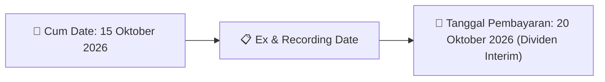
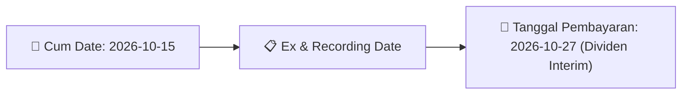
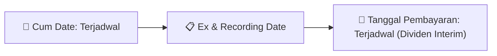
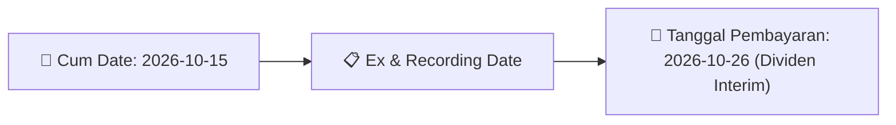
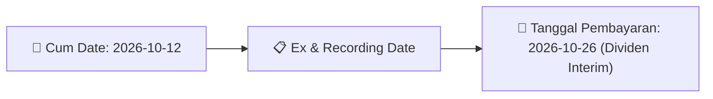

# Ikhtisar Pasar Harian (Daily Digest) - 2026-10-06

📅 **2026-10-06 (Daily Digest)**

## 1. Radar Pasar & Sentimen Harian (Executive Dashboard)
> [!NOTE]
> Terdeteksi sebanyak **220 pengumuman baru** dari 83 emiten pantauan pada (2026-10-06).

| Metric | Jumlah | Status Radar |
| :--- | :---: | :--- |
| **🟢 Sentimen Bullish / Positif** | `6` | [[Dividen Interim]], [[Mandatory Tender Offer]], Kinerja Positif |
| **⚪ Sentimen Netral / Routine** | `87` | [[Tanggapan Penjelasan Bursa]], [[RUPS]], [[Pendaftaran Unit]] |
| **🔴 Sentimen Bearish / Alert** | `3` | Sengketa Hukum, Defisit / Gugatan (Nihil hari ini) |
| **📄 [[Laporan Keuangan]] Baru** | `2` | Memicu Analisis Keuangan Otomatis |

> [!IMPORTANT]
> **Ditemukan Laporan Keuangan Baru Hari Ini:**
> - **FLMC**: FinancialStatement-2026-II-FLMC ([Buka PDF](file:///g:/My Drive/Model2/reports/raw/FLMC/20261005_FLMC_FinancialStatement-2026-II-FLMC.pdf))
- **FLMC**: FinancialStatement-2026-II-FLMC. ([Buka PDF](file:///g:/My Drive/Model2/reports/raw/FLMC/20261005_FLMC_FinancialStatement-2026-II-FLMC.xlsx))
> 
> *Tugas Swarm Agent:* Lakukan analisis laporan keuangan mendalam per emiten secara terpisah untuk berkas-berkas di atas.

---

## 2. Sorotan Utama & Watchlist Strategis (Strategic Watchlist)
#### 💰 Watchlist Dividen & Distribution
- **[[BSBK]]**: Nomor Surat = 058/CS-BSBK/X/2026
- **[[BSBK]]**: Nama Emiten atau Perusahaan Publik = PT Wulandari Bangun Laksana Tbk
- **[[BSBK]]**: Bidang Usaha = Properti dan Real Estate
- **[[BSBK]]**: Telepon = 0542 - 765888
- **[[BSBK]]**: Alamat Surat Elektronik = corsec.wbl@gmail.com
- **[[BSBK]]**: Tanggal Kejadian = 01 Oktober 2025

#### 🎯 Watchlist Penawaran Tender Wajib (MTO) & Strategis
- **[[BUVA]]**: Pemegang Saham Utama dan Pengendali = [[PT Nusantara Utama Investama (NUI)]]
- **[[LUCY]]**: Keterangan Pengendali = [[Tidak]]
- **[[BKSL]]**: Pengendali = [[Tidak]]
- **[[FILM]]**: Keterangan Pengendali = [[Tidak]]
- **[[TAPG]]**: Pengendali = [[Tidak]]
- **[[TGUK]]**: Pihak Penjual/Pengendali Lama = [[PT Dinasti Kreatif Indonesia (DKI)]]

#### 📈 Watchlist Konversi Waran & Potensi Dilusi
- **[[CSIS]]**: Nama Waran = CSIS-W
- **[[CSIS]]**: Total Saham Setelah Konversi = 1.829.804.598
- **[[CSIS]]**: Sisa Waran Setelah Konversi = 52.275.340
- **[[INET]]**: Nama waran = INET-W2
- **[[INET]]**: Jumlah waran yang dikonversi = 2,420
- **[[INET]]**: Jumlah saham hasil konversi = 2.420

#### 👥 Watchlist Transaksi Orang Dalam & Kepemilikan Saham (Insider / Repo Moves)
- **[[PSSI]]**: Tanggal dan Waktu Pelaporan = 05-10-2026 11:45
- **[[LUCY]]**: Nama Pelapor = HP CAPITAL RESOURCES
- **[[LUCY]]**: Anggota Direksi/Dewan Komisaris = Tidak
- **[[LUCY]]**: Kewarganegaraan = WNI
- **[[LUCY]]**: Emiten = LUCY - LIMA DUA LIMA TIGA Tbk, PT
- **[[LUCY]]**: Nomor Laporan = LK/06102026/0001/1
- **[[LUCY]]**: Jenis Transaksi = Penjualan Tidak Langsung
- **[[LUCY]]**: Jumlah Saham Sebelum Transaksi = 194.275.700,00 Unit

---

## 3. Matriks Pengumuman Pasar (Announcements Intelligence Table)
| Emiten | Sentimen | Jenis Pengumuman | Judul Pengumuman | Berkas |
| :--- | :---: | :--- | :--- | :--- |
| **[[CSIS]]** | ⚪ NEUTRAL | Aksi Korporasi | Pencatatan Saham Tambahan dari Konversi | [Utama](file:///g:/My%20Drive/Model2/reports/raw/CSIS/20261006_CSIS_20261005_CSIS_Pencatatan Saham Tambahan dari Konversi_32163245.pdf) |
| **[[INET]]** | ⚪ NEUTRAL | Aksi Korporasi | Pencatatan Saham Tambahan dari Konversi | [Utama](file:///g:/My%20Drive/Model2/reports/raw/INET/20261006_INET_20261005_INET_Pencatatan Saham Tambahan dari Konversi_32163181.pdf) |
| **[[ISAP]]** | ⚪ NEUTRAL | Aksi Korporasi | Pencatatan Saham Tambahan dari Konversi | [Utama](file:///g:/My%20Drive/Model2/reports/raw/ISAP/20261006_ISAP_20261005_ISAP_Pencatatan Saham Tambahan dari Konversi_32163168.pdf) |
| **[[MGNA]]** | ⚪ NEUTRAL | Aksi Korporasi | Pencatatan Saham Tambahan dari Konversi | [Utama](file:///g:/My%20Drive/Model2/reports/raw/MGNA/20261006_MGNA_20261002_MGNA_Pencatatan Saham Tambahan dari Konversi_32162682.pdf) |
| **[[PSSI]]** | ⚪ NEUTRAL | RUPS | Pemanggilan RUPS | [Utama](file:///g:/My%20Drive/Model2/reports/raw/PSSI/20261006_PSSI_20261006_PSSI_Pemanggilan RUPS_32163600.pdf) · [Lamp 1](file:///g:/My%20Drive/Model2/reports/raw/PSSI/20261006_PSSI_20261006_PSSI_Pemanggilan RUPS_32163600_lamp1.pdf) |
| **[[PSSI]]** | ⚪ NEUTRAL | Aksi Korporasi | Laporan Informasi dan Fakta Material | [Utama](file:///g:/My%20Drive/Model2/reports/raw/PSSI/20261005_PSSI_20261005_PSSI_Laporan Informasi dan Fakta Material_32163127.pdf) · [Lamp 1](file:///g:/My%20Drive/Model2/reports/raw/PSSI/20261005_PSSI_20261005_PSSI_Laporan Informasi dan Fakta Material_32163127_lamp1.pdf) |
| **[[DJPU]]** | ⚪ NEUTRAL | Aksi Korporasi | Pengumuman Bursa | [Utama](file:///g:/My%20Drive/Model2/reports/raw/DJPU/20261006_DJPU_20261005_DJPU_Pengumuman Bursa_32162999.pdf) · [Lamp 1](file:///g:/My%20Drive/Model2/reports/raw/DJPU/20261006_DJPU_20261005_DJPU_Pengumuman Bursa_32162999_lamp1.pdf) · [Lamp 2](file:///g:/My%20Drive/Model2/reports/raw/DJPU/20261006_DJPU_20261005_DJPU_Pengumuman Bursa_32162999_lamp2.pdf) |
| **[[PJHB]]** | ⚪ NEUTRAL | Aksi Korporasi | Pencatatan Saham Tambahan dari Konversi | [Utama](file:///g:/My%20Drive/Model2/reports/raw/PJHB/20261005_PJHB_20261002_PJHB_Pencatatan Saham Tambahan dari Konversi_32162667.pdf) |
| **[[WIKA]]** | ⚪ NEUTRAL | RUPS | Pemberitahuan RencanaPenyampaian PanggilanHasil RUPORUPSURUP EBA-SP | [Utama](file:///g:/My%20Drive/Model2/reports/raw/WIKA/20261006_WIKA_20261005_WIKA_Pemberitahuan RencanaPenyampaian PanggilanHasil RUPORUPSURUP EBA-SP_32163006.pdf) · [Lamp 1](file:///g:/My%20Drive/Model2/reports/raw/WIKA/20261006_WIKA_20261005_WIKA_Pemberitahuan RencanaPenyampaian PanggilanHasil RUPORUPSURUP EBA-SP_32163023_lamp1.pdf) · [Lamp 1](file:///g:/My%20Drive/Model2/reports/raw/WIKA/20261006_WIKA_20261005_WIKA_Pemberitahuan RencanaPenyampaian PanggilanHasil RUPORUPSURUP EBA-SP_32163020_lamp1.pdf) · [Lamp 1](file:///g:/My%20Drive/Model2/reports/raw/WIKA/20261006_WIKA_20261005_WIKA_Pemberitahuan RencanaPenyampaian PanggilanHasil RUPORUPSURUP EBA-SP_32163015_lamp1.pdf) · [Lamp 1](file:///g:/My%20Drive/Model2/reports/raw/WIKA/20261006_WIKA_20261005_WIKA_Pemberitahuan RencanaPenyampaian PanggilanHasil RUPORUPSURUP EBA-SP_32163010_lamp1.pdf) · [Lamp 1](file:///g:/My%20Drive/Model2/reports/raw/WIKA/20261006_WIKA_20261005_WIKA_Pemberitahuan RencanaPenyampaian PanggilanHasil RUPORUPSURUP EBA-SP_32163007_lamp1.pdf) · [Lamp 1](file:///g:/My%20Drive/Model2/reports/raw/WIKA/20261006_WIKA_20261005_WIKA_Pemberitahuan RencanaPenyampaian PanggilanHasil RUPORUPSURUP EBA-SP_32163006_lamp1.pdf) |
| **[[WIKA]]** | ⚪ NEUTRAL | Public Expose | Public Expose | [Utama](file:///g:/My%20Drive/Model2/reports/raw/WIKA/20261006_WIKA_20261005_WIKA_Public Expose_32163176.pdf) · [Lamp 1](file:///g:/My%20Drive/Model2/reports/raw/WIKA/20261006_WIKA_20261005_WIKA_Public Expose_32163176_lamp1.pdf) |
| **[[BUVA]]** | ⚪ NEUTRAL | Aksi Korporasi | Keterbukaan Informasi terkait Aksi Korporasi | [Utama](file:///g:/My%20Drive/Model2/reports/raw/BUVA/20261006_BUVA_20261006_BUVA_Keterbukaan Informasi terkait Aksi Korporasi_32163479.pdf) · [Lamp 2](file:///g:/My%20Drive/Model2/reports/raw/BUVA/20261006_BUVA_20261006_BUVA_Keterbukaan Informasi terkait Aksi Korporasi_32163479_lamp2.pdf) · [Lamp 1](file:///g:/My%20Drive/Model2/reports/raw/BUVA/20261006_BUVA_20261006_BUVA_Keterbukaan Informasi terkait Aksi Korporasi_32163479_lamp1.pdf) |
| **[[BUVA]]** | ⚪ NEUTRAL | Aksi Korporasi | Penyampaian ProspektusInformasi Tambahan | [Utama](file:///g:/My%20Drive/Model2/reports/raw/BUVA/20261006_BUVA_20261006_BUVA_Penyampaian ProspektusInformasi Tambahan_32163468.pdf) · [Lamp 1](file:///g:/My%20Drive/Model2/reports/raw/BUVA/20261006_BUVA_20261006_BUVA_Penyampaian ProspektusInformasi Tambahan_32163468_lamp1.pdf) |
| **[[LUCY]]** | ⚪ NEUTRAL | Kepemilikan Saham (Insider) | LK-06102026-9727-00 | [Utama](file:///g:/My%20Drive/Model2/reports/raw/LUCY/20261006_LUCY_LK-06102026-9727-00.pdf) |
| **[[PYFA]]** | ⚪ NEUTRAL | Aksi Korporasi | Pencatatan Saham Tambahan dari Konversi | [Utama](file:///g:/My%20Drive/Model2/reports/raw/PYFA/20261006_PYFA_20261002_PYFA_Pencatatan Saham Tambahan dari Konversi_32162702.pdf) |
| **[[PYFA]]** | ⚪ NEUTRAL | RUPS | Pemberitahuan RencanaPenyampaian PanggilanHasil RUPORUPSURUP EBA-SP | [Utama](file:///g:/My%20Drive/Model2/reports/raw/PYFA/20261005_PYFA_20261005_PYFA_Pemberitahuan RencanaPenyampaian PanggilanHasil RUPORUPSURUP EBA-SP_32163213.pdf) · [Lamp 1](file:///g:/My%20Drive/Model2/reports/raw/PYFA/20261005_PYFA_20261005_PYFA_Pemberitahuan RencanaPenyampaian PanggilanHasil RUPORUPSURUP EBA-SP_32163213_lamp1.pdf) |
| **[[PGEO]]** | ⚪ NEUTRAL | Aksi Korporasi | Pencatatan Saham Tambahan dari Konversi | [Utama](file:///g:/My%20Drive/Model2/reports/raw/PGEO/20261006_PGEO_20261005_PGEO_Pencatatan Saham Tambahan dari Konversi_32163167.pdf) |
| **[[BINO]]** | ⚪ NEUTRAL | Aksi Korporasi | Laporan Penggunaan Dana Hasil Penawaran Umum | [Utama](file:///g:/My%20Drive/Model2/reports/raw/BINO/20261006_BINO_20261005_BINO_Laporan Penggunaan Dana Hasil Penawaran Umum_32163038.pdf) · [Lamp 3](file:///g:/My%20Drive/Model2/reports/raw/BINO/20261006_BINO_20261005_BINO_Laporan Penggunaan Dana Hasil Penawaran Umum_32163038_lamp3.pdf) · [Lamp 2](file:///g:/My%20Drive/Model2/reports/raw/BINO/20261006_BINO_20261005_BINO_Laporan Penggunaan Dana Hasil Penawaran Umum_32163038_lamp2.pdf) · [Lamp 4](file:///g:/My%20Drive/Model2/reports/raw/BINO/20261006_BINO_20261005_BINO_Laporan Penggunaan Dana Hasil Penawaran Umum_32163038_lamp4.pdf) |
| **[[EDGE]]** | ⚪ NEUTRAL | Aksi Korporasi | Laporan Informasi dan Fakta Material | [Utama](file:///g:/My%20Drive/Model2/reports/raw/EDGE/20261006_EDGE_20261006_EDGE_Laporan Informasi dan Fakta Material_32163475.pdf) · [Lamp 1](file:///g:/My%20Drive/Model2/reports/raw/EDGE/20261006_EDGE_20261006_EDGE_Laporan Informasi dan Fakta Material_32163475_lamp1.pdf) |
| **[[KOCI]]** | ⚪ NEUTRAL | Aksi Korporasi | Pencatatan Saham Tambahan dari Konversi | [Utama](file:///g:/My%20Drive/Model2/reports/raw/KOCI/20261005_KOCI_20261002_KOCI_Pencatatan Saham Tambahan dari Konversi_32162655.pdf) · [Lamp 1](file:///g:/My%20Drive/Model2/reports/raw/KOCI/20261006_KOCI_20261005_KOCI_Pencatatan Saham Tambahan dari Konversi_32163069_lamp1.pdf) |
| **[[TALF]]** | ⚪ NEUTRAL | Aksi Korporasi | Informasi Transaksi Afiliasi | [Utama](file:///g:/My%20Drive/Model2/reports/raw/TALF/20261006_TALF_20261006_TALF_Informasi Transaksi Afiliasi_32163633.pdf) · [Lamp 1](file:///g:/My%20Drive/Model2/reports/raw/TALF/20261006_TALF_20261006_TALF_Informasi Transaksi Afiliasi_32163633_lamp1.pdf) |
| **[[TALF]]** | ⚪ NEUTRAL | RUPS | Transaksi Material Tanpa Persetujuan RUPS | [Utama](file:///g:/My%20Drive/Model2/reports/raw/TALF/20261005_TALF_20261005_TALF_Transaksi Material Tanpa Persetujuan RUPS_32163329.pdf) · [Lamp 1](file:///g:/My%20Drive/Model2/reports/raw/TALF/20261005_TALF_20261005_TALF_Transaksi Material Tanpa Persetujuan RUPS_32163329_lamp1.pdf) |
| **[[POOL]]** | ⚪ NEUTRAL | Aksi Korporasi | Laporan Informasi dan Fakta Material | [Utama](file:///g:/My%20Drive/Model2/reports/raw/POOL/20261006_POOL_20261006_POOL_Laporan Informasi dan Fakta Material_32163542.pdf) |
| **[[FORU]]** | ⚪ NEUTRAL | Aksi Korporasi | Pencatatan Saham Tambahan dari Konversi | [Utama](file:///g:/My%20Drive/Model2/reports/raw/FORU/20261006_FORU_20261005_FORU_Pencatatan Saham Tambahan dari Konversi_32163169.pdf) |
| **[[INPS]]** | ⚪ NEUTRAL | Aksi Korporasi | Laporan Informasi dan Fakta Material | [Utama](file:///g:/My%20Drive/Model2/reports/raw/INPS/20261006_INPS_20261006_INPS_Laporan Informasi dan Fakta Material_32163577.pdf) |
| **[[IATA]]** | ⚪ NEUTRAL | Aksi Korporasi | Pengumuman Jatuh Tempo Obligasi dan Sukuk | [Utama](file:///g:/My%20Drive/Model2/reports/raw/IATA/20261006_IATA_20261005_IATA_Pengumuman Jatuh Tempo Obligasi dan Sukuk_32163300.pdf) · [Lamp 2](file:///g:/My%20Drive/Model2/reports/raw/IATA/20261006_IATA_20261005_IATA_Pengumuman Jatuh Tempo Obligasi dan Sukuk_32163300_lamp2.pdf) · [Lamp 1](file:///g:/My%20Drive/Model2/reports/raw/IATA/20261006_IATA_20261005_IATA_Pengumuman Jatuh Tempo Obligasi dan Sukuk_32163300_lamp1.pdf) |
| **[[BLOG]]** | ⚪ NEUTRAL | Aksi Korporasi | Laporan Penggunaan Dana Hasil Penawaran Umum | [Utama](file:///g:/My%20Drive/Model2/reports/raw/BLOG/20261005_BLOG_20261005_BLOG_Laporan Penggunaan Dana Hasil Penawaran Umum_32163283.pdf) |
| **[[SOCI]]** | ⚪ NEUTRAL | Aksi Korporasi | Pembayaran KuponBagi HasilIjarahPokok | [Utama](file:///g:/My%20Drive/Model2/reports/raw/SOCI/20261006_SOCI_20261002_SOCI_Pembayaran KuponBagi HasilIjarahPokok_32162850.pdf) |
| **[[LPPI]]** | ⚪ NEUTRAL | Aksi Korporasi | Pengumuman Jatuh Tempo Obligasi dan Sukuk | [Utama](file:///g:/My%20Drive/Model2/reports/raw/LPPI/20261006_LPPI_20261005_LPPI_Pengumuman Jatuh Tempo Obligasi dan Sukuk_32163289.pdf) · [Lamp 2](file:///g:/My%20Drive/Model2/reports/raw/LPPI/20261006_LPPI_20261005_LPPI_Pengumuman Jatuh Tempo Obligasi dan Sukuk_32163289_lamp2.pdf) |
| **[[PPRI]]** | ⚪ NEUTRAL | Kepemilikan Saham (Insider) | LK-06102026-2548-00 | [Utama](file:///g:/My%20Drive/Model2/reports/raw/PPRI/20261006_PPRI_LK-06102026-2548-00.pdf) |
| **[[PPRI]]** | ⚪ NEUTRAL | Aksi Korporasi | Laporan Penggunaan Dana Hasil Penawaran Umum | [Utama](file:///g:/My%20Drive/Model2/reports/raw/PPRI/20261005_PPRI_20261005_PPRI_Laporan Penggunaan Dana Hasil Penawaran Umum_32162964.pdf) · [Lamp 1](file:///g:/My%20Drive/Model2/reports/raw/PPRI/20261005_PPRI_20261005_PPRI_Laporan Penggunaan Dana Hasil Penawaran Umum_32162964_lamp1.pdf) |
| **[[IKAI]]** | ⚪ NEUTRAL | Kepemilikan Saham (Insider) | LK-06102026-0602-00 | [Utama](file:///g:/My%20Drive/Model2/reports/raw/IKAI/20261006_IKAI_LK-06102026-0602-00.pdf) |
| **[[BOLD]]** | ⚪ NEUTRAL | Aksi Korporasi | Laporan Informasi dan Fakta Material | [Utama](file:///g:/My%20Drive/Model2/reports/raw/BOLD/20261006_BOLD_20261006_BOLD_Laporan Informasi dan Fakta Material_32163492.pdf) · [Lamp 1](file:///g:/My%20Drive/Model2/reports/raw/BOLD/20261006_BOLD_20261006_BOLD_Laporan Informasi dan Fakta Material_32163492_lamp1.pdf) |
| **[[ASDF]]** | ⚪ NEUTRAL | Aksi Korporasi | Laporan Informasi dan Fakta Material | [Utama](file:///g:/My%20Drive/Model2/reports/raw/ASDF/20261005_ASDF_20261005_ASDF_Laporan Informasi dan Fakta Material_32163087.pdf) |
| **[[BCIC]]** | ⚪ NEUTRAL | Public Expose | Public Expose | [Utama](file:///g:/My%20Drive/Model2/reports/raw/BCIC/20261005_BCIC_20261005_BCIC_Public Expose_32163232.pdf) |
| **[[UVCR]]** | ⚪ NEUTRAL | RUPS | Pemanggilan RUPS | [Utama](file:///g:/My%20Drive/Model2/reports/raw/UVCR/20261005_UVCR_20261005_UVCR_Pemanggilan RUPS_32163200.pdf) · [Lamp 1](file:///g:/My%20Drive/Model2/reports/raw/UVCR/20261005_UVCR_20261005_UVCR_Pemanggilan RUPS_32163200_lamp1.pdf) |
| **[[NSSS]]** | ⚪ NEUTRAL | Kepemilikan Saham (Insider) | LK-05102026-7470-00 | [Utama](file:///g:/My%20Drive/Model2/reports/raw/NSSS/20261005_NSSS_LK-05102026-7470-00.pdf) |
| **[[GJTL]]** | ⚪ NEUTRAL | Aksi Korporasi | Pengumuman Bursa | [Utama](file:///g:/My%20Drive/Model2/reports/raw/GJTL/20261005_GJTL_20261005_GJTL_Pengumuman Bursa_32163029.pdf) · [Lamp 1](file:///g:/My%20Drive/Model2/reports/raw/GJTL/20261005_GJTL_20261005_GJTL_Pengumuman Bursa_32163029_lamp1.pdf) |
| **[[CYBR]]** | ⚪ NEUTRAL | Kepemilikan Saham (Insider) | LK-05102026-7781-00 | [Utama](file:///g:/My%20Drive/Model2/reports/raw/CYBR/20261005_CYBR_LK-05102026-7781-00.pdf) |
| **[[CASH]]** | ⚪ NEUTRAL | Public Expose | Public Expose | [Utama](file:///g:/My%20Drive/Model2/reports/raw/CASH/20261005_CASH_20261005_CASH_Public Expose_32163400.pdf) · [Lamp 1](file:///g:/My%20Drive/Model2/reports/raw/CASH/20261005_CASH_20261005_CASH_Public Expose_32163400_lamp1.pdf) |
| **[[CASH]]** | ⚪ NEUTRAL | Aksi Korporasi | Laporan Informasi dan Fakta Material | [Utama](file:///g:/My%20Drive/Model2/reports/raw/CASH/20261005_CASH_20261005_CASH_Laporan Informasi dan Fakta Material_32163210.pdf) · [Lamp 1](file:///g:/My%20Drive/Model2/reports/raw/CASH/20261005_CASH_20261005_CASH_Laporan Informasi dan Fakta Material_32163210_lamp1.pdf) · [Lamp 3](file:///g:/My%20Drive/Model2/reports/raw/CASH/20261005_CASH_20261005_CASH_Laporan Informasi dan Fakta Material_32163210_lamp3.pdf) · [Lamp 2](file:///g:/My%20Drive/Model2/reports/raw/CASH/20261005_CASH_20261005_CASH_Laporan Informasi dan Fakta Material_32163210_lamp2.pdf) · [Lamp 4](file:///g:/My%20Drive/Model2/reports/raw/CASH/20261005_CASH_20261005_CASH_Laporan Informasi dan Fakta Material_32163210_lamp4.pdf) |
| **[[SMMT]]** | ⚪ NEUTRAL | Public Expose | Public Expose | [Utama](file:///g:/My%20Drive/Model2/reports/raw/SMMT/20261005_SMMT_20261005_SMMT_Public Expose_32163171.pdf) |
| **[[MANG]]** | ⚪ NEUTRAL | Aksi Korporasi | Pencatatan Saham Tambahan dari Konversi | [Utama](file:///g:/My%20Drive/Model2/reports/raw/MANG/20261005_MANG_20261002_MANG_Pencatatan Saham Tambahan dari Konversi_32162727.pdf) · [Lamp 1](file:///g:/My%20Drive/Model2/reports/raw/MANG/20261005_MANG_20261002_MANG_Pencatatan Saham Tambahan dari Konversi_32162727_lamp1.pdf) |
| **[[MANG]]** | ⚪ NEUTRAL | Aksi Korporasi | Laporan Penggunaan Dana Hasil Penawaran Umum | [Utama](file:///g:/My%20Drive/Model2/reports/raw/MANG/20261005_MANG_20261005_MANG_Laporan Penggunaan Dana Hasil Penawaran Umum_32163285.pdf) · [Lamp 1](file:///g:/My%20Drive/Model2/reports/raw/MANG/20261005_MANG_20261005_MANG_Laporan Penggunaan Dana Hasil Penawaran Umum_32163285_lamp1.pdf) |
| **[[BSBK]]** | 🟢 BULLISH | Dividen | Laporan Informasi dan Fakta Material | [Utama](file:///g:/My%20Drive/Model2/reports/raw/BSBK/20261005_BSBK_20261005_BSBK_Laporan Informasi dan Fakta Material_32163433.pdf) · [Lamp 1](file:///g:/My%20Drive/Model2/reports/raw/BSBK/20261005_BSBK_20261005_BSBK_Laporan Informasi dan Fakta Material_32163433_lamp1.pdf) |
| **[[BSBK]]** | 🟢 BULLISH | Dividen | Jadwal Aksi Korporasi (Khusus Penyampaian Dividen Interim) | [Utama](file:///g:/My%20Drive/Model2/reports/raw/BSBK/20261005_BSBK_20261005_BSBK_Jadwal Aksi Korporasi (Khusus Penyampaian Dividen Interim)_32163425.pdf) · [Lamp 3](file:///g:/My%20Drive/Model2/reports/raw/BSBK/20261005_BSBK_20261005_BSBK_Jadwal Aksi Korporasi (Khusus Penyampaian Dividen Interim)_32163425_lamp3.pdf) · [Lamp 4](file:///g:/My%20Drive/Model2/reports/raw/BSBK/20261005_BSBK_20261005_BSBK_Jadwal Aksi Korporasi (Khusus Penyampaian Dividen Interim)_32163425_lamp4.pdf) · [Lamp 1](file:///g:/My%20Drive/Model2/reports/raw/BSBK/20261005_BSBK_20261005_BSBK_Jadwal Aksi Korporasi (Khusus Penyampaian Dividen Interim)_32163425_lamp1.pdf) · [Lamp 2](file:///g:/My%20Drive/Model2/reports/raw/BSBK/20261005_BSBK_20261005_BSBK_Jadwal Aksi Korporasi (Khusus Penyampaian Dividen Interim)_32163425_lamp2.pdf) |
| **[[BKSL]]** | ⚪ NEUTRAL | Kepemilikan Saham (Insider) | LK-05102026-1915-00 | [Utama](file:///g:/My%20Drive/Model2/reports/raw/BKSL/20261005_BKSL_LK-05102026-1915-00.pdf) |
| **[[FILM]]** | ⚪ NEUTRAL | Kepemilikan Saham (Insider) | LK-05102026-8376-00 | [Utama](file:///g:/My%20Drive/Model2/reports/raw/FILM/20261005_FILM_LK-05102026-8376-00.pdf) |
| **[[TAPG]]** | ⚪ NEUTRAL | Kepemilikan Saham (Insider) | LK-05102026-0374-00 | [Utama](file:///g:/My%20Drive/Model2/reports/raw/TAPG/20261005_TAPG_LK-05102026-0374-00.pdf) |
| **[[DEWI]]** | ⚪ NEUTRAL | Aksi Korporasi | Tanggapan atas Permintaan Penjelasan Bursa | [Utama](file:///g:/My%20Drive/Model2/reports/raw/DEWI/20261005_DEWI_20261005_DEWI_Tanggapan atas Permintaan Penjelasan Bursa_32163397.pdf) · [Lamp 1](file:///g:/My%20Drive/Model2/reports/raw/DEWI/20261005_DEWI_20261005_DEWI_Tanggapan atas Permintaan Penjelasan Bursa_32163397_lamp1.pdf) |
| **[[KRAS]]** | ⚪ NEUTRAL | RUPS | Transaksi Material Tanpa Persetujuan RUPS | [Utama](file:///g:/My%20Drive/Model2/reports/raw/KRAS/20261005_KRAS_20261005_KRAS_Transaksi Material Tanpa Persetujuan RUPS_32163259.pdf) · [Lamp 1](file:///g:/My%20Drive/Model2/reports/raw/KRAS/20261005_KRAS_20261005_KRAS_Transaksi Material Tanpa Persetujuan RUPS_32163259_lamp1.pdf) |
| **[[MGLV]]** | ⚪ NEUTRAL | RUPS | Transaksi Material Tanpa Persetujuan RUPS | [Utama](file:///g:/My%20Drive/Model2/reports/raw/MGLV/20261005_MGLV_20261005_MGLV_Transaksi Material Tanpa Persetujuan RUPS_32163444.pdf) · [Lamp 1](file:///g:/My%20Drive/Model2/reports/raw/MGLV/20261005_MGLV_20261005_MGLV_Transaksi Material Tanpa Persetujuan RUPS_32163444_lamp1.pdf) |
| **[[PTPP]]** | ⚪ NEUTRAL | Aksi Korporasi | Laporan Informasi dan Fakta Material | [Utama](file:///g:/My%20Drive/Model2/reports/raw/PTPP/20261005_PTPP_20260923_PTPP_Laporan Informasi dan Fakta Material_32150623.pdf) · [Lamp 1](file:///g:/My%20Drive/Model2/reports/raw/PTPP/20261005_PTPP_20260923_PTPP_Laporan Informasi dan Fakta Material_32150623_lamp1.pdf) |
| **[[SONA]]** | ⚪ NEUTRAL | Public Expose | Public Expose | [Utama](file:///g:/My%20Drive/Model2/reports/raw/SONA/20261005_SONA_20261005_SONA_Public Expose_32163338.pdf) · [Lamp 2](file:///g:/My%20Drive/Model2/reports/raw/SONA/20261005_SONA_20261005_SONA_Public Expose_32163338_lamp2.pdf) |
| **[[POLI]]** | ⚪ NEUTRAL | Public Expose | Public Expose | [Utama](file:///g:/My%20Drive/Model2/reports/raw/POLI/20261005_POLI_20261005_POLI_Public Expose_32163256.pdf) · [Lamp 1](file:///g:/My%20Drive/Model2/reports/raw/POLI/20261005_POLI_20261005_POLI_Public Expose_32163256_lamp1.pdf) |
| **[[HGII]]** | ⚪ NEUTRAL | Kepemilikan Saham (Insider) | LK-05102026-7168-00 | [Utama](file:///g:/My%20Drive/Model2/reports/raw/HGII/20261005_HGII_LK-05102026-7168-00.pdf) |
| **[[POLU]]** | ⚪ NEUTRAL | Public Expose | Public Expose | [Utama](file:///g:/My%20Drive/Model2/reports/raw/POLU/20261005_POLU_20261005_POLU_Public Expose_32163309.pdf) · [Lamp 1](file:///g:/My%20Drive/Model2/reports/raw/POLU/20261005_POLU_20261005_POLU_Public Expose_32163309_lamp1.pdf) |
| **[[LPKR]]** | ⚪ NEUTRAL | Aksi Korporasi | Tanggapan atas Permintaan Penjelasan Bursa | [Utama](file:///g:/My%20Drive/Model2/reports/raw/LPKR/20261005_LPKR_20261005_LPKR_Tanggapan atas Permintaan Penjelasan Bursa_32163364.pdf) · [Lamp 1](file:///g:/My%20Drive/Model2/reports/raw/LPKR/20261005_LPKR_20261005_LPKR_Tanggapan atas Permintaan Penjelasan Bursa_32163364_lamp1.pdf) |
| **[[TGUK]]** | ⚪ NEUTRAL | Aksi Korporasi | Laporan Informasi dan Fakta Material | [Utama](file:///g:/My%20Drive/Model2/reports/raw/TGUK/20261005_TGUK_20261005_TGUK_Laporan Informasi dan Fakta Material_32163390.pdf) · [Lamp 2](file:///g:/My%20Drive/Model2/reports/raw/TGUK/20261005_TGUK_20261005_TGUK_Laporan Informasi dan Fakta Material_32163390_lamp2.pdf) · [Lamp 3](file:///g:/My%20Drive/Model2/reports/raw/TGUK/20261005_TGUK_20261005_TGUK_Laporan Informasi dan Fakta Material_32163390_lamp3.pdf) · [Lamp 1](file:///g:/My%20Drive/Model2/reports/raw/TGUK/20261005_TGUK_20261005_TGUK_Laporan Informasi dan Fakta Material_32163390_lamp1.pdf) |
| **[[TPIA]]** | ⚪ NEUTRAL | Aksi Korporasi | Laporan Informasi dan Fakta Material | [Utama](file:///g:/My%20Drive/Model2/reports/raw/TPIA/20261005_TPIA_20261005_TPIA_Laporan Informasi dan Fakta Material_32162976.pdf) · [Lamp 1](file:///g:/My%20Drive/Model2/reports/raw/TPIA/20261005_TPIA_20261005_TPIA_Laporan Informasi dan Fakta Material_32162976_lamp1.pdf) |
| **[[KETR]]** | ⚪ NEUTRAL | Aksi Korporasi | Tanggapan atas Permintaan Penjelasan Bursa | [Utama](file:///g:/My%20Drive/Model2/reports/raw/KETR/20261005_KETR_20261005_KETR_Tanggapan atas Permintaan Penjelasan Bursa_32163386.pdf) |
| **[[MERK]]** | ⚪ NEUTRAL | Public Expose | Public Expose | [Utama](file:///g:/My%20Drive/Model2/reports/raw/MERK/20261005_MERK_20261005_MERK_Public Expose_32163359.pdf) · [Lamp 3](file:///g:/My%20Drive/Model2/reports/raw/MERK/20261005_MERK_20261005_MERK_Public Expose_32163359_lamp3.pdf) · [Lamp 2](file:///g:/My%20Drive/Model2/reports/raw/MERK/20261005_MERK_20261005_MERK_Public Expose_32163359_lamp2.pdf) |
| **[[DRMA]]** | ⚪ NEUTRAL | Kepemilikan Saham (Insider) | LK-05102026-2674-00 | [Utama](file:///g:/My%20Drive/Model2/reports/raw/DRMA/20261005_DRMA_LK-05102026-2674-00.pdf) |
| **[[BSWD]]** | ⚪ NEUTRAL | Public Expose | Public Expose | [Utama](file:///g:/My%20Drive/Model2/reports/raw/BSWD/20261005_BSWD_20261005_BSWD_Public Expose_32163286.pdf) |
| **[[FLMC]]** | ⚪ NEUTRAL | Laporan Keuangan | FinancialStatement-2026-II-FLMC | [Utama](file:///g:/My%20Drive/Model2/reports/raw/FLMC/20261005_FLMC_FinancialStatement-2026-II-FLMC.pdf) |
| **[[FLMC]]** | ⚪ NEUTRAL | Aksi Korporasi | 034 - Bursa - Penjelasan Perubahan Aset | [Utama](file:///g:/My%20Drive/Model2/reports/raw/FLMC/20261005_FLMC_034 - Bursa - Penjelasan Perubahan Aset.pdf) |
| **[[FLMC]]** | ⚪ NEUTRAL | Laporan Keuangan | FinancialStatement-2026-II-FLMC. | [Utama](file:///g:/My%20Drive/Model2/reports/raw/FLMC/20261005_FLMC_FinancialStatement-2026-II-FLMC.xlsx) |
| **[[FLMC]]** | ⚪ NEUTRAL | Aksi Korporasi | LK JUNI 2026 AUDITED 1 | [Utama](file:///g:/My%20Drive/Model2/reports/raw/FLMC/20261005_FLMC_LK JUNI 2026_AUDITED_1.pdf) |
| **[[AMRT]]** | 🟢 BULLISH | Dividen | Jadwal Aksi Korporasi (Khusus Penyampaian Dividen Interim) | [Utama](file:///g:/My%20Drive/Model2/reports/raw/AMRT/20261005_AMRT_20261005_AMRT_Jadwal Aksi Korporasi (Khusus Penyampaian Dividen Interim)_32163009.pdf) · [Lamp 1](file:///g:/My%20Drive/Model2/reports/raw/AMRT/20261005_AMRT_20261005_AMRT_Jadwal Aksi Korporasi (Khusus Penyampaian Dividen Interim)_32163009_lamp1.pdf) |
| **[[BMBL]]** | ⚪ NEUTRAL | RUPS | Pengumuman RUPS | [Utama](file:///g:/My%20Drive/Model2/reports/raw/BMBL/20261005_BMBL_20261005_BMBL_Pengumuman RUPS_32163231.pdf) · [Lamp 1](file:///g:/My%20Drive/Model2/reports/raw/BMBL/20261005_BMBL_20261005_BMBL_Pengumuman RUPS_32163231_lamp1.pdf) |
| **[[APEX]]** | ⚪ NEUTRAL | Aksi Korporasi | Perubahan danatau Tambahan Keterbukaan Informasi terkait Aksi Korporasi | [Utama](file:///g:/My%20Drive/Model2/reports/raw/APEX/20261005_APEX_20261005_APEX_Perubahan danatau Tambahan Keterbukaan Informasi terkait Aksi Korporasi_32163362.pdf) · [Lamp 3](file:///g:/My%20Drive/Model2/reports/raw/APEX/20261005_APEX_20261005_APEX_Perubahan danatau Tambahan Keterbukaan Informasi terkait Aksi Korporasi_32163362_lamp3.pdf) · [Lamp 2](file:///g:/My%20Drive/Model2/reports/raw/APEX/20261005_APEX_20261005_APEX_Perubahan danatau Tambahan Keterbukaan Informasi terkait Aksi Korporasi_32163362_lamp2.pdf) |
| **[[BAJA]]** | ⚪ NEUTRAL | Aksi Korporasi | Pencatatan Saham Tambahan dari Konversi | [Utama](file:///g:/My%20Drive/Model2/reports/raw/BAJA/20261005_BAJA_20261005_BAJA_Pencatatan Saham Tambahan dari Konversi_32163132.pdf) · [Lamp 1](file:///g:/My%20Drive/Model2/reports/raw/BAJA/20261005_BAJA_20261005_BAJA_Pencatatan Saham Tambahan dari Konversi_32163132_lamp1.pdf) |
| **[[UNIQ]]** | ⚪ NEUTRAL | Aksi Korporasi | Tanggapan atas Permintaan Penjelasan Bursa | [Utama](file:///g:/My%20Drive/Model2/reports/raw/UNIQ/20261005_UNIQ_20261005_UNIQ_Tanggapan atas Permintaan Penjelasan Bursa_32163035.pdf) |
| **[[ULTJ]]** | 🟢 BULLISH | Dividen | Pemanggilan RUPS | [Utama](file:///g:/My%20Drive/Model2/reports/raw/ULTJ/20261005_ULTJ_20261005_ULTJ_Pemanggilan RUPS_32163136.pdf) · [Lamp 1](file:///g:/My%20Drive/Model2/reports/raw/ULTJ/20261005_ULTJ_20261005_ULTJ_Pemanggilan RUPS_32163136_lamp1.pdf) |
| **[[KIOS]]** | ⚪ NEUTRAL | RUPS | Pemanggilan RUPS | [Utama](file:///g:/My%20Drive/Model2/reports/raw/KIOS/20261005_KIOS_20261005_KIOS_Pemanggilan RUPS_32163284.pdf) · [Lamp 1](file:///g:/My%20Drive/Model2/reports/raw/KIOS/20261005_KIOS_20261005_KIOS_Pemanggilan RUPS_32163284_lamp1.pdf) · [Lamp 2](file:///g:/My%20Drive/Model2/reports/raw/KIOS/20261005_KIOS_20261005_KIOS_Pemanggilan RUPS_32163284_lamp2.pdf) |
| **[[AUTO]]** | 🟢 BULLISH | Dividen | Jadwal Aksi Korporasi (Khusus Penyampaian Dividen Interim) | [Utama](file:///g:/My%20Drive/Model2/reports/raw/AUTO/20261005_AUTO_20261005_AUTO_Jadwal Aksi Korporasi (Khusus Penyampaian Dividen Interim)_32163401.pdf) · [Lamp 3](file:///g:/My%20Drive/Model2/reports/raw/AUTO/20261005_AUTO_20261005_AUTO_Jadwal Aksi Korporasi (Khusus Penyampaian Dividen Interim)_32163401_lamp3.pdf) |
| **[[GTBO]]** | ⚪ NEUTRAL | Aksi Korporasi | Tanggapan atas Permintaan Penjelasan Bursa | [Utama](file:///g:/My%20Drive/Model2/reports/raw/GTBO/20261005_GTBO_20261005_GTBO_Tanggapan atas Permintaan Penjelasan Bursa_32163439.pdf) · [Lamp 1](file:///g:/My%20Drive/Model2/reports/raw/GTBO/20261005_GTBO_20261005_GTBO_Tanggapan atas Permintaan Penjelasan Bursa_32163439_lamp1.pdf) |
| **[[KING]]** | ⚪ NEUTRAL | Aksi Korporasi | Laporan Informasi dan Fakta Material | [Utama](file:///g:/My%20Drive/Model2/reports/raw/KING/20261005_KING_20261005_KING_Laporan Informasi dan Fakta Material_32163459.pdf) · [Lamp 1](file:///g:/My%20Drive/Model2/reports/raw/KING/20261005_KING_20261005_KING_Laporan Informasi dan Fakta Material_32163459_lamp1.pdf) |
| **[[INDO]]** | ⚪ NEUTRAL | Aksi Korporasi | Pengumuman Bursa | [Utama](file:///g:/My%20Drive/Model2/reports/raw/INDO/20261005_INDO_20261005_INDO_Pengumuman Bursa_32162961.pdf) · [Lamp 1](file:///g:/My%20Drive/Model2/reports/raw/INDO/20261005_INDO_20261005_INDO_Pengumuman Bursa_32162961_lamp1.pdf) |
| **[[VKTR]]** | ⚪ NEUTRAL | Kepemilikan Saham (Insider) | LK-05102026-6612-00 | [Utama](file:///g:/My%20Drive/Model2/reports/raw/VKTR/20261005_VKTR_LK-05102026-6612-00.pdf) |
| **[[KREN]]** | ⚪ NEUTRAL | Aksi Korporasi | Tanggapan atas Permintaan Penjelasan Bursa | [Utama](file:///g:/My%20Drive/Model2/reports/raw/KREN/20261005_KREN_20261005_KREN_Tanggapan atas Permintaan Penjelasan Bursa_32163151.pdf) |
| **[[KOTA]]** | ⚪ NEUTRAL | RUPS | Pemanggilan RUPS | [Utama](file:///g:/My%20Drive/Model2/reports/raw/KOTA/20261005_KOTA_20261005_KOTA_Pemanggilan RUPS_32163435.pdf) |
| **[[MICE]]** | ⚪ NEUTRAL | Kepemilikan Saham (Insider) | LK-05102026-0085-00 | [Utama](file:///g:/My%20Drive/Model2/reports/raw/MICE/20261005_MICE_LK-05102026-0085-00.pdf) |
| **[[BJBR]]** | ⚪ NEUTRAL | Aksi Korporasi | Laporan Informasi dan Fakta Material | [Utama](file:///g:/My%20Drive/Model2/reports/raw/BJBR/20261005_BJBR_20261005_BJBR_Laporan Informasi dan Fakta Material_32163452.pdf) · [Lamp 2](file:///g:/My%20Drive/Model2/reports/raw/BJBR/20261005_BJBR_20261005_BJBR_Laporan Informasi dan Fakta Material_32163452_lamp2.pdf) |
| **[[NAYZ]]** | ⚪ NEUTRAL | RUPS | Ringkasan RisalahRisalah RUPS | [Utama](file:///g:/My%20Drive/Model2/reports/raw/NAYZ/20261005_NAYZ_20261005_NAYZ_Ringkasan RisalahRisalah RUPS_32163219.pdf) |
| **[[NAYZ]]** | ⚪ NEUTRAL | Aksi Korporasi | Laporan Informasi dan Fakta Material | [Utama](file:///g:/My%20Drive/Model2/reports/raw/NAYZ/20261005_NAYZ_20261005_NAYZ_Laporan Informasi dan Fakta Material_32163137.pdf) |
| **[[MEJA]]** | ⚪ NEUTRAL | Aksi Korporasi | Laporan Informasi dan Fakta Material | [Utama](file:///g:/My%20Drive/Model2/reports/raw/MEJA/20261005_MEJA_20261005_MEJA_Laporan Informasi dan Fakta Material_32163130.pdf) · [Lamp 1](file:///g:/My%20Drive/Model2/reports/raw/MEJA/20261005_MEJA_20261005_MEJA_Laporan Informasi dan Fakta Material_32163130_lamp1.pdf) |
| **[[SUPR]]** | 🔴 BEARISH | Aksi Korporasi | Pengumuman Bursa | [Utama](file:///g:/My%20Drive/Model2/reports/raw/SUPR/20261005_SUPR_20261005_SUPR_Pengumuman Bursa_32163126.pdf) · [Lamp 1](file:///g:/My%20Drive/Model2/reports/raw/SUPR/20261005_SUPR_20261005_SUPR_Pengumuman Bursa_32163126_lamp1.pdf) |
| **[[FWCT]]** | ⚪ NEUTRAL | Aksi Korporasi | Tanggapan atas Permintaan Penjelasan Bursa | [Utama](file:///g:/My%20Drive/Model2/reports/raw/FWCT/20261005_FWCT_20261005_FWCT_Tanggapan atas Permintaan Penjelasan Bursa_32163263.pdf) |
| **[[GDYR]]** | ⚪ NEUTRAL | Aksi Korporasi | Tanggapan atas Permintaan Penjelasan Bursa | [Utama](file:///g:/My%20Drive/Model2/reports/raw/GDYR/20261005_GDYR_20261005_GDYR_Tanggapan atas Permintaan Penjelasan Bursa_32163357.pdf) · [Lamp 1](file:///g:/My%20Drive/Model2/reports/raw/GDYR/20261005_GDYR_20261005_GDYR_Tanggapan atas Permintaan Penjelasan Bursa_32163357_lamp1.pdf) |
| **[[UNVR]]** | ⚪ NEUTRAL | Aksi Korporasi | Pengumuman Bursa | [Utama](file:///g:/My%20Drive/Model2/reports/raw/UNVR/20261005_UNVR_20261005_UNVR_Pengumuman Bursa_32163028.pdf) |
| **[[BBYB]]** | 🔴 BEARISH | Aksi Korporasi | Laporan Informasi dan Fakta Material | [Utama](file:///g:/My%20Drive/Model2/reports/raw/BBYB/20261005_BBYB_20261005_BBYB_Laporan Informasi dan Fakta Material_32163084.pdf) |
| **[[AALI]]** | 🟢 BULLISH | Dividen | Jadwal Aksi Korporasi (Khusus Penyampaian Dividen Interim) | [Utama](file:///g:/My%20Drive/Model2/reports/raw/AALI/20261005_AALI_20261005_AALI_Jadwal Aksi Korporasi (Khusus Penyampaian Dividen Interim)_32163438.pdf) |
| **[[GAMA]]** | 🔴 BEARISH | Aksi Korporasi | Suspensi dan Pembukaan Suspensi | [Utama](file:///g:/My%20Drive/Model2/reports/raw/GAMA/20261005_GAMA_20261005_Suspensi dan Pembukaan Suspensi_32163450.pdf) · [Lamp 1](file:///g:/My%20Drive/Model2/reports/raw/GAMA/20261005_GAMA_20261005_Suspensi dan Pembukaan Suspensi_32163450_lamp1.pdf) |
| **[[ARTA]]** | ⚪ NEUTRAL | Aksi Korporasi | Tanggapan atas Permintaan Penjelasan Bursa | [Utama](file:///g:/My%20Drive/Model2/reports/raw/ARTA/20261005_ARTA_20261005_ARTA_Tanggapan atas Permintaan Penjelasan Bursa_32163416.pdf) |
| **[[KJEN]]** | ⚪ NEUTRAL | Aksi Korporasi | Tanggapan atas Permintaan Penjelasan Bursa | [Utama](file:///g:/My%20Drive/Model2/reports/raw/KJEN/20261005_KJEN_20261005_KJEN_Tanggapan atas Permintaan Penjelasan Bursa_32163384.pdf) |
| **[[MEDP]]** | ⚪ NEUTRAL | Aksi Korporasi | Laporan Informasi dan Fakta Material | [Utama](file:///g:/My%20Drive/Model2/reports/raw/MEDP/20261005_MEDP_20261005_MEDP_Laporan Informasi dan Fakta Material_32163135.pdf) · [Lamp 2](file:///g:/My%20Drive/Model2/reports/raw/MEDP/20261005_MEDP_20261005_MEDP_Laporan Informasi dan Fakta Material_32163135_lamp2.pdf) · [Lamp 1](file:///g:/My%20Drive/Model2/reports/raw/MEDP/20261005_MEDP_20261005_MEDP_Laporan Informasi dan Fakta Material_32163135_lamp1.pdf) |

---

## 4. Detail Informasi per Emiten (Grouped by Emiten)
### 📋 4.2. Detail Emiten Lain (Non-Watchlist)

#### 🔵 [[CSIS]]
- **[Aksi Korporasi]** [Pencatatan Saham Tambahan dari Konversi](file:///g:/My%20Drive/Model2/reports/raw/CSIS/20261006_CSIS_20261005_CSIS_Pencatatan Saham Tambahan dari Konversi_32163245.pdf)
  - 📌 *Deskripsi*: PT Cahayasakti Investindo Sukses Tbk (CSIS) mengumumkan pencatatan saham tambahan dari konversi waran CSIS-W. Sebanyak 4 waran dikonversi menjadi 4 saham, sehingga total saham setelah konversi menjadi 1.829.804.598 saham. Sisa waran CSIS-W setelah konversi adalah 52.275.340. Pencatatan dan perdagangan dilakukan pada 06 Oktober 2026 di Papan Pencatatan Pengembangan.
  - 📊 **Fakta Material**:
    - **Nama Waran**: CSIS-W
    - **Total Saham Setelah Konversi**: 1.829.804.598
    - **Sisa Waran Setelah Konversi**: 52.275.340
    - **Tanggal Pencatatan dan Perdagangan**: 06 Oktober 2026
    - **Papan Pencatatan**: Pengembangan

#### 🔵 [[INET]]
- **[Aksi Korporasi]** [Pencatatan Saham Tambahan dari Konversi](file:///g:/My%20Drive/Model2/reports/raw/INET/20261006_INET_20261005_INET_Pencatatan Saham Tambahan dari Konversi_32163181.pdf)
  - 📌 *Deskripsi*: Bursa Efek Indonesia mengumumkan pencatatan saham tambahan PT Sinergi Inti Andalan Prima Tbk. (INET) di Papan Pengembangan terkait konversi waran INET-W2. Sebanyak 2.420 waran dikonversi menjadi 2.420 saham, sehingga total saham setelah konversi menjadi 22.378.263.222 saham. Sisa waran INET-W2 setelah konversi adalah 2.296.463.367. Tanggal pencatatan dan perdagangan adalah 06 Oktober 2026.
  - 📊 **Fakta Material**:
    - **Nama emiten**: PT Sinergi Inti Andalan Prima Tbk. (INET)
    - **Nama waran**: INET-W2
    - **Jumlah waran yang dikonversi**: 2,420
    - **Jumlah saham hasil konversi**: 2.420
    - **Total saham setelah konversi**: 22.378.263.222
    - **Sisa waran setelah konversi**: 2.296.463.367
    - **Tanggal pencatatan dan perdagangan**: 06 Oktober 2026
    - **Papan pencatatan**: Pengembangan

#### 🔵 [[ISAP]]
- **[Aksi Korporasi]** [Pencatatan Saham Tambahan dari Konversi](file:///g:/My%20Drive/Model2/reports/raw/ISAP/20261006_ISAP_20261005_ISAP_Pencatatan Saham Tambahan dari Konversi_32163168.pdf)
  - 📌 *Deskripsi*: Bursa mengumumkan pencatatan saham tambahan PT Isra Presisi Indonesia Tbk (ISAP) dari konversi waran ISAP-W. Jumlah saham hasil konversi adalah 27 saham, total saham setelah konversi menjadi 4.020.378.139 saham, dan sisa waran setelah konversi adalah 749.621.861 waran. Pencatatan dan perdagangan dilakukan pada 06 Oktober 2026.
  - 📊 **Fakta Material**:
    - **Nama Waran**: ISAP-W
    - **Total Saham Setelah Konversi**: 4.020.378.139
    - **Sisa Waran Setelah Konversi**: 749.621.861
    - **Tanggal Pencatatan dan Perdagangan**: 06 Oktober 2026
    - **Papan Pencatatan**: Akselerasi

#### 🔵 [[MGNA]]
- **[Aksi Korporasi]** [Pencatatan Saham Tambahan dari Konversi](file:///g:/My%20Drive/Model2/reports/raw/MGNA/20261006_MGNA_20261002_MGNA_Pencatatan Saham Tambahan dari Konversi_32162682.pdf)
  - 📌 *Deskripsi*: PT Magna Investama Mandiri Tbk (MGNA) mengumumkan pencatatan saham tambahan di Papan Pengembangan sebagai hasil konversi Waran Seri MGNA-W. Sebanyak 200 waran dikonversi menjadi 200 saham, sehingga total saham setelah konversi menjadi 3.411.177.935 saham. Sisa waran setelah konversi adalah 343.210.864 waran. Tanggal pencatatan dan perdagangan saham hasil konversi adalah 05 Oktober 2026.
  - 📊 **Fakta Material**:
    - **Nama Waran**: MGNA-W
    - **Jumlah Waran yang Dikonversi**: 200
    - **Jumlah Saham Hasil Konversi**: 200
    - **Total Saham Setelah Konversi**: 3.411.177.935
    - **Sisa Waran Setelah Konversi**: 343.210.864
    - **Tanggal Pencatatan dan Perdagangan**: 05 Oktober 2026
    - **Papan Pencatatan**: Pengembangan

#### 🔵 [[PSSI]]
- **[RUPS]** [Pemanggilan RUPS](file:///g:/My%20Drive/Model2/reports/raw/PSSI/20261006_PSSI_20261006_PSSI_Pemanggilan RUPS_32163600.pdf) *(Attachment: [Lamp 1](file:///g:/My%20Drive/Model2/reports/raw/PSSI/20261006_PSSI_20261006_PSSI_Pemanggilan RUPS_32163600_lamp1.pdf))*
  - 📌 *Deskripsi*: PT IMC Pelita Logistik Tbk (PSSI) mengundang pemegang saham untuk menghadiri Rapat Umum Pemegang Saham Luar Biasa pada Rabu, 28 Oktober 2026 pukul 10.00 WIB di Graha Irama Lantai 8-1, Setiabudi, Jakarta Selatan. Agenda rapat meliputi persetujuan pengalihan saham hasil pembelian kembali (saham treasuri) melalui mekanisme pembagian saham bonus dan persetujuan perubahan Pasal 3 Anggaran Dasar terkait penyesuaian dengan KBLI 2025.
  - 📊 **Fakta Material**:
    - **Nama Perseroan**: PT IMC Pelita Logistik Tbk
    - **Kode Emiten**: PSSI
    - **Jenis Rapat**: Rapat Umum Pemegang Saham Luar Biasa (RUPSLB)
    - **Hari/Tanggal Rapat**: Rabu, 28 Oktober 2026
    - **Waktu Rapat**: 10.00 WIB
    - **Tempat Rapat**: Graha Irama Lantai 8-1 Setiabudi, Jakarta Selatan 12950
    - **Mekanisme Rapat**: Rapat secara fisik dengan kehadiran terbatas dan secara elektronik
    - **Mata Acara 1**: Persetujuan Pengalihan Saham Hasil Pembelian Kembali (Saham Treasuri) Perseroan melalui Mekanisme Pembagian Saham Bonus
    - **Mata Acara 2**: Persetujuan Perubahan Pasal 3 Anggaran Dasar Perseroan tentang Maksud dan Tujuan serta Kegiatan Usaha
    - **Dasar Hukum Agenda 1**: POJK No. 29 Tahun 2023 tentang Pembelian Kembali Saham yang Dikeluarkan oleh Perusahaan Terbuka jo. POJK No. 27 Tahun 2020 tentang Saham Bonus
    - **Dasar Hukum Agenda 2**: Penyesuaian dengan Klasifikasi Baku Lapangan Usaha Indonesia (KBLI) tahun 2025
    - **Tanggal Pencatatan Pemegang Saham Berhak (Record Date)**: 5 Oktober 2026 pada penutupan jam perdagangan Bursa Efek
    - **Referensi RUPS Elektronik**: POJK No. 16/POJK.04/2020 tentang Pelaksanaan Rapat Umum Pemegang Saham Perusahaan Terbuka Secara Elektronik
    - **Pemberian Kuasa**: Persetujuan pemegang saham dan pemberian kuasa kepada Direksi Perseroan untuk melaksanakan segala tindakan yang diperlukan dalam rangka pengalihan saham treasuri melalui pembagian saham bonus
    - **Undangan Khusus**: Perseroan tidak mengirimkan undangan khusus kepada pemegang saham karena Pemanggilan ini berlaku sebagai undangan resmi
- **[Aksi Korporasi]** [Laporan Informasi dan Fakta Material](file:///g:/My%20Drive/Model2/reports/raw/PSSI/20261005_PSSI_20261005_PSSI_Laporan Informasi dan Fakta Material_32163127.pdf) *(Attachment: [Lamp 1](file:///g:/My%20Drive/Model2/reports/raw/PSSI/20261005_PSSI_20261005_PSSI_Laporan Informasi dan Fakta Material_32163127_lamp1.pdf))*
  - 📌 *Deskripsi*: PT IMC Pelita Logistik Tbk (PSSI) menyampaikan laporan informasi atau fakta material berupa siaran pers tentang penguatan armada dengan enam kapal baru. Detail lengkap tercantum pada lampiran, dan dampak terhadap kegiatan operasional, hukum, kondisi keuangan, atau kelangsungan usaha dinyatakan tidak ada.
  - 📊 **Fakta Material**:
    - **Nomor Surat**: 056/PLOG-Corsec/X/2026
    - **Nama Emiten atau Perusahaan Publik**: PT IMC Pelita Logistik Tbk
    - **Bidang Usaha**: Jasa Angkutan Laut
    - **Tanggal Kejadian**: 05 Oktober 2026
    - **Jenis Informasi atau Fakta Material**: Siaran Pers : IMC Pelita Logistik Perkuat Armada dengan Enam Kapal Baru
    - **Uraian Informasi atau Fakta Material**: Siaran Pers : IMC Pelita Logistik Perkuat Armada dengan Enam Kapal Baru. Detil terlampir.
    - **Jumlah Kapal Baru**: 6 kapal
    - **Dampak Kejadian**: Tidak Ada
    - **Lampiran**: PSSI Release Penambahan 6 kapal.pdf
    - **Nama Pengirim**: Desi Femilinda Safitri
    - **Jabatan Pengirim**: Approver
    - **Tanggal dan Waktu Pelaporan**: 05-10-2026 11:45

#### 🔵 [[DJPU]]
- **[Aksi Korporasi]** [Pengumuman Bursa](file:///g:/My%20Drive/Model2/reports/raw/DJPU/20261006_DJPU_20261005_DJPU_Pengumuman Bursa_32162999.pdf) *(Attachment: [Lamp 1](file:///g:/My%20Drive/Model2/reports/raw/DJPU/20261006_DJPU_20261005_DJPU_Pengumuman Bursa_32162999_lamp1.pdf) · [Lamp 2](file:///g:/My%20Drive/Model2/reports/raw/DJPU/20261006_DJPU_20261005_DJPU_Pengumuman Bursa_32162999_lamp2.pdf))*
  - 📌 *Deskripsi*: Pemerintah akan melaksanakan lelang SBSN/Sukuk Negara pada Selasa, 6 Oktober 2026, pukul 09.00-11.00 WIB, dengan target indikatif Rp10.000.000.000.000,00 dan target maksimum 200% dari target indikatif. Seri yang dilelang meliputi SPNS23112026, SPNS12042027, SPNS07062027, PBS030, PBS040, PBSG002, PBS034, dan PBS038. Settlement dilakukan pada 8 Oktober 2026 (T+2).
  - 📊 **Fakta Material**:
    - **Tanggal Pengumuman**: 29 September 2026
    - **Tanggal Lelang**: 6 Oktober 2026
    - **Waktu Lelang**: 09.00-11.00 WIB
    - **Tanggal Settlement**: 8 Oktober 2026 (T+2)
    - **Target Indikatif**: Rp10.000.000.000.000,00
    - **Target Maksimum**: 200% dari target indikatif
    - **Metode Lelang**: Open auction dengan multiple price method
    - **Alokasi Non-Kompetitif**: Maksimum 99% dari awarded untuk SPN-S; maksimum 30% dari awarded untuk PBS
    - **Seri SPNS23112026**: Reopening; jatuh tempo 23 November 2026; kupon at discount
    - **Seri SPNS12042027**: Reopening; jatuh tempo 12 April 2027; kupon at discount
    - **Seri SPNS07062027**: Reopening; jatuh tempo 7 Juni 2027; kupon at discount
    - **Seri PBS030**: Reopening; jatuh tempo 15 Juli 2028; kupon 5.87500%
    - **Seri PBS040**: Reopening; jatuh tempo 15 November 2030; kupon 5.00000%
    - **Seri PBSG002**: Reopening; jatuh tempo 15 Oktober 2033; kupon 5.62500%
    - **Seri PBS034**: Reopening; jatuh tempo 15 Juni 2039; kupon 6.50000%
    - **Seri PBS038**: Reopening; jatuh tempo 15 Desember 2049; kupon 6.87500%
    - **Underlying Asset**: Proyek dalam APBN 2026 dan Aset Milik Negara
    - **Struktur SPN-S**: Ijarah Sale and Lease Back berdasarkan Fatwa DSN-MUI No. 72/DSN-MUI/VI/2008
    - **Struktur PBS**: Ijarah Asset to be Leased berdasarkan Fatwa DSN-MUI No. 76/DSN-MUI/VI/2010
    - **Dasar Hukum**: PMK No. 195/PMK.08/2020 sebagaimana diubah dengan PMK No. 65 Tahun 2026; Perdirjen No. 6/PR/2020
    - **Peserta Lelang Terdaftar**: Primary Dealers, Indonesia Deposit Insurance Corporation (IDIC), dan Bank Indonesia

#### 🔵 [[PJHB]]
- **[Aksi Korporasi]** [Pencatatan Saham Tambahan dari Konversi](file:///g:/My%20Drive/Model2/reports/raw/PJHB/20261005_PJHB_20261002_PJHB_Pencatatan Saham Tambahan dari Konversi_32162667.pdf)
  - 📌 *Deskripsi*: Bursa mengumumkan pencatatan saham tambahan PT Pelayaran Jaya Hidup Baru Tbk (PJHB) dari konversi waran PJHB-W. Sebanyak 2.551 waran dikonversi menjadi 2.551 saham, sehingga total saham setelah konversi menjadi 1.921.099.050 saham. Sisa waran setelah konversi adalah 238.900.950. Pencatatan dan perdagangan dilakukan pada 06 Oktober 2026 di Papan Pencatatan Pengembangan.
  - 📊 **Fakta Material**:
    - **Jenis Aksi Korporasi**: Konversi Waran
    - **Nama Waran**: PJHB - W
    - **Jumlah Waran yang Dikonversi**: 2.551
    - **Jumlah Saham Hasil Konversi**: 2.551
    - **Total Saham Setelah Konversi**: 1.921.099.050
    - **Sisa Waran Setelah Konversi**: 238.900.950
    - **Tanggal Pencatatan dan Perdagangan**: 2026-10-06
    - **Papan Pencatatan**: Pengembangan

#### 🔵 [[WIKA]]
- **[RUPS]** [Pemberitahuan RencanaPenyampaian PanggilanHasil RUPORUPSURUP EBA-SP](file:///g:/My%20Drive/Model2/reports/raw/WIKA/20261006_WIKA_20261005_WIKA_Pemberitahuan RencanaPenyampaian PanggilanHasil RUPORUPSURUP EBA-SP_32163006.pdf) *(Attachment: [Lamp 1](file:///g:/My%20Drive/Model2/reports/raw/WIKA/20261006_WIKA_20261005_WIKA_Pemberitahuan RencanaPenyampaian PanggilanHasil RUPORUPSURUP EBA-SP_32163023_lamp1.pdf) · [Lamp 1](file:///g:/My%20Drive/Model2/reports/raw/WIKA/20261006_WIKA_20261005_WIKA_Pemberitahuan RencanaPenyampaian PanggilanHasil RUPORUPSURUP EBA-SP_32163020_lamp1.pdf) · [Lamp 1](file:///g:/My%20Drive/Model2/reports/raw/WIKA/20261006_WIKA_20261005_WIKA_Pemberitahuan RencanaPenyampaian PanggilanHasil RUPORUPSURUP EBA-SP_32163015_lamp1.pdf) · [Lamp 1](file:///g:/My%20Drive/Model2/reports/raw/WIKA/20261006_WIKA_20261005_WIKA_Pemberitahuan RencanaPenyampaian PanggilanHasil RUPORUPSURUP EBA-SP_32163010_lamp1.pdf) · [Lamp 1](file:///g:/My%20Drive/Model2/reports/raw/WIKA/20261006_WIKA_20261005_WIKA_Pemberitahuan RencanaPenyampaian PanggilanHasil RUPORUPSURUP EBA-SP_32163007_lamp1.pdf) · [Lamp 1](file:///g:/My%20Drive/Model2/reports/raw/WIKA/20261006_WIKA_20261005_WIKA_Pemberitahuan RencanaPenyampaian PanggilanHasil RUPORUPSURUP EBA-SP_32163006_lamp1.pdf))*
  - 📌 *Deskripsi*: PT Bank Mega Tbk selaku Wali Amanat mengundang Pemegang Obligasi Berkelanjutan II Wijaya Karya Tahap II Tahun 2022 untuk menghadiri RUPO pada Selasa, 20 Oktober 2026 pukul 09.00 WIB di WIKA Tower 2. Agenda utama adalah penjelasan dan usulan PT Wijaya Karya (Persero) Tbk terkait kelalaian tidak dipenuhinya kewajiban pembayaran Bunga ke-18 Obligasi Seri A, Seri B, dan Seri C, serta penentuan sikap/keputusan Pemegang Obligasi.
  - 📊 **Fakta Material**:
    - **Nama Obligasi**: Obligasi Berkelanjutan II Wijaya Karya Tahap II Tahun 2022
    - **Wali Amanat**: PT Bank Mega Tbk
    - **Penyelenggara RUPO**: PT Bank Mega Tbk selaku Wali Amanat
    - **Hari/Tanggal RUPO**: Selasa, 20 Oktober 2026
    - **Waktu RUPO**: Pukul 09.00 WIB s.d selesai
    - **Tempat RUPO**: WIKA Tower 2, Jl. D.I Panjaitan Kavling 9-10
    - **Agenda 1**: Penjelasan PT Wijaya Karya (Persero) Tbk selaku Emiten sehubungan dengan kelalaian tidak dipenuhinya kewajiban pembayaran Bunga ke-18 Obligasi Berkelanjutan II Wijaya Karya Tahap II Tahun 2022 Seri A, Seri B, dan Seri C, serta usulan Emiten.
    - **Agenda 2**: Penentuan Sikap/Keputusan para Pemegang Obligasi Berkelanjutan II Wijaya Karya Tahap II Tahun 2022 terhadap penjelasan dan usulan PT Wijaya Karya (Persero) Tbk.
    - **Kewajiban yang Dilalaikan**: Pembayaran Bunga ke-18 (kedelapan belas) Obligasi Berkelanjutan II Wijaya Karya Tahap II Tahun 2022 Seri A, Seri B, dan Seri C.
    - **Kuorum Kehadiran RUPO**: Sah apabila dihadiri oleh Pemegang Obligasi atau diwakili paling sedikit 3/4 (tiga per empat) bagian dari jumlah Obligasi yang masih belum dilunasi.
    - **Persetujuan Keputusan RUPO**: Sah dan mengikat apabila disetujui paling sedikit 3/4 (tiga per empat) bagian dari jumlah Obligasi yang hadir dalam RUPO.
    - **Hak Suara Emiten/Afiliasi**: Obligasi yang dimiliki oleh Emiten dan/atau Afiliasi Emiten tidak memiliki hak suara dan tidak diperhitungkan dalam kuorum kehadiran, kecuali Afiliasi tersebut terjadi karena kepemilikan atau penyertaan modal Pemerintah.
    - **Pemegang Obligasi yang Berhak Hadir dan Bersuara**: Pemegang Obligasi yang namanya tercatat pada hari kerja sebelum tanggal penyelenggaraan RUPO.
    - **Tanggal Surat/Panggilan**: Jakarta, 5 Oktober 2026
    - **Pihak Penandatangan**: Emiten: PT Wijaya Karya (Persero) Tbk; Wali Amanat: PT Bank Mega Tbk.
    - **Dokumen Referensi Perwaliamanatan**: Akta No. 48, tanggal 21 Januari 2022, dibuat di hadapan Ir. Nanette Cahyanie Handari Adi Warsito, S.H., Notaris di Jakarta.
    - **Kehadiran**: Para Pemegang Obligasi atau kuasanya diharapkan hadir 30 menit sebelum RUPO dimulai.
- **[Public Expose]** [Public Expose](file:///g:/My%20Drive/Model2/reports/raw/WIKA/20261006_WIKA_20261005_WIKA_Public Expose_32163176.pdf) *(Attachment: [Lamp 1](file:///g:/My%20Drive/Model2/reports/raw/WIKA/20261006_WIKA_20261005_WIKA_Public Expose_32163176_lamp1.pdf))*
  - 📌 *Deskripsi*: WIKA melaporkan pelaksanaan Public Expose Live 2026 pada 1 Oktober 2026 secara virtual. Manajemen memaparkan target kontrak baru 2026 sebesar Rp21,4 triliun, margin laba kotor 14,11%, target margin RKAP 8%-10%, utang berbunga Rp32,7 triliun, serta strategi kembali fokus pada core business konstruksi.
  - 📊 **Fakta Material**:
    - **Nomor surat laporan**: SE.01.00/A.CORSEC.00325/2026
    - **Tanggal surat laporan**: 2026-10-02
    - **Penyelenggara**: PT Wijaya Karya (Persero) Tbk
    - **Bentuk public expose**: Public Expose Live virtual melalui Zoom dan YouTube
    - **Hari/tanggal pelaksanaan**: Kamis, 1 Oktober 2026
    - **Waktu pelaksanaan**: 10.00 WIB - 11.00 WIB
    - **Waktu press conference**: 11.00 WIB - 11.35 WIB
    - **Jumlah peserta YouTube**: 866 peserta
    - **Jumlah wakil media**: 13 wakil media
    - **Direktur Utama**: I Ketut Pasek Senjaya Putra
    - **Direktur Keuangan**: Mulyadi
    - **Direktur Manajemen Sumber Daya Manusia dan Transformasi**: Hadjar Seti Adji
    - **Direktur Operasi I**: Hananto Aji
    - **Direktur Operasi II**: Sonny Setyadhy
    - **Direktur Manajemen Risiko dan Legal**: Vera Kirana
    - **Target perolehan kontrak baru 2026**: Rp21,4 triliun
    - **Fokus proyek strategis pemerintah**: Program Sekolah Rakyat, Sekolah Terintegrasi, optimasi lahan, dan proyek EPCC
    - **Pasar luar negeri**: Timor Leste dan supply beton di Manila
    - **Margin laba kotor**: 14,11%
    - **Target margin laba RKAP**: 8% hingga 10%
    - **Utang berbunga**: Rp32,7 triliun
    - **Strategi usaha**: Kembali fokus pada core business konstruksi, perbaikan tata kelola, metode kerja, dan HPP
    - **Prioritas semester I 2026**: Penagihan piutang lama serta penyelesaian proyek berjalan dan hampir rampung
    - **Sektor yang disasar**: Swasta, BUMN lain, hilirisasi/smelter, dan green market

#### 🔵 [[BUVA]]
- **[Aksi Korporasi]** [Keterbukaan Informasi terkait Aksi Korporasi](file:///g:/My%20Drive/Model2/reports/raw/BUVA/20261006_BUVA_20261006_BUVA_Keterbukaan Informasi terkait Aksi Korporasi_32163479.pdf) *(Attachment: [Lamp 2](file:///g:/My%20Drive/Model2/reports/raw/BUVA/20261006_BUVA_20261006_BUVA_Keterbukaan Informasi terkait Aksi Korporasi_32163479_lamp2.pdf) · [Lamp 1](file:///g:/My%20Drive/Model2/reports/raw/BUVA/20261006_BUVA_20261006_BUVA_Keterbukaan Informasi terkait Aksi Korporasi_32163479_lamp1.pdf))*
  - 📌 *Deskripsi*: PT Bukit Uluwatu Villa Tbk (BUVA) menyampaikan indikasi jadwal pelaksanaan Penambahan Modal dengan Hak Memesan Efek Terlebih Dahulu II (PMHMETD II), dengan laporan keuangan audit per 30 April 2026. Jadwal mencakup registrasi HMETD di SIPO, finalisasi dokumen OJK, publikasi informasi penting, cum/ex HMETD, periode perdagangan dan pelaksanaan HMETD, penjatahan, distribusi saham tambahan, hingga laporan penjatahan ke IDX/OJK.
  - 📊 **Fakta Material**:
    - **Jenis aksi korporasi**: Penambahan Modal dengan Hak Memesan Efek Terlebih Dahulu II (PMHMETD II)
    - **Laporan keuangan audit**: 30 April 2026
    - **Kick off meeting**: 2026-07-09
    - **Registrasi HMETD di SIPO**: 2026-07-13
    - **Angka audit final per 30 April 2026**: 2026-07-16
    - **Laporan keuangan per 30 April 2026**: 2026-07-23
    - **Waiver kreditur untuk melakukan rights issue**: 2026-07-31
    - **Finalisasi dokumen registrasi OJK (Prospektus dan surat-surat ke OJK)**: 2026-07-31
    - **Penandatanganan perjanjian dalam rangka PMHMETD**: 2026-07-31
    - **Publikasi informasi penting pada situs web BEI dan Perseroan**: 2026-08-03
    - **Registrasi 1 OJK**: 2026-08-03
    - **Tanggapan dari OJK atas Pernyataan Pendaftaran**: 2026-08-12
    - **Penandatanganan perjanjian**: 2026-08-24
    - **Bukti kecukupan dana**: 2026-08-24
    - **Registrasi 2 OJK**: 2026-08-26
    - **Surat Efektif dari OJK**: 2026-10-05 (bergantung pada regulator)
    - **Permohonan Pencatatan Saham Tambahan ke IDX**: 2026-10-06
    - **Publikasi perbaikan/tambahan informasi atas Informasi Penting HMETD**: 2026-10-06
    - **Cum HMETD pada Pasar Reguler & Negosiasi**: 2026-10-13
    - **Ex HMETD pada Pasar Reguler & Negosiasi**: 2026-10-14
    - **Daftar pemegang saham yang berhak atas HMETD (Recording Date)**: 2026-10-15
    - **Cum HMETD pada Pasar Tunai**: 2026-10-15
    - **Ex HMETD pada Pasar Tunai**: 2026-10-16
    - **Distribusi HMETD**: 2026-10-16
    - **Tanggal pencatatan HMETD di Bursa Efek Indonesia**: 2026-10-19
    - **Periode perdagangan dan pelaksanaan HMETD - mulai**: 2026-10-19
    - **Periode penyerahan saham hasil pelaksanaan HMETD - mulai**: 2026-10-21
    - **Periode perdagangan dan pelaksanaan HMETD - selesai**: 2026-10-30
    - **Periode penyerahan saham hasil pelaksanaan HMETD - selesai**: 2026-11-03
    - **Tanggal akhir Pembayaran Pemesanan Saham Tambahan**: 2026-11-03
    - **Penjatahan pesanan saham tambahan**: 2026-11-04
    - **Pembayaran dari Pembeli Siaga**: 2026-11-04
    - **Distribusi saham tambahan**: 2026-11-05
    - **Refund (pengembalian uang atas pemesanan tambahan)**: 2026-11-05
    - **Penyampaian laporan atas penjatahan ke IDX dan OJK**: 2026-11-11
    - **Penyampaian laporan dari auditor independen atas penjatahan ke OJK**: 2026-12-02
    - **Hari Libur - Hari Kemerdekaan Republik Indonesia**: 2026-08-17
    - **Hari Libur - Maulid Nabi Muhammad SAW**: 2026-08-25
    - **Hari Libur - Cuti Bersama Hari Raya Natal**: 2026-12-24
    - **Hari Libur - Hari Raya Natal**: 2026-12-25
    - **Hari Libur - Libur Bursa**: 2026-12-31
- **[Aksi Korporasi]** [Penyampaian ProspektusInformasi Tambahan](file:///g:/My%20Drive/Model2/reports/raw/BUVA/20261006_BUVA_20261006_BUVA_Penyampaian ProspektusInformasi Tambahan_32163468.pdf) *(Attachment: [Lamp 1](file:///g:/My%20Drive/Model2/reports/raw/BUVA/20261006_BUVA_20261006_BUVA_Penyampaian ProspektusInformasi Tambahan_32163468_lamp1.pdf))*
  - 📌 *Deskripsi*: PT Bukit Uluwatu Villa Tbk (BUVA) menyampaikan Prospektus PMHMETD II dengan menawarkan 6.154.263.660 saham baru atau sekitar 20,00% dari modal ditempatkan dan disetor penuh setelah PMHMETD II. Harga pelaksanaan Rp250 per saham, rasio 4 saham lama berhak atas 1 HMETD, dan target dana Rp1.538.565.915.000. Pemegang saham utama NUI menyatakan dukungan dan akan melaksanakan sebagian HMETD serta mengalihkan sebagian HMETD kepada pihak lain.
  - 📊 **Fakta Material**:
    - **Nama Perseroan**: PT Bukit Uluwatu Villa Tbk
    - **Kegiatan Usaha Utama**: Aktivitas Hotel Bintang Lima dan Aktivitas Penyewaan Bangunan dan Lahan Hunian Milik Sendiri atau Sewa
    - **Kedudukan**: Badung, Bali
    - **Jenis Aksi Korporasi**: Penambahan Modal dengan Memberikan Hak Memesan Efek Terlebih Dahulu II (PMHMETD II)
    - **Jumlah Saham Baru**: 6.154.263.660 saham biasa
    - **Persentase Saham Baru terhadap Modal Ditempatkan dan Disetor Penuh Setelah PMHMETD II**: 20,00%
    - **Nilai Nominal per Saham**: Rp50
    - **Rasio HMETD**: Setiap 4 Saham Lama berhak atas 1 HMETD
    - **Hak per HMETD**: Setiap 1 HMETD berhak membeli 1 Saham Baru
    - **Harga Pelaksanaan HMETD**: Rp250 per saham
    - **Jumlah Dana yang Diharapkan Diterima Perseroan**: Rp1.538.565.915.000
    - **Daftar Pemegang Saham yang Berhak Memperoleh HMETD**: 15 Oktober 2026 pukul 16.00 WIB
    - **Pemegang Saham Utama dan Pengendali**: PT Nusantara Utama Investama (NUI)
    - **Kepemilikan NUI Sebelum PMHMETD II**: 15.034.031.772 saham atau 61,07% dari modal ditempatkan dan disetor Perseroan
    - **HMETD yang Diperoleh NUI**: 3.758.507.943 HMETD
    - **HMETD yang Akan Dilaksanakan NUI**: 3.474.507.943 HMETD
    - **HMETD yang Akan Dialihkan NUI**: 284.000.000 HMETD kepada PT Tat
    - **Tanggal Surat Pernyataan Kesanggupan NUI**: 21 Agustus 2026
    - **Jadwal RUPS Persetujuan PMHMETD II**: 26 Februari 2026
    - **Tanggal Efektif Pernyataan Pendaftaran**: 5 Oktober 2026
    - **Cum-HMETD di Pasar Reguler dan Pasar Negosiasi**: 13 Oktober 2026
    - **Ex-HMETD di Pasar Reguler dan Pasar Negosiasi**: 14 Oktober 2026
    - **Cum-HMETD di Pasar Tunai**: 15 Oktober 2026
    - **Ex-HMETD di Pasar Tunai**: 16 Oktober 2026
    - **Distribusi HMETD**: 16 Oktober 2026
    - **Pencatatan HMETD di Bursa Efek Indonesia**: 19 Oktober 2026
    - **Periode Perdagangan dan Pelaksanaan HMETD**: 19 – 30 Oktober 2026
    - **Periode Distribusi Saham Hasil HMETD**: 21 Oktober – 3 November 2026
    - **Akhir Pembayaran Pemesanan Saham Tambahan**: 3 November 2026
    - **Penjatahan Saham Tambahan**: 4 November 2026
    - **Pembayaran dari Pembeli Siaga**: 4 November 2026
    - **Distribusi Saham Hasil Penjatahan**: 5 November 2026
    - **Pengembalian Uang Pemesanan**: 5 November 2026

#### 🔵 [[LUCY]]
- **[Kepemilikan Saham (Insider)]** [LK-06102026-9727-00](file:///g:/My%20Drive/Model2/reports/raw/LUCY/20261006_LUCY_LK-06102026-9727-00.pdf)
  - 📌 *Deskripsi*: HP CAPITAL RESOURCES melaporkan perubahan kepemilikan saham LUCY. Sebelum transaksi memiliki 194.275.700 unit saham dengan hak suara 12,83%, setelah transaksi menjadi 166.604.500 unit dengan hak suara 10,99%. Perubahan terjadi melalui penjualan tidak langsung saham biasa pada 1, 2, dan 5 Oktober 2026 dengan tujuan diversifikasi dan alokasi aset.
  - 📊 **Fakta Material**:
    - **Nama Pelapor**: HP CAPITAL RESOURCES
    - **Anggota Direksi/Dewan Komisaris**: Tidak
    - **Kewarganegaraan**: WNI
    - **Emiten**: LUCY - LIMA DUA LIMA TIGA Tbk, PT
    - **Nomor Laporan**: LK/06102026/0001/1
    - **Jenis Transaksi**: Penjualan Tidak Langsung
    - **Jumlah Saham Sebelum Transaksi**: 194.275.700,00 Unit
    - **Hak Suara Sebelum Transaksi**: 12,83%
    - **Jumlah Saham Setelah Transaksi**: 166.604.500,00 Unit
    - **Hak Suara Setelah Transaksi**: 10,99%
    - **Transaksi 1 - Tanggal**: 2026-10-01
    - **Transaksi 1 - Jumlah Saham**: 5.275.700,00 Unit
    - **Transaksi 1 - Harga**: 259,00
    - **Transaksi 1 - Klasifikasi Saham**: Saham Biasa
    - **Transaksi 1 - Tujuan Transaksi**: Diversifikasi dan alokasi aset
    - **Transaksi 2 - Tanggal**: 2026-10-02
    - **Transaksi 2 - Jumlah Saham**: 11.761.000,00 Unit
    - **Transaksi 2 - Harga**: 268,00
    - **Transaksi 2 - Klasifikasi Saham**: Saham Biasa
    - **Transaksi 2 - Tujuan Transaksi**: Diversifikasi dan alokasi aset
    - **Transaksi 3 - Tanggal**: 2026-10-05
    - **Transaksi 3 - Jumlah Saham**: 10.634.500,00 Unit
    - **Transaksi 3 - Harga**: 245,00
    - **Transaksi 3 - Klasifikasi Saham**: Saham Biasa
    - **Transaksi 3 - Tujuan Transaksi**: Diversifikasi dan alokasi aset
    - **Keterangan Pengendali**: Tidak
    - **Laporan kepemilikan melalui proxy**: Tidak

#### 🔵 [[PYFA]]
- **[Aksi Korporasi]** [Pencatatan Saham Tambahan dari Konversi](file:///g:/My%20Drive/Model2/reports/raw/PYFA/20261006_PYFA_20261002_PYFA_Pencatatan Saham Tambahan dari Konversi_32162702.pdf)
  - 📌 *Deskripsi*: PT Pyridam Farma Tbk (PYFA) mengumumkan pencatatan saham tambahan hasil konversi Waran Seri PYFA-W. Sebanyak 12 waran dikonversi menjadi 12 saham, sehingga total saham setelah konversi menjadi 11.236.751.484 saham. Sisa waran setelah konversi adalah 178.288.015. Pencatatan dan perdagangan dilakukan pada 06 Oktober 2026 di Papan Pencatatan Pengembangan.
  - 📊 **Fakta Material**:
    - **Nama Emiten**: PT Pyridam Farma Tbk (PYFA)
    - **Jenis Aksi Korporasi**: Konversi Waran
    - **Nama Waran**: PYFA-W
    - **Jumlah Saham Hasil Konversi**: 12 saham
    - **Total Saham Setelah Konversi**: 11.236.751.484 saham
    - **Jumlah Waran yang Dikonversi**: 12 waran
    - **Sisa Waran Setelah Konversi**: 178.288.015 waran
    - **Tanggal Pencatatan dan Perdagangan**: 06 Oktober 2026
    - **Papan Pencatatan**: Papan Pencatatan Pengembangan
- **[RUPS]** [Pemberitahuan RencanaPenyampaian PanggilanHasil RUPORUPSURUP EBA-SP](file:///g:/My%20Drive/Model2/reports/raw/PYFA/20261005_PYFA_20261005_PYFA_Pemberitahuan RencanaPenyampaian PanggilanHasil RUPORUPSURUP EBA-SP_32163213.pdf) *(Attachment: [Lamp 1](file:///g:/My%20Drive/Model2/reports/raw/PYFA/20261005_PYFA_20261005_PYFA_Pemberitahuan RencanaPenyampaian PanggilanHasil RUPORUPSURUP EBA-SP_32163213_lamp1.pdf))*
  - 📌 *Deskripsi*: PT Pyridam Farma Tbk (PYFA) memberitahukan panggilan Rapat Umum Pemegang Obligasi (RUPO) Ke-2 untuk Obligasi Berkelanjutan I Pyridam Farma Tahap I Tahun 2022. RUPO akan dilaksanakan pada 19 Oktober 2026 pukul 10:00 di Sinar Mas Land Plaza Sudirman, lantai 12, Jakarta Selatan. Agenda utama adalah pelunasan lebih awal obligasi menjadi 7 Desember 2026 dan hal-hal lain yang berkaitan dengan agenda tersebut.
  - 📊 **Fakta Material**:
    - **Nomor Surat**: 249/PYFA-CS/X/2026
    - **Jenis Rapat**: Rapat Umum Pemegang Obligasi (RUPO)
    - **Nama Emisi**: Obligasi Berkelanjutan I Pyridam Farma Tahap I Tahun 2022
    - **Hari dan Tanggal RUPO**: 19 Oktober 2026
    - **Waktu RUPO**: 10:00
    - **Tempat RUPO**: PT Pyridam Farma Tbk, Sinar Mas Land Plaza Sudirman, lantai 12, Jl. Jenderal Sudirman No.Kav. 21, Jakarta Selatan
    - **Agenda 1**: Pelunasan Lebih Awal Obligasi Berkelanjutan I Pyridam Farma Tahap I Tahun 2022 menjadi 7 Desember 2026 atau pada tanggal lain sebelum tanggal yang tercantum di dalam Prospektus Penawaran Umum Obligasi Berkelanjutan I Pyridam Farma Tahap I Tahun 2022 yang diterbitkan pada tanggal 2 Maret 2022
    - **Agenda 2**: Hal-hal lainnya yang berkaitan dengan agenda nomor 1 di atas
    - **Tanggal Pelunasan Lebih Awal**: 7 Desember 2026
    - **Tanggal Prospektus Penawaran Umum**: 2 Maret 2022
    - **Nama Pengirim**: Herdiasti Anggitya Dwisani
    - **Tanggal dan Waktu Pengiriman**: 05-10-2026 14:37
    - **Lampiran**: Pemanggilan RUPO.pdf

#### 🔵 [[PGEO]]
- **[Aksi Korporasi]** [Pencatatan Saham Tambahan dari Konversi](file:///g:/My%20Drive/Model2/reports/raw/PGEO/20261006_PGEO_20261005_PGEO_Pencatatan Saham Tambahan dari Konversi_32163167.pdf)
  - 📌 *Deskripsi*: PT Pertamina Geothermal Energy Tbk (PGEO) mengumumkan pencatatan dan perdagangan saham tambahan hasil konversi ESOP/MSOP Tahap I dan Tahap III di Papan Pencatatan Utama BEI pada 6 Oktober 2026. Total saham tambahan yang dicatatkan adalah 1.429.793 saham, sehingga jumlah saham setelah pencatatan menjadi 41.954.253.581 saham.
  - 📊 **Fakta Material**:
    - **Papan Pencatatan**: Utama
    - **Jenis Aksi Korporasi**: Pencatatan Saham Tambahan dari Konversi ESOP/MSOP
    - **ESOP/MSOP Tahap I - Jumlah Saham**: 937.335
    - **ESOP/MSOP Tahap I - Tanggal Pencatatan dan Perdagangan**: 2026-10-06
    - **ESOP/MSOP Tahap I - Jumlah Saham Setelah Pencatatan**: 41.953.761.123
    - **ESOP/MSOP Tahap I - Sisa ESOP/MSOP**: 9.970.905
    - **ESOP/MSOP Tahap III - Jumlah Saham**: 492.458
    - **ESOP/MSOP Tahap III - Tanggal Pencatatan dan Perdagangan**: 2026-10-06
    - **ESOP/MSOP Tahap III - Jumlah Saham Setelah Pencatatan**: 41.954.253.581
    - **ESOP/MSOP Tahap III - Sisa ESOP/MSOP**: 7.491.026
    - **Total Saham Tambahan Dicatatkan**: 1.429.793
    - **Jumlah Saham Setelah Seluruh Pencatatan**: 41.954.253.581

#### 🔵 [[BINO]]
- **[Aksi Korporasi]** [Laporan Penggunaan Dana Hasil Penawaran Umum](file:///g:/My%20Drive/Model2/reports/raw/BINO/20261006_BINO_20261005_BINO_Laporan Penggunaan Dana Hasil Penawaran Umum_32163038.pdf) *(Attachment: [Lamp 3](file:///g:/My%20Drive/Model2/reports/raw/BINO/20261006_BINO_20261005_BINO_Laporan Penggunaan Dana Hasil Penawaran Umum_32163038_lamp3.pdf) · [Lamp 2](file:///g:/My%20Drive/Model2/reports/raw/BINO/20261006_BINO_20261005_BINO_Laporan Penggunaan Dana Hasil Penawaran Umum_32163038_lamp2.pdf) · [Lamp 4](file:///g:/My%20Drive/Model2/reports/raw/BINO/20261006_BINO_20261005_BINO_Laporan Penggunaan Dana Hasil Penawaran Umum_32163038_lamp4.pdf))*
  - 📌 *Deskripsi*: PT Perma Plasindo Tbk (BINO) menyampaikan koreksi Laporan Penggunaan Dana Hasil Penawaran Umum atas surat 384/CORSEC/BINO/VII/2026 tanggal 14 Juli 2026. IPO Saham BINO efektif 16 November 2021 dengan hasil penawaran umum IDR 60.030.000.000, biaya IDR 4.200.000.000, hasil bersih IDR 55.830.000.000, realisasi penggunaan dana IDR 54.501.050.000, dan sisa dana IDR 1.328.950.000 yang ditempatkan pada deposito berjangka Bank BCA KCP Kelapa Gading Villa dengan bunga 2,75% per triwulan.
  - 📊 **Fakta Material**:
    - **Nomor Pengumuman**: 401/CORSEC/BINO/X/2026
    - **Mengoreksi Surat**: 384/CORSEC/BINO/VII/2026 tanggal 14 Juli 2026
    - **Jenis Penawaran Umum**: IPO Saham BINO
    - **Tanggal Efektif**: 16 November 2021
    - **Jumlah Hasil Penawaran Umum**: IDR 60.030.000.000
    - **Biaya Penawaran Umum**: IDR 4.200.000.000
    - **Hasil Realisasi Bersih**: IDR 55.830.000.000
    - **Rencana Penggunaan Dana Menurut Prospektus**: IDR 55.830.000.000
    - **Realisasi Penggunaan Dana Menurut Prospektus**: IDR 54.501.050.000
    - **Sisa Dana**: IDR 1.328.950.000
    - **Penempatan Sisa Dana**: Deposito Berjangka Bank BCA KCP Kelapa Gading Villa
    - **Tingkat Bunga Penempatan Sisa Dana**: 2,75% per triwulan
    - **Jangka Waktu Penyimpanan**: 3 bulan
    - **Hubungan dengan Perusahaan**: Pihak ketiga, tidak terdapat hubungan afiliasi dengan Bank BCA
    - **Rencana Pelunasan Utang Perseroan kepada Pihak Ketiga**: IDR 38.000.000.000 (68,06379699707031%)
    - **Rencana Pembelian Aset Tetap Tanah**: IDR 2.850.000.000 (5,104800224304199%)
    - **Rencana Operasional Perusahaan**: IDR 100.000.000 (0,17910000681877136%)
    - **Rencana Pinjaman kepada Entitas Anak PT Batara Indah untuk Pembelian Mesin**: IDR 4.500.000.000 (8,060199737548828%)
    - **Rencana Modal Kerja Entitas Anak Bino Digital PTE Ltd**: IDR 2.550.000.000 (4,567399978637695%)
    - **Rencana Modal Kerja Entitas Anak PT Bino Mitra Sejati**: IDR 7.830.000.000 (14,024700164794922%)
    - **Realisasi Pelunasan Utang Perseroan kepada Pihak Ketiga**: IDR 38.000.000.000 (68,06379699707031%)
    - **Realisasi Pembelian Aset Tetap Tanah**: IDR 1.521.050.000 (2,724400043487549%)
    - **Realisasi Operasional Perusahaan**: IDR 100.000.000 (0,17910000681877136%)
    - **Realisasi Pinjaman kepada Entitas Anak PT Batara Indah untuk Pembelian Mesin**: IDR 4.500.000.000 (8,060199737548828%)
    - **Realisasi Modal Kerja Entitas Anak Bino Digital PTE Ltd**: IDR 2.550.000.000 (4,567399978637695%)
    - **Realisasi Modal Kerja Entitas Anak PT Bino Mitra Sejati**: IDR 7.830.000.000 (14,024700164794922%)
    - **Biaya Jasa Penjaminan (Underwriting Fee)**: IDR 1.980.000.000 (47,1429%)
    - **Biaya Jasa Penyelenggaraan (Management Fee)**: IDR 11.100.000 (0,2643%)
    - **Biaya Jasa Penjualan (Selling Fee)**: IDR 0 (0%)
    - **Biaya Jasa Profesi Penunjang Pasar Modal**: IDR 2.019.900.000 (48,0929%)
    - **Biaya Jasa Lembaga Penunjang Pasar Modal**: IDR 70.000.000 (1,6667%)
    - **Biaya Jasa Konsultasi Keuangan (Financial Advisory Fee)**: IDR 0 (0%)
    - **Biaya Lain-lain yang Dapat Diatribusikan Langsung sebagai Biaya Emisi**: IDR 119.000.000 (2,8333%)
    - **Waran BINO - Tanggal Penerbitan**: 25 November 2021
    - **Waran BINO - Total Efek yang Diterbitkan**: 217.500.000
    - **Waran BINO - Harga**: 168
    - **Waran BINO - Nilai**: IDR 36.540.000.000
    - **Waran BINO - Jumlah Efek yang Belum Dikonversikan**: 117.183.889
    - **Waran BINO - Rencana Penggunaan Dana Menurut Prospektus**: IDR 36.540.000.000
    - **Waran BINO - Realisasi Penggunaan Dana Menurut Prospektus**: IDR 16.853.106.648
    - **Waran BINO - Sisa Dana Hasil Konversi**: IDR 0
    - **Nama Pengirim**: Lie Fonda
    - **Jabatan Pengirim**: Direktur
    - **Tanggal Pengiriman**: 06-10-2026 11:56

#### 🔵 [[EDGE]]
- **[Aksi Korporasi]** [Laporan Informasi dan Fakta Material](file:///g:/My%20Drive/Model2/reports/raw/EDGE/20261006_EDGE_20261006_EDGE_Laporan Informasi dan Fakta Material_32163475.pdf) *(Attachment: [Lamp 1](file:///g:/My%20Drive/Model2/reports/raw/EDGE/20261006_EDGE_20261006_EDGE_Laporan Informasi dan Fakta Material_32163475_lamp1.pdf))*
  - 📌 *Deskripsi*: PT Indointernet Tbk (EDGE) mengumumkan hasil pelaksanaan Penawaran Tender Sukarela oleh Digital Edge (Hong Kong) Ltd (DEHK) terkait rencana perubahan status menjadi perusahaan tertutup dan delisting dari BEI. Penawaran tender sukarela dilakukan atas sebanyak-banyaknya 159.598.500 saham atau 7,90% kepemilikan saham Perseroan. Dari tiga periode pelaksanaan, total saham yang dibeli adalah 7.714.000 saham atau 4,84% dari total saham objek penawaran, dengan harga Rp11.500 per saham. Sisa nilai saham yang menjadi objek penawaran tender sukarela setelah pelaksanaan terakhir adalah Rp1.746.671.750.000.
  - 📊 **Fakta Material**:
    - **Nama pihak yang melakukan penawaran tender sukarela**: Digital Edge (Hong Kong) Ltd (DEHK)
    - **Tujuan penawaran tender sukarela**: Perubahan status PT Indointernet Tbk dari perusahaan terbuka menjadi perusahaan tertutup, termasuk rencana pembatalan pencatatan (delisting) saham dari Bursa Efek Indonesia
    - **Jumlah maksimum saham objek penawaran tender sukarela**: 159.598.500 saham
    - **Persentase maksimum saham objek penawaran tender sukarela**: 7,90% dari kepemilikan saham Perseroan
    - **Harga penawaran tender sukarela**: Rp11.500 per saham
    - **Periode tender sukarela tahap 1**: 25 Juni 2026 sampai dengan 24 Juli 2026; pembayaran selesai pada 05 Agustus 2026
    - **Periode tender sukarela tahap 2**: 25 Juli 2026 sampai dengan 23 Agustus 2026; pembayaran selesai pada 04 September 2026
    - **Periode tender sukarela tahap 3**: 24 Agustus 2026 sampai dengan 22 September 2026; pembayaran selesai pada 02 Oktober 2026
    - **Saham yang dibeli pada tahap 1**: 7.118.700 saham; 4,46% dari total saham objek penawaran; sisa nilai Rp1.753.517.700.000
    - **Saham yang dibeli pada tahap 2**: 360.600 saham; 0,23% dari total saham objek penawaran; sisa nilai Rp1.749.370.800.000
    - **Saham yang dibeli pada tahap 3**: 234.700 saham; 0,15% dari total saham objek penawaran; sisa nilai Rp1.746.671.750.000
    - **Total saham yang telah dibeli**: 7.714.000 saham
    - **Total persentase saham yang telah dibeli dari total saham objek penawaran**: 4,84%
    - **Sisa nilai saham yang menjadi objek penawaran tender sukarela setelah pelaksanaan terakhir**: Rp1.746.671.750.000
    - **Tanggal laporan**: 06 Oktober 2026

#### 🔵 [[KOCI]]
- **[Aksi Korporasi]** [Pencatatan Saham Tambahan dari Konversi](file:///g:/My%20Drive/Model2/reports/raw/KOCI/20261005_KOCI_20261002_KOCI_Pencatatan Saham Tambahan dari Konversi_32162655.pdf) *(Attachment: [Lamp 1](file:///g:/My%20Drive/Model2/reports/raw/KOCI/20261006_KOCI_20261005_KOCI_Pencatatan Saham Tambahan dari Konversi_32163069_lamp1.pdf))*
  - 📌 *Deskripsi*: PT Kokoh Exa Nusantara, Tbk (KOCI) melaporkan pencatatan penambahan saham hasil exercise Waran Seri I (KOCI-W). Terdapat exercise atas 3.344 waran yang menghasilkan 3.344 saham baru. Total saham setelah exercise menjadi 4.468.989.077 saham, sedangkan sisa Waran Seri I menjadi 396.600.923.
  - 📊 **Fakta Material**:
    - **Nama Emiten**: PT Kokoh Exa Nusantara, Tbk
    - **Kode Bursa Waran**: KOCI-W
    - **Perihal**: Pencatatan Penambahan Saham Hasil Exercise Waran Seri I
    - **Tanggal Pelaksanaan Exercise Waran Seri I**: 2026-10-02
    - **Tanggal Penerbitan Saham**: 2026-10-05
    - **Jumlah Waran Seri I yang di-exercise**: 3.344
    - **Jumlah Saham Baru Hasil Exercise**: 3.344
    - **Total Saham Sebelum Exercise Waran**: 4.468.985.733
    - **Total Saham Setelah Exercise Waran**: 4.468.989.077
    - **Sisa Waran Seri I Sebelum Exercise**: 396.604.267
    - **Sisa Waran Seri I Setelah Exercise**: 396.600.923
    - **Tujuan Pencatatan**: PT Bursa Efek Indonesia
    - **Pihak Penyampai**: PT Adimitra Jasa Korpora
    - **Jabatan Penandatangan**: Head of Operational

#### 🔵 [[TALF]]
- **[Aksi Korporasi]** [Informasi Transaksi Afiliasi](file:///g:/My%20Drive/Model2/reports/raw/TALF/20261006_TALF_20261006_TALF_Informasi Transaksi Afiliasi_32163633.pdf) *(Attachment: [Lamp 1](file:///g:/My%20Drive/Model2/reports/raw/TALF/20261006_TALF_20261006_TALF_Informasi Transaksi Afiliasi_32163633_lamp1.pdf))*
  - 📌 *Deskripsi*: PT Tunas Alfin Tbk menyampaikan keterbukaan informasi mengenai transaksi afiliasi berupa sewa menyewa kendaraan dengan PT Adi Indah Andalan. Perjanjian Sewa Menyewa Kendaraan No. 17/SW-TALF/2026 tanggal 5 Oktober 2026 dengan harga sewa Rp 9.714.700 per bulan untuk jangka waktu 3 bulan. Transaksi dilakukan karena Perseroan memerlukan tambahan kendaraan.
  - 📊 **Fakta Material**:
    - **Nama Emiten atau Perusahaan Publik**: PT Tunas Alfin Tbk
    - **Pihak yang Melakukan Transaksi**: PT Adi Indah Andalan
    - **Hubungan Afiliasi**: Pieter Tika, John Tika, dan James Tika masing-masing sebagai Presiden Komisaris, Direktur Utama, dan Direktur Perseroan juga menjabat sebagai Presiden Komisaris, Direktur Utama, dan Direktur PT Adi Indah Andalan
    - **Objek Transaksi**: Sewa Menyewa Kendaraan
    - **Nomor Perjanjian**: 17/SW-TALF/2026
    - **Tanggal Perjanjian**: 2026-10-05
    - **Harga Sewa**: Rp 9.714.700 per bulan
    - **Jangka Waktu Sewa**: 3 bulan
    - **Pertimbangan Transaksi**: Perseroan memerlukan tambahan kendaraan
    - **Pernyataan Direksi dan Dewan Komisaris**: Direksi dan Dewan Komisaris Perseroan menyatakan bahwa setelah melakukan pemeriksaan yang wajar, semua informasi yang diungkapkan dalam Keterbukaan Informasi ini tidak menyesatkan
- **[RUPS]** [Transaksi Material Tanpa Persetujuan RUPS](file:///g:/My%20Drive/Model2/reports/raw/TALF/20261005_TALF_20261005_TALF_Transaksi Material Tanpa Persetujuan RUPS_32163329.pdf) *(Attachment: [Lamp 1](file:///g:/My%20Drive/Model2/reports/raw/TALF/20261005_TALF_20261005_TALF_Transaksi Material Tanpa Persetujuan RUPS_32163329_lamp1.pdf))*
  - 📌 *Deskripsi*: PT Tunas Alfin Tbk (TALF) mengumumkan transaksi material tanpa persetujuan RUPS berupa perolehan dan pelepasan atas perusahaan atau segmen dengan nilai transaksi Rp398.658.083.800 atau 29,9% terhadap ekuitas. Transaksi dilakukan dengan PT Blue Sky Technology Indonesia, tidak memiliki hubungan afiliasi, dan mengacu pada laporan keuangan 31 Desember 2025. Transaksi dikecualikan dari kewajiban penggunaan Penilai karena dilakukan dalam rangka pemenuhan kewajiban sesuai ketentuan peraturan perundang-undangan.
  - 📊 **Fakta Material**:
    - **Nomor Surat**: 669/TA/X/2026
    - **Jenis Transaksi**: Transaksi Material Tanpa Persetujuan RUPS
    - **Uraian Singkat Transaksi**: Transaksi berupa perolehan dan pelepasan atas perusahaan atau segmen
    - **Nilai Transaksi Material**: Rp398.658.083.800
    - **Persentase Nilai Transaksi terhadap Ekuitas**: 29,9%
    - **Periode Laporan Keuangan Acuan**: 31 Desember 2025
    - **Tanggal Transaksi**: 2026-10-02
    - **Pihak yang Melakukan Transaksi**: PT Tunas Alfin Tbk dan PT Blue Sky Technology Indonesia
    - **Sifat Hubungan Afiliasi**: Tidak ada
    - **Tanggal Penerbitan/Pengumuman**: 2026-10-05
    - **Media Pengumuman**: Situs Web Perseroan
    - **Dasar Pengecualian**: Transaksi yang dilakukan oleh Perusahaan Terbuka dalam rangka pemenuhan kewajiban sesuai dengan ketentuan peraturan perundang-undangan
    - **Nama Pengirim**: Bernardus Budiman
    - **Jabatan Pengirim**: Direktur
    - **Lampiran**: KI Trans Material Pembelian Solvent_5 Okt 26..pdf

#### 🔵 [[POOL]]
- **[Aksi Korporasi]** [Laporan Informasi dan Fakta Material](file:///g:/My%20Drive/Model2/reports/raw/POOL/20261006_POOL_20261006_POOL_Laporan Informasi dan Fakta Material_32163542.pdf)
  - 📌 *Deskripsi*: POOL menandatangani Conditional Share Sale and Purchase Agreement (CSPA) dengan Cicil Technologies Pte. Ltd. untuk penjualan 1.005.322.680 lembar saham PT Pool Advista Finance Tbk (PAF) atau 30,00% dari modal ditempatkan dan disetor penuh PAF. Nilai transaksi belum ditetapkan karena masih menunggu laporan KJPP independen. Setelah transaksi selesai, kepemilikan POOL di PAF berubah dari 76,34% menjadi 46,34%, sedangkan Cicil akan memiliki 30,00%.
  - 📊 **Fakta Material**:
    - **Nomor Surat**: 061/POOL/X/2026
    - **Jenis Informasi atau Fakta Material**: Penandatanganan Perjanjian Penjualan dan Pembelian Saham Bersyarat atas 30 Persen Saham PT Pool Advista Finance Tbk
    - **Tanggal Kejadian**: 02 Oktober 2026
    - **Tanggal Pelaporan**: 06-10-2026
    - **Penjual**: Pool Advista Indonesia Tbk (POOL)
    - **Pembeli**: Cicil Technologies Pte. Ltd. (Cicil)
    - **Objek Transaksi**: 1.005.322.680 lembar saham PT Pool Advista Finance Tbk (PAF)
    - **Persentase Saham yang Ditransaksikan**: 30,00% dari seluruh modal ditempatkan dan disetor penuh PAF
    - **Nilai Transaksi**: Belum ditetapkan, akan berdasarkan nilai wajar menurut laporan KJPP independen yang terdaftar di OJK
    - **Status CSPA**: Bersyarat; penyelesaian bergantung pada penerbitan laporan KJPP, pemenuhan ketentuan OJK dan BEI, serta penandatanganan dokumen pembayaran
    - **Kepemilikan POOL di PAF Sebelum Transaksi**: 76,34%
    - **Kepemilikan POOL di PAF Setelah Transaksi**: 46,34%
    - **Kepemilikan Cicil di PAF Setelah Transaksi**: 30,00%
    - **Dampak terhadap Kegiatan Operasional, Hukum, Kondisi Keuangan, atau Kelangsungan Usaha**: Penandatanganan CSPA tidak berdampak terhadap kegiatan operasional, aspek hukum, kondisi keuangan, maupun kelangsungan usaha Perseroan
    - **Hak atas Saham PAF**: Tetap pada Perseroan sampai Transaksi diselesaikan
    - **Dampak Setelah Transaksi Selesai**: Perseroan akan menerima dana hasil penjualan yang memperkuat likuiditasnya, dan PAF tetap menjadi Entitas Anak yang dikonsolidasikan

#### 🔵 [[FORU]]
- **[Aksi Korporasi]** [Pencatatan Saham Tambahan dari Konversi](file:///g:/My%20Drive/Model2/reports/raw/FORU/20261006_FORU_20261005_FORU_Pencatatan Saham Tambahan dari Konversi_32163169.pdf)
  - 📌 *Deskripsi*: PT Fortune Indonesia Tbk (FORU) mengumumkan pencatatan saham tambahan hasil pelaksanaan HMETD/rights issue sebanyak 89.728.333 saham. Setelah pencatatan tersebut, jumlah saham tercatat menjadi 168.735.336.116 saham pada tanggal 6 Oktober 2026 di Papan Pencatatan Pengembangan.
  - 📊 **Fakta Material**:
    - **Jenis aksi korporasi**: Pencatatan saham hasil pelaksanaan HMETD/rights issue
    - **Jumlah saham tambahan**: 89.728.333 saham
    - **Jumlah saham setelah pencatatan**: 168.735.336.116 saham
    - **Tanggal pencatatan**: 2026-10-06
    - **Papan pencatatan**: Pengembangan

#### 🔵 [[INPS]]
- **[Aksi Korporasi]** [Laporan Informasi dan Fakta Material](file:///g:/My%20Drive/Model2/reports/raw/INPS/20261006_INPS_20261006_INPS_Laporan Informasi dan Fakta Material_32163577.pdf)
  - 📌 *Deskripsi*: PT Indah Prakasa Sentosa Tbk. (INPS) telah menandatangani Akta Jual Beli Saham pada 5 Oktober 2026 untuk mengakuisisi 180 saham atau 90% saham PT Tri Satria Indah Motor (TSIM) dari Tuan Jemmy Widjaja dengan nilai transaksi Rp5.800.000.000,00. Setelah transaksi, TSIM menjadi entitas anak Perseroan dan laporan keuangannya akan dikonsolidasikan. Transaksi berada di bawah ambang batas Transaksi Material dan bukan transaksi afiliasi maupun benturan kepentingan.
  - 📊 **Fakta Material**:
    - **Nomor Laporan**: 024/INPS-OJK/X/2026
    - **Jenis Informasi atau Fakta Material**: Pengambilalihan 180 saham atau 90% saham PT Tri Satria Indah Motor oleh Perseroan
    - **Tanggal Kejadian**: 05 Oktober 2026
    - **Tanggal Pelaporan**: 06 Oktober 2026
    - **Pihak Penjual**: Tuan Jemmy Widjaja, pihak ketiga yang tidak memiliki hubungan afiliasi dengan Perseroan
    - **Objek Transaksi**: 180 saham, masing-masing bernilai nominal Rp1.000.000,00, atau 90% dari seluruh saham yang telah ditempatkan dan disetor dalam PT Tri Satria Indah Motor
    - **Nama Perusahaan Target**: PT Tri Satria Indah Motor (TSIM)
    - **Kedudukan TSIM**: Kabupaten Sidoarjo, Jawa Timur, beralamat di Jalan Raya Gelam No. 6, Kelurahan Gelam, Kecamatan Candi
    - **Bidang Usaha TSIM**: Otomotif sebagai main dealer kendaraan bermotor roda tiga merek APPKTM
    - **Nilai Transaksi**: Rp5.800.000.000,00
    - **Pembayaran Transaksi**: Telah dibayar lunas, yaitu Rp2.920.000.000,00 berdasarkan Perjanjian Jual Beli Saham Bersyarat tanggal 30 September 2026 dan sisanya Rp2.880.000.000,00 pada saat penandatanganan AJB
    - **Sumber Pendanaan**: Fasilitas pinjaman dari pihak ketiga sebagaimana dilaporkan melalui Laporan Informasi atau Fakta Material No. 022/INPS-OJK/X/2026 tanggal 1 Oktober 2026
    - **Susunan Pemegang Saham TSIM Setelah Transaksi**: Perseroan 180 saham atau 90%; Tuan Jemmy Widjaja 18 saham atau 9%; Tuan Liem Kiet Hiw 2 saham atau 1%
    - **Persetujuan Transaksi**: Disetujui seluruh pemegang saham TSIM melalui Keputusan Sirkuler Para Pemegang Saham tanggal 5 Oktober 2026 dan Akta Pernyataan Keputusan Para Pemegang Saham TSIM No. 5 tanggal 5 Oktober 2026
    - **Pengumuman Rencana Pengambilalihan**: Diumumkan dalam surat kabar Harian Terbit tanggal 4 September 2026 sesuai Pasal 127 Undang-Undang Perseroan Terbatas
    - **Status Transaksi Material**: Nilai Transaksi berada di bawah ambang batas Transaksi Material sebagaimana diatur dalam POJK No. 17/POJK.04/2020
    - **Status Transaksi Afiliasi dan Benturan Kepentingan**: Bukan Transaksi Afiliasi maupun Transaksi Benturan Kepentingan sebagaimana diatur dalam POJK No. 42/POJK.04/2020
    - **Dampak Transaksi**: TSIM menjadi entitas anak yang dikendalikan langsung oleh Perseroan dan laporan keuangannya dikonsolidasikan ke dalam laporan keuangan Perseroan; merupakan langkah pengembangan usaha ke bidang otomotif kendaraan bermotor roda tiga dan diharapkan berdampak positif
    - **Dampak Negatif Material**: Transaksi tidak membawa dampak negatif yang material terhadap kegiatan operasional, hukum, kondisi keuangan, maupun kelangsungan usaha Perseroan
    - **Direktur Utama**: Muhammad Reagy Sukmana

#### 🔵 [[IATA]]
- **[Aksi Korporasi]** [Pengumuman Jatuh Tempo Obligasi dan Sukuk](file:///g:/My%20Drive/Model2/reports/raw/IATA/20261006_IATA_20261005_IATA_Pengumuman Jatuh Tempo Obligasi dan Sukuk_32163300.pdf) *(Attachment: [Lamp 2](file:///g:/My%20Drive/Model2/reports/raw/IATA/20261006_IATA_20261005_IATA_Pengumuman Jatuh Tempo Obligasi dan Sukuk_32163300_lamp2.pdf) · [Lamp 1](file:///g:/My%20Drive/Model2/reports/raw/IATA/20261006_IATA_20261005_IATA_Pengumuman Jatuh Tempo Obligasi dan Sukuk_32163300_lamp1.pdf))*
  - 📌 *Deskripsi*: PT MNC Energy Investments Tbk. menyampaikan penyelesaian Penawaran Umum Berkelanjutan Obligasi Berkelanjutan I Tahap I Tahun 2023 dan Sukuk Wakalah Berkelanjutan I Tahap I Tahun 2023. Obligasi ditawarkan sebesar Rp500.000.000.000 dan Sukuk Wakalah sebesar Rp250.000.000.000, masing-masing terdiri dari 3 seri. Jatuh tempo Obligasi/Sukuk Seri A adalah 16 Oktober 2024, Seri B 6 Oktober 2026, dan Seri C 6 Oktober 2028.
  - 📊 **Fakta Material**:
    - **Nama program obligasi**: Obligasi Berkelanjutan I MNC Energy Investments Tahap I Tahun 2023
    - **Total Obligasi ditawarkan**: Rp500.000.000.000
    - **Jumlah seri Obligasi**: 3 seri
    - **Obligasi Seri A - Jumlah Pokok**: Rp250.000.000.000
    - **Obligasi Seri A - Tingkat Bunga Tetap**: 10,75% per tahun
    - **Obligasi Seri A - Jangka Waktu**: 370 hari kalender sejak Tanggal Emisi
    - **Obligasi Seri A - Jatuh Tempo**: 16 Oktober 2024
    - **Obligasi Seri B - Jumlah Pokok**: Rp149.825.000.000
    - **Obligasi Seri B - Tingkat Bunga Tetap**: 11,25% per tahun
    - **Obligasi Seri B - Jangka Waktu**: 3 tahun sejak Tanggal Emisi
    - **Obligasi Seri B - Jatuh Tempo**: 6 Oktober 2026
    - **Obligasi Seri C - Jumlah Pokok**: Rp100.175.000.000
    - **Obligasi Seri C - Tingkat Bunga Tetap**: 11,50% per tahun
    - **Obligasi Seri C - Jangka Waktu**: 5 tahun sejak Tanggal Emisi
    - **Obligasi Seri C - Jatuh Tempo**: 6 Oktober 2028
    - **Nilai penawaran Obligasi**: 100% dari Jumlah Pokok Obligasi
    - **Frekuensi pembayaran bunga Obligasi**: Setiap triwulan
    - **Pembayaran bunga pertama Obligasi**: 6 Januari 2024
    - **Nama program Sukuk Wakalah**: Sukuk Wakalah Berkelanjutan I MNC Energy Investments Tahap I Tahun 2023
    - **Total Sukuk Wakalah ditawarkan**: Rp250.000.000.000
    - **Jumlah seri Sukuk Wakalah**: 3 seri
    - **Sukuk Wakalah Seri A - Jumlah Dana Modal Investasi**: Rp100.000.000.000
    - **Sukuk Wakalah Seri A - Imbal Hasil Wakalah**: Rp10.750.000.000 atau ekuivalen 10,75% per tahun
    - **Sukuk Wakalah Seri A - Jangka Waktu**: 370 hari kalender sejak Tanggal Emisi
    - **Sukuk Wakalah Seri A - Jatuh Tempo**: 16 Oktober 2024
    - **Sukuk Wakalah Seri B - Jumlah Dana Modal Investasi**: Rp49.300.000.000
    - **Sukuk Wakalah Seri B - Imbal Hasil Wakalah**: Rp5.546.250.000 atau ekuivalen 11,25% per tahun
    - **Sukuk Wakalah Seri B - Jangka Waktu**: 3 tahun sejak Tanggal Emisi
    - **Sukuk Wakalah Seri B - Jatuh Tempo**: 6 Oktober 2026
    - **Sukuk Wakalah Seri C - Jumlah Dana Modal Investasi**: Rp100.700.000.000
    - **Sukuk Wakalah Seri C - Imbal Hasil Wakalah**: Rp11.580.500.000 atau ekuivalen 11,50% per tahun
    - **Sukuk Wakalah Seri C - Jangka Waktu**: 5 tahun sejak Tanggal Emisi
    - **Sukuk Wakalah Seri C - Jatuh Tempo**: 6 Oktober 2028
    - **Nilai penawaran Sukuk Wakalah**: 100% dari Jumlah Dana Modal Investasi
    - **Frekuensi pembayaran Imbal Hasil Wakalah**: Setiap triwulan
    - **Pembayaran Imbal Hasil Wakalah pertama**: 6 Januari 2024
    - **Wali Amanat**: PT Bank Rakyat Indonesia (Persero) Tbk
    - **Penjamin Pelaksana Emisi Efek**: PT MNC Sekuritas (Terafiliasi)
    - **Tanggal dokumen**: 4 Oktober 2023

#### 🔵 [[BLOG]]
- **[Aksi Korporasi]** [Laporan Penggunaan Dana Hasil Penawaran Umum](file:///g:/My%20Drive/Model2/reports/raw/BLOG/20261005_BLOG_20261005_BLOG_Laporan Penggunaan Dana Hasil Penawaran Umum_32163283.pdf)
  - 📌 *Deskripsi*: PT Trimitra Trans Persada Tbk (BLOG) menyampaikan koreksi atas Laporan Penggunaan Dana Hasil Penawaran Umum sebelumnya. Penawaran Umum IPO Saham BLOG efektif pada 10 Juli 2025 dengan hasil penawaran umum sebesar IDR 140.811.975.000, biaya penawaran umum IDR 2.581.632.688, dan hasil realisasi bersih IDR 138.230.342.312. Seluruh dana telah direalisasikan sesuai prospektus dengan sisa dana IDR 0. Penggunaan dana utama adalah setoran modal ke PT Simpan Sini Aja untuk pembangunan gudang pendingin di Kabupaten Tangerang, Pontianak, dan Makassar sebesar IDR 92.614.329.349 (67%), serta pembelian unit kendaraan light truck termasuk karoseri tipe cold dan dry sebesar IDR 45.616.012.963 (33%).
  - 📊 **Fakta Material**:
    - **Nama Emiten**: PT Trimitra Trans Persada Tbk
    - **Kode Emiten**: BLOG
    - **Nomor Pengumuman**: 46/SK/CLI/TTP/X/2026
    - **Mengoreksi Surat Nomor**: 45/SK/CLI/TTP/X/2026 tanggal 05 Oktober 2026
    - **Jenis Penawaran Umum**: IPO Saham BLOG
    - **Tanggal Efektif**: 2025-07-10
    - **Jumlah Hasil Penawaran Umum**: 140.811.975.000 IDR
    - **Biaya Penawaran Umum**: 2.581.632.688 IDR
    - **Hasil Realisasi Bersih**: 138.230.342.312 IDR
    - **Rencana Penggunaan Dana Menurut Prospektus**: 138.230.342.312 IDR
    - **Realisasi Penggunaan Dana Menurut Prospektus**: 138.230.342.312 IDR
    - **Sisa Dana**: 0 IDR
    - **Dana diperoleh dari Penawaran Umum**: IDR
    - **Sisa Dana Penempatan**: 0 IDR
    - **Setoran Modal Entitas Anak PT Simpan Sini Aja untuk Pembangunan Gudang pendingin berlokasi di Kabupaten Tangerang, Pontianak, dan Makassar**: 92.614.329.349 IDR (67%)
    - **Pembelian Unit Kendaraan Light Truck termasuk karoseri tipe cold dan dry**: 45.616.012.963 IDR (33%)
    - **Biaya jasa penjaminan (underwriting fee)**: 1.200.070.057 IDR (0,85%)
    - **Biaya jasa penyelenggaraan (management fee)**: 149.964.972 IDR (0,11%)
    - **Biaya jasa penjualan (selling fee)**: 149.964.972 IDR (0,11%)
    - **Biaya jasa profesi penunjang pasar modal**: 340.000.000 IDR (0,24%)
    - **Biaya jasa lembaga penunjang pasar modal**: 50.000.000 IDR (0,04%)
    - **Biaya jasa konsultasi keuangan (financial advisory fee)**: 342.339.500 IDR (0,24%)
    - **Biaya lain-lain yang dapat diatribusikan langsung sebagai biaya emisi**: 349.293.188 IDR (1,83%)
    - **Tanggal Penyampaian**: 2026-10-06 11:38
    - **Nama Pengirim**: Wanny Wijaya
    - **Jabatan**: Direktur / Corporate Secretary
    - **Alamat**: Alfa Tower, lantai 28 Jl. Jalur Sutera Barat, Kav 7-9 Alam Sutera, Tangerang
    - **Telepon**: (021)80821778
    - **Website**: https://b-log.co.id/id/home-id/
    - **Lampiran**: Surat Penyampaian LRPD per 30 Juni 2026 - updated.pdf

#### 🔵 [[SOCI]]
- **[Aksi Korporasi]** [Pembayaran KuponBagi HasilIjarahPokok](file:///g:/My%20Drive/Model2/reports/raw/SOCI/20261006_SOCI_20261002_SOCI_Pembayaran KuponBagi HasilIjarahPokok_32162850.pdf)
  - 📌 *Deskripsi*: PT Soechi Lines Tbk. (SOCI) memberitahukan pembayaran Cicilan Imbalan Ijarah ke-1 atas Sukuk Ijarah Berkelanjutan I Soechi Lines Tahap I Tahun 2026. Pembayaran dijadwalkan pada 8 Oktober 2026 dengan nilai IDR 2,680,243,125. Perseroan menyatakan telah mengirimkan dana untuk pembayaran tersebut.
  - 📊 **Fakta Material**:
    - **Nomor Surat**: 069/CORSEC-SOCI/X/2026
    - **Nama Obligasi/Sukuk**: Sukuk Ijarah Berkelanjutan I Soechi Lines Tahap I Tahun 2026
    - **Tipe**: Ijarah Fee
    - **Tingkat Bunga / Bagi Hasil / Ijarah Fee**: 2.680.243.125
    - **Mata Uang**: IDR
    - **Nilai Nominal**: 2,680,243,125
    - **Tanggal Pembayaran**: 08 Oktober 2026
    - **Cicilan Imbalan Ijarah**: ke-1 (satu)
    - **Tanggal Pelaporan**: 06-10-2026 10:49
    - **Pihak yang Menyampaikan**: Paula Marlina, Direksi PT Soechi Lines Tbk.

#### 🔵 [[LPPI]]
- **[Aksi Korporasi]** [Pengumuman Jatuh Tempo Obligasi dan Sukuk](file:///g:/My%20Drive/Model2/reports/raw/LPPI/20261006_LPPI_20261005_LPPI_Pengumuman Jatuh Tempo Obligasi dan Sukuk_32163289.pdf) *(Attachment: [Lamp 2](file:///g:/My%20Drive/Model2/reports/raw/LPPI/20261006_LPPI_20261005_LPPI_Pengumuman Jatuh Tempo Obligasi dan Sukuk_32163289_lamp2.pdf))*
  - 📌 *Deskripsi*: Dokumen ini merupakan informasi tambahan terkait Penawaran Umum Berkelanjutan Obligasi Berkelanjutan II PT Lontar Papyrus Pulp & Paper Industry. Perseroan memiliki target dana Rp7.000.000.000.000 dan telah menerbitkan Tahap I Tahun 2023 sebesar Rp3.000.000.000.000 serta akan menerbitkan Tahap II Tahun 2023 sebesar Rp1.800.000.000.000 yang terdiri dari Seri A, Seri B, dan Seri C dengan tingkat bunga tetap dan jatuh tempo masing-masing. Dokumen juga memuat jadwal penawaran, penjatahan, distribusi, pencatatan, serta ketentuan jaminan obligasi.
  - 📊 **Fakta Material**:
    - **Nama Perseroan**: PT Lontar Papyrus Pulp & Paper Industry
    - **Kegiatan Usaha Utama**: Industri Bubur Kertas (Pulp) dan Tissue
    - **Kedudukan Perseroan**: Jambi, Indonesia
    - **Target Dana Penawaran Umum Berkelanjutan Obligasi Berkelanjutan II**: Rp7.000.000.000.000
    - **Jumlah Pokok Obligasi Berkelanjutan II Tahap I Tahun 2023**: Rp3.000.000.000.000
    - **Jumlah Pokok Obligasi Berkelanjutan II Tahap II Tahun 2023**: Rp1.800.000.000.000
    - **Seri A - Jumlah Pokok Obligasi**: Rp85.740.000.000
    - **Seri A - Tingkat Bunga Tetap**: 6,50% per tahun
    - **Seri A - Jangka Waktu**: 370 hari kalender sejak Tanggal Emisi
    - **Seri A - Jatuh Tempo**: 16 Oktober 2024
    - **Seri B - Jumlah Pokok Obligasi**: Rp1.483.070.000.000
    - **Seri B - Tingkat Bunga Tetap**: 10,50% per tahun
    - **Seri B - Jangka Waktu**: 3 tahun sejak Tanggal Emisi
    - **Seri B - Jatuh Tempo**: 6 Oktober 2026
    - **Seri C - Jumlah Pokok Obligasi**: Rp231.190.000.000
    - **Seri C - Tingkat Bunga Tetap**: 11,00% per tahun
    - **Seri C - Jangka Waktu**: 5 tahun sejak Tanggal Emisi
    - **Seri C - Jatuh Tempo**: 6 Oktober 2028
    - **Frekuensi Pembayaran Bunga Obligasi**: Setiap 3 bulan sejak Tanggal Emisi
    - **Pembayaran Bunga Obligasi Pertama**: 6 Januari 2024
    - **Tanggal Efektif**: 23 Juni 2023
    - **Masa Penawaran Umum**: 2 – 3 Oktober 2023
    - **Tanggal Penjatahan**: 4 Oktober 2023
    - **Tanggal Pengembalian Uang Pemesanan**: 6 Oktober 2023
    - **Tanggal Distribusi Secara Elektronik**: 6 Oktober 2023
    - **Tanggal Pencatatan pada PT Bursa Efek Indonesia**: 9 Oktober 2023
    - **Jaminan Obligasi**: Tidak dijamin dengan jaminan khusus berupa benda, pendapatan, atau aktiva lain milik Perseroan dan tidak dijamin oleh pihak manapun

#### 🔵 [[PPRI]]
- **[Kepemilikan Saham (Insider)]** [LK-06102026-2548-00](file:///g:/My%20Drive/Model2/reports/raw/PPRI/20261006_PPRI_LK-06102026-2548-00.pdf)
  - 📌 *Deskripsi*: IRSYAD HANIF, Direksi PPRI (Paperocks Indonesia Tbk, PT), melaporkan perubahan kepemilikan saham. Sebelum transaksi memiliki 150.588.300 saham (14,01% hak suara), setelah transaksi menjadi 135.588.300 saham (12,61% hak suara). Transaksi berupa penjualan 15.000.000 saham biasa pada harga Rp185,00 per saham pada 5 Oktober 2026 dengan tujuan divestasi.
  - 📊 **Fakta Material**:
    - **Nama (sesuai SID)**: IRSYAD HANIF
    - **Jabatan**: Direksi
    - **Kewarganegaraan**: WNI
    - **Emiten**: PPRI - PAPEROCKS INDONESIA Tbk, PT
    - **Jumlah Saham Sebelum Transaksi**: 150.588.300,00 Unit
    - **Hak Suara Sebelum Transaksi**: 14,01%
    - **Jumlah Saham Setelah Transaksi**: 135.588.300,00 Unit
    - **Hak Suara Setelah Transaksi**: 12,61%
    - **Nomor Laporan**: LK/06102026/0002/1
    - **Jenis Transaksi**: Penjualan
    - **Status Kepemilikan**: Tidak Langsung
    - **Jumlah Saham Transaksi**: 15.000.000,00 Unit
    - **Klasifikasi Saham**: Saham Biasa
    - **Harga**: 185,00
    - **Tanggal Transaksi**: 2026-10-05
    - **Tujuan Transaksi**: Divestasi
- **[Aksi Korporasi]** [Laporan Penggunaan Dana Hasil Penawaran Umum](file:///g:/My%20Drive/Model2/reports/raw/PPRI/20261005_PPRI_20261005_PPRI_Laporan Penggunaan Dana Hasil Penawaran Umum_32162964.pdf) *(Attachment: [Lamp 1](file:///g:/My%20Drive/Model2/reports/raw/PPRI/20261005_PPRI_20261005_PPRI_Laporan Penggunaan Dana Hasil Penawaran Umum_32162964_lamp1.pdf))*
  - 📌 *Deskripsi*: PT Paperocks Indonesia Tbk (PPRI) menyampaikan koreksi Laporan Penggunaan Dana Hasil Penawaran Umum atas surat Dir.026/PI/VII/2026 tanggal 13 Juli 2026. IPO saham PPRI efektif 8 Agustus 2023 dengan hasil penawaran umum Rp38.500.000.000, biaya penawaran umum Rp3.719.891.667, dan hasil realisasi bersih Rp34.780.108.333. Dana digunakan untuk modal kerja; realisasi Rp26.280.108.333 (75,55999755859375%) dan sisa dana Rp8.500.000.000 ditempatkan pada deposito PT Bank Maybank Indonesia Tbk.
  - 📊 **Fakta Material**:
    - **Nomor Pengumuman**: Dir.037/PI/X/2026
    - **Nama Emiten**: PT Paperocks Indonesia Tbk
    - **Kode Emiten**: PPRI
    - **Jenis Penawaran Umum**: IPO
    - **Nama Emisi / Efek**: Saham PPRI
    - **Tanggal Efektif**: 2023-08-08
    - **Mata Uang**: IDR
    - **Jumlah Hasil Penawaran Umum**: Rp38.500.000.000
    - **Biaya Penawaran Umum**: Rp3.719.891.667
    - **Hasil Realisasi Bersih**: Rp34.780.108.333
    - **Rencana Penggunaan Dana Menurut Prospektus**: Modal Kerja Rp34.780.108.333 (100%)
    - **Realisasi Penggunaan Dana Menurut Prospektus**: Modal Kerja Rp26.280.108.333 (75,55999755859375%)
    - **Sisa Dana**: Rp8.500.000.000
    - **Penempatan Sisa Dana 1**: Deposito PT Bank Maybank Indonesia Tbk; Rp2.500.000.000; bunga 3,25%; jangka waktu 1 tahun; hubungan pihak ketiga
    - **Penempatan Sisa Dana 2**: Deposito PT Bank Maybank Indonesia Tbk; Rp2.500.000.000; bunga 3,25%; jangka waktu 1 tahun; hubungan pihak ketiga
    - **Penempatan Sisa Dana 3**: Deposito PT Bank Maybank Indonesia Tbk; Rp3.500.000.000; bunga 3,25%; jangka waktu 1 tahun; hubungan pihak ketiga
    - **Rincian Biaya - Underwriting Fee**: Rp800.030.000 (2,078%)
    - **Rincian Biaya - Management Fee**: Rp555.170.000 (1,442%)
    - **Rincian Biaya - Selling Fee**: Rp194.800.000 (0,506%)
    - **Rincian Biaya - Profesi Penunjang Pasar Modal**: Rp1.649.037.500 (4,283%)
    - **Rincian Biaya - Lembaga Penunjang Pasar Modal**: Rp109.750.000 (0,285%)
    - **Rincian Biaya - Financial Advisory Fee**: Rp0 (0%)
    - **Rincian Biaya - Biaya Lain-lain**: Rp411.104.167 (1,0678%)
    - **Koreksi Atas**: Dir.026/PI/VII/2026 tanggal 13 Juli 2026
    - **Nama Pengirim**: Budi Supriadi
    - **Jabatan Pengirim**: Head Finance & Accounting
    - **Lampiran**: 30Juni2026_Revisi_LRPD PPRI.pdf

#### 🔵 [[IKAI]]
- **[Kepemilikan Saham (Insider)]** [LK-06102026-0602-00](file:///g:/My%20Drive/Model2/reports/raw/IKAI/20261006_IKAI_LK-06102026-0602-00.pdf)
  - 📌 *Deskripsi*: DESRA FIRZA GHAZFAN, seorang Direksi, melaporkan kepemilikan saham pada PT INTIKERAMIK ALAMASRI INDUSTRI Tbk (IKAI). Sebelum transaksi kepemilikan saham 0 unit dan hak suara 0,00%. Setelah transaksi kepemilikan menjadi 5.000.000 unit saham biasa dengan hak suara 0,04%. Transaksi dilakukan pada 01-Okt-2026 dengan harga Rp20,00 per saham untuk tujuan investasi.
  - 📊 **Fakta Material**:
    - **Nama Pemilik Saham**: DESRA FIRZA GHAZFAN
    - **Jabatan**: Direksi
    - **Kewarganegaraan**: WNI
    - **Emiten**: IKAI - INTIKERAMIK ALAMASRI INDUSTRI Tbk, PT
    - **Jumlah Saham Sebelum Transaksi**: 0,00 Unit
    - **Hak Suara Sebelum Transaksi**: 0,00%
    - **Jumlah Saham Setelah Transaksi**: 5.000.000,00 Unit
    - **Hak Suara Setelah Transaksi**: 0,04%
    - **Nomor Laporan**: LK/06102026/0003/1
    - **Jenis Transaksi**: Pembelian Tidak Langsung
    - **Klasifikasi Saham**: Saham Biasa
    - **Harga Saham**: Rp20,00
    - **Tanggal Transaksi**: 01-Okt-2026
    - **Tujuan Transaksi**: Investasi

#### 🔵 [[BOLD]]
- **[Aksi Korporasi]** [Laporan Informasi dan Fakta Material](file:///g:/My%20Drive/Model2/reports/raw/BOLD/20261006_BOLD_20261006_BOLD_Laporan Informasi dan Fakta Material_32163492.pdf) *(Attachment: [Lamp 1](file:///g:/My%20Drive/Model2/reports/raw/BOLD/20261006_BOLD_20261006_BOLD_Laporan Informasi dan Fakta Material_32163492_lamp1.pdf))*
  - 📌 *Deskripsi*: PT Bukit Makmur Mandiri Utama mengumumkan perubahan susunan Direksi berdasarkan Keputusan Sirkuler Pemegang Saham sebagai Pengganti RUPSLB tertanggal 2 Oktober 2026. Wakil Direktur Utama berubah dari Nanang Rizal Achyar menjadi Yohanes Budi Kurniawan, Nanang Rizal Achyar diangkat sebagai Direktur, dan Novendra ditunjuk sebagai Direktur. Perubahan ini tidak berdampak material terhadap kondisi keuangan, operasional, maupun kelangsungan usaha Perseroan.
  - 📊 **Fakta Material**:
    - **Nama Emiten atau Perusahaan Publik**: PT Bukit Makmur Mandiri Utama
    - **Bidang Usaha**: Jasa Pertambangan Umum / General Mining Services
    - **Tanggal Kejadian**: 2 Oktober 2026
    - **Jenis Informasi atau Fakta Material**: Perubahan Susunan Direksi Perseroan
    - **Dasar Perubahan**: Keputusan Sirkuler Pemegang Saham PT Bukit Makmur Mandiri Utama sebagai Pengganti Rapat Umum Pemegang Saham Luar Biasa tertanggal 02 Oktober 2026
    - **Direktur Utama Sebelum Perubahan**: Dian Sofia Andyasuri
    - **Direktur Utama Sesudah Perubahan**: Dian Sofia Andyasuri
    - **Wakil Direktur Utama Sebelum Perubahan**: Nanang Rizal Achyar
    - **Wakil Direktur Utama Sesudah Perubahan**: Yohanes Budi Kurniawan
    - **Direktur Sebelum Perubahan**: Silfanny Fadillah Bahar, Brett McGuire
    - **Direktur Sesudah Perubahan**: Nanang Rizal Achyar, Silfanny Fadillah Bahar, Brett McGuire, Novendra
    - **Dampak Kejadian**: Tidak berdampak material terhadap kondisi keuangan, operasional, maupun kelangsungan usaha Perseroan.
    - **Keterangan Lain-lain**: Tidak ada
    - **Tanggal Surat Pelaporan**: 5 Oktober 2026
    - **Nomor Referensi Surat**: BUMA/DIR/2026/X/0799
    - **Penandatangan**: Riska Aurisna Febriane

#### 🔵 [[ASDF]]
- **[Aksi Korporasi]** [Laporan Informasi dan Fakta Material](file:///g:/My%20Drive/Model2/reports/raw/ASDF/20261005_ASDF_20261005_ASDF_Laporan Informasi dan Fakta Material_32163087.pdf)
  - 📌 *Deskripsi*: PT Astra Sedaya Finance menyampaikan kesiapan dana untuk pelunasan pokok dan kupon Obligasi Berkelanjutan VII Astra Sedaya Finance Tahap II Tahun 2025 Seri A sebesar Rp304.500.000.000,00 yang akan jatuh tempo pada 4 November 2026. Penyampaian ini dilakukan untuk memenuhi ketentuan IV.2.22 Peraturan BEI No. I-E tanggal 29 Januari 2021.
  - 📊 **Fakta Material**:
    - **Nama Emiten atau Perusahaan Publik**: PT Astra Sedaya Finance
    - **Kode Emiten**: ASDF
    - **Nomor Surat**: 001/Trea/PUBVII-2/X/2026
    - **Jenis Informasi atau Fakta Material**: Penyampaian Kesiapan Dana untuk Pelunasan Efek Bersifat Utang
    - **Tanggal Kejadian**: 2026-11-04
    - **Tanggal dan Waktu Pelaporan**: 2026-10-05 11:22
    - **Obligasi yang Dilunasi**: Obligasi Berkelanjutan VII Astra Sedaya Finance Tahap II Tahun 2025 Seri A
    - **Jumlah Dana Pelunasan Pokok dan Kupon**: Rp304.500.000.000,00
    - **Jatuh Tempo Obligasi**: 2026-11-04
    - **Dasar Kewajiban Penyampaian**: Ketentuan IV.2.22 Peraturan BEI No. I-E tanggal 29 Januari 2021 tentang Kewajiban Penyampaian Informasi
    - **Nama Pengirim**: Ikhsan Abdillah
    - **Lampiran**: SIGNED SURAT KESIAPAN DANA VII - 2 - A - 2025.pdf

#### 🔵 [[BCIC]]
- **[Public Expose]** [Public Expose](file:///g:/My%20Drive/Model2/reports/raw/BCIC/20261005_BCIC_20261005_BCIC_Public Expose_32163232.pdf)
  - 📌 *Deskripsi*: PT Bank JTrust Indonesia Tbk. (BCIC) menyampaikan Laporan Hasil Public Expose Tahunan dengan merujuk pada surat penyampaian materi Public Expose No. 036/CSD/JTRUST/IX/2026 tanggal 25 September 2026. Peserta yang hadir dalam public expose di luar manajemen dan karyawan Perseroan sebanyak 7 orang.
  - 📊 **Fakta Material**:
    - **Nomor surat laporan hasil public expose**: 05.01/S.Dir-CSD/JTRUST/X/2026
    - **Nomor surat rencana penyelenggaraan public expose**: 036/CSD/JTRUST/IX/2026
    - **Tanggal surat rencana public expose**: 2026-09-25
    - **Jumlah peserta public expose di luar manajemen dan karyawan**: 7 orang
    - **Nama pengirim**: Hendy Deiny Wong
    - **Jabatan pengirim**: Corsec Division Head
    - **Tanggal dan waktu penyampaian**: 2026-10-05 14:45
    - **Lampiran**: BJI Laporan Hasil Public Expose Tahunan 2026.pdf

#### 🔵 [[UVCR]]
- **[RUPS]** [Pemanggilan RUPS](file:///g:/My%20Drive/Model2/reports/raw/UVCR/20261005_UVCR_20261005_UVCR_Pemanggilan RUPS_32163200.pdf) *(Attachment: [Lamp 1](file:///g:/My%20Drive/Model2/reports/raw/UVCR/20261005_UVCR_20261005_UVCR_Pemanggilan RUPS_32163200_lamp1.pdf))*
  - 📌 *Deskripsi*: PT Trimegah Karya Pratama Tbk (UVCR) mengumumkan Pemanggilan RUPSLB No. 015/SK/LGL/TKP/X/2026 untuk Kamis, 21 Mei 2026 pukul 14.00 WIB di Voucher, Jakarta Selatan. Agenda rapat meliputi persetujuan pelaksanaan PMTHMETD dan penyesuaian KBLI 2025. Pemegang saham yang berhak hadir adalah yang tercatat dalam Daftar Pemegang Saham pada penutupan jam perdagangan Bursa Efek hari Jumat, 2 Oktober 2026.
  - 📊 **Fakta Material**:
    - **Nama Perseroan**: PT Trimegah Karya Pratama Tbk
    - **Nomor Pemanggilan**: 015/SK/LGL/TKP/X/2026
    - **Jenis Rapat**: Rapat Umum Pemegang Saham Luar Biasa (RUPSLB)
    - **Hari/Tanggal Rapat**: Kamis, 21 Mei 2026
    - **Waktu Rapat**: 14.00 WIB - Selesai
    - **Tempat Rapat**: Voucher, Jalan Tebet Barat IX Nomor 35BB, Tebet Barat, Tebet, Jakarta Selatan
    - **Mata Acara 1**: Persetujuan pelaksanaan Penambahan Modal Tanpa Memberikan Hak Memesan Efek Terlebih Dahulu (PMTHMETD) sesuai POJK No. 32/POJK.04/2015 sebagaimana diubah dengan POJK No. 14/POJK.04/2019, termasuk persetujuan tindakan dan/atau langkah-langkah pelaksanaan PMTHMETD.
    - **Mata Acara 2**: Persetujuan penyesuaian Klasifikasi Baku Lapangan Usaha Indonesia (KBLI) Perseroan sesuai Kode KBLI 2025 (menggantikan KBLI 2020) serta perubahan kegiatan usaha yang diperlukan.
    - **Dasar Hukum PMTHMETD**: POJK No. 32/POJK.04/2015 dan POJK No. 14/POJK.04/2019
    - **Dasar Hukum KBLI**: Kode KBLI 2025 menggantikan KBLI 2020; POJK No. 17/POJK.04/2020 tentang Transaksi Material dan Perubahan Kegiatan Usaha
    - **Tanggal Daftar Pemegang Saham (Record Date)**: Jumat, 2 Oktober 2026 (penutupan jam perdagangan Bursa Efek)
    - **Pemegang Saham yang Berhak Hadir**: Pemegang saham yang namanya tercatat dalam Daftar Pemegang Saham Perseroan pada penutupan jam perdagangan Bursa Efek hari Jumat, 2 Oktober 2026
    - **Mekanisme Kehadiran**: Hadir dalam Rapat secara fisik; atau hadir secara elektronik (e-RUPS/e-Voting) bagi pemegang saham individu lokal yang sahamnya disimpan dalam [informasi terpotong]
    - **Undangan Khusus**: Perseroan tidak mengirimkan undangan khusus; Pemanggilan ini berlaku sebagai undangan resmi.
    - **Sifat Penyesuaian KBLI**: Penyesuaian administratif dan tidak dikategorikan sebagai perubahan kegiatan usaha Perseroan sebagaimana dimaksud dalam POJK No. 17/POJK.04/2020.

#### 🔵 [[NSSS]]
- **[Kepemilikan Saham (Insider)]** [LK-05102026-7470-00](file:///g:/My%20Drive/Model2/reports/raw/NSSS/20261005_NSSS_LK-05102026-7470-00.pdf)
  - 📌 *Deskripsi*: Samuel Sekuritas Indonesia, selaku Direksi NSSS, melaporkan transaksi Repurchase Agreement berupa penjualan 147.076.600 saham biasa pada harga Rp760 dan pembelian 108.521.300 saham biasa pada harga Rp690 pada 5 Oktober 2026. Kepemilikan saham turun dari 8.274.869.100 unit (34,77%) menjadi 8.236.313.800 unit (34,60%).
  - 📊 **Fakta Material**:
    - **Nama (sesuai SID)**: SAMUEL SEKURITAS INDONESIA
    - **Jabatan**: Direksi
    - **Kewarganegaraan**: WNI
    - **Tbk**: NSSS - NUSANTARA SAWIT SEJAHTERA Tbk, PT
    - **Nomor**: LK/05102026/0009/1
    - **Jumlah Saham Sebelum Transaksi**: 8.274.869.100,00 Unit
    - **Hak Suara Sebelum Transaksi**: 34,77%
    - **Jumlah Saham Setelah Transaksi**: 8.236.313.800,00 Unit
    - **Hak Suara Setelah Transaksi**: 34,60%
    - **Jenis Transaksi**: Repurchase Agreement
    - **Status Kepemilikan**: Langsung
    - **Transaksi Penjualan - Jumlah Saham**: 147.076.600,00 Unit
    - **Transaksi Penjualan - Klasifikasi Saham**: Saham Biasa
    - **Transaksi Penjualan - Harga**: 760,00
    - **Transaksi Penjualan - Tanggal Transaksi**: 2026-10-05
    - **Transaksi Penjualan - Tujuan Transaksi**: PENCAIRAN REPO
    - **Transaksi Pembelian - Jumlah Saham**: 108.521.300,00 Unit
    - **Transaksi Pembelian - Klasifikasi Saham**: Saham Biasa
    - **Transaksi Pembelian - Harga**: 690,00
    - **Transaksi Pembelian - Tanggal Transaksi**: 2026-10-05
    - **Transaksi Pembelian - Tujuan Transaksi**: TOP UP REPO

#### 🔵 [[GJTL]]
- **[Aksi Korporasi]** [Pengumuman Bursa](file:///g:/My%20Drive/Model2/reports/raw/GJTL/20261005_GJTL_20261005_GJTL_Pengumuman Bursa_32163029.pdf) *(Attachment: [Lamp 1](file:///g:/My%20Drive/Model2/reports/raw/GJTL/20261005_GJTL_20261005_GJTL_Pengumuman Bursa_32163029_lamp1.pdf))*
  - 📌 *Deskripsi*: PT Datindo Entrycom mewakili PT Gajah Tunggal Tbk (GJTL) mengumumkan laporan kehilangan Surat Kolektif Saham (SKS) dengan nomor 46.533, 115.791, dan 165.858 atas nama Trisyanti Theresia Santoso, SH. Pihak yang berkeberatan dapat menghubungi PT Datindo Entrycom dalam 6 bulan; jika tidak ada keberatan, akan diterbitkan SKS pengganti.
  - 📊 **Fakta Material**:
    - **Nomor Pengumuman**: DE/X/26-3103
    - **Pemohon Pengumuman**: PT Datindo Entrycom
    - **Emiten**: PT Gajah Tunggal Tbk (GJTL)
    - **Jenis Aksi Korporasi**: Pelaporan Surat Kolektif Saham (SKS) hilang
    - **Nomor SKS Hilang**: 46.533; 115.791; 165.858
    - **Jumlah Saham per SKS**: 50; 5; 44
    - **Nominal per Saham**: Rp1.000,-
    - **Atas Nama**: TRISYANTI THERESIA SANTOSO, SH
    - **Alamat Pemegang Saham**: Pinang Kuningan IX/70 RT.012/003 Pondok Pinang - Kebayoran Lama
    - **Batas Waktu Keberatan**: 6 (enam) bulan sejak diumumkannya pengumuman kehilangan saham
    - **Konsekuensi Jika Tidak Ada Keberatan**: PT Datindo Entrycom akan menerbitkan Surat Kolektif Saham pengganti
    - **Kontak Keberatan**: PT Datindo Entrycom, Jl. Hayam Wuruk No. 28, Lantai 2, Jakarta, Telp. 021 3508077
    - **Dasar Pengelolaan Administrasi Saham**: Akta Perjanjian Pengelolaan Administrasi Saham No. 52 tanggal 8 Mei 1992, Notaris Rahmat Santoso, SH

#### 🔵 [[CYBR]]
- **[Kepemilikan Saham (Insider)]** [LK-05102026-7781-00](file:///g:/My%20Drive/Model2/reports/raw/CYBR/20261005_CYBR_LK-05102026-7781-00.pdf)
  - 📌 *Deskripsi*: Patrick Rudolf Dannacher, Direksi CYBR - ITSEC ASIA Tbk, PT, melaporkan kepemilikan saham setelah melakukan pembelian tidak langsung saham biasa. Kepemilikan saham meningkat dari 100.251.100 unit (0,743%) menjadi 107.563.500 unit (0,797%). Transaksi dilakukan pada 23-30 September 2026 dengan total pembelian 7.312.400 unit saham biasa.
  - 📊 **Fakta Material**:
    - **Nama (sesuai SID)**: PATRICK RUDOLF DANNACHER
    - **Jabatan**: Direksi
    - **Kewarganegaraan**: WNA
    - **Emiten**: CYBR - ITSEC ASIA Tbk, PT
    - **Jumlah Saham Sebelum Transaksi**: 100.251.100,00 Unit
    - **Hak Suara Sebelum Transaksi**: 0,743%
    - **Jumlah Saham Setelah Transaksi**: 107.563.500,00 Unit
    - **Hak Suara Setelah Transaksi**: 0,797%
    - **Nomor Laporan**: LK/05102026/0012/1
    - **Perihal**: Share Ownership Report
    - **Jenis Transaksi**: Pembelian Tidak Langsung
    - **Klasifikasi Saham**: Saham Biasa
    - **Tujuan Transaksi**: Investasi
    - **Rentang Tanggal Transaksi**: 23-Sep-2026 s.d. 30-Sep-2026
    - **Total Saham Dibeli**: 7.312.400,00 Unit
    - **Rentang Harga Transaksi**: Rp492,00 - Rp530,00
    - **Alamat Identitas**: Tidak ditampilkan
    - **Nomor Telepon**: Tidak ditampilkan
    - **Alamat e-mail**: Tidak ditampilkan

#### 🔵 [[CASH]]
- **[Public Expose]** [Public Expose](file:///g:/My%20Drive/Model2/reports/raw/CASH/20261005_CASH_20261005_CASH_Public Expose_32163400.pdf) *(Attachment: [Lamp 1](file:///g:/My%20Drive/Model2/reports/raw/CASH/20261005_CASH_20261005_CASH_Public Expose_32163400_lamp1.pdf))*
  - 📌 *Deskripsi*: PT Cashlez Worldwide Indonesia Tbk (CASH) menyelenggarakan Public Expose 2026 pada 8 Oktober 2026. Dokumen memuat profil perusahaan, agenda public expose, kinerja perusahaan Semester 1 2026, serta potensi pertumbuhan melalui transformasi dengan tema Building Sustainable Growth through Transformation. Perusahaan bergerak di bidang teknologi finansial dan menyediakan solusi pembayaran serta teknologi bagi merchant dan partner, termasuk Payment Gateway offline dan online.
  - 📊 **Fakta Material**:
    - **Nama Perusahaan**: PT Cashlez Worldwide Indonesia Tbk
    - **Kode Emiten**: CASH
    - **Tanggal Public Expose**: 8 Oktober 2026
    - **Tahun Pendirian Cashlez**: 2015
    - **Status Perusahaan**: Perusahaan teknologi finansial yang terdaftar di Bursa Efek Indonesia
    - **Fokus Utama**: Menyediakan solusi pembayaran dan teknologi bagi merchant dan partner, meliputi layanan Payment Gateway offline dan online
    - **Visi**: Menjadi mitra teknologi dan solusi pembayaran yang paling terpercaya dan dapat diandalkan
    - **Entitas Anak**: PT Leader of Smart Card and RFID Solution
    - **Jumlah Service Points**: 100+ service points nationwide
    - **Core Values**: RISE: Responsive, Innovative, Solution-Driven, Excellence
    - **Agenda Public Expose**: Company Profile; Kinerja Perusahaan Semester 1 2026; Growth Potential Building Sustainable Growth through Transformation
    - **Tema Public Expose**: Building Sustainable Growth through Transformation
- **[Aksi Korporasi]** [Laporan Informasi dan Fakta Material](file:///g:/My%20Drive/Model2/reports/raw/CASH/20261005_CASH_20261005_CASH_Laporan Informasi dan Fakta Material_32163210.pdf) *(Attachment: [Lamp 1](file:///g:/My%20Drive/Model2/reports/raw/CASH/20261005_CASH_20261005_CASH_Laporan Informasi dan Fakta Material_32163210_lamp1.pdf) · [Lamp 3](file:///g:/My%20Drive/Model2/reports/raw/CASH/20261005_CASH_20261005_CASH_Laporan Informasi dan Fakta Material_32163210_lamp3.pdf) · [Lamp 2](file:///g:/My%20Drive/Model2/reports/raw/CASH/20261005_CASH_20261005_CASH_Laporan Informasi dan Fakta Material_32163210_lamp2.pdf) · [Lamp 4](file:///g:/My%20Drive/Model2/reports/raw/CASH/20261005_CASH_20261005_CASH_Laporan Informasi dan Fakta Material_32163210_lamp4.pdf))*
  - 📌 *Deskripsi*: PT Cashlez Worldwide Indonesia Tbk (CASH) menerima Revisi Laporan Studi Kelayakan Perubahan Kegiatan Usaha berupa Penyesuaian dan Penambahan Kegiatan Usaha dari KJPP Ferdinand, Danar, Ichsan dan Rekan. Revisi ini diterbitkan menindaklanjuti permintaan klarifikasi OJK dan mencakup 6 penyesuaian KBLI serta 3 penambahan KBLI. Revisi menambahkan pengungkapan informasi atas kejadian penting setelah tanggal penilaian, namun tidak mengubah kesimpulan dan opini laporan.
  - 📊 **Fakta Material**:
    - **Jenis dokumen**: Revisi Laporan Studi Kelayakan Perubahan Kegiatan Usaha berupa Penyesuaian dan Penambahan Kegiatan Usaha
    - **Nomor laporan**: FDI.JKT/0017/LAP/B/SK/IX/2026
    - **Tanggal laporan**: 23 September 2026
    - **Penyusun laporan**: KJPP Ferdinand, Danar, Ichsan dan Rekan
    - **Dasar penugasan**: Surat Penawaran No. 004/FDI.JKT/PB-FS/VII/2026 tanggal 15 Juli 2026
    - **Laporan sebelumnya**: No. FDI.JKT/0016/LAP/B/SK/VIII/2026 tanggal 31 Agustus 2026
    - **Surat OJK terkait**: S-262/PM.211/2026 tanggal 16 September 2026, Permintaan Klarifikasi atas Rencana Penyesuaian dan Penambahan Kegiatan Usaha
    - **Objek studi kelayakan**: Perubahan kegiatan usaha berupa penyesuaian KBLI dan penambahan kegiatan usaha pada Perseroan
    - **Jumlah penyesuaian KBLI**: 6 kegiatan usaha
    - **Jumlah penambahan KBLI**: 3 kegiatan usaha baru
    - **Penyesuaian KBLI 1**: 47414 menjadi 46523 - Perdagangan Besar Peralatan Telekomunikasi
    - **Penyesuaian KBLI 2**: 47793 menjadi 46591 - Perdagangan Besar Mesin Kantor dan Industri Pengolahan, Suku Cadang, dan Perlengkapannya
    - **Penyesuaian KBLI 3**: 58200 menjadi 58290 - Penerbitan Perangkat Lunak (Software) Lainnya
    - **Penyesuaian KBLI 4**: 66411 menjadi 66141 - Penyedia Jasa Pembayaran
    - **Penyesuaian KBLI 5**: 66413 menjadi 66143 - Penyelenggaraan Penunjang Sistem Pembayaran
    - **Penyesuaian KBLI 6**: 62012 menjadi 62199 - Aktivitas Pemrograman Komputer Lainnya YTDL
    - **Penambahan KBLI 1**: 95101 - Reparasi dan Pemeliharaan Komputer/Peralatan Komunikasi
    - **Penambahan KBLI 2**: 66199 - Aktivitas Penunjang Jasa Keuangan Lainnya YTDL, Kecuali Asuransi dan Dana Pensiun
    - **Penambahan KBLI 3**: 77394 - Penyewaan dan Sewa Guna Usaha Mesin dan Peralatan Kantor
    - **Tujuan laporan**: Memenuhi ketentuan OJK terkait Peraturan Otoritas Jasa Keuangan No. 17/POJK.04/2020 tentang Transaksi Material dan Perubahan Kegiatan Usaha
    - **Pedoman penyusunan**: POJK No. 35/POJK.04/2020 tentang Penilaian dan Penyajian Laporan Penilaian Bisnis di Pasar Modal dan SEOJK No. 17/SEOJK.04/2020
    - **Sifat revisi**: Menambahkan pengungkapan informasi atas kejadian penting setelah tanggal penilaian analisis kelayakan pasar, pola bisnis, model manajemen, dan keuangan, namun tidak mengubah kesimpulan dan opini laporan

#### 🔵 [[SMMT]]
- **[Public Expose]** [Public Expose](file:///g:/My%20Drive/Model2/reports/raw/SMMT/20261005_SMMT_20261005_SMMT_Public Expose_32163171.pdf)
  - 📌 *Deskripsi*: GOLDEN EAGLE ENERGY Tbk (SMMT) melaporkan rencana penyelenggaraan Public Expose Insidentil secara online pada 20 Oktober 2026 pukul 15:30. Public expose ini dilatarbelakangi permintaan OJK dan akan membahas kinerja keuangan serta kondisi bisnis terkini, rencana bisnis ke depan, dan analisa manajemen terkait pergerakan harga saham Perseroan.
  - 📊 **Fakta Material**:
    - **Nomor Surat**: 041/SMMT-CS/2026
    - **Nama Perusahaan**: GOLDEN EAGLE ENERGY Tbk
    - **Kode Emiten**: SMMT
    - **Jenis Pengumuman**: General Announcement - Public Expose
    - **Sifat Public Expose**: Insidentil
    - **Latar Belakang Pelaksanaan**: Permintaan Otoritas Jasa Keuangan (OJK)
    - **Tempat Pelaksanaan**: Dilakukan secara online
    - **Hari/Tanggal Pelaksanaan**: 20 Oktober 2026
    - **Waktu Pelaksanaan**: 15:30
    - **Agenda**: 1. Kinerja Keuangan dan kondisi bisnis terkini Perseroan; 2. Rencana bisnis ke depan Perseroan; 3. Analisa manajemen terkait pergerakan harga saham Perseroan
    - **Alamat Perusahaan**: The Suites Tower Lt. 17, Jl. Boulevard Pantai Indah Kapuk No. 1 Kav OFS, Jakarta
    - **Nama Pengirim**: Susanti Nilam
    - **Tanggal dan Waktu Pengumuman**: 05-10-2026 16:11

#### 🔵 [[MANG]]
- **[Aksi Korporasi]** [Pencatatan Saham Tambahan dari Konversi](file:///g:/My%20Drive/Model2/reports/raw/MANG/20261005_MANG_20261002_MANG_Pencatatan Saham Tambahan dari Konversi_32162727.pdf) *(Attachment: [Lamp 1](file:///g:/My%20Drive/Model2/reports/raw/MANG/20261005_MANG_20261002_MANG_Pencatatan Saham Tambahan dari Konversi_32162727_lamp1.pdf))*
  - 📌 *Deskripsi*: PT Manggung Polahraya Tbk (MANG) melaporkan pelaksanaan Waran Seri I menjadi saham sebanyak 90 saham pada 1 Oktober 2026 dan diterbitkan pada 2 Oktober 2026. Setelah pelaksanaan, total saham MANG menjadi 3.812.607.574 saham dan sisa Waran Seri I menjadi 228.642.426.
  - 📊 **Fakta Material**:
    - **Nama emiten**: PT Manggung Polahraya Tbk
    - **Kode emiten**: MANG
    - **Nomor surat**: 258/BIMA/BEI/MANG_CA/X/2026
    - **Tanggal surat**: 2026-10-02
    - **Perihal**: Pelaksanaan Waran Seri I menjadi Saham PT Manggung Polahraya Tbk
    - **Tanggal pelaksanaan Waran Seri I**: 2026-10-01
    - **Tanggal penerbitan saham hasil Waran Seri I**: 2026-10-02
    - **Sisa Waran Seri I sebelum pelaksanaan**: 228.642.516
    - **Sisa Waran Seri I setelah pelaksanaan**: 228.642.426
    - **Total saham sebelum pelaksanaan Waran Seri I**: 3.812.607.484
    - **Total saham setelah pelaksanaan Waran Seri I**: 3.812.607.574
    - **Pihak yang dituju**: PT Bursa Efek Indonesia
    - **Tembusan**: Lie Kurniawan - PT Manggung Polahraya Tbk
    - **Penandatangan**: Septi Dayana - Manager Corporate
- **[Aksi Korporasi]** [Laporan Penggunaan Dana Hasil Penawaran Umum](file:///g:/My%20Drive/Model2/reports/raw/MANG/20261005_MANG_20261005_MANG_Laporan Penggunaan Dana Hasil Penawaran Umum_32163285.pdf) *(Attachment: [Lamp 1](file:///g:/My%20Drive/Model2/reports/raw/MANG/20261005_MANG_20261005_MANG_Laporan Penggunaan Dana Hasil Penawaran Umum_32163285_lamp1.pdf))*
  - 📌 *Deskripsi*: PT Manggung Polahraya Tbk (MANG) menyampaikan koreksi Laporan Penggunaan Dana Hasil Penawaran Umum atas pengumuman sebelumnya nomor 266/CORSEC-MPR/VII/2026 tanggal 16 Juli 2026. Dana IPO sebesar IDR 76.250.000.000 dengan biaya penawaran umum IDR 2.859.618.252 menghasilkan realisasi bersih IDR 73.390.381.748. Seluruh dana telah digunakan sesuai prospektus untuk modal kerja, dengan sisa dana IDR 0. Dokumen juga memuat rincian realisasi penggunaan dana, rincian biaya penawaran umum, serta informasi waran MANG-W.
  - 📊 **Fakta Material**:
    - **Nomor pengumuman**: 379/CORSEC-MPR/X/2026
    - **Jenis penawaran umum**: IPO
    - **Nama emisi/efek**: Saham MANG
    - **Tanggal efektif**: 2024-01-11
    - **Jumlah hasil penawaran umum**: IDR 76.250.000.000
    - **Biaya penawaran umum**: IDR 2.859.618.252
    - **Hasil realisasi bersih**: IDR 73.390.381.748
    - **Rencana penggunaan dana menurut prospektus**: IDR 73.390.381.748 untuk modal kerja antara lain biaya pokok konstruksi bangunan, pembangunan infrastruktur jalan, produksi aspal hot mix dan produksi beton ready mix, gaji dan tunjangan
    - **Realisasi penggunaan dana menurut prospektus**: IDR 73.390.381.748
    - **Sisa dana**: IDR 0
    - **Rincian realisasi - Konstruksi Bangunan**: IDR 5.591.143.120 (7,62%)
    - **Rincian realisasi - Produksi Aspal Beton**: IDR 1.382.997.200 (1,88%)
    - **Rincian realisasi - Uang Muka**: IDR 66.416.241.428 (90,5%)
    - **Total realisasi penggunaan dana**: IDR 73.390.381.748 (100%)
    - **Rincian biaya penawaran umum - underwriting fee**: IDR 912.500.000 (31,91%)
    - **Rincian biaya penawaran umum - management fee**: IDR 0 (0%)
    - **Rincian biaya penawaran umum - selling fee**: IDR 0 (0%)
    - **Rincian biaya penawaran umum - profesi penunjang pasar modal**: IDR 1.449.523.615 (50,69%)
    - **Rincian biaya penawaran umum - lembaga penunjang pasar modal**: IDR 152.600.000 (5,34%)
    - **Rincian biaya penawaran umum - financial advisory fee**: IDR 0 (0%)
    - **Rincian biaya penawaran umum - biaya lain-lain**: IDR 344.994.637 (12,06%)
    - **Waran MANG-W - tanggal penerbitan**: 2024-01-11
    - **Waran MANG-W - total efek diterbitkan**: 228.750.000
    - **Waran MANG-W - harga**: IDR 125
    - **Waran MANG-W - nilai**: IDR 28.593.750.000
    - **Waran MANG-W - jumlah efek belum dikonversikan**: 228.646.145
    - **Waran MANG-W - rencana penggunaan dana menurut prospektus**: IDR 12.981.875
    - **Waran MANG-W - realisasi penggunaan dana menurut prospektus**: IDR 0
    - **Waran MANG-W - sisa dana hasil konversi**: IDR 12.981.875
    - **Penempatan sisa dana**: IDR 0; tingkat bunga/bagi hasil 0%; jangka waktu 0; hubungan dengan perusahaan pihak ketiga
    - **Koreksi atas pengumuman sebelumnya**: Nomor 266/CORSEC-MPR/VII/2026 tanggal 2026-07-16
    - **Tanggal dan waktu laporan**: 2026-10-05 17:33

#### 🔵 [[BSBK]]
- **[Dividen]** [Laporan Informasi dan Fakta Material](file:///g:/My%20Drive/Model2/reports/raw/BSBK/20261005_BSBK_20261005_BSBK_Laporan Informasi dan Fakta Material_32163433.pdf) *(Attachment: [Lamp 1](file:///g:/My%20Drive/Model2/reports/raw/BSBK/20261005_BSBK_20261005_BSBK_Laporan Informasi dan Fakta Material_32163433_lamp1.pdf))*
  - 📌 *Deskripsi*: PT Wulandari Bangun Laksana Tbk (BSBK) melaporkan pembagian dividen interim 2026 sebesar Rp25.091.882.375 atau Rp1 per saham, dengan jadwal cum dividen di pasar reguler dan negosiasi pada 13 Oktober 2026, ex dividen pada 14 Oktober 2026, recording date 15 Oktober 2026, dan pembayaran pada 20 Oktober 2026.
  - 📊 **Fakta Material**:
    - **Nomor Surat**: 058/CS-BSBK/X/2026
    - **Nama Emiten atau Perusahaan Publik**: PT Wulandari Bangun Laksana Tbk
    - **Bidang Usaha**: Properti dan Real Estate
    - **Telepon**: 0542 - 765888
    - **Alamat Surat Elektronik**: corsec.wbl@gmail.com
    - **Tanggal Kejadian**: 01 Oktober 2025
    - **Jenis Informasi atau Fakta Material**: Pembagian Dividen Interim 2026
    - **Jumlah dividen interim yang dibagikan**: Rp 25.091.882.375 (dua puluh lima miliar sembilan puluh satu juta delapan ratus delapan puluh dua ribu tiga ratus tujuh puluh lima rupiah)
    - **Dividen Interim per saham**: Rp 1,- (satu rupiah)
    - **Cum Dividen Interim di Pasar Reguler dan Negosiasi**: 13 Oktober 2026
    - **Ex Dividen Interim di Pasar Reguler dan Negosiasi**: 14 Oktober 2026
    - **Cum Dividen Interim di Pasar Tunai**: 15 Oktober 2026
    - **Ex Dividen Interim di Pasar Tunai**: 16 Oktober 2026
    - **Recording Date (yang berhak atas Dividen Interim)**: 15 Oktober 2026
    - **Pelaksanaan Pembayaran Dividen Interim**: 20 Oktober 2026
    - **Tanggal keputusan Direksi Perseroan**: 01 Oktober 2026
    - **Persetujuan Dewan Komisaris Perseroan efektif**: 01 Oktober 2026

- **[Dividen]** [Jadwal Aksi Korporasi (Khusus Penyampaian Dividen Interim)](file:///g:/My%20Drive/Model2/reports/raw/BSBK/20261005_BSBK_20261005_BSBK_Jadwal Aksi Korporasi (Khusus Penyampaian Dividen Interim)_32163425.pdf) *(Attachment: [Lamp 3](file:///g:/My%20Drive/Model2/reports/raw/BSBK/20261005_BSBK_20261005_BSBK_Jadwal Aksi Korporasi (Khusus Penyampaian Dividen Interim)_32163425_lamp3.pdf) · [Lamp 4](file:///g:/My%20Drive/Model2/reports/raw/BSBK/20261005_BSBK_20261005_BSBK_Jadwal Aksi Korporasi (Khusus Penyampaian Dividen Interim)_32163425_lamp4.pdf) · [Lamp 1](file:///g:/My%20Drive/Model2/reports/raw/BSBK/20261005_BSBK_20261005_BSBK_Jadwal Aksi Korporasi (Khusus Penyampaian Dividen Interim)_32163425_lamp1.pdf) · [Lamp 2](file:///g:/My%20Drive/Model2/reports/raw/BSBK/20261005_BSBK_20261005_BSBK_Jadwal Aksi Korporasi (Khusus Penyampaian Dividen Interim)_32163425_lamp2.pdf))*
  - 📌 *Deskripsi*: PT Wulandari Bangun Laksana Tbk (BSBK) menyampaikan rencana pembagian Dividen Tunai Interim untuk tahun buku 2026 berdasarkan keputusan Direksi yang disetujui Dewan Komisaris pada 01 Oktober 2026. Dividen per saham sebesar IDR 1 dengan total nilai dividen IDR 25.091.882.375. Pembayaran dividen dijadwalkan pada 20 Oktober 2026.
  - 📊 **Fakta Material**:
    - **Nama Emiten**: PT Wulandari Bangun Laksana Tbk
    - **Kode Emiten**: BSBK
    - **Nomor Surat**: 057/CS-BSBK/X/2026
    - **Jenis Dividen**: Dividen Tunai Interim
    - **Periode Tahun Buku**: 2026
    - **Tanggal Persetujuan Direksi dan Dewan Komisaris**: 01 Oktober 2026
    - **Tanggal Daftar Pemegang Saham (DPS) yang Berhak atas Dividen Tunai**: 15 Oktober 2026
    - **Waktu DPS**: 16:00
    - **Tanggal Cum Dividen di Pasar Reguler dan Pasar Negosiasi**: 13 Oktober 2026
    - **Tanggal Ex Dividen di Pasar Reguler dan Pasar Negosiasi**: 14 Oktober 2026
    - **Tanggal Cum Dividen di Pasar Tunai**: 15 Oktober 2026
    - **Tanggal Ex Dividen di Pasar Tunai**: 16 Oktober 2026
    - **Tanggal Pembayaran Dividen**: 20 Oktober 2026
    - **Data Keuangan per**: 30 Juni 2026
    - **Laba Bersih yang Diatribusikan kepada Entitas Induk**: IDR 39.838.057.772
    - **Saldo Laba Ditahan yang Tidak Dibatasi Penggunaannya**: IDR 925.486.599.923
    - **Total Ekuitas**: IDR 2.200.486.262.609
    - **Total Nilai Dividen**: IDR 25.091.882.375
    - **Dividen per Saham**: IDR 1
    - **Nama Pengirim**: Alexsandro Martin Tiga
    - **Tanggal dan Waktu Penyampaian**: 05-10-2026 18:27

#### 🔵 [[BKSL]]
- **[Kepemilikan Saham (Insider)]** [LK-05102026-1915-00](file:///g:/My%20Drive/Model2/reports/raw/BKSL/20261005_BKSL_LK-05102026-1915-00.pdf)
  - 📌 *Deskripsi*: Samuel Sekuritas Indonesia melaporkan transaksi Repurchase Agreement (Repo) atas saham BKSL (SENTUL CITY Tbk, PT) berupa pembelian 683.885.800 saham biasa pada harga Rp55,00 per saham pada 5 Oktober 2026. Kepemilikan saham meningkat dari 8.688.323.600 unit (5,18%) menjadi 9.372.209.400 unit (5,59%).
  - 📊 **Fakta Material**:
    - **Nama (sesuai SID)**: SAMUEL SEKURITAS INDONESIA
    - **Jabatan**: Direksi
    - **Kewarganegaraan**: WNI
    - **Tbk**: BKSL - SENTUL CITY Tbk, PT
    - **Nomor Laporan**: LK/05102026/0008/1
    - **Jenis Transaksi**: Repurchase Agreement
    - **Status Kepemilikan**: Langsung
    - **Jumlah Saham Sebelum Transaksi**: 8.688.323.600,00 Unit
    - **Hak Suara Sebelum Transaksi**: 5,18%
    - **Jumlah Saham Setelah Transaksi**: 9.372.209.400,00 Unit
    - **Hak Suara Setelah Transaksi**: 5,59%
    - **Jumlah Saham Transaksi**: 683.885.800,00 Unit
    - **Klasifikasi Saham**: Saham Biasa
    - **Harga**: 55,00
    - **Tanggal Transaksi**: 05-Okt-2026
    - **Tujuan Transaksi**: PENEMPATAN REPO
    - **Pengendali**: Tidak
    - **Laporan melalui proxy**: Tidak

#### 🔵 [[FILM]]
- **[Kepemilikan Saham (Insider)]** [LK-05102026-8376-00](file:///g:/My%20Drive/Model2/reports/raw/FILM/20261005_FILM_LK-05102026-8376-00.pdf)
  - 📌 *Deskripsi*: SAMUEL SEKURITAS INDONESIA, Direksi FILM, melaporkan kepemilikan saham sebelum transaksi 980.247.600 unit (9,00%) dan setelah transaksi 1.000.876.000 unit (9,19%). Terdapat transaksi Repurchase Agreement berupa penjualan 149.710.600 saham biasa pada harga Rp980 dan pembelian 170.339.000 saham biasa pada harga Rp600, keduanya tanggal 05 Oktober 2026, dengan tujuan pencairan dan penempatan repo.
  - 📊 **Fakta Material**:
    - **Nama (sesuai SID)**: SAMUEL SEKURITAS INDONESIA
    - **Jabatan**: Direksi
    - **Kewarganegaraan**: WNI
    - **Emiten**: FILM - MD ENTERTAINMENT Tbk, PT
    - **Jumlah Saham Sebelum Transaksi**: 980.247.600,00 Unit
    - **Hak Suara Sebelum Transaksi**: 9,00%
    - **Jumlah Saham Setelah Transaksi**: 1.000.876.000,00 Unit
    - **Hak Suara Setelah Transaksi**: 9,19%
    - **Nomor**: LK/05102026/0007/1
    - **Jenis Transaksi**: Repurchase Agreement
    - **Transaksi Penjualan - Jumlah Saham**: 149.710.600,00 Unit
    - **Transaksi Penjualan - Klasifikasi Saham**: Saham Biasa
    - **Transaksi Penjualan - Harga**: Rp980,00
    - **Transaksi Penjualan - Tanggal**: 2026-10-05
    - **Transaksi Penjualan - Tujuan**: PENCAIRAN REPO
    - **Transaksi Pembelian - Jumlah Saham**: 170.339.000,00 Unit
    - **Transaksi Pembelian - Klasifikasi Saham**: Saham Biasa
    - **Transaksi Pembelian - Harga**: Rp600,00
    - **Transaksi Pembelian - Tanggal**: 2026-10-05
    - **Transaksi Pembelian - Tujuan**: PENEMPATAN REPO
    - **Keterangan Pengendali**: Tidak
    - **Laporan kepemilikan melalui proxy**: Tidak

#### 🔵 [[TAPG]]
- **[Kepemilikan Saham (Insider)]** [LK-05102026-0374-00](file:///g:/My%20Drive/Model2/reports/raw/TAPG/20261005_TAPG_LK-05102026-0374-00.pdf)
  - 📌 *Deskripsi*: George Oetomo, Direksi TAPG, melaporkan kepemilikan sahamnya. Sebelum transaksi memiliki 51.006.100 saham dengan 0,2569% hak suara, setelah transaksi menjadi 51.056.100 saham dengan 0,2572% hak suara. Terdapat transaksi pembelian 50.000 saham biasa pada harga Rp1.900 per saham tanggal 1 Oktober 2026 dengan tujuan investasi.
  - 📊 **Fakta Material**:
    - **Nama pelapor**: GEORGE OETOMO
    - **Jabatan**: Direksi
    - **Kewarganegaraan**: WNI
    - **Emiten**: TAPG - TRIPUTRA AGRO PERSADA Tbk, PT
    - **Jumlah saham sebelum transaksi**: 51.006.100,00 Unit
    - **Hak suara sebelum transaksi**: 0,2569%
    - **Jumlah saham setelah transaksi**: 51.056.100,00 Unit
    - **Hak suara setelah transaksi**: 0,2572%
    - **Nomor laporan**: LK/05102026/0004/1
    - **Jenis transaksi**: Repurchase Agreement
    - **Status kepemilikan**: Langsung
    - **Jumlah saham transaksi**: 50.000,00 Unit
    - **Klasifikasi saham**: Saham Biasa
    - **Harga transaksi**: Rp1.900,00
    - **Tanggal transaksi**: 2026-10-01
    - **Tujuan transaksi**: Investasi
    - **Pengendali**: Tidak

#### 🔵 [[DEWI]]
- **[Aksi Korporasi]** [Tanggapan atas Permintaan Penjelasan Bursa](file:///g:/My%20Drive/Model2/reports/raw/DEWI/20261005_DEWI_20261005_DEWI_Tanggapan atas Permintaan Penjelasan Bursa_32163397.pdf) *(Attachment: [Lamp 1](file:///g:/My%20Drive/Model2/reports/raw/DEWI/20261005_DEWI_20261005_DEWI_Tanggapan atas Permintaan Penjelasan Bursa_32163397_lamp1.pdf))*
  - 📌 *Deskripsi*: PT Dewi Shri Farmindo Tbk (DEWI) menanggapi permintaan penjelasan BEI terkait volatilitas transaksi saham pada 23 September 2026. Perseroan menyatakan tidak mengetahui adanya informasi atau fakta material, tidak mengetahui aktivitas pemegang saham tertentu, tidak memiliki rencana aksi korporasi dalam waktu dekat, dan pemegang saham utama tidak berencana mengubah kepemilikan sahamnya.
  - 📊 **Fakta Material**:
    - **Nomor Surat Perseroan**: 593/DSF/X/2026
    - **Tanggal Surat Perseroan**: 5 Oktober 2026
    - **Perihal**: Tanggapan Penjelasan atas Volatilitas Transaksi Efek
    - **Pengirim**: PT Dewi Shri Farmindo Tbk
    - **Penerima**: Kepala Divisi Penilaian Perusahaan 2 PT Bursa Efek Indonesia
    - **Tanggal Surat BEI**: 24 September 2026
    - **Waktu Surat BEI**: 17.36
    - **Tanggal Fluktuasi Harga dan Aktivitas Transaksi Saham DEWI**: 23 September 2026
    - **Pengetahuan Informasi atau Fakta Material POJK 31/POJK.04/2015**: Perseroan tidak mengetahui adanya informasi atau fakta material yang dapat mempengaruhi nilai efek perusahaan atau keputusan investasi pemodal.
    - **Pengetahuan Informasi atau Fakta Material Peraturan I-E butir III.2.1**: Perseroan tidak mengetahui adanya informasi atau fakta material yang dapat mempengaruhi nilai efek perusahaan atau keputusan investasi pemodal.
    - **Pengetahuan Aktivitas Pemegang Saham Tertentu POJK No. 4 Tahun 2024**: Perseroan tidak mengetahui adanya aktivitas dari pemegang saham tertentu.
    - **Rencana Tindakan Korporasi dalam 3 Bulan Mendatang**: Perseroan tidak memiliki rencana untuk melakukan tindakan korporasi dalam waktu dekat, termasuk rencana korporasi yang berakibat terhadap pencatatan saham Perseroan di Bursa.
    - **Informasi/Fakta/Kejadian Penting Lainnya yang Material**: Tidak terdapat informasi, fakta, atau kejadian penting lainnya yang material yang dapat mempengaruhi harga efek Perseroan serta kelangsungan hidup Perseroan yang belum diungkapkan kepada publik.
    - **Rencana Pemegang Saham Utama**: Pemegang saham utama tidak memiliki rencana untuk menjual, mengalihkan, atau menambah kepemilikan sahamnya di Perseroan dalam waktu dekat dan berkomitmen mempertahankan kepemilikan sahamnya.
    - **Penandatangan**: Aditiya Fajar Junus, Direktur Utama

#### 🔵 [[KRAS]]
- **[RUPS]** [Transaksi Material Tanpa Persetujuan RUPS](file:///g:/My%20Drive/Model2/reports/raw/KRAS/20261005_KRAS_20261005_KRAS_Transaksi Material Tanpa Persetujuan RUPS_32163259.pdf) *(Attachment: [Lamp 1](file:///g:/My%20Drive/Model2/reports/raw/KRAS/20261005_KRAS_20261005_KRAS_Transaksi Material Tanpa Persetujuan RUPS_32163259_lamp1.pdf))*
  - 📌 *Deskripsi*: KRAS menyampaikan transaksi material tanpa persetujuan RUPS berupa kerja sama pendayagunaan aktiva tetap dengan PT Cabot Indonesia senilai Rp130.740.000.000. Transaksi dinilai wajar oleh KJPP Edi Andesta dan Rekan, tanpa hubungan afiliasi.
  - 📊 **Fakta Material**:
    - **Jenis transaksi**: Kerja sama pendayagunaan aktiva tetap
    - **Pihak transaksi**: PT Cabot Indonesia
    - **Nilai transaksi material**: 130.740.000.000
    - **Tanggal transaksi**: 2026-02-05
    - **Periode laporan keuangan acuan**: 2025-12-31
    - **Dikecualikan dari kewajiban penggunaan Penilai**: Tidak
    - **Nama penilai**: Edi Andesta
    - **Nama KJPP**: KJPP Edi Andesta dan Rekan
    - **Tanggal penilaian**: 2026-01-02
    - **Pendapat kewajaran**: Wajar
    - **Sifat hubungan afiliasi**: Tidak Ada
    - **Tanggal penerbitan/pengumuman**: 2026-10-05

#### 🔵 [[MGLV]]
- **[RUPS]** [Transaksi Material Tanpa Persetujuan RUPS](file:///g:/My%20Drive/Model2/reports/raw/MGLV/20261005_MGLV_20261005_MGLV_Transaksi Material Tanpa Persetujuan RUPS_32163444.pdf) *(Attachment: [Lamp 1](file:///g:/My%20Drive/Model2/reports/raw/MGLV/20261005_MGLV_20261005_MGLV_Transaksi Material Tanpa Persetujuan RUPS_32163444_lamp1.pdf))*
  - 📌 *Deskripsi*: PT NexAI Digital Infrastruktur Tbk (MGLV) mengumumkan transaksi material tanpa persetujuan RUPS. Perseroan bertindak sebagai kreditur kepada PT Nextier Askara Center (NAC) dengan fasilitas pinjaman maksimum Rp1.500.000.000.000 dan kepada PT Nextier GenAi Center (NGC) dengan fasilitas pinjaman maksimum Rp2.500.000.000.000, sehingga total nilai transaksi material tercatat Rp4.000.000.000.000. Transaksi dilakukan pada 2 Oktober 2026 dengan periode laporan keuangan acuan 30 April 2026, dan diumumkan pada 5 Oktober 2026.
  - 📊 **Fakta Material**:
    - **Nomor Surat**: 018/NexAI/Corsec/X/2026
    - **Perihal**: Transaksi Material Tanpa Persetujuan RUPS
    - **Nilai Transaksi Material**: Rp4.000.000.000.000
    - **Tanggal Transaksi**: 02 Oktober 2026
    - **Periode Laporan Keuangan Acuan**: 30 April 2026
    - **Pihak Perseroan**: Kreditur
    - **Pihak PT Nextier Askara Center (NAC)**: Debitur dengan fasilitas pinjaman maksimum Rp1.500.000.000.000
    - **Pihak PT Nextier GenAi Center (NGC)**: Debitur dengan fasilitas pinjaman maksimum Rp2.500.000.000.000
    - **Sifat Hubungan Afiliasi**: Afiliasi
    - **Tanggal Pengumuman**: 05-10-2026 22:31
    - **Nama Pengirim**: Putra Harianto Bate'e
    - **Lampiran**: Transaksi Material dan Transaksi Afiliasi NAC-NGC.pdf

#### 🔵 [[PTPP]]
- **[Aksi Korporasi]** [Laporan Informasi dan Fakta Material](file:///g:/My%20Drive/Model2/reports/raw/PTPP/20261005_PTPP_20260923_PTPP_Laporan Informasi dan Fakta Material_32150623.pdf) *(Attachment: [Lamp 1](file:///g:/My%20Drive/Model2/reports/raw/PTPP/20261005_PTPP_20260923_PTPP_Laporan Informasi dan Fakta Material_32150623_lamp1.pdf))*
  - 📌 *Deskripsi*: PT PP (Persero) Tbk menyampaikan keterbukaan informasi atas penetapan pencabutan permohonan PKPU Nomor 277/Pdt.Sus-PKPU/2026/PN.Niaga.Jkt.Pst. Pengadilan mengabulkan pencabutan permohonan PKPU dan menyatakan perkara dicabut. Perseroan menyatakan tidak terdapat dampak signifikan terhadap hukum, kondisi keuangan, atau kelangsungan usaha.
  - 📊 **Fakta Material**:
    - **Nomor Surat**: 2985/EXT/PP/DK/2026
    - **Tanggal Surat**: 5 Oktober 2026
    - **Nama Emiten atau Perusahaan Publik**: PT Pembangunan Perumahan (Persero) Tbk
    - **Bidang Usaha**: Jasa Konstruksi, Engineering Procurement Construction (EPC), Properti, Infrastruktur, Energi, Pracetak dan Hunian MBR serta Kontraktor Berbasis Alat Berat
    - **Tanggal Kejadian**: 5 Oktober 2026
    - **Jenis Informasi atau Fakta Material**: Penetapan Pencabutan Permohonan PKPU Nomor 277/Pdt.Sus-PKPU/2026/PN.Niaga.Jkt.Pst kepada PT PP (Persero) Tbk
    - **Nomor Perkara PKPU**: 277/Pdt.Sus-PKPU/2026/PN Niaga Jkt.Pst
    - **Pemohon PKPU I**: PT Atap Perkasa
    - **Pemohon PKPU II**: CV Citra Pratama
    - **Proyek Terkait**: Pembangunan Museum KCBN Muarajambi Provinsi Jambi
    - **Lingkup Pekerjaan Terkait**: Pengerjaan rangka, penutup atap proyek, pengerjaan plafond fibercelulosa, dan pekerjaan tambahan berupa Kisi-kisi WPC
    - **Tanggal Pendaftaran Permohonan PKPU**: 14 September 2026
    - **Tanggal Putusan atau Rapat Permusyawaratan Majelis Hakim**: 2 Oktober 2026
    - **Putusan 1**: Mengabulkan permohonan Para Pemohon untuk mencabut perkara permohonan Penundaan Kewajiban Pembayaran Utang Nomor 277/Pdt.Sus-PKPU/2026/PN Niaga Jkt.Pst
    - **Putusan 2**: Menyatakan permohonan PKPU yang diterima dan didaftarkan di Kepaniteraan Pengadilan Niaga pada Pengadilan Negeri Jakarta Pusat pada tanggal 14 September 2026 dalam Register Nomor 277/Pdt.Sus-PKPU/2026/PN Niaga Jkt.Pst dicabut
    - **Putusan 3**: Memerintahkan Panitera Pengadilan Niaga pada Pengadilan Negeri Jakarta Pusat untuk mencatat pencabutan perkara tersebut dalam register induk perkara perdata khusus kepailitan permohonan PKPU
    - **Putusan 4**: Menghukum Para Pemohon untuk membayar biaya perkara sebesar Rp2.428.000
    - **Dampak Kejadian**: Tidak terdapat dampak yang signifikan terhadap hukum, kondisi keuangan, atau kelangsungan usaha Perseroan
    - **Penandatangan**: FAIZAL RAHMAD, Direktur Keuangan

#### 🔵 [[SONA]]
- **[Public Expose]** [Public Expose](file:///g:/My%20Drive/Model2/reports/raw/SONA/20261005_SONA_20261005_SONA_Public Expose_32163338.pdf) *(Attachment: [Lamp 2](file:///g:/My%20Drive/Model2/reports/raw/SONA/20261005_SONA_20261005_SONA_Public Expose_32163338_lamp2.pdf))*
  - 📌 *Deskripsi*: PT. Sona Topas Tourism Industry Tbk (SONA) menyelenggarakan Paparan Publik Insidentil di Jakarta pada 6 Oktober 2026. Dokumen memuat informasi umum perseroan, struktur pemegang saham per 30 September 2026, struktur kepemilikan anak perusahaan, bidang usaha, serta kinerja keuangan pendapatan tahun 2024, 2025, dan kuartal II 2026.
  - 📊 **Fakta Material**:
    - **Nama Perusahaan**: PT. Sona Topas Tourism Industry Tbk (SONA)
    - **Acara**: Paparan Publik Insidentil
    - **Lokasi Acara**: Jakarta
    - **Tanggal Acara**: 6 Oktober 2026
    - **Struktur Pemegang Saham per 30 September 2026 - PT Pratama Citra Karunia**: 45,11%
    - **Struktur Pemegang Saham per 30 September 2026 - PT. Precise Pacific Realty**: 31,65%
    - **Struktur Pemegang Saham per 30 September 2026 - Bapak Tahir**: 15,7%
    - **Struktur Pemegang Saham per 30 September 2026 - Masyarakat**: 7,52%
    - **Struktur Pemegang Saham per 30 September 2026 - Bapak Harry Wangidjaja**: 0,01%
    - **Struktur Pemegang Saham per 30 September 2026 - Bapak Ronald Kumalaputra**: 0,01%
    - **Kepemilikan Anak Perusahaan - PT. Sukses Garda Mulia**: 99,9%
    - **Kepemilikan Anak Perusahaan - PT. Karya Prima Unggulan**: 99,88%
    - **Kepemilikan Anak Perusahaan - PT. Inti Dufree Promosindo**: 99,96%
    - **Kepemilikan Anak Perusahaan - PT. Artha Mulia Indah**: 99,9%
    - **Kepemilikan Anak Perusahaan - PT. Cahaya Retilindo**: 99,67%
    - **Bidang Usaha**: Biro Perjalanan (Tour & Travel) dan Toko Retail Perjalanan
    - **Pendapatan 2024 FY - Retail Travel Sales**: 850.531 juta Rupiah
    - **Pendapatan 2024 FY - Tour & Travel**: 471 juta Rupiah
    - **Pendapatan 2024 FY - Total**: 851.002 juta Rupiah
    - **Pendapatan 2025 FY - Retail Travel Sales**: 899.380 juta Rupiah
    - **Pendapatan 2025 FY - Tour & Travel**: 407 juta Rupiah
    - **Pendapatan 2025 FY - Total**: 899.788 juta Rupiah
    - **Pendapatan 2026 Q2 - Retail Travel Sales**: 441.394 juta Rupiah
    - **Pendapatan 2026 Q2 - Tour & Travel**: 213 juta Rupiah
    - **Pendapatan 2026 Q2 - Total**: 441.606 juta Rupiah

#### 🔵 [[POLI]]
- **[Public Expose]** [Public Expose](file:///g:/My%20Drive/Model2/reports/raw/POLI/20261005_POLI_20261005_POLI_Public Expose_32163256.pdf) *(Attachment: [Lamp 1](file:///g:/My%20Drive/Model2/reports/raw/POLI/20261005_POLI_20261005_POLI_Public Expose_32163256_lamp1.pdf))*
  - 📌 *Deskripsi*: Public expose POLI pada 8 Oktober 2026 membahas strategi usaha dan target tahun 2026, kinerja operasional dan keuangan, serta informasi perseroan. Perseroan bernama PT Pollux Hotels Group Tbk, sebelumnya PT Pollux Investasi Internasional Tbk, bergerak di bidang properti hotel, apartemen, dan pusat perbelanjaan. POLI melakukan IPO sebanyak 402.105.300 saham dan mencatatkan sahamnya di BEI pada 10 Januari 2019.
  - 📊 **Fakta Material**:
    - **Nama Perseroan**: PT Pollux Hotels Group Tbk
    - **Nama Sebelumnya**: PT Pollux Investasi Internasional Tbk
    - **Dasar Perubahan Nama**: Akta Pernyataan Keputusan Rapat Pemegang Saham Tahunan No. 85 tanggal 31 Agustus 2021
    - **Notaris Perubahan Nama**: Fathiah Helmi, S.H., Notaris di Jakarta
    - **Bidang Usaha**: Mengembangkan proyek properti termasuk pembangunan, pengembangan, investasi, perdagangan dan jasa penyewaan properti (Hotel, Apartemen dan Pusat Perbelanjaan)
    - **Tanggal Pernyataan Efektif OJK**: 2018-12-31
    - **Kode Saham**: POLI
    - **Jumlah Saham IPO**: 402.105.300 saham
    - **Nilai Nominal Saham**: Rp100 per saham
    - **Harga Penawaran IPO**: Rp1.635 per saham
    - **Tanggal Pencatatan di BEI**: 2019-01-10
    - **Agenda Public Expose**: Strategi Usaha dan Target Tahun 2026; Kinerja Operasional dan Keuangan; Informasi Perseroan
    - **Waktu Public Expose**: Selasa, 8 Oktober 2026
    - **Media Public Expose**: Online Zoom

#### 🔵 [[HGII]]
- **[Kepemilikan Saham (Insider)]** [LK-05102026-7168-00](file:///g:/My%20Drive/Model2/reports/raw/HGII/20261005_HGII_LK-05102026-7168-00.pdf)
  - 📌 *Deskripsi*: ROBIN SUNYOTO, Direksi HGII, melaporkan kepemilikan saham. Sebelum transaksi 16.500.000 unit (0,25%), setelah transaksi 16.550.000 unit (0,25%). Terdapat transaksi pembelian 50.000 saham biasa pada 29-Sep-2026 dengan harga Rp134,00 untuk tujuan investasi. Laporan tanggal 05 Oktober 2026 nomor LK/05102026/0010/1.
  - 📊 **Fakta Material**:
    - **Nama pelapor**: ROBIN SUNYOTO
    - **Jabatan**: Direksi
    - **Kewarganegaraan**: WNI
    - **Emiten**: HGII - HERO GLOBAL INVESTMENT Tbk, PT
    - **Jumlah saham sebelum transaksi**: 16.500.000,00 Unit
    - **Hak suara sebelum transaksi**: 0,25%
    - **Jumlah saham setelah transaksi**: 16.550.000,00 Unit
    - **Hak suara setelah transaksi**: 0,25%
    - **Nomor laporan**: LK/05102026/0010/1
    - **Jenis transaksi**: Repurchase Agreement
    - **Status kepemilikan**: Tidak Langsung
    - **Jumlah saham transaksi**: 50.000,00 Unit
    - **Klasifikasi saham**: Saham Biasa
    - **Harga transaksi**: Rp134,00
    - **Tanggal transaksi**: 2026-09-29
    - **Tujuan transaksi**: Investasi
    - **Tanggal pelaporan**: 2026-10-05

#### 🔵 [[POLU]]
- **[Public Expose]** [Public Expose](file:///g:/My%20Drive/Model2/reports/raw/POLU/20261005_POLU_20261005_POLU_Public Expose_32163309.pdf) *(Attachment: [Lamp 1](file:///g:/My%20Drive/Model2/reports/raw/POLU/20261005_POLU_20261005_POLU_Public Expose_32163309_lamp1.pdf))*
  - 📌 *Deskripsi*: PT Golden Flower Tbk. (POLU) menyampaikan materi Public Expose Tahunan melalui surat No. 81/LGL/GFU/X/2026 tanggal 5 Oktober 2026, merujuk pada pengumuman rencana Public Expose Tahunan No. 77/LGL/GFU/IX/2026 tanggal 25 September 2026. Materi Public Expose 2026 dilampirkan dalam dokumen terpisah.
  - 📊 **Fakta Material**:
    - **Nomor Surat**: 81/LGL/GFU/X/2026
    - **Perihal**: Penyampaian Materi Public Expose Tahunan
    - **Tanggal Surat**: 2026-10-05
    - **Waktu Penyampaian**: 16:10
    - **Referensi Surat Sebelumnya**: 77/LGL/GFU/IX/2026 tanggal 25 September 2026
    - **Nama Pengirim**: Aditya Putra
    - **Jabatan Pengirim**: PT Golden Flower Tbk.
    - **Lampiran**: Materi Public Expose 2026.pdf

#### 🔵 [[LPKR]]
- **[Aksi Korporasi]** [Tanggapan atas Permintaan Penjelasan Bursa](file:///g:/My%20Drive/Model2/reports/raw/LPKR/20261005_LPKR_20261005_LPKR_Tanggapan atas Permintaan Penjelasan Bursa_32163364.pdf) *(Attachment: [Lamp 1](file:///g:/My%20Drive/Model2/reports/raw/LPKR/20261005_LPKR_20261005_LPKR_Tanggapan atas Permintaan Penjelasan Bursa_32163364_lamp1.pdf))*
  - 📌 *Deskripsi*: PT Lippo Karawaci Tbk (LPKR) menanggapi permintaan penjelasan BEI terkait transaksi pengalihan Lippo Plaza Kupang dari PT Nusa Bahana Niaga (NBN) kepada PT Bumi Sarana Sejahtera (BSS), entitas anak Perseroan. Nilai transaksi sebesar SGD29,09 juta atau Rp403,80 miliar, didanai dari kas internal Perseroan. Perseroan menjelaskan latar belakang, manfaat ekonomis, dasar penetapan nilai, risiko, tingkat okupansi Lippo Plaza Kupang, serta kinerja keuangan BSS.
  - 📊 **Fakta Material**:
    - **Nomor surat Perseroan**: 077/LK-COS/X/2026
    - **Tanggal surat Perseroan**: 5 Oktober 2026
    - **Nomor surat BEI**: S-12643/BEI.PP2/10-2026
    - **Tanggal surat BEI**: 1 Oktober 2026
    - **Transaksi yang ditanggapi**: Pengalihan Lippo Plaza Kupang dari PT Nusa Bahana Niaga (NBN) kepada PT Bumi Sarana Sejahtera (BSS)
    - **Pihak penjual**: PT Nusa Bahana Niaga (NBN)
    - **Pihak pembeli**: PT Bumi Sarana Sejahtera (BSS)
    - **Status BSS**: Entitas anak Perseroan
    - **Nilai transaksi**: SGD29.090.000 setara Rp403.795.671.900
    - **Kurs yang disepakati**: Rp13.880,91 untuk SGD1
    - **Dasar penetapan nilai transaksi**: Berdasarkan kesepakatan para pihak; referensi Laporan Tahunan 2025 First REIT mencatat nilai properti SGD29,7 juta dari penilaian Knight Frank pada tahun 2025
    - **Sumber pendanaan transaksi**: Dana kas internal Perseroan
    - **Manfaat ekonomis yang diharapkan**: Fleksibilitas pengelolaan dan pemanfaatan Lippo Plaza Kupang serta potensi pendapatan berulang (recurring income) dari kegiatan komersial aset
    - **Risiko utama**: Dinamika kegiatan operasional dan kondisi pasar yang dapat mempengaruhi pengelolaan dan pemanfaatan Lippo Plaza Kupang
    - **Tingkat okupansi Lippo Plaza Kupang 30 Juni 2026**: 94,8%
    - **Tingkat okupansi Lippo Plaza Kupang 31 Desember 2025**: 96,4%
    - **Tingkat okupansi Lippo Plaza Kupang 31 Desember 2024**: 97,3%
    - **Tingkat okupansi Lippo Plaza Kupang 31 Desember 2023**: 95,1%
    - **Kinerja BSS 30 Juni 2026**: Aset Rp125.980.347.785; Ekuitas (Rp18.890.076.684); Pendapatan Rp27.511.598.824; Laba Bersih (Rp20.693.510.369)
    - **Kinerja BSS 31 Desember 2025**: Aset Rp127.384.907.530; Ekuitas Rp1.803.433.685; Pendapatan Rp55.519.951.819; Laba Bersih (Rp13.201.682.795)
    - **Kinerja BSS 31 Desember 2024**: Aset Rp123.407.153.717; Ekuitas Rp20.915.116.479; Pendapatan Rp53.101.342.891; Laba Bersih Rp26.461.205.850
    - **Kinerja BSS 31 Desember 2023**: Aset Rp190.727.607.866; Ekuitas Rp48.203.910.630; Pendapatan Rp50.050.084.892; Laba Bersih Rp25.125.842.757
    - **Keterangan atas NBN**: NBN merupakan entitas terpisah dan tidak dikendalikan oleh Perseroan, sehingga data aset, ekuitas, pendapatan, dan laba bersih NBN tidak disediakan

#### 🔵 [[TGUK]]
- **[Aksi Korporasi]** [Laporan Informasi dan Fakta Material](file:///g:/My%20Drive/Model2/reports/raw/TGUK/20261005_TGUK_20261005_TGUK_Laporan Informasi dan Fakta Material_32163390.pdf) *(Attachment: [Lamp 2](file:///g:/My%20Drive/Model2/reports/raw/TGUK/20261005_TGUK_20261005_TGUK_Laporan Informasi dan Fakta Material_32163390_lamp2.pdf) · [Lamp 3](file:///g:/My%20Drive/Model2/reports/raw/TGUK/20261005_TGUK_20261005_TGUK_Laporan Informasi dan Fakta Material_32163390_lamp3.pdf) · [Lamp 1](file:///g:/My%20Drive/Model2/reports/raw/TGUK/20261005_TGUK_20261005_TGUK_Laporan Informasi dan Fakta Material_32163390_lamp1.pdf))*
  - 📌 *Deskripsi*: PT Platinum Wahab Nusantara Tbk. (TGUK) melaporkan pengambilalihan saham oleh Visionary Capital Global Pte. Ltd. (VCG) dari PT Dinasti Kreatif Indonesia (DKI) sebanyak 2.030.032.377 saham pada harga Rp20 per saham, dengan total nilai transaksi Rp40.600.647.540, pada 2 Oktober 2026. Setelah transaksi, VCG memiliki 56,84% saham dan menjadi pengendali baru Perseroan. VCG menunjuk PT Artha Global Trikanaka Investama untuk melaksanakan penawaran tender wajib sesuai POJK 9/2018.
  - 📊 **Fakta Material**:
    - **Nama Emiten**: PT Platinum Wahab Nusantara Tbk.
    - **Kode Emiten**: TGUK
    - **Bidang Usaha**: Kedai makanan dan minuman
    - **Tanggal Kejadian**: 02 Oktober 2026
    - **Jenis Informasi atau Fakta Material**: Keterbukaan Informasi atas Informasi atau Fakta Material
    - **Pihak Pengambilalih**: Visionary Capital Global Pte. Ltd. (VCG)
    - **Pihak Penjual/Pengendali Lama**: PT Dinasti Kreatif Indonesia (DKI)
    - **Tanggal Perjanjian Jual-Beli Bersyarat**: 18 Juli 2025
    - **Tanggal Addendum Perjanjian Jual-Beli Bersyarat**: 30 September 2026
    - **Tanggal Pengambilalihan**: 02 Oktober 2026
    - **Jumlah Saham Diambilalih**: 2.030.032.377 saham
    - **Harga per Saham**: Rp20
    - **Total Nilai Transaksi**: Rp40.600.647.540
    - **Persentase Kepemilikan VCG Setelah Transaksi**: 56,84%
    - **Status VCG Setelah Transaksi**: Pengendali baru Perseroan
    - **Tujuan Pengambilalihan**: Mendukung pengembangan usaha Perseroan, membuka peluang sinergi dan kolaborasi, meningkatkan nilai Perseroan serta prospek usaha
    - **Hubungan Afiliasi - Janni**: Pemegang saham VCG dan pemegang saham Perseroan
    - **Hubungan Afiliasi - Antonius Bobby Siswanto**: Pemegang saham dan Direktur VCG; pemegang saham dan Komisaris Utama Perseroan
    - **Hubungan Afiliasi - Agus Suhada**: Pemegang saham VCG dan Direktur Utama Perseroan
    - **Dampak Kejadian**: Perubahan pengendalian dari DKI menjadi VCG sesuai POJK No. 9/POJK.04/2018
    - **Pihak Pelaksana Penawaran Tender Wajib**: PT Artha Global Trikanaka Investama
    - **Pengirim Laporan**: Agus Suhada, Direktur PT Platinum Wahab Nusantara Tbk.
    - **Tanggal Pelaporan**: 05-10-2026 18:20
    - **Lampiran**: Pengumuman Pengambilalihan VCG_011026.pdf; Laporan Informasi atau Fakta Material TGUK.pdf; KI Koran MTO TGUK.pdf

#### 🔵 [[TPIA]]
- **[Aksi Korporasi]** [Laporan Informasi dan Fakta Material](file:///g:/My%20Drive/Model2/reports/raw/TPIA/20261005_TPIA_20261005_TPIA_Laporan Informasi dan Fakta Material_32162976.pdf) *(Attachment: [Lamp 1](file:///g:/My%20Drive/Model2/reports/raw/TPIA/20261005_TPIA_20261005_TPIA_Laporan Informasi dan Fakta Material_32162976_lamp1.pdf))*
  - 📌 *Deskripsi*: PT Chandra Asri Pacific Tbk (TPIA) menyampaikan Laporan Informasi atau Fakta Material terkait Penyampaian Informasi Kesiapan Dana atas Obligasi Berkelanjutan III Chandra Asri Petrochemical Tahap IV Tahun 2021 Seri A. Dokumen disampaikan pada 5 Oktober 2026 pukul 15:05 dengan lampiran kesiapan dana obligasi.
  - 📊 **Fakta Material**:
    - **Nomor Surat**: 217/LCM-DOC/CAP/X/2026
    - **Nama Emiten atau Perusahaan Publik**: PT Chandra Asri Pacific Tbk
    - **Kode Emiten**: TPIA
    - **Bidang Usaha**: Petrokimia
    - **Telepon**: (021) 5307950
    - **Faksimili**: (021) 5308950
    - **Alamat Surat Elektronik**: corporatesecretary@capcx.com
    - **Tanggal Kejadian**: 05 Oktober 2026
    - **Jenis Informasi atau Fakta Material**: Penyampaian Informasi Kesiapan Dana atas Obligasi Berkelanjutan III Chandra Asri Petrochemical Tahap IV Tahun 2021 Seri A
    - **Nama Pengirim**: Erri Dewi Riani
    - **Fungsi**: PT Chandra Asri Pacific Tbk
    - **Tanggal dan Waktu**: 05-10-2026 15:05
    - **Lampiran**: Kesiapan Dana Obl Bkl III CAP IV-2021 Seri A.pdf
    - **Obligasi Terkait**: Obligasi Berkelanjutan III Chandra Asri Petrochemical Tahap IV Tahun 2021 Seri A

#### 🔵 [[KETR]]
- **[Aksi Korporasi]** [Tanggapan atas Permintaan Penjelasan Bursa](file:///g:/My%20Drive/Model2/reports/raw/KETR/20261005_KETR_20261005_KETR_Tanggapan atas Permintaan Penjelasan Bursa_32163386.pdf)
  - 📌 *Deskripsi*: PT Ketrosden Triasmitra Tbk (KETR) menyampaikan tanggapan atas Permintaan Penjelasan Bursa Efek Indonesia No. S-12621/BEI.PP3/10-2026 tanggal 1 Oktober 2026. Tanggapan disampaikan melalui surat No. 002/KT-BEI/VP/CORSEC/STG/X/2026 dan dilampiri dokumen jawaban Perseroan.
  - 📊 **Fakta Material**:
    - **Nama Emiten**: PT Ketrosden Triasmitra Tbk
    - **Kode Emiten**: KETR
    - **Nomor Surat Perseroan**: 002/KT-BEI/VP/CORSEC/STG/X/2026
    - **Perihal**: Penjelasan atas Permintaan Penjelasan Bursa
    - **Referensi Surat Bursa**: S-12621/BEI.PP3/10-2026
    - **Tanggal Surat Bursa**: 2026-10-01
    - **Tanggal Surat Diterima Perseroan**: 2026-10-01
    - **Tanggal dan Waktu Penyampaian**: 2026-10-05 18:01
    - **Nama Pengirim**: Henry Rizard Rumopa
    - **Jabatan Pengirim**: PT Ketrosden Triasmitra Tbk
    - **Lampiran**: KETR_Pub_Jawaban PP Bursa.pdf

#### 🔵 [[MERK]]
- **[Public Expose]** [Public Expose](file:///g:/My%20Drive/Model2/reports/raw/MERK/20261005_MERK_20261005_MERK_Public Expose_32163359.pdf) *(Attachment: [Lamp 3](file:///g:/My%20Drive/Model2/reports/raw/MERK/20261005_MERK_20261005_MERK_Public Expose_32163359_lamp3.pdf) · [Lamp 2](file:///g:/My%20Drive/Model2/reports/raw/MERK/20261005_MERK_20261005_MERK_Public Expose_32163359_lamp2.pdf))*
  - 📌 *Deskripsi*: PT Merck Tbk menyelenggarakan Public Expose pada 8 Oktober 2026 untuk membahas pembukuan impairment, update kinerja, dan strategi ke depan. Perusahaan memiliki 364 karyawan, kapasitas pabrik 769 juta tablet & kapsul, serta komposisi pasar lokal 56% dan ekspor 44%. Latar belakang impairment terkait perubahan utilisasi pabrik Pasar Rebo sejak 2015, divestasi Consumer Health Merck Group pada 2018, dan periode akhir Manufacturing Service Agreement dengan P&G pada 2026–2027.
  - 📊 **Fakta Material**:
    - **Nama dokumen**: Public Expose Company Presentation PT Merck Tbk
    - **Tanggal Public Expose**: 8 October 2026
    - **Tanggal informasi impairment**: Sep 24, 2026
    - **Tahun pendirian PT Merck Tbk**: 1970
    - **Tahun menjadi perusahaan publik**: 1981
    - **Jumlah karyawan**: 364 Employees
    - **Jumlah pasien healthcare**: 2 million Healthcare Patients
    - **Kapasitas tablet dan kapsul di pabrik**: 1.6 Billion Tablet and Capsule Capacity in Factory
    - **Kapasitas produksi**: 769 million tablets & capsules
    - **Total site area**: 21,760 m²
    - **Built-on area**: 5,539 m²
    - **Manufacturing + Packaging**: +1,920 m²
    - **Warehouse**: 2,500 PP
    - **President Commissioner**: Koji Okamoto
    - **Independent Commissioner**: Agus Prabowo
    - **President Director**: Evie Yulin
    - **Director**: Arryo Aritrixso Teguh Putranto Wachjuwidajat
    - **Director**: Bambang Nurcahyo
    - **Core areas of expertise**: thyroid, diabetes & prediabetes, cardiovascular, growth hormone, fertility, multiple sclerosis, and cancer
    - **Tanggung jawab pabrik**: product development, manufacturing, logistics and warehousing, quality control of pharmaceutical drugs, and packaging of medical devices
    - **Jenis produksi**: oral solid (sugar and film-coated tablets, gelatin capsules), oral nonsterile liquids, nasal drops and spray, cold-chain products (Biotech)
    - **Periode ekspansi kapasitas pabrik Pasar Rebo**: 2015–2018
    - **Target output ekspansi kapasitas**: two billion tablets
    - **Dampak divestasi Consumer Health Merck Group**: significantly impacted production capacity utilization and utility facilities at the Jakarta site
    - **Tahun divestasi Consumer Health Merck Group**: 2018
    - **Periode akhir Manufacturing Service Agreement dengan P&G**: 2026–2027
    - **Dampak akhir MSA dengan P&G**: volume and cash flow outlooks are changing materially

#### 🔵 [[DRMA]]
- **[Kepemilikan Saham (Insider)]** [LK-05102026-2674-00](file:///g:/My%20Drive/Model2/reports/raw/DRMA/20261005_DRMA_LK-05102026-2674-00.pdf)
  - 📌 *Deskripsi*: Noel Aelyo Laras Kusuma Negara, Dewan Komisaris DRMA, melaporkan perubahan kepemilikan saham. Sebelum transaksi: 79.525.000 saham (1,69%). Setelah transaksi: 84.525.000 saham (1,80%). Transaksi pembelian 5.000.000 saham biasa pada 30 September 2026 dengan harga Rp800,00 per saham, status kepemilikan tidak langsung, tujuan investasi.
  - 📊 **Fakta Material**:
    - **Nama (sesuai SID)**: NOEL AELYO LARAS KUSUMA NEGARA
    - **Jabatan**: Dewan Komisaris
    - **Kewarganegaraan**: WNI
    - **Emiten**: DRMA - DHARMA POLIMETAL Tbk, PT
    - **Jumlah Saham Sebelum Transaksi**: 79.525.000,00 Unit
    - **Hak Suara Sebelum Transaksi**: 1,69%
    - **Jumlah Saham Setelah Transaksi**: 84.525.000,00 Unit
    - **Hak Suara Setelah Transaksi**: 1,80%
    - **Nomor Laporan**: LK/05102026/0005/1
    - **Jenis Transaksi (header)**: Repurchase Agreement
    - **Jenis Transaksi (tabel)**: Pembelian
    - **Status Kepemilikan**: Tidak Langsung
    - **Jumlah Saham Transaksi**: 5.000.000,00 Unit
    - **Klasifikasi Saham**: Saham Biasa
    - **Harga Transaksi**: Rp800,00
    - **Tanggal Transaksi**: 2026-09-30
    - **Tujuan Transaksi**: Investment
    - **Pengendali**: Tidak

#### 🔵 [[BSWD]]
- **[Public Expose]** [Public Expose](file:///g:/My%20Drive/Model2/reports/raw/BSWD/20261005_BSWD_20261005_BSWD_Public Expose_32163286.pdf)
  - 📌 *Deskripsi*: Bank of India Indonesia Tbk (BSWD) mengumumkan rencana Public Expose Insidentil secara daring melalui Zoom pada 8 Oktober 2026 pukul 14:00. Pelaksanaan dilakukan atas permintaan Otoritas Jasa Keuangan (OJK), dengan agenda perkembangan kinerja dan operasional terkini, summary laporan keuangan terkini, rencana usaha perseroan, dan informasi material lainnya.
  - 📊 **Fakta Material**:
    - **Nomor Surat**: 050/KP-BD/SPE-IDX/AA/X/2026
    - **Nama Emiten**: Bank of India Indonesia Tbk
    - **Kode Emiten**: BSWD
    - **Jenis Public Expose**: Insidentil
    - **Latar Belakang**: Permintaan Otoritas Jasa Keuangan (OJK)
    - **Tempat**: Zoom Online
    - **Link Zoom**: https://us06web.zoom.us/meeting/register/t3cuvMhlRS2Mh6wZlYbzFQ
    - **Meeting ID**: 847 9245 2926
    - **Password**: BOII2026
    - **Hari/Tanggal**: 08 Oktober 2026
    - **Waktu**: 14:00
    - **Agenda 1**: Perkembangan Kinerja dan Operasional Terkini
    - **Agenda 2**: Summary Laporan Keuangan Terkini
    - **Agenda 3**: Rencana Usaha Perseroan
    - **Agenda 4**: Informasi Material Lainnya
    - **Pengirim**: Santoso Pribadi
    - **Jabatan**: Kadiv. Accounting & Reporting
    - **Tanggal Pelaporan**: 05-10-2026 15:58
    - **Lampiran**: Rencana Penyelenggaraan Pubex Insidental.pdf

#### 🔵 [[FLMC]]
- **[Laporan Keuangan]** [FinancialStatement-2026-II-FLMC](file:///g:/My%20Drive/Model2/reports/raw/FLMC/20261005_FLMC_FinancialStatement-2026-II-FLMC.pdf)
  - 📌 *Deskripsi*: PT Falmaco Nonwoven Industri Tbk (FLMC) menyampaikan laporan keuangan interim (KOREKSI) untuk periode 6 bulan yang berakhir pada 30 Juni 2026. Laporan merupakan laporan keuangan entitas tunggal, diaudit, dengan opini Wajar Tanpa Modifikasian. Periode pelaporan adalah Kuartal II 2026, menggunakan mata uang Rupiah dan penyajian satuan penuh.
  - 📊 **Fakta Material**:
    - **Nama entitas**: PT Falmaco Nonwoven Industri Tbk
    - **Kode entitas**: FLMC
    - **Nomor identifikasi entitas**: AB041
    - **Jenis dokumen**: Penyampaian Laporan Keuangan Interim (KOREKSI)
    - **Periode laporan keuangan**: 6 Bulan yang berakhir pada 30/06/2026 / Kuartal II
    - **Tanggal awal periode berjalan**: 2026-01-01
    - **Tanggal akhir periode berjalan**: 2026-06-30
    - **Tanggal akhir tahun sebelumnya**: 2025-12-31
    - **Tanggal awal periode sebelumnya**: 2025-01-01
    - **Tanggal akhir periode sebelumnya**: 2025-06-30
    - **Tanggal akhir 2 tahun sebelumnya**: 2024-12-31
    - **Mata uang pelaporan**: Rupiah / IDR
    - **Pembulatan penyajian**: Satuan Penuh / Full Amount
    - **Jenis laporan atas laporan keuangan**: Diaudit / Audited
    - **Opini auditor**: Wajar Tanpa Modifikasian / Unqualified
    - **Tanggal laporan audit atau hasil review**: 2026-09-03
    - **Auditor tahun berjalan**: KAP Heru Saleh Marzuki Rekan
    - **Partner audit tahun berjalan**: M. Saleh
    - **Auditor tahun sebelumnya**: KAP Heru Saleh Marzuki Rekan
    - **Partner audit tahun sebelumnya**: Heru Noruza
    - **Tanggal Surat Pernyataan Direksi**: 2026-09-03
    - **Kepatuhan POJK 75/POJK.04/2017**: Ya / Yes
    - **Kepatuhan independensi akuntan POJK 13/POJK.03/2017**: Ya / Yes
    - **Sektor**: D. Consumer Non-Cyclicals
    - **Subsektor**: D4. Nondurable Household Products
    - **Industri**: D42. Personal Care Products
    - **Subindustri**: D421. Personal Care Products
    - **Jenis efek yang dicatatkan**: Saham / Stock
    - **Jenis papan perdagangan**: Akselerasi / Acceleration
    - **Jenis entitas**: Local Company - Indonesia
    - **Pemegang saham pengendali**: Individual WNI
    - **Jumlah aset entitas/anak perusahaan**: 37.137.596.218 IDR
    - **Persentase kepemilikan entitas/anak perusahaan**: 100.0%
    - **Status operasi entitas/anak perusahaan**: AKTIF
    - **Tahun komersil entitas/anak perusahaan**: 1996
- **[Aksi Korporasi]** [034 - Bursa - Penjelasan Perubahan Aset](file:///g:/My%20Drive/Model2/reports/raw/FLMC/20261005_FLMC_034 - Bursa - Penjelasan Perubahan Aset.pdf)
  - 📌 *Deskripsi*: Tidak dapat dilakukan ekstraksi karena teks mentah lampiran tidak tersedia atau tidak terbaca.
- **[Laporan Keuangan]** [FinancialStatement-2026-II-FLMC.](file:///g:/My%20Drive/Model2/reports/raw/FLMC/20261005_FLMC_FinancialStatement-2026-II-FLMC.xlsx)
  - 📌 *Deskripsi*: Dokumen merupakan catatan atas laporan keuangan FLMC terkait utang bank berdasarkan tingkat likuiditas dan informasi bunga. Tercantum penyebutan Bank Central Asia Tbk serta daftar mata uang asing, namun tidak ditemukan nilai nominal, tanggal jatuh tempo, atau suku bunga spesifik dalam teks mentah yang tersedia.
  - 📊 **Fakta Material**:
    - **Topik catatan**: Utang bank berdasarkan tingkat likuiditas
    - **Informasi terkait**: Jatuh tempo utang bank; Bunga Bank Central Asia Tbk
    - **Mata uang yang disebutkan**: IDR, AUD, CAD, CNY, EUR, HKD, GBP, JPY, SGD, THB
    - **Bank yang disebutkan**: Bank Central Asia Tbk
- **[Aksi Korporasi]** [LK JUNI 2026 AUDITED 1](file:///g:/My%20Drive/Model2/reports/raw/FLMC/20261005_FLMC_LK JUNI 2026_AUDITED_1.pdf)
  - 📌 *Deskripsi*: PT FALMACO NONWOVEN INDUSTRI Tbk menyampaikan laporan keuangan interim per 30 Juni 2026 dalam mata uang Indonesia, disertai laporan auditor independen dan surat pernyataan direksi.
  - 📊 **Fakta Material**:
    - **Nama entitas**: PT FALMACO NONWOVEN INDUSTRI Tbk
    - **Jenis laporan**: Laporan Keuangan Interim
    - **Tanggal laporan**: 30 Juni 2026
    - **Mata uang**: Indonesia
    - **Laporan auditor independen**: Disertakan
    - **Surat pernyataan direksi**: Disertakan
    - **Komponen laporan keuangan**: Laporan Posisi Keuangan; Laporan Laba Rugi dan Penghasilan Komprehensif Lain; Laporan Perubahan Ekuitas; Laporan Arus Kas; Catatan atas Laporan Keuangan
    - **Halaman Catatan atas Laporan Keuangan**: 7-82

#### 🔵 [[AMRT]]
- **[Dividen]** [Jadwal Aksi Korporasi (Khusus Penyampaian Dividen Interim)](file:///g:/My%20Drive/Model2/reports/raw/AMRT/20261005_AMRT_20261005_AMRT_Jadwal Aksi Korporasi (Khusus Penyampaian Dividen Interim)_32163009.pdf) *(Attachment: [Lamp 1](file:///g:/My%20Drive/Model2/reports/raw/AMRT/20261005_AMRT_20261005_AMRT_Jadwal Aksi Korporasi (Khusus Penyampaian Dividen Interim)_32163009_lamp1.pdf))*
  - 📌 *Deskripsi*: PT Sumber Alfaria Trijaya Tbk (AMRT) mengumumkan pembagian dividen tunai interim untuk tahun buku 2026 sebesar IDR 14,5 per saham dengan total nilai IDR 595.831.574.150. Pembayaran dividen dijadwalkan pada 27 Oktober 2026.
  - 📊 **Fakta Material**:
    - **Nomor Surat**: 062/SAT/CS/10-2026
    - **Jenis Dividen**: Dividen Tunai Interim
    - **Periode Tahun Buku**: 2026
    - **Tanggal Keputusan Direksi dan Persetujuan Dewan Komisaris**: 2026-10-01
    - **Total Nilai Dividen**: IDR 595.831.574.150
    - **Dividen per Saham**: IDR 14,5
    - **Tanggal Daftar Pemegang Saham (DPS) / Recording Date**: 2026-10-15
    - **Tanggal Cum Dividen Pasar Reguler dan Pasar Negosiasi**: 2026-10-13
    - **Tanggal Ex Dividen Pasar Reguler dan Pasar Negosiasi**: 2026-10-14
    - **Tanggal Cum Dividen Pasar Tunai**: 2026-10-15
    - **Tanggal Ex Dividen Pasar Tunai**: 2026-10-16
    - **Tanggal Pembayaran Dividen**: 2026-10-27
    - **Laba Bersih yang Diatribusikan kepada Entitas Induk per 30 Juni 2026**: IDR 2.025.121.281.798
    - **Saldo Laba Ditahan yang Tidak Dibatasi Penggunaannya per 30 Juni 2026**: IDR 15.494.432.790.112
    - **Total Ekuitas per 30 Juni 2026**: IDR 19.158.173.156.709
    - **Nama Pengirim**: Tomin Widian
    - **Waktu Pelaporan**: 2026-10-05 16:56

#### 🔵 [[BMBL]]
- **[RUPS]** [Pengumuman RUPS](file:///g:/My%20Drive/Model2/reports/raw/BMBL/20261005_BMBL_20261005_BMBL_Pengumuman RUPS_32163231.pdf) *(Attachment: [Lamp 1](file:///g:/My%20Drive/Model2/reports/raw/BMBL/20261005_BMBL_20261005_BMBL_Pengumuman RUPS_32163231_lamp1.pdf))*
  - 📌 *Deskripsi*: PT Lavender Bina Cendikia Tbk (BMBL) mengumumkan akan melaksanakan Rapat Umum Pemegang Saham pada Rabu, 11 November 2026 secara fisik dan elektronik. Pemegang Saham yang berhak hadir adalah yang tercatat dalam DPS dan/atau penutupan perdagangan saham di BEI pada 19 Oktober 2026 sampai pukul 16:00 WIB. Pemegang Saham dapat mengusulkan mata acara Rapat paling lambat 7 hari sebelum Pemanggilan Rapat dengan kepemilikan minimal 1/20 dari seluruh saham dengan hak suara.
  - 📊 **Fakta Material**:
    - **Nama Perseroan**: PT Lavender Bina Cendikia Tbk
    - **Kedudukan Hukum**: Kota Depok
    - **Jenis Rapat**: Rapat Umum Pemegang Saham Tahunan / Rapat Umum Pemegang Saham Luar Biasa
    - **Hari dan Tanggal Rapat**: Rabu, 11 November 2026
    - **Tanggal Pengumuman**: 05 Oktober 2026
    - **Tanggal DPS dan Penutupan Perdagangan Saham**: 19 Oktober 2026 sampai dengan pukul 16:00 WIB
    - **Metode Pelaksanaan Rapat**: Secara fisik dan elektronik
    - **Tautan Situs Web Perseroan**: https://lavenderbinacendikia.id/
    - **Dasar Hukum**: POJK No. 15/POJK.04/2020 dan POJK No. 16/POJK.04/2020
    - **Batas Pengajuan Usulan Mata Acara Rapat**: Paling lambat 7 hari sebelum Pemanggilan Rapat
    - **Kepemilikan Minimal untuk Mengusulkan Mata Acara Rapat**: 1/20 atau lebih dari jumlah seluruh saham dengan hak suara
    - **Syarat Usulan Mata Acara Rapat**: Diajukan tertulis, dengan itikad baik, mempertimbangkan kepentingan Perseroan, membutuhkan keputusan Rapat, menyertakan alasan dan bahan, serta tidak bertentangan dengan Anggaran Dasar dan peraturan perundang-undangan

#### 🔵 [[APEX]]
- **[Aksi Korporasi]** [Perubahan danatau Tambahan Keterbukaan Informasi terkait Aksi Korporasi](file:///g:/My%20Drive/Model2/reports/raw/APEX/20261005_APEX_20261005_APEX_Perubahan danatau Tambahan Keterbukaan Informasi terkait Aksi Korporasi_32163362.pdf) *(Attachment: [Lamp 3](file:///g:/My%20Drive/Model2/reports/raw/APEX/20261005_APEX_20261005_APEX_Perubahan danatau Tambahan Keterbukaan Informasi terkait Aksi Korporasi_32163362_lamp3.pdf) · [Lamp 2](file:///g:/My%20Drive/Model2/reports/raw/APEX/20261005_APEX_20261005_APEX_Perubahan danatau Tambahan Keterbukaan Informasi terkait Aksi Korporasi_32163362_lamp2.pdf))*
  - 📌 *Deskripsi*: APEX menyampaikan keterbukaan informasi atas aksi korporasi penambahan modal tanpa HMETD melalui pelunasan utang dan/atau konversi utang menjadi saham. Konversi utang menjadi saham bertujuan memperbaiki posisi keuangan, dengan dilusi 5,789999961853027%, harga konversi IDR 325, dan perkiraan pelaksanaan 20 Oktober 2026.
  - 📊 **Fakta Material**:
    - **Nomor surat**: 275/DIR-X/2026
    - **Nama emiten**: Apexindo Pratama Duta Tbk
    - **Kode emiten**: APEX
    - **Jenis aksi korporasi**: Penambahan modal tanpa HMETD, Pelunasan Utang dan/atau Konversi Utang Menjadi Saham
    - **Tanggal pengumuman Rapat Umum Pemegang Saham**: 31 Agustus 2026
    - **Tanggal keterbukaan informasi**: 05 Oktober 2026
    - **Alasan dan tujuan**: Memperbaiki posisi keuangan
    - **Rencana penggunaan dana hasil penambahan modal tanpa HMETD**: Konversi Utang Menjadi Saham
    - **Dilusi kepemilikan saham akibat konversi utang menjadi saham**: 5,789999961853027%
    - **Modal dasar sebelum**: 6,000,000,000 saham; nilai nominal 500; total nilai nominal 3,000,000,000,000
    - **Modal dasar sesudah**: 5,858,241,292 saham; nilai nominal 500; total nilai nominal 2,929,120,646,000
    - **PT Aserra Capital (Seri A) sebelum**: 1,897,730,677 saham; nilai nominal 500; total 948,865,338,500; persentase 53.51%
    - **PT Aserra Capital (Seri A) sesudah**: 1,897,730,677 saham; nilai nominal 500; total 948,865,338,500; persentase 50.41%
    - **Standard Chartered Bank Singapore S/A Augusta Investment Pte.Ltd (Seri A) sebelum**: 220,767,550 saham; nilai nominal 500; total 110,383,775,000; persentase 6.23%
    - **Standard Chartered Bank Singapore S/A Augusta Investment Pte.Ltd (Seri A) sesudah**: 220,767,550 saham; nilai nominal 500; total 110,383,775,000; persentase 5.86%
    - **Eka Dharmajanto Kasih (Seri A) sebelum**: 28,551,500 saham; nilai nominal 500; total 14,275,780,000; persentase 0.81%
    - **Eka Dharmajanto Kasih (Seri A) sesudah**: 28,551,500 saham; nilai nominal 500; total 14,275,780,000; persentase 0.76%
    - **HSBC Bank PLC (Seri B) sebelum**: 0 saham; nilai nominal 0; total 0; persentase 0.0%
    - **HSBC Bank PLC (Seri B) sesudah**: 62,311,515 saham; nilai nominal 325; total 20,251,242,375; persentase 1.66%
    - **The Hongkong and Shanghai Banking Corporation Limited (Seri B) sebelum**: 0 saham; nilai nominal 0; total 0; persentase 0.0%
    - **The Hongkong and Shanghai Banking Corporation Limited (Seri B) sesudah**: 155,778,802 saham; nilai nominal 325; total 50,628,110,650; persentase 4.14%
    - **Masyarakat (Seri A) sebelum**: 1,399,416,874 saham; nilai nominal 500; total 699,708,437,000; persentase 39.46%
    - **Masyarakat (Seri A) sesudah**: 1,399,416,874 saham; nilai nominal 500; total 699,708,437,000; persentase 37.17%
    - **Saham dalam simpanan (Portepel)**: 2,453,533,339 saham; nilai nominal 500; total 1,226,766,669,500
    - **Keterangan mengenai kreditur**: Tidak Afiliasi
    - **Keterangan perubahan pengendali**: Tidak
    - **Harga pelaksanaan konversi per saham**: IDR 325
    - **Dasar harga pelaksanaan saham**: Paling sedikit 90% dari rata-rata harga penutupan saham selama 25 hari bursa berturut-turut di pasar reguler sebelum Permohonan Pencatatan
    - **Perkiraan tanggal pelaksanaan konversi utang dan penerbitan**: 20 Oktober 2026
    - **Nama pengirim**: Frieda Salvantina
    - **Tanggal dan waktu pengiriman**: 05-10-2026 17:48
    - **Lampiran**: 1. OJK 275 Tanggapan ke-3 surat OJK No S-305.pdf; 2. Tambahan Keterbukaan Informasi PMTHMETD Apexindo.pdf; 3. Amend. of Disc. of Information PMTHMETD Apexindo.pdf

#### 🔵 [[BAJA]]
- **[Aksi Korporasi]** [Pencatatan Saham Tambahan dari Konversi](file:///g:/My%20Drive/Model2/reports/raw/BAJA/20261005_BAJA_20261005_BAJA_Pencatatan Saham Tambahan dari Konversi_32163132.pdf) *(Attachment: [Lamp 1](file:///g:/My%20Drive/Model2/reports/raw/BAJA/20261005_BAJA_20261005_BAJA_Pencatatan Saham Tambahan dari Konversi_32163132_lamp1.pdf))*
  - 📌 *Deskripsi*: PT Adimitra Jasa Korpora selaku agen pemantau melaporkan kepada BEI permohonan pencatatan penambahan saham PT Saranacentral Bajatama, Tbk (BAJA) terkait pelaksanaan HMETD PUT I. Pelaksanaan HMETD melalui C-BEST pada 2 Oktober 2026 menambah 81.878 saham, sehingga total HMETD yang telah dilaksanakan menjadi 247.823 dan jumlah saham menjadi 1.800.247.823.
  - 📊 **Fakta Material**:
    - **Nomor surat**: OPR-1407 / AJKI 102026
    - **Tanggal surat**: 5 Oktober 2026
    - **Periode pelaksanaan PUT I**: 1 - 7 Oktober 2026
    - **Tanggal pelaksanaan HMETD melalui C-BEST**: 2 Oktober 2026
    - **Jumlah awal HMETD per 1 Oktober 2026**: 900.000.000
    - **Jumlah awal saham per 1 Oktober 2026**: 1.800.000.000
    - **Jumlah pelaksanaan HMETD sebelumnya**: 165.945
    - **Pelaksanaan HMETD per 2 Oktober 2026 (scriptless)**: 81.878
    - **Total HMETD yang sudah dilaksanakan**: 247.823
    - **Jumlah saham setelah penambahan**: 1.800.247.823
    - **Sisa HMETD**: 899.752.177

#### 🔵 [[UNIQ]]
- **[Aksi Korporasi]** [Tanggapan atas Permintaan Penjelasan Bursa](file:///g:/My%20Drive/Model2/reports/raw/UNIQ/20261005_UNIQ_20261005_UNIQ_Tanggapan atas Permintaan Penjelasan Bursa_32163035.pdf)
  - 📌 *Deskripsi*: PT Ulima Nitra Tbk (UNIQ) menyampaikan tanggapan atas permintaan penjelasan BEI terkait volatilitas transaksi efek. Perseroan menyatakan tidak mengetahui adanya informasi atau fakta material, tidak ada tindakan korporasi, tidak ada perubahan pemegang saham lebih dari 5 persen, dan belum memiliki rencana aksi korporasi dalam waktu dekat yang dapat mempengaruhi pencatatan saham.
  - 📊 **Fakta Material**:
    - **Nomor Surat Perseroan**: 036/CORSEC-UN/X/2026
    - **Nomor Surat BEI**: S-12662/BEI.PP1/10-2026
    - **Perihal**: Permintaan penjelasan atas volatilitas transaksi efek
    - **Informasi atau Fakta Material**: Tidak terdapat informasi atau fakta material maupun tindakan korporasi yang dapat mempengaruhi nilai efek Perseroan atau keputusan investasi pemodal
    - **Perubahan Pemegang Saham di atas 5 Persen**: Tidak terdapat perubahan pemegang saham, baik aktivitas pembelian maupun penjualan saham Perseroan oleh pemegang saham lebih dari 5 persen pada saat terjadi lonjakan harga
    - **Rencana Tindakan Korporasi dalam 3 Bulan**: Perseroan belum memiliki rencana untuk melakukan tindakan korporasi dalam waktu dekat yang akan berakibat terhadap pencatatan saham Perseroan di Bursa
    - **Informasi/Fakta/Kejadian Penting Lainnya**: Tidak terdapat informasi/fakta/kejadian penting lainnya yang material dan dapat mempengaruhi harga efek Perseroan serta kelangsungan hidup Perseroan yang belum diungkapkan kepada publik
    - **Rencana Pemegang Saham Utama dan Pengendali**: Pemegang saham utama sampai saat ini belum memiliki rencana terkait dengan kepemilikan sahamnya di Perseroan
    - **Nama Pengirim**: Ulung Wijaya
    - **Jabatan Pengirim**: Bussines Development & Operation Director, Corpora
    - **Tanggal dan Waktu Penyampaian**: 05-10-2026 13:45

#### 🔵 [[ULTJ]]
- **[Dividen]** [Pemanggilan RUPS](file:///g:/My%20Drive/Model2/reports/raw/ULTJ/20261005_ULTJ_20261005_ULTJ_Pemanggilan RUPS_32163136.pdf) *(Attachment: [Lamp 1](file:///g:/My%20Drive/Model2/reports/raw/ULTJ/20261005_ULTJ_20261005_ULTJ_Pemanggilan RUPS_32163136_lamp1.pdf))*
  - 📌 *Deskripsi*: PT Ultrajaya Milk Industry & Trading Company Tbk (ULTJ) menyampaikan pemanggilan RUPS Luar Biasa yang akan dilaksanakan pada 27 Oktober 2026 pukul 10:00 di Kantor Perseroan, Jalan Raya Cimareme No 131, Bandung Barat, Jawa Barat. Agenda rapat mencakup persetujuan PMHMETD, transaksi material di atas 50%, pengangkatan kembali/perubahan susunan Direksi dan Dewan Komisaris, penggunaan laba bersih (dividen tunai), serta perubahan Anggaran Dasar. Recording date pemegang saham yang berhak hadir adalah 02 September 2026.
  - 📊 **Fakta Material**:
    - **Jenis rapat**: Rapat Umum Pemegang Saham Luar Biasa (RUPSLB)
    - **Tanggal RUPS**: 27 Oktober 2026
    - **Waktu RUPS**: 10:00
    - **Lokasi RUPS**: Kantor Perseroan, Jalan Raya Cimareme No 131, Bandung Barat, Jawa Barat, Indonesia
    - **Recording Date / DPS yang berhak hadir**: 02 September 2026
    - **Nomor surat pemberitahuan**: 262026/ultj-cs/idxnet-speojk/ix/2026 tanggal 18 September 2026
    - **Nomor surat pemanggilan**: 342026/ultj-cs/idxnet-speojk/x/2026
    - **Agenda 1**: Persetujuan Rencana Penambahan Modal Dengan Hak Memesan Efek Terlebih Dahulu (PMHMETD)
    - **Agenda 2**: Persetujuan Rencana Transaksi Material Di Atas 50% (Transaksi Material)
    - **Agenda 3**: Persetujuan Pengangkatan Kembali / Perubahan Susunan Direksi
    - **Agenda 3**: Persetujuan Pengangkatan Kembali / Perubahan Susunan Dewan Komisaris
    - **Agenda 4**: Persetujuan Penggunaan Laba Bersih (Dividen Tunai)
    - **Agenda 5**: Persetujuan Perubahan Anggaran Dasar
    - **Nama pengirim**: Helina Widayani
    - **Tanggal dan waktu pengiriman**: 05-10-2026 16:31
    - **Lampiran**: 20261005_Panggilan RUPSLB- Invitation EGMS ULTJ.pdf

#### 🔵 [[KIOS]]
- **[RUPS]** [Pemanggilan RUPS](file:///g:/My%20Drive/Model2/reports/raw/KIOS/20261005_KIOS_20261005_KIOS_Pemanggilan RUPS_32163284.pdf) *(Attachment: [Lamp 1](file:///g:/My%20Drive/Model2/reports/raw/KIOS/20261005_KIOS_20261005_KIOS_Pemanggilan RUPS_32163284_lamp1.pdf) · [Lamp 2](file:///g:/My%20Drive/Model2/reports/raw/KIOS/20261005_KIOS_20261005_KIOS_Pemanggilan RUPS_32163284_lamp2.pdf))*
  - 📌 *Deskripsi*: PT Kioson Komersial Indonesia Tbk (KIOS) menyampaikan pemanggilan RUPS Luar Biasa yang akan dilaksanakan pada 27 Oktober 2026 pukul 14:00 di Axa Tower Lantai 42, Jakarta Selatan. Agenda RUPSLB meliputi persetujuan perubahan susunan Direksi dan/atau Dewan Komisaris serta perubahan Pasal 3 Anggaran Dasar Perseroan terkait penyesuaian Peraturan BPS Nomor 7 Tahun 2025 tentang KBLI. Recording date ditetapkan 2 Oktober 2026.
  - 📊 **Fakta Material**:
    - **nomor_surat**: 47/KIOS-OJK/X/2026
    - **perihal**: Pemanggilan Rapat Umum Pemegang Saham Luar Biasa
    - **nomor_surat_pemberitahuan_sebelumnya**: 44/KIOS-OJK/IX/2026
    - **tanggal_surat_pemberitahuan_sebelumnya**: 18 September 2026
    - **hari_tanggal_waktu_rups**: 27 Oktober 2026 14:00
    - **waktu_rups**: 14:00
    - **lokasi_rups**: Axa Tower Lantai 42 Jl. Prof. DR. Satrio, Kuningan, Karet Kuningan, Kecamatan Setiabudi, Kota Jakarta Selatan, DKI Jakarta 12940
    - **recording_date**: 02 Oktober 2026
    - **agenda_1**: Persetujuan Perubahan Susunan Direksi dan/atau Dewan Komisaris
    - **agenda_2**: Persetujuan Perubahan Pasal 3 Anggaran Dasar Perseroan sehubungan dengan Penyesuaian Peraturan Badan Pusat Statistik (BPS) Nomor 7 Tahun 2025 tentang Klasifikasi Baku Lapangan Usaha Indonesia (KBLI).
    - **pengirim**: Ornela Bartin Sutan Giri
    - **jabatan**: approver
    - **tanggal_pelaporan**: 05-10-2026 16:47
    - **lampiran**: 1. PEMANGGILAN RUPSLB PT KIOS 27 OKT EN.pdf; 2. PEMANGGILAN RUPSLB PT KIOS 27 OKT.pdf
    - **alamat_perseroan**: Alaydrus No. 66 BC, Kel. Petojo Utara, Kec. Gambir, Jakarta Pusat
    - **telepon**: +6221-6317523
    - **website**: https://kioson.app/

#### 🔵 [[AUTO]]
- **[Dividen]** [Jadwal Aksi Korporasi (Khusus Penyampaian Dividen Interim)](file:///g:/My%20Drive/Model2/reports/raw/AUTO/20261005_AUTO_20261005_AUTO_Jadwal Aksi Korporasi (Khusus Penyampaian Dividen Interim)_32163401.pdf) *(Attachment: [Lamp 3](file:///g:/My%20Drive/Model2/reports/raw/AUTO/20261005_AUTO_20261005_AUTO_Jadwal Aksi Korporasi (Khusus Penyampaian Dividen Interim)_32163401_lamp3.pdf))*
  - 📌 *Deskripsi*: PT Astra Otoparts Tbk (AUTO) mengumumkan pembagian dividen interim tahun buku 2026 sebesar Rp72,52 per saham. Keputusan Direksi dilakukan pada 2 Oktober 2026 dan disetujui Dewan Komisaris pada 1 Oktober 2026. Pembayaran dividen interim dijadwalkan pada 26 Oktober 2026 kepada pemegang saham yang tercatat pada recording date 15 Oktober 2026 pukul 16:00 WIB.
  - 📊 **Fakta Material**:
    - **Nama emiten**: PT Astra Otoparts Tbk
    - **Jenis dividen**: Dividen interim
    - **Tahun buku**: Berakhir 31 Desember 2026
    - **Nilai dividen per saham**: Rp72,52
    - **Tanggal keputusan Direksi**: 2026-10-02
    - **Tanggal persetujuan Dewan Komisaris**: 2026-10-01
    - **Cum dividen interim pasar reguler dan negosiasi**: 2026-10-13
    - **Ex dividen interim pasar reguler dan negosiasi**: 2026-10-14
    - **Cum dividen interim pasar tunai**: 2026-10-15
    - **Recording date**: 2026-10-15 pukul 16:00 WIB
    - **Ex dividen interim pasar tunai**: 2026-10-16
    - **Tanggal pembayaran dividen interim**: 2026-10-26
    - **Biro Administrasi Efek**: PT Raya Saham Registra (RSR)
    - **Batas penyampaian dokumen rekening bank bagi pemegang saham fisik**: 2026-10-15 pukul 16:00 WIB
    - **Batas penyampaian SKD kepada RSR**: 2026-10-15 pukul 16:00 WIB

#### 🔵 [[GTBO]]
- **[Aksi Korporasi]** [Tanggapan atas Permintaan Penjelasan Bursa](file:///g:/My%20Drive/Model2/reports/raw/GTBO/20261005_GTBO_20261005_GTBO_Tanggapan atas Permintaan Penjelasan Bursa_32163439.pdf) *(Attachment: [Lamp 1](file:///g:/My%20Drive/Model2/reports/raw/GTBO/20261005_GTBO_20261005_GTBO_Tanggapan atas Permintaan Penjelasan Bursa_32163439_lamp1.pdf))*
  - 📌 *Deskripsi*: PT Garda Tujuh Buana Tbk menanggapi permintaan penjelasan BEI terkait persetujuan RKAB 2026 dan rencana produksi kembali. Perseroan melampirkan salinan persetujuan RKAB dari Kementerian ESDM No. T-247.RKAB/MB.05/DJB.B/2026 tanggal 25 September 2026, menjelaskan produksi kembali direncanakan pada minggu ke-1 atau ke-2 Oktober 2026, serta perbedaan jumlah karyawan operasional dan tambang sebanyak 4 orang per 31 Maret 2026 dibandingkan 97 orang per 31 Maret 2025.
  - 📊 **Fakta Material**:
    - **Nomor Surat Permintaan Penjelasan Bursa**: S-12631/BEI.PP3/10-2026
    - **Tanggal Surat Permintaan Penjelasan Bursa**: 2026-10-01
    - **Nomor Surat Perseroan**: 040/GTB-JKT/X/2026
    - **Tanggal Surat Perseroan**: 2026-10-05
    - **Nomor Persetujuan RKAB**: T-247.RKAB/MB.05/DJB.B/2026
    - **Tanggal Persetujuan RKAB**: 2026-09-25
    - **Instansi Pemberi Persetujuan RKAB**: Kementerian Energi dan Sumber Daya Mineral (Kementerian ESDM)
    - **Tanggal Keterbukaan Informasi RKAB**: 2026-09-29
    - **Rencana Mulai Produksi Kembali**: Minggu ke-1 atau minggu ke-2 bulan Oktober 2026
    - **Jumlah Karyawan Operasional dan Tambang per 31 Maret 2026**: 4 orang
    - **Jumlah Karyawan Operasional dan Tambang per 31 Maret 2025**: 97 orang
    - **Kebutuhan Persiapan Produksi Kembali**: Sewa peralatan dan perlengkapan produksi seperti alat berat, jetty, conveyor belt, dan perangkat pendukung produksi
    - **Tahapan Menuju Produksi Kembali**: Penyelesaian administrasi pasca-persetujuan RKAB; penandatanganan/aktivasi kembali kontrak jasa pertambangan dengan kontraktor alat berat, kapal tongkang, dan solar; mobilisasi alat berat dan tenaga kerja

#### 🔵 [[KING]]
- **[Aksi Korporasi]** [Laporan Informasi dan Fakta Material](file:///g:/My%20Drive/Model2/reports/raw/KING/20261005_KING_20261005_KING_Laporan Informasi dan Fakta Material_32163459.pdf) *(Attachment: [Lamp 1](file:///g:/My%20Drive/Model2/reports/raw/KING/20261005_KING_20261005_KING_Laporan Informasi dan Fakta Material_32163459_lamp1.pdf))*
  - 📌 *Deskripsi*: PT Hoffmen Cleanindo Tbk (KING) melaporkan pendirian anak usaha baru bernama PT Galaksi Hoffmen Sekuritindo pada 1 Oktober 2026 di Jakarta. Anak usaha ini bergerak dalam penyediaan jasa tenaga kerja keamanan. Transaksi dinyatakan bukan transaksi material atau afiliasi dan tidak berdampak hukum bagi Perseroan, serta diharapkan memperluas bisnis Perseroan.
  - 📊 **Fakta Material**:
    - **Nama Emiten atau Perusahaan Publik**: PT Hoffmen Cleanindo Tbk
    - **Kode Emiten**: KING
    - **Jenis Informasi atau Fakta Material**: Mendirikan anak usaha baru
    - **Tanggal Kejadian**: 01 Oktober 2026
    - **Nama Anak Usaha Baru**: PT Galaksi Hoffmen Sekuritindo
    - **Lokasi Pendirian Anak Usaha**: Jakarta
    - **Bidang Usaha Anak Usaha**: Penyedia jasa tenaga kerja keamanan
    - **Modal Dasar Perseroan**: Rp10.000.000.000
    - **Modal Disetor Perseroan**: Rp4.000.000.000
    - **Perbandingan Modal Dasar terhadap Ekuitas Perseroan Tahun Buku 2025**: 10,17%
    - **Status Transaksi**: Bukan transaksi material atau afiliasi
    - **Dampak Hukum**: Tidak berdampak hukum bagi Perseroan
    - **Dampak Operasional**: Menambah anak usaha dan melebarkan bisnis Perseroan
    - **Tanggal dan Waktu Pelaporan**: 05-10-2026 23:32
    - **Nama Pengirim**: Rudy Japarto
    - **Jabatan Pengirim**: Presiden Direktur

#### 🔵 [[INDO]]
- **[Aksi Korporasi]** [Pengumuman Bursa](file:///g:/My%20Drive/Model2/reports/raw/INDO/20261005_INDO_20261005_INDO_Pengumuman Bursa_32162961.pdf) *(Attachment: [Lamp 1](file:///g:/My%20Drive/Model2/reports/raw/INDO/20261005_INDO_20261005_INDO_Pengumuman Bursa_32162961_lamp1.pdf))*
  - 📌 *Deskripsi*: PT Bursa Efek Indonesia dan PT Kustodian Sentral Efek Indonesia mengumumkan bahwa saham PT Royalindo Investa Wijaya Tbk (INDO) memiliki kepemilikan saham terkonsentrasi tinggi. Berdasarkan struktur kepemilikan saham dalam bentuk Warkat dan Tanpa Warkat per 30 September 2026, sejumlah tertentu pemegang saham secara agregat menguasai 94,96% dari total saham INDO. Pengumuman ini tidak serta merta menunjukkan pelanggaran peraturan pasar modal.
  - 📊 **Fakta Material**:
    - **Nomor pengumuman**: Peng-HSC-00064/BEI.WAS/10-2026
    - **Nama emiten**: PT Royalindo Investa Wijaya Tbk
    - **Kode emiten**: INDO
    - **Tanggal struktur kepemilikan saham**: 2026-09-30
    - **Persentase kepemilikan agregat pemegang saham tertentu**: 94,96%
    - **Jenis saham yang dinilai**: Warkat dan Tanpa Warkat
    - **Tanggal pengumuman**: 2026-10-02
    - **Pihak yang mengumumkan**: PT Bursa Efek Indonesia dan PT Kustodian Sentral Efek Indonesia
    - **Direktur PT Bursa Efek Indonesia**: Yulianto Aji Sadono
    - **Direktur PT Kustodian Sentral Efek Indonesia**: Dharma Setyadi

#### 🔵 [[VKTR]]
- **[Kepemilikan Saham (Insider)]** [LK-05102026-6612-00](file:///g:/My%20Drive/Model2/reports/raw/VKTR/20261005_VKTR_LK-05102026-6612-00.pdf)
  - 📌 *Deskripsi*: V BIMO KURNIATMOKO, Direksi VKTR, melaporkan kepemilikan saham setelah transaksi sebanyak 15.000.000,00 unit atau 0,03% dari sebelumnya 0,00 unit atau 0,00%. Transaksi tercatat sebagai Repurchase Agreement dengan status Pembelian Tidak Langsung, harga Rp720,00 per saham, tanggal transaksi 30-09-2026, dan tujuan Investasi.
  - 📊 **Fakta Material**:
    - **Nama (sesuai SID)**: V BIMO KURNIATMOKO
    - **Jabatan**: Direksi
    - **Kewarganegaraan**: WNI
    - **Tbk**: VKTR - VKTR TEKNOLOGI MOBILITAS Tbk, PT
    - **Jumlah Saham Sebelum Transaksi**: 0,00 Unit
    - **Hak Suara Sebelum Transaksi**: 0,00%
    - **Jumlah Saham Setelah Transaksi**: 15.000.000,00 Unit
    - **Hak Suara Setelah Transaksi**: 0,03%
    - **Nomor**: LK/05102026/0011/1
    - **Jenis Transaksi**: Repurchase Agreement
    - **Status Kepemilikan**: Pembelian Tidak Langsung
    - **Jumlah Saham (Unit)**: 15.000.000,00
    - **Klasifikasi Saham**: Saham Biasa
    - **Harga (Rp)**: 720,00
    - **Tanggal Transaksi**: 30-09-2026
    - **Tujuan Transaksi**: Investasi

#### 🔵 [[KREN]]
- **[Aksi Korporasi]** [Tanggapan atas Permintaan Penjelasan Bursa](file:///g:/My%20Drive/Model2/reports/raw/KREN/20261005_KREN_20261005_KREN_Tanggapan atas Permintaan Penjelasan Bursa_32163151.pdf)
  - 📌 *Deskripsi*: PT Quantum Clovera Investama Tbk. (KREN) menyampaikan tanggapan atas permintaan penjelasan BEI terkait volatilitas transaksi efek. Perseroan menyatakan tidak mengetahui adanya informasi atau fakta material yang dapat mempengaruhi nilai efek atau keputusan investasi pemodal, tidak mengetahui aktivitas pemegang saham tertentu, tidak memiliki rencana tindakan korporasi dalam waktu dekat termasuk 3 bulan mendatang, dan tidak ada informasi/fakta/kejadian penting lain yang material dan belum diungkapkan kepada publik.
  - 📊 **Fakta Material**:
    - **Nomor surat permintaan penjelasan BEI**: S-12548/BEI.PP2/09-2026
    - **Nomor surat tanggapan Perseroan**: 050/1002/QCI-Corsec/X/2026
    - **Perihal**: Penjelasan atas Volatilitas Transaksi
    - **Pengetahuan atas informasi atau fakta material menurut POJK 31/POJK.04/2015**: Perseroan tidak mengetahui adanya informasi atau fakta material yang dapat mempengaruhi nilai efek Perusahaan atau keputusan investasi pemodal
    - **Pengetahuan atas informasi atau fakta material menurut Peraturan Nomor I-E**: Perseroan tidak mengetahui adanya informasi atau fakta material yang dapat mempengaruhi nilai efek Perusahaan atau keputusan investasi pemodal
    - **Pengetahuan atas aktivitas pemegang saham tertentu, perubahan kepemilikan saham, atau penjaminan saham**: Perseroan tidak mengetahui adanya aktivitas dari pemegang saham tertentu
    - **Rencana tindakan korporasi dalam waktu dekat**: Perseroan tidak memiliki rencana untuk melakukan tindakan korporasi dalam waktu dekat termasuk rencana korporasi yang berakibat terhadap pencatatan saham Perseroan di Bursa paling tidak dalam 3 bulan mendatang
    - **Informasi/fakta/kejadian penting lainnya yang material**: Tidak ada informasi, fakta, atau peristiwa penting lainnya yang dapat mempengaruhi harga saham perusahaan atau kelangsungan usahanya yang belum diumumkan kepada publik
    - **Nama pengirim**: Indera Hidayat
    - **Tanggal dan waktu penyampaian**: 05-10-2026 13:13
    - **Alamat Perseroan**: Indera Hidayat Tower B, 9th Floor 18 Parc Place SCBD Jl. Jend Sudirman Kav 52-53 Jakarta 12190

#### 🔵 [[KOTA]]
- **[RUPS]** [Pemanggilan RUPS](file:///g:/My%20Drive/Model2/reports/raw/KOTA/20261005_KOTA_20261005_KOTA_Pemanggilan RUPS_32163435.pdf)
  - 📌 *Deskripsi*: PT DMS Propertindo Tbk (KOTA) mengumumkan penundaan Rapat Umum Pemegang Saham Luar Biasa (RUPSLB) yang semula direncanakan berdasarkan surat Nomor 334/DMSP/IX/2026 tanggal 14 September 2026. Penundaan berlaku sampai pengumuman lebih lanjut. Agenda RUPSLB mencakup persetujuan PMHMETD, perubahan anggaran dasar terkait peningkatan modal dan penerbitan saham Seri B, transaksi material, penyesuaian KBLI 2025, dan perubahan penggunaan dana hasil PUPS.
  - 📊 **Fakta Material**:
    - **Nomor Surat**: 338/DMSP/X/2026
    - **Perihal**: Penundaan Rapat Umum Pemegang Saham Luar Biasa (RUPSLB)
    - **Referensi Surat Sebelumnya**: 334/DMSP/IX/2026 tanggal 14 September 2026
    - **Status RUPS**: Ditunda sampai pengumuman lebih lanjut
    - **Agenda 1**: Persetujuan atas rencana Perseroan untuk melakukan Penambahan Modal dengan Memberikan Hak Memesan Efek Terlebih Dahulu (PMHMETD) melalui mekanisme penawaran umum terbatas sesuai POJK No. 32/POJK.04/2015 sebagaimana diubah dengan POJK No. 14/POJK.04/2019
    - **Agenda 2**: Persetujuan atas perubahan Pasal 4 ayat (1) dan (2) Anggaran Dasar Perseroan sehubungan dengan peningkatan modal dasar, modal ditempatkan, dan modal disetor terkait pelaksanaan PMHMETD serta penerbitan saham seri baru yakni saham Seri B
    - **Agenda 3**: Persetujuan atas rencana Perseroan untuk melakukan transaksi material sebagaimana dimaksud dalam POJK No. 17/POJK.04/2020 tentang Transaksi Material dan Perubahan Kegiatan Usaha
    - **Agenda 4**: Persetujuan atas perubahan Pasal 3 Anggaran Dasar Perseroan dalam rangka penyesuaian dengan Klasifikasi Baku Lapangan Usaha Indonesia (KBLI) tahun 2025
    - **Agenda 5**: Persetujuan atas rencana perubahan penggunaan dana hasil Penawaran Umum Perdana Saham (PUPS) Perseroan
    - **Nama Pengirim**: Gema Pratama
    - **Entitas Pengirim**: PT DMS Propertindo Tbk.
    - **Waktu Pelaporan**: 05-10-2026 18:57
    - **Lampiran**: Surat Pemberitahuan Penundaan RUPSLB_KOTA.pdf

#### 🔵 [[MICE]]
- **[Kepemilikan Saham (Insider)]** [LK-05102026-0085-00](file:///g:/My%20Drive/Model2/reports/raw/MICE/20261005_MICE_LK-05102026-0085-00.pdf)
  - 📌 *Deskripsi*: SIWIE HONORIS melaporkan kepemilikan saham MICE - MULTI INDOCITRA Tbk, PT. Sebelum transaksi 2.060.300,00 unit (0,3434%), setelah transaksi 2.160.300,00 unit (0,3601%). Terdapat pembelian tidak langsung 100.000,00 saham biasa pada 1-2 Oktober 2026 dengan harga Rp484,00-Rp492,00 per saham, tujuan investasi. Status pengendali: Ya.
  - 📊 **Fakta Material**:
    - **Nama Pelapor**: SIWIE HONORIS
    - **Kewarganegaraan**: WNI
    - **Anggota Direksi/Dewan Komisaris**: Tidak
    - **Emiten**: MICE - MULTI INDOCITRA Tbk, PT
    - **Nomor Laporan**: LK/05102026/0006/1
    - **Tanggal Laporan**: 05 Oktober 2026
    - **Jenis Transaksi**: Repurchase Agreement
    - **Jumlah Saham Sebelum Transaksi**: 2.060.300,00 Unit
    - **Hak Suara Sebelum Transaksi**: 0,3434%
    - **Jumlah Saham Setelah Transaksi**: 2.160.300,00 Unit
    - **Hak Suara Setelah Transaksi**: 0,3601%
    - **Perubahan Jumlah Saham**: 100.000,00 Unit
    - **Klasifikasi Saham**: Saham Biasa
    - **Tujuan Transaksi**: Investasi
    - **Transaksi 1**: Pembelian Tidak Langsung, 20.000,00 saham biasa, harga Rp490,00, tanggal 01-Okt-2026, tujuan Investasi
    - **Transaksi 2**: Pembelian Tidak Langsung, 20.000,00 saham biasa, harga Rp488,00, tanggal 01-Okt-2026, tujuan Investasi
    - **Transaksi 3**: Pembelian Tidak Langsung, 20.000,00 saham biasa, harga Rp492,00, tanggal 01-Okt-2026, tujuan Investasi
    - **Transaksi 4**: Pembelian Tidak Langsung, 20.000,00 saham biasa, harga Rp484,00, tanggal 02-Okt-2026, tujuan Investasi
    - **Transaksi 5**: Pembelian Tidak Langsung, 20.000,00 saham biasa, harga Rp486,00, tanggal 02-Okt-2026, tujuan Investasi
    - **Total Saham Dibeli**: 100.000,00 Unit
    - **Rentang Harga Transaksi**: Rp484,00 - Rp492,00
    - **Tanggal Transaksi**: 01-Okt-2026 s.d. 02-Okt-2026

#### 🔵 [[BJBR]]
- **[Aksi Korporasi]** [Laporan Informasi dan Fakta Material](file:///g:/My%20Drive/Model2/reports/raw/BJBR/20261005_BJBR_20261005_BJBR_Laporan Informasi dan Fakta Material_32163452.pdf) *(Attachment: [Lamp 2](file:///g:/My%20Drive/Model2/reports/raw/BJBR/20261005_BJBR_20261005_BJBR_Laporan Informasi dan Fakta Material_32163452_lamp2.pdf))*
  - 📌 *Deskripsi*: Fitch Ratings Indonesia mengafirmasi National Long-Term Rating PT Bank Pembangunan Daerah Jawa Barat dan Banten Tbk (BJB) di 'AA-(idn)' dengan Outlook Stable. Peringkat didukung oleh profil kredit intrinsik, portofolio kredit payroll yang resilien, dan peran sebagai bank pembangunan daerah terbesar di Indonesia serta domestic systemically important bank. Namun, terdapat tekanan pada kualitas aset dan profitabilitas, dengan NPL dan loans-at-risk meningkat, serta ekspektasi profitabilitas yang melunak hingga akhir 2027.
  - 📊 **Fakta Material**:
    - **Lembaga pemeringkat**: Fitch Ratings Indonesia
    - **Aksi pemeringkatan**: Affirm National Long-Term Rating
    - **Peringkat**: AA-(idn)
    - **Outlook**: Stable
    - **Tanggal aksi pemeringkatan**: 2026-10-05
    - **Pangsa aset sistem**: 1.6% per akhir Juni 2026
    - **NPL ratio**: 3.3% per akhir Juni 2026
    - **Loans-at-risk ratio**: 10.2%
    - **Proyeksi operating profit/RWA hingga akhir 2027**: sekitar 1.7%
    - **CET1 ratio**: 14.5% Juni 2026
    - **Proyeksi CET1 ratio**: tetap di atas 14%
    - **Dividend payout**: sekitar 78%
    - **Loan-to-deposit ratio**: 87% akhir 1H26
    - **Liquidity coverage ratio**: 207%
    - **Kenaikan suku bunga BI**: 100 bps pada pertengahan 2026
    - **Porsi kredit payroll**: sekitar tiga perempat dari kredit konsolidasi grup
    - **Segmen penyebab kenaikan NPL**: korporasi dan UMKM
    - **Fokus wilayah**: Jawa Barat dan Banten
    - **Status bank**: bank pembangunan daerah terbesar di Indonesia dan domestic systemically important bank
    - **Current and savings account ratio**: low-40% range

#### 🔵 [[NAYZ]]
- **[RUPS]** [Ringkasan RisalahRisalah RUPS](file:///g:/My%20Drive/Model2/reports/raw/NAYZ/20261005_NAYZ_20261005_NAYZ_Ringkasan RisalahRisalah RUPS_32163219.pdf)
  - 📌 *Deskripsi*: PT Hassana Boga Sejahtera Tbk (NAYZ) menyelenggarakan RUPS Luar Biasa pada 02 Oktober 2026. RUPS dihadiri pemegang saham yang mewakili 1.479.291.806 saham atau 58,01% dari seluruh saham dengan hak suara sah. Agenda 1 menyetujui perubahan susunan anggota Direksi dan Dewan Komisaris Perseroan. Agenda 2 menyetujui penegasan susunan pemegang saham Perseroan.
  - 📊 **Fakta Material**:
    - **Jenis RUPS**: Rapat Umum Pemegang Saham Luar Biasa
    - **Tanggal penyelenggaraan RUPS**: 02 Oktober 2026
    - **Tanggal pelaporan/surat**: 05 Oktober 2026
    - **Kuorum kehadiran**: 1.479.291.806 saham atau 58,01% dari seluruh saham dengan hak suara sah
    - **Agenda 1**: Persetujuan perubahan susunan anggota Direksi dan Dewan Komisaris Perseroan
    - **Hasil Agenda 1**: Setuju
    - **Agenda 2**: Penegasan susunan pemegang saham Perseroan
    - **Hasil Agenda 2**: Setuju
    - **Direktur Utama**: Dody Arifianto, periode 05 Juni 2026 sampai 30 Juni 2027
    - **Direktur**: Eko Safrudin, periode 05 Juni 2026 sampai 30 Juni 2027
    - **Direktur**: Nusttanakit Sasiarnon, periode 02 Oktober 2026 sampai 30 Juni 2027
    - **Komisaris Utama**: Teuku Chairul Wisal, periode 05 Juni 2026 sampai 30 Juni 2027
    - **Komisaris**: Bambang Wijananto, periode 30 Mei 2024 sampai 30 Juni 2027
    - **Komisaris**: Sawin Laosethakul, periode 02 Oktober 2026 sampai 30 Juni 2027
- **[Aksi Korporasi]** [Laporan Informasi dan Fakta Material](file:///g:/My%20Drive/Model2/reports/raw/NAYZ/20261005_NAYZ_20261005_NAYZ_Laporan Informasi dan Fakta Material_32163137.pdf)
  - 📌 *Deskripsi*: PT Hassana Boga Sejahtera Tbk (NAYZ) melaporkan penandatanganan Perjanjian Pengalihan Saham Bersyarat dengan Saiko, pihak terafiliasi dan pemegang saham pengendali, untuk mengambil alih 5.692.500 saham atau 75% modal diterbitkan BTL. Sebanyak 20% saham akan dibayar tunai setelah penyelesaian transaksi, sedangkan 80% akan dikontribusikan sebagai setoran modal selain uang (inbreng) dalam rangka HMETD. Perseroan menyatakan tidak ada dampak material terhadap operasional, hukum, kondisi keuangan, atau kelangsungan usaha.
  - 📊 **Fakta Material**:
    - **Nomor Surat**: 081/01/HBS/X/2026
    - **Nama Emiten**: PT Hassana Boga Sejahtera Tbk
    - **Kode Emiten**: NAYZ
    - **Bidang Usaha**: Industri dan makanan bayi
    - **Tanggal Kejadian**: 02 Oktober 2026
    - **Jenis Informasi atau Fakta Material**: Penandatanganan Perjanjian Pengalihan Saham Bersyarat
    - **Pihak dalam Perjanjian**: Saiko, pihak terafiliasi dan pemegang saham pengendali Perseroan
    - **Rencana Pengambilalihan Saham**: 5.692.500 saham yang mewakili 75% dari seluruh modal yang telah diterbitkan oleh BTL dari Saiko
    - **Porsi Pembayaran Tunai**: 20% dari saham yang akan diambil alih akan dialihkan kepada Perseroan melalui pembayaran secara tunai setelah penyelesaian transaksi
    - **Porsi Setoran Modal Selain Uang**: 80% sisanya akan dikontribusikan oleh Saiko kepada Perseroan sebagai setoran modal dalam bentuk selain uang (inbreng) dalam rangka pelaksanaan HMETD
    - **Dampak terhadap Perseroan**: Tidak memiliki dampak material terhadap kegiatan operasional, hukum, kondisi keuangan, atau kelangsungan usaha Perseroan
    - **Direktur Utama**: Dody Arifianto
    - **Alamat Perseroan**: Kawasan Pergudangan Multiguna Taman Tekno 2 Blok L2 No. 35 BSD, Tangerang
    - **Tanggal dan Waktu Pelaporan**: 05-10-2026 12:44
    - **Lampiran**: KI POJK 31_051026..pdf

#### 🔵 [[MEJA]]
- **[Aksi Korporasi]** [Laporan Informasi dan Fakta Material](file:///g:/My%20Drive/Model2/reports/raw/MEJA/20261005_MEJA_20261005_MEJA_Laporan Informasi dan Fakta Material_32163130.pdf) *(Attachment: [Lamp 1](file:///g:/My%20Drive/Model2/reports/raw/MEJA/20261005_MEJA_20261005_MEJA_Laporan Informasi dan Fakta Material_32163130_lamp1.pdf))*
  - 📌 *Deskripsi*: PT Harta Djaya Karya Tbk (MEJA) melaporkan pelunasan utang kepada PT Bank Central Asia Tbk (BCA) pada 30 September 2026 atas fasilitas Kredit Modal Kerja (KMK) dengan plafon Rp2.000.000.000 dan Kredit Rekening Koran (KRK) dengan plafon Rp1.000.000.000, dengan total plafon Rp3.000.000.000. Pelunasan ini dilakukan untuk pengelolaan struktur permodalan dan kewajiban keuangan yang lebih prudent, mengurangi risiko gagal bayar, kebutuhan pendanaan kembali, serta beban bunga ke depan.
  - 📊 **Fakta Material**:
    - **Nomor Surat**: 002/HDK/SP/X/2026
    - **Nama Emiten atau Perusahaan Publik**: PT Harta Djaya Karya Tbk
    - **Kode Emiten**: MEJA
    - **Tanggal Kejadian**: 30 September 2026
    - **Jenis Informasi atau Fakta Material**: Keterbukaan Informasi mengenai Pelunasan Utang Perseroan kepada PT Bank Central Asia Tbk
    - **Pihak Kreditur**: PT Bank Central Asia Tbk (BCA)
    - **Fasilitas Kredit Modal Kerja (KMK)**: Plafon Rp2.000.000.000
    - **Fasilitas Kredit Rekening Koran (KRK)**: Plafon Rp1.000.000.000
    - **Total Plafon Kedua Fasilitas**: Rp3.000.000.000
    - **Status Pelunasan**: Telah dilunasi pada 30 September 2026
    - **Tujuan Pelunasan**: Pengelolaan struktur permodalan dan kewajiban keuangan secara lebih prudent
    - **Dampak terhadap Risiko**: Mengurangi eksposur terhadap risiko gagal bayar atas fasilitas yang telah dilunasi
    - **Dampak terhadap Beban Bunga**: Berkurangnya kewajiban pembayaran bunga ke depan atas saldo pinjaman
    - **Dampak terhadap Arus Kas**: Mengurangi tekanan pembayaran utang terhadap arus kas pada periode berikutnya
    - **Harapan Kinerja**: Manajemen berharap kinerja keuangan Perseroan positif pada semester II tahun 2026
    - **Nama Pengirim**: Richie Adrian Hartanto S
    - **Jabatan Pengirim**: President Director
    - **Tanggal Pelaporan**: 05-10-2026 12:33

#### 🔵 [[SUPR]]
- **[Aksi Korporasi]** [Pengumuman Bursa](file:///g:/My%20Drive/Model2/reports/raw/SUPR/20261005_SUPR_20261005_SUPR_Pengumuman Bursa_32163126.pdf) *(Attachment: [Lamp 1](file:///g:/My%20Drive/Model2/reports/raw/SUPR/20261005_SUPR_20261005_SUPR_Pengumuman Bursa_32163126_lamp1.pdf))*
  - 📌 *Deskripsi*: BEI membuka penghentian sementara perdagangan efek SUPR hanya di Pasar Negosiasi untuk pelaksanaan transaksi crossing saham hasil Penawaran Tender Sukarela (VTO) dalam rangka go private dan voluntary delisting oleh PT Bahana Sekuritas, lalu melakukan suspensi kembali di seluruh pasar pada 5 Oktober 2026 setelah transaksi selesai atau paling lambat pukul 14.00 WIB.
  - 📊 **Fakta Material**:
    - **Nomor Pengumuman Bursa**: Peng-UPT-00008/BEI.PP2/10-2026
    - **Papan Pencatatan**: Pengembangan
    - **Pengumuman Terkait**: Peng-SPT-00007/BEI.PP2/04-2026 tanggal 2 April 2026 tentang Penghentian Sementara Perdagangan Efek SUPR
    - **Surat Permohonan Perseroan**: 084/DIR-STP/IX/2026 tanggal 29 September 2026
    - **Tujuan Pencabutan Suspensi**: Pelaksanaan crossing saham hasil Penawaran Tender Sukarela (VTO) dalam rangka go private dan voluntary delisting Perseroan
    - **Pihak Pelaksana Crossing**: PT Bahana Sekuritas
    - **Pihak Yang Melakukan Penawaran Tender Sukarela**: PT Profesional Telekomunikasi Indonesia (Protelindo)
    - **Waktu Pembukaan Suspensi**: Sesi II Perdagangan Efek hari Senin, 5 Oktober 2026 pukul 13.30 WIB
    - **Pasar Yang Dibuka**: Hanya Pasar Negosiasi
    - **Waktu Suspensi Kembali**: Sesi II Perdagangan Efek tanggal 5 Oktober 2026 setelah transaksi pengalihan saham selesai atau paling lambat pukul 14.00 WIB
    - **Cakupan Suspensi Kembali**: Seluruh Pasar
    - **Batasan Transaksi**: Transaksi lain selain transaksi crossing yang disebutkan tidak diperkenankan selama masa pembukaan suspensi

#### 🔵 [[FWCT]]
- **[Aksi Korporasi]** [Tanggapan atas Permintaan Penjelasan Bursa](file:///g:/My%20Drive/Model2/reports/raw/FWCT/20261005_FWCT_20261005_FWCT_Tanggapan atas Permintaan Penjelasan Bursa_32163263.pdf)
  - 📌 *Deskripsi*: PT Wijaya Cahaya Timber Tbk (FWCT) menyampaikan tanggapan atas Surat BEI No. S-12620/BEI.PP1/10-2026 tanggal 1 Oktober 2026 yang diterima melalui SPEIDX-SPEOJK pada 1 Oktober 2026 pukul 17.12 WIB. Tanggapan disampaikan oleh Budi Tjahjadi selaku Direktur pada 5 Oktober 2026 pukul 15:24 WIB dengan dua lampiran. Teks yang tersedia tidak memuat rincian substansi tanggapan.
  - 📊 **Fakta Material**:
    - **Nomor Surat Perusahaan**: DIR/WCT/JKT/1026/102
    - **Nomor Surat BEI**: S-12620/BEI.PP1/10-2026
    - **Tanggal Surat BEI**: 2026-10-01
    - **Perihal**: Permintaan Penjelasan kepada PT Wijaya Cahaya Timber Tbk
    - **Diterima melalui**: SPEIDX-SPEOJK
    - **Tanggal Penerimaan**: 2026-10-01
    - **Waktu Penerimaan**: 17.12 WIB
    - **Pengirim**: Budi Tjahjadi
    - **Jabatan**: Direktur
    - **Tanggal dan Waktu Penyampaian**: 05-10-2026 15:24
    - **Lampiran 1**: 20261005_FWCT_Penyampaian Tanggapan IDX S-12620.pdf
    - **Lampiran 2**: 20261005_FWCT_Tanggapan IDX S-12620.pdf
    - **Alamat**: Puri Indah Financial Tower, Lantai 27, Jl. Puri Lingkar Dalam Blok T8, RT.001/RW.
    - **Telepon**: +62 21 22585789
    - **Fax**: +62 21 22585413
    - **Website**: http://wijayacahayatimber.com/

#### 🔵 [[GDYR]]
- **[Aksi Korporasi]** [Tanggapan atas Permintaan Penjelasan Bursa](file:///g:/My%20Drive/Model2/reports/raw/GDYR/20261005_GDYR_20261005_GDYR_Tanggapan atas Permintaan Penjelasan Bursa_32163357.pdf) *(Attachment: [Lamp 1](file:///g:/My%20Drive/Model2/reports/raw/GDYR/20261005_GDYR_20261005_GDYR_Tanggapan atas Permintaan Penjelasan Bursa_32163357_lamp1.pdf))*
  - 📌 *Deskripsi*: Goodyear Indonesia Tbk (GDYR) menyampaikan tanggapan atas permintaan penjelasan Bursa Efek Indonesia terkait volatilitas transaksi efek. Perseroan menyatakan tidak mengetahui adanya informasi atau fakta material yang dapat mempengaruhi nilai efek atau keputusan investasi pemodal, tidak mengetahui aktivitas pemegang saham tertentu, tidak memiliki rencana aksi korporasi dalam 3 bulan mendatang, tidak terdapat informasi/fakta/kejadian penting lain yang belum diungkapkan, dan tidak memiliki informasi atas rencana pemegang saham utama terkait kepemilikan sahamnya.
  - 📊 **Fakta Material**:
    - **Nomor surat tanggapan**: CSLM.155/IDX/X/2026
    - **Nomor surat permintaan penjelasan BEI**: S-12664/BEI.PP3/10-2026
    - **Perihal**: Penjelasan atas Volatilitas Transaksi
    - **Tanggal dan waktu penyampaian**: 05-10-2026 17:03
    - **Pengetahuan informasi atau fakta material**: Perseroan tidak mengetahui adanya informasi atau fakta material yang dapat mempengaruhi nilai efek perusahaan atau keputusan investasi pemodal sebagaimana diatur dalam POJK Nomor 31/POJK.04/2015
    - **Pengetahuan informasi atau fakta material terkait harga efek**: Perseroan tidak mengetahui adanya informasi atau fakta material yang dapat mempengaruhi harga Efek Perusahaan Tercatat dan/atau keputusan investasi pemodal sebagaimana diatur dalam ketentuan III.2.1 Peraturan Nomor I-E Keputusan Direksi PT Bursa Efek Indonesia Nomor Kep-00087/BEI/12-2025
    - **Aktivitas pemegang saham tertentu**: Perseroan tidak mengetahui adanya aktivitas dari pemegang saham tertentu sebagaimana diatur dalam perubahan kepemilikan saham perusahaan terbuka dan laporan aktivitas menjaminkan saham perusahaan terbuka
    - **Rencana aksi korporasi dalam waktu dekat**: Perseroan tidak memiliki rencana aksi korporasi yang dapat mengakibatkan pencatatan saham Perseroan di Bursa yang akan dilakukan hingga 3 bulan ke depan
    - **Informasi/fakta/kejadian penting lainnya yang material**: Tidak terdapat informasi/fakta/kejadian penting lainnya yang material dan dapat mempengaruhi harga efek Perseroan serta kelangsungan hidup Perseroan yang belum diungkapkan kepada publik
    - **Rencana pemegang saham utama dan pengendali**: Perseroan tidak memiliki informasi atas rencana pemegang saham utama terkait dengan kepemilikan sahamnya di Perseroan
    - **Nama pengirim**: Goodyear Indonesia Tbk

#### 🔵 [[UNVR]]
- **[Aksi Korporasi]** [Pengumuman Bursa](file:///g:/My%20Drive/Model2/reports/raw/UNVR/20261005_UNVR_20261005_UNVR_Pengumuman Bursa_32163028.pdf)
  - 📌 *Deskripsi*: PT Bursa Efek Indonesia mengumumkan penerbitan SKS pengganti terkait saham hilang PT Unilever Indonesia Tbk (UNVR) di Papan Pencatatan Utama. Pengumuman ini merujuk pada permohonan pengumuman SKS pengganti UNVR tertanggal 25 September 2026 dan dipublikasikan pada 5 Oktober 2026 pukul 17:50.
  - 📊 **Fakta Material**:
    - **Emiten**: PT Unilever Indonesia Tbk (UNVR)
    - **Papan Pencatatan**: Utama
    - **Jenis Pengumuman**: Saham Hilang
    - **Tindakan**: Penerbitan SKS Pengganti Karena Saham Hilang
    - **Lampiran**: 20260925_Permohonan Pengumuman SKS Pengganti_UNVR.pdf
    - **Tanggal dan Waktu Pengumuman**: 05-10-2026 17:50
    - **Penandatangan**: Lidia M. Panjaitan, Kadiv Penilaian Perusahaan 3; Stalsa Frani Akmyga, PH Kepala Divisi PLP

#### 🔵 [[BBYB]]
- **[Aksi Korporasi]** [Laporan Informasi dan Fakta Material](file:///g:/My%20Drive/Model2/reports/raw/BBYB/20261005_BBYB_20261005_BBYB_Laporan Informasi dan Fakta Material_32163084.pdf)
  - 📌 *Deskripsi*: PT Bank Neo Commerce Tbk (BBYB) menerima permohonan pengunduran diri Eri Budiono dari jabatan Direktur Utama pada 2 Oktober 2026. Pengunduran diri telah dicatat OJK dan akan dimintakan persetujuan dalam RUPS. Perseroan menyatakan kejadian ini tidak berdampak merugikan terhadap kegiatan usaha dan keuangan Perseroan.
  - 📊 **Fakta Material**:
    - **Nomor Surat**: 049/BNC-Tbk/E-Report/IDX/X/2026
    - **Nama Emiten atau Perusahaan Publik**: PT Bank Neo Commerce Tbk.
    - **Kode Emiten**: BBYB
    - **Bidang Usaha**: Perbankan
    - **Jenis Informasi atau Fakta Material**: Pengunduran Diri anggota Direksi Perseroan
    - **Tanggal Kejadian**: 02 Oktober 2026
    - **Nama Direktur yang Mengundurkan Diri**: Eri Budiono
    - **Jabatan**: Direktur Utama Perseroan
    - **Tanggal Perseroan Menerima Permohonan Pengunduran Diri**: 2 Oktober 2026
    - **Surat OJK**: No. SR-241/PB.32/2026
    - **Tanggal Surat OJK**: 28 September 2026
    - **Tindak Lanjut**: Akan dimintakan persetujuan dalam Rapat Umum Pemegang Saham Perseroan
    - **Dampak**: Tidak berdampak merugikan terhadap kegiatan usaha dan keuangan Perseroan
    - **Nama Pengirim**: Heru Sulistiadhi
    - **Tanggal dan Waktu Laporan**: 05-10-2026 17:25
    - **Lampiran**: 232.pdf

#### 🔵 [[AALI]]
- **[Dividen]** [Jadwal Aksi Korporasi (Khusus Penyampaian Dividen Interim)](file:///g:/My%20Drive/Model2/reports/raw/AALI/20261005_AALI_20261005_AALI_Jadwal Aksi Korporasi (Khusus Penyampaian Dividen Interim)_32163438.pdf)
  - 📌 *Deskripsi*: Astra Agro Lestari Tbk (AALI) menyampaikan koreksi jadwal Dividen Tunai Interim untuk tahun buku 2026. Berdasarkan keputusan Direksi yang disetujui Dewan Komisaris pada 29 September 2026, perseroan akan membagikan dividen interim sebesar IDR 449.029.788.089 atau IDR 233 per saham. Pembayaran dividen dijadwalkan pada 26 Oktober 2026.
  - 📊 **Fakta Material**:
    - **Jenis aksi korporasi**: Dividen Tunai Interim (Koreksi)
    - **Nomor surat koreksi**: LECO/017A/EXT/AAL/IX/2026
    - **Surat yang dikoreksi**: LECO/017/EXT/AAL/IX/2026 tanggal 30 September 2026
    - **Tanggal keputusan Direksi disetujui Dewan Komisaris**: 2026-09-29
    - **Periode tahun buku dividen**: 2026
    - **Total nilai dividen**: IDR 449.029.788.089
    - **Dividen per saham**: IDR 233
    - **Tanggal Daftar Pemegang Saham (DPS) yang berhak atas dividen tunai**: 2026-10-12
    - **Tanggal Cum Dividen di Pasar Reguler dan Pasar Negosiasi**: 2026-10-08
    - **Tanggal Ex Dividen di Pasar Reguler dan Pasar Negosiasi**: 2026-10-09
    - **Tanggal Cum Dividen di Pasar Tunai**: 2026-10-12
    - **Tanggal Ex Dividen di Pasar Tunai**: 2026-10-13
    - **Tanggal Pembayaran Dividen**: 2026-10-26
    - **Laba Bersih yang diatribusikan kepada entitas induk per 30 Juni 2026**: IDR 1.098.888.954.253
    - **Saldo Laba Ditahan yang Tidak Dibatasi Penggunaannya per 30 Juni 2026**: IDR 18.997.696.075.770
    - **Total Ekuitas per 30 Juni 2026**: IDR 24.606.391.109.660
    - **Catatan terkait buyback**: Jumlah dividen interim yang dibagikan bergantung pada jumlah total saham yang berhak menerima dividen berdasarkan Daftar Pemegang Saham pada Recording Date Dividen sehubungan dengan program pembelian kembali saham (shares buyback) yang sedang berlangsung.

#### 🔵 [[GAMA]]
- **[Aksi Korporasi]** [Suspensi dan Pembukaan Suspensi](file:///g:/My%20Drive/Model2/reports/raw/GAMA/20261005_GAMA_20261005_Suspensi dan Pembukaan Suspensi_32163450.pdf) *(Attachment: [Lamp 1](file:///g:/My%20Drive/Model2/reports/raw/GAMA/20261005_GAMA_20261005_Suspensi dan Pembukaan Suspensi_32163450_lamp1.pdf))*
  - 📌 *Deskripsi*: BEI mengumumkan penghentian sementara perdagangan Efek PT Aksara Global Development Tbk (GAMA) di seluruh pasar efektif 6 Oktober 2026 karena indikasi ketidakpastian material yang dapat menyebabkan keraguan signifikan atas kemampuan Perseroan mempertahankan kelangsungan usaha (going concern), hingga pengumuman Bursa lebih lanjut.
  - 📊 **Fakta Material**:
    - **Nomor Pengumuman**: Peng-SPT-00010/BEI.PP1/10-2026
    - **Nama Emiten**: PT Aksara Global Development Tbk (GAMA)
    - **Papan Pencatatan**: Utama
    - **Jenis Tindakan**: Penghentian Sementara Perdagangan Efek (Suspensi)
    - **Alasan Suspensi**: Indikasi adanya ketidakpastian material yang dapat menyebabkan keraguan signifikan atas kemampuan Perseroan untuk mempertahankan kelangsungan usahanya (going concern)
    - **Pasar yang Disuspensi**: Seluruh pasar, termasuk Pasar Reguler, Pasar Tunai, dan Pasar Negosiasi
    - **Tanggal Efektif Suspensi**: 6 Oktober 2026, sejak Sesi Pra-Pembukaan Perdagangan Efek
    - **Sifat Suspensi**: Berlaku hingga pengumuman Bursa lebih lanjut
    - **Referensi Surat Bursa**: S-012501/BEI.PP1/09-2026 tanggal 28 September 2026
    - **Referensi Suspensi Sebelumnya**: Peng-SPT-00013/BEI.PP2/07-2023 dan Peng-SPT-00008/BEI.PP3/07-2023 tanggal 3 Juli 2023
    - **Pejabat Penandatangan**: Aditya Nugraha; Pande Made Kusuma Ari A.

#### 🔵 [[ARTA]]
- **[Aksi Korporasi]** [Tanggapan atas Permintaan Penjelasan Bursa](file:///g:/My%20Drive/Model2/reports/raw/ARTA/20261005_ARTA_20261005_ARTA_Tanggapan atas Permintaan Penjelasan Bursa_32163416.pdf)
  - 📌 *Deskripsi*: Arthavest Tbk (ARTA) menanggapi permintaan penjelasan BEI atas volatilitas transaksi efek. Perseroan menyatakan tidak mengetahui adanya informasi atau fakta material yang dapat mempengaruhi nilai/harga efek atau keputusan investasi pemodal, tidak mengetahui aktivitas pemegang saham tertentu, belum memiliki rencana tindakan korporasi dalam waktu dekat (minimal 3 bulan), dan tidak ada rencana pemegang saham utama terkait kepemilikan sahamnya.
  - 📊 **Fakta Material**:
    - **Nomor surat permintaan BEI**: S-12703/BEI.PP3/10-2026
    - **Perihal**: Permintaan penjelasan atas volatilitas transaksi efek
    - **Tanggal pelaporan**: 2026-10-05 18:10
    - **Nama pengirim**: Tsun Tien Wen Lie
    - **Pengetahuan informasi/fakta material POJK 31/POJK.04/2015**: Perseroan tidak mengetahui adanya informasi atau fakta material yang dapat mempengaruhi nilai efek perusahaan atau keputusan investasi pemodal.
    - **Pengetahuan informasi/fakta material Peraturan Nomor I-E**: Perseroan tidak mengetahui adanya informasi atau fakta material yang dapat mempengaruhi harga Efek Perusahaan Tercatat dan/atau keputusan investasi pemodal.
    - **Pengetahuan aktivitas pemegang saham tertentu**: Perseroan tidak mengetahui adanya aktivitas dari pemegang saham tertentu.
    - **Rencana tindakan korporasi dalam waktu dekat**: Perseroan belum memiliki rencana untuk melakukan tindakan korporasi dalam waktu dekat, termasuk rencana korporasi yang akan berakibat terhadap pencatatan saham Perseroan di Bursa (paling tidak dalam 3 bulan mendatang).
    - **Informasi/fakta/kejadian penting lainnya yang material**: Tidak ada informasi/fakta/kejadian penting lainnya yang material dan dapat mempengaruhi harga efek Perseroan serta kelangsungan hidup Perseroan yang belum diungkapkan kepada publik.
    - **Rencana pemegang saham utama terkait kepemilikan saham**: Tidak ada rencana pemegang saham utama terkait dengan kepemilikan sahamnya di Perseroan.

#### 🔵 [[KJEN]]
- **[Aksi Korporasi]** [Tanggapan atas Permintaan Penjelasan Bursa](file:///g:/My%20Drive/Model2/reports/raw/KJEN/20261005_KJEN_20261005_KJEN_Tanggapan atas Permintaan Penjelasan Bursa_32163384.pdf)
  - 📌 *Deskripsi*: PT Krida Jaringan Nusantara Tbk. (KJEN) menyampaikan tanggapan atas permintaan penjelasan Bursa Efek Indonesia terkait volatilitas transaksi efek. Perseroan menyatakan tidak mengetahui adanya informasi atau fakta material yang belum diungkapkan kepada publik, tidak mengetahui aktivitas pemegang saham tertentu yang wajib dilaporkan, belum memiliki rencana tindakan korporasi dalam 3 bulan mendatang, dan tidak terdapat rencana pemegang saham utama terkait perubahan kepemilikan sahamnya.
  - 📊 **Fakta Material**:
    - **Nomor Surat Perseroan**: 039/CS/KJN/X/2026
    - **Nomor Surat Permintaan Penjelasan BEI**: S-12637/BEI.PP3/10-2026
    - **Tanggal Surat Permintaan Penjelasan BEI**: 2026-10-01
    - **Peraturan OJK terkait Keterbukaan Informasi atau Fakta Material**: POJK Nomor 31/POJK.04/2015
    - **Peraturan BEI terkait Informasi atau Fakta Material**: Peraturan Nomor I-E, Keputusan Direksi PT Bursa Efek Indonesia Nomor Kep-00087/BEI/12-2025
    - **Pengetahuan atas Informasi atau Fakta Material**: Perseroan tidak mengetahui adanya informasi atau fakta material yang dapat mempengaruhi nilai efek perusahaan atau keputusan investasi pemodal yang belum diungkapkan kepada publik
    - **Pengetahuan atas Aktivitas Pemegang Saham Tertentu**: Perseroan tidak mengetahui adanya aktivitas dari pemegang saham tertentu yang wajib dilaporkan kepada Perseroan sesuai ketentuan yang berlaku
    - **Rencana Tindakan Korporasi dalam 3 Bulan Mendatang**: Perseroan belum memiliki rencana untuk melakukan tindakan korporasi yang dapat berdampak terhadap pencatatan saham Perseroan di Bursa dalam waktu 3 bulan mendatang
    - **Rencana Pemegang Saham Utama**: Tidak terdapat rencana dari pemegang saham utama terkait perubahan kepemilikan sahamnya di Perseroan
    - **Nama dan Jabatan Penandatangan**: Sunarto, Direktur Utama PT Krida Jaringan Nusantara Tbk.
    - **Waktu Pelaporan**: 2026-10-05 17:40

#### 🔵 [[MEDP]]
- **[Aksi Korporasi]** [Laporan Informasi dan Fakta Material](file:///g:/My%20Drive/Model2/reports/raw/MEDP/20261005_MEDP_20261005_MEDP_Laporan Informasi dan Fakta Material_32163135.pdf) *(Attachment: [Lamp 2](file:///g:/My%20Drive/Model2/reports/raw/MEDP/20261005_MEDP_20261005_MEDP_Laporan Informasi dan Fakta Material_32163135_lamp2.pdf) · [Lamp 1](file:///g:/My%20Drive/Model2/reports/raw/MEDP/20261005_MEDP_20261005_MEDP_Laporan Informasi dan Fakta Material_32163135_lamp1.pdf))*
  - 📌 *Deskripsi*: Dokumen merupakan Akta Pernyataan Keputusan Sirkuler Pemegang Saham Sebagai Pengganti RUPS PT Medco Power Indonesia Nomor 01 tanggal 1 Oktober 2026, dibuat di hadapan Notaris Siti Rumondang Buian Lubis, SH., M.KN di Kabupaten Tangerang. Rapat dihadiri oleh Sabrina Rahmi Fala yang bertindak berdasarkan kuasa dari PT Medco Power Indonesia, pada pukul 10.00 WIB. Teks yang tersedia terutama memuat preamble notaris dan referensi historis anggaran dasar, tanpa rincian keputusan aksi korporasi spesifik.
  - 📊 **Fakta Material**:
    - **Nama Perseroan**: PT Medco Power Indonesia
    - **Jenis Dokumen**: Pernyataan Keputusan Sirkuler Pemegang Saham Sebagai Pengganti Rapat Umum Pemegang Saham
    - **Tanggal Keputusan**: 2026-10-01
    - **Hari**: Kamis
    - **Waktu**: 10.00 WIB
    - **Notaris**: Siti Rumondang Buian Lubis, SH., M.KN
    - **Kedudukan Notaris**: Kabupaten Tangerang
    - **Pihak Hadir**: Sabrina Rahmi Fala
    - **Kapasitas Pihak Hadir**: Bertindak atas kekuatan kuasa dari PT Medco Power Indonesia
    - **Dasar Kuasa**: Keputusan Sirkuler Pemegang Saham Sebagai Pengganti Rapat Umum Pemegang Saham tertanggal 01-10-2026
    - **Kedudukan Perseroan**: Jakarta Selatan
    - **Referensi Regulasi**: Undang-Undang Nomor 40 Tahun 2007 tentang Perseroan Terbatas
    - **Akta Pendirian/Perubahan Awal**: Akta tanggal 27-12-2007 Nomor 05
    - **Persetujuan Menteri Hukum dan HAM**: Surat Keputusan tertanggal 23-01-2008

---

## 5. Rekomendasi & Langkah Analisis Selanjutnya (Next Steps)
> [!TIP]
> **Instruksi Otomatis Swarm Agent**:
> 1. **Dividen Action**: Pantau *Recording Date & Payment Date* untuk emiten pembagi [[Dividen Interim]] (`[[TAPG]]`, `[[AMAR]]`).
> 2. **Tender Offer Action**: Pantau keterbukaan informasi lanjutan untuk `[[MAPI]]` terkait harga [[Mandatory Tender Offer]] oleh `[[Pacific Universal Investments Pte. Ltd.]]`.
> 3. **Financial Statement Deep-Dive**: Jika ada [[Laporan Keuangan]] baru di Section 1, jalankan agen `financial-summarizer-agent` untuk menghitung margin dan rasio valuasi.
