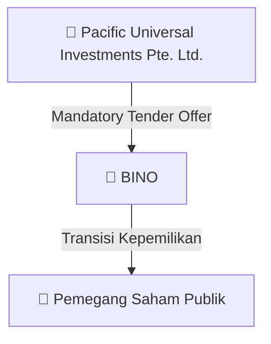
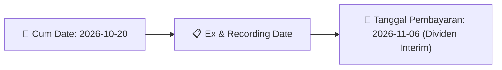
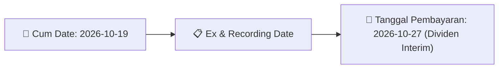

# Ikhtisar Pasar Harian (Daily Digest) - 2026-10-09

📅 **2026-10-09 (Daily Digest)**

## 1. Radar Pasar & Sentimen Harian (Executive Dashboard)
> [!NOTE]
> Terdeteksi sebanyak **497 pengumuman baru** dari 160 emiten pantauan pada (2026-10-09).

| Metric | Jumlah | Status Radar |
| :--- | :---: | :--- |
| **🟢 Sentimen Bullish / Positif** | `4` | [[Dividen Interim]], [[Mandatory Tender Offer]], Kinerja Positif |
| **⚪ Sentimen Netral / Routine** | `180` | [[Tanggapan Penjelasan Bursa]], [[RUPS]], [[Pendaftaran Unit]] |
| **🔴 Sentimen Bearish / Alert** | `6` | Sengketa Hukum, Defisit / Gugatan (Nihil hari ini) |
| **📄 [[Laporan Keuangan]] Baru** | `0` | Memicu Analisis Keuangan Otomatis |

> [!NOTE]
> Tidak dideteksi adanya publikasi laporan keuangan baru hari ini. Rangkuman per emiten secara terperinci tidak diperlukan.

---

## 2. Sorotan Utama & Watchlist Strategis (Strategic Watchlist)
#### 💰 Watchlist Dividen & Distribution
- **[[BUAH]]**: Nama Emiten = PT Segar Kumala Indonesia Tbk
- **[[BUAH]]**: Kode Emiten = BUAH
- **[[BUAH]]**: Jenis Dividen = Dividen Tunai Interim
- **[[BUAH]]**: Periode Tahun Buku = 2026
- **[[BUAH]]**: Nomor Surat = 003/X/SKI/2026
- **[[BUAH]]**: Tanggal Keputusan Direksi dan Persetujuan Dewan Komisaris = 2026-10-06

#### 🎯 Watchlist Penawaran Tender Wajib (MTO) & Strategis
- **[[DOOH]]**: Keterangan Pengendali = [[Tidak]]
- **[[PSSI]]**: Pengendali = [[Tidak]]
- **[[NICK]]**: Pengendali = [[Tidak]]
- **[[HELI]]**: Pengendali = [[Tidak]]
- **[[DRMA]]**: Pengendali = [[Tidak]]
- **[[APEX]]**: Keterangan Perubahan Pengendali = [[Tidak]]

#### 📈 Watchlist Konversi Waran & Potensi Dilusi
- **[[ANTM]]**: Jenis Penawaran Umum = Right Issue
- **[[ANTM]]**: Jumlah Hasil Penawaran Umum = IDR 5.376.645.145.725
- **[[ANTM]]**: Biaya Penawaran Umum = IDR 22.399.124.645
- **[[INET]]**: Nama Waran = INET-W2
- **[[INET]]**: Jumlah Waran yang Dikonversi = 5.484
- **[[INET]]**: Jumlah Saham Hasil Konversi = 5.484

#### 👥 Watchlist Transaksi Orang Dalam & Kepemilikan Saham (Insider / Repo Moves)
- **[[ANTM]]**: Hasil aktivitas eksplorasi hingga akhir periode pelaporan = Terlampir
- **[[ANTM]]**: Tanggal dan waktu pelaporan = 09-10-2026 16:07
- **[[ANTM]]**: Tanggal dan Waktu Pelaporan = 08-10-2026 20:48
- **[[INET]]**: Tanggal dan Waktu Pelaporan = 08-10-2026 19:35
- **[[INET]]**: Tanggal dan Waktu Pelaporan = 07-10-2026 18:24
- **[[ISAP]]**: Tanggal Pelaporan/Dokumen = 9 Oktober 2026
- **[[DOOH]]**: Nama Pemilik/Pelapor = PRAMBANAN INVESTASI SUKSES
- **[[DOOH]]**: Anggota Direksi/Dewan Komisaris = Tidak

---

## 3. Matriks Pengumuman Pasar (Announcements Intelligence Table)
| Emiten | Sentimen | Jenis Pengumuman | Judul Pengumuman | Berkas |
| :--- | :---: | :--- | :--- | :--- |
| **[[CSIS]]** | ⚪ NEUTRAL | Aksi Korporasi | Tanggapan atas Permintaan Penjelasan Bursa | [Utama](file:///g:/My%20Drive/Model2/reports/raw/CSIS/20261009_CSIS_20261009_CSIS_Tanggapan atas Permintaan Penjelasan Bursa_32165041.pdf) |
| **[[ANTM]]** | ⚪ NEUTRAL | Aksi Korporasi | Laporan Bulanan Aktivitas Eksplorasi | [Utama](file:///g:/My%20Drive/Model2/reports/raw/ANTM/20261009_ANTM_20261009_ANTM_Laporan Bulanan Aktivitas Eksplorasi_32165233.pdf) · [Lamp 2](file:///g:/My%20Drive/Model2/reports/raw/ANTM/20261009_ANTM_20261009_ANTM_Laporan Bulanan Aktivitas Eksplorasi_32165233_lamp2.pdf) · [Lamp 1](file:///g:/My%20Drive/Model2/reports/raw/ANTM/20261009_ANTM_20261009_ANTM_Laporan Bulanan Aktivitas Eksplorasi_32165233_lamp1.pdf) |
| **[[ANTM]]** | ⚪ NEUTRAL | Aksi Korporasi | Laporan Penggunaan Dana Hasil Penawaran Umum | [Utama](file:///g:/My%20Drive/Model2/reports/raw/ANTM/20261008_ANTM_20261008_ANTM_Laporan Penggunaan Dana Hasil Penawaran Umum_32164921.pdf) · [Lamp 1](file:///g:/My%20Drive/Model2/reports/raw/ANTM/20261008_ANTM_20261008_ANTM_Laporan Penggunaan Dana Hasil Penawaran Umum_32164921_lamp1.pdf) |
| **[[INET]]** | ⚪ NEUTRAL | Aksi Korporasi | Pencatatan Saham Tambahan dari Konversi | [Utama](file:///g:/My%20Drive/Model2/reports/raw/INET/20261007_INET_20261007_INET_Pencatatan Saham Tambahan dari Konversi_32164187.pdf) |
| **[[INET]]** | ⚪ NEUTRAL | RUPS | Pemberitahuan RencanaPenyampaian PanggilanHasil RUPORUPSURUP EBA-SP | [Utama](file:///g:/My%20Drive/Model2/reports/raw/INET/20261008_INET_20261008_INET_Pemberitahuan RencanaPenyampaian PanggilanHasil RUPORUPSURUP EBA-SP_32164910.pdf) · [Lamp 1](file:///g:/My%20Drive/Model2/reports/raw/INET/20261008_INET_20261008_INET_Pemberitahuan RencanaPenyampaian PanggilanHasil RUPORUPSURUP EBA-SP_32164911_lamp1.pdf) · [Lamp 1](file:///g:/My%20Drive/Model2/reports/raw/INET/20261008_INET_20261008_INET_Pemberitahuan RencanaPenyampaian PanggilanHasil RUPORUPSURUP EBA-SP_32164910_lamp1.pdf) |
| **[[INET]]** | ⚪ NEUTRAL | Aksi Korporasi | Laporan Informasi dan Fakta Material | [Utama](file:///g:/My%20Drive/Model2/reports/raw/INET/20261007_INET_20261007_INET_Laporan Informasi dan Fakta Material_32164158.pdf) · [Lamp 1](file:///g:/My%20Drive/Model2/reports/raw/INET/20261007_INET_20261007_INET_Laporan Informasi dan Fakta Material_32164158_lamp1.pdf) |
| **[[ISAP]]** | ⚪ NEUTRAL | Aksi Korporasi | Pencatatan Saham Tambahan dari Konversi | [Utama](file:///g:/My%20Drive/Model2/reports/raw/ISAP/20261009_ISAP_20261009_ISAP_Pencatatan Saham Tambahan dari Konversi_32165013.pdf) |
| **[[DOOH]]** | ⚪ NEUTRAL | Kepemilikan Saham (Insider) | LK-09102026-8852-00 | [Utama](file:///g:/My%20Drive/Model2/reports/raw/DOOH/20261009_DOOH_LK-09102026-8852-00.pdf) |
| **[[MGNA]]** | ⚪ NEUTRAL | Aksi Korporasi | Pencatatan Saham Tambahan dari Konversi | [Utama](file:///g:/My%20Drive/Model2/reports/raw/MGNA/20261009_MGNA_20261009_MGNA_Pencatatan Saham Tambahan dari Konversi_32165015.pdf) · [Lamp 1](file:///g:/My%20Drive/Model2/reports/raw/MGNA/20261009_MGNA_20261009_MGNA_Pencatatan Saham Tambahan dari Konversi_32165015_lamp1.pdf) |
| **[[PSSI]]** | ⚪ NEUTRAL | Kepemilikan Saham (Insider) | LK-09102026-8741-00 | [Utama](file:///g:/My%20Drive/Model2/reports/raw/PSSI/20261009_PSSI_LK-09102026-8741-00.pdf) |
| **[[TBIG]]** | ⚪ NEUTRAL | Aksi Korporasi | Penyampaian ProspektusInformasi Tambahan | [Utama](file:///g:/My%20Drive/Model2/reports/raw/TBIG/20261009_TBIG_20261009_TBIG_Penyampaian ProspektusInformasi Tambahan_32165006.pdf) · [Lamp 1](file:///g:/My%20Drive/Model2/reports/raw/TBIG/20261009_TBIG_20261009_TBIG_Penyampaian ProspektusInformasi Tambahan_32165006_lamp1.pdf) |
| **[[UVCR]]** | ⚪ NEUTRAL | RUPS | Pemanggilan RUPS | [Utama](file:///g:/My%20Drive/Model2/reports/raw/UVCR/20261009_UVCR_20261009_UVCR_Pemanggilan RUPS_32164968.pdf) · [Lamp 1](file:///g:/My%20Drive/Model2/reports/raw/UVCR/20261009_UVCR_20261009_UVCR_Pemanggilan RUPS_32164968_lamp1.pdf) · [Lamp 2](file:///g:/My%20Drive/Model2/reports/raw/UVCR/20261009_UVCR_20261009_UVCR_Pemanggilan RUPS_32164968_lamp2.pdf) |
| **[[SMFP]]** | ⚪ NEUTRAL | Aksi Korporasi | Penyampaian ProspektusInformasi Tambahan | [Utama](file:///g:/My%20Drive/Model2/reports/raw/SMFP/20261009_SMFP_20261009_SMFP_Penyampaian ProspektusInformasi Tambahan_32165237.pdf) · [Lamp 2](file:///g:/My%20Drive/Model2/reports/raw/SMFP/20261009_SMFP_20261009_SMFP_Penyampaian ProspektusInformasi Tambahan_32165237_lamp2.pdf) |
| **[[SMFP]]** | ⚪ NEUTRAL | Aksi Korporasi | Laporan Informasi dan Fakta Material | [Utama](file:///g:/My%20Drive/Model2/reports/raw/SMFP/20261008_SMFP_20261008_SMFP_Laporan Informasi dan Fakta Material_32164668.pdf) · [Lamp 1](file:///g:/My%20Drive/Model2/reports/raw/SMFP/20261008_SMFP_20261008_SMFP_Laporan Informasi dan Fakta Material_32164668_lamp1.pdf) |
| **[[AHAP]]** | ⚪ NEUTRAL | Aksi Korporasi | Laporan Informasi dan Fakta Material | [Utama](file:///g:/My%20Drive/Model2/reports/raw/AHAP/20261009_AHAP_20261009_AHAP_Laporan Informasi dan Fakta Material_32164997.pdf) · [Lamp 3](file:///g:/My%20Drive/Model2/reports/raw/AHAP/20261009_AHAP_20261009_AHAP_Laporan Informasi dan Fakta Material_32164997_lamp3.pdf) · [Lamp 2](file:///g:/My%20Drive/Model2/reports/raw/AHAP/20261009_AHAP_20261009_AHAP_Laporan Informasi dan Fakta Material_32164997_lamp2.pdf) · [Lamp 1](file:///g:/My%20Drive/Model2/reports/raw/AHAP/20261009_AHAP_20261009_AHAP_Laporan Informasi dan Fakta Material_32164997_lamp1.pdf) |
| **[[AHAP]]** | ⚪ NEUTRAL | Aksi Korporasi | Peng-Harga Teoretis AHAP 261008-.POP10-2026 | [Utama](file:///g:/My%20Drive/Model2/reports/raw/AHAP/20261008_AHAP_Peng-Harga Teoretis AHAP 261008-No. Peng-00191BEI.POP10-2026.pdf) |
| **[[CYBR]]** | ⚪ NEUTRAL | Aksi Korporasi | Pencatatan Saham Tambahan dari Konversi | [Utama](file:///g:/My%20Drive/Model2/reports/raw/CYBR/20261009_CYBR_20261009_CYBR_Pencatatan Saham Tambahan dari Konversi_32165016.pdf) · [Lamp 1](file:///g:/My%20Drive/Model2/reports/raw/CYBR/20261009_CYBR_20261009_CYBR_Pencatatan Saham Tambahan dari Konversi_32165016_lamp1.pdf) |
| **[[CYBR]]** | ⚪ NEUTRAL | Kepemilikan Saham (Insider) | LK-07102026-9536-00 | [Utama](file:///g:/My%20Drive/Model2/reports/raw/CYBR/20261007_CYBR_LK-07102026-9536-00.pdf) |
| **[[KDTN]]** | ⚪ NEUTRAL | Aksi Korporasi | Laporan Informasi dan Fakta Material | [Utama](file:///g:/My%20Drive/Model2/reports/raw/KDTN/20261008_KDTN_20261008_KDTN_Laporan Informasi dan Fakta Material_32164741.pdf) |
| **[[BAFI]]** | ⚪ NEUTRAL | Aksi Korporasi | Pengumuman Pencatatan Awal Obligasi dan Sukuk | [Utama](file:///g:/My%20Drive/Model2/reports/raw/BAFI/20261009_BAFI_20261008_BAFI_Pengumuman Pencatatan Awal Obligasi dan Sukuk_32164709.pdf) · [Lamp 1](file:///g:/My%20Drive/Model2/reports/raw/BAFI/20261009_BAFI_20261008_BAFI_Pengumuman Pencatatan Awal Obligasi dan Sukuk_32164709_lamp1.pdf) |
| **[[CASH]]** | ⚪ NEUTRAL | RUPS | Ringkasan RisalahRisalah RUPS | [Utama](file:///g:/My%20Drive/Model2/reports/raw/CASH/20261009_CASH_20261009_CASH_Ringkasan RisalahRisalah RUPS_32165291.pdf) · [Lamp 3](file:///g:/My%20Drive/Model2/reports/raw/CASH/20261009_CASH_20261009_CASH_Ringkasan RisalahRisalah RUPS_32165291_lamp3.pdf) · [Lamp 1](file:///g:/My%20Drive/Model2/reports/raw/CASH/20261009_CASH_20261009_CASH_Ringkasan RisalahRisalah RUPS_32165291_lamp1.pdf) · [Lamp 2](file:///g:/My%20Drive/Model2/reports/raw/CASH/20261009_CASH_20261009_CASH_Ringkasan RisalahRisalah RUPS_32165291_lamp2.pdf) |
| **[[DJPU]]** | ⚪ NEUTRAL | Aksi Korporasi | Pengumuman Pencatatan Awal Obligasi dan Sukuk | [Utama](file:///g:/My%20Drive/Model2/reports/raw/DJPU/20261009_DJPU_20261008_DJPU_Pengumuman Pencatatan Awal Obligasi dan Sukuk_32164860.pdf) · [Lamp 2](file:///g:/My%20Drive/Model2/reports/raw/DJPU/20261009_DJPU_20261008_DJPU_Pengumuman Pencatatan Awal Obligasi dan Sukuk_32164775_lamp2.pdf) · [Lamp 1](file:///g:/My%20Drive/Model2/reports/raw/DJPU/20261009_DJPU_20261008_DJPU_Pengumuman Pencatatan Awal Obligasi dan Sukuk_32164775_lamp1.pdf) |
| **[[DJPU]]** | ⚪ NEUTRAL | Aksi Korporasi | Pengumuman Bursa | [Utama](file:///g:/My%20Drive/Model2/reports/raw/DJPU/20261009_DJPU_20261009_DJPU_Pengumuman Bursa_32164962.pdf) · [Lamp 1](file:///g:/My%20Drive/Model2/reports/raw/DJPU/20261009_DJPU_20261009_DJPU_Pengumuman Bursa_32164962_lamp1.pdf) · [Lamp 2](file:///g:/My%20Drive/Model2/reports/raw/DJPU/20261009_DJPU_20261009_DJPU_Pengumuman Bursa_32164962_lamp2.pdf) |
| **[[DJPU]]** | ⚪ NEUTRAL | Aksi Korporasi | Pengumuman Jatuh Tempo Obligasi dan Sukuk | [Utama](file:///g:/My%20Drive/Model2/reports/raw/DJPU/20261007_DJPU_20261007_DJPU_Pengumuman Jatuh Tempo Obligasi dan Sukuk_32164184.pdf) |
| **[[PACK]]** | ⚪ NEUTRAL | Aksi Korporasi | Pencatatan Saham Tambahan dari Konversi | [Utama](file:///g:/My%20Drive/Model2/reports/raw/PACK/20261009_PACK_20261009_PACK_Pencatatan Saham Tambahan dari Konversi_32165134.pdf) |
| **[[PJHB]]** | ⚪ NEUTRAL | Aksi Korporasi | Pencatatan Saham Tambahan dari Konversi | [Utama](file:///g:/My%20Drive/Model2/reports/raw/PJHB/20261007_PJHB_20261007_PJHB_Pencatatan Saham Tambahan dari Konversi_32164163.pdf) |
| **[[MANG]]** | ⚪ NEUTRAL | Aksi Korporasi | Pencatatan Saham Tambahan dari Konversi | [Utama](file:///g:/My%20Drive/Model2/reports/raw/MANG/20261009_MANG_20261009_MANG_Pencatatan Saham Tambahan dari Konversi_32165076.pdf) · [Lamp 1](file:///g:/My%20Drive/Model2/reports/raw/MANG/20261009_MANG_20261009_MANG_Pencatatan Saham Tambahan dari Konversi_32165076_lamp1.pdf) |
| **[[OPPM]]** | ⚪ NEUTRAL | Aksi Korporasi | Pengumuman Jatuh Tempo Obligasi dan Sukuk | [Utama](file:///g:/My%20Drive/Model2/reports/raw/OPPM/20261009_OPPM_20261009_OPPM_Pengumuman Jatuh Tempo Obligasi dan Sukuk_32165158.pdf) |
| **[[PGLI]]** | ⚪ NEUTRAL | Public Expose | Public Expose | [Utama](file:///g:/My%20Drive/Model2/reports/raw/PGLI/20261009_PGLI_20261009_PGLI_Public Expose_32165075.pdf) |
| **[[BKSL]]** | ⚪ NEUTRAL | Aksi Korporasi | Laporan Informasi dan Fakta Material | [Utama](file:///g:/My%20Drive/Model2/reports/raw/BKSL/20261009_BKSL_20261009_BKSL_Laporan Informasi dan Fakta Material_32165132.pdf) · [Lamp 1](file:///g:/My%20Drive/Model2/reports/raw/BKSL/20261009_BKSL_20261009_BKSL_Laporan Informasi dan Fakta Material_32165132_lamp1.pdf) · [Lamp 2](file:///g:/My%20Drive/Model2/reports/raw/BKSL/20261009_BKSL_20261009_BKSL_Laporan Informasi dan Fakta Material_32165132_lamp2.pdf) |
| **[[TARA]]** | ⚪ NEUTRAL | Aksi Korporasi | Tanggapan atas Permintaan Penjelasan Bursa | [Utama](file:///g:/My%20Drive/Model2/reports/raw/TARA/20261009_TARA_20261009_TARA_Tanggapan atas Permintaan Penjelasan Bursa_32165251.pdf) |
| **[[NICK]]** | ⚪ NEUTRAL | Kepemilikan Saham (Insider) | LK-09102026-2726-00 | [Utama](file:///g:/My%20Drive/Model2/reports/raw/NICK/20261009_NICK_LK-09102026-2726-00.pdf) |
| **[[BMHS]]** | 🔴 BEARISH | Aksi Korporasi | Laporan Informasi dan Fakta Material | [Utama](file:///g:/My%20Drive/Model2/reports/raw/BMHS/20261009_BMHS_20261009_BMHS_Laporan Informasi dan Fakta Material_32165039.pdf) |
| **[[HELI]]** | ⚪ NEUTRAL | Kepemilikan Saham (Insider) | LK-09102026-0522-00 | [Utama](file:///g:/My%20Drive/Model2/reports/raw/HELI/20261009_HELI_LK-09102026-0522-00.pdf) |
| **[[HELI]]** | ⚪ NEUTRAL | Kepemilikan Saham (Insider) | LK-09102026-1568-00 | [Utama](file:///g:/My%20Drive/Model2/reports/raw/HELI/20261009_HELI_LK-09102026-1568-00.pdf) |
| **[[AKPI]]** | ⚪ NEUTRAL | Kepemilikan Saham (Insider) | LK-09102026-8858-00 | [Utama](file:///g:/My%20Drive/Model2/reports/raw/AKPI/20261009_AKPI_LK-09102026-8858-00.pdf) |
| **[[LUCY]]** | ⚪ NEUTRAL | Kepemilikan Saham (Insider) | LK-09102026-3515-00 | [Utama](file:///g:/My%20Drive/Model2/reports/raw/LUCY/20261009_LUCY_LK-09102026-3515-00.pdf) |
| **[[PYFA]]** | ⚪ NEUTRAL | Aksi Korporasi | Pencatatan Saham Tambahan dari Konversi | [Utama](file:///g:/My%20Drive/Model2/reports/raw/PYFA/20261009_PYFA_20261009_PYFA_Pencatatan Saham Tambahan dari Konversi_32165152.pdf) |
| **[[MDKA]]** | ⚪ NEUTRAL | Aksi Korporasi | Laporan Bulanan Aktivitas Eksplorasi | [Utama](file:///g:/My%20Drive/Model2/reports/raw/MDKA/20261009_MDKA_20261009_MDKA_Laporan Bulanan Aktivitas Eksplorasi_32165125.pdf) · [Lamp 1](file:///g:/My%20Drive/Model2/reports/raw/MDKA/20261009_MDKA_20261009_MDKA_Laporan Bulanan Aktivitas Eksplorasi_32165125_lamp1.pdf) |
| **[[MDKA]]** | ⚪ NEUTRAL | Aksi Korporasi | Laporan Hasil Pemeringkatan | [Utama](file:///g:/My%20Drive/Model2/reports/raw/MDKA/20261007_MDKA_20261007_MDKA_Laporan Hasil Pemeringkatan_32164436.pdf) · [Lamp 2](file:///g:/My%20Drive/Model2/reports/raw/MDKA/20261007_MDKA_20261007_MDKA_Laporan Hasil Pemeringkatan_32164436_lamp2.pdf) · [Lamp 1](file:///g:/My%20Drive/Model2/reports/raw/MDKA/20261007_MDKA_20261007_MDKA_Laporan Hasil Pemeringkatan_32164436_lamp1.pdf) |
| **[[PIKI]]** | ⚪ NEUTRAL | Aksi Korporasi | Laporan Hasil Pemeringkatan | [Utama](file:///g:/My%20Drive/Model2/reports/raw/PIKI/20261009_PIKI_20261009_PIKI_Laporan Hasil Pemeringkatan_32164958.pdf) · [Lamp 3](file:///g:/My%20Drive/Model2/reports/raw/PIKI/20261009_PIKI_20261009_PIKI_Laporan Hasil Pemeringkatan_32164958_lamp3.pdf) · [Lamp 1](file:///g:/My%20Drive/Model2/reports/raw/PIKI/20261009_PIKI_20261009_PIKI_Laporan Hasil Pemeringkatan_32164958_lamp1.pdf) |
| **[[NICE]]** | ⚪ NEUTRAL | Aksi Korporasi | Laporan Bulanan Aktivitas Eksplorasi | [Utama](file:///g:/My%20Drive/Model2/reports/raw/NICE/20261009_NICE_20261009_NICE_Laporan Bulanan Aktivitas Eksplorasi_32164970.pdf) |
| **[[PTPP]]** | ⚪ NEUTRAL | Aksi Korporasi | Laporan Hasil Pemeringkatan | [Utama](file:///g:/My%20Drive/Model2/reports/raw/PTPP/20261009_PTPP_20261009_PTPP_Laporan Hasil Pemeringkatan_32164957.pdf) · [Lamp 1](file:///g:/My%20Drive/Model2/reports/raw/PTPP/20261009_PTPP_20261009_PTPP_Laporan Hasil Pemeringkatan_32164957_lamp1.pdf) · [Lamp 2](file:///g:/My%20Drive/Model2/reports/raw/PTPP/20261009_PTPP_20261009_PTPP_Laporan Hasil Pemeringkatan_32164957_lamp2.pdf) |
| **[[BIKE]]** | ⚪ NEUTRAL | Aksi Korporasi | Laporan Informasi dan Fakta Material | [Utama](file:///g:/My%20Drive/Model2/reports/raw/BIKE/20261009_BIKE_20261009_BIKE_Laporan Informasi dan Fakta Material_32164974.pdf) · [Lamp 1](file:///g:/My%20Drive/Model2/reports/raw/BIKE/20261009_BIKE_20261009_BIKE_Laporan Informasi dan Fakta Material_32164974_lamp1.pdf) |
| **[[POLI]]** | ⚪ NEUTRAL | Public Expose | Public Expose | [Utama](file:///g:/My%20Drive/Model2/reports/raw/POLI/20261009_POLI_20261009_POLI_Public Expose_32164984.pdf) |
| **[[BTPS]]** | ⚪ NEUTRAL | Kepemilikan Saham (Insider) | LK-09102026-0316-00 | [Utama](file:///g:/My%20Drive/Model2/reports/raw/BTPS/20261009_BTPS_LK-09102026-0316-00.pdf) |
| **[[BINO]]** | ⚪ NEUTRAL | Aksi Korporasi | Keterbukaan Informasi Tentang PengambilalihanPenawaran Tender WajibRefloat | [Utama](file:///g:/My%20Drive/Model2/reports/raw/BINO/20261009_BINO_20261009_BINO_Keterbukaan Informasi Tentang PengambilalihanPenawaran Tender WajibRefloat_32165183.pdf) |
| **[[SMMA]]** | ⚪ NEUTRAL | RUPS | Pengumuman RUPS | [Utama](file:///g:/My%20Drive/Model2/reports/raw/SMMA/20261009_SMMA_20261009_SMMA_Pengumuman RUPS_32165029.pdf) · [Lamp 3](file:///g:/My%20Drive/Model2/reports/raw/SMMA/20261009_SMMA_20261009_SMMA_Pengumuman RUPS_32165029_lamp3.pdf) |
| **[[POLU]]** | ⚪ NEUTRAL | Public Expose | Public Expose | [Utama](file:///g:/My%20Drive/Model2/reports/raw/POLU/20261009_POLU_20261009_POLU_Public Expose_32165025.pdf) · [Lamp 1](file:///g:/My%20Drive/Model2/reports/raw/POLU/20261009_POLU_20261009_POLU_Public Expose_32165025_lamp1.pdf) |
| **[[INCO]]** | ⚪ NEUTRAL | Aksi Korporasi | Laporan Bulanan Aktivitas Eksplorasi | [Utama](file:///g:/My%20Drive/Model2/reports/raw/INCO/20261009_INCO_20261009_INCO_Laporan Bulanan Aktivitas Eksplorasi_32165204.pdf) · [Lamp 1](file:///g:/My%20Drive/Model2/reports/raw/INCO/20261009_INCO_20261009_INCO_Laporan Bulanan Aktivitas Eksplorasi_32165204_lamp1.pdf) |
| **[[KOCI]]** | ⚪ NEUTRAL | Aksi Korporasi | Laporan Penggunaan Dana Hasil Penawaran Umum | [Utama](file:///g:/My%20Drive/Model2/reports/raw/KOCI/20261008_KOCI_20261008_KOCI_Laporan Penggunaan Dana Hasil Penawaran Umum_32164904.pdf) · [Lamp 1](file:///g:/My%20Drive/Model2/reports/raw/KOCI/20261009_KOCI_20261009_KOCI_Laporan Penggunaan Dana Hasil Penawaran Umum_32165181_lamp1.pdf) · [Lamp 1](file:///g:/My%20Drive/Model2/reports/raw/KOCI/20261008_KOCI_20261008_KOCI_Laporan Penggunaan Dana Hasil Penawaran Umum_32164904_lamp1.pdf) |
| **[[PRDA]]** | 🟢 BULLISH | Buyback | Laporan Informasi dan Fakta Material | [Utama](file:///g:/My%20Drive/Model2/reports/raw/PRDA/20261009_PRDA_20261009_PRDA_Laporan Informasi dan Fakta Material_32165269.pdf) · [Lamp 1](file:///g:/My%20Drive/Model2/reports/raw/PRDA/20261009_PRDA_20261009_PRDA_Laporan Informasi dan Fakta Material_32165269_lamp1.pdf) |
| **[[MCOL]]** | ⚪ NEUTRAL | Aksi Korporasi | Laporan Bulanan Aktivitas Eksplorasi | [Utama](file:///g:/My%20Drive/Model2/reports/raw/MCOL/20261009_MCOL_20261009_MCOL_Laporan Bulanan Aktivitas Eksplorasi_32164953.pdf) · [Lamp 2](file:///g:/My%20Drive/Model2/reports/raw/MCOL/20261009_MCOL_20261009_MCOL_Laporan Bulanan Aktivitas Eksplorasi_32164953_lamp2.pdf) |
| **[[WSKT]]** | ⚪ NEUTRAL | Aksi Korporasi | Laporan Informasi dan Fakta Material | [Utama](file:///g:/My%20Drive/Model2/reports/raw/WSKT/20261009_WSKT_20261008_WSKT_Laporan Informasi dan Fakta Material_32164907.pdf) · [Lamp 1](file:///g:/My%20Drive/Model2/reports/raw/WSKT/20261009_WSKT_20261008_WSKT_Laporan Informasi dan Fakta Material_32164907_lamp1.pdf) |
| **[[WSKT]]** | ⚪ NEUTRAL | Aksi Korporasi | Laporan Hasil Pemeringkatan | [Utama](file:///g:/My%20Drive/Model2/reports/raw/WSKT/20261008_WSKT_20261008_WSKT_Laporan Hasil Pemeringkatan_32164791.pdf) · [Lamp 1](file:///g:/My%20Drive/Model2/reports/raw/WSKT/20261008_WSKT_20261008_WSKT_Laporan Hasil Pemeringkatan_32164791_lamp1.pdf) |
| **[[MTFN]]** | ⚪ NEUTRAL | Aksi Korporasi | Laporan Bulanan Aktivitas Eksplorasi | [Utama](file:///g:/My%20Drive/Model2/reports/raw/MTFN/20261009_MTFN_20261009_MTFN_Laporan Bulanan Aktivitas Eksplorasi_32165001.pdf) · [Lamp 1](file:///g:/My%20Drive/Model2/reports/raw/MTFN/20261009_MTFN_20261009_MTFN_Laporan Bulanan Aktivitas Eksplorasi_32165001_lamp1.pdf) |
| **[[DRMA]]** | ⚪ NEUTRAL | Kepemilikan Saham (Insider) | LK-09102026-1970-00 | [Utama](file:///g:/My%20Drive/Model2/reports/raw/DRMA/20261009_DRMA_LK-09102026-1970-00.pdf) |
| **[[CITA]]** | ⚪ NEUTRAL | Aksi Korporasi | Laporan Bulanan Aktivitas Eksplorasi | [Utama](file:///g:/My%20Drive/Model2/reports/raw/CITA/20261009_CITA_20261007_CITA_Laporan Bulanan Aktivitas Eksplorasi_32164108.pdf) · [Lamp 1](file:///g:/My%20Drive/Model2/reports/raw/CITA/20261009_CITA_20261007_CITA_Laporan Bulanan Aktivitas Eksplorasi_32164108_lamp1.pdf) |
| **[[SOTS]]** | ⚪ NEUTRAL | Aksi Korporasi | Tanggapan atas Permintaan Penjelasan Bursa | [Utama](file:///g:/My%20Drive/Model2/reports/raw/SOTS/20261009_SOTS_20261009_SOTS_Tanggapan atas Permintaan Penjelasan Bursa_32165145.pdf) |
| **[[GEMA]]** | ⚪ NEUTRAL | RUPS | Pengumuman RUPS | [Utama](file:///g:/My%20Drive/Model2/reports/raw/GEMA/20261009_GEMA_20261009_GEMA_Pengumuman RUPS_32164972.pdf) · [Lamp 1](file:///g:/My%20Drive/Model2/reports/raw/GEMA/20261009_GEMA_20261009_GEMA_Pengumuman RUPS_32164972_lamp1.pdf) |
| **[[POOL]]** | ⚪ NEUTRAL | Public Expose | Public Expose | [Utama](file:///g:/My%20Drive/Model2/reports/raw/POOL/20261009_POOL_20261009_POOL_Public Expose_32164990.pdf) |
| **[[KKGI]]** | ⚪ NEUTRAL | Aksi Korporasi | Laporan Bulanan Aktivitas Eksplorasi | [Utama](file:///g:/My%20Drive/Model2/reports/raw/KKGI/20261009_KKGI_20261009_KKGI_Laporan Bulanan Aktivitas Eksplorasi_32165040.pdf) |
| **[[APEX]]** | ⚪ NEUTRAL | Aksi Korporasi | Penambahan Modal Tanpa HMETD | [Utama](file:///g:/My%20Drive/Model2/reports/raw/APEX/20261008_APEX_20261008_APEX_Penambahan Modal Tanpa HMETD_32164578.pdf) · [Lamp 1](file:///g:/My%20Drive/Model2/reports/raw/APEX/20261009_APEX_20261009_APEX_Penambahan Modal Tanpa HMETD_32164994_lamp1.pdf) |
| **[[APEX]]** | ⚪ NEUTRAL | RUPS | Ringkasan RisalahRisalah RUPS | [Utama](file:///g:/My%20Drive/Model2/reports/raw/APEX/20261008_APEX_20261008_APEX_Ringkasan RisalahRisalah RUPS_32164513.pdf) · [Lamp 1](file:///g:/My%20Drive/Model2/reports/raw/APEX/20261008_APEX_20261008_APEX_Ringkasan RisalahRisalah RUPS_32164671_lamp1.pdf) · [Lamp 1](file:///g:/My%20Drive/Model2/reports/raw/APEX/20261008_APEX_20261008_APEX_Ringkasan RisalahRisalah RUPS_32164513_lamp1.pdf) |
| **[[BAJA]]** | ⚪ NEUTRAL | Aksi Korporasi | Pencatatan Saham Tambahan dari Konversi | [Utama](file:///g:/My%20Drive/Model2/reports/raw/BAJA/20261007_BAJA_20261007_BAJA_Pencatatan Saham Tambahan dari Konversi_32164278.pdf) · [Lamp 1](file:///g:/My%20Drive/Model2/reports/raw/BAJA/20261009_BAJA_20261008_BAJA_Pencatatan Saham Tambahan dari Konversi_32164626_lamp1.pdf) · [Lamp 1](file:///g:/My%20Drive/Model2/reports/raw/BAJA/20261007_BAJA_20261007_BAJA_Pencatatan Saham Tambahan dari Konversi_32164278_lamp1.pdf) |
| **[[BEEF]]** | ⚪ NEUTRAL | Kepemilikan Saham (Insider) | LK-09102026-0233-00 | [Utama](file:///g:/My%20Drive/Model2/reports/raw/BEEF/20261009_BEEF_LK-09102026-0233-00.pdf) |
| **[[SMAR]]** | ⚪ NEUTRAL | RUPS | Pengumuman RUPS | [Utama](file:///g:/My%20Drive/Model2/reports/raw/SMAR/20261009_SMAR_20261007_SMAR_Pengumuman RUPS_32164438.pdf) |
| **[[ZINC]]** | ⚪ NEUTRAL | Aksi Korporasi | Laporan Bulanan Aktivitas Eksplorasi | [Utama](file:///g:/My%20Drive/Model2/reports/raw/ZINC/20261009_ZINC_20261009_ZINC_Laporan Bulanan Aktivitas Eksplorasi_32165023.pdf) |
| **[[BELI]]** | ⚪ NEUTRAL | Public Expose | Public Expose | [Utama](file:///g:/My%20Drive/Model2/reports/raw/BELI/20261009_BELI_20261008_BELI_Public Expose_32164700.pdf) · [Lamp 1](file:///g:/My%20Drive/Model2/reports/raw/BELI/20261009_BELI_20261008_BELI_Public Expose_32164700_lamp1.pdf) · [Lamp 2](file:///g:/My%20Drive/Model2/reports/raw/BELI/20261009_BELI_20261008_BELI_Public Expose_32164700_lamp2.pdf) |
| **[[PSAB]]** | ⚪ NEUTRAL | Aksi Korporasi | Laporan Bulanan Aktivitas Eksplorasi | [Utama](file:///g:/My%20Drive/Model2/reports/raw/PSAB/20261009_PSAB_20261009_PSAB_Laporan Bulanan Aktivitas Eksplorasi_32165164.pdf) · [Lamp 1](file:///g:/My%20Drive/Model2/reports/raw/PSAB/20261009_PSAB_20261009_PSAB_Laporan Bulanan Aktivitas Eksplorasi_32165164_lamp1.pdf) |
| **[[AMMN]]** | ⚪ NEUTRAL | RUPS | Pengumuman RUPS | [Utama](file:///g:/My%20Drive/Model2/reports/raw/AMMN/20261009_AMMN_20261009_AMMN_Pengumuman RUPS_32165104.pdf) · [Lamp 1](file:///g:/My%20Drive/Model2/reports/raw/AMMN/20261009_AMMN_20261009_AMMN_Pengumuman RUPS_32165104_lamp1.pdf) · [Lamp 2](file:///g:/My%20Drive/Model2/reports/raw/AMMN/20261009_AMMN_20261009_AMMN_Pengumuman RUPS_32165104_lamp2.pdf) |
| **[[AMMN]]** | ⚪ NEUTRAL | Aksi Korporasi | Laporan Bulanan Aktivitas Eksplorasi | [Utama](file:///g:/My%20Drive/Model2/reports/raw/AMMN/20261009_AMMN_20261007_AMMN_Laporan Bulanan Aktivitas Eksplorasi_32164279.pdf) · [Lamp 3](file:///g:/My%20Drive/Model2/reports/raw/AMMN/20261009_AMMN_20261007_AMMN_Laporan Bulanan Aktivitas Eksplorasi_32164279_lamp3.pdf) · [Lamp 2](file:///g:/My%20Drive/Model2/reports/raw/AMMN/20261009_AMMN_20261007_AMMN_Laporan Bulanan Aktivitas Eksplorasi_32164279_lamp2.pdf) |
| **[[TOBA]]** | ⚪ NEUTRAL | Aksi Korporasi | Laporan Bulanan Aktivitas Eksplorasi | [Utama](file:///g:/My%20Drive/Model2/reports/raw/TOBA/20261009_TOBA_20261008_TOBA_Laporan Bulanan Aktivitas Eksplorasi_32164751.pdf) · [Lamp 1](file:///g:/My%20Drive/Model2/reports/raw/TOBA/20261009_TOBA_20261008_TOBA_Laporan Bulanan Aktivitas Eksplorasi_32164751_lamp1.pdf) · [Lamp 2](file:///g:/My%20Drive/Model2/reports/raw/TOBA/20261009_TOBA_20261008_TOBA_Laporan Bulanan Aktivitas Eksplorasi_32164751_lamp2.pdf) |
| **[[TOBA]]** | ⚪ NEUTRAL | Aksi Korporasi | Laporan Hasil Pemeringkatan | [Utama](file:///g:/My%20Drive/Model2/reports/raw/TOBA/20261008_TOBA_20261008_TOBA_Laporan Hasil Pemeringkatan_32164526.pdf) · [Lamp 3](file:///g:/My%20Drive/Model2/reports/raw/TOBA/20261008_TOBA_20261008_TOBA_Laporan Hasil Pemeringkatan_32164526_lamp3.pdf) · [Lamp 2](file:///g:/My%20Drive/Model2/reports/raw/TOBA/20261008_TOBA_20261008_TOBA_Laporan Hasil Pemeringkatan_32164526_lamp2.pdf) |
| **[[VKTR]]** | ⚪ NEUTRAL | Aksi Korporasi | Pencatatan Efek Bersifat Ekuitas dan Pra Pencatatan Saham | [Utama](file:///g:/My%20Drive/Model2/reports/raw/VKTR/20261009_VKTR_20261009_VKTR_Pencatatan Efek Bersifat Ekuitas dan Pra Pencatatan Saham_32165114.pdf) |
| **[[VKTR]]** | ⚪ NEUTRAL | Aksi Korporasi | Penyampaian ProspektusInformasi Tambahan | [Utama](file:///g:/My%20Drive/Model2/reports/raw/VKTR/20261008_VKTR_20261008_VKTR_Penyampaian ProspektusInformasi Tambahan_32164908.pdf) · [Lamp 1](file:///g:/My%20Drive/Model2/reports/raw/VKTR/20261008_VKTR_20261008_VKTR_Penyampaian ProspektusInformasi Tambahan_32164908_lamp1.pdf) |
| **[[AVIA]]** | ⚪ NEUTRAL | Aksi Korporasi | Laporan Penggunaan Dana Hasil Penawaran Umum | [Utama](file:///g:/My%20Drive/Model2/reports/raw/AVIA/20261009_AVIA_20261009_AVIA_Laporan Penggunaan Dana Hasil Penawaran Umum_32165118.pdf) |
| **[[ALII]]** | ⚪ NEUTRAL | Kepemilikan Saham (Insider) | LK-09102026-7352-00 | [Utama](file:///g:/My%20Drive/Model2/reports/raw/ALII/20261009_ALII_LK-09102026-7352-00.pdf) |
| **[[LOPI]]** | ⚪ NEUTRAL | RUPS | Pemanggilan RUPS | [Utama](file:///g:/My%20Drive/Model2/reports/raw/LOPI/20261009_LOPI_20261009_LOPI_Pemanggilan RUPS_32165078.pdf) · [Lamp 1](file:///g:/My%20Drive/Model2/reports/raw/LOPI/20261009_LOPI_20261009_LOPI_Pemanggilan RUPS_32165078_lamp1.pdf) |
| **[[ENRG]]** | ⚪ NEUTRAL | Aksi Korporasi | Pencatatan Saham Tambahan dari Konversi | [Utama](file:///g:/My%20Drive/Model2/reports/raw/ENRG/20261009_ENRG_20261009_ENRG_Pencatatan Saham Tambahan dari Konversi_32165141.pdf) |
| **[[ENRG]]** | ⚪ NEUTRAL | Aksi Korporasi | Laporan Penggunaan Dana Hasil Penawaran Umum | [Utama](file:///g:/My%20Drive/Model2/reports/raw/ENRG/20261007_ENRG_20261007_ENRG_Laporan Penggunaan Dana Hasil Penawaran Umum_32164383.pdf) · [Lamp 1](file:///g:/My%20Drive/Model2/reports/raw/ENRG/20261007_ENRG_20261007_ENRG_Laporan Penggunaan Dana Hasil Penawaran Umum_32164383_lamp1.pdf) |
| **[[ENRG]]** | ⚪ NEUTRAL | Aksi Korporasi | Pencatatan Efek Bersifat Ekuitas dan Pra Pencatatan Saham | [Utama](file:///g:/My%20Drive/Model2/reports/raw/ENRG/20261007_ENRG_20261007_ENRG_Pencatatan Efek Bersifat Ekuitas dan Pra Pencatatan Saham_32163993.pdf) · [Lamp 1](file:///g:/My%20Drive/Model2/reports/raw/ENRG/20261007_ENRG_20261007_ENRG_Pencatatan Efek Bersifat Ekuitas dan Pra Pencatatan Saham_32163993_lamp1.pdf) |
| **[[CNMA]]** | ⚪ NEUTRAL | Aksi Korporasi | Laporan Penggunaan Dana Hasil Penawaran Umum | [Utama](file:///g:/My%20Drive/Model2/reports/raw/CNMA/20261009_CNMA_20261008_CNMA_Laporan Penggunaan Dana Hasil Penawaran Umum_32164770.pdf) · [Lamp 1](file:///g:/My%20Drive/Model2/reports/raw/CNMA/20261009_CNMA_20261008_CNMA_Laporan Penggunaan Dana Hasil Penawaran Umum_32164762_lamp1.pdf) · [Lamp 1](file:///g:/My%20Drive/Model2/reports/raw/CNMA/20261009_CNMA_20261008_CNMA_Laporan Penggunaan Dana Hasil Penawaran Umum_32164770_lamp1.pdf) |
| **[[LPPI]]** | ⚪ NEUTRAL | Aksi Korporasi | Laporan Penggunaan Dana Hasil Penawaran Umum | [Utama](file:///g:/My%20Drive/Model2/reports/raw/LPPI/20261009_LPPI_20261009_LPPI_Laporan Penggunaan Dana Hasil Penawaran Umum_32164991.pdf) |
| **[[AGII]]** | ⚪ NEUTRAL | Aksi Korporasi | Pengumuman Jatuh Tempo Obligasi dan Sukuk | [Utama](file:///g:/My%20Drive/Model2/reports/raw/AGII/20261009_AGII_20261009_AGII_Pengumuman Jatuh Tempo Obligasi dan Sukuk_32165154.pdf) · [Lamp 1](file:///g:/My%20Drive/Model2/reports/raw/AGII/20261009_AGII_20261009_AGII_Pengumuman Jatuh Tempo Obligasi dan Sukuk_32165154_lamp1.pdf) |
| **[[TCID]]** | ⚪ NEUTRAL | Aksi Korporasi | Laporan Informasi dan Fakta Material | [Utama](file:///g:/My%20Drive/Model2/reports/raw/TCID/20261009_TCID_20261009_TCID_Laporan Informasi dan Fakta Material_32165169.pdf) · [Lamp 1](file:///g:/My%20Drive/Model2/reports/raw/TCID/20261009_TCID_20261009_TCID_Laporan Informasi dan Fakta Material_32165169_lamp1.pdf) |
| **[[MORA]]** | ⚪ NEUTRAL | Aksi Korporasi | Pembayaran KuponBagi HasilIjarahPokok | [Utama](file:///g:/My%20Drive/Model2/reports/raw/MORA/20261009_MORA_20261009_MORA_Pembayaran KuponBagi HasilIjarahPokok_32165116.pdf) |
| **[[PPRI]]** | ⚪ NEUTRAL | Kepemilikan Saham (Insider) | LK-09102026-1008-00 | [Utama](file:///g:/My%20Drive/Model2/reports/raw/PPRI/20261009_PPRI_LK-09102026-1008-00.pdf) |
| **[[PPRI]]** | ⚪ NEUTRAL | Kepemilikan Saham (Insider) | LK-09102026-7699-00 | [Utama](file:///g:/My%20Drive/Model2/reports/raw/PPRI/20261009_PPRI_LK-09102026-7699-00.pdf) |
| **[[BSSR]]** | ⚪ NEUTRAL | Aksi Korporasi | Laporan Bulanan Aktivitas Eksplorasi | [Utama](file:///g:/My%20Drive/Model2/reports/raw/BSSR/20261009_BSSR_20261009_BSSR_Laporan Bulanan Aktivitas Eksplorasi_32165238.pdf) · [Lamp 1](file:///g:/My%20Drive/Model2/reports/raw/BSSR/20261009_BSSR_20261009_BSSR_Laporan Bulanan Aktivitas Eksplorasi_32165238_lamp1.pdf) |
| **[[TRIN]]** | ⚪ NEUTRAL | Aksi Korporasi | Laporan Informasi dan Fakta Material | [Utama](file:///g:/My%20Drive/Model2/reports/raw/TRIN/20261009_TRIN_20261009_TRIN_Laporan Informasi dan Fakta Material_32164985.pdf) · [Lamp 1](file:///g:/My%20Drive/Model2/reports/raw/TRIN/20261009_TRIN_20261009_TRIN_Laporan Informasi dan Fakta Material_32164985_lamp1.pdf) |
| **[[IKAI]]** | ⚪ NEUTRAL | Kepemilikan Saham (Insider) | LK-09102026-5044-00 | [Utama](file:///g:/My%20Drive/Model2/reports/raw/IKAI/20261009_IKAI_LK-09102026-5044-00.pdf) |
| **[[COKE]]** | ⚪ NEUTRAL | Aksi Korporasi | Pengumuman Pencatatan Awal Obligasi dan Sukuk | [Utama](file:///g:/My%20Drive/Model2/reports/raw/COKE/20261009_COKE_20261009_COKE_Pengumuman Pencatatan Awal Obligasi dan Sukuk_32165253.pdf) · [Lamp 1](file:///g:/My%20Drive/Model2/reports/raw/COKE/20261009_COKE_20261009_COKE_Pengumuman Pencatatan Awal Obligasi dan Sukuk_32165253_lamp1.pdf) |
| **[[MDKI]]** | ⚪ NEUTRAL | Aksi Korporasi | Laporan Penggunaan Dana Hasil Penawaran Umum | [Utama](file:///g:/My%20Drive/Model2/reports/raw/MDKI/20261009_MDKI_20261009_MDKI_Laporan Penggunaan Dana Hasil Penawaran Umum_32165159.pdf) |
| **[[ARII]]** | ⚪ NEUTRAL | Kepemilikan Saham (Insider) | LK-08102026-9209-00 | [Utama](file:///g:/My%20Drive/Model2/reports/raw/ARII/20261008_ARII_LK-08102026-9209-00.pdf) |
| **[[BSIM]]** | ⚪ NEUTRAL | Aksi Korporasi | Pembayaran KuponBagi HasilIjarahPokok | [Utama](file:///g:/My%20Drive/Model2/reports/raw/BSIM/20261008_BSIM_20261008_BSIM_Pembayaran KuponBagi HasilIjarahPokok_32164491.pdf) |
| **[[BCIC]]** | ⚪ NEUTRAL | Aksi Korporasi | Laporan Informasi dan Fakta Material | [Utama](file:///g:/My%20Drive/Model2/reports/raw/BCIC/20261008_BCIC_20261008_BCIC_Laporan Informasi dan Fakta Material_32164841.pdf) |
| **[[SRTG]]** | ⚪ NEUTRAL | Kepemilikan Saham (Insider) | LK-08102026-5406-00 | [Utama](file:///g:/My%20Drive/Model2/reports/raw/SRTG/20261008_SRTG_LK-08102026-5406-00.pdf) |
| **[[NSSS]]** | ⚪ NEUTRAL | Kepemilikan Saham (Insider) | LK-08102026-2774-00 | [Utama](file:///g:/My%20Drive/Model2/reports/raw/NSSS/20261008_NSSS_LK-08102026-2774-00.pdf) |
| **[[MAHA]]** | ⚪ NEUTRAL | Aksi Korporasi | Laporan Informasi dan Fakta Material | [Utama](file:///g:/My%20Drive/Model2/reports/raw/MAHA/20261008_MAHA_20261008_MAHA_Laporan Informasi dan Fakta Material_32164784.pdf) · [Lamp 1](file:///g:/My%20Drive/Model2/reports/raw/MAHA/20261008_MAHA_20261008_MAHA_Laporan Informasi dan Fakta Material_32164784_lamp1.pdf) · [Lamp 3](file:///g:/My%20Drive/Model2/reports/raw/MAHA/20261008_MAHA_20261008_MAHA_Laporan Informasi dan Fakta Material_32164784_lamp3.pdf) · [Lamp 2](file:///g:/My%20Drive/Model2/reports/raw/MAHA/20261008_MAHA_20261008_MAHA_Laporan Informasi dan Fakta Material_32164784_lamp2.pdf) |
| **[[SDPC]]** | ⚪ NEUTRAL | Aksi Korporasi | Laporan Informasi dan Fakta Material | [Utama](file:///g:/My%20Drive/Model2/reports/raw/SDPC/20261008_SDPC_20261008_SDPC_Laporan Informasi dan Fakta Material_32164477.pdf) |
| **[[BUMI]]** | ⚪ NEUTRAL | Aksi Korporasi | Laporan Penggunaan Dana Hasil Penawaran Umum | [Utama](file:///g:/My%20Drive/Model2/reports/raw/BUMI/20261008_BUMI_20261008_BUMI_Laporan Penggunaan Dana Hasil Penawaran Umum_32164787.pdf) · [Lamp 9](file:///g:/My%20Drive/Model2/reports/raw/BUMI/20261008_BUMI_20261008_BUMI_Laporan Penggunaan Dana Hasil Penawaran Umum_32164787_lamp9.pdf) |
| **[[BUMI]]** | ⚪ NEUTRAL | Aksi Korporasi | Laporan Bulanan Aktivitas Eksplorasi | [Utama](file:///g:/My%20Drive/Model2/reports/raw/BUMI/20261008_BUMI_20261007_BUMI_Laporan Bulanan Aktivitas Eksplorasi_32164073.pdf) |
| **[[BSML]]** | ⚪ NEUTRAL | RUPS | Pemanggilan RUPS | [Utama](file:///g:/My%20Drive/Model2/reports/raw/BSML/20261008_BSML_20261008_BSML_Pemanggilan RUPS_32164919.pdf) · [Lamp 1](file:///g:/My%20Drive/Model2/reports/raw/BSML/20261008_BSML_20261008_BSML_Pemanggilan RUPS_32164919_lamp1.pdf) |
| **[[BIPP]]** | ⚪ NEUTRAL | RUPS | Pemanggilan RUPS | [Utama](file:///g:/My%20Drive/Model2/reports/raw/BIPP/20261008_BIPP_20261008_BIPP_Pemanggilan RUPS_32164499.pdf) |
| **[[TMPO]]** | ⚪ NEUTRAL | Aksi Korporasi | Pengumuman Bursa | [Utama](file:///g:/My%20Drive/Model2/reports/raw/TMPO/20261008_TMPO_20261008_TMPO_Pengumuman Bursa_32164625.pdf) |
| **[[DSSA]]** | ⚪ NEUTRAL | Aksi Korporasi | Laporan Bulanan Aktivitas Eksplorasi | [Utama](file:///g:/My%20Drive/Model2/reports/raw/DSSA/20261008_DSSA_20261001_DSSA_Laporan Bulanan Aktivitas Eksplorasi_32162371.pdf) |
| **[[FILM]]** | ⚪ NEUTRAL | Kepemilikan Saham (Insider) | LK-08102026-8503-00 | [Utama](file:///g:/My%20Drive/Model2/reports/raw/FILM/20261008_FILM_LK-08102026-8503-00.pdf) |
| **[[BOLT]]** | ⚪ NEUTRAL | Kepemilikan Saham (Insider) | LK-08102026-5726-00 | [Utama](file:///g:/My%20Drive/Model2/reports/raw/BOLT/20261008_BOLT_LK-08102026-5726-00.pdf) |
| **[[PGEO]]** | ⚪ NEUTRAL | Aksi Korporasi | Laporan Penggunaan Dana Hasil Penawaran Umum | [Utama](file:///g:/My%20Drive/Model2/reports/raw/PGEO/20261008_PGEO_20261008_PGEO_Laporan Penggunaan Dana Hasil Penawaran Umum_32164887.pdf) · [Lamp 3](file:///g:/My%20Drive/Model2/reports/raw/PGEO/20261008_PGEO_20261008_PGEO_Laporan Penggunaan Dana Hasil Penawaran Umum_32164887_lamp3.pdf) · [Lamp 2](file:///g:/My%20Drive/Model2/reports/raw/PGEO/20261008_PGEO_20261008_PGEO_Laporan Penggunaan Dana Hasil Penawaran Umum_32164887_lamp2.pdf) · [Lamp 1](file:///g:/My%20Drive/Model2/reports/raw/PGEO/20261008_PGEO_20261008_PGEO_Laporan Penggunaan Dana Hasil Penawaran Umum_32164887_lamp1.pdf) |
| **[[BALI]]** | ⚪ NEUTRAL | Aksi Korporasi | Tanggapan atas Permintaan Penjelasan Bursa | [Utama](file:///g:/My%20Drive/Model2/reports/raw/BALI/20261008_BALI_20261008_BALI_Tanggapan atas Permintaan Penjelasan Bursa_32164579.pdf) |
| **[[PPGD]]** | ⚪ NEUTRAL | Aksi Korporasi | Pembayaran KuponBagi HasilIjarahPokok | [Utama](file:///g:/My%20Drive/Model2/reports/raw/PPGD/20261008_PPGD_20261008_PPGD_Pembayaran KuponBagi HasilIjarahPokok_32164714.pdf) · [Lamp 1](file:///g:/My%20Drive/Model2/reports/raw/PPGD/20261008_PPGD_20261008_PPGD_Pembayaran KuponBagi HasilIjarahPokok_32164732_lamp1.pdf) · [Lamp 1](file:///g:/My%20Drive/Model2/reports/raw/PPGD/20261008_PPGD_20261008_PPGD_Pembayaran KuponBagi HasilIjarahPokok_32164714_lamp1.pdf) |
| **[[TOTL]]** | ⚪ NEUTRAL | Kepemilikan Saham (Insider) | LK-08102026-2960-00 | [Utama](file:///g:/My%20Drive/Model2/reports/raw/TOTL/20261008_TOTL_LK-08102026-2960-00.pdf) |
| **[[TOTL]]** | ⚪ NEUTRAL | RUPS | Pengumuman RUPS | [Utama](file:///g:/My%20Drive/Model2/reports/raw/TOTL/20261008_TOTL_20261007_TOTL_Pengumuman RUPS_32164337.pdf) · [Lamp 1](file:///g:/My%20Drive/Model2/reports/raw/TOTL/20261008_TOTL_20261007_TOTL_Pengumuman RUPS_32164337_lamp1.pdf) |
| **[[PTBA]]** | ⚪ NEUTRAL | Aksi Korporasi | Laporan Bulanan Aktivitas Eksplorasi | [Utama](file:///g:/My%20Drive/Model2/reports/raw/PTBA/20261008_PTBA_20261008_PTBA_Laporan Bulanan Aktivitas Eksplorasi_32164523.pdf) · [Lamp 2](file:///g:/My%20Drive/Model2/reports/raw/PTBA/20261008_PTBA_20261008_PTBA_Laporan Bulanan Aktivitas Eksplorasi_32164523_lamp2.pdf) |
| **[[DIVA]]** | 🟢 BULLISH | Buyback | Laporan Pengalihan Saham Hasil Buy Back | [Utama](file:///g:/My%20Drive/Model2/reports/raw/DIVA/20261008_DIVA_20261008_DIVA_Laporan Pengalihan Saham Hasil Buy Back_32164699.pdf) · [Lamp 1](file:///g:/My%20Drive/Model2/reports/raw/DIVA/20261008_DIVA_20261008_DIVA_Laporan Pengalihan Saham Hasil Buy Back_32164699_lamp1.pdf) |
| **[[TLDN]]** | ⚪ NEUTRAL | Aksi Korporasi | Laporan Penggunaan Dana Hasil Penawaran Umum | [Utama](file:///g:/My%20Drive/Model2/reports/raw/TLDN/20261008_TLDN_20261007_TLDN_Laporan Penggunaan Dana Hasil Penawaran Umum_32164090.pdf) |
| **[[BLTA]]** | ⚪ NEUTRAL | Aksi Korporasi | Laporan Informasi dan Fakta Material | [Utama](file:///g:/My%20Drive/Model2/reports/raw/BLTA/20261008_BLTA_20261008_BLTA_Laporan Informasi dan Fakta Material_32164833.pdf) · [Lamp 1](file:///g:/My%20Drive/Model2/reports/raw/BLTA/20261008_BLTA_20261008_BLTA_Laporan Informasi dan Fakta Material_32164833_lamp1.pdf) |
| **[[NTBK]]** | ⚪ NEUTRAL | Aksi Korporasi | Laporan Penggunaan Dana Hasil Penawaran Umum | [Utama](file:///g:/My%20Drive/Model2/reports/raw/NTBK/20261008_NTBK_20261008_NTBK_Laporan Penggunaan Dana Hasil Penawaran Umum_32164906.pdf) |
| **[[BSWD]]** | ⚪ NEUTRAL | Aksi Korporasi | Tanggapan atas Permintaan Penjelasan Bursa | [Utama](file:///g:/My%20Drive/Model2/reports/raw/BSWD/20261008_BSWD_20261008_BSWD_Tanggapan atas Permintaan Penjelasan Bursa_32164862.pdf) |
| **[[BSWD]]** | ⚪ NEUTRAL | Public Expose | Public Expose | [Utama](file:///g:/My%20Drive/Model2/reports/raw/BSWD/20261007_BSWD_20261007_BSWD_Public Expose_32164451.pdf) · [Lamp 2](file:///g:/My%20Drive/Model2/reports/raw/BSWD/20261007_BSWD_20261007_BSWD_Public Expose_32164451_lamp2.pdf) |
| **[[CBRE]]** | ⚪ NEUTRAL | Aksi Korporasi | Laporan Informasi dan Fakta Material | [Utama](file:///g:/My%20Drive/Model2/reports/raw/CBRE/20261008_CBRE_20261008_CBRE_Laporan Informasi dan Fakta Material_32164755.pdf) |
| **[[JAST]]** | ⚪ NEUTRAL | Aksi Korporasi | Laporan Informasi dan Fakta Material | [Utama](file:///g:/My%20Drive/Model2/reports/raw/JAST/20261008_JAST_20261008_JAST_Laporan Informasi dan Fakta Material_32164660.pdf) · [Lamp 1](file:///g:/My%20Drive/Model2/reports/raw/JAST/20261008_JAST_20261008_JAST_Laporan Informasi dan Fakta Material_32164660_lamp1.pdf) |
| **[[UNTR]]** | 🔴 BEARISH | Aksi Korporasi | Tanggapan atas Permintaan Penjelasan Bursa | [Utama](file:///g:/My%20Drive/Model2/reports/raw/UNTR/20261008_UNTR_20261008_UNTR_Tanggapan atas Permintaan Penjelasan Bursa_32164936.pdf) · [Lamp 1](file:///g:/My%20Drive/Model2/reports/raw/UNTR/20261008_UNTR_20261008_UNTR_Tanggapan atas Permintaan Penjelasan Bursa_32164936_lamp1.pdf) |
| **[[CRAB]]** | ⚪ NEUTRAL | Aksi Korporasi | Laporan Penggunaan Dana Hasil Penawaran Umum | [Utama](file:///g:/My%20Drive/Model2/reports/raw/CRAB/20261008_CRAB_20261008_CRAB_Laporan Penggunaan Dana Hasil Penawaran Umum_32164601.pdf) · [Lamp 1](file:///g:/My%20Drive/Model2/reports/raw/CRAB/20261008_CRAB_20261008_CRAB_Laporan Penggunaan Dana Hasil Penawaran Umum_32164601_lamp1.pdf) |
| **[[WEGE]]** | ⚪ NEUTRAL | Aksi Korporasi | Laporan Informasi dan Fakta Material | [Utama](file:///g:/My%20Drive/Model2/reports/raw/WEGE/20261008_WEGE_20261008_WEGE_Laporan Informasi dan Fakta Material_32164847.pdf) · [Lamp 1](file:///g:/My%20Drive/Model2/reports/raw/WEGE/20261008_WEGE_20261008_WEGE_Laporan Informasi dan Fakta Material_32164847_lamp1.pdf) · [Lamp 2](file:///g:/My%20Drive/Model2/reports/raw/WEGE/20261008_WEGE_20261008_WEGE_Laporan Informasi dan Fakta Material_32164847_lamp2.pdf) |
| **[[ARKO]]** | ⚪ NEUTRAL | Aksi Korporasi | Laporan Informasi dan Fakta Material | [Utama](file:///g:/My%20Drive/Model2/reports/raw/ARKO/20261008_ARKO_20261008_ARKO_Laporan Informasi dan Fakta Material_32164879.pdf) |
| **[[ARKO]]** | ⚪ NEUTRAL | RUPS | Pemberitahuan RencanaPenyampaian PanggilanHasil RUPORUPSURUP EBA-SP | [Utama](file:///g:/My%20Drive/Model2/reports/raw/ARKO/20261008_ARKO_20261008_ARKO_Pemberitahuan RencanaPenyampaian PanggilanHasil RUPORUPSURUP EBA-SP_32164557.pdf) · [Lamp 1](file:///g:/My%20Drive/Model2/reports/raw/ARKO/20261008_ARKO_20261008_ARKO_Pemberitahuan RencanaPenyampaian PanggilanHasil RUPORUPSURUP EBA-SP_32164557_lamp1.pdf) |
| **[[TRUK]]** | 🔴 BEARISH | Aksi Korporasi | Tanggapan atas Permintaan Penjelasan Bursa | [Utama](file:///g:/My%20Drive/Model2/reports/raw/TRUK/20261008_TRUK_20261008_TRUK_Tanggapan atas Permintaan Penjelasan Bursa_32164570.pdf) · [Lamp 1](file:///g:/My%20Drive/Model2/reports/raw/TRUK/20261008_TRUK_20261008_TRUK_Tanggapan atas Permintaan Penjelasan Bursa_32164570_lamp1.pdf) |
| **[[BBMD]]** | ⚪ NEUTRAL | Aksi Korporasi | Laporan Informasi dan Fakta Material | [Utama](file:///g:/My%20Drive/Model2/reports/raw/BBMD/20261008_BBMD_20261008_BBMD_Laporan Informasi dan Fakta Material_32164548.pdf) · [Lamp 2](file:///g:/My%20Drive/Model2/reports/raw/BBMD/20261008_BBMD_20261008_BBMD_Laporan Informasi dan Fakta Material_32164548_lamp2.pdf) · [Lamp 5](file:///g:/My%20Drive/Model2/reports/raw/BBMD/20261008_BBMD_20261008_BBMD_Laporan Informasi dan Fakta Material_32164548_lamp5.pdf) · [Lamp 6](file:///g:/My%20Drive/Model2/reports/raw/BBMD/20261008_BBMD_20261008_BBMD_Laporan Informasi dan Fakta Material_32164548_lamp6.pdf) |
| **[[JPFA]]** | ⚪ NEUTRAL | Public Expose | Public Expose | [Utama](file:///g:/My%20Drive/Model2/reports/raw/JPFA/20261008_JPFA_20261008_JPFA_Public Expose_32164761.pdf) |
| **[[TRJA]]** | ⚪ NEUTRAL | Kepemilikan Saham (Insider) | LK-08102026-9164-00 | [Utama](file:///g:/My%20Drive/Model2/reports/raw/TRJA/20261008_TRJA_LK-08102026-9164-00.pdf) |
| **[[LTLS]]** | ⚪ NEUTRAL | Aksi Korporasi | Laporan Informasi dan Fakta Material | [Utama](file:///g:/My%20Drive/Model2/reports/raw/LTLS/20261008_LTLS_20261008_LTLS_Laporan Informasi dan Fakta Material_32164748.pdf) · [Lamp 1](file:///g:/My%20Drive/Model2/reports/raw/LTLS/20261008_LTLS_20261008_LTLS_Laporan Informasi dan Fakta Material_32164748_lamp1.pdf) |
| **[[ADMF]]** | ⚪ NEUTRAL | Aksi Korporasi | Pembayaran KuponBagi HasilIjarahPokok | [Utama](file:///g:/My%20Drive/Model2/reports/raw/ADMF/20261008_ADMF_20261008_ADMF_Pembayaran KuponBagi HasilIjarahPokok_32164644.pdf) |
| **[[ADHI]]** | ⚪ NEUTRAL | Aksi Korporasi | Laporan Informasi dan Fakta Material | [Utama](file:///g:/My%20Drive/Model2/reports/raw/ADHI/20261007_ADHI_20261007_ADHI_Laporan Informasi dan Fakta Material_32164457.pdf) · [Lamp 3](file:///g:/My%20Drive/Model2/reports/raw/ADHI/20261008_ADHI_20261008_ADHI_Laporan Informasi dan Fakta Material_32164934_lamp3.pdf) · [Lamp 1](file:///g:/My%20Drive/Model2/reports/raw/ADHI/20261008_ADHI_20261008_ADHI_Laporan Informasi dan Fakta Material_32164934_lamp1.pdf) · [Lamp 2](file:///g:/My%20Drive/Model2/reports/raw/ADHI/20261008_ADHI_20261008_ADHI_Laporan Informasi dan Fakta Material_32164934_lamp2.pdf) · [Lamp 1](file:///g:/My%20Drive/Model2/reports/raw/ADHI/20261007_ADHI_20261007_ADHI_Laporan Informasi dan Fakta Material_32164457_lamp1.pdf) |
| **[[ADHI]]** | ⚪ NEUTRAL | RUPS | Pengumuman RUPS | [Utama](file:///g:/My%20Drive/Model2/reports/raw/ADHI/20261007_ADHI_20261007_ADHI_Pengumuman RUPS_32164437.pdf) · [Lamp 1](file:///g:/My%20Drive/Model2/reports/raw/ADHI/20261007_ADHI_20261007_ADHI_Pengumuman RUPS_32164437_lamp1.pdf) |
| **[[NCKL]]** | ⚪ NEUTRAL | Aksi Korporasi | Laporan Bulanan Aktivitas Eksplorasi | [Utama](file:///g:/My%20Drive/Model2/reports/raw/NCKL/20261008_NCKL_20261008_NCKL_Laporan Bulanan Aktivitas Eksplorasi_32164479.pdf) |
| **[[IATA]]** | ⚪ NEUTRAL | Aksi Korporasi | Laporan Informasi dan Fakta Material | [Utama](file:///g:/My%20Drive/Model2/reports/raw/IATA/20261008_IATA_20261008_IATA_Laporan Informasi dan Fakta Material_32164902.pdf) · [Lamp 1](file:///g:/My%20Drive/Model2/reports/raw/IATA/20261008_IATA_20261008_IATA_Laporan Informasi dan Fakta Material_32164902_lamp1.pdf) |
| **[[HRUM]]** | ⚪ NEUTRAL | Aksi Korporasi | Laporan Bulanan Aktivitas Eksplorasi | [Utama](file:///g:/My%20Drive/Model2/reports/raw/HRUM/20261008_HRUM_20261006_HRUM_Laporan Bulanan Aktivitas Eksplorasi_32163554.pdf) |
| **[[CUAN]]** | ⚪ NEUTRAL | Aksi Korporasi | Laporan Bulanan Aktivitas Eksplorasi | [Utama](file:///g:/My%20Drive/Model2/reports/raw/CUAN/20261008_CUAN_20261008_CUAN_Laporan Bulanan Aktivitas Eksplorasi_32164712.pdf) |
| **[[PBSA]]** | ⚪ NEUTRAL | Aksi Korporasi | Keterbukaan Informasi terkait Aksi Korporasi | [Utama](file:///g:/My%20Drive/Model2/reports/raw/PBSA/20261008_PBSA_20261008_PBSA_Keterbukaan Informasi terkait Aksi Korporasi_32164716.pdf) · [Lamp 1](file:///g:/My%20Drive/Model2/reports/raw/PBSA/20261008_PBSA_20261008_PBSA_Keterbukaan Informasi terkait Aksi Korporasi_32164716_lamp1.pdf) |
| **[[BYAN]]** | ⚪ NEUTRAL | Aksi Korporasi | Laporan Informasi dan Fakta Material | [Utama](file:///g:/My%20Drive/Model2/reports/raw/BYAN/20261008_BYAN_20261008_BYAN_Laporan Informasi dan Fakta Material_32164808.pdf) |
| **[[BYAN]]** | ⚪ NEUTRAL | Aksi Korporasi | Laporan Bulanan Aktivitas Eksplorasi | [Utama](file:///g:/My%20Drive/Model2/reports/raw/BYAN/20261008_BYAN_20261008_BYAN_Laporan Bulanan Aktivitas Eksplorasi_32164778.pdf) |
| **[[BYAN]]** | ⚪ NEUTRAL | Kepemilikan Saham (Insider) | LK-08102026-8698-00 | [Utama](file:///g:/My%20Drive/Model2/reports/raw/BYAN/20261008_BYAN_LK-08102026-8698-00.pdf) |
| **[[BYAN]]** | ⚪ NEUTRAL | Kepemilikan Saham (Insider) | LK-08102026-6571-00 | [Utama](file:///g:/My%20Drive/Model2/reports/raw/BYAN/20261008_BYAN_LK-08102026-6571-00.pdf) |
| **[[BYAN]]** | ⚪ NEUTRAL | Kepemilikan Saham (Insider) | LK-08102026-7889-00 | [Utama](file:///g:/My%20Drive/Model2/reports/raw/BYAN/20261008_BYAN_LK-08102026-7889-00.pdf) |
| **[[COIN]]** | ⚪ NEUTRAL | Aksi Korporasi | Laporan Penggunaan Dana Hasil Penawaran Umum | [Utama](file:///g:/My%20Drive/Model2/reports/raw/COIN/20261008_COIN_20261008_COIN_Laporan Penggunaan Dana Hasil Penawaran Umum_32164620.pdf) · [Lamp 1](file:///g:/My%20Drive/Model2/reports/raw/COIN/20261008_COIN_20261008_COIN_Laporan Penggunaan Dana Hasil Penawaran Umum_32164620_lamp1.pdf) |
| **[[SOCI]]** | ⚪ NEUTRAL | Aksi Korporasi | Laporan Informasi dan Fakta Material | [Utama](file:///g:/My%20Drive/Model2/reports/raw/SOCI/20261008_SOCI_20261008_SOCI_Laporan Informasi dan Fakta Material_32164594.pdf) |
| **[[SOFN]]** | ⚪ NEUTRAL | Aksi Korporasi | Laporan Informasi dan Fakta Material | [Utama](file:///g:/My%20Drive/Model2/reports/raw/SOFN/20261008_SOFN_20261008_SOFN_Laporan Informasi dan Fakta Material_32164617.pdf) |
| **[[FAPA]]** | ⚪ NEUTRAL | RUPS | Pengumuman RUPS | [Utama](file:///g:/My%20Drive/Model2/reports/raw/FAPA/20261008_FAPA_20261008_FAPA_Pengumuman RUPS_32164472.pdf) · [Lamp 3](file:///g:/My%20Drive/Model2/reports/raw/FAPA/20261008_FAPA_20261008_FAPA_Pengumuman RUPS_32164472_lamp3.pdf) · [Lamp 2](file:///g:/My%20Drive/Model2/reports/raw/FAPA/20261008_FAPA_20261008_FAPA_Pengumuman RUPS_32164472_lamp2.pdf) |
| **[[PTHK]]** | 🔴 BEARISH | Aksi Korporasi | Laporan Informasi dan Fakta Material | [Utama](file:///g:/My%20Drive/Model2/reports/raw/PTHK/20261008_PTHK_20261008_PTHK_Laporan Informasi dan Fakta Material_32164933.pdf) · [Lamp 1](file:///g:/My%20Drive/Model2/reports/raw/PTHK/20261008_PTHK_20261008_PTHK_Laporan Informasi dan Fakta Material_32164933_lamp1.pdf) |
| **[[CANI]]** | 🔴 BEARISH | Public Expose | Public Expose | [Utama](file:///g:/My%20Drive/Model2/reports/raw/CANI/20261008_CANI_20261008_CANI_Public Expose_32164679.pdf) · [Lamp 2](file:///g:/My%20Drive/Model2/reports/raw/CANI/20261008_CANI_20261008_CANI_Public Expose_32164679_lamp2.pdf) · [Lamp 3](file:///g:/My%20Drive/Model2/reports/raw/CANI/20261008_CANI_20261008_CANI_Public Expose_32164679_lamp3.pdf) · [Lamp 1](file:///g:/My%20Drive/Model2/reports/raw/CANI/20261008_CANI_20261008_CANI_Public Expose_32164679_lamp1.pdf) |
| **[[KOIN]]** | ⚪ NEUTRAL | Aksi Korporasi | Keterbukaan Informasi Tentang PengambilalihanPenawaran Tender WajibRefloat | [Utama](file:///g:/My%20Drive/Model2/reports/raw/KOIN/20261008_KOIN_20261007_KOIN_Keterbukaan Informasi Tentang PengambilalihanPenawaran Tender WajibRefloat_32164057.pdf) |
| **[[ARMY]]** | ⚪ NEUTRAL | RUPS | Pemanggilan RUPS | [Utama](file:///g:/My%20Drive/Model2/reports/raw/ARMY/20261008_ARMY_20261008_ARMY_Pemanggilan RUPS_32164484.pdf) · [Lamp 2](file:///g:/My%20Drive/Model2/reports/raw/ARMY/20261008_ARMY_20261008_ARMY_Pemanggilan RUPS_32164484_lamp2.pdf) · [Lamp 3](file:///g:/My%20Drive/Model2/reports/raw/ARMY/20261008_ARMY_20261008_ARMY_Pemanggilan RUPS_32164484_lamp3.pdf) · [Lamp 1](file:///g:/My%20Drive/Model2/reports/raw/ARMY/20261008_ARMY_20261008_ARMY_Pemanggilan RUPS_32164484_lamp1.pdf) |
| **[[BLUE]]** | ⚪ NEUTRAL | Aksi Korporasi | Tanggapan atas Permintaan Penjelasan Bursa | [Utama](file:///g:/My%20Drive/Model2/reports/raw/BLUE/20261008_BLUE_20261008_BLUE_Tanggapan atas Permintaan Penjelasan Bursa_32164760.pdf) |
| **[[BUAH]]** | 🟢 BULLISH | Dividen | Jadwal Aksi Korporasi (Khusus Penyampaian Dividen Interim) | [Utama](file:///g:/My%20Drive/Model2/reports/raw/BUAH/20261008_BUAH_20261008_BUAH_Jadwal Aksi Korporasi (Khusus Penyampaian Dividen Interim)_32164634.pdf) · [Lamp 4](file:///g:/My%20Drive/Model2/reports/raw/BUAH/20261008_BUAH_20261008_BUAH_Jadwal Aksi Korporasi (Khusus Penyampaian Dividen Interim)_32164634_lamp4.pdf) · [Lamp 3](file:///g:/My%20Drive/Model2/reports/raw/BUAH/20261008_BUAH_20261008_BUAH_Jadwal Aksi Korporasi (Khusus Penyampaian Dividen Interim)_32164634_lamp3.pdf) |
| **[[JASS]]** | ⚪ NEUTRAL | RUPS | Ringkasan RisalahRisalah RUPS | [Utama](file:///g:/My%20Drive/Model2/reports/raw/JASS/20261008_JASS_20261008_JASS_Ringkasan RisalahRisalah RUPS_32164633.pdf) · [Lamp 3](file:///g:/My%20Drive/Model2/reports/raw/JASS/20261008_JASS_20261008_JASS_Ringkasan RisalahRisalah RUPS_32164633_lamp3.pdf) |
| **[[BTPN]]** | ⚪ NEUTRAL | Aksi Korporasi | Laporan Informasi dan Fakta Material | [Utama](file:///g:/My%20Drive/Model2/reports/raw/BTPN/20261007_BTPN_20261007_BTPN_Laporan Informasi dan Fakta Material_32164388.pdf) · [Lamp 1](file:///g:/My%20Drive/Model2/reports/raw/BTPN/20261007_BTPN_20261007_BTPN_Laporan Informasi dan Fakta Material_32164388_lamp1.pdf) |
| **[[ELSA]]** | ⚪ NEUTRAL | Aksi Korporasi | Laporan Informasi dan Fakta Material | [Utama](file:///g:/My%20Drive/Model2/reports/raw/ELSA/20261007_ELSA_20261007_ELSA_Laporan Informasi dan Fakta Material_32164360.pdf) · [Lamp 2](file:///g:/My%20Drive/Model2/reports/raw/ELSA/20261007_ELSA_20261007_ELSA_Laporan Informasi dan Fakta Material_32164360_lamp2.pdf) · [Lamp 1](file:///g:/My%20Drive/Model2/reports/raw/ELSA/20261007_ELSA_20261007_ELSA_Laporan Informasi dan Fakta Material_32164360_lamp1.pdf) |
| **[[CMRY]]** | ⚪ NEUTRAL | Aksi Korporasi | Laporan Penggunaan Dana Hasil Penawaran Umum | [Utama](file:///g:/My%20Drive/Model2/reports/raw/CMRY/20261007_CMRY_20261007_CMRY_Laporan Penggunaan Dana Hasil Penawaran Umum_32164461.pdf) · [Lamp 1](file:///g:/My%20Drive/Model2/reports/raw/CMRY/20261007_CMRY_20261007_CMRY_Laporan Penggunaan Dana Hasil Penawaran Umum_32164461_lamp1.pdf) |
| **[[MUTU]]** | ⚪ NEUTRAL | Aksi Korporasi | Laporan Penggunaan Dana Hasil Penawaran Umum | [Utama](file:///g:/My%20Drive/Model2/reports/raw/MUTU/20261007_MUTU_20261007_MUTU_Laporan Penggunaan Dana Hasil Penawaran Umum_32164258.pdf) · [Lamp 1](file:///g:/My%20Drive/Model2/reports/raw/MUTU/20261007_MUTU_20261007_MUTU_Laporan Penggunaan Dana Hasil Penawaran Umum_32164258_lamp1.pdf) |
| **[[WINS]]** | ⚪ NEUTRAL | Aksi Korporasi | Laporan Informasi dan Fakta Material | [Utama](file:///g:/My%20Drive/Model2/reports/raw/WINS/20261007_WINS_20261007_WINS_Laporan Informasi dan Fakta Material_32164366.pdf) · [Lamp 1](file:///g:/My%20Drive/Model2/reports/raw/WINS/20261007_WINS_20261007_WINS_Laporan Informasi dan Fakta Material_32164366_lamp1.pdf) |
| **[[PANI]]** | ⚪ NEUTRAL | Aksi Korporasi | Laporan Informasi dan Fakta Material | [Utama](file:///g:/My%20Drive/Model2/reports/raw/PANI/20261007_PANI_20261007_PANI_Laporan Informasi dan Fakta Material_32164262.pdf) · [Lamp 1](file:///g:/My%20Drive/Model2/reports/raw/PANI/20261007_PANI_20261007_PANI_Laporan Informasi dan Fakta Material_32164262_lamp1.pdf) |
| **[[BEKS]]** | ⚪ NEUTRAL | Aksi Korporasi | Laporan Penggunaan Dana Hasil Penawaran Umum | [Utama](file:///g:/My%20Drive/Model2/reports/raw/BEKS/20261007_BEKS_20261007_BEKS_Laporan Penggunaan Dana Hasil Penawaran Umum_32164464.pdf) · [Lamp 1](file:///g:/My%20Drive/Model2/reports/raw/BEKS/20261007_BEKS_20261007_BEKS_Laporan Penggunaan Dana Hasil Penawaran Umum_32164467_lamp1.pdf) · [Lamp 1](file:///g:/My%20Drive/Model2/reports/raw/BEKS/20261007_BEKS_20261007_BEKS_Laporan Penggunaan Dana Hasil Penawaran Umum_32164464_lamp1.pdf) |
| **[[BEKS]]** | ⚪ NEUTRAL | Aksi Korporasi | Tanggapan atas Permintaan Penjelasan Bursa | [Utama](file:///g:/My%20Drive/Model2/reports/raw/BEKS/20261007_BEKS_20261007_BEKS_Tanggapan atas Permintaan Penjelasan Bursa_32164420.pdf) |
| **[[SOFA]]** | ⚪ NEUTRAL | Aksi Korporasi | Laporan Informasi dan Fakta Material | [Utama](file:///g:/My%20Drive/Model2/reports/raw/SOFA/20261007_SOFA_20261007_SOFA_Laporan Informasi dan Fakta Material_32164454.pdf) · [Lamp 1](file:///g:/My%20Drive/Model2/reports/raw/SOFA/20261007_SOFA_20261007_SOFA_Laporan Informasi dan Fakta Material_32164454_lamp1.pdf) · [Lamp 2](file:///g:/My%20Drive/Model2/reports/raw/SOFA/20261007_SOFA_20261007_SOFA_Laporan Informasi dan Fakta Material_32164454_lamp2.pdf) |
| **[[SONA]]** | ⚪ NEUTRAL | Public Expose | Public Expose | [Utama](file:///g:/My%20Drive/Model2/reports/raw/SONA/20261007_SONA_20261007_SONA_Public Expose_32164327.pdf) |
| **[[JECX]]** | ⚪ NEUTRAL | Kepemilikan Saham (Insider) | LK-07102026-2954-00 | [Utama](file:///g:/My%20Drive/Model2/reports/raw/JECX/20261007_JECX_LK-07102026-2954-00.pdf) |
| **[[ADCP]]** | ⚪ NEUTRAL | RUPS | Pengumuman RUPS | [Utama](file:///g:/My%20Drive/Model2/reports/raw/ADCP/20261007_ADCP_20261007_ADCP_Pengumuman RUPS_32164151.pdf) · [Lamp 1](file:///g:/My%20Drive/Model2/reports/raw/ADCP/20261007_ADCP_20261007_ADCP_Pengumuman RUPS_32164151_lamp1.pdf) |
| **[[LCKM]]** | ⚪ NEUTRAL | Aksi Korporasi | Tanggapan atas Permintaan Penjelasan Bursa | [Utama](file:///g:/My%20Drive/Model2/reports/raw/LCKM/20261007_LCKM_20261001_LCKM_Tanggapan atas Permintaan Penjelasan Bursa_32162320.pdf) · [Lamp 2](file:///g:/My%20Drive/Model2/reports/raw/LCKM/20261007_LCKM_20261001_LCKM_Tanggapan atas Permintaan Penjelasan Bursa_32162320_lamp2.pdf) · [Lamp 1](file:///g:/My%20Drive/Model2/reports/raw/LCKM/20261007_LCKM_20261001_LCKM_Tanggapan atas Permintaan Penjelasan Bursa_32162320_lamp1.pdf) |
| **[[PANS]]** | ⚪ NEUTRAL | Aksi Korporasi | Laporan Informasi dan Fakta Material | [Utama](file:///g:/My%20Drive/Model2/reports/raw/PANS/20261007_PANS_20261007_PANS_Laporan Informasi dan Fakta Material_32164379.pdf) |
| **[[PLIN]]** | 🟢 BULLISH | Dividen | Jadwal Aksi Korporasi (Khusus Penyampaian Dividen Interim) | [Utama](file:///g:/My%20Drive/Model2/reports/raw/PLIN/20261007_PLIN_20261007_PLIN_Jadwal Aksi Korporasi (Khusus Penyampaian Dividen Interim)_32164302.pdf) |
| **[[IIFF]]** | ⚪ NEUTRAL | Aksi Korporasi | Laporan Informasi dan Fakta Material | [Utama](file:///g:/My%20Drive/Model2/reports/raw/IIFF/20261007_IIFF_20261007_IIFF_Laporan Informasi dan Fakta Material_32164331.pdf) · [Lamp 1](file:///g:/My%20Drive/Model2/reports/raw/IIFF/20261007_IIFF_20261007_IIFF_Laporan Informasi dan Fakta Material_32164331_lamp1.pdf) |
| **[[IIFF]]** | ⚪ NEUTRAL | Aksi Korporasi | Laporan Penggunaan Dana Hasil Penawaran Umum | [Utama](file:///g:/My%20Drive/Model2/reports/raw/IIFF/20261007_IIFF_20261007_IIFF_Laporan Penggunaan Dana Hasil Penawaran Umum_32164228.pdf) · [Lamp 1](file:///g:/My%20Drive/Model2/reports/raw/IIFF/20261007_IIFF_20261007_IIFF_Laporan Penggunaan Dana Hasil Penawaran Umum_32164228_lamp1.pdf) |
| **[[FLMC]]** | ⚪ NEUTRAL | Aksi Korporasi | Tanggapan atas Permintaan Penjelasan Bursa | [Utama](file:///g:/My%20Drive/Model2/reports/raw/FLMC/20261007_FLMC_20261007_FLMC_Tanggapan atas Permintaan Penjelasan Bursa_32164189.pdf) |
| **[[MPIX]]** | ⚪ NEUTRAL | Kepemilikan Saham (Insider) | LK-07102026-7424-00 | [Utama](file:///g:/My%20Drive/Model2/reports/raw/MPIX/20261007_MPIX_LK-07102026-7424-00.pdf) |
| **[[FORU]]** | ⚪ NEUTRAL | Aksi Korporasi | Pencatatan Saham Tambahan dari Konversi | [Utama](file:///g:/My%20Drive/Model2/reports/raw/FORU/20261007_FORU_20261007_FORU_Pencatatan Saham Tambahan dari Konversi_32164182.pdf) |
| **[[ADMR]]** | ⚪ NEUTRAL | Aksi Korporasi | Laporan Bulanan Aktivitas Eksplorasi | [Utama](file:///g:/My%20Drive/Model2/reports/raw/ADMR/20261007_ADMR_20261007_ADMR_Laporan Bulanan Aktivitas Eksplorasi_32163981.pdf) |
| **[[SMDR]]** | ⚪ NEUTRAL | Aksi Korporasi | Pengumuman Bursa | [Utama](file:///g:/My%20Drive/Model2/reports/raw/SMDR/20261007_SMDR_20261007_SMDR_Pengumuman Bursa_32164118.pdf) |
| **[[BOSS]]** | ⚪ NEUTRAL | RUPS | Pemanggilan RUPS | [Utama](file:///g:/My%20Drive/Model2/reports/raw/BOSS/20261007_BOSS_20261007_BOSS_Pemanggilan RUPS_32164460.pdf) · [Lamp 2](file:///g:/My%20Drive/Model2/reports/raw/BOSS/20261007_BOSS_20261007_BOSS_Pemanggilan RUPS_32164460_lamp2.pdf) · [Lamp 1](file:///g:/My%20Drive/Model2/reports/raw/BOSS/20261007_BOSS_20261007_BOSS_Pemanggilan RUPS_32164460_lamp1.pdf) · [Lamp 3](file:///g:/My%20Drive/Model2/reports/raw/BOSS/20261007_BOSS_20261007_BOSS_Pemanggilan RUPS_32164460_lamp3.pdf) · [Lamp 4](file:///g:/My%20Drive/Model2/reports/raw/BOSS/20261007_BOSS_20261007_BOSS_Pemanggilan RUPS_32164460_lamp4.pdf) |
| **[[DKFT]]** | ⚪ NEUTRAL | Aksi Korporasi | Laporan Bulanan Aktivitas Eksplorasi | [Utama](file:///g:/My%20Drive/Model2/reports/raw/DKFT/20261007_DKFT_20261007_DKFT_Laporan Bulanan Aktivitas Eksplorasi_32164367.pdf) |
| **[[DKFT]]** | ⚪ NEUTRAL | Kepemilikan Saham (Insider) | LK-07102026-2149-00 | [Utama](file:///g:/My%20Drive/Model2/reports/raw/DKFT/20261007_DKFT_LK-07102026-2149-00.pdf) |
| **[[CHEK]]** | ⚪ NEUTRAL | Aksi Korporasi | Laporan Penggunaan Dana Hasil Penawaran Umum | [Utama](file:///g:/My%20Drive/Model2/reports/raw/CHEK/20261007_CHEK_20261007_CHEK_Laporan Penggunaan Dana Hasil Penawaran Umum_32164319.pdf) · [Lamp 2](file:///g:/My%20Drive/Model2/reports/raw/CHEK/20261007_CHEK_20261007_CHEK_Laporan Penggunaan Dana Hasil Penawaran Umum_32164319_lamp2.pdf) |
| **[[JARR]]** | ⚪ NEUTRAL | Aksi Korporasi | Laporan Informasi dan Fakta Material | [Utama](file:///g:/My%20Drive/Model2/reports/raw/JARR/20261007_JARR_20261007_JARR_Laporan Informasi dan Fakta Material_32164270.pdf) · [Lamp 1](file:///g:/My%20Drive/Model2/reports/raw/JARR/20261007_JARR_20261007_JARR_Laporan Informasi dan Fakta Material_32164270_lamp1.pdf) |
| **[[PGUN]]** | ⚪ NEUTRAL | Aksi Korporasi | Laporan Informasi dan Fakta Material | [Utama](file:///g:/My%20Drive/Model2/reports/raw/PGUN/20261007_PGUN_20261007_PGUN_Laporan Informasi dan Fakta Material_32164249.pdf) · [Lamp 1](file:///g:/My%20Drive/Model2/reports/raw/PGUN/20261007_PGUN_20261007_PGUN_Laporan Informasi dan Fakta Material_32164231_lamp1.pdf) · [Lamp 1](file:///g:/My%20Drive/Model2/reports/raw/PGUN/20261007_PGUN_20261007_PGUN_Laporan Informasi dan Fakta Material_32164240_lamp1.pdf) · [Lamp 1](file:///g:/My%20Drive/Model2/reports/raw/PGUN/20261007_PGUN_20261007_PGUN_Laporan Informasi dan Fakta Material_32164249_lamp1.pdf) |
| **[[BBLD]]** | ⚪ NEUTRAL | Aksi Korporasi | Laporan Informasi dan Fakta Material | [Utama](file:///g:/My%20Drive/Model2/reports/raw/BBLD/20261007_BBLD_20261007_BBLD_Laporan Informasi dan Fakta Material_32164255.pdf) |
| **[[VICI]]** | ⚪ NEUTRAL | RUPS | Pemanggilan RUPS | [Utama](file:///g:/My%20Drive/Model2/reports/raw/VICI/20261007_VICI_20261007_VICI_Pemanggilan RUPS_32164204.pdf) · [Lamp 2](file:///g:/My%20Drive/Model2/reports/raw/VICI/20261007_VICI_20261007_VICI_Pemanggilan RUPS_32164204_lamp2.pdf) |
| **[[ADRO]]** | ⚪ NEUTRAL | Aksi Korporasi | Laporan Bulanan Aktivitas Eksplorasi | [Utama](file:///g:/My%20Drive/Model2/reports/raw/ADRO/20261007_ADRO_20261005_ADRO_Laporan Bulanan Aktivitas Eksplorasi_32163068.pdf) |
| **[[WBSA]]** | 🔴 BEARISH | Aksi Korporasi | Laporan Informasi dan Fakta Material | [Utama](file:///g:/My%20Drive/Model2/reports/raw/WBSA/20261007_WBSA_20261007_WBSA_Laporan Informasi dan Fakta Material_32164290.pdf) |
| **[[BBYB]]** | ⚪ NEUTRAL | RUPS | Pemanggilan RUPS | [Utama](file:///g:/My%20Drive/Model2/reports/raw/BBYB/20261007_BBYB_20261007_BBYB_Pemanggilan RUPS_32164200.pdf) |

---

## 4. Detail Informasi per Emiten (Grouped by Emiten)
### ⭐ 4.1. Detail Emiten Pantauan (Watchlist)

#### 🔵 [[DSSA]]
- **[Aksi Korporasi]** [Laporan Bulanan Aktivitas Eksplorasi](file:///g:/My%20Drive/Model2/reports/raw/DSSA/20261008_DSSA_20261001_DSSA_Laporan Bulanan Aktivitas Eksplorasi_32162371.pdf)
  - 📌 *Deskripsi*: Informasi dan fakta material DSSA: 172/CSDSS-10/2026 Dian Swastatika Sentosa Tbk DSSA 1 Laporan Bulanan Aktivitas Eksplorasi Perseroan melaporkan aktivitas eksplorasi untuk OCT 2026 Sebagai Berikut : / Anak perusahaan Area yang dilakukan aktivitas eksplorasi Total biaya yang telah dikeluarkan Pihak yang melakukan eksplorasi Metode pengujian dan pemilihan area Hasil aktivitas eksplorasi hingga akhir periode pelaporan ini Rencana tindak lanjut PT Daya Mas Geopatra Pangrango 36.200.000 m2 341.148.568 Eksternal Analisis gas tak terko
  - 📊 **Fakta Material**:
    - **Uraian Kejadian**: 172/CSDSS-10/2026 Dian Swastatika Sentosa Tbk DSSA 1 Laporan Bulanan Aktivitas Eksplorasi Perseroan melaporkan aktivitas eksplorasi untuk OCT 2026 Sebagai Berikut : / Anak perusahaan Area yang dilakukan aktivitas eksplorasi Total biaya yang telah dikeluarkan Pihak yang melakukan eksplorasi Metode pengujian dan pemilihan area Hasil aktivitas eksplorasi hingga akhir periode pelaporan ini Rencana tindak lanjut PT Daya Mas Geopatra Pangrango 36.200.000 m2 341.148.568 Eksternal Analisis gas tak terko

---

### 📋 4.2. Detail Emiten Lain (Non-Watchlist)

#### 🔵 [[CSIS]]
- **[Aksi Korporasi]** [Tanggapan atas Permintaan Penjelasan Bursa](file:///g:/My%20Drive/Model2/reports/raw/CSIS/20261009_CSIS_20261009_CSIS_Tanggapan atas Permintaan Penjelasan Bursa_32165041.pdf)
  - 📌 *Deskripsi*: PT Cahayasakti Investindo Sukses Tbk (CSIS) menyampaikan tanggapan atas permintaan penjelasan BEI terkait volatilitas transaksi efek. Perseroan menyatakan tidak mengetahui adanya informasi atau fakta material yang dapat mempengaruhi nilai efek, harga efek, atau keputusan investasi pemodal; tidak mengetahui aktivitas pemegang saham tertentu; tidak memiliki rencana tindakan korporasi dalam waktu dekat termasuk 3 bulan mendatang; tidak ada informasi/fakta/kejadian penting lain yang belum diungkapkan; dan belum memperoleh konfirmasi dari pemegang saham utama terkait rencana kepemilikan sahamnya.
  - 📊 **Fakta Material**:
    - **Nomor surat Perseroan**: 076/DIRUT-CSIS/EKS/X/2026
    - **Nomor surat permintaan penjelasan BEI**: S-12829/BEI.PP3/10-2026
    - **Peraturan terkait informasi/fakta material**: POJK Nomor 31/POJK.04/2015
    - **Peraturan terkait harga efek dan keputusan investasi**: Peraturan Nomor I-E, Keputusan Direksi PT Bursa Efek Indonesia Nomor Kep-00087/BEI/12-2025, ketentuan III.2.1
    - **Peraturan terkait aktivitas pemegang saham tertentu**: POJK Nomor 4 Tahun 2024 tentang Aktivitas Menjaminkan Saham Perusahaan Terbuka
    - **Jawaban atas pertanyaan 1**: Perseroan tidak mengetahui adanya informasi atau fakta material yang dapat mempengaruhi nilai efek perusahaan atau keputusan investasi pemodal sebagaimana diatur dalam POJK Nomor 31/POJK.04/2015.
    - **Jawaban atas pertanyaan 2**: Perseroan tidak mengetahui adanya informasi atau fakta material yang dapat mempengaruhi harga Efek Perusahaan Tercatat dan/atau keputusan investasi pemodal sebagaimana diatur dalam ketentuan III.2.1 Peraturan Nomor I-E Keputusan Direksi PT Bursa Efek Indonesia Nomor Kep-00087/BEI/12-2025.
    - **Jawaban atas pertanyaan 3**: Perseroan tidak mengetahui adanya aktivitas dari pemegang saham tertentu sebagaimana diatur dalam POJK Nomor 4 Tahun 2024 tentang Aktivitas Menjaminkan Saham Perusahaan Terbuka.
    - **Jawaban atas pertanyaan 4**: Perseroan tidak memiliki rencana untuk melakukan tindakan korporasi dalam waktu dekat, termasuk rencana korporasi yang akan berakibat terhadap pencatatan saham Perseroan di Bursa dalam 3 bulan mendatang.
    - **Jawaban atas pertanyaan 5**: Tidak ada informasi/fakta/kejadian penting lainnya yang material dan dapat mempengaruhi harga efek Perseroan serta kelangsungan hidup Perseroan yang belum diungkapkan kepada publik.
    - **Jawaban atas pertanyaan 6**: Sampai dengan tanggal surat, Perseroan belum memperoleh konfirmasi dari pemegang saham utama terkait dengan rencana kepemilikan sahamnya di Perseroan.
    - **Nama pengirim**: Tjoea Aubintoro
    - **Jabatan pengirim**: Direktur Utama
    - **Tanggal dan waktu surat**: 09-10-2026 10:55
    - **Alamat/area**: Kawasan Industri Olympic

#### 🔵 [[ANTM]]
- **[Aksi Korporasi]** [Laporan Bulanan Aktivitas Eksplorasi](file:///g:/My%20Drive/Model2/reports/raw/ANTM/20261009_ANTM_20261009_ANTM_Laporan Bulanan Aktivitas Eksplorasi_32165233.pdf) *(Attachment: [Lamp 2](file:///g:/My%20Drive/Model2/reports/raw/ANTM/20261009_ANTM_20261009_ANTM_Laporan Bulanan Aktivitas Eksplorasi_32165233_lamp2.pdf) · [Lamp 1](file:///g:/My%20Drive/Model2/reports/raw/ANTM/20261009_ANTM_20261009_ANTM_Laporan Bulanan Aktivitas Eksplorasi_32165233_lamp1.pdf))*
  - 📌 *Deskripsi*: PT ANTAM (Persero) Tbk melaporkan aktivitas eksplorasi untuk Oktober 2026 dengan total biaya yang telah dikeluarkan sebesar 134.390.542.788. Rincian area, pihak, metode, hasil, dan rencana tindak lanjut tercantum dalam lampiran.
  - 📊 **Fakta Material**:
    - **Nomor surat**: 6172/692/DCS/2026
    - **Periode laporan**: Oktober 2026
    - **Total biaya yang telah dikeluarkan**: 134.390.542.788
    - **Anak perusahaan**: PT ANTAM (Persero) Tbk
    - **Area yang dilakukan aktivitas eksplorasi**: Terlampir
    - **Pihak yang melakukan eksplorasi**: Terlampir
    - **Metode pengujian dan pemilihan area**: Terlampir
    - **Hasil aktivitas eksplorasi hingga akhir periode pelaporan**: Terlampir
    - **Rencana tindak lanjut**: Terlampir
    - **Lampiran**: 1. Laporan Eksplorasi 9M26_BHS (Final).pdf; 2. Laporan Eksplorasi 9M26_ENG (Final).pdf
    - **Tanggal dan waktu pelaporan**: 09-10-2026 16:07
    - **Nama pengirim**: PT ANTAM (Persero) Tbk
    - **Telepon**: 021-7805119; 021-7891234; 021-7812635
    - **Fax**: 021-7812822
- **[Aksi Korporasi]** [Laporan Penggunaan Dana Hasil Penawaran Umum](file:///g:/My%20Drive/Model2/reports/raw/ANTM/20261008_ANTM_20261008_ANTM_Laporan Penggunaan Dana Hasil Penawaran Umum_32164921.pdf) *(Attachment: [Lamp 1](file:///g:/My%20Drive/Model2/reports/raw/ANTM/20261008_ANTM_20261008_ANTM_Laporan Penggunaan Dana Hasil Penawaran Umum_32164921_lamp1.pdf))*
  - 📌 *Deskripsi*: ANTM menyampaikan koreksi Laporan Penggunaan Dana Hasil Penawaran Umum Right Issue ANTM-R. Dana hasil penawaran umum sebesar IDR 5.376.645.145.725 dengan biaya IDR 22.399.124.645 dan hasil realisasi bersih IDR 5.354.246.021.080. Sisa dana IDR 203.292.472.488 ditempatkan pada deposito Bank Syariah Indonesia IDR 130.000.000.000 (6,5%) dan giro Bank Rakyat Indonesia IDR 73.292.472.488 (1,25%). Realisasi penggunaan dana tercatat IDR 5.150.953.548.592, terutama untuk Proyek Pembangunan Pabrik Feronikel Haltim Tahap I IDR 3.494.820.000.000 dan pembiayaan modal kerja/proyek pengembangan lainnya IDR 1.656.133.548.592.
  - 📊 **Fakta Material**:
    - **Nomor Pengumuman**: 6146/692/KAT/2026
    - **Jenis Penawaran Umum**: Right Issue
    - **Nama Emisi**: ANTM-R
    - **Tanggal Efektif**: 2015-10-22
    - **Jumlah Hasil Penawaran Umum**: IDR 5.376.645.145.725
    - **Biaya Penawaran Umum**: IDR 22.399.124.645
    - **Hasil Realisasi Bersih**: IDR 5.354.246.021.080
    - **Rencana Penggunaan Dana Menurut Prospektus**: IDR 5.354.246.021.080
    - **Realisasi Penggunaan Dana Menurut Prospektus**: IDR 5.150.953.548.592
    - **Sisa Dana**: IDR 203.292.472.488
    - **Penempatan Sisa Dana - Deposito Bank Syariah Indonesia**: IDR 130.000.000.000; tingkat bunga 6,5%; jangka waktu 1 bulan rollover; hubungan afiliasi
    - **Penempatan Sisa Dana - Giro Bank Rakyat Indonesia**: IDR 73.292.472.488; tingkat bunga 1,25%; hubungan afiliasi
    - **Rencana Penggunaan - Proyek Pembangunan Pabrik Feronikel Haltim Tahap I**: IDR 3.494.820.000.000 (65%)
    - **Rencana Penggunaan - Pembiayaan Modal Kerja Perseroan/Proyek Pengembangan Lainnya**: IDR 1.859.426.021.080 (35%)
    - **Realisasi Penggunaan - Proyek Pembangunan Pabrik Feronikel Haltim Tahap I**: IDR 3.494.820.000.000 (65%)
    - **Realisasi Penggunaan - Pembiayaan Modal Kerja Perseroan/Proyek Pengembangan Lainnya**: IDR 1.656.133.548.592 (30,799999237060547%)
    - **Koreksi atas**: Surat nomor 4173/692/KAT/2026 tanggal 15 Juli 2026
    - **Tanggal dan Waktu Pelaporan**: 08-10-2026 20:48

#### 🔵 [[INET]]
- **[Aksi Korporasi]** [Pencatatan Saham Tambahan dari Konversi](file:///g:/My%20Drive/Model2/reports/raw/INET/20261007_INET_20261007_INET_Pencatatan Saham Tambahan dari Konversi_32164187.pdf)
  - 📌 *Deskripsi*: PT Sinergi Inti Andalan Prima Tbk. (INET) mengumumkan pencatatan saham tambahan dari konversi waran INET-W2. Sebanyak 5.484 waran dikonversi menjadi 5.484 saham, sehingga total saham setelah konversi menjadi 22.378.278.782 saham. Sisa waran INET-W2 setelah konversi adalah 2.296.447.807. Pencatatan dan perdagangan dilakukan pada 09 Oktober 2026 di Papan Pengembangan.
  - 📊 **Fakta Material**:
    - **Nama Emiten**: PT Sinergi Inti Andalan Prima Tbk.
    - **Kode Emiten**: INET
    - **Jenis Aksi Korporasi**: Konversi Waran
    - **Nama Waran**: INET-W2
    - **Jumlah Waran yang Dikonversi**: 5.484
    - **Jumlah Saham Hasil Konversi**: 5.484
    - **Total Saham Setelah Konversi**: 22.378.278.782
    - **Sisa Waran Setelah Konversi**: 2.296.447.807
    - **Tanggal Pencatatan dan Perdagangan**: 09 Oktober 2026
    - **Papan Pencatatan**: Pengembangan
- **[RUPS]** [Pemberitahuan RencanaPenyampaian PanggilanHasil RUPORUPSURUP EBA-SP](file:///g:/My%20Drive/Model2/reports/raw/INET/20261008_INET_20261008_INET_Pemberitahuan RencanaPenyampaian PanggilanHasil RUPORUPSURUP EBA-SP_32164910.pdf) *(Attachment: [Lamp 1](file:///g:/My%20Drive/Model2/reports/raw/INET/20261008_INET_20261008_INET_Pemberitahuan RencanaPenyampaian PanggilanHasil RUPORUPSURUP EBA-SP_32164911_lamp1.pdf) · [Lamp 1](file:///g:/My%20Drive/Model2/reports/raw/INET/20261008_INET_20261008_INET_Pemberitahuan RencanaPenyampaian PanggilanHasil RUPORUPSURUP EBA-SP_32164910_lamp1.pdf))*
  - 📌 *Deskripsi*: PT Sinergi Inti Andalan Prima Tbk. (INET) memberitahukan rencana penyelenggaraan Rapat Umum Pemegang Obligasi (RUPO) Ke-1 atas Obligasi I Sinergi Inti Andalan Prima Tahun 2026 pada 05 November 2026 pukul 14:00 di Belgravia, 2nd Floor, The Langham, Jakarta. Agenda utama adalah persetujuan penggantian Wali Amanat dari PT Bank KB Indonesia Tbk menjadi PT Bank CIMB Niaga Tbk serta pendelegasian kewenangan kepada Wali Amanat pengganti untuk mengubah Perjanjian Perwaliamanatan.
  - 📊 **Fakta Material**:
    - **Nomor Surat**: 180/INET-OJK/X/2026
    - **Nama Emiten**: PT Sinergi Inti Andalan Prima Tbk.
    - **Kode Emiten**: INET
    - **Jenis Rapat**: Rapat Umum Pemegang Obligasi (RUPO)
    - **Nama Emisi**: Obligasi I Sinergi Inti Andalan Prima Tahun 2026
    - **Hari dan Tanggal RUPO**: 05 November 2026
    - **Waktu RUPO**: 14:00
    - **Tempat RUPO**: Belgravia, 2nd Floor, The Langham, Jakarta, Jakarta District 8, SCBD, Lot 28, Senayan, Kebayoran Baru, Kota Jakarta Selatan, Daerah Khusus Ibukota Jakarta 12190
    - **Agenda 1**: Persetujuan penggantian Wali Amanat Obligasi I Sinergi Inti Andalan Prima Tbk Tahun 2026 yang semula PT Bank KB Indonesia Tbk menjadi PT Bank CIMB Niaga Tbk
    - **Agenda 2**: Mendelegasikan kewenangan dan memberikan kuasa kepada Wali Amanat pengganti untuk melakukan perubahan terhadap Perjanjian Perwaliamanatan serta mengambil segala tindakan yang diperlukan sehubungan dengan perubahan tersebut, termasuk namun tidak terbatas pada membuat, menandatangani, dan/atau melaksanakan segala akta, perjanjian, addendum, amandemen, dan/atau dokumen lainnya yang diperlukan, serta menghadap dan/atau memberikan keterangan kepada notaris dalam rangka proses perubahan Perjanjian Perwaliamanatan dan/atau akta-akta lain yang terkait
    - **Wali Amanat Awal**: PT Bank KB Indonesia Tbk
    - **Wali Amanat Pengganti**: PT Bank CIMB Niaga Tbk
    - **Nama Pengirim**: Arki Rifazka
    - **Jabatan Pengirim**: PT Sinergi Inti Andalan Prima Tbk.
    - **Tanggal dan Waktu Pelaporan**: 08-10-2026 19:35
    - **Lampiran**: 1. Pengumuman RUPO INET 2026.pdf
- **[Aksi Korporasi]** [Laporan Informasi dan Fakta Material](file:///g:/My%20Drive/Model2/reports/raw/INET/20261007_INET_20261007_INET_Laporan Informasi dan Fakta Material_32164158.pdf) *(Attachment: [Lamp 1](file:///g:/My%20Drive/Model2/reports/raw/INET/20261007_INET_20261007_INET_Laporan Informasi dan Fakta Material_32164158_lamp1.pdf))*
  - 📌 *Deskripsi*: PT Sinergi Inti Andalan Prima Tbk. (INET) melaporkan penandatanganan Perjanjian Pinjam Pakai dengan PT Internet Anak Bangsa (IAB) pada 1 Oktober 2026. Perseroan memberikan hak pinjam pakai tanpa biaya atas bangunan kantor untuk kegiatan usaha IAB selama 1 tahun, dari 1 Oktober 2026 sampai 30 September 2027. Tidak terdapat nilai pembayaran dalam perjanjian tersebut.
  - 📊 **Fakta Material**:
    - **Nomor Laporan**: 179/INET-OJK/X/2026
    - **Nama Emiten**: PT Sinergi Inti Andalan Prima Tbk.
    - **Kode Emiten**: INET
    - **Tanggal Kejadian**: 01 Oktober 2026
    - **Jenis Informasi atau Fakta Material**: Perjanjian Pinjam Pakai
    - **Pihak dalam Perjanjian**: PT Sinergi Inti Andalan Prima Tbk. dan PT Internet Anak Bangsa (IAB)
    - **Objek Perjanjian**: Bangunan kantor untuk digunakan sebagai tempat kegiatan usaha IAB
    - **Sifat Pinjam Pakai**: Tanpa biaya
    - **Jangka Waktu**: 1 tahun, sejak 01 Oktober 2026 sampai dengan 30 September 2027
    - **Nilai Pembayaran**: Tidak terdapat nilai pembayaran
    - **Dampak terhadap Operasional, Hukum, Kondisi Keuangan, atau Kelangsungan Usaha**: Tidak disebutkan dampak khusus
    - **Lampiran**: KI-Transaksi Afiliasi SIAP-IAB.pdf
    - **Tanggal dan Waktu Pelaporan**: 07-10-2026 18:24
    - **Nama Pengirim**: Arki Rifazka
    - **Jabatan Pengirim**: Arki Rifazka

#### 🔵 [[ISAP]]
- **[Aksi Korporasi]** [Pencatatan Saham Tambahan dari Konversi](file:///g:/My%20Drive/Model2/reports/raw/ISAP/20261009_ISAP_20261009_ISAP_Pencatatan Saham Tambahan dari Konversi_32165013.pdf)
  - 📌 *Deskripsi*: PT Isra Presisi Indonesia Tbk (ISAP) mengumumkan pencatatan saham tambahan dari konversi Waran Seri ISAP-W. Sebanyak 68 waran dikonversi menjadi 68 saham, sehingga total saham setelah konversi menjadi 4.020.378.207 saham dan sisa waran ISAP-W menjadi 749.621.793. Pencatatan dan perdagangan saham hasil konversi dijadwalkan pada 12 Oktober 2026 di Papan Pencatatan Akselerasi.
  - 📊 **Fakta Material**:
    - **Nama Waran**: ISAP-W
    - **Total Saham Setelah Konversi**: 4.020.378.207
    - **Sisa Waran Setelah Konversi**: 749.621.793
    - **Tanggal Pencatatan dan Perdagangan**: 12 Oktober 2026
    - **Papan Pencatatan**: Papan Pencatatan Akselerasi
    - **Tanggal Pelaporan/Dokumen**: 9 Oktober 2026

#### 🔵 [[DOOH]]
- **[Kepemilikan Saham (Insider)]** [LK-09102026-8852-00](file:///g:/My%20Drive/Model2/reports/raw/DOOH/20261009_DOOH_LK-09102026-8852-00.pdf)
  - 📌 *Deskripsi*: PRAMBANAN INVESTASI SUKSES melaporkan perubahan kepemilikan saham pada DOOH - ERA MEDIA SEJAHTERA Tbk, PT. Jumlah saham sebelum transaksi 1.167.507.400 unit dengan hak suara 15,09%, dan setelah transaksi menjadi 933.417.400 unit dengan hak suara 12,06%. Transaksi berupa penjualan/divestasi 234.090.000 saham biasa pada harga Rp350,00 per saham dengan tanggal transaksi 08 Oktober 2026.
  - 📊 **Fakta Material**:
    - **Nama Pemilik/Pelapor**: PRAMBANAN INVESTASI SUKSES
    - **Anggota Direksi/Dewan Komisaris**: Tidak
    - **Kewarganegaraan**: WNI
    - **Emiten/Tbk**: DOOH - ERA MEDIA SEJAHTERA Tbk, PT
    - **Jumlah Saham Sebelum Transaksi**: 1.167.507.400,00 Unit
    - **Hak Suara Sebelum Transaksi**: 15,09%
    - **Jumlah Saham Setelah Transaksi**: 933.417.400,00 Unit
    - **Hak Suara Setelah Transaksi**: 12,06%
    - **Nomor Laporan**: LK/09102026/0004/1
    - **Jenis Transaksi**: Repurchase Agreement
    - **Status Kepemilikan**: Langsung
    - **Jumlah Saham Transaksi**: 234.090.000,00 Unit
    - **Klasifikasi Saham**: Saham Biasa
    - **Harga Transaksi**: Rp350,00
    - **Tanggal Transaksi**: 2026-10-08
    - **Tujuan Transaksi**: Divestasi
    - **Keterangan Pengendali**: Tidak

#### 🔵 [[MGNA]]
- **[Aksi Korporasi]** [Pencatatan Saham Tambahan dari Konversi](file:///g:/My%20Drive/Model2/reports/raw/MGNA/20261009_MGNA_20261009_MGNA_Pencatatan Saham Tambahan dari Konversi_32165015.pdf) *(Attachment: [Lamp 1](file:///g:/My%20Drive/Model2/reports/raw/MGNA/20261009_MGNA_20261009_MGNA_Pencatatan Saham Tambahan dari Konversi_32165015_lamp1.pdf))*
  - 📌 *Deskripsi*: PT Magna Investama Mandiri, Tbk. menyampaikan permohonan pencatatan penambahan saham hasil exercise Waran Seri II MGNA-W. Terdapat exercise atas 600 waran yang menghasilkan penerbitan 600 saham baru. Setelah exercise, total saham menjadi 3.411.179.735 dan sisa Waran Seri II menjadi 343.209.064.
  - 📊 **Fakta Material**:
    - **Nomor Surat**: OPR-1429/AJKI/102026
    - **Tanggal Surat**: 2026-10-09
    - **Kode Waran**: MGNA-W
    - **Jenis Waran**: Waran Seri II
    - **Tanggal Pelaksanaan Exercise Waran**: 2026-10-08
    - **Tanggal Penerbitan Saham**: 2026-10-09
    - **Jumlah Waran yang Di-exercise**: 600
    - **Jumlah Saham yang Diterbitkan**: 600
    - **Total Saham Sebelum Exercise Waran**: 3.411.179.135
    - **Total Saham Setelah Exercise Waran**: 3.411.179.735
    - **Sisa Waran Seri II Sebelum Exercise**: 343.209.664
    - **Sisa Waran Seri II Setelah Exercise**: 343.209.064

#### 🔵 [[PSSI]]
- **[Kepemilikan Saham (Insider)]** [LK-09102026-8741-00](file:///g:/My%20Drive/Model2/reports/raw/PSSI/20261009_PSSI_LK-09102026-8741-00.pdf)
  - 📌 *Deskripsi*: IRIAWAN IBARAT, Dewan Komisaris PSSI - IMC PELITA LOGISTIK Tbk, PT, melaporkan kepemilikan saham sebelum transaksi 13.851.300 unit (0,255%) dan setelah transaksi 13.616.000 unit (0,251%). Terjadi penjualan tidak langsung saham biasa sebanyak 235.300 unit dengan tujuan divestasi pada beberapa tanggal transaksi September-Oktober 2026.
  - 📊 **Fakta Material**:
    - **Nama Pelapor**: IRIAWAN IBARAT
    - **Jabatan**: Dewan Komisaris
    - **Kewarganegaraan**: WNI
    - **Emiten**: PSSI - IMC PELITA LOGISTIK Tbk, PT
    - **Nomor Laporan**: LK/09102026/0011/1
    - **Jumlah Saham Sebelum Transaksi**: 13.851.300 unit
    - **Hak Suara Sebelum Transaksi**: 0,255%
    - **Jumlah Saham Setelah Transaksi**: 13.616.000 unit
    - **Hak Suara Setelah Transaksi**: 0,251%
    - **Selisih Saham**: 235.300 unit
    - **Jenis Transaksi**: Penjualan Tidak Langsung
    - **Tujuan Transaksi**: Divestasi
    - **Transaksi 1**: 39.100 saham biasa, harga Rp360,00, tanggal 2026-09-15, divestasi
    - **Transaksi 2**: 50.000 saham biasa, harga Rp358,00, tanggal 2026-09-15, divestasi
    - **Transaksi 3**: 44.800 saham biasa, harga Rp358,00, tanggal 2026-09-16, divestasi
    - **Transaksi 4**: 12.600 saham biasa, harga Rp360,00, tanggal 2026-09-18, divestasi
    - **Transaksi 5**: 21.400 saham biasa, harga Rp358,00, tanggal 2026-10-05, divestasi
    - **Transaksi 6**: 67.400 saham biasa, harga Rp360,00, tanggal 2026-10-05, divestasi
    - **Pengendali**: Tidak
    - **Laporan melalui proxy**: Tidak

#### 🔵 [[TBIG]]
- **[Aksi Korporasi]** [Penyampaian ProspektusInformasi Tambahan](file:///g:/My%20Drive/Model2/reports/raw/TBIG/20261009_TBIG_20261009_TBIG_Penyampaian ProspektusInformasi Tambahan_32165006.pdf) *(Attachment: [Lamp 1](file:///g:/My%20Drive/Model2/reports/raw/TBIG/20261009_TBIG_20261009_TBIG_Penyampaian ProspektusInformasi Tambahan_32165006_lamp1.pdf))*
  - 📌 *Deskripsi*: PT Tower Bersama Infrastructure Tbk menyampaikan informasi tambahan terkait Penawaran Umum Berkelanjutan Obligasi Berkelanjutan VII dan Sukuk Ijarah Berkelanjutan I. Perseroan akan menerbitkan Obligasi Berkelanjutan VII Tahap V Tahun 2026 dengan jumlah pokok Rp1.244.300.000.000 dan Sukuk Ijarah Berkelanjutan I Tahap V Tahun 2026 dengan jumlah sisa imbalan ijarah Rp1.126.100.000.000, masing-masing terdiri dari 3 seri dengan tingkat bunga/cicilan imbalan dan tenor yang berbeda.
  - 📊 **Fakta Material**:
    - **Nama emiten**: PT Tower Bersama Infrastructure Tbk
    - **Target dana Obligasi Berkelanjutan VII**: Rp20.000.000.000.000
    - **Target sisa imbalan ijarah Sukuk Ijarah Berkelanjutan I**: Rp8.000.000.000.000
    - **Obligasi yang telah diterbitkan dalam Penawaran Umum Berkelanjutan**: Rp4.364.190.000.000
    - **Sukuk ijarah yang telah diterbitkan dalam Penawaran Umum Berkelanjutan**: Rp1.862.260.000.000
    - **Jumlah pokok Obligasi Berkelanjutan VII Tahap V Tahun 2026**: Rp1.244.300.000.000
    - **Obligasi Seri A - jumlah pokok**: Rp500.000.000.000
    - **Obligasi Seri A - tingkat bunga tetap**: 7,15% per tahun
    - **Obligasi Seri A - jangka waktu**: 370 hari kalender sejak Tanggal Emisi
    - **Obligasi Seri B - jumlah pokok**: Rp150.650.000.000
    - **Obligasi Seri B - tingkat bunga tetap**: 7,65% per tahun
    - **Obligasi Seri B - jangka waktu**: 3 tahun sejak Tanggal Emisi
    - **Obligasi Seri C - jumlah pokok**: Rp593.650.000.000
    - **Obligasi Seri C - tingkat bunga tetap**: 7,80% per tahun
    - **Obligasi Seri C - jangka waktu**: 5 tahun sejak Tanggal Emisi
    - **Jadwal pembayaran bunga obligasi**: Setiap triwulan; pertama 15 Januari 2027; terakhir 25 Oktober 2027 untuk Seri A, 15 Oktober 2029 untuk Seri B, dan 15 Oktober 2031 untuk Seri C
    - **Jumlah sisa imbalan ijarah Sukuk Ijarah Berkelanjutan I Tahap V Tahun 2026**: Rp1.126.100.000.000
    - **Sukuk Ijarah Seri A - jumlah sisa imbalan ijarah**: Rp1.000.030.000.000
    - **Sukuk Ijarah Seri A - cicilan imbalan ijarah per tahun**: Rp71.502.145.000 per tahun atau Rp71.500.000 per Rp1.000.000.000 per tahun
    - **Sukuk Ijarah Seri A - jangka waktu**: 370 hari kalender sejak Tanggal Emisi
    - **Sukuk Ijarah Seri B - jumlah sisa imbalan ijarah**: Rp83.060.000.000
    - **Sukuk Ijarah Seri B - cicilan imbalan ijarah per tahun**: Rp6.354.090.000 per tahun atau Rp76.500.000 per Rp1.000.000.000 per tahun
    - **Sukuk Ijarah Seri B - jangka waktu**: 3 tahun sejak Tanggal Emisi
    - **Sukuk Ijarah Seri C - jumlah sisa imbalan ijarah**: Rp43.010.000.000
    - **Sukuk Ijarah Seri C - cicilan imbalan ijarah per tahun**: Rp3.354.780.000 per tahun atau Rp78.000.000 per Rp1.000.000.000 per tahun
    - **Sukuk Ijarah Seri C - jangka waktu**: 5 tahun sejak Tanggal Emisi
    - **Jadwal pembayaran cicilan imbalan ijarah**: Setiap triwulan; pertama 15 Januari 2027; terakhir 25 Oktober 2027 untuk Seri A, 15 Oktober 2029 untuk Seri B, dan 15 Oktober 2031 untuk Seri C
    - **Nilai penawaran obligasi dan sukuk ijarah**: 100%
    - **Rencana tahap selanjutnya**: Obligasi Berkelanjutan VII Tahap VI dan/atau tahap selanjutnya (jika ada) dan/atau Sukuk Ijarah Berkelanjutan I Tahap VI dan/atau tahap selanjutnya (jika ada)

#### 🔵 [[UVCR]]
- **[RUPS]** [Pemanggilan RUPS](file:///g:/My%20Drive/Model2/reports/raw/UVCR/20261009_UVCR_20261009_UVCR_Pemanggilan RUPS_32164968.pdf) *(Attachment: [Lamp 1](file:///g:/My%20Drive/Model2/reports/raw/UVCR/20261009_UVCR_20261009_UVCR_Pemanggilan RUPS_32164968_lamp1.pdf) · [Lamp 2](file:///g:/My%20Drive/Model2/reports/raw/UVCR/20261009_UVCR_20261009_UVCR_Pemanggilan RUPS_32164968_lamp2.pdf))*
  - 📌 *Deskripsi*: PT Trimegah Karya Pratama Tbk (UVCR) menyampaikan perubahan jadwal/koreksi pemanggilan RUPS Luar Biasa yang akan dilaksanakan pada 27 Oktober 2026 pukul 14:00 di kantor Ultra Voucher, Jakarta Selatan. Agenda RUPSLB meliputi persetujuan penambahan modal tanpa hak memesan efek terlebih dahulu (PMTHMETD) dan perubahan anggaran dasar. Recording date ditetapkan 02 Oktober 2026.
  - 📊 **Fakta Material**:
    - **Nomor Surat**: 035/SK/LGL/TKP-REG/X/2026
    - **Referensi Surat Sebelumnya**: 015/SK/LGL/TKP/X/2026 tanggal 05 Oktober 2026
    - **Jenis Rapat**: Rapat Umum Pemegang Saham Luar Biasa (RUPSLB)
    - **Status Dokumen**: Perubahan Jadwal / Koreksi
    - **Hari/Tanggal/Waktu RUPS**: 27 Oktober 2026, 14:00
    - **Lokasi RUPS**: Kantor Ultra Voucher, Jl. Tebet Barat IX No. 35BB, Tebet Barat, Tebet, Jakarta Selatan, DKI Jakarta 12810
    - **Tanggal Daftar Pemegang Saham (Recording Date)**: 02 Oktober 2026
    - **Agenda 1**: Persetujuan Rencana Penambahan Modal Tanpa Hak Memesan Efek Terlebih Dahulu (PMTHMETD)
    - **Agenda 2**: Persetujuan Perubahan Anggaran Dasar
    - **Pengirim**: Hady Kuswanto, Direktur Utama
    - **Telepon**: 021-22008385
    - **Website**: https://company.ultravoucher.co.id/
    - **Tanggal/Waktu Pelaporan**: 09-10-2026 10:12
    - **Lampiran**: Pemanggilan RUPSLB UVCR 27 Oktober 2026 (KOREKSI).pdf; Pengantar Tanggal Pelaksanaan RUPSLB (KOREKSI).pdf

#### 🔵 [[SMFP]]
- **[Aksi Korporasi]** [Penyampaian ProspektusInformasi Tambahan](file:///g:/My%20Drive/Model2/reports/raw/SMFP/20261009_SMFP_20261009_SMFP_Penyampaian ProspektusInformasi Tambahan_32165237.pdf) *(Attachment: [Lamp 2](file:///g:/My%20Drive/Model2/reports/raw/SMFP/20261009_SMFP_20261009_SMFP_Penyampaian ProspektusInformasi Tambahan_32165237_lamp2.pdf))*
  - 📌 *Deskripsi*: SMFP menyampaikan Prospektus dan/atau Term Sheet terkait Penawaran Umum Perdana Obligasi dan Sukuk. Dokumen mencakup Obligasi Seri A, Seri B, dan Seri C, Sukuk Musyarakah, Obligasi Berwawasan Sosial, serta Sukuk Musyarakah Berwawasan Sosial dengan rincian jumlah pokok/dana, tingkat bunga/indikasi bagi hasil, jangka waktu, dan tanggal pelunasan.
  - 📊 **Fakta Material**:
    - **Nomor Surat**: S-2426/DIR/SMF/X/2026
    - **Perihal**: Penyampaian Prospektus
    - **Jenis Penawaran**: Penawaran Umum Perdana
    - **Instrumen**: Obligasi dan Sukuk Musyarakah
    - **Obligasi Seri A - Jumlah Pokok**: Rp1.081.510.000.000
    - **Obligasi Seri A - Tingkat Bunga Tetap**: 7,10% per tahun
    - **Obligasi Seri A - Jangka Waktu**: 370 Hari Kalender sejak Tanggal Emisi
    - **Obligasi Seri A - Tanggal Pelunasan**: 9 November 2027
    - **Obligasi Seri B - Jumlah Pokok**: Rp132.500.000.000
    - **Obligasi Seri B - Tingkat Bunga Tetap**: 7,20% per tahun
    - **Obligasi Seri B - Jangka Waktu**: 2 tahun sejak Tanggal Emisi
    - **Obligasi Seri B - Tanggal Pelunasan**: 29 Oktober 2028
    - **Obligasi Seri C - Jumlah Pokok**: Rp318.250.000.000
    - **Obligasi Seri C - Tingkat Bunga Tetap**: 7,35% per tahun
    - **Obligasi Seri C - Jangka Waktu**: 3 tahun sejak Tanggal Emisi
    - **Obligasi Seri C - Tanggal Pelunasan**: 29 Oktober 2029
    - **Bunga Obligasi - Frekuensi Pembayaran**: Triwulan
    - **Bunga Obligasi - Basis Perhitungan**: 1 tahun = 360 Hari Kalender; 1 bulan = 30 Hari Kalender
    - **Pembayaran Bunga Pertama**: 29 Januari 2027
    - **Pelunasan Obligasi**: Bullet payment 100% dari Jumlah Pokok Obligasi pada saat jatuh tempo
    - **Sukuk Musyarakah - Jumlah Dana**: Rp513.540.000.000
    - **Sukuk Musyarakah - Nisbah Pemegang Sukuk**: 90,43%
    - **Sukuk Musyarakah - Indikasi Bagi Hasil**: Ekuivalen 7,10% per tahun
    - **Sukuk Musyarakah - Jangka Waktu**: 370 Hari Kalender sejak Tanggal Emisi
    - **Sukuk Musyarakah - Nilai Penawaran**: 100% dari jumlah Dana Sukuk Musyarakah
    - **Sukuk Musyarakah - Frekuensi Pendapatan Bagi Hasil**: Triwulan
    - **Sukuk Musyarakah - Pembayaran Bagi Hasil Pertama**: 29 Januari 2027
    - **Sukuk Musyarakah - Tanggal Pelunasan**: 9 November 2027
    - **Obligasi Berwawasan Sosial - Jumlah Pokok**: Rp762.600.000.000
    - **Obligasi Berwawasan Sosial - Tingkat Bunga Tetap**: 7,70% per tahun
    - **Obligasi Berwawasan Sosial - Jangka Waktu**: 5 tahun sejak Tanggal Emisi
    - **Obligasi Berwawasan Sosial - Pembayaran Bunga Pertama**: 29 Januari 2027
    - **Obligasi Berwawasan Sosial - Tanggal Pelunasan**: 29 Oktober 2031
    - **Sukuk Musyarakah Berwawasan Sosial - Jumlah Dana**: Rp266.600.000.000
- **[Aksi Korporasi]** [Laporan Informasi dan Fakta Material](file:///g:/My%20Drive/Model2/reports/raw/SMFP/20261008_SMFP_20261008_SMFP_Laporan Informasi dan Fakta Material_32164668.pdf) *(Attachment: [Lamp 1](file:///g:/My%20Drive/Model2/reports/raw/SMFP/20261008_SMFP_20261008_SMFP_Laporan Informasi dan Fakta Material_32164668_lamp1.pdf))*
  - 📌 *Deskripsi*: PT Sarana Multigriya Finansial (Persero) menyampaikan Akta Perubahan Anggota Direksi Nomor 66 Tahun 2026 terkait keputusan RUPS di Luar Rapat. Sdr. Ananta Wiyogo diberhentikan dengan hormat dari jabatan Direktur Utama, dan Sdr. Budi Susanto diangkat sebagai Direktur Utama. Akta telah diterima Kementerian Hukum pada 7 Oktober 2026.
  - 📊 **Fakta Material**:
    - **Nomor Surat**: S-2410/DIR/SMF/X/2026
    - **Tanggal Surat**: 8 Oktober 2026
    - **Perihal**: Penyampaian Akta Perubahan Anggota Direksi PT Sarana Multigriya Finansial (Persero)
    - **Nomor Akta Perubahan Anggota Direksi**: 66 Tahun 2026
    - **Dasar Keputusan**: Pernyataan Keputusan Rapat Umum Pemegang Saham di Luar Rapat Perusahaan Perseroan (Persero) PT Sarana Multigriya Finansial
    - **Pemberhentian Direktur Utama**: Sdr. Ananta Wiyogo diberhentikan dengan hormat dari jabatan sebagai Direktur Utama Perseroan
    - **Pengangkatan Direktur Utama**: Sdr. Budi Susanto diangkat sebagai Direktur Utama Perseroan
    - **Susunan Direksi - Direktur Utama**: Budi Susanto
    - **Susunan Direksi - Pelaksana Tugas Direktur**: Heliantopo
    - **Susunan Direksi - Direktur**: Bonai Subiakto
    - **Nomor Penerimaan Kementerian Hukum**: AHU-AH.01.09-0414454
    - **Tanggal Penerimaan Kementerian Hukum**: 7 Oktober 2026

#### 🔵 [[AHAP]]
- **[Aksi Korporasi]** [Laporan Informasi dan Fakta Material](file:///g:/My%20Drive/Model2/reports/raw/AHAP/20261009_AHAP_20261009_AHAP_Laporan Informasi dan Fakta Material_32164997.pdf) *(Attachment: [Lamp 3](file:///g:/My%20Drive/Model2/reports/raw/AHAP/20261009_AHAP_20261009_AHAP_Laporan Informasi dan Fakta Material_32164997_lamp3.pdf) · [Lamp 2](file:///g:/My%20Drive/Model2/reports/raw/AHAP/20261009_AHAP_20261009_AHAP_Laporan Informasi dan Fakta Material_32164997_lamp2.pdf) · [Lamp 1](file:///g:/My%20Drive/Model2/reports/raw/AHAP/20261009_AHAP_20261009_AHAP_Laporan Informasi dan Fakta Material_32164997_lamp1.pdf))*
  - 📌 *Deskripsi*: PT Asuransi Harta Aman Pratama Tbk (AHAP) mengumumkan pelaksanaan dematerialisasi saham dalam bentuk warkat/Surat Kolektif Saham (SKS) sesuai POJK No. 9 Tahun 2025. Pemegang saham warkat wajib mengembalikan SKS kepada Biro Administrasi Efek PT Datindo Entrycom untuk dikonversi menjadi saham tanpa warkat. Batas pelaksanaan dematerialisasi adalah 6 Mei 2030. Setelah batas tersebut, saham yang tidak didematerialisasi berpotensi menjadi aset tidak diklaim dengan hak klaim paling lama 5 tahun setelahnya.
  - 📊 **Fakta Material**:
    - **Dasar Hukum**: Peraturan Otoritas Jasa Keuangan No. 9 Tahun 2025 tentang Dematerialisasi Efek Bersifat Ekuitas dan Pengelolaan Aset yang Tidak Diklaim di Pasar Modal
    - **Tanggal Berlaku POJK**: 6 Mei 2025
    - **Kewajiban Perusahaan Terbuka**: Wajib menerbitkan bukti kepemilikan saham dalam bentuk tanpa warkat
    - **Kewajiban Pemegang Saham Warkat/SKS**: Wajib melaksanakan dematerialisasi atas saham yang dimilikinya
    - **Biro Administrasi Efek**: PT Datindo Entrycom
    - **Kontak BAE**: Telp +62 21-3508077; Email dm@datindo.com dan sc@datindo.com
    - **Jam Layanan BAE**: Hari kerja pukul 09.00 s.d. 15.00 WIB
    - **Jangka Waktu Pelaksanaan Dematerialisasi**: 5 tahun sejak 6 Mei 2025 dan berakhir pada 6 Mei 2030
    - **Konsekuensi Tidak Melaksanakan Dematerialisasi**: Saham akan dimasukkan dalam pengelolaan aset yang Tidak Diklaim yang dikelola oleh pihak yang ditetapkan Otoritas Jasa Keuangan
    - **Hak Klaim Kepemilikan Saham**: Paling lama 5 tahun setelah jangka waktu pelaksanaan Dematerialisasi Saham berakhir
    - **Pembatasan Transaksi Saham Warkat/SKS**: Saham dalam bentuk warkat/SKS tidak dapat ditransaksikan baik melalui bursa efek maupun di luar bursa efek sampai pemegang saham melakukan dematerialisasi
    - **Waktu Konfirmasi BAE**: Dalam jangka waktu 2 hari kerja setelah diterimanya dokumen
    - **Dokumen Pemegang Saham Perorangan WNI**: Salinan KTP dengan NIK yang telah diperbaharui
    - **Dokumen Pemegang Saham WNA**: Paspor
    - **Dokumen Badan Hukum**: Dokumen pendirian dan susunan pengurus terakhir
    - **Dokumen Tambahan**: Salinan NPWP atas nama pemegang saham, alamat email, dan nomor telepon yang dapat dihubungi
    - **Biaya Dematerialisasi**: Pemegang saham membayar biaya pelaksanaan Dematerialisasi kepada BAE
    - **Rekening Titipan**: Bagi pemegang saham yang tidak memiliki Sub Rekening Efek, saham akan dimasukkan dalam Rekening Titipan atas nama Pemegang saham
    - **Konversi untuk Transaksi**: Saham dalam Rekening Titipan harus dikonversi terlebih dahulu untuk dapat ditransaksikan melalui Bursa Efek Indonesia
- **[Aksi Korporasi]** [Peng-Harga Teoretis AHAP 261008-.POP10-2026](file:///g:/My%20Drive/Model2/reports/raw/AHAP/20261008_AHAP_Peng-Harga Teoretis AHAP 261008-No. Peng-00191BEI.POP10-2026.pdf)
  - 📌 *Deskripsi*: BEI mengumumkan harga teoretis saham AHAP terkait aksi korporasi HMETD dengan rasio 7:5, harga pelaksanaan Rp50 per saham, dan harga saham akhir Cum di Pasar Reguler Rp88 pada 8 Oktober 2026. Harga teoretis dihitung Rp72,167 dan disesuaikan fraksi harga menjadi Rp72 untuk perdagangan 9 Oktober 2026. Harga Dasar Baru untuk penghitungan Indeks Harga Saham Individual AHAP ditetapkan 17,036.
  - 📊 **Fakta Material**:
    - **Rasio HMETD**: 7:5, setiap pemegang 7 saham lama AHAP mempunyai 5 HMETD untuk membeli 5 saham baru
    - **Harga Pelaksanaan HMETD**: Rp50 per saham
    - **Harga Saham AHAP akhir Cum di Pasar Reguler**: Rp88 pada 8 Oktober 2026
    - **Harga Teoretis Saham AHAP**: Rp72,167; disesuaikan dengan fraksi harga menjadi Rp72
    - **Tanggal Harga Teoretis di JATS**: 9 Oktober 2026 untuk Pasar Reguler dan Pasar Negosiasi
    - **Harga Dasar Baru Indeks Harga Saham Individual AHAP**: 17,036
    - **Formula Harga Dasar Baru**: 72 / 88 x 20,822 = 17,036
    - **Nomor Surat Emiten**: 0324/EXT-DIR/SRT/102026 tanggal 01 Oktober 2026
    - **Nomor Pengumuman BEI**: Peng-00191/BEI.POP10-2026

#### 🔵 [[CYBR]]
- **[Aksi Korporasi]** [Pencatatan Saham Tambahan dari Konversi](file:///g:/My%20Drive/Model2/reports/raw/CYBR/20261009_CYBR_20261009_CYBR_Pencatatan Saham Tambahan dari Konversi_32165016.pdf) *(Attachment: [Lamp 1](file:///g:/My%20Drive/Model2/reports/raw/CYBR/20261009_CYBR_20261009_CYBR_Pencatatan Saham Tambahan dari Konversi_32165016_lamp1.pdf))*
  - 📌 *Deskripsi*: PT ITSEC ASIA Tbk (CYBR) menyampaikan pencatatan penambahan saham hasil exercise Waran Seri I. Exercise dilakukan pada 8 Oktober 2026 dan saham diterbitkan pada 9 Oktober 2026 sebanyak 200 saham. Total saham setelah exercise menjadi 13.488.396.659 dan sisa Waran Seri I menjadi 419.487.545.
  - 📊 **Fakta Material**:
    - **Nama emiten**: PT ITSEC ASIA Tbk
    - **Kode bursa waran**: CYBR-W
    - **Jenis aksi korporasi**: Exercise Waran Seri I
    - **Tanggal pelaksanaan exercise**: 2026-10-08
    - **Tanggal penerbitan saham**: 2026-10-09
    - **Jumlah waran yang diexercise**: 200
    - **Jumlah saham yang diterbitkan**: 200
    - **Total saham sebelum exercise**: 13.488.396.459
    - **Total saham setelah exercise**: 13.488.396.659
    - **Sisa Waran Seri I sebelum exercise**: 419.487.745
    - **Sisa Waran Seri I setelah exercise**: 419.487.545
    - **Tujuan pencatatan**: PT Bursa Efek Indonesia
- **[Kepemilikan Saham (Insider)]** [LK-07102026-9536-00](file:///g:/My%20Drive/Model2/reports/raw/CYBR/20261007_CYBR_LK-07102026-9536-00.pdf)
  - 📌 *Deskripsi*: DONI MORA, Direksi CYBR - ITSEC ASIA Tbk, PT, melaporkan perubahan kepemilikan saham berupa penjualan 11.500 saham biasa pada 6 Oktober 2026 dengan harga Rp494,00 per saham. Kepemilikan saham turun dari 4.309.300 unit menjadi 4.297.800 unit, sedangkan hak suara tetap 0,032%.
  - 📊 **Fakta Material**:
    - **Nama Pelapor**: DONI MORA
    - **Jabatan**: Direksi
    - **Kewarganegaraan**: WNI
    - **Emiten**: CYBR - ITSEC ASIA Tbk, PT
    - **Nomor Laporan**: LK/07102026/0010/1
    - **Jumlah Saham Sebelum Transaksi**: 4.309.300,00 Unit
    - **Hak Suara Sebelum Transaksi**: 0,032%
    - **Jumlah Saham Setelah Transaksi**: 4.297.800,00 Unit
    - **Hak Suara Setelah Transaksi**: 0,032%
    - **Jenis Transaksi**: Penjualan
    - **Status Kepemilikan**: Tidak Langsung
    - **Jumlah Saham Transaksi**: 11.500,00 Unit
    - **Klasifikasi Saham**: Saham Biasa
    - **Harga Transaksi**: Rp494,00
    - **Tanggal Transaksi**: 2026-10-06
    - **Tujuan Transaksi**: Investasi Lainnya

#### 🔵 [[KDTN]]
- **[Aksi Korporasi]** [Laporan Informasi dan Fakta Material](file:///g:/My%20Drive/Model2/reports/raw/KDTN/20261008_KDTN_20261008_KDTN_Laporan Informasi dan Fakta Material_32164741.pdf)
  - 📌 *Deskripsi*: PT Puri Sentul Permai Tbk (KDTN) menyampaikan koreksi atas Keterbukaan Informasi atau Fakta Material terkait rencana pengambilalihan oleh Ruby Mining (Hong Kong) Limited. RUPS Independen telah ditunda sesuai arahan OJK, dan calon pembeli menunda pelaksanaan transaksi hingga waktu yang belum ditentukan. CSPA masih berlaku tanpa perubahan, dan Pemegang Saham melakukan perubahan kepengurusan melalui RUPSLB. Perseroan menyatakan tidak ada dampak material terhadap operasional, hukum, kondisi keuangan, atau kelangsungan usaha.
  - 📊 **Fakta Material**:
    - **Nomor Surat**: 126/PSP-CORSEC/LO/X/2026
    - **Jenis Dokumen**: Keterbukaan atas Informasi atau Fakta Material (Koreksi)
    - **Surat yang Dikoreksi**: 125/PSP-CORSEC/LO/X/2026 tanggal 08 Oktober 2026
    - **Nama Emiten atau Perusahaan Publik**: PT Puri Sentul Permai Tbk
    - **Bidang Usaha**: Jasa penyedia akomodasi berupa hotel dan jasa penyediaan makan minum berupa restoran
    - **Tanggal Kejadian**: 08 Oktober 2026
    - **Penerimaan Informasi**: Perseroan menerima Surat Pemberitahuan Resmi dari Pemegang Saham Utama/Pengendali pada 8 Oktober 2026 terkait perkembangan rencana pengambilalihan PT Puri Sentul Permai Tbk
    - **Calon Pembeli**: Ruby Mining (Hong Kong) Limited
    - **Status RUPS Independen**: Penundaan RUPS Independen telah dilaksanakan sesuai arahan OJK
    - **Penundaan Transaksi oleh Calon Pembeli**: Ruby Mining menunda pelaksanaan transaksi sampai jangka waktu yang belum ditentukan
    - **Target Awal Penyelesaian Transaksi**: Kuartal III
    - **Perubahan Kepengurusan**: Calon penjual (Pemegang Saham) melakukan perubahan kepengurusan Perseroan melalui RUPSLB
    - **Status CSPA**: CSPA antara Pemegang Saham dan calon pembeli masih tetap berlaku, namun belum terdapat perkembangan perubahan CSPA
    - **Dampak Material**: Tidak memiliki dampak material terhadap kegiatan operasional, hukum, kondisi keuangan, atau kelangsungan usaha Perseroan
    - **Nama Pengirim**: Amanda Ayu Ningsih
    - **Jabatan Pengirim**: Amanda Ayu Ningsih
    - **Waktu Pelaporan Elektronik**: 09-10-2026 10:41
    - **Lampiran**: 1. Pemberitahuan PS kpd KDTN 8 Okt 2026 Final OK.pdf; 2. Surat KI KDTN 20261008 Final_OK.pdf

#### 🔵 [[BAFI]]
- **[Aksi Korporasi]** [Pengumuman Pencatatan Awal Obligasi dan Sukuk](file:///g:/My%20Drive/Model2/reports/raw/BAFI/20261009_BAFI_20261008_BAFI_Pengumuman Pencatatan Awal Obligasi dan Sukuk_32164709.pdf) *(Attachment: [Lamp 1](file:///g:/My%20Drive/Model2/reports/raw/BAFI/20261009_BAFI_20261008_BAFI_Pengumuman Pencatatan Awal Obligasi dan Sukuk_32164709_lamp1.pdf))*
  - 📌 *Deskripsi*: BEI mengumumkan pencatatan awal Obligasi Berkelanjutan IV Bussan Auto Finance Tahap II Tahun 2026 dan Sukuk Mudharabah Berkelanjutan II Bussan Auto Finance Tahap II Tahun 2026 mulai 09 Oktober 2026. Obligasi terdiri dari Seri A dan Seri B, sedangkan Sukuk terdiri dari Seri A dan Seri B, dengan wali amanat PT Bank Mandiri (Persero) Tbk. serta rating AAA(idn)/idAAA dan idAAA(sy) PEFINDO.
  - 📊 **Fakta Material**:
    - **Nama Emiten**: PT Bussan Auto Finance
    - **Kode Emiten**: BAFI
    - **Nama Emisi Obligasi**: Obligasi Berkelanjutan IV Bussan Auto Finance Tahap II Tahun 2026
    - **Nama Emisi Sukuk**: Sukuk Mudharabah Berkelanjutan II Bussan Auto Finance Tahap II Tahun 2026
    - **Wali Amanat**: PT Bank Mandiri (Persero) Tbk.
    - **Rating Emisi Obligasi**: AAA(idn) FITCH RATING INDONESIA, idAAA PEFINDO
    - **Rating Emisi Sukuk**: AAA(idn) FITCH RATING INDONESIA, idAAA(sy) PEFINDO
    - **Tanggal Pencatatan**: 09 Oktober 2026
    - **Surat Emiten**: BAF/543/CP/IX/2026 tanggal 22 September 2026
    - **Surat BEI**: S-12756/BEI.PP1/10-2026 tanggal 07 Oktober 2026
    - **Obligasi Seri A - Security Number**: IDA0001747A7
    - **Obligasi Seri A - Kode Seri**: BAFI04ACN2
    - **Obligasi Seri A - Nilai Emisi (Juta)**: 481.875
    - **Obligasi Seri A - Tingkat Bunga**: 7,10%
    - **Obligasi Seri A - Tanggal Terbit**: 08 Oktober 2026
    - **Obligasi Seri A - Tanggal Jatuh Tempo**: 18 Oktober 2027
    - **Obligasi Seri B - Security Number**: IDA0001747B5
    - **Obligasi Seri B - Kode Seri**: BAFI04BCN2
    - **Obligasi Seri B - Nilai Emisi (Juta)**: 70.385
    - **Obligasi Seri B - Tingkat Bunga**: 7,35%
    - **Obligasi Seri B - Tanggal Terbit**: 08 Oktober 2026
    - **Obligasi Seri B - Tanggal Jatuh Tempo**: 08 Oktober 2029
    - **Sukuk Seri A - Security Number**: IDJ0000473A2
    - **Sukuk Seri A - Kode Seri**: SMBAFI02ACN2
    - **Sukuk Seri A - Nilai Emisi (Juta)**: 293.675
    - **Sukuk Seri A - Nisbah/Imbal Hasil**: Nisbah sebesar 16,14% dari pendapatan yang dibagihasilkan dengan ekuivalen 7,10% per tahun
    - **Sukuk Seri A - Tanggal Terbit**: 08 Oktober 2026
    - **Sukuk Seri A - Tanggal Jatuh Tempo**: 18 Oktober 2027
    - **Sukuk Seri B - Security Number**: IDJ0000473B0
    - **Sukuk Seri B - Kode Seri**: SMBAFI02BCN2
    - **Sukuk Seri B - Nilai Emisi (Juta)**: 56.325
    - **Sukuk Seri B - Nisbah/Imbal Hasil**: Nisbah sebesar 16,70% dari pendapatan yang dibagihasilkan dengan ekuivalen 7,35% per tahun
    - **Sukuk Seri B - Tanggal Terbit**: 08 Oktober 2026
    - **Sukuk Seri B - Tanggal Jatuh Tempo**: 08 Oktober 2029

#### 🔵 [[CASH]]
- **[RUPS]** [Ringkasan RisalahRisalah RUPS](file:///g:/My%20Drive/Model2/reports/raw/CASH/20261009_CASH_20261009_CASH_Ringkasan RisalahRisalah RUPS_32165291.pdf) *(Attachment: [Lamp 3](file:///g:/My%20Drive/Model2/reports/raw/CASH/20261009_CASH_20261009_CASH_Ringkasan RisalahRisalah RUPS_32165291_lamp3.pdf) · [Lamp 1](file:///g:/My%20Drive/Model2/reports/raw/CASH/20261009_CASH_20261009_CASH_Ringkasan RisalahRisalah RUPS_32165291_lamp1.pdf) · [Lamp 2](file:///g:/My%20Drive/Model2/reports/raw/CASH/20261009_CASH_20261009_CASH_Ringkasan RisalahRisalah RUPS_32165291_lamp2.pdf))*
  - 📌 *Deskripsi*: PT Cashlez Worldwide Indonesia Tbk menyelenggarakan RUPSLB pada Kamis, 8 Oktober 2026 pukul 10.13-11.02 WIB. RUPSLB dihadiri pemegang saham yang mewakili 2.082.292.764 saham atau 85,76% dari total saham dengan hak suara sah. Seluruh mata acara disetujui dengan 2.082.292.664 suara setuju, 100 abstain, dan 0 tidak setuju. Keputusan mencakup penerimaan studi kelayakan, perubahan/penambahan kegiatan usaha sesuai KBLI BPS No. 7 Tahun 2025, perubahan Pasal 3 Anggaran Dasar, serta pemberian kuasa kepada Direksi.
  - 📊 **Fakta Material**:
    - **Jenis Rapat**: Rapat Umum Pemegang Saham Luar Biasa (RUPSLB)
    - **Hari/Tanggal RUPSLB**: Kamis, 8 Oktober 2026
    - **Waktu RUPSLB**: 10.13 - 11.02 WIB
    - **Tempat RUPSLB**: Ruang Brass Ballroom, Thamrin Nine Complex, Ground Floor
    - **Pemimpin RUPSLB**: Surya Aseanto Putra selaku Presiden Komisaris
    - **Presiden Komisaris Hadir**: Surya Aseanto Putra
    - **Komisaris Independen Hadir**: Niniek S Rahardja
    - **Presiden Direktur Hadir**: Willy Chandry
    - **Jumlah Saham Hadir**: 2.082.292.764 saham
    - **Persentase Kehadiran Saham**: 85,76%
    - **Total Saham dengan Hak Suara Sah**: 2.427.802.216 saham
    - **Mata Acara 1**: Pembahasan studi kelayakan atas dasar penambahan serta perubahan kegiatan usaha Perseroan dalam Anggaran Dasar sesuai Peraturan BPS No. 7 Tahun 2025 tentang KBLI
    - **Mata Acara 2**: Persetujuan perubahan Anggaran Dasar terkait perubahan kegiatan usaha Perseroan
    - **Mata Acara 3**: Persetujuan atas perubahan penggunaan dana hasil PMHMETD I Perseroan
    - **Mata Acara 4**: Persetujuan perubahan alamat lengkap Perseroan
    - **Mata Acara 5**: Persetujuan atas perubahan susunan pengurus Perseroan
    - **Hasil Voting Agenda Pertama**: Tidak Setuju: 0; Abstain: 100; Setuju: 2.082.292.664; Total: 2.082.292.764 (100%); Pertanyaan/Pendapat: Nihil
    - **Hasil Voting Agenda Kedua**: Tidak Setuju: 0; Abstain: 100; Setuju: 2.082.292.664; Total: 2.082.292.764 (100%); Pertanyaan/Pendapat: Nihil
    - **Hasil Voting Agenda Ketiga**: Tidak Setuju: 0; Abstain: 100; Setuju: 2.082.292.664; Total: 2.082.292.764 (100%); Pertanyaan/Pendapat: Nihil
    - **Hasil Voting Agenda Keempat**: Tidak Setuju: 0; Abstain: 100; Setuju: 2.082.292.664; Total: 2.082.292.764 (100%); Pertanyaan/Pendapat: Nihil
    - **Hasil Voting Agenda Kelima**: Tidak Setuju: 0; Abstain: 100; Setuju: 2.082.292.664; Total: 2.082.292.764 (100%); Pertanyaan/Pendapat: Nihil
    - **Keputusan Mata Acara Pertama**: Menerima studi kelayakan tentang rencana penambahan kegiatan usaha Perseroan dalam Laporan FDI.JKT/0017/LAP/B/SK/IX/2026 tanggal 23 September 2026 yang disusun oleh KJPP FDI&R; menyetujui perubahan dan penambahan kegiatan usaha sesuai Peraturan BPS No. 7 Tahun 2025 tentang KBLI
    - **Keputusan Mata Acara Kedua**: Menyetujui perubahan dan pernyataan kembali Pasal 3 Anggaran Dasar Perseroan terkait perubahan kegiatan usaha sesuai Peraturan BPS No. 7 Tahun 2025 tentang KBLI; memberikan kuasa dan wewenang kepada Direksi dengan hak substitusi untuk menuangkan keputusan dalam akta notaris dan memberitahukan kepada Menteri Hukum Republik Indonesia
    - **Dasar Hukum KBLI**: Peraturan Badan Pusat Statistik No. 7 Tahun 2025 tentang Klasifikasi Baku Lapangan Usaha Indonesia (KBLI)
    - **Laporan Studi Kelayakan**: FDI.JKT/0017/LAP/B/SK/IX/2026 tanggal 23 September 2026 oleh KJPP FDI&R

#### 🔵 [[DJPU]]
- **[Aksi Korporasi]** [Pengumuman Pencatatan Awal Obligasi dan Sukuk](file:///g:/My%20Drive/Model2/reports/raw/DJPU/20261009_DJPU_20261008_DJPU_Pengumuman Pencatatan Awal Obligasi dan Sukuk_32164860.pdf) *(Attachment: [Lamp 2](file:///g:/My%20Drive/Model2/reports/raw/DJPU/20261009_DJPU_20261008_DJPU_Pengumuman Pencatatan Awal Obligasi dan Sukuk_32164775_lamp2.pdf) · [Lamp 1](file:///g:/My%20Drive/Model2/reports/raw/DJPU/20261009_DJPU_20261008_DJPU_Pengumuman Pencatatan Awal Obligasi dan Sukuk_32164775_lamp1.pdf))*
  - 📌 *Deskripsi*: PT Bursa Efek Indonesia mengumumkan pencatatan awal Surat Berharga Negara berupa Obligasi Negara RI dan Surat Berharga Syariah Negara mulai 09 Oktober 2026. Pencatatan mencakup seri VR0047 dengan jenis Debt Switch Kurang, serta seri PBS028, PBS033, dan PBS015 dengan jenis Debt Switch Tambah.
  - 📊 **Fakta Material**:
    - **Tanggal pencatatan awal di BEI**: 09 Oktober 2026
    - **Referensi siaran pers DJPPR Kementerian Keuangan RI**: Nomor: - tanggal 08 Oktober 2026
    - **Jenis efek yang dicatatkan**: Obligasi Negara RI dan Surat Berharga Syariah Negara
    - **Seri VR0047 - Jenis Pencatatan**: DEBTSWITCH KURANG
    - **Seri VR0047 - Nilai Emisi (Juta)**: -11.550.000
    - **Seri VR0047 - Tanggal Terbit**: 12 Oktober 2020
    - **Seri VR0047 - Tanggal Jatuh Tempo**: 12 Oktober 2026
    - **Seri PBS028 - Jenis Pencatatan**: DEBTSWITCH TAMBAH
    - **Seri PBS028 - Nilai Emisi (Juta)**: 3.550.000
    - **Seri PBS028 - Tanggal Terbit**: 23 Juli 2020
    - **Seri PBS028 - Tanggal Jatuh Tempo**: 15 Oktober 2046
    - **Seri PBS028 - Nilai Total (Juta)**: 90.393.440
    - **Seri PBS033 - Jenis Pencatatan**: DEBTSWITCH TAMBAH
    - **Seri PBS033 - Nilai Emisi (Juta)**: 4.000.000
    - **Seri PBS033 - Tanggal Terbit**: 13 Januari 2022
    - **Seri PBS033 - Tanggal Jatuh Tempo**: 15 Juni 2047
    - **Seri PBS033 - Nilai Total (Juta)**: 68.565.887
    - **Seri PBS015 - Jenis Pencatatan**: DEBTSWITCH TAMBAH
    - **Seri PBS015 - Nilai Emisi (Juta)**: 4.000.000
    - **Seri PBS015 - Tanggal Terbit**: 21 Juli 2017
    - **Seri PBS015 - Tanggal Jatuh Tempo**: 15 Juli 2047
    - **Seri PBS015 - Nilai Total (Juta)**: 42.668.000
- **[Aksi Korporasi]** [Pengumuman Bursa](file:///g:/My%20Drive/Model2/reports/raw/DJPU/20261009_DJPU_20261009_DJPU_Pengumuman Bursa_32164962.pdf) *(Attachment: [Lamp 1](file:///g:/My%20Drive/Model2/reports/raw/DJPU/20261009_DJPU_20261009_DJPU_Pengumuman Bursa_32164962_lamp1.pdf) · [Lamp 2](file:///g:/My%20Drive/Model2/reports/raw/DJPU/20261009_DJPU_20261009_DJPU_Pengumuman Bursa_32164962_lamp2.pdf))*
  - 📌 *Deskripsi*: Pemerintah akan melakukan lelang Surat Utang Negara (SUN) dalam mata uang Rupiah pada Selasa, 13 Oktober 2026, untuk memenuhi sebagian target pembiayaan APBN 2026. Lelang dilakukan berdasarkan PMK No. 168/PMK.08/2019, dengan target indikatif Rp30.000.000.000.000,00 dan target maksimal 150% dari target indikatif. Setelmen dijadwalkan Kamis, 15 Oktober 2026. Terdapat sembilan seri SUN yang dilelang, terdiri dari SPN new issuance dan FR reopening, menggunakan sistem open auction multiple price yang diselenggarakan Bank Indonesia.
  - 📊 **Fakta Material**:
    - **Tanggal Lelang**: Selasa, 13 Oktober 2026, dibuka pukul 09.00 WIB dan ditutup pukul 11.00 WIB
    - **Tanggal Setelmen**: Kamis, 15 Oktober 2026
    - **Target Indikatif**: Rp30.000.000.000.000,00 (tiga puluh triliun Rupiah)
    - **Target Maksimal**: 150% dari target indikatif
    - **Dasar Hukum**: Peraturan Menteri Keuangan Nomor 168/PMK.08/2019 tentang Lelang Surat Utang Negara di Pasar Perdana Domestik
    - **Jenis Instrumen**: Surat Utang Negara (SUN) dalam mata uang Rupiah
    - **Seri SPN New Issuance**: SPN01261114, SPN03270113, SPN12271014
    - **Seri FR Reopening**: FR0110, FR0111, FR0112, FR0107, FR0102, FR0105
    - **Jatuh Tempo**: SPN01261114: 14 November 2026; SPN03270113: 13 Januari 2027; SPN12271014: 14 Oktober 2027; FR0110: 15 Mei 2032; FR0111: 15 Maret 2037; FR0112: 15 Mei 2042; FR0107: 15 Agustus 2045; FR0102: 15 Juli 2054; FR0105: 15 Juli 2064
    - **Tingkat Kupon**: SPN01261114: Diskonto; SPN03270113: Diskonto; SPN12271014: Diskonto; FR0110: 7,25000%; FR0111: 7,00000%; FR0112: 7,25000%; FR0107: 7,12500%; FR0102: 6,87500%; FR0105: 6,87500%
    - **Alokasi Pembelian Non-Kompetitif**: Maksimal sebesar 99% dari penawaran pembelian yang dimenangkan, dengan penetapan imbal hasil SUN menggunakan imbal hasil rata-rata tertimbang dari hasil Lelang SUN dengan penawaran pembelian Kompetitif; Maksimal sebesar 30% dari penawaran pembelian yang dimenangkan, dengan penetapan imbal hasil SUN menggunakan imbal hasil rata-rata tertimbang dari hasil Lelang SUN dengan penawaran pembelian Kompetitif
    - **Peserta Lelang**: Dealer Utama, Lembaga Penjamin Simpanan, Bank Indonesia
    - **Sistem Lelang**: Open auction, multiple price, diselenggarakan oleh Bank Indonesia
    - **Nominal per Unit**: Rp1.000.000,00 (satu juta Rupiah)
    - **Pemenang Lelang Kompetitif**: Membayar sesuai dengan yield yang diajukan
    - **Pemenang Lelang Non-Kompetitif**: Membayar sesuai dengan yield rata-rata tertimbang (weighted average yield) dari penawaran pembelian kompetitif yang dinyatakan menang
    - **Hak Pemerintah**: Pemerintah memiliki hak untuk menjual kesembilan seri SUN tersebut lebih besar atau lebih kecil dari jumlah indikatif yang ditentukan
    - **Kontak Informasi**: Email: surat.utang.negara@kemenkeu.go.id; Telp. Call Center Kemenkeu PRIME 134; Fax. (021) 3846516
- **[Aksi Korporasi]** [Pengumuman Jatuh Tempo Obligasi dan Sukuk](file:///g:/My%20Drive/Model2/reports/raw/DJPU/20261007_DJPU_20261007_DJPU_Pengumuman Jatuh Tempo Obligasi dan Sukuk_32164184.pdf)
  - 📌 *Deskripsi*: Bursa Efek Indonesia mengumumkan bahwa Surat Perbendaharaan Negara Seri SPN12261008 akan jatuh tempo dan mulai tanggal 8 Oktober 2026 tidak tercatat serta tidak dapat diperdagangkan lagi di Bursa Efek Indonesia.
  - 📊 **Fakta Material**:
    - **Kode Seri SBN**: SPN12261008
    - **Nama Seri SBN**: Surat Perbendaharaan Negara Seri SPN12261008
    - **Nilai Seri Total SBN**: 9,750,000,000,000
    - **Tanggal Terbit**: 2025-10-09
    - **Tanggal Jatuh Tempo**: 2026-10-08
    - **Mulai Tidak Tercatat dan Tidak Dapat Diperdagangkan**: 2026-10-08
    - **Bursa**: Bursa Efek Indonesia
    - **Tanggal Pengumuman**: 2026-10-07
    - **Waktu Pengumuman**: 18:41
    - **Penerbit**: Pemerintah Republik Indonesia (DJPU)
    - **Jenis Surat Berharga**: Surat Perbendaharaan Negara (SPN)

#### 🔵 [[PACK]]
- **[Aksi Korporasi]** [Pencatatan Saham Tambahan dari Konversi](file:///g:/My%20Drive/Model2/reports/raw/PACK/20261009_PACK_20261009_PACK_Pencatatan Saham Tambahan dari Konversi_32165134.pdf)
  - 📌 *Deskripsi*: Informasi dan fakta material PACK: PT Abadi Nusantara Hijau Investama Tbk (PACK) PENGUMUMAN BURSA Pencatatan Saham Papan Pencatatan Akselerasi Dengan ini Bursa mengumumkan sebagai berikut: Obligasi Wajib Konversi Sisa Obligasi Wajib Konversi 12 Oktober 2026 Jumlah Saham Setelah Pencatatan Saham Hasil Pelaksanaan Obligasi Wajib Konversi 34.122.012.671 62.325.673 Tanggal Pencatatan Penambahan Saham 18.720 PT. Bursa Efek Indonesia Pande Made Kusuma Ari A Kadiv Pengaturan & Operasional Perdagangan PT Bursa Efek Indonesia PH Kepala Di
  - 📊 **Fakta Material**:
    - **Uraian Kejadian**: PT Abadi Nusantara Hijau Investama Tbk (PACK) PENGUMUMAN BURSA Pencatatan Saham Papan Pencatatan Akselerasi Dengan ini Bursa mengumumkan sebagai berikut: Obligasi Wajib Konversi Sisa Obligasi Wajib Konversi 12 Oktober 2026 Jumlah Saham Setelah Pencatatan Saham Hasil Pelaksanaan Obligasi Wajib Konversi 34.122.012.671 62.325.673 Tanggal Pencatatan Penambahan Saham 18.720 PT. Bursa Efek Indonesia Pande Made Kusuma Ari A Kadiv Pengaturan & Operasional Perdagangan PT Bursa Efek Indonesia PH Kepala Di

#### 🔵 [[PJHB]]
- **[Aksi Korporasi]** [Pencatatan Saham Tambahan dari Konversi](file:///g:/My%20Drive/Model2/reports/raw/PJHB/20261007_PJHB_20261007_PJHB_Pencatatan Saham Tambahan dari Konversi_32164163.pdf)
  - 📌 *Deskripsi*: PT Pelayaran Jaya Hidup Baru Tbk (PJHB) mengumumkan pencatatan saham tambahan dari konversi waran PJHB-W sebanyak 6.925 waran. Total saham setelah konversi menjadi 1.921.105.975 saham, dengan sisa waran setelah konversi sebanyak 238.894.025. Pencatatan dan perdagangan saham hasil konversi dijadwalkan pada 08 Oktober 2026 di Papan Pencatatan Pengembangan.
  - 📊 **Fakta Material**:
    - **Nama Waran**: PJHB - W
    - **Jumlah Waran yang Dikonversi**: 6.925
    - **Jumlah Saham Hasil Konversi**: 6.925
    - **Total Saham Setelah Konversi**: 1.921.105.975
    - **Sisa Waran Setelah Konversi**: 238.894.025
    - **Tanggal Pencatatan dan Perdagangan**: 08 Oktober 2026
    - **Papan Pencatatan**: Pengembangan
    - **Lampiran**: PJHB_W_102.pdf, PJHB_W_103.pdf

#### 🔵 [[MANG]]
- **[Aksi Korporasi]** [Pencatatan Saham Tambahan dari Konversi](file:///g:/My%20Drive/Model2/reports/raw/MANG/20261009_MANG_20261009_MANG_Pencatatan Saham Tambahan dari Konversi_32165076.pdf) *(Attachment: [Lamp 1](file:///g:/My%20Drive/Model2/reports/raw/MANG/20261009_MANG_20261009_MANG_Pencatatan Saham Tambahan dari Konversi_32165076_lamp1.pdf))*
  - 📌 *Deskripsi*: PT Manggung Polahraya Tbk (MANG) melaporkan pelaksanaan Waran Seri I menjadi saham sebanyak 24 saham pada 08 Oktober 2026 dan diterbitkan pada 09 Oktober 2026. Setelah pelaksanaan, total saham MANG meningkat dari 3.812.607.574 menjadi 3.812.607.598, sedangkan sisa Waran Seri I berkurang dari 228.642.426 menjadi 228.642.402.
  - 📊 **Fakta Material**:
    - **Nama Emiten**: PT Manggung Polahraya Tbk
    - **Kode Emiten**: MANG
    - **Jenis Aksi Korporasi**: Pelaksanaan Waran Seri I menjadi Saham
    - **Tanggal Pelaksanaan Waran Seri I**: 08 Oktober 2026
    - **Tanggal Penerbitan Saham**: 09 Oktober 2026
    - **Total Saham Sebelum Pelaksanaan Waran**: 3.812.607.574
    - **Total Saham Setelah Pelaksanaan Waran**: 3.812.607.598
    - **Sisa Waran Seri I Sebelum Pelaksanaan**: 228.642.426
    - **Sisa Waran Seri I Setelah Pelaksanaan**: 228.642.402
    - **Tujuan Pencatatan**: PT Bursa Efek Indonesia

#### 🔵 [[OPPM]]
- **[Aksi Korporasi]** [Pengumuman Jatuh Tempo Obligasi dan Sukuk](file:///g:/My%20Drive/Model2/reports/raw/OPPM/20261009_OPPM_20261009_OPPM_Pengumuman Jatuh Tempo Obligasi dan Sukuk_32165158.pdf)
  - 📌 *Deskripsi*: BEI mengumumkan bahwa mulai 12 Oktober 2026, empat seri obligasi/sukuk korporasi PT OKI Pulp & Paper Mills (OPPM) jatuh tempo dan tidak lagi tercatat serta tidak dapat diperdagangkan di Bursa Efek Indonesia.
  - 📊 **Fakta Material**:
    - **Efek tidak tercatat dan tidak dapat diperdagangkan mulai tanggal**: 12 Oktober 2026
    - **Obligasi Berkelanjutan I OKI Pulp & Paper Mills Tahap I Tahun 2023 Seri B - Kode Seri**: OPPM01BCN1
    - **Obligasi Berkelanjutan I OKI Pulp & Paper Mills Tahap I Tahun 2023 Seri B - Nilai Seri**: 1608890
    - **Obligasi Berkelanjutan I OKI Pulp & Paper Mills Tahap I Tahun 2023 Seri B - Tanggal Terbit**: 2023-10-12
    - **Obligasi Berkelanjutan I OKI Pulp & Paper Mills Tahap I Tahun 2023 Seri B - Tanggal Jatuh Tempo**: 2026-10-12
    - **Sukuk Mudharabah Berkelanjutan I OKI Pulp & Paper Mills Tahap I Tahun 2023 Seri A - Kode Seri**: SMOPPM01ACN1
    - **Sukuk Mudharabah Berkelanjutan I OKI Pulp & Paper Mills Tahap I Tahun 2023 Seri A - Nilai Seri**: 333200
    - **Sukuk Mudharabah Berkelanjutan I OKI Pulp & Paper Mills Tahap I Tahun 2023 Seri A - Tanggal Terbit**: 2023-10-12
    - **Sukuk Mudharabah Berkelanjutan I OKI Pulp & Paper Mills Tahap I Tahun 2023 Seri A - Tanggal Jatuh Tempo**: 2026-10-12
    - **Obligasi USD Berkelanjutan I OKI Pulp & Paper Mills Tahap I Tahun 2023 Seri A - Kode Seri**: USDOPPM01ACN1
    - **Obligasi USD Berkelanjutan I OKI Pulp & Paper Mills Tahap I Tahun 2023 Seri A - Tanggal Terbit**: 2023-10-12
    - **Obligasi USD Berkelanjutan I OKI Pulp & Paper Mills Tahap I Tahun 2023 Seri A - Tanggal Jatuh Tempo**: 2026-10-12
    - **Obligasi Berwawasan Lingkungan Berkelanjutan I OKI Pulp & Paper Mills Tahap I Tahun 2023 Seri B - Kode Seri**: OPPM01BGNCN1
    - **Obligasi Berwawasan Lingkungan Berkelanjutan I OKI Pulp & Paper Mills Tahap I Tahun 2023 Seri B - Nilai Seri**: 1042090
    - **Obligasi Berwawasan Lingkungan Berkelanjutan I OKI Pulp & Paper Mills Tahap I Tahun 2023 Seri B - Tanggal Terbit**: 2023-10-12
    - **Obligasi Berwawasan Lingkungan Berkelanjutan I OKI Pulp & Paper Mills Tahap I Tahun 2023 Seri B - Tanggal Jatuh Tempo**: 2026-10-12

#### 🔵 [[PGLI]]
- **[Public Expose]** [Public Expose](file:///g:/My%20Drive/Model2/reports/raw/PGLI/20261009_PGLI_20261009_PGLI_Public Expose_32165075.pdf)
  - 📌 *Deskripsi*: PGLI melaporkan rencana Public Expose Insidentil pada 13 Oktober 2026 pukul 10:00 di Hotel Travellers Suites Medan dan melalui Zoom. Agenda mencakup kinerja keuangan dan kondisi bisnis terkini, rencana bisnis ke depan, serta analisa manajemen terkait pergerakan harga saham Perseroan. Pelaksanaan dilakukan atas permintaan OJK berdasarkan surat Peng-SPT-00207/BEI.WAS/10-2026.
  - 📊 **Fakta Material**:
    - **Nomor Surat**: 171/MDN/PGLI/X/2026
    - **Jenis Aksi Korporasi**: Public Expose Insidentil
    - **Latar Belakang**: Permintaan Otoritas Jasa Keuangan (OJK)
    - **Referensi Surat**: Peng-SPT-00207/BEI.WAS/10-2026
    - **Hari/Tanggal**: 13 Oktober 2026
    - **Waktu**: 10:00
    - **Tempat**: Hotel Travellers Suites Medan, Jl. Listrik No.15, Kelurahan Petisah Tengah
    - **Link Zoom**: https://zoom.us/j/93527280573?pwd=dNXgwUP31mICgzg2HqTz4HOrdFuVfX.1
    - **Meeting ID**: 93527280573
    - **PIN Meeting**: 514759
    - **Agenda 1**: Kinerja keuangan dan kondisi bisnis terkini Perseroan
    - **Agenda 2**: Rencana bisnis ke depan
    - **Agenda 3**: Analisa manajemen terkait dengan pergerakan harga saham Perseroan
    - **Pengirim**: Lukmanul Hakim
    - **Jabatan**: FA Manager
    - **Tanggal Pelaporan**: 09-10-2026 12:30
    - **Lampiran**: PGLI-Pemb Rencana Public Expose Insidentil.pdf

#### 🔵 [[BKSL]]
- **[Aksi Korporasi]** [Laporan Informasi dan Fakta Material](file:///g:/My%20Drive/Model2/reports/raw/BKSL/20261009_BKSL_20261009_BKSL_Laporan Informasi dan Fakta Material_32165132.pdf) *(Attachment: [Lamp 1](file:///g:/My%20Drive/Model2/reports/raw/BKSL/20261009_BKSL_20261009_BKSL_Laporan Informasi dan Fakta Material_32165132_lamp1.pdf) · [Lamp 2](file:///g:/My%20Drive/Model2/reports/raw/BKSL/20261009_BKSL_20261009_BKSL_Laporan Informasi dan Fakta Material_32165132_lamp2.pdf))*
  - 📌 *Deskripsi*: PT Sentul City Tbk. (BKSL) meluncurkan klaster hunian premium Uptown Park di kawasan CBD Sentul City, Bogor. Proyek ini dibangun di atas lahan 4,8 hektare dengan 110 unit rumah dan 58% area sebagai ruang terbuka. Perusahaan juga mempercepat penyelesaian proyek berjalan serta mengimplementasikan sistem pemesanan online, dengan puncak acara Pre-Sale dijadwalkan pada 24 Oktober 2026.
  - 📊 **Fakta Material**:
    - **Nama proyek baru**: Uptown Park
    - **Lokasi proyek**: CBD Sentul City, Bogor
    - **Luas lahan proyek**: 4,8 hektare
    - **Jumlah unit rumah**: 110 unit
    - **Porsi ruang terbuka**: 58% dari total area
    - **Konsep hunian**: Modern tropical, wellness living in true nature
    - **Fasilitas sekitar**: AEON Mall, IKEA, EMC Hospital, akses tol
    - **Tanggal Pre-Sale Uptown Park**: 2026-10-24
    - **Tempat Pre-Sale Uptown Park**: Sentul City Sales Office
    - **Sistem pemesanan**: Online booking system untuk unit Uptown Park
    - **Proyek berjalan yang dipercepat**: Spring City (Spring Residence, Spring Valley, Spring Garden, Pancar Square, Terrace Square), Pinelane, Centronia Residence, Saffron Apartment
    - **Direktur Utama**: Hiramsyah S. Thaib
    - **Luas kawasan Sentul City**: 3.100 hektare
    - **Lokasi kawasan Sentul City**: Babakan Madang, Kabupaten Bogor, Jawa Barat

#### 🔵 [[TARA]]
- **[Aksi Korporasi]** [Tanggapan atas Permintaan Penjelasan Bursa](file:///g:/My%20Drive/Model2/reports/raw/TARA/20261009_TARA_20261009_TARA_Tanggapan atas Permintaan Penjelasan Bursa_32165251.pdf)
  - 📌 *Deskripsi*: PT Agung Semesta Sejahtera Tbk (TARA) menyampaikan tanggapan atas permintaan penjelasan BEI terkait volatilitas transaksi efek. Perseroan menyatakan tidak mengetahui adanya informasi atau fakta material yang dapat mempengaruhi nilai efek atau keputusan investasi pemodal, tidak mengetahui aktivitas pemegang saham tertentu, belum memiliki rencana aksi korporasi dalam waktu dekat, tidak memiliki informasi material yang belum diungkapkan ke publik, dan belum menerima informasi terkait rencana perubahan kepemilikan saham pemegang saham utama.
  - 📊 **Fakta Material**:
    - **Nomor Surat Perseroan**: 002/Dir-TARA/X/2026
    - **Tanggal Permintaan Penjelasan BEI**: 2026-10-08
    - **Nomor Surat Permintaan BEI**: S-12834/BEI.PP3/10-2026
    - **Peraturan Terkait**: POJK No. 31/POJK.04/2015; Peraturan BEI No. I-E Kep-00087/BEI/12-2025
    - **Status Informasi atau Fakta Material**: Perseroan tidak mengetahui adanya informasi atau fakta material yang dapat mempengaruhi nilai efek Perusahaan
    - **Aktivitas Pemegang Saham Tertentu**: Perseroan tidak mengetahui adanya aktivitas dari pemegang saham tertentu
    - **Rencana Aksi Korporasi dalam 3 Bulan Mendatang**: Sampai dengan saat ini Perseroan belum memiliki rencana aksi korporasi sebagaimana dimaksud
    - **Informasi Material yang Belum Diungkapkan ke Publik**: Sampai dengan saat ini tidak ada informasi material yang belum disampaikan ke publik
    - **Rencana Pemegang Saham Utama**: Sampai dengan saat ini Perseroan belum menerima informasi terkait rencana perubahan kepemilikan saham pemegang saham utama
    - **Nama Pengirim**: Bitra Wijaya
    - **Tanggal dan Waktu Pelaporan**: 2026-10-09 16:29

#### 🔵 [[NICK]]
- **[Kepemilikan Saham (Insider)]** [LK-09102026-2726-00](file:///g:/My%20Drive/Model2/reports/raw/NICK/20261009_NICK_LK-09102026-2726-00.pdf)
  - 📌 *Deskripsi*: Nicholas Santoso, Direksi NICK - CHARNIC CAPITAL Tbk, PT, melaporkan perubahan kepemilikan saham. Jumlah saham sebelum transaksi 291.600 unit dan setelah transaksi 286.300 unit. Terdapat penjualan tidak langsung 4.800 saham pada harga Rp3.520 dan 500 saham pada harga Rp3.510 pada 08-Okt-2026.
  - 📊 **Fakta Material**:
    - **Nama pelapor**: NICHOLAS SANTOSO
    - **Jabatan**: Direksi
    - **Kewarganegaraan**: WNI
    - **Emiten**: NICK - CHARNIC CAPITAL Tbk, PT
    - **Nomor laporan**: LK/09102026/0010/1
    - **Jumlah saham sebelum transaksi**: 291.600,00 Unit
    - **Hak suara sebelum transaksi**: 0,04%
    - **Jumlah saham setelah transaksi**: 286.300,00 Unit
    - **Hak suara setelah transaksi**: 0,04%
    - **Transaksi 1 - jenis**: Penjualan Tidak Langsung
    - **Transaksi 1 - jumlah saham**: 4.800,00 Unit
    - **Transaksi 1 - klasifikasi saham**: Saham Biasa
    - **Transaksi 1 - harga**: Rp3.520,00
    - **Transaksi 1 - tanggal**: 2026-10-08
    - **Transaksi 1 - tujuan**: Investasi
    - **Transaksi 2 - jenis**: Penjualan Tidak Langsung
    - **Transaksi 2 - jumlah saham**: 500,00 Unit
    - **Transaksi 2 - klasifikasi saham**: Saham Biasa
    - **Transaksi 2 - harga**: Rp3.510,00
    - **Transaksi 2 - tanggal**: 2026-10-08
    - **Transaksi 2 - tujuan**: Investasi
    - **Pengendali**: Tidak

#### 🔵 [[BMHS]]
- **[Aksi Korporasi]** [Laporan Informasi dan Fakta Material](file:///g:/My%20Drive/Model2/reports/raw/BMHS/20261009_BMHS_20261009_BMHS_Laporan Informasi dan Fakta Material_32165039.pdf)
  - 📌 *Deskripsi*: PT Bundamedik Tbk (BMHS) menerima surat permohonan pengunduran diri Bapak Shubhasish Chattoraj dari jabatannya sebagai Wakil Presiden Komisaris pada 7 Oktober 2026. Perseroan akan mengikuti POJK 33 dan Anggaran Dasar untuk menyelenggarakan RUPSLB guna meminta persetujuan pemegang saham atas pengunduran diri tersebut. Perseroan menyatakan tidak ada dampak material yang merugikan terhadap kegiatan operasional, hukum, kondisi keuangan, atau kelangsungan usaha.
  - 📊 **Fakta Material**:
    - **Nama Emiten atau Perusahaan Publik**: PT Bundamedik Tbk
    - **Kode Emiten**: BMHS
    - **Bidang Usaha**: Aktivitas rumah sakit swasta
    - **Tanggal Kejadian**: 07 Oktober 2026
    - **Jenis Informasi atau Fakta Material**: Pengunduran Diri Wakil Presiden Komisaris Perseroan
    - **Nama Pihak yang Mengundurkan Diri**: Bapak Shubhasish Chattoraj
    - **Jabatan yang Ditinggalkan**: Wakil Presiden Komisaris
    - **Dasar Tindak Lanjut**: Peraturan Otoritas Jasa Keuangan Nomor 33/POJK.04/2014 tentang Direksi dan Dewan Komisaris Emiten atau Perusahaan Publik (POJK 33) dan Anggaran Dasar Perseroan
    - **Rencana Tindak Lanjut**: Menyelenggarakan Rapat Umum Pemegang Saham Luar Biasa dan meminta persetujuan pemegang saham atas pengunduran diri tersebut
    - **Dampak Kejadian**: Tidak ada dampak material yang merugikan terhadap reorganisasi Dewan Komisaris, kegiatan operasional, hukum, kondisi keuangan, atau kelangsungan operasional Perseroan
    - **Nama Pengirim Laporan**: Josephine Tobing
    - **Tanggal dan Waktu Pelaporan**: 09-10-2026 17:04

#### 🔵 [[HELI]]
- **[Kepemilikan Saham (Insider)]** [LK-09102026-0522-00](file:///g:/My%20Drive/Model2/reports/raw/HELI/20261009_HELI_LK-09102026-0522-00.pdf)
  - 📌 *Deskripsi*: Laporan perubahan kepemilikan saham insider HELI.
  - 📊 **Fakta Material**:
    - **Nama Insider**: PT ALTA INTERNASIONAL INDONESIA
    - **Jabatan**: Tidak
- **[Kepemilikan Saham (Insider)]** [LK-09102026-1568-00](file:///g:/My%20Drive/Model2/reports/raw/HELI/20261009_HELI_LK-09102026-1568-00.pdf)
  - 📌 *Deskripsi*: AVIA NUSANTARA KHATULISTIWA melaporkan perubahan kepemilikan saham HELI (JAYA TRISHINDO Tbk, PT) melalui penjualan saham biasa sebanyak 9.200.000 unit pada 8 Oktober 2026 dengan tujuan divestasi. Kepemilikan turun dari 133.258.000 saham (16,00%) menjadi 124.058.000 saham (14,90%).
  - 📊 **Fakta Material**:
    - **Nama Pemilik/Pelapor**: AVIA NUSANTARA KHATULISTIWA
    - **Anggota Direksi/Dewan Komisaris**: Tidak
    - **Kewarganegaraan**: WNI
    - **Emiten**: HELI - JAYA TRISHINDO Tbk, PT
    - **Nomor Laporan**: LK/09102026/0006/1
    - **Jumlah Saham Sebelum Transaksi**: 133.258.000,00 Unit
    - **Hak Suara Sebelum Transaksi**: 16,00%
    - **Jumlah Saham Setelah Transaksi**: 124.058.000,00 Unit
    - **Hak Suara Setelah Transaksi**: 14,90%
    - **Jenis Transaksi**: Penjualan
    - **Repurchase Agreement**: Tidak
    - **Status Kepemilikan**: Langsung
    - **Jumlah Saham Ditransaksikan**: 9.200.000,00 Unit
    - **Klasifikasi Saham**: Saham Biasa
    - **Harga Transaksi**: 342,00
    - **Tanggal Transaksi**: 2026-10-08
    - **Tujuan Transaksi**: Divestasi
    - **Pengendali**: Tidak

#### 🔵 [[AKPI]]
- **[Kepemilikan Saham (Insider)]** [LK-09102026-8858-00](file:///g:/My%20Drive/Model2/reports/raw/AKPI/20261009_AKPI_LK-09102026-8858-00.pdf)
  - 📌 *Deskripsi*: Henry Liem, Dewan Komisaris AKPI, melaporkan kepemilikan saham sebelum transaksi 6.298.159 unit (1,0287%) dan setelah transaksi 6.222.259 unit (1,0163%). Perubahan terjadi melalui penjualan tidak langsung 5.900 unit pada 07-Okt-2026 dan 70.000 unit pada 08-Okt-2026, masing-masing pada harga Rp520,00 per saham.
  - 📊 **Fakta Material**:
    - **Nama pelapor**: HENRY LIEM
    - **Jabatan**: Dewan Komisaris
    - **Kewarganegaraan**: WNI
    - **Emiten**: AKPI - ARGHA KARYA PRIMA INDUSTRY Tbk, PT
    - **Nomor laporan**: LK/09102026/0002/1
    - **Jumlah saham sebelum transaksi**: 6.298.159,00 Unit
    - **Hak suara sebelum transaksi**: 1,0287%
    - **Jumlah saham setelah transaksi**: 6.222.259,00 Unit
    - **Hak suara setelah transaksi**: 1,0163%
    - **Jenis transaksi 1**: Penjualan Tidak Langsung
    - **Jumlah saham transaksi 1**: 5.900,00 Unit
    - **Klasifikasi saham transaksi 1**: Saham Biasa
    - **Harga transaksi 1**: Rp520,00
    - **Tanggal transaksi 1**: 2026-10-07
    - **Tujuan transaksi 1**: jual saham
    - **Jenis transaksi 2**: Penjualan Tidak Langsung
    - **Jumlah saham transaksi 2**: 70.000,00 Unit
    - **Klasifikasi saham transaksi 2**: Saham Biasa
    - **Harga transaksi 2**: Rp520,00
    - **Tanggal transaksi 2**: 2026-10-08
    - **Tujuan transaksi 2**: jual saham

#### 🔵 [[LUCY]]
- **[Kepemilikan Saham (Insider)]** [LK-09102026-3515-00](file:///g:/My%20Drive/Model2/reports/raw/LUCY/20261009_LUCY_LK-09102026-3515-00.pdf)
  - 📌 *Deskripsi*: HP CAPITAL RESOURCES melaporkan kepemilikan saham LUCY sebelum transaksi 166.604.500 unit (11,99%) dan setelah transaksi 116.178.900 unit (7,67%). Terdapat tiga transaksi penjualan tidak langsung saham biasa pada 6-8 Oktober 2026 dengan tujuan penyesuaian portofolio investasi.
  - 📊 **Fakta Material**:
    - **Nama Pemilik**: HP CAPITAL RESOURCES
    - **Anggota Direksi/Dewan Komisaris**: Tidak
    - **Kewarganegaraan**: WNI
    - **Emiten**: LUCY - LIMA DUA LIMA TIGA Tbk, PT
    - **Nomor Laporan**: LK/09102026/0003/1
    - **Jumlah Saham Sebelum Transaksi**: 166.604.500,00 Unit
    - **Hak Suara Sebelum Transaksi**: 11,99%
    - **Jumlah Saham Setelah Transaksi**: 116.178.900,00 Unit
    - **Hak Suara Setelah Transaksi**: 7,67%
    - **Transaksi 1 - Jenis Transaksi**: Penjualan Tidak Langsung
    - **Transaksi 1 - Jumlah Saham**: 16.951.500,00 Unit
    - **Transaksi 1 - Klasifikasi Saham**: Saham Biasa
    - **Transaksi 1 - Harga**: 235,00
    - **Transaksi 1 - Tanggal Transaksi**: 2026-10-06
    - **Transaksi 1 - Tujuan Transaksi**: Penyesuaian Portofolio Investasi
    - **Transaksi 2 - Jenis Transaksi**: Penjualan Tidak Langsung
    - **Transaksi 2 - Jumlah Saham**: 24.704.400,00 Unit
    - **Transaksi 2 - Klasifikasi Saham**: Saham Biasa
    - **Transaksi 2 - Harga**: 210,00
    - **Transaksi 2 - Tanggal Transaksi**: 2026-10-07
    - **Transaksi 2 - Tujuan Transaksi**: Penyesuaian Portofolio Investasi
    - **Transaksi 3 - Jenis Transaksi**: Penjualan Tidak Langsung
    - **Transaksi 3 - Jumlah Saham**: 8.769.700,00 Unit
    - **Transaksi 3 - Klasifikasi Saham**: Saham Biasa
    - **Transaksi 3 - Harga**: 197,00
    - **Transaksi 3 - Tanggal Transaksi**: 2026-10-08
    - **Transaksi 3 - Tujuan Transaksi**: Penyesuaian Portofolio Investasi

#### 🔵 [[PYFA]]
- **[Aksi Korporasi]** [Pencatatan Saham Tambahan dari Konversi](file:///g:/My%20Drive/Model2/reports/raw/PYFA/20261009_PYFA_20261009_PYFA_Pencatatan Saham Tambahan dari Konversi_32165152.pdf)
  - 📌 *Deskripsi*: PT Pyridam Farma Tbk (PYFA) mengumumkan pencatatan saham tambahan dari konversi waran PYFA-W. Jumlah saham hasil konversi adalah 6 saham, sehingga total saham setelah konversi menjadi 11.236.751.517 saham. Sisa waran setelah konversi adalah 178.287.982. Pencatatan dan perdagangan saham hasil konversi dijadwalkan pada 12 Oktober 2026 di Papan Pencatatan Pengembangan.
  - 📊 **Fakta Material**:
    - **Nama Emiten**: PT Pyridam Farma Tbk
    - **Kode Emiten**: PYFA
    - **Jenis Aksi Korporasi**: Konversi Waran
    - **Papan Pencatatan**: Pengembangan
    - **Nama Waran**: PYFA-W
    - **Total Saham Setelah Konversi**: 11.236.751.517
    - **Sisa Waran Setelah Konversi**: 178.287.982
    - **Tanggal Pencatatan dan Perdagangan**: 12 Oktober 2026
    - **Tanggal Pencatatan dan Perdagangan (ISO)**: 2026-10-12
    - **Sumber Pengumuman**: PT Bursa Efek Indonesia

#### 🔵 [[MDKA]]
- **[Aksi Korporasi]** [Laporan Bulanan Aktivitas Eksplorasi](file:///g:/My%20Drive/Model2/reports/raw/MDKA/20261009_MDKA_20261009_MDKA_Laporan Bulanan Aktivitas Eksplorasi_32165125.pdf) *(Attachment: [Lamp 1](file:///g:/My%20Drive/Model2/reports/raw/MDKA/20261009_MDKA_20261009_MDKA_Laporan Bulanan Aktivitas Eksplorasi_32165125_lamp1.pdf))*
  - 📌 *Deskripsi*: PT Merdeka Copper Gold Tbk (MDKA) melaporkan aktivitas eksplorasi bulan Oktober 2026 melalui surat No. 105/MDKA-JKT/CORSEC/X/2026. Aktivitas dilakukan oleh anak perusahaan PT Bumi Suksesindo di Tujuh Bukit, PT Batutua Kharisma Permai di Pulau Wetar, dan PT Damai Suksesindo di Banyuwangi, dengan total biaya yang telah dikeluarkan masing-masing Rp51.100.000.000, Rp3.530.000.000, dan Rp122.000.000. Dokumen juga merujuk lampiran Laporan Kegiatan Eksplorasi Triwulan ke-3 Tahun 2026 (30 September 2026).
  - 📊 **Fakta Material**:
    - **Nomor surat**: 105/MDKA-JKT/CORSEC/X/2026
    - **Periode laporan aktivitas eksplorasi**: OCT 2026
    - **Periode laporan triwulanan terlampir**: Triwulan ke-3 Tahun 2026 (30 September 2026)
    - **Anak perusahaan / area eksplorasi 1**: PT Bumi Suksesindo (Tembaga, Emas & Perak) - Tujuh Bukit, Banyuwangi, Jawa Timur
    - **Total biaya eksplorasi PT Bumi Suksesindo**: Rp51.100.000.000
    - **Pihak yang melakukan eksplorasi PT Bumi Suksesindo**: PT Bumi Suksesindo, PT Merdeka Copper Gold Tbk & PT Merdeka Teknik Servis
    - **Anak perusahaan / area eksplorasi 2**: PT Batutua Kharisma Permai - Pulau Wetar, Maluku Barat Daya
    - **Total biaya eksplorasi PT Batutua Kharisma Permai**: Rp3.530.000.000
    - **Pihak yang melakukan eksplorasi PT Batutua Kharisma Permai**: PT Merdeka Copper Gold Tbk & PT Merdeka Teknik Servis
    - **Anak perusahaan / area eksplorasi 3**: PT Damai Suksesindo - Banyuwangi, Jawa Timur
    - **Total biaya eksplorasi PT Damai Suksesindo**: Rp122.000.000
    - **Pihak yang melakukan eksplorasi PT Damai Suksesindo**: PT Damai Suksesindo, PT Merdeka Copper Gold Tbk & PT Merdeka Teknik Servis
    - **Hasil aktivitas eksplorasi hingga akhir periode pelaporan**: Tidak dilaporkan (-)
    - **Rencana tindak lanjut**: Tidak dilaporkan (-)
    - **Lampiran**: 105. IDX_Exploration Report Q3 2026 MDKA.pdf
    - **Nama pengirim**: Jessica J.
    - **Tanggal dan waktu pelaporan**: 2026-10-09 17:25
- **[Aksi Korporasi]** [Laporan Hasil Pemeringkatan](file:///g:/My%20Drive/Model2/reports/raw/MDKA/20261007_MDKA_20261007_MDKA_Laporan Hasil Pemeringkatan_32164436.pdf) *(Attachment: [Lamp 2](file:///g:/My%20Drive/Model2/reports/raw/MDKA/20261007_MDKA_20261007_MDKA_Laporan Hasil Pemeringkatan_32164436_lamp2.pdf) · [Lamp 1](file:///g:/My%20Drive/Model2/reports/raw/MDKA/20261007_MDKA_20261007_MDKA_Laporan Hasil Pemeringkatan_32164436_lamp1.pdf))*
  - 📌 *Deskripsi*: PT Merdeka Copper Gold Tbk (MDKA) melaporkan hasil pemeringkatan tahunan dari PEFINDO dengan rating A+ dan outlook STABLE untuk serangkaian obligasi berkelanjutan, berlaku 1 Oktober 2026 hingga 1 Oktober 2027. Laporan diterima dan dipublikasikan pada 5 Oktober 2026 serta disampaikan ke OJK pada 7 Oktober 2026.
  - 📊 **Fakta Material**:
    - **Lembaga Pemeringkat**: PEFINDO
    - **Outlook**: STABLE
    - **Periode Rating**: 01 Oktober 2026 - 01 Oktober 2027
    - **Nomor Surat Hasil Pemeringkatan**: RC-1318/PEF-DIR/X/2026
    - **Tanggal Hasil Pemeringkatan**: 2026-10-01
    - **Tanggal Terima Hasil Pemeringkatan oleh Emiten**: 2026-10-05
    - **Tanggal Penerbitan Publikasi**: 2026-10-05
    - **Tahun Pemeringkatan**: 2026
    - **Obligasi Berkelanjutan III Merdeka Copper Gold Tahap II Tahun 2022 Seri B**: Jumlah Pokok 1.690.000.000.000; Jatuh Tempo 28-Apr-27; PEFINDO A+ STABLE; Periode 01 Oktober 2026 - 01 Oktober 2027
    - **Obligasi Berkelanjutan III Merdeka Copper Gold Tahap III Tahun 2022 Seri C**: Jumlah Pokok 797.640.000.000; Jatuh Tempo 01-Sep-27; PEFINDO A+ STABLE; Periode 01 Oktober 2026 - 01 Oktober 2027
    - **Obligasi Berkelanjutan IV Merdeka Copper Gold Tahap V Tahun 2024 Seri B**: Jumlah Pokok 750.000.000.000; Jatuh Tempo 23-Feb-27; PEFINDO A+ STABLE; Periode 01 Oktober 2026 - 01 Oktober 2027
    - **Obligasi Berkelanjutan IV Merdeka Copper Gold Tahap VI Tahun 2024 Seri B**: Jumlah Pokok 1.971.315.000.000; Jatuh Tempo 30-Jul-27; PEFINDO A+ STABLE; Periode 01 Oktober 2026 - 01 Oktober 2027
    - **Obligasi Berkelanjutan V Merdeka Copper Gold Tahap I Tahun 2024**: Jumlah Pokok 1.000.000.000.000; Jatuh Tempo 24-Dec-27; PEFINDO A+ STABLE; Periode 01 Oktober 2026 - 01 Oktober 2027
    - **Obligasi Berkelanjutan V Merdeka Copper Gold Tahap II Tahun 2025 Seri B**: Jumlah Pokok 1.944.000.000.000; Jatuh Tempo 25-Feb-28; PEFINDO A+ STABLE; Periode 01 Oktober 2026 - 01 Oktober 2027
    - **Obligasi Berkelanjutan V Merdeka Copper Gold Tahap III Tahun 2026**: Jumlah Pokok 2.300.520.000.000; Jatuh Tempo 08-Jul-27; PEFINDO A+ STABLE; Periode 01 Oktober 2026 - 01 Oktober 2027
    - **Obligasi Berkelanjutan IV Merdeka Copper Gold Tahap IV Tahun 2023 Seri B**: Jumlah Pokok 1.292.020.000.000; Jatuh Tempo 15-12-2026; PEFINDO A+ STABLE; Periode 01-10-2026 sampai dengan 15-12-2026
    - **Nama Pengirim**: Jessica J.

#### 🔵 [[PIKI]]
- **[Aksi Korporasi]** [Laporan Hasil Pemeringkatan](file:///g:/My%20Drive/Model2/reports/raw/PIKI/20261009_PIKI_20261009_PIKI_Laporan Hasil Pemeringkatan_32164958.pdf) *(Attachment: [Lamp 3](file:///g:/My%20Drive/Model2/reports/raw/PIKI/20261009_PIKI_20261009_PIKI_Laporan Hasil Pemeringkatan_32164958_lamp3.pdf) · [Lamp 1](file:///g:/My%20Drive/Model2/reports/raw/PIKI/20261009_PIKI_20261009_PIKI_Laporan Hasil Pemeringkatan_32164958_lamp1.pdf))*
  - 📌 *Deskripsi*: PEFINDO menegaskan peringkat idAAA/Stable untuk PT Pelabuhan Indonesia (Persero) atau Pelindo serta Obligasi I/2018. Peringkat mencerminkan peran strategis Pelindo bagi pemerintah, posisi pasar yang superior, dan pendapatan berulang yang stabil, sebagian diimbangi oleh struktur permodalan dan indikator perlindungan arus kas yang moderat. Periode peringkat berlaku 6 Oktober 2026 sampai 1 Oktober 2027.
  - 📊 **Fakta Material**:
    - **Nama entitas yang diperingkat**: PT Pelabuhan Indonesia (Persero) / Pelindo
    - **Peringkat General Obligation**: idAAA/Stable
    - **Peringkat Obligasi I/2018**: idAAA
    - **Prospek peringkat**: Stabil
    - **Periode peringkat**: 6 Oktober 2026 – 1 Oktober 2027
    - **Tanggal ikhtisar peringkat**: 8 Oktober 2026
    - **Total adjusted assets per Jun-2026**: IDR 128,746.5 bn
    - **Total adjusted debt per Jun-2026**: IDR 47,495.4 bn
    - **Total adjusted equity per Jun-2026**: IDR 49,708.3 bn
    - **Total sales per Jun-2026**: IDR 18,513.1 bn
    - **EBITDA per Jun-2026**: IDR 6,492.5 bn
    - **Net income after MI per Jun-2026**: IDR 2,416.5 bn
    - **EBITDA margin per Jun-2026**: 35.1%
    - **Adjusted debt/EBITDA per Jun-2026**: 3.7x
    - **Adjusted debt/adjusted equity per Jun-2026**: 1.0x
    - **FFO/adjusted debt per Jun-2026**: 19.2%
    - **EBITDA/IFCCI per Jun-2026**: 4.9x
    - **USD exchange rate per Jun-2026**: IDR 17,856/USD
    - **Pemilik mayoritas**: Danantara melalui PT Danantara Asset Management (Persero); Pemerintah Indonesia mempertahankan satu saham Seri A Dwiwarna
    - **Tanggal efektif penggabungan Pelindo I-IV**: 1 Oktober 2021
    - **Lini bisnis setelah penggabungan**: petikemas, non-petikemas, dukungan fasilitas pelabuhan, serta marine, equipment, dan port services (MEPS)

#### 🔵 [[NICE]]
- **[Aksi Korporasi]** [Laporan Bulanan Aktivitas Eksplorasi](file:///g:/My%20Drive/Model2/reports/raw/NICE/20261009_NICE_20261009_NICE_Laporan Bulanan Aktivitas Eksplorasi_32164970.pdf)
  - 📌 *Deskripsi*: PT Adhi Kartiko Pratama Tbk (NICE) melaporkan aktivitas eksplorasi pada Blok A dan Blok B dengan total biaya yang telah dikeluarkan sebesar 484.260.000. Kegiatan eksplorasi periode Juli-September 2026 menghasilkan 15 titik bor dengan total kedalaman 511 meter, menggunakan metode full coring triple tube drilling, dan akan melanjutkan aktivitas pemboran.
  - 📊 **Fakta Material**:
    - **Nomor Surat**: 155/AKP-Corsec/Rep/X/2026
    - **Nama Perusahaan**: PT Adhi Kartiko Pratama Tbk
    - **Kode Emiten**: NICE
    - **Periode Pelaporan Aktivitas Eksplorasi**: OCT 2027
    - **Area Aktivitas Eksplorasi**: Blok A dan Blok B
    - **Total Biaya yang Telah Dikeluarkan**: 484.260.000
    - **Pihak yang Melakukan Eksplorasi**: PT Adhi Kartiko Pratama Tbk
    - **Metode Pengujian dan Pemilihan Area**: Metode pengeboran yang dilakukan adalah full coring triple tube drilling
    - **Hasil Aktivitas Eksplorasi**: Kegiatan eksplorasi yang dilaksanakan di periode Juli - September 2026 menghasilkan pengeboran sebanyak 15 titik bor dengan total kedalaman 511 meter
    - **Rencana Tindak Lanjut**: Melanjutkan aktivitas pemboran
    - **Nama Pengirim**: Yeon Ho Choi
    - **Jabatan Pengirim**: Direktur
    - **Lampiran**: NICE - Laporan Eksplorasi Jul-Sep 2026.pdf

#### 🔵 [[PTPP]]
- **[Aksi Korporasi]** [Laporan Hasil Pemeringkatan](file:///g:/My%20Drive/Model2/reports/raw/PTPP/20261009_PTPP_20261009_PTPP_Laporan Hasil Pemeringkatan_32164957.pdf) *(Attachment: [Lamp 1](file:///g:/My%20Drive/Model2/reports/raw/PTPP/20261009_PTPP_20261009_PTPP_Laporan Hasil Pemeringkatan_32164957_lamp1.pdf) · [Lamp 2](file:///g:/My%20Drive/Model2/reports/raw/PTPP/20261009_PTPP_20261009_PTPP_Laporan Hasil Pemeringkatan_32164957_lamp2.pdf))*
  - 📌 *Deskripsi*: PTPP melaporkan hasil pemeringkatan dari PEFINDO karena terdapat fakta material. Obligasi perseroan memperoleh rating idCCC, sedangkan Sukuk Mudharabah memperoleh rating idCCC(sy), dengan outlook LAIN-LAIN dan periode rating 05 Oktober 2026 sampai 05 Januari 2027.
  - 📊 **Fakta Material**:
    - **Lembaga Pemeringkat**: PEFINDO
    - **Nomor Surat Hasil Pemeringkatan**: RC-1356/PEF-DIR/X/2026
    - **Tanggal Hasil Pemeringkatan**: 2026-10-05
    - **Tanggal Terima Hasil Pemeringkatan oleh Emiten**: 2026-10-08
    - **Tanggal Penerbitan Publikasi**: 2026-10-06
    - **Tahun Pemeringkatan**: 2026
    - **Outlook**: LAIN-LAIN
    - **Periode Rating**: 05 Oktober 2026 - 05 Januari 2027
    - **Obligasi Berkelanjutan III PTPP Tahap I Tahun 2021 Seri B - Jumlah Pokok**: Rp650.000.000.000
    - **Obligasi Berkelanjutan III PTPP Tahap I Tahun 2021 Seri B - Tanggal Jatuh Tempo**: 2027-07-02
    - **Obligasi Berkelanjutan III PTPP Tahap I Tahun 2021 Seri B - Rating**: idCCC
    - **Obligasi Berkelanjutan III PTPP Tahap II Tahun 2022 Seri B - Jumlah Pokok**: Rp404.500.000.000
    - **Obligasi Berkelanjutan III PTPP Tahap II Tahun 2022 Seri B - Tanggal Jatuh Tempo**: 2027-04-22
    - **Obligasi Berkelanjutan III PTPP Tahap II Tahun 2022 Seri B - Rating**: idCCC
    - **Obligasi Berkelanjutan III PTPP Tahap III Tahun 2023 - Jumlah Pokok**: Rp503.725.000.000
    - **Obligasi Berkelanjutan III PTPP Tahap III Tahun 2023 - Tanggal Jatuh Tempo**: 2027-04-11
    - **Obligasi Berkelanjutan III PTPP Tahap III Tahun 2023 - Rating**: idCCC
    - **Obligasi Berkelanjutan IV PTPP Tahap I Tahun 2024 - Jumlah Pokok**: Rp434.620.000.000
    - **Obligasi Berkelanjutan IV PTPP Tahap I Tahun 2024 - Tanggal Jatuh Tempo**: 2027-06-28
    - **Obligasi Berkelanjutan IV PTPP Tahap I Tahun 2024 - Rating**: idCCC
    - **Sukuk Mudharabah Berkelanjutan I PTPP Tahap I Tahun 2021 Seri B - Jumlah Pokok**: Rp100.000.000.000
    - **Sukuk Mudharabah Berkelanjutan I PTPP Tahap I Tahun 2021 Seri B - Tanggal Jatuh Tempo**: 2027-07-02
    - **Sukuk Mudharabah Berkelanjutan I PTPP Tahap I Tahun 2021 Seri B - Rating**: idCCC(sy)
    - **Sukuk Mudharabah Berkelanjutan I PTPP Tahap II Tahun 2022 Seri B - Jumlah Pokok**: Rp305.000.000.000
    - **Sukuk Mudharabah Berkelanjutan I PTPP Tahap II Tahun 2022 Seri B - Tanggal Jatuh Tempo**: 2027-04-22
    - **Sukuk Mudharabah Berkelanjutan I PTPP Tahap II Tahun 2022 Seri B - Rating**: idCCC(sy)
    - **Sukuk Mudharabah Berkelanjutan I PTPP Tahap III Tahun 2023 - Jumlah Pokok**: Rp126.754.000.000
    - **Sukuk Mudharabah Berkelanjutan I PTPP Tahap III Tahun 2023 - Tanggal Jatuh Tempo**: 2027-04-11
    - **Sukuk Mudharabah Berkelanjutan I PTPP Tahap III Tahun 2023 - Rating**: idCCC(sy)
    - **Lampiran**: 3105 EXT - Rating PTPP Oktpdf.pdf; PTPPbo-cf2610-special review.pdf

#### 🔵 [[BIKE]]
- **[Aksi Korporasi]** [Laporan Informasi dan Fakta Material](file:///g:/My%20Drive/Model2/reports/raw/BIKE/20261009_BIKE_20261009_BIKE_Laporan Informasi dan Fakta Material_32164974.pdf) *(Attachment: [Lamp 1](file:///g:/My%20Drive/Model2/reports/raw/BIKE/20261009_BIKE_20261009_BIKE_Laporan Informasi dan Fakta Material_32164974_lamp1.pdf))*
  - 📌 *Deskripsi*: PT Bhineka Inovasi Ketahanan Energi Tbk (BIKE) mengumumkan akuisisi 72% saham PT Berau Usaha Mandiri (BUM), perusahaan tambang batu bara di Tanjung Redeb, Berau, Kalimantan Timur. BUM memiliki area tambang sekitar 500 hektare, dengan sekitar 400 hektare telah dieksplorasi dan cadangan terbukti sekitar 22 juta metrik ton batu bara. Akuisisi ini diharapkan mendukung diversifikasi usaha dan kinerja Perseroan ke depan.
  - 📊 **Fakta Material**:
    - **Nama Emiten atau Perusahaan Publik**: PT Bhineka Inovasi Ketahanan Energi Tbk
    - **Kode Emiten**: BIKE
    - **Jenis Informasi atau Fakta Material**: Pemberitahuan PT Bhineka Inovasi Ketahanan Energi Tbk Resmi Akuisisi 72% Saham Perusahaan Tambang Batu Bara
    - **Tanggal Kejadian**: 07 Oktober 2026
    - **Perusahaan Target**: PT Berau Usaha Mandiri (BUM)
    - **Lokasi Area Tambang**: Tanjung Redeb, Berau, Kalimantan Timur
    - **Luas Area Tambang**: Sekitar 500 hektare
    - **Luas Area Dieksplorasi**: Sekitar 400 hektare
    - **Cadangan Terbukti Batu Bara**: Sekitar 22 juta metrik ton
    - **Dampak Kejadian**: Diharapkan mendukung pengembangan dan diversifikasi kegiatan usaha Perseroan serta memberikan kontribusi positif terhadap kinerja Perseroan ke depannya
    - **Nama Pengirim**: Winston Mulyadi
    - **Jabatan Pengirim**: Direktur
    - **Tanggal dan Waktu Pelaporan**: 09-10-2026 09:41

#### 🔵 [[POLI]]
- **[Public Expose]** [Public Expose](file:///g:/My%20Drive/Model2/reports/raw/POLI/20261009_POLI_20261009_POLI_Public Expose_32164984.pdf)
  - 📌 *Deskripsi*: PT Pollux Hotels Group Tbk (POLI) menyampaikan Laporan Hasil Public Expose Tahunan. Acara dihadiri oleh 9 orang peserta di luar manajemen dan karyawan Perseroan. Laporan disampaikan oleh Aswin Desmonda selaku Director pada 09-10-2026 pukul 09:53, dengan lampiran Penyampaian Hasil Public Expose PHG 2026.pdf.
  - 📊 **Fakta Material**:
    - **Nomor Surat**: 004/phg-cs/ojk-idx/x/26
    - **Referensi Surat**: 003/PHG-CS/OJK-IDX/X/2026
    - **Tanggal Referensi Public Expose**: 2026-10-05
    - **Jenis Laporan**: Laporan Hasil Public Expose Tahunan
    - **Jumlah Peserta Hadir**: 9 orang
    - **Nama Pengirim**: Aswin Desmonda
    - **Jabatan Pengirim**: Director
    - **Tanggal dan Waktu Penyampaian**: 09-10-2026 09:53
    - **Alamat**: Paragon Mall lantai 4, Jl. Pemuda No. 118
    - **Telepon**: (024) 3562111
    - **Fax**: (024) 86579272
    - **Website**: http://polluxinvestments.com/
    - **Lampiran**: Penyampaian Hasil Public Expose PHG 2026.pdf

#### 🔵 [[BTPS]]
- **[Kepemilikan Saham (Insider)]** [LK-09102026-0316-00](file:///g:/My%20Drive/Model2/reports/raw/BTPS/20261009_BTPS_LK-09102026-0316-00.pdf)
  - 📌 *Deskripsi*: Mustaqim Akbar melaporkan kepemilikan saham pada BTPS - Bank BTPN Syariah Tbk, PT. Sebelum transaksi 0,00 unit (0,00%), setelah transaksi 1,00 unit (6,16%). Laporan nomor LK/09102026/0001/1 dengan jenis transaksi Repurchase Agreement.
  - 📊 **Fakta Material**:
    - **Nama pelapor**: MUSTAQIM AKBAR
    - **Jabatan**: Tidak (bukan Anggota Direksi/Dewan Komisaris)
    - **Kewarganegaraan**: WNI
    - **Emiten**: BTPS - BANK BTPN SYARIAH Tbk, PT
    - **Jumlah saham sebelum transaksi**: 0,00 Unit
    - **Hak suara sebelum transaksi**: 0,00%
    - **Jumlah saham setelah transaksi**: 1,00 Unit
    - **Hak suara setelah transaksi**: 6,16%
    - **Nomor laporan**: LK/09102026/0001/1
    - **Jenis transaksi**: Repurchase Agreement
    - **Rincian transaksi 1**: Pembelian Tidak Langsung - 1,00 13-Sep-2026 1,00 Saham dengan hak suara multiple 1.000.000,00 09-Jul-2026 Untung Pelaksanaan (exercise) Efek Bersifat Ekuitas
    - **Rincian transaksi 2**: Langsung - 1,00 22-Sep-2026 1,00 Saham Biasa 1.000.000,00 14-Sep-2026 Beli

#### 🔵 [[BINO]]
- **[Aksi Korporasi]** [Keterbukaan Informasi Tentang PengambilalihanPenawaran Tender WajibRefloat](file:///g:/My%20Drive/Model2/reports/raw/BINO/20261009_BINO_20261009_BINO_Keterbukaan Informasi Tentang PengambilalihanPenawaran Tender WajibRefloat_32165183.pdf)
  - 📌 *Deskripsi*: PT Perma Plasindo Tbk (BINO) menyampaikan keterbukaan informasi mengenai pengalihan kembali saham (refloat) terkait Penawaran Tender Wajib. Periode refloat berlangsung 06 September 2024 sampai 05 September 2026. Realisasi pengalihan kembali saham dalam periode laporan 30 September 2026 adalah 0% (0 saham), dengan sisa saham yang belum di-refloat 129.212.911 saham (5,68%) dan jumlah pemegang saham 2.382.
  - 📊 **Fakta Material**:
    - **Nomor Surat**: 404/CORSEC/BINO/X/2026
    - **Nama Emiten**: PT Perma Plasindo Tbk
    - **Kode Emiten**: BINO
    - **Perihal**: Keterbukaan Informasi Tentang Refloat / Pengalihan Kembali Saham
    - **Tanggal Penawaran Tender Wajib berakhir**: 05 September 2024
    - **Kepemilikan Saham setelah Penawaran Tender Wajib - Jumlah**: 1.949.465.800
    - **Kepemilikan Saham setelah Penawaran Tender Wajib - Persentase**: 85,68%
    - **Tanggal dimulainya periode Pengalihan Kembali Saham**: 06 September 2024
    - **Tanggal Pengalihan Saham berakhir**: 05 September 2026
    - **Periode Pengalihan Kembali Saham berdasarkan Keterbukaan Informasi**: Mulai 06 September 2024, Berakhir 05 September 2026
    - **Periode Laporan**: 30 September 2026
    - **Sisa Saham yang belum di refloat - Jumlah**: 129.212.911
    - **Sisa Saham yang belum di refloat - Persentase**: 5,68%
    - **Jumlah Pemegang Saham Perseroan (pada akhir periode berjalan)**: 2.382
    - **Nama Pengirim**: Lie Fonda
    - **Jabatan**: Direktur
    - **Tanggal dan Waktu Pelaporan**: 09-10-2026 17:27

#### 🔵 [[SMMA]]
- **[RUPS]** [Pengumuman RUPS](file:///g:/My%20Drive/Model2/reports/raw/SMMA/20261009_SMMA_20261009_SMMA_Pengumuman RUPS_32165029.pdf) *(Attachment: [Lamp 3](file:///g:/My%20Drive/Model2/reports/raw/SMMA/20261009_SMMA_20261009_SMMA_Pengumuman RUPS_32165029_lamp3.pdf))*
  - 📌 *Deskripsi*: PT Sinar Mas Multiartha Tbk (SMMA) menyampaikan pemberitahuan rencana penyelenggaraan Rapat Umum Pemegang Saham Luar Biasa (RUPSLB). RUPSLB direncanakan pada Selasa, 17 November 2026 pukul 16:00 di The Grand Mansion, Jakarta, dengan tanggal Daftar Pemegang Saham (DPS) 23 Oktober 2026.
  - 📊 **Fakta Material**:
    - **Nomor Surat**: 187/SMMA/X/2026
    - **Referensi Surat**: 180B/SMMA/X/2026
    - **Jenis Rapat**: Rapat Umum Pemegang Saham Luar Biasa (RUPSLB)
    - **Lokasi Penyelenggaraan RUPS**: The Grand Mansion, Jalan Borobudur Nomor 10, Pengangsaan, Menteng, Jakarta
    - **Tanggal Daftar Pemegang Saham (DPS)**: 23 Oktober 2026
    - **Hari/Tanggal RUPS**: Selasa, 17 November 2026
    - **Waktu RUPS**: 16:00
    - **Nama Pengirim**: Felix
    - **Tanggal dan Waktu Dokumen**: 09-10-2026
    - **Lampiran**: 1. Iklan Pengumuman RUPS SMMA 09102026 (VE).pdf; 2. Iklan Pengumuman RUPS SMMA 09102026 (VI).pdf; 3. Bukti Iklan Pengumuman RUPS SMMA 09102026.pdf

#### 🔵 [[POLU]]
- **[Public Expose]** [Public Expose](file:///g:/My%20Drive/Model2/reports/raw/POLU/20261009_POLU_20261009_POLU_Public Expose_32165025.pdf) *(Attachment: [Lamp 1](file:///g:/My%20Drive/Model2/reports/raw/POLU/20261009_POLU_20261009_POLU_Public Expose_32165025_lamp1.pdf))*
  - 📌 *Deskripsi*: PT Golden Flower Tbk (POLU) menyampaikan hasil Public Expose Tahunan 2026 yang diselenggarakan pada 8 Oktober 2026 melalui Zoom. Perseroan menjawab pertanyaan investor mengenai strategi peningkatan profitabilitas melalui perluasan pasar Asia Pasifik dan domestik serta peningkatan kapasitas produksi, dan strategi bersaing dengan kompetitor garmen Vietnam/Bangladesh melalui efisiensi, percepatan lead time, otomasi, dan diversifikasi pasar.
  - 📊 **Fakta Material**:
    - **Nomor surat**: 83/LGL/GFU/X/2026
    - **Perihal**: Hasil Public Expose Tahunan PT Golden Flower Tbk
    - **Emiten**: PT Golden Flower Tbk
    - **Acara**: Public Expose Tahun 2026
    - **Hari/tanggal**: Kamis, 8 Oktober 2026
    - **Waktu**: 11.00 s/d 11.15 WIB
    - **Tempat**: Diselenggarakan melalui aplikasi Zoom
    - **Daftar hadir**: Teny Siti Febryani (Direktur Utama), Aditya Putra, Naya Ilyatul (Investor Individu)
    - **Pertanyaan 1**: Bagaimana strategi Perseroan untuk meningkatkan profitabilitas?
    - **Jawaban 1**: Perseroan berupaya meningkatkan penjualan dengan perluasan pasar di Asia Pasifik dan pasar domestik untuk mewujudkan diversifikasi pasar, diikuti dengan peningkatan kapasitas produksi.
    - **Pertanyaan 2**: Bagaimana langkah Perseroan untuk bersaing dengan berbagai kompetitor garmen terutama dari Vietnam dan Bangladesh?
    - **Jawaban 2**: Perseroan akan terus mengedepankan efisiensi di berbagai proses kerja, mempersingkat lead time produksi, memperluas otomasi, serta melakukan diversifikasi terhadap pangsa pasar.
    - **Tanggal surat**: 9 Oktober 2026
    - **Penandatangan**: Teny Siti Febryani, Direktur Utama

#### 🔵 [[INCO]]
- **[Aksi Korporasi]** [Laporan Bulanan Aktivitas Eksplorasi](file:///g:/My%20Drive/Model2/reports/raw/INCO/20261009_INCO_20261009_INCO_Laporan Bulanan Aktivitas Eksplorasi_32165204.pdf) *(Attachment: [Lamp 1](file:///g:/My%20Drive/Model2/reports/raw/INCO/20261009_INCO_20261009_INCO_Laporan Bulanan Aktivitas Eksplorasi_32165204_lamp1.pdf))*
  - 📌 *Deskripsi*: PT Vale Indonesia Tbk (INCO) melaporkan aktivitas eksplorasi bulanan untuk Juli, Agustus, dan September 2026 di wilayah IUPK, mencakup Blok Sorowako, Blok Bahodopi, dan Blok Pomalaa. Kegiatan utama berupa pengeboran core drilling HQ-3 dan survei geolistrik ERT, dengan biaya masing-masing US$736,159.65, US$728,577.48, dan US$576,670.38. Hasil pengujian masih dalam proses penghitungan sumber daya dan cadangan.
  - 📊 **Fakta Material**:
    - **Entitas pelapor**: PT Vale Indonesia Tbk
    - **Periode laporan**: Juli 2026, Agustus 2026, dan September 2026
    - **Tanggal laporan Juli 2026**: 10 Agustus 2026
    - **Tanggal laporan Agustus 2026**: 10 September 2026
    - **Tanggal laporan September 2026**: 9 Oktober 2026
    - **Daerah eksplorasi**: Blok Sorowako di Kabupaten Luwu Timur, Sulawesi Selatan; Blok Bahodopi di Kabupaten Morowali, Sulawesi Tengah; Blok Pomalaa di Kabupaten Kolaka, Sulawesi Tenggara
    - **Biaya eksplorasi Juli 2026**: AS$736,159.65
    - **Biaya eksplorasi Agustus 2026**: US$728,577.48
    - **Biaya eksplorasi September 2026**: US$576,670.38
    - **Metode eksplorasi**: Pengeboran core drilling HQ-3 dengan jarak 100 meter dan 50 meter; survei geofisika Geolistrik Electrical Resistivity Tomography (ERT)
    - **Area pengeboran Juli 2026**: Triple A Sorowako East, Blok 3H dan 3F Bahodopi, dan Blok 4 Pomalaa
    - **Area geofisika Juli 2026**: Blok 2B Bahodopi dan Blok 4 Pomalaa
    - **Area pengeboran Agustus 2026**: Triple A Sorowako Blok timur, Larona, Blok 3H dan 3F Bahodopi, serta Blok 1 dan Blok 4 Pomalaa
    - **Area geofisika Agustus 2026**: Blok 2B Bahodopi dan Blok 4 Pomalaa
    - **Pelaksana eksplorasi**: PT Vale Indonesia Tbk bersama pihak ketiga (kontraktor pengeboran dan geofisika)
    - **Hasil pengujian**: Sedang dalam proses penghitungan sumber daya dan cadangan dengan metode ordinary krigging di Sorowako
    - **Rencana aksi Juli 2026**: Melanjutkan pengeboran jarak 100 meter dan 50 meter di area Larona, Tanamalia, Triple A Sorowako East, Blok 3H dan 3F Bahodopi, serta Blok 4 Pomalaa; melanjutkan pengukuran geofisika ERT di Blok 2B Bahodopi dan Blok 4 Pomalaa; seluruh aktivitas pengeboran direncanakan mendapat profil laterit lengkap
    - **Rencana aksi Agustus 2026**: Melanjutkan pengeboran jarak 100 meter dan 50 meter di area Triple A Sorowako Blok Timur, Larona, Blok 3H dan 3F Bahodopi; melanjutkan pengukuran geofisika ERT di Blok 2B Bahodopi; seluruh aktivitas pengeboran direncanakan mendapat profil laterit lengkap
    - **Kontak hubungan investor**: ptvi-corpsec@vale.com / ptvi.investorrelation@vale.com; ptvi-corpsec@valeindonesia.com / ptvi.investorrelation@valeindonesia.com

#### 🔵 [[KOCI]]
- **[Aksi Korporasi]** [Laporan Penggunaan Dana Hasil Penawaran Umum](file:///g:/My%20Drive/Model2/reports/raw/KOCI/20261008_KOCI_20261008_KOCI_Laporan Penggunaan Dana Hasil Penawaran Umum_32164904.pdf) *(Attachment: [Lamp 1](file:///g:/My%20Drive/Model2/reports/raw/KOCI/20261009_KOCI_20261009_KOCI_Laporan Penggunaan Dana Hasil Penawaran Umum_32165181_lamp1.pdf) · [Lamp 1](file:///g:/My%20Drive/Model2/reports/raw/KOCI/20261008_KOCI_20261008_KOCI_Laporan Penggunaan Dana Hasil Penawaran Umum_32164904_lamp1.pdf))*
  - 📌 *Deskripsi*: PT Kokoh Exa Nusantara Tbk menyampaikan Laporan Realisasi Penggunaan Dana Hasil Pelaksanaan Waran Seri I per 30 Juni 2026. Total dana hasil konversi Waran Seri I sebesar Rp6.997.611.600 digunakan seluruhnya untuk modal kerja dan biaya pembangunan proyek, dengan sisa dana nihil. Waran Seri I yang diterbitkan sebanyak 450.000.000, telah dikonversi 51.834.160, dan belum dikonversi 398.165.840.
  - 📊 **Fakta Material**:
    - **Nama Perusahaan**: PT Kokoh Exa Nusantara Tbk
    - **Nomor Surat**: 008/KEN-LGL/X/2026
    - **Tanggal Surat**: 2026-10-09
    - **Periode Laporan**: 30 Juni 2026
    - **Dasar Regulasi**: POJK No.40/2025 tentang Penggunaan Dana Hasil Penawaran Umum
    - **Jenis Efek**: Waran Seri I
    - **Nama Efek**: KOCI-W
    - **Tanggal Efektif**: 2023-10-06
    - **Total Waran yang Diterbitkan**: 450.000.000
    - **Waran yang Telah Dikonversi**: 51.834.160
    - **Jumlah Waran yang Belum Dikonversikan**: 398.165.840
    - **Total Dana Hasil Konversi Waran Seri I**: Rp6.997.611.600
    - **Rencana Penggunaan Dana menurut Prospectus**: Modal Kerja Rp6.997.611.600
    - **Realisasi Penggunaan Dana**: Modal Kerja Rp6.997.611.600
    - **Sisa Dana Hasil Konversi**: Nihil / Rp0
    - **Realisasi Modal Kerja CutnFill**: Rp620.402.140
    - **Realisasi Biaya Pembangunan Proyek**: Rp6.377.209.460
    - **Total Realisasi Penggunaan Dana**: Rp6.997.611.600

#### 🔵 [[PRDA]]
- **[Buyback]** [Laporan Informasi dan Fakta Material](file:///g:/My%20Drive/Model2/reports/raw/PRDA/20261009_PRDA_20261009_PRDA_Laporan Informasi dan Fakta Material_32165269.pdf) *(Attachment: [Lamp 1](file:///g:/My%20Drive/Model2/reports/raw/PRDA/20261009_PRDA_20261009_PRDA_Laporan Informasi dan Fakta Material_32165269_lamp1.pdf))*
  - 📌 *Deskripsi*: PT Prodia Widyahusada Tbk melaporkan pelaksanaan pembelian kembali saham periode 20 Agustus 2026 hingga 9 Oktober 2026. Laporan terakhir per 9 Oktober 2026 mencatat pembelian 615.000 saham dengan harga rata-rata Rp3.075, persentase 0,07%, dan sisa biaya pembelian kembali saham Rp98.031.376.929.
  - 📊 **Fakta Material**:
    - **Nomor laporan**: 148/CORSEC/EKS/X/2026
    - **Tanggal laporan**: 9 Oktober 2026
    - **Nama emiten**: PT Prodia Widyahusada Tbk
    - **Jenis aksi korporasi**: Pembelian kembali saham / buyback
    - **Dasar hukum**: POJK No. 13 Tahun 2023 Pasal 12 ayat (1)
    - **Referensi keterbukaan informasi**: 19 Agustus 2026
    - **Periode laporan**: 20 Agustus 2026 sampai 9 Oktober 2026
    - **Jumlah transaksi tercatat**: 37 transaksi
    - **Total saham yang dibeli kembali berdasarkan akumulasi tabel**: 18.636.500 saham
    - **Tanggal transaksi terakhir**: 9 Oktober 2026
    - **Jumlah saham pada transaksi terakhir**: 615.000 saham
    - **Harga rata-rata pembelian kembali pada transaksi terakhir**: Rp3.075
    - **Persentase saham dibeli kembali pada transaksi terakhir**: 0,07%
    - **Sisa biaya pembelian kembali saham per 9 Oktober 2026**: Rp98.031.376.929

#### 🔵 [[MCOL]]
- **[Aksi Korporasi]** [Laporan Bulanan Aktivitas Eksplorasi](file:///g:/My%20Drive/Model2/reports/raw/MCOL/20261009_MCOL_20261009_MCOL_Laporan Bulanan Aktivitas Eksplorasi_32164953.pdf) *(Attachment: [Lamp 2](file:///g:/My%20Drive/Model2/reports/raw/MCOL/20261009_MCOL_20261009_MCOL_Laporan Bulanan Aktivitas Eksplorasi_32164953_lamp2.pdf))*
  - 📌 *Deskripsi*: PT Prima Andalan Mandiri Tbk (MCOL) menyampaikan Laporan Eksplorasi Triwulan III 2026 untuk periode Juli-September 2026. Entitas anak PT Mandiri Intiperkasa (MIP) selaku pemegang izin PKP2B di Kalimantan Utara melaksanakan kegiatan eksplorasi berupa pengeboran open hole dan coring. Pada Triwulan III 2026, MIP melakukan pemboran sebanyak 39 titik dengan total kedalaman 7.672 meter. Seluruh biaya eksplorasi masih merupakan biaya operasional, sedangkan biaya investasi tercatat 0.
  - 📊 **Fakta Material**:
    - **Nama entitas induk**: PT Prima Andalan Mandiri Tbk
    - **Entitas anak**: PT Mandiri Intiperkasa (MIP), PT Mandala Karya Prima (MKP), PT Maritim Prima Mandiri (MPM)
    - **Peran PT Mandiri Intiperkasa**: Pemilik izin PKP2B
    - **Peran PT Mandala Karya Prima**: Kontraktor penambangan
    - **Peran PT Maritim Prima Mandiri**: Kontraktor pengangkutan laut
    - **Lokasi izin PKP2B PT Mandiri Intiperkasa**: Kecamatan Sesayap Hilir, Kabupaten Tana Tidung dan Kecamatan Sembakung, Kabupaten Nunukan, Provinsi Kalimantan Utara
    - **Dasar pelaporan**: Surat Keputusan Direksi PT Bursa Efek Indonesia Nomor Kep-00087/BEI/12-2025, Peraturan Nomor I-E tentang Kewajiban Penyampaian Informasi, berlaku 12 Desember 2025
    - **Periode laporan eksplorasi**: Triwulan III 2026 (Juli - September 2026)
    - **Awal operasi produksi penambangan batubara PT MIP**: Tahun 2004 sesuai Keputusan Menteri Energi dan Sumberdaya Mineral Republik Indonesia Nomor 241.K/40.00/DJG/2004 tanggal 5 Juni 2004
    - **Sistem penambangan**: Open Pit
    - **Kontraktor penambangan PT MIP**: PT Mandala Karya Prima dan PT Riung Mitra Lestari
    - **Metode pengeboran eksplorasi**: Pemboran lubang terbuka (open hole) dan pemboran inti (coring), dilengkapi geophysical logging
    - **Mesin bor yang digunakan**: Jacro 250, Jacro 350, dan Jacro 450 dengan kedalaman pengeboran maksimal 350 m
    - **Penguji kualitas batubara**: PT Superintending Company of Indonesia (Sucofindo)
    - **Jumlah titik pemboran Triwulan III 2026**: 39 titik
    - **Total kedalaman pemboran Triwulan III 2026**: 7.672 meter (pengeboran lubang terbuka)
    - **Biaya eksplorasi Triwulan III 2026**: Seluruh biaya merupakan biaya operasional; biaya investasi 0

#### 🔵 [[WSKT]]
- **[Aksi Korporasi]** [Laporan Informasi dan Fakta Material](file:///g:/My%20Drive/Model2/reports/raw/WSKT/20261009_WSKT_20261008_WSKT_Laporan Informasi dan Fakta Material_32164907.pdf) *(Attachment: [Lamp 1](file:///g:/My%20Drive/Model2/reports/raw/WSKT/20261009_WSKT_20261008_WSKT_Laporan Informasi dan Fakta Material_32164907_lamp1.pdf))*
  - 📌 *Deskripsi*: PT Waskita Karya (Persero) Tbk menyampaikan informasi material terkait penyertaan dan peningkatan modal pada PT Waskita Wado Energi (WWE) yang menyebabkan perubahan pengendali. Investor PT EDT mengambil 14.111 saham baru WWE senilai Rp14.111.000.000 dan membeli 1 saham KOPERASI senilai Rp1.000.000, sehingga setelah transaksi PT EDT menjadi pemegang 14.112 saham dan WKI tetap 14.109 saham.
  - 📊 **Fakta Material**:
    - **Nomor surat**: 1084/WK/SEKPER/2026
    - **Nama emiten**: PT Waskita Karya (Persero) Tbk
    - **Bidang usaha**: Jasa Konstruksi, Industri, Realty dan Perdagangan
    - **Tanggal kejadian**: 08 Oktober 2026
    - **Jenis informasi atau fakta material**: Penyampaian Informasi atas Penyertaan dan Peningkatan Modal yang menyebabkan Perubahan Pengendali pada PT Waskita Wado Energi
    - **Anak perusahaan Perseroan**: PT Waskita Karya Infrastruktur (WKI)
    - **Pemegang saham WKI - Perseroan**: 299.999 lembar saham dengan nilai nominal seluruhnya Rp299.999.000.000 atau 99,99%
    - **Pemegang saham WKI - Koperasi Waskita**: 1 lembar saham dengan nilai nominal seluruhnya Rp1.000.000 atau 0,01%
    - **Anak perusahaan WKI**: PT Waskita Wado Energi (WWE)
    - **Pemegang saham WWE sebelum transaksi - WKI**: 14.109 lembar saham dengan nilai nominal seluruhnya Rp14.109.000.000 atau 99,97%
    - **Pemegang saham WWE sebelum transaksi - KOPERASI**: 1 lembar saham dengan nilai nominal seluruhnya Rp1.000.000 atau 0,03%
    - **Investor**: PT EDT
    - **Penawaran saham WWE oleh Investor**: 14.111 lembar saham atau senilai Rp14.111.000.000 dengan pembayaran tunai
    - **Akta persetujuan pemegang saham WWE**: Akta Pernyataan Keputusan Pemegang Saham WWE Nomor 57 Tanggal 08 Oktober 2026, dibuat di hadapan Jose Dima Satria, Notaris di Jakarta Selatan
    - **Peningkatan modal dasar WWE**: Dari 56.440 lembar saham atau Rp56.440.000.000 menjadi 100.000 lembar saham atau Rp100.000.000.000
    - **Peningkatan modal ditempatkan dan disetor WWE**: Dari 14.110 lembar saham atau Rp14.110.000.000 menjadi 28.221 lembar saham atau Rp28.221.000.000
    - **Penerbitan saham baru WWE**: 14.111 lembar saham baru atau senilai Rp14.111.000.000 yang seluruhnya diambil bagian oleh Investor
    - **Pembelian saham KOPERASI oleh Investor**: 1 lembar saham milik KOPERASI senilai Rp1.000.000
    - **Susunan pemegang saham WWE setelah transaksi - PT EDT**: 14.112 lembar saham baru atau senilai Rp14.112.000.000
    - **Susunan pemegang saham WWE setelah transaksi - WKI**: 14.109 lembar saham baru atau senilai Rp14.109.000.000
    - **Dampak transaksi**: Diharapkan memberikan dampak positif dan peningkatan nilai yang baik bagi Perseroan maupun Anak Usaha Perseroan
    - **Nama pengirim**: Steven Subiantoro
    - **Tanggal pelaporan**: 09-10-2026 08:43
- **[Aksi Korporasi]** [Laporan Hasil Pemeringkatan](file:///g:/My%20Drive/Model2/reports/raw/WSKT/20261008_WSKT_20261008_WSKT_Laporan Hasil Pemeringkatan_32164791.pdf) *(Attachment: [Lamp 1](file:///g:/My%20Drive/Model2/reports/raw/WSKT/20261008_WSKT_20261008_WSKT_Laporan Hasil Pemeringkatan_32164791_lamp1.pdf))*
  - 📌 *Deskripsi*: PT Waskita Karya (Persero) Tbk (WSKT) melaporkan hasil pemeringkatan tahunan dari PEFINDO per 1 Oktober 2026. Sejumlah obligasi dan sukuk memiliki rating idAAA(gg), idAAA(sy), idAAAA(sy), dan idB dengan outlook NEGATIVE untuk periode rating 1 Oktober 2026 sampai 1 Oktober 2027.
  - 📊 **Fakta Material**:
    - **Nomor Surat**: 1083/WK/SEKPER/2026
    - **Nomor Surat Hasil Pemeringkatan**: RC-1323/PEF-DIR/X/2026
    - **Tanggal Hasil Pemeringkatan Efek**: 2026-10-01
    - **Tanggal Terima Hasil Pemeringkatan Efek oleh Emiten**: 2026-10-05
    - **Tanggal Penerbitan Publikasi**: 2026-10-05
    - **Tahun Pemeringkatan**: 2026
    - **Lembaga Pemeringkat**: PEFINDO
    - **Outlook**: NEGATIVE
    - **Periode Rating**: 01 Oktober 2026 - 01 Oktober 2027
    - **Pengirim**: PT Waskita Karya (Persero) Tbk
    - **Nama Penandatangan**: Steven Subiantoro
    - **Alamat**: Jln. MT Haryono Kav. 10 Cawang, Jakarta
    - **Tanggal dan Waktu Dokumen**: 2026-10-08 17:14
    - **Obligasi III Waskita Karya Tahun 2021 Seri B**: Jumlah Pokok: Rp1.051.000.000.000; Jatuh Tempo: 24-Sep-28; Peringkat: idAAA(gg); Outlook: NEGATIVE; Periode Rating: 01 Oktober 2026 - 01 Oktober 2027
    - **Obligasi IV Waskita Karya Tahun 2022 Seri A**: Jumlah Pokok: Rp658.000.000.000; Jatuh Tempo: 12-May-27; Peringkat: idAAA(gg); Outlook: NEGATIVE; Periode Rating: 01 Oktober 2026 - 01 Oktober 2027
    - **Obligasi IV Waskita Karya Tahun 2022 Seri B**: Jumlah Pokok: Rp1.469.300.000.000; Jatuh Tempo: 12-May-29; Peringkat: idAAA(gg); Outlook: NEGATIVE; Periode Rating: 01 Oktober 2026 - 01 Oktober 2027
    - **Sukuk Mudharabah I Waskita Karya Tahun 2022 Seri A**: Jumlah Pokok: Rp383.000.000.000; Jatuh Tempo: 12-May-27; Peringkat: idAAA(sy); Outlook: NEGATIVE; Periode Rating: 01 Oktober 2026 - 01 Oktober 2027
    - **Sukuk Mudharabah I Waskita Karya Tahun 2022 Seri B**: Jumlah Pokok: Rp765.100.000.000; Jatuh Tempo: 12-May-29; Peringkat: idAAAA(sy); Outlook: NEGATIVE; Periode Rating: 01 Oktober 2026 - 01 Oktober 2027
    - **Obligasi Berkelanjutan III Waskita Karya Tahap II Tahun 2018 Seri B**: Jumlah Pokok: Rp2.276.500.000.000; Jatuh Tempo: 31-Dec-34; Peringkat: idB; Outlook: NEGATIVE; Periode Rating: 01 Oktober 2026 - 01 Oktober 2027
    - **Obligasi Berkelanjutan III Waskita Karya Tahap III Tahun 2018 Seri B**: Jumlah Pokok: Rp941.750.000.000; Jatuh Tempo: 31-Dec-34; Peringkat: idB; Outlook: NEGATIVE; Periode Rating: 01 Oktober 2026 - 01 Oktober 2027
    - **Obligasi Berkelanjutan IV Waskita Karya Tahap I Tahun 2020**: Jumlah Pokok: Rp135.500.000.000; Jatuh Tempo: 31-Dec-34; Peringkat: idB; Outlook: NEGATIVE; Periode Rating: 01 Oktober 2026 - 01 Oktober 2027
    - **Obligasi Berkelanjutan III Waskita Karya Tahap IV Tahun 2019 Seri B**: Jumlah Pokok: Rp1.361.750.000.000; Jatuh Tempo: 31-Dec-34; Peringkat: idB; Outlook: NEGATIVE; Periode Rating: 01 Oktober 2026 - 01 Oktober 2027

#### 🔵 [[MTFN]]
- **[Aksi Korporasi]** [Laporan Bulanan Aktivitas Eksplorasi](file:///g:/My%20Drive/Model2/reports/raw/MTFN/20261009_MTFN_20261009_MTFN_Laporan Bulanan Aktivitas Eksplorasi_32165001.pdf) *(Attachment: [Lamp 1](file:///g:/My%20Drive/Model2/reports/raw/MTFN/20261009_MTFN_20261009_MTFN_Laporan Bulanan Aktivitas Eksplorasi_32165001_lamp1.pdf))*
  - 📌 *Deskripsi*: Perseroan melaporkan aktivitas eksplorasi untuk periode Oktober 2026. Tidak terdapat area kegiatan eksplorasi aktif, tidak ada pihak yang melaksanakan eksplorasi, total biaya yang dikeluarkan 0, tidak ada hasil eksplorasi, dan Perseroan belum memiliki rencana pelaksanaan eksplorasi lebih lanjut untuk anak perusahaan PT. Cahaya Batu Raja Blok (CBRB) dan PT. Kutai Etam Petroleum (KEP).
  - 📊 **Fakta Material**:
    - **Nomor Surat**: 072/CI/Corsec/X/2026
    - **Periode Pelaporan**: OCT 2026
    - **Waktu Pelaporan**: 09-10-2026 14:28
    - **Lampiran**: 072-CI-BEI-Lap. Eksplorasi Okt2026.pdf
    - **Nama Pengirim**: Gideon Tampubolon
    - **Anak Perusahaan**: PT. Cahaya Batu Raja Blok (CBRB)
    - **Area Aktivitas Eksplorasi - CBRB**: Tidak terdapat area kegiatan eksplorasi aktif dalam periode pelaporan ini.
    - **Pihak yang Melakukan Eksplorasi - CBRB**: Tidak terdapat pihak yang melaksanakan kegiatan eksplorasi dalam periode pelaporan ini.
    - **Hasil Aktivitas Eksplorasi - CBRB**: Tidak terdapat hasil kegiatan eksplorasi dalam periode pelaporan ini.
    - **Rencana Tindak Lanjut - CBRB**: Perseroan belum memiliki rencana pelaksanaan eksplorasi lebih lanjut.
    - **Anak Perusahaan**: PT. Kutai Etam Petroleum (KEP)
    - **Area Aktivitas Eksplorasi - KEP**: Tidak terdapat area kegiatan eksplorasi aktif dalam periode pelaporan ini.
    - **Pihak yang Melakukan Eksplorasi - KEP**: Tidak terdapat pihak yang melaksanakan kegiatan eksplorasi dalam periode pelaporan ini.
    - **Hasil Aktivitas Eksplorasi - KEP**: Tidak terdapat hasil kegiatan eksplorasi dalam periode pelaporan ini.
    - **Rencana Tindak Lanjut - KEP**: Perseroan belum memiliki rencana pelaksanaan eksplorasi lebih lanjut.

#### 🔵 [[DRMA]]
- **[Kepemilikan Saham (Insider)]** [LK-09102026-1970-00](file:///g:/My%20Drive/Model2/reports/raw/DRMA/20261009_DRMA_LK-09102026-1970-00.pdf)
  - 📌 *Deskripsi*: Noel Aelyo Laras Kusuma Negara, Dewan Komisaris DRMA, melaporkan kepemilikan saham sebelum transaksi 84.525.000 unit (1,80%) dan setelah transaksi 84.381.700 unit (1,79%). Terjadi penjualan tidak langsung 143.300 saham biasa pada 2 dan 5 Oktober 2026 dengan tujuan divestment.
  - 📊 **Fakta Material**:
    - **Nama pelapor**: NOEL AELYO LARAS KUSUMA NEGARA
    - **Jabatan**: Dewan Komisaris
    - **Kewarganegaraan**: WNI
    - **Emiten**: DRMA - DHARMA POLIMETAL Tbk, PT
    - **Nomor laporan**: LK/09102026/0007/1
    - **Tanggal laporan**: 09 Oktober 2026
    - **Jumlah saham sebelum transaksi**: 84.525.000,00 Unit
    - **Hak suara sebelum transaksi**: 1,80%
    - **Jumlah saham setelah transaksi**: 84.381.700,00 Unit
    - **Hak suara setelah transaksi**: 1,79%
    - **Perubahan jumlah saham**: -143.300,00 Unit
    - **Total saham dijual**: 143.300,00 Unit
    - **Jenis transaksi**: Penjualan Tidak Langsung
    - **Status kepemilikan**: Tidak Langsung
    - **Klasifikasi saham**: Saham Biasa
    - **Tujuan transaksi**: Divestment
    - **Rincian transaksi penjualan**: 10.000,00 saham @ Rp940,00 pada 02-Okt-2026; 33.300,00 saham @ Rp935,00 pada 02-Okt-2026; 88.600,00 saham @ Rp930,00 pada 05-Okt-2026; 11.400,00 saham @ Rp935,00 pada 05-Okt-2026
    - **Pengendali**: Tidak
    - **Laporan melalui proxy**: Tidak

#### 🔵 [[CITA]]
- **[Aksi Korporasi]** [Laporan Bulanan Aktivitas Eksplorasi](file:///g:/My%20Drive/Model2/reports/raw/CITA/20261009_CITA_20261007_CITA_Laporan Bulanan Aktivitas Eksplorasi_32164108.pdf) *(Attachment: [Lamp 1](file:///g:/My%20Drive/Model2/reports/raw/CITA/20261009_CITA_20261007_CITA_Laporan Bulanan Aktivitas Eksplorasi_32164108_lamp1.pdf))*
  - 📌 *Deskripsi*: Cita Mineral Investindo Tbk melaporkan aktivitas eksplorasi bulan Oktober 2026 pada beberapa blok, meliputi Blok Randau, Meraban, Simpang Dua, dan Lembah Hijau. Aktivitas dilakukan melalui pengeboran inti dan sumur uji, dengan total biaya yang dikeluarkan berbeda untuk setiap blok. Rencana tindak lanjut adalah melanjutkan eksplorasi di blok lainnya.
  - 📊 **Fakta Material**:
    - **Nomor surat**: 046/CITA/X/2026
    - **Periode pelaporan aktivitas eksplorasi**: OCT 2026
    - **Blok Randau dan sekitarnya - total biaya yang telah dikeluarkan**: 1.658.885.376
    - **Blok Randau dan sekitarnya - pihak yang melakukan eksplorasi**: PT Cita Mineral Investindo Tbk
    - **Blok Randau dan sekitarnya - metode pengujian dan pemilihan area**: Pengeboran Inti dan Sumur Uji
    - **Blok Randau dan sekitarnya - rencana tindak lanjut**: Melanjutkan eksplorasi di blok lainnya
    - **Blok Meraban dan sekitarnya - total biaya yang telah dikeluarkan**: 1.433.072.735
    - **Blok Meraban dan sekitarnya - pihak yang melakukan eksplorasi**: PT Cita Mineral Investindo Tbk
    - **Blok Meraban dan sekitarnya - metode pengujian dan pemilihan area**: Pengeboran Inti dan Sumur Uji
    - **Blok Meraban dan sekitarnya - rencana tindak lanjut**: Melanjutkan eksplorasi di blok lainnya
    - **Blok Simpang Dua dan sekitarnya - total biaya yang telah dikeluarkan**: 2.884.020.816
    - **Blok Simpang Dua dan sekitarnya - pihak yang melakukan eksplorasi**: PT Cita Mineral Investindo Tbk
    - **Blok Simpang Dua dan sekitarnya - metode pengujian dan pemilihan area**: Pengeboran Inti dan Sumur Uji
    - **Blok Simpang Dua dan sekitarnya - rencana tindak lanjut**: Melanjutkan eksplorasi di blok lainnya
    - **Blok Lembah Hijau dan sekitarnya - total biaya yang telah dikeluarkan**: 1.087.217.601
    - **Blok Lembah Hijau dan sekitarnya - pihak yang melakukan eksplorasi**: PT Ketapang Karya Utama
    - **Blok Lembah Hijau dan sekitarnya - metode pengujian dan pemilihan area**: Pengeboran Inti dan Sumur Uji
    - **Blok Lembah Hijau dan sekitarnya - rencana tindak lanjut**: Melanjutkan eksplorasi di blok lainnya
    - **Nama pengirim**: Yusak Lumba Pardede
    - **Jabatan pengirim**: Cita Mineral Investindo Tbk
    - **Tanggal dan waktu pelaporan**: 09-10-2026 16:53
    - **Lampiran**: Laporan Aktivitas Eksplorasi CITA Q3 2026.pdf

#### 🔵 [[SOTS]]
- **[Aksi Korporasi]** [Tanggapan atas Permintaan Penjelasan Bursa](file:///g:/My%20Drive/Model2/reports/raw/SOTS/20261009_SOTS_20261009_SOTS_Tanggapan atas Permintaan Penjelasan Bursa_32165145.pdf)
  - 📌 *Deskripsi*: PT Satria Mega Kencana Tbk. (SOTS) menyampaikan tanggapan atas permintaan penjelasan Bursa Efek Indonesia terkait volatilitas transaksi efek. Perseroan menyatakan tidak mengetahui adanya informasi atau fakta material yang dapat mempengaruhi nilai/harga efek dan keputusan investasi pemodal, tidak mengetahui aktivitas pemegang saham tertentu, belum menetapkan rencana aksi korporasi dalam 3 bulan mendatang, dan pemegang saham utama belum memiliki rencana pelepasan/penjualan saham.
  - 📊 **Fakta Material**:
    - **Nomor Surat Tanggapan**: 327/SMK-OJK/X/2026
    - **Nomor Surat Permintaan BEI**: S-12831/BEI.PP3/10-2026
    - **Perihal**: Permintaan penjelasan atas volatilitas transaksi efek
    - **Tanggal Surat Tanggapan**: 09-10-2026 14:26
    - **Nama Emiten**: PT Satria Mega Kencana Tbk.
    - **Kode Emiten**: SOTS
    - **Pengirim**: Floreta Tane
    - **Jabatan Pengirim**: Direktur
    - **Jawaban atas Informasi/Fakta Material POJK 31/POJK.04/2015**: Perseroan tidak mengetahui adanya informasi atau fakta material yang dapat mempengaruhi nilai efek perusahaan atau keputusan investasi pemodal.
    - **Jawaban atas Informasi/Fakta Material Peraturan I-E**: Perseroan tidak mengetahui adanya informasi atau fakta material yang dapat mempengaruhi harga efek Perseroan dan/atau keputusan investasi pemodal.
    - **Jawaban atas Aktivitas Pemegang Saham Tertentu**: Perseroan tidak mengetahui adanya aktivitas dari pemegang saham tertentu terkait perubahan kepemilikan saham atau penjaminan saham perusahaan terbuka.
    - **Rencana Tindakan Korporasi 3 Bulan Mendatang**: Perseroan belum menetapkan keputusan maupun jadwal pelaksanaan tindakan korporasi dalam jangka waktu 3 bulan mendatang, termasuk yang berdampak terhadap pencatatan saham di Bursa.
    - **Alternatif Pendanaan dan Pengembangan Usaha**: Manajemen masih melakukan evaluasi terhadap berbagai alternatif pendanaan dan pengembangan usaha, namun masih dalam tahap pertimbangan dan belum terdapat keputusan definitif mengenai bentuk, waktu, maupun pelaksanaannya.
    - **Informasi/Fakta/Kejadian Penting Lainnya**: Tidak terdapat informasi/fakta/kejadian penting lainnya yang material dan dapat mempengaruhi harga efek Perseroan serta kelangsungan hidup Perseroan yang belum diungkapkan kepada publik.
    - **Rencana Pemegang Saham Utama**: Pemegang Saham Utama belum memiliki rencana untuk melakukan pelepasan/penjualan saham kepada pihak lain/publik dan/atau tindakan yang mengakibatkan perubahan kepemilikan sahamnya dalam Perseroan.

#### 🔵 [[GEMA]]
- **[RUPS]** [Pengumuman RUPS](file:///g:/My%20Drive/Model2/reports/raw/GEMA/20261009_GEMA_20261009_GEMA_Pengumuman RUPS_32164972.pdf) *(Attachment: [Lamp 1](file:///g:/My%20Drive/Model2/reports/raw/GEMA/20261009_GEMA_20261009_GEMA_Pengumuman RUPS_32164972_lamp1.pdf))*
  - 📌 *Deskripsi*: PT GEMA GRAHASARANA Tbk mengumumkan akan menyelenggarakan Rapat Umum Pemegang Saham Luar Biasa (RUPSLB) secara elektronik pada Selasa, 17 November 2026. Pemanggilan rapat dijadwalkan pada 26 Oktober 2026, dengan pemegang saham yang berhak hadir adalah yang tercatat pada 23 Oktober 2026 hingga pukul 16.00 WIB. Usulan pemegang saham harus diterima Direksi paling lambat 7 hari kalender sebelum tanggal pemanggilan rapat.
  - 📊 **Fakta Material**:
    - **Jenis rapat**: Rapat Umum Pemegang Saham Luar Biasa (RUPSLB)
    - **Penyelenggara**: PT GEMA GRAHASARANA Tbk
    - **Hari/tanggal rapat**: Selasa, 17 November 2026
    - **Tanggal pengumuman**: 09 Oktober 2026
    - **Kota pengumuman**: Tangerang
    - **Tanggal pemanggilan rapat**: 26 Oktober 2026
    - **Tanggal daftar pemegang saham yang berhak hadir**: Jumat, 23 Oktober 2026 sampai dengan pukul 16.00 WIB
    - **Batas pengajuan usul pemegang saham**: Paling lambat 7 (tujuh) hari kalender sebelum tanggal pemanggilan rapat
    - **Metode penyelenggaraan rapat**: Secara elektronik
    - **Waktu partisipasi/voting elektronik**: Sejak tanggal pemanggilan rapat sampai dengan 1 (satu) hari kerja sebelum tanggal rapat pukul 12.00 WIB
    - **Dasar hukum**: Pasal 21 ayat 11 Anggaran Dasar Perseroan; POJK No. 15/POJK.04/2020; Pasal 21 ayat 8 Anggaran Dasar Perseroan; Pasal 16 POJK No. 15/POJK.04/2020; Pasal 5 POJK No. 14 Tahun 2025
    - **Pihak yang berhak hadir atau diwakili**: Pemegang saham yang namanya tercatat dalam Daftar Pemegang Saham Perseroan pada 23 Oktober 2026 sampai pukul 16.00 WIB dan pemilik saham pada sub rekening efek PT Kustodian Sentral Efek di PT Bursa Efek Indonesia pada 23 Oktober 2026

#### 🔵 [[POOL]]
- **[Public Expose]** [Public Expose](file:///g:/My%20Drive/Model2/reports/raw/POOL/20261009_POOL_20261009_POOL_Public Expose_32164990.pdf)
  - 📌 *Deskripsi*: PT Pool Advista Indonesia Tbk (POOL) mengumumkan rencana penyelenggaraan Public Expose Tahunan untuk Tahun Buku yang berakhir pada 2022. Acara dijadwalkan pada 23 Oktober 2026 pukul 09:00 di Kantor PT Pool Advista Indonesia Tbk, Grogol Utara, Kebayoran Lama, Jakarta Selatan, dengan agenda pemaparan kinerja dan kondisi terkini Perseroan serta rencana strategis Perseroan.
  - 📊 **Fakta Material**:
    - **Nomor Surat**: 065/POOL/X/2026
    - **Nama Emiten**: Pool Advista Indonesia Tbk
    - **Kode Emiten**: POOL
    - **Jenis Pengumuman**: Public Expose
    - **Tahun Buku**: 2022
    - **Tempat**: Kantor PT Pool Advista Indonesia Tbk, Grogol Utara, Kec. Kebayoran Lama, Jakarta Selatan
    - **Hari/Tanggal**: 23 Oktober 2026
    - **Waktu**: 09:00
    - **Agenda**: Pemaparan kinerja dan kondisi terkini Perseroan, rencana strategis Perseroan
    - **Pengirim**: Ferdiansyah Siregar
    - **Jabatan Pengirim**: Direktur
    - **Tanggal dan Waktu Pelaporan**: 09-10-2026 10:45
    - **Lampiran**: Surat Penyampaian Public Expose.pdf

#### 🔵 [[KKGI]]
- **[Aksi Korporasi]** [Laporan Bulanan Aktivitas Eksplorasi](file:///g:/My%20Drive/Model2/reports/raw/KKGI/20261009_KKGI_20261009_KKGI_Laporan Bulanan Aktivitas Eksplorasi_32165040.pdf)
  - 📌 *Deskripsi*: PT Resource Alam Indonesia Tbk (KKGI) melaporkan aktivitas eksplorasi bulan Oktober 2026 pada Sub Blok Handil Bakti dan Blok Utara. Total biaya yang dikeluarkan masing-masing USD 2.915.674 dan USD 42.955. Aktivitas dilakukan oleh PT Insani Baraperkasa dan PT Loa Haur dengan metode bor dangkal sedang; hasil masih dalam proses konfirmasi cadangan tertambang dan tindak lanjut berupa pemetaan geologi serta pembebasan lahan.
  - 📊 **Fakta Material**:
    - **Nomor surat**: 011/RAIN-BEI/ACC/X/2026
    - **Periode laporan**: OCT 2026
    - **Mata uang biaya**: USD
    - **Area eksplorasi 1**: SUB BLOK HANDIL BAKTI
    - **Total biaya area 1**: USD 2.915.674
    - **Pihak yang melakukan eksplorasi area 1**: PT INSANI BARAPERKASA
    - **Metode pengujian area 1**: BOR DANGKAL SEDANG
    - **Hasil aktivitas eksplorasi area 1**: DALAM PROSES KONFIRMASI CADANGAN TERTAMBANG
    - **Rencana tindak lanjut area 1**: TERUS DI LAKUKAN PEMETAAN GEOLOGI DAN PEMBEBASAN LAHAN
    - **Area eksplorasi 2**: BLOK UTARA
    - **Total biaya area 2**: USD 42.955
    - **Pihak yang melakukan eksplorasi area 2**: PT LOA HAUR
    - **Metode pengujian area 2**: BOR DANGKAL SEDANG
    - **Hasil aktivitas eksplorasi area 2**: DALAM PROSES KONFIRMASI CADANGAN TERTAMBANG
    - **Rencana tindak lanjut area 2**: TERUS DI LAKUKAN PEMETAAN GEOLOGI DAN PEMBEBASAN LAHAN
    - **Nama pengirim**: Leny
    - **Tanggal dan waktu pengiriman**: 09-10-2026 11:34
    - **Lampiran**: 1. LAPORAN EKSPLORASI 0929.pdf

#### 🔵 [[APEX]]
- **[Aksi Korporasi]** [Penambahan Modal Tanpa HMETD](file:///g:/My%20Drive/Model2/reports/raw/APEX/20261008_APEX_20261008_APEX_Penambahan Modal Tanpa HMETD_32164578.pdf) *(Attachment: [Lamp 1](file:///g:/My%20Drive/Model2/reports/raw/APEX/20261009_APEX_20261009_APEX_Penambahan Modal Tanpa HMETD_32164994_lamp1.pdf))*
  - 📌 *Deskripsi*: Apexindo Pratama Duta Tbk (APEX) menyampaikan rencana penambahan modal tanpa HMETD melalui pelunasan utang dan/atau konversi utang menjadi saham untuk memperbaiki posisi keuangan. Dilusi kepemilikan saham akibat konversi utang menjadi saham sebesar 5,789999961853027%. Perkiraan tanggal pelaksanaan konversi utang dan penerbitan saham adalah 20 Oktober 2026 dengan harga pelaksanaan konversi per saham IDR 325. Pemegang saham baru Seri B adalah HSBC Bank PLC dan The Hongkong and Shanghai Banking Corporation Limited.
  - 📊 **Fakta Material**:
    - **Nomor Surat**: 281/DIR-X/2026
    - **Nama Emiten**: Apexindo Pratama Duta Tbk
    - **Kode Emiten**: APEX
    - **Subjek**: Penambahan Modal Tanpa HMETD - Pelunasan Utang dan/atau Konversi Utang Menjadi Saham
    - **Tanggal Pengumuman Rapat Umum Pemegang Saham**: 31 Agustus 2026
    - **Tanggal Keterbukaan Informasi**: 05 Oktober 2026
    - **Alasan dan Tujuan**: Memperbaiki Posisi Keuangan
    - **Rencana Penggunaan Dana Hasil Penambahan Modal Tanpa HMETD**: Konversi Utang Menjadi Saham
    - **Dilusi Kepemilikan Saham Akibat Konversi Utang Menjadi Saham**: 5,789999961853027%
    - **Modal Dasar Sebelum - Jumlah Saham**: 6.000.000.000
    - **Modal Dasar Sebelum - Nilai Nominal**: 5.000
    - **Modal Dasar Sebelum - Total Nilai Nominal**: 3.000.000.000.000
    - **Modal Dasar Sesudah - Jumlah Saham**: 5.858.241.292
    - **Modal Dasar Sesudah - Nilai Nominal**: 500
    - **Modal Dasar Sesudah - Total Nilai Nominal**: 2.929.120.646.000
    - **PT Aserra Capital (Seri A) - Sebelum**: 1.897.730.677 saham; nilai nominal 500; total 948.865.338.500; persentase 53,51%
    - **PT Aserra Capital (Seri A) - Sesudah**: 1.897.730.677 saham; nilai nominal 500; total 948.865.338.500; persentase 50,41%
    - **Standard Chartered Bank Singapore S/A Augusta Investment Pte.Ltd (Seri A) - Sebelum**: 220.767.550 saham; nilai nominal 500; total 110.383.775.000; persentase 6,23%
    - **Standard Chartered Bank Singapore S/A Augusta Investment Pte.Ltd (Seri A) - Sesudah**: 220.767.550 saham; nilai nominal 500; total 110.383.775.000; persentase 5,86%
    - **Eka Dharmajanto Kasih (Seri A) - Sebelum**: 28.551.560 saham; nilai nominal 500; total 14.275.780.000; persentase 0,81%
    - **Eka Dharmajanto Kasih (Seri A) - Sesudah**: 28.551.560 saham; nilai nominal 500; total 14.275.780.000; persentase 0,76%
    - **HSBC Bank PLC (Seri B) - Sebelum**: 0 saham; nilai nominal 0; total 0; persentase 0%
    - **HSBC Bank PLC (Seri B) - Sesudah**: 62.311.515 saham; nilai nominal 325; total 20.251.242.375; persentase 1,66%
    - **The Hongkong and Shanghai Banking Corporation Limited (Seri B) - Sebelum**: 0 saham; nilai nominal 0; total 0; persentase 0%
    - **The Hongkong and Shanghai Banking Corporation Limited (Seri B) - Sesudah**: 155.778.802 saham; nilai nominal 325; total 50.628.110.650; persentase 4,14%
    - **Masyarakat (Seri A) - Sebelum**: 1.399.416.874 saham; nilai nominal 500; total 699.708.437.000; persentase 39,46%
    - **Masyarakat (Seri A) - Sesudah**: 1.399.416.874 saham; nilai nominal 500; total 699.708.437.000; persentase 37,17%
    - **Saham Dalam Simpanan (Portepel) - Jumlah Saham**: 2.453.533.339
    - **Saham Dalam Simpanan (Portepel) - Nilai Nominal**: 500
    - **Keterangan Mengenai Kreditur**: The Hongkong and Shanghai Banking Corporation Limited; Financial services; Tidak Afiliasi
    - **Keterangan Perubahan Pengendali**: Tidak
    - **Harga Pelaksanaan Konversi per Saham**: IDR 325
    - **Dasar Harga Pelaksanaan Saham**: Paling sedikit 90% dari Rata-rata harga penutupan saham selama 25 hari bursa berturut-turut di pasar reguler sebelum Permohonan Pencatatan
    - **Perkiraan Tanggal Pelaksanaan Konversi Utang dan Penerbitan**: 20 Oktober 2026
    - **Nama Pengirim**: Frieda Salvantina
    - **Tanggal Email**: 08-10-2026 13:57
    - **Lampiran**: Surat Permohonan Pencatatan Saham PMTHMETD.pdf; Berita Acara RUPSLB 7 Okt 2025 No. 35 Apexindo.pdf
- **[RUPS]** [Ringkasan RisalahRisalah RUPS](file:///g:/My%20Drive/Model2/reports/raw/APEX/20261008_APEX_20261008_APEX_Ringkasan RisalahRisalah RUPS_32164513.pdf) *(Attachment: [Lamp 1](file:///g:/My%20Drive/Model2/reports/raw/APEX/20261008_APEX_20261008_APEX_Ringkasan RisalahRisalah RUPS_32164671_lamp1.pdf) · [Lamp 1](file:///g:/My%20Drive/Model2/reports/raw/APEX/20261008_APEX_20261008_APEX_Ringkasan RisalahRisalah RUPS_32164513_lamp1.pdf))*
  - 📌 *Deskripsi*: PT Apexindo Pratama Duta Tbk (APEX) menyelenggarakan RUPS Luar Biasa pada 7 Oktober 2026. RUPS menyetujui perubahan klasifikasi saham menjadi saham Seri A dengan nilai nominal Rp500,00 per saham dan saham Seri B dengan nilai nominal Rp325,00 per saham, serta menyetujui PMTHMETD dengan menerbitkan 218.090.317 saham Seri B nominal Rp325,00 per saham melalui kompensasi hak tagih pihak ketiga terhadap Perseroan. RUPS juga memberikan kuasa dan wewenang kepada Direksi untuk melaksanakan keputusan tersebut.
  - 📊 **Fakta Material**:
    - **Jenis Rapat**: Rapat Umum Pemegang Saham Luar Biasa
    - **Tanggal RUPS**: 7 Oktober 2026
    - **Tanggal Surat Pemberitahuan**: 8 Oktober 2026
    - **Nomor Surat**: 280/DIR-X/2026
    - **Lokasi Rapat**: Function Room Residence 8 Lantai 7, Jl. Senopati No. 8B, Kebayoran Baru, Jakarta Selatan 12190
    - **Waktu Rapat**: 10:20 WIB
    - **Mata Acara 1**: Persetujuan perubahan Pasal 4 anggaran dasar Perseroan sehubungan dengan perubahan klasifikasi saham menjadi saham Seri A dengan nilai nominal Rp500,00 per saham dan saham Seri B dengan nilai nominal Rp325,00 per saham
    - **Mata Acara 2**: Persetujuan rencana PMTHMETD dengan menerbitkan 218.090.317 saham Seri B dengan nilai nominal Rp325,00 per saham yang penyetoran sahamnya dilakukan dengan mengkompensasikan hak tagih pihak ketiga terhadap Perseroan
    - **Mata Acara 3**: Pemberian kuasa dan wewenang dengan hak substitusi kepada Direksi Perseroan untuk melaksanakan keputusan RUPS
    - **Jumlah Saham Hadir**: 2.611.414.200 saham
    - **Persentase Kehadiran**: 73,64%
    - **Total Saham Perseroan dengan Hak Suara Sah**: 3.546.046.317 saham
    - **Hasil Voting Mata Acara 1**: Setuju 2.611.414.200 suara; Abstain 0 suara; Tidak Setuju 0 suara
    - **Hasil Voting Mata Acara 2**: Setuju 2.390.646.650 suara; Abstain 220.767.550 suara; Tidak Setuju 0 suara
    - **Hasil Voting Mata Acara 3**: Setuju 2.611.414.200 suara; Abstain 0 suara; Tidak Setuju 0 suara
    - **Keputusan Mata Acara 1**: Menyetujui perubahan Pasal 4 Anggaran Dasar Perseroan sehubungan dengan perubahan klasifikasi saham menjadi saham Seri A dengan nilai nominal Rp500,00 per saham dan saham Seri B dengan nilai nominal Rp325,00 per saham
    - **Keputusan Mata Acara 2**: Menyetujui rencana PMTHMETD dengan menerbitkan 218.090.317 saham Seri B dengan nilai nominal Rp325,00 per saham yang penyetoran sahamnya dilakukan dengan mengkompensasikan hak tagih pihak ketiga terhadap Perseroan
    - **Keputusan Mata Acara 3**: Memberikan kuasa dan wewenang dengan hak substitusi kepada Direksi Perseroan untuk melaksanakan keputusan-keputusan RUPS
    - **Notaris**: Yulia, SH, Notaris di Jakarta
    - **Surat Keterangan Notaris**: Tanggal 7 Oktober 2026
    - **Direktur Utama Hadir**: Zainal Abidinsyah Siregar
    - **Direktur dan Direktur Independen Hadir**: Donald Kent Wood
    - **Direktur Hadir**: Jeanne Watulo
    - **Komisaris Utama Hadir**: Irawan Sastrotanojo
    - **Komisaris Hadir**: Eka Dharmajanto Kasih
    - **Komisaris Independen Hadir**: Robinson P. Simbolon
    - **Pertanyaan Pemegang Saham**: Tidak ada pertanyaan pada mata acara Pertama sampai dengan Ketiga

#### 🔵 [[BAJA]]
- **[Aksi Korporasi]** [Pencatatan Saham Tambahan dari Konversi](file:///g:/My%20Drive/Model2/reports/raw/BAJA/20261007_BAJA_20261007_BAJA_Pencatatan Saham Tambahan dari Konversi_32164278.pdf) *(Attachment: [Lamp 1](file:///g:/My%20Drive/Model2/reports/raw/BAJA/20261009_BAJA_20261008_BAJA_Pencatatan Saham Tambahan dari Konversi_32164626_lamp1.pdf) · [Lamp 1](file:///g:/My%20Drive/Model2/reports/raw/BAJA/20261007_BAJA_20261007_BAJA_Pencatatan Saham Tambahan dari Konversi_32164278_lamp1.pdf))*
  - 📌 *Deskripsi*: PT Adimitra Jasa Korpora selaku Biro Administrasi Efek menyampaikan permohonan kepada Direksi PT Bursa Efek Indonesia untuk mencatatkan penambahan saham hasil Penawaran Umum Terbatas (PUT) I PT Saranacentral Bajatama, Tbk (BAJA). Pelaksanaan HMETD melalui C-BEST terjadi pada 7 Oktober 2026, dengan total HMETD yang telah dilaksanakan sebanyak 160.543.723 dan jumlah saham menjadi 1.960.543.723.
  - 📊 **Fakta Material**:
    - **Perihal**: Permohonan Pencatatan Penambahan Saham Hasil Penawaran Umum Terbatas (PUT) I PT Saranacentral Bajatama, Tbk (BAJA)
    - **Nomor surat**: 0PR-1426/AJK/102076
    - **Tanggal surat**: 8 Oktober 2026
    - **Periode pelaksanaan PUT I**: 1 - 7 Oktober 2026
    - **Tanggal pelaksanaan HMETD melalui C-BEST**: 7 Oktober 2026
    - **Jumlah awal HMETD per 1 Oktober 2026**: 900.000.000
    - **Jumlah awal saham per 1 Oktober 2026**: 1.800.000.000
    - **Jumlah pelaksanaan HMETD sebelumnya**: 160.432.272
    - **Jumlah saham pelaksanaan HMETD sebelumnya**: 160.432.277
    - **Pelaksanaan HMETD per 7 Oktober 2026 (scriptless)**: 111.451
    - **Jumlah saham pelaksanaan HMETD per 7 Oktober 2026 (scriptless)**: 111.451
    - **Total HMETD yang sudah dilaksanakan**: 160.543.723
    - **Total saham yang sudah dilaksanakan**: 160.543.723
    - **Sisa HMETD**: 739.456.777
    - **Jumlah saham setelah pelaksanaan**: 1.960.543.723
    - **Pengirim surat**: PT Adimitra Jasa Korpora (Biro Administrasi Efek)
    - **Penerima surat**: Direksi PT Bursa Efek Indonesia
    - **Tembusan**: Direksi PT Saranacentral Bajatama, Tbk.; Kepala Divisi Penilaian Perusahaan 1; Direksi PT Kustodian Sentral Efek Indonesia
    - **Permohonan**: Agar saham-saham tersebut dapat dicatatkan di PT Bursa Efek Indonesia

#### 🔵 [[BEEF]]
- **[Kepemilikan Saham (Insider)]** [LK-09102026-0233-00](file:///g:/My%20Drive/Model2/reports/raw/BEEF/20261009_BEEF_LK-09102026-0233-00.pdf)
  - 📌 *Deskripsi*: Billy Sabarto, Dewan Komisaris BEEF - Estika Tata Tiara Tbk, PT, melaporkan perubahan kepemilikan saham. Sebelum transaksi memiliki 576 unit dengan hak suara 0,00%, dan setelah transaksi menjadi 0 unit dengan hak suara 0,00%. Transaksi berupa penjualan tidak langsung pada 06-Okt-2026 dengan tujuan pelepasan seluruh kepemilikan saham.
  - 📊 **Fakta Material**:
    - **Nama pelapor**: BILLY SABARTO
    - **Jabatan**: Dewan Komisaris
    - **Kewarganegaraan**: WNI
    - **Emiten**: BEEF - ESTIKA TATA TIARA Tbk, PT
    - **Jumlah saham sebelum transaksi**: 576,00 Unit
    - **Hak suara sebelum transaksi**: 0,00%
    - **Jumlah saham setelah transaksi**: 0,00 Unit
    - **Hak suara setelah transaksi**: 0,00%
    - **Nomor laporan**: LK/09102026/0013/1
    - **Jenis transaksi**: Penjualan Tidak Langsung
    - **Tujuan transaksi**: Pelepasan Seluruh Kepemilikan Saham
    - **Tanggal transaksi**: 2026-10-06
    - **Rincian transaksi 1**: 11,00 Saham Biasa @ Rp422,00 pada 06-Okt-2026; Penjualan Tidak Langsung; Pelepasan Seluruh Kepemilikan Saham
    - **Rincian transaksi 2**: 500,00 Saham Biasa @ Rp424,00 pada 06-Okt-2026; Penjualan Tidak Langsung; Pelepasan Seluruh Kepemilikan Saham
    - **Rincian transaksi 3**: 65,00 Saham Biasa @ Rp422,00 pada 06-Okt-2026; Penjualan Tidak Langsung; Pelepasan Seluruh Kepemilikan Saham
    - **Status pengendali**: Tidak

#### 🔵 [[SMAR]]
- **[RUPS]** [Pengumuman RUPS](file:///g:/My%20Drive/Model2/reports/raw/SMAR/20261009_SMAR_20261007_SMAR_Pengumuman RUPS_32164438.pdf)
  - 📌 *Deskripsi*: PT Sinar Mas Agro Resources and Technology Tbk (SMAR) menyampaikan pemberitahuan rencana penyelenggaraan Rapat Umum Pemegang Saham Luar Biasa (RUPSLB) yang akan dilaksanakan pada Selasa, 17 November 2026 pukul 10:00 di Ruang Danamas, Plaza Sinar Mas Land, Menara 2, Lantai 39, Jalan MH. Thamrin. Tanggal Daftar Pemegang Saham (DPS) yang berhak hadir adalah 23 Oktober 2026.
  - 📊 **Fakta Material**:
    - **Nomor Surat**: 096/SMART-IR/X/2026
    - **Referensi Surat**: 091/SMART-IR/X/2026
    - **Jenis Rapat**: Rapat Umum Pemegang Saham Luar Biasa (RUPSLB)
    - **Hari/Tanggal RUPS**: Selasa, 17 November 2026
    - **Waktu RUPS**: 10:00
    - **Lokasi RUPS**: Ruang Danamas, Plaza Sinar Mas Land, Menara 2, Lantai 39, Jalan MH. Thamrin
    - **Tanggal Daftar Pemegang Saham (DPS)**: 23 Oktober 2026
    - **Tanggal Pengumuman**: 09-10-2026
    - **Pengirim**: Jimmy Pramono
    - **Jabatan Pengirim**: PT Sinar Mas Agro Resources and Technology Tbk
    - **Lampiran**: 1. Srt Pengumuman RUPSLB SMART 17 Nov 2026.pdf; 2. Pengumuman RUPSLB SMART Indo dan Inggris.pdf

#### 🔵 [[ZINC]]
- **[Aksi Korporasi]** [Laporan Bulanan Aktivitas Eksplorasi](file:///g:/My%20Drive/Model2/reports/raw/ZINC/20261009_ZINC_20261009_ZINC_Laporan Bulanan Aktivitas Eksplorasi_32165023.pdf)
  - 📌 *Deskripsi*: PT Kapuas Prima Coal Tbk (ZINC) melaporkan aktivitas eksplorasi bulan Oktober 2026 pada area Karim dengan total biaya yang telah dikeluarkan sebesar 155.000.000. Aktivitas meliputi pemetaan geologi detail seluas 50 ha, pengambilan contoh batuan untuk analisis geokimia, serta rencana tindak lanjut berupa trenching dan pemboran inti dengan konsep model deposit dan penamaan baru.
  - 📊 **Fakta Material**:
    - **Nomor Surat**: 002/KPC-TBK/X/2026
    - **Periode Pelaporan**: OCT 2026
    - **Nama Perusahaan**: PT Kapuas Prima Coal Tbk
    - **Kode Emiten**: ZINC
    - **Area Aktivitas Eksplorasi**: Karim
    - **Total Biaya yang Telah Dikeluarkan**: 155.000.000
    - **Pihak yang Melakukan Eksplorasi**: PT. Kapuas Prima Coal Tbk
    - **Metode Pengujian dan Pemilihan Area**: Pemetaan geologi detail, pengambilan contoh batuan untuk analisis geokimia lebih lanjut
    - **Luas Pemetaan Geologi Detail**: 50 ha
    - **Hasil Aktivitas Eksplorasi**: Kegiatan eksplorasi permukaan berupa pemetaan geologi detail seluas 50 ha pada blok Karim; pengambilan contoh batuan untuk analisis geokimia lebih lanjut
    - **Rencana Tindak Lanjut**: Melanjutkan kegiatan trenching, dan pemboran inti dengan konsep model deposit dan penamaan yang baru
    - **Nama Pengirim**: Harjanto Widjaja
    - **Jabatan Pengirim**: Direktur Utama
    - **Tanggal dan Waktu Pelaporan**: 2026-10-09 14:41

#### 🔵 [[BELI]]
- **[Public Expose]** [Public Expose](file:///g:/My%20Drive/Model2/reports/raw/BELI/20261009_BELI_20261008_BELI_Public Expose_32164700.pdf) *(Attachment: [Lamp 1](file:///g:/My%20Drive/Model2/reports/raw/BELI/20261009_BELI_20261008_BELI_Public Expose_32164700_lamp1.pdf) · [Lamp 2](file:///g:/My%20Drive/Model2/reports/raw/BELI/20261009_BELI_20261008_BELI_Public Expose_32164700_lamp2.pdf))*
  - 📌 *Deskripsi*: PT Global Digital Niaga Tbk (BELI) menyampaikan materi Public Expose Tahunan 2026 melalui surat No. 049/GDN-LEG/Corsec/SKL/X/2026 sebagai tindak lanjut atas surat No. 047/GDN-LEG/Corsec/SKL/IX/2026 tanggal 30 September 2026. Dokumen dilampirkan dalam dua berkas, yaitu cover materi dan paparan publik tahunan.
  - 📊 **Fakta Material**:
    - **Nama Emiten**: PT Global Digital Niaga Tbk
    - **Kode Emiten**: BELI
    - **Nomor Surat**: 049/GDN-LEG/Corsec/SKL/X/2026
    - **Perihal**: Penyampaian Materi Public Expose Tahunan
    - **Referensi Surat**: 047/GDN-LEG/Corsec/SKL/IX/2026 tanggal 30 September 2026
    - **Tanggal dan Waktu Penyampaian**: 09-10-2026 16:53
    - **Nama Pengirim**: Eric Alamsjah Winarta
    - **Telepon**: (0291) 431695
    - **Website**: https://about.blibli.com/id
    - **Lampiran 1**: BELI_Materi Public Expose Tahunan 2026 cover.pdf
    - **Lampiran 2**: BELI_Paparan Publik Tahunan 2026.pdf

#### 🔵 [[PSAB]]
- **[Aksi Korporasi]** [Laporan Bulanan Aktivitas Eksplorasi](file:///g:/My%20Drive/Model2/reports/raw/PSAB/20261009_PSAB_20261009_PSAB_Laporan Bulanan Aktivitas Eksplorasi_32165164.pdf) *(Attachment: [Lamp 1](file:///g:/My%20Drive/Model2/reports/raw/PSAB/20261009_PSAB_20261009_PSAB_Laporan Bulanan Aktivitas Eksplorasi_32165164_lamp1.pdf))*
  - 📌 *Deskripsi*: PT J Resources Asia Pasifik Tbk (PSAB) menyampaikan laporan aktivitas eksplorasi anak perusahaan PT J Resources Bolaang Mongondow (JRBM) untuk Triwulan III tahun 2026. Kegiatan eksplorasi berlangsung di Blok Bakan, Sulawesi Utara, meliputi pengeboran, pemetaan geologi, survei geofisika IP, serta analisa SWIR dan XRF. Sebanyak 10 lubang pengeboran selesai dan 3 masih dalam proses dengan total kedalaman 4.632 meter. Biaya eksplorasi JRBM pada periode ini sebesar USD916.410.
  - 📊 **Fakta Material**:
    - **Nomor Surat**: JRAP/SKLR/CSD/2026/X/083
    - **Tanggal Surat**: 9 Oktober 2026
    - **Periode Laporan**: Triwulan III Tahun 2026 (Juli, Agustus, September 2026)
    - **Entitas Anak**: PT J Resources Bolaang Mongondow (JRBM)
    - **Area Eksplorasi**: Blok Bakan, Desa Bakan, Kecamatan Lolayan, Kabupaten Bolaang Mongondow dan Desa Tobayagan, Kecamatan Pinolosian Tengah, Kabupaten Bolaang Mongondow Selatan, Provinsi Sulawesi Utara
    - **Pihak Pelaksana Eksplorasi**: Senior geologist, geologist, dan field assistant JRBM dibantu kru lapangan CV. Tri Bersaudara, diawasi Superintendent Brownfield Exploration
    - **Area Kegiatan Eksplorasi**: Main Ridge, Upper Tobayagan, dan North Villa (West Tapagale)
    - **Metode Pengujian**: Pengeboran sela, survei geofisika, pemetaan geologi, analisa spektral SWIR, dan XRF
    - **Jumlah Lubang Pengeboran Selesai**: 10 lubang
    - **Jumlah Lubang Pengeboran Dalam Proses**: 3 lubang
    - **Total Kedalaman Pengeboran**: 4.632 meter
    - **Survei Geofisika IP**: 19 lintasan dengan total panjang 34.200 meter, konfigurasi dipole-dipole spasi 100 meter
    - **Contoh Batuan untuk Analisa Laboratorium**: 163 contoh batuan kadar kosong, 203 contoh material tersertifikasi, dan 47 contoh batuan duplikat lapangan
    - **Litologi West Tapagale (North Villa)**: Didominasi tuf kristal dasitik dengan sedikit intrusi diorit kuarsa berupa stock dan sill berukuran kecil
    - **Litologi Upper Tobayagan**: Didominasi breksi monomik yang menumpang di atas intrusi diorit
    - **Biaya Eksplorasi JRBM Triwulan III 2026**: USD916.410
    - **Rencana Tindak Lanjut Triwulan IV 2026**: Melanjutkan pengeboran, pemetaan geologi di Upper Tobayagan dan North Villa (West Tapagale), pengambilan data pendukung SWIR/XRF/magnetik suseptibilitas, studi komprehensif untuk kemenerusan tubuh mineralisasi, dan survei geofisika di Upper Tobayagan

#### 🔵 [[AMMN]]
- **[RUPS]** [Pengumuman RUPS](file:///g:/My%20Drive/Model2/reports/raw/AMMN/20261009_AMMN_20261009_AMMN_Pengumuman RUPS_32165104.pdf) *(Attachment: [Lamp 1](file:///g:/My%20Drive/Model2/reports/raw/AMMN/20261009_AMMN_20261009_AMMN_Pengumuman RUPS_32165104_lamp1.pdf) · [Lamp 2](file:///g:/My%20Drive/Model2/reports/raw/AMMN/20261009_AMMN_20261009_AMMN_Pengumuman RUPS_32165104_lamp2.pdf))*
  - 📌 *Deskripsi*: PT Amman Mineral Internasional Tbk (AMMN) mengumumkan rencana RUPS Luar Biasa (EGMS) yang akan dilaksanakan pada Selasa, 17 November 2026 pukul 10:30, dengan tanggal daftar pemegang saham yang berhak hadir 23 Oktober 2026. Pengumuman disampaikan pada 9 Oktober 2026 dan merujuk pada surat No. 042/CORSEC/AMI/X/2026.
  - 📊 **Fakta Material**:
    - **Nama Emiten**: PT Amman Mineral Internasional Tbk.
    - **Kode Emiten**: AMMN
    - **Nomor Surat Pengumuman**: 045/CORSEC/AMI/X/2026
    - **Nomor Surat Rujukan**: 042/CORSEC/AMI/X/2026
    - **Jenis Rapat**: Rapat Umum Pemegang Saham Luar Biasa (RUPSLB) / Extraordinary General Meeting of Shareholders (EGMS)
    - **Tanggal Daftar Pemegang Saham (DPS) yang Berhak Hadir**: 23 Oktober 2026
    - **Hari/Tanggal RUPS**: Selasa, 17 November 2026
    - **Waktu RUPS**: 10:30
    - **Lokasi RUPS**: Tidak diumumkan dalam dokumen
    - **Tanggal dan Waktu Penyampaian**: 09-10-2026
    - **Nama Pengirim**: Vemmy Febrianti
    - **Jabatan Pengirim**: Tidak disebutkan
    - **Lampiran**: 1. AMMN - Pengumuman RUPSLB 2026.pdf; 2. AMMN - Announcement of EGMS 2026.pdf
- **[Aksi Korporasi]** [Laporan Bulanan Aktivitas Eksplorasi](file:///g:/My%20Drive/Model2/reports/raw/AMMN/20261009_AMMN_20261007_AMMN_Laporan Bulanan Aktivitas Eksplorasi_32164279.pdf) *(Attachment: [Lamp 3](file:///g:/My%20Drive/Model2/reports/raw/AMMN/20261009_AMMN_20261007_AMMN_Laporan Bulanan Aktivitas Eksplorasi_32164279_lamp3.pdf) · [Lamp 2](file:///g:/My%20Drive/Model2/reports/raw/AMMN/20261009_AMMN_20261007_AMMN_Laporan Bulanan Aktivitas Eksplorasi_32164279_lamp2.pdf))*
  - 📌 *Deskripsi*: PT Amman Mineral Nusa Tenggara (PT AMNT), anak usaha PT Amman Mineral Internasional Tbk (PT AMI), melaporkan kegiatan eksplorasi Triwulan III 2026 periode 1 Juli hingga 30 September 2026 di IUPK Blok I (Batu Hijau) dan Blok II (Elang), Sumbawa, Indonesia. Tidak ada kegiatan eksplorasi di Blok III (Rinti) dan Blok IV (Lampui). Total pengeluaran eksplorasi sekitar USD 3,06 juta, dengan rincian Blok I sekitar USD 304 ribu dan Blok II sekitar USD 2,75 juta. Kegiatan mencakup pengeboran inti, pemetaan geologi, dan pengiriman sampel ke laboratorium.
  - 📊 **Fakta Material**:
    - **Periode laporan**: 1 Juli hingga 30 September 2026 (Triwulan III 2026)
    - **Entitas pelaksana eksplorasi**: PT Amman Mineral Nusa Tenggara (PT AMNT), anak usaha PT Amman Mineral Internasional Tbk (PT AMI)
    - **Lokasi eksplorasi**: IUPK Blok I (Batu Hijau) dan Blok II (Elang), Sumbawa, Indonesia
    - **Blok tanpa kegiatan eksplorasi**: Blok III (Rinti) dan Blok IV (Lampui)
    - **Total pengeluaran eksplorasi Triwulan III 2026**: Sekitar USD 3,06 juta
    - **Blok I Batu Hijau - pengeluaran pengeboran eksplorasi**: Sekitar USD 304 ribu
    - **Blok I Batu Hijau - area kerja**: Proyek porfiri Katala Cu-Au dan Proyek porfiri Air Merah Cu-Au
    - **Blok I Batu Hijau - kontraktor pengeboran**: PT Minera Nusa Drillindo (PT MND)
    - **Blok I Batu Hijau - laboratorium pengujian**: PT Intertek Utama Service (ITS)
    - **Blok I Batu Hijau - metode penilaian**: Pengeboran inti menggunakan 1-3 rig dan pemetaan geologi
    - **Blok I Batu Hijau - hasil pengeboran inti**: 4 lubang bor dengan total kedalaman 1.712,8 m
    - **Blok I Batu Hijau - Katala**: 3 lubang bor sepanjang 1.532,6 m telah selesai atau sedang berlangsung
    - **Blok I Batu Hijau - Air Merah**: 1 lubang bor sepanjang 180,2 m sedang berlangsung
    - **Blok I Batu Hijau - conto inti bor ke laboratorium**: 500 conto
    - **Blok I Batu Hijau - pemetaan geologi**: 66 ha di Air Merah; menghasilkan 112 conto batuan
    - **Blok I Batu Hijau - rencana selanjutnya**: Melanjutkan pengeboran eksplorasi di Prospek Katala menggunakan 2 rig dan Prospek Air Merah menggunakan 1 rig
    - **Blok II Elang - biaya eksplorasi**: Sekitar USD 2,75 juta
    - **Blok II Elang - area kerja**: Proyek porfiri Cu-Au di Elang, Gerbang Timur, dan Sebu Timur
    - **Blok II Elang - kontraktor pengeboran**: PT Minera Nusa Drillindo (PT MND)
    - **Blok II Elang - laboratorium pengujian**: PT Intertek Utama Service (ITS)
    - **Blok II Elang - metode penilaian**: Pengeboran inti menggunakan 1-3 rig, pemetaan geologi, dan analisis alterasi menggunakan Spektrometer Mineral ASD TerraSpec 4
    - **Blok II Elang - hasil pengeboran inti**: 5 lubang bor atau sepanjang 3.349,1 m
    - **Blok II Elang - pengeboran infill sumber daya Elang**: 4 lubang bor sepanjang 2.337,9 m telah selesai atau sedang berlangsung
    - **Blok II Elang - pengeboran eksplorasi Gerbang Timur**: 1 lubang bor sepanjang 1.011,2 m telah selesai
    - **Blok II Elang - sampel inti bor ke laboratorium**: 1.315 sampel
    - **Blok II Elang - pemetaan geologi**: 113 ha di Gerbang Timur dan Sebu Timur; menghasilkan 138 conto batuan
    - **Blok II Elang - rencana selanjutnya**: Melanjutkan pengeboran sumber daya di Elang menggunakan 1 rig

#### 🔵 [[TOBA]]
- **[Aksi Korporasi]** [Laporan Bulanan Aktivitas Eksplorasi](file:///g:/My%20Drive/Model2/reports/raw/TOBA/20261009_TOBA_20261008_TOBA_Laporan Bulanan Aktivitas Eksplorasi_32164751.pdf) *(Attachment: [Lamp 1](file:///g:/My%20Drive/Model2/reports/raw/TOBA/20261009_TOBA_20261008_TOBA_Laporan Bulanan Aktivitas Eksplorasi_32164751_lamp1.pdf) · [Lamp 2](file:///g:/My%20Drive/Model2/reports/raw/TOBA/20261009_TOBA_20261008_TOBA_Laporan Bulanan Aktivitas Eksplorasi_32164751_lamp2.pdf))*
  - 📌 *Deskripsi*: PT TBS Energi Utama Tbk (TOBA) melaporkan aktivitas eksplorasi bulan Oktober 2026. PT Trisensa Mineral Utama dan PT Indomining tidak melakukan kegiatan eksplorasi dengan biaya 0. PT Adimitra Baratama Nusantara melakukan aktivitas eksplorasi di Pit 6 dengan total biaya yang telah dikeluarkan sebesar Rp953.115.000.
  - 📊 **Fakta Material**:
    - **Nomor surat**: 217/TBS/VIII/2026
    - **Periode laporan**: OCT 2026
    - **Nama pengirim**: Pingkan Ratna Melati
    - **Jabatan pengirim**: PT TBS Energi Utama Tbk
    - **Tanggal dan waktu pelaporan**: 09-10-2026 17:32
    - **Anak perusahaan - PT Trisensa Mineral Utama - area aktivitas eksplorasi**: Tidak ada kegiatan eksplorasi
    - **Anak perusahaan - PT Trisensa Mineral Utama - pihak pelaksana eksplorasi**: Geologist TMU
    - **Anak perusahaan - PT Trisensa Mineral Utama - metode pengujian dan pemilihan area**: Trenching dan Sampling
    - **Anak perusahaan - PT Indomining - area aktivitas eksplorasi**: Tidak ada kegiatan eksplorasi
    - **Anak perusahaan - PT Indomining - pihak pelaksana eksplorasi**: Kegiatan Pemboran diawasi oleh Departemen Engineering Section Geologist
    - **Anak perusahaan - PT Indomining - metode pengujian dan pemilihan area**: Untuk kegiatan pemboran infill menggunakan metode touch coring, sedangkan untuk pemboran geoteknik dilakukan dengan pemboran metode Full Coring.
    - **Anak perusahaan - PT Adimitra Baratama Nusantara - area aktivitas eksplorasi**: Pit 6
    - **Anak perusahaan - PT Adimitra Baratama Nusantara - total biaya**: Rp953.115.000
    - **Anak perusahaan - PT Adimitra Baratama Nusantara - pihak pelaksana eksplorasi**: Departemen Mining section Geotech & Exploration Development
    - **Anak perusahaan - PT Adimitra Baratama Nusantara - metode pengujian dan pemilihan area**: Channel sampling dilakukan dengan mapping dan pengukuran aktual batubara yang telah terekspos (thickness, strike, dip, collar) kemudian diambil sampel secara komposit untuk dilakukan analisa kualitas batubara sebagai dasar untuk update model geologi seiring dengan kemajuan tambang.
    - **Lampiran**: 1. TBS - Surat Kegiatan Eksplorasi Q3 2026.pdf; 2. TBS - Laporan Kegiatan Eksplorasi Q3 2026.pdf
- **[Aksi Korporasi]** [Laporan Hasil Pemeringkatan](file:///g:/My%20Drive/Model2/reports/raw/TOBA/20261008_TOBA_20261008_TOBA_Laporan Hasil Pemeringkatan_32164526.pdf) *(Attachment: [Lamp 3](file:///g:/My%20Drive/Model2/reports/raw/TOBA/20261008_TOBA_20261008_TOBA_Laporan Hasil Pemeringkatan_32164526_lamp3.pdf) · [Lamp 2](file:///g:/My%20Drive/Model2/reports/raw/TOBA/20261008_TOBA_20261008_TOBA_Laporan Hasil Pemeringkatan_32164526_lamp2.pdf))*
  - 📌 *Deskripsi*: PEFINDO menegaskan peringkat idA/Stable untuk PT TBS Energi Utama Tbk (TOBA) dan obligasi yang telah diterbitkan, serta peringkat idA(sy) untuk Sukuk yang telah diterbitkan. Peringkat mencerminkan bisnis yang terdiversifikasi baik, struktur permodalan konservatif, dan profil bisnis baru yang kuat, namun dibatasi oleh risiko pengembangan proyek baru serta paparan fluktuasi harga komoditas.
  - 📊 **Fakta Material**:
    - **Nama Perusahaan**: PT TBS Energi Utama Tbk
    - **Peringkat Perusahaan**: idA/Stable
    - **Peringkat Obligasi**: idA
    - **Peringkat Sukuk**: idA(sy)
    - **Prospek Peringkat**: Stabil
    - **Periode Peringkat**: 5 Oktober 2026 – 1 Oktober 2027
    - **Tanggal Laporan**: 7 Oktober 2026
    - **Pemegang Saham per 30 Juni 2026**: Highland Strategic Holdings Pte., Ltd 60,4%; PT Toba Sejahtra 8,3%; PT Bara Makmur Abadi 4,4%; publik 26,9%
    - **Total adjusted assets Jun-2026**: USD 633,0 juta
    - **Total adjusted debt Jun-2026**: USD 404,5 juta
    - **Total adjusted equity Jun-2026**: USD 57,5 juta
    - **Total sales Jun-2026**: USD 173,0 juta
    - **EBITDA Jun-2026**: USD 18,6 juta
    - **Net income after MI Jun-2026**: USD -19,7 juta
    - **EBITDA margin Jun-2026**: 10,8%
    - **Adjusted debt/EBITDA Jun-2026**: 10,9x
    - **Adjusted debt/adjusted equity Jun-2026**: 7,0x
    - **USD exchange rate Jun-2026**: IDR/USD 17.857
    - **Faktor Pendukung Peringkat**: Diversifikasi bisnis yang baik, struktur permodalan konservatif, serta profil bisnis yang kuat dari bisnis barunya
    - **Faktor Pembatas Peringkat**: Risiko atas pengembangan proyek baru serta paparan terhadap risiko fluktuasi harga komoditas
    - **Potensi Kenaikan Peringkat**: TBS berhasil mengoperasikan proyek baru yang direncanakan dan menghasilkan pendapatan, margin laba, dan penerimaan dividen lebih besar dari proyeksi, dengan tetap mempertahankan struktur permodalan konservatif
    - **Potensi Penurunan Peringkat**: Pendapatan dan margin laba lebih rendah dari proyeksi akibat kinerja proyek di bawah proyeksi; pembiayaan strategi investasi atau belanja modal agresif dengan utang besar tanpa kompensasi pendapatan lebih tinggi; keterlambatan pembangunan proyek
    - **Bidang Usaha**: Batu bara di Kalimantan Timur, pengelolaan limbah di Singapura dan Indonesia, pembangkit listrik tenaga minihidro di Lampung, pembangkit listrik tenaga surya terapung di Batam, dan kendaraan listrik
    - **Analis**: fahrinaldi.akbar@pefindo.co.id; kresna.wiryawan@pefindo.co.id

#### 🔵 [[VKTR]]
- **[Aksi Korporasi]** [Pencatatan Efek Bersifat Ekuitas dan Pra Pencatatan Saham](file:///g:/My%20Drive/Model2/reports/raw/VKTR/20261009_VKTR_20261009_VKTR_Pencatatan Efek Bersifat Ekuitas dan Pra Pencatatan Saham_32165114.pdf)
  - 📌 *Deskripsi*: PT VKTR Teknologi Mobilitas Tbk mengumumkan pencatatan efek bersifat ekuitas dan pra-pencatatan saham hasil HMETD/right issue dengan kode HMETD VKTR-R, jumlah HMETD 15.000.000.000 saham, harga nominal Rp10, harga pelaksanaan Rp200, serta jadwal pelaksanaan dan perdagangan HMETD pada 12-26 Oktober 2026.
  - 📊 **Fakta Material**:
    - **Kode HMETD**: VKTR-R
    - **Jumlah HMETD**: 15.000.000.000
    - **Pra Pencatatan Saham Hasil Pelaksanaan HMETD**: 15.000.000.000
    - **Harga Pelaksanaan Saham**: 200
    - **Securities Number**: ID3000070309
    - **Papan Pencatatan**: Pengembangan
    - **Tanggal Pra Pencatatan Saham**: 12 Oktober 2026
    - **Tanggal Pencatatan dan Mulai Perdagangan HMETD**: 12 Oktober 2026
    - **Tanggal Delisting HMETD**: 26 Oktober 2026
    - **Tanggal Berakhir Perdagangan HMETD**: 23 Oktober 2026
    - **Tanggal Mulai Pelaksanaan HMETD**: 12 Oktober 2026
    - **Tanggal Berakhir Pelaksanaan HMETD**: 23 Oktober 2026
- **[Aksi Korporasi]** [Penyampaian ProspektusInformasi Tambahan](file:///g:/My%20Drive/Model2/reports/raw/VKTR/20261008_VKTR_20261008_VKTR_Penyampaian ProspektusInformasi Tambahan_32164908.pdf) *(Attachment: [Lamp 1](file:///g:/My%20Drive/Model2/reports/raw/VKTR/20261008_VKTR_20261008_VKTR_Penyampaian ProspektusInformasi Tambahan_32164908_lamp1.pdf))*
  - 📌 *Deskripsi*: Perseroan melaksanakan PMHMETD I dengan menerbitkan 15.000.000.000 saham baru bernominal Rp10 per saham dan harga pelaksanaan Rp200 per saham, mewakili 25,53% dari modal ditempatkan dan disetor penuh setelah PMHMETD I, dengan nilai PMHMETD I sebesar Rp3.000.000.000.000. Rasio HMETD adalah 35 saham lama berhak atas 12 HMETD, di mana 1 HMETD berhak membeli 1 Saham Baru. Jadwal utama mencakup recording date 8 Oktober 2026, perdagangan HMETD 12-16 dan 19-23 Oktober 2026, serta tanggal terakhir pelaksanaan HMETD 23 Oktober 2026.
  - 📊 **Fakta Material**:
    - **Tanggal Rapat Umum Pemegang Saham Luar Biasa (RUPSLB)**: 2026-05-19
    - **Tanggal Efektif**: 2026-09-28
    - **Tanggal Distribusi HMETD**: 2026-10-09
    - **Tanggal Pencatatan HMETD di Bursa Efek Indonesia**: 2026-10-12
    - **Tanggal Pencatatan (Recording Date) untuk Memperoleh HMETD**: 2026-10-08
    - **Tanggal Akhir Perdagangan Saham dengan HMETD (Cum-Right) - Pasar Reguler dan Negosiasi**: 2026-10-06
    - **Tanggal Akhir Perdagangan Saham dengan HMETD (Cum-Right) - Pasar Tunai**: 2026-10-08
    - **Tanggal Mulai Perdagangan Saham Tanpa HMETD (Ex-Right) - Pasar Reguler dan Negosiasi**: 2026-10-07
    - **Tanggal Mulai Perdagangan Saham Tanpa HMETD (Ex-Right) - Pasar Tunai**: 2026-10-09
    - **Periode Perdagangan HMETD**: 12-16 dan 19-23 Oktober 2026
    - **Periode Pelaksanaan HMETD**: 12-16 dan 19-23 Oktober 2026
    - **Periode Penyerahan Saham Hasil Pelaksanaan HMETD**: 14-16, 19-23, dan 26-27 Oktober 2026
    - **Tanggal Terakhir Pembayaran Pemesanan Saham Tambahan**: 2026-10-27
    - **Tanggal Penjatahan Pemesanan Saham Tambahan**: 2026-10-28
    - **Tanggal Pembayaran Penuh oleh Pembeli Siaga**: 2026-10-29
    - **Tanggal Pengembalian Uang Pemesanan**: 2026-10-30
    - **Jumlah Saham Baru yang Ditawarkan**: 15.000.000.000 saham
    - **Nilai Nominal per Saham**: Rp10
    - **Harga Pelaksanaan per Saham**: Rp200
    - **Persentase terhadap Modal Ditempatkan dan Disetor Penuh Setelah PMHMETD I**: 25,53%
    - **Nilai PMHMETD I**: Rp3.000.000.000.000
    - **Rasio HMETD**: Setiap 35 saham biasa atas nama berhak atas 12 HMETD; 1 HMETD berhak membeli 1 Saham Baru
    - **Tanggal Terakhir Pelaksanaan HMETD**: 2026-10-23
    - **Pencatatan Saham Baru Hasil Pelaksanaan HMETD di BEI**: 2026-10-12
    - **Hak Saham Baru**: Sama dan sederajat dalam segala hal dengan saham biasa atas nama lainnya yang telah ditempatkan dan disetor penuh, termasuk hak suara, hak dividen, hak atas sisa hasil likuidasi, HMETD, dan hak atas pembagian saham bonus

#### 🔵 [[AVIA]]
- **[Aksi Korporasi]** [Laporan Penggunaan Dana Hasil Penawaran Umum](file:///g:/My%20Drive/Model2/reports/raw/AVIA/20261009_AVIA_20261009_AVIA_Laporan Penggunaan Dana Hasil Penawaran Umum_32165118.pdf)
  - 📌 *Deskripsi*: PT Avia Avian Tbk (AVIA) menyampaikan koreksi atas Laporan Penggunaan Dana Hasil Penawaran Umum sebelumnya No. 073/AA/CORSEC/VII/2026 tanggal 13 Juli 2026. Dokumen memuat rincian IPO Saham AVIA dengan tanggal efektif 30 November 2021, hasil penawaran umum, biaya penawaran umum, realisasi penggunaan dana, sisa dana, penempatan sisa dana, serta rincian rencana dan realisasi penggunaan dana.
  - 📊 **Fakta Material**:
    - **Nomor Pengumuman**: 099/AA/CORSEC/X/2026
    - **Koreksi atas Pengumuman**: 073/AA/CORSEC/VII/2026 tanggal 13 Juli 2026
    - **Jenis Penawaran Umum**: IPO Saham AVIA
    - **Tanggal Efektif**: 2021-11-30
    - **Mata Uang**: IDR
    - **Jumlah Hasil Penawaran Umum**: 5.766.000.000.000
    - **Biaya Penawaran Umum**: 119.355.668.820
    - **Hasil Realisasi Bersih**: 5.646.644.331.180
    - **Rencana Penggunaan Dana Menurut Prospektus**: 5.646.644.331.180
    - **Realisasi Penggunaan Dana Menurut Prospektus**: 5.509.883.227.101
    - **Sisa Dana**: 136.761.104.079
    - **Penempatan Sisa Dana - Bank Mandiri**: 2.993.397.041; tingkat bunga/bagi hasil 0%; pihak ketiga
    - **Penempatan Sisa Dana - Bank UOB**: 133.615.313.106; tingkat bunga/bagi hasil 0%; pihak ketiga
    - **Penempatan Sisa Dana - Bank BCA**: 152.393.932; tingkat bunga/bagi hasil 0%; pihak ketiga
    - **Rencana Penggunaan Dana - Modal Kerja PT Avia Avian Tbk**: 2.979.499.790.068 (52,77%)
    - **Rencana Penggunaan Dana - Pembelanjaan Modal PT Avia Avian Tbk**: 702.144.541.112 (12,43%)
    - **Rencana Penggunaan Dana - Pelunasan Pokok Hutang Bank PT Avia Avian Tbk**: 550.000.000.000 (9,74%)
    - **Rencana Penggunaan Dana - Modal Kerja PT Tirtakencana Tatawarna**: 950.000.000.000 (16,82%)
    - **Rencana Penggunaan Dana - Pembelanjaan Modal PT Tirtakencana Tatawarna**: 85.000.000.000 (1,51%)
    - **Rencana Penggunaan Dana - Pelunasan Pokok Hutang Bank PT Tirtakencana Tatawarna**: 380.000.000.000 (6,73%)
    - **Realisasi Penggunaan Dana - Modal Kerja PT Avia Avian Tbk**: 2.979.499.790.068 (52,77%)
    - **Realisasi Penggunaan Dana - Belanja Modal PT Avia Avian Tbk**: 565.383.437.033 (10,01%)
    - **Realisasi Penggunaan Dana - Pelunasan Pokok Hutang Bank PT Avia Avian Tbk**: 550.000.000.000 (9,74%)
    - **Realisasi Penggunaan Dana - Modal Kerja PT Tirtakencana Tatawarna**: 950.000.000.000 (16,82%)
    - **Realisasi Penggunaan Dana - Belanja Modal PT Tirtakencana Tatawarna**: 85.000.000.000 (1,51%)
    - **Realisasi Penggunaan Dana - Pelunasan Pokok Hutang Bank Mandiri PT Tirtakencana Tatawarna**: 380.000.000.000 (6,73%)
    - **Rincian Biaya Penawaran Umum - Underwriting Fee**: 16.791.775.334 (14,07%)
    - **Rincian Biaya Penawaran Umum - Management Fee**: 54.809.229.332 (45,92%)
    - **Rincian Biaya Penawaran Umum - Selling Fee**: 16.791.775.334 (14,07%)
    - **Rincian Biaya Penawaran Umum - Biaya Jasa Profesi Penunjang Pasar Modal**: 12.254.160.000 (10,27%)
    - **Rincian Biaya Penawaran Umum - Biaya Jasa Lembaga Penunjang Pasar Modal**: 1.050.000.000 (0,88%)
    - **Rincian Biaya Penawaran Umum - Financial Advisory Fee**: 6.195.000.000 (5,19%)
    - **Rincian Biaya Penawaran Umum - Biaya Lain-lain**: 11.463.728.820 (9,6%)
    - **Nama Pengirim**: Kurnia Hadi Sinanto
    - **Jabatan**: Direktur
    - **Waktu Pelaporan**: 09-10-2026 16:10
    - **Lampiran**: AVIA_099_Revisi LRPD periode Juni 2026.pdf

#### 🔵 [[ALII]]
- **[Kepemilikan Saham (Insider)]** [LK-09102026-7352-00](file:///g:/My%20Drive/Model2/reports/raw/ALII/20261009_ALII_LK-09102026-7352-00.pdf)
  - 📌 *Deskripsi*: ABUNDANTIA FUND SPC melaporkan kepemilikan saham pada ALII - ANCARA LOGISTICS INDONESIA Tbk, PT. Jumlah saham sebelum transaksi 791.262.940 unit dan setelah transaksi 791.256.740 unit, dengan hak suara tetap 4,9998%. Terdapat transaksi pembelian dan penjualan saham biasa.
  - 📊 **Fakta Material**:
    - **Nama Pemilik (sesuai SID)**: ABUNDANTIA FUND SPC
    - **Anggota Direksi/Dewan Komisaris**: Tidak
    - **Kewarganegaraan**: WNA
    - **Emiten**: ALII - ANCARA LOGISTICS INDONESIA Tbk, PT
    - **Nomor Laporan**: LK/09102026/0012/1
    - **Jumlah Saham Sebelum Transaksi**: 791.262.940,00 Unit
    - **Hak Suara Sebelum Transaksi**: 4,9998%
    - **Jumlah Saham Setelah Transaksi**: 791.256.740,00 Unit
    - **Hak Suara Setelah Transaksi**: 4,9998%
    - **Jenis Transaksi**: Repurchase Agreement
    - **Transaksi 1**: Pembelian Tidak Langsung, 50.000,00 Saham Biasa, Harga Rp750,00, Tanggal 20-Jul-2026, Tujuan Investasi
    - **Transaksi 2**: Pembelian Tidak Langsung, 23.800,00 Saham Biasa, Harga Rp745,00, Tanggal 20-Jul-2026, Tujuan Investasi
    - **Transaksi 3**: Penjualan Langsung, 80.000,00 Saham Biasa, Harga Rp805,00, Tanggal 10-Agu-2026, Tujuan Diversifikasi investasi
    - **Keterangan Pengendali**: Tidak

#### 🔵 [[LOPI]]
- **[RUPS]** [Pemanggilan RUPS](file:///g:/My%20Drive/Model2/reports/raw/LOPI/20261009_LOPI_20261009_LOPI_Pemanggilan RUPS_32165078.pdf) *(Attachment: [Lamp 1](file:///g:/My%20Drive/Model2/reports/raw/LOPI/20261009_LOPI_20261009_LOPI_Pemanggilan RUPS_32165078_lamp1.pdf))*
  - 📌 *Deskripsi*: PT Logisticsplus International Tbk (LOPI) menyampaikan pemanggilan RUPSLB Ke-3 yang akan dilaksanakan pada Senin, 19 Oktober 2026 pukul 10.00 WIB di SAV Building, Jakarta Selatan. RUPSLB Ke-3 ini dilakukan setelah RUPSLB Ke-1 dan Ke-2 tidak mencapai kuorum untuk mata acara persetujuan rencana Penambahan Modal Tanpa Hak Memesan Efek Terlebih Dahulu (PMTHMETD).
  - 📊 **Fakta Material**:
    - **Nama Perseroan**: PT LOGISTICSPLUS INTERNATIONAL Tbk
    - **Jenis Rapat**: Rapat Umum Pemegang Saham Luar Biasa (RUPSLB) Ke-3
    - **Hari/Tanggal RUPSLB Ke-3**: Senin, 19 Oktober 2026
    - **Waktu RUPSLB Ke-3**: 10.00 WIB
    - **Tempat RUPSLB Ke-3**: SAV Building, Jl. Kavling Polri No. 20, Jagakarsa, Jakarta Selatan 12620
    - **Mata Acara RUPSLB Ke-3**: Persetujuan atas rencana Penambahan Modal Tanpa Hak Memesan Efek Terlebih Dahulu (PMTHMETD)
    - **Dasar Hukum**: POJK No. 14/POJK.04/2019, Perubahan Atas Peraturan Otoritas Jasa Keuangan No. 32/POJK.04/2015 Tentang Penambahan Modal Perusahaan Terbuka Dengan Memberikan Hak Memesan Efek Terlebih Dahulu
    - **RUPSLB Ke-1**: Selasa, 2 Juni 2026
    - **RUPSLB Ke-2**: Jumat, 19 Juni 2026
    - **Hasil RUPSLB Ke-1 dan Ke-2**: Tidak mencapai kuorum kehadiran untuk mata acara persetujuan rencana PMTHMETD
    - **Recording Date**: 8 Oktober 2026 pukul 16.00 WIB
    - **Pemegang Saham yang Berhak Hadir**: Pemegang Saham Independen yang sahamnya belum dimasukkan dalam Penitipan Kolektif dan/atau yang namanya tercatat dalam rekening efek Bank Kustodian atau Perusahaan Efek pada Recording Date
    - **Direktur Utama**: Wahyu Dwi Jatmiko

#### 🔵 [[ENRG]]
- **[Aksi Korporasi]** [Pencatatan Saham Tambahan dari Konversi](file:///g:/My%20Drive/Model2/reports/raw/ENRG/20261009_ENRG_20261009_ENRG_Pencatatan Saham Tambahan dari Konversi_32165141.pdf)
  - 📌 *Deskripsi*: Bursa Efek Indonesia mengumumkan pencatatan saham tambahan ENRG hasil pelaksanaan HMETD sebanyak 484.255.469 saham. Setelah pencatatan tersebut, jumlah saham tercatat ENRG menjadi 27.048.799.219 saham, dengan tanggal pencatatan 12 Oktober 2026 di Papan Pencatatan Utama.
  - 📊 **Fakta Material**:
    - **Jumlah saham tambahan hasil pelaksanaan HMETD**: 484.255.469 saham
    - **Jumlah saham setelah pencatatan saham hasil pelaksanaan HMETD**: 27.048.799.219 saham
    - **Tanggal pencatatan**: 12 Oktober 2026
    - **Papan pencatatan**: Papan Pencatatan Utama
    - **Dasar pencatatan saham**: Pelaksanaan HMETD / Rights Issue
- **[Aksi Korporasi]** [Laporan Penggunaan Dana Hasil Penawaran Umum](file:///g:/My%20Drive/Model2/reports/raw/ENRG/20261007_ENRG_20261007_ENRG_Laporan Penggunaan Dana Hasil Penawaran Umum_32164383.pdf) *(Attachment: [Lamp 1](file:///g:/My%20Drive/Model2/reports/raw/ENRG/20261007_ENRG_20261007_ENRG_Laporan Penggunaan Dana Hasil Penawaran Umum_32164383_lamp1.pdf))*
  - 📌 *Deskripsi*: Laporan realisasi penggunaan dana hasil Penawaran Umum Berkelanjutan Obligasi Berkelanjutan I Energi Mega Persada Tahap I Tahun 2025, Tahap II Tahun 2026, dan Tahap III Tahun 2026. Dokumen memuat rincian biaya penawaran umum serta realisasi penggunaan dana untuk pembayaran utang, modal kerja, dan pinjaman kepada anak perusahaan.
  - 📊 **Fakta Material**:
    - **Jenis Penawaran Umum Tahap I**: OBLIGASI BERKELANJUTAN I ENERGI MEGA PERSADA TAHAP I TAHUN 2025
    - **Tanggal Efektif Tahap I**: 23 Desember 2025
    - **Jumlah Hasil Penawaran Umum Tahap I**: Rp500.000.000.000
    - **Jenis Penawaran Umum Tahap II**: OBLIGASI BERKELANJUTAN I ENERGI MEGA PERSADA TAHAP II TAHUN 2026
    - **Tanggal Efektif Tahap II**: 23 Desember 2025
    - **Jumlah Hasil Penawaran Umum Tahap II**: Rp1.150.200.000.000
    - **Jenis Penawaran Umum Tahap III**: OBLIGASI BERKELANJUTAN I ENERGI MEGA PERSADA TAHAP III TAHUN 2026
    - **Tanggal Efektif Tahap III**: 23 Desember 2025
    - **Jumlah Hasil Penawaran Umum Tahap III**: Rp500.000.000.000
    - **Realisasi Pembayaran Utang KCS1 Pte. Ltd. (PUB I Tahap I)**: Rencana Rp126.692.000.000 (25,34%); realisasi Rp127.680.000.001 (25,54%)
    - **Realisasi Modal Kerja Perseroan (PUB I Tahap I)**: Rencana Rp7.687.551.317 (1,54%); realisasi Rp7.657.911.317 (1,53%)
    - **Realisasi Pinjaman ke PT Bangun Samudra Sarana Laut (PUB I Tahap I)**: Rencana/realisasi Rp105.219.200.000 (21,04%)
    - **Realisasi Pinjaman ke EMP Bentu Limited (PUB I Tahap I)**: Rencana Rp108.906.976.988 (21,78%); realisasi Rp108.487.076.988 (21,70%)
    - **Realisasi Pinjaman ke PT Imbang Tata Alam (PUB I Tahap I)**: Rencana Rp89.688.098.696 (17,94%); realisasi Rp89.342.298.696 (17,87%)
    - **Realisasi Pinjaman ke PT EMP Energi Gandewa (PUB I Tahap I)**: Rencana Rp19.218.878.292 (3,84%); realisasi Rp19.144.778.292 (3,83%)
    - **Realisasi Pinjaman ke PT EMP Energi Riau (PUB I Tahap I)**: Rencana Rp20.500.136.845 (4,10%); realisasi Rp20.421.096.845 (4,08%)
    - **Realisasi Pinjaman ke PT Energi Maju Abadi (PUB I Tahap I)**: Rencana Rp10.250.068.422 (2,05%); realisasi Rp10.210.548.422 (2,04%)
    - **Realisasi Modal Kerja Perseroan (PUB I Tahap II)**: Rencana Rp43.388.636.664 (3,77%); realisasi Rp45.000.000.000 (3,91%)
- **[Aksi Korporasi]** [Pencatatan Efek Bersifat Ekuitas dan Pra Pencatatan Saham](file:///g:/My%20Drive/Model2/reports/raw/ENRG/20261007_ENRG_20261007_ENRG_Pencatatan Efek Bersifat Ekuitas dan Pra Pencatatan Saham_32163993.pdf) *(Attachment: [Lamp 1](file:///g:/My%20Drive/Model2/reports/raw/ENRG/20261007_ENRG_20261007_ENRG_Pencatatan Efek Bersifat Ekuitas dan Pra Pencatatan Saham_32163993_lamp1.pdf))*
  - 📌 *Deskripsi*: PT Energi Mega Persada Tbk (ENRG) melaksanakan PMHMETD IV dengan menerbitkan 13.282.271.875 saham baru Seri B, nilai nominal Rp100 per saham, harga pelaksanaan Rp310 per saham, dan total nilai Rp4.117.504.281.250. Saham baru tersebut mewakili 33,33% dari jumlah saham Perseroan yang telah ditempatkan dan disetor penuh setelah PMHMETD IV. Setiap pemegang 2 saham lama berhak atas 1 HMETD, dan setiap 1 HMETD berhak membeli 1 Saham Baru. Jadwal utama mencakup tanggal efektif 24 September 2026, pencatatan HMETD di BEI 8 Oktober 2026, serta periode perdagangan dan pelaksanaan HMETD 8–21 Oktober 2026.
  - 📊 **Fakta Material**:
    - **Nama Perseroan**: PT Energi Mega Persada Tbk
    - **Kegiatan Usaha Utama**: Aktivitas perusahaan induk dan bergerak dalam bidang usaha eksplorasi, pengembangan dan produksi minyak dan gas bumi di darat (onshore) dan lepas pantai (offshore) serta infrastruktur minyak dan gas bumi melalui Perusahaan Anak
    - **Kantor Pusat**: Bakrie Tower Lantai 32, Rasuna Epicentrum, Jl. H.R. Rasuna Said, Jakarta, Indonesia
    - **Wilayah Operasional**: 1 kantor pusat serta 13 Aset Minyak & Gas Upstream yang tersebar di Indonesia & Mozambik
    - **Jenis Aksi Korporasi**: Penawaran Umum Terbatas kepada para pemegang saham dalam rangka Penambahan Modal dengan Memberikan Hak Memesan Efek Terlebih Dahulu IV (PMHMETD IV)
    - **Jumlah Saham Baru**: 13.282.271.875 saham baru Seri B
    - **Nilai Nominal per Saham**: Rp100
    - **Persentase Saham Baru terhadap Saham Ditempatkan dan Disetor Penuh Setelah PMHMETD IV**: 33,33%
    - **Harga Pelaksanaan**: Rp310 per saham
    - **Total Nilai Penawaran**: Rp4.117.504.281.250
    - **Rasio HMETD**: Setiap 2 saham yang namanya tercantum dalam DPS berhak atas 1 HMETD; setiap 1 HMETD berhak membeli 1 Saham Baru
    - **Tanggal Recording Date / DPS**: 6 Oktober 2026 pukul 16.00 WIB
    - **Tanggal RUPSLB**: 5 Juni 2026
    - **Tanggal Efektif**: 24 September 2026
    - **Tanggal Pencatatan HMETD di Bursa Efek Indonesia**: 8 Oktober 2026
    - **Periode Perdagangan HMETD**: 8 – 21 Oktober 2026
    - **Tanggal Cum HMETD di Pasar Reguler dan Negosiasi**: 2 Oktober 2026
    - **Tanggal Ex HMETD di Pasar Reguler dan Negosiasi**: 5 Oktober 2026
    - **Tanggal Cum HMETD di Pasar Tunai**: 6 Oktober 2026
    - **Tanggal Ex HMETD di Pasar Tunai**: 7 Oktober 2026
    - **Periode Pelaksanaan HMETD**: 8 – 21 Oktober 2026
    - **Periode Distribusi Saham HMETD**: 12 – 23 Oktober 2026
    - **Tanggal Terakhir Pembayaran untuk Pemesanan Saham Tambahan**: 23 Oktober 2026
    - **Tanggal Penjatahan Pemesanan Saham Tambahan**: 26 Oktober 2026
    - **Tanggal Pembayaran oleh Pembeli Siaga**: 27 Oktober 2026
    - **Tanggal Pengembalian Uang Pemesanan Saham Tambahan**: 27 Oktober 2026
    - **Tanggal Distribusi HMETD**: 7 Oktober 2026
    - **Pemegang Saham Pengendali**: PT Shima Global Kapital (Shima) dengan kepemilikan 4.661.422.413 saham
    - **Surat Pernyataan Pengalihan HMETD Shima**: No.003/SKL-SGK/VIII/26 tanggal 28 Agustus 2026
    - **Dasar Regulasi**: POJK No. 32/POJK.04/2015 tanggal 16 Desember 2015 sebagaimana diubah dengan POJK No. 14/POJK.04/2019 tanggal 29 April 2019

#### 🔵 [[CNMA]]
- **[Aksi Korporasi]** [Laporan Penggunaan Dana Hasil Penawaran Umum](file:///g:/My%20Drive/Model2/reports/raw/CNMA/20261009_CNMA_20261008_CNMA_Laporan Penggunaan Dana Hasil Penawaran Umum_32164770.pdf) *(Attachment: [Lamp 1](file:///g:/My%20Drive/Model2/reports/raw/CNMA/20261009_CNMA_20261008_CNMA_Laporan Penggunaan Dana Hasil Penawaran Umum_32164762_lamp1.pdf) · [Lamp 1](file:///g:/My%20Drive/Model2/reports/raw/CNMA/20261009_CNMA_20261008_CNMA_Laporan Penggunaan Dana Hasil Penawaran Umum_32164770_lamp1.pdf))*
  - 📌 *Deskripsi*: PT Nusantara Sejahtera Raya Tbk (CNMA) menyampaikan koreksi Laporan Penggunaan Dana Hasil Penawaran Umum atas surat nomor 61/CNMA-IDX/VIII/2026 tanggal 14 Agustus 2026. Penawaran Umum IPO Saham CNMA efektif pada 25 Juli 2023 dengan hasil penawaran umum IDR 2.250.450.000.000, biaya penawaran umum IDR 77.774.745.488, dan hasil realisasi bersih IDR 2.172.675.254.512. Sisa dana tercatat IDR 0. Dana digunakan untuk ekspansi, pembayaran sisa pokok utang, dan modal kerja, dengan realisasi masing-masing 62%, 23%, dan 15%.
  - 📊 **Fakta Material**:
    - **Nomor Pengumuman**: 74/CNMA-IDX/X/2026
    - **Mengoreksi Surat Sebelumnya**: 61/CNMA-IDX/VIII/2026 tanggal 14 Agustus 2026
    - **Jenis Penawaran Umum**: IPO
    - **Nama Emisi / Efek**: Saham CNMA
    - **Tanggal Efektif**: 2023-07-25
    - **Jumlah Hasil Penawaran Umum**: IDR 2.250.450.000.000
    - **Biaya Penawaran Umum**: IDR 77.774.745.488
    - **Hasil Realisasi Bersih**: IDR 2.172.675.254.512
    - **Sisa Dana**: IDR 0
    - **Rencana Penggunaan Dana - Ekspansi**: IDR 1.412.238.915.433 (65%)
    - **Rencana Penggunaan Dana - Pembayaran Sisa Pokok Utang**: IDR 434.535.050.902 (20%)
    - **Rencana Penggunaan Dana - Modal Kerja**: IDR 325.901.288.177 (15%)
    - **Realisasi Penggunaan Dana - Ekspansi**: IDR 1.352.675.179.512 (62%)
    - **Realisasi Penggunaan Dana - Pembayaran Sisa Pokok Utang**: IDR 500.000.025.000 (23%)
    - **Realisasi Penggunaan Dana - Modal Kerja**: IDR 320.000.050.000 (15%)
    - **Biaya Underwriting Fee**: IDR 3.535.808.583 (0,157%)
    - **Biaya Management Fee**: IDR 28.286.468.662 (1,257%)
    - **Biaya Selling Fee**: IDR 3.535.808.583 (0,157%)
    - **Biaya Jasa Profesi Penunjang Pasar Modal**: IDR 26.026.203.908 (1,157%)
    - **Biaya Jasa Lembaga Penunjang Pasar Modal**: IDR 66.700.400 (0,003%)
    - **Biaya Jasa Konsultasi Keuangan / Financial Advisory Fee**: IDR 0 (0%)
    - **Biaya Lain-lain yang Dapat Diatribusikan Langsung sebagai Biaya Emisi**: IDR 16.323.755.352 (0,725%)
    - **Nama Pengirim**: Indah Tri Wahyuni
    - **Jabatan Pengirim**: Head of Corporate Legal
    - **Tanggal dan Waktu Pelaporan**: 2026-10-09 17:25

#### 🔵 [[LPPI]]
- **[Aksi Korporasi]** [Laporan Penggunaan Dana Hasil Penawaran Umum](file:///g:/My%20Drive/Model2/reports/raw/LPPI/20261009_LPPI_20261009_LPPI_Laporan Penggunaan Dana Hasil Penawaran Umum_32164991.pdf)
  - 📌 *Deskripsi*: Pencatatan saham tambahan hasil konversi waran LPPI.

#### 🔵 [[AGII]]
- **[Aksi Korporasi]** [Pengumuman Jatuh Tempo Obligasi dan Sukuk](file:///g:/My%20Drive/Model2/reports/raw/AGII/20261009_AGII_20261009_AGII_Pengumuman Jatuh Tempo Obligasi dan Sukuk_32165154.pdf) *(Attachment: [Lamp 1](file:///g:/My%20Drive/Model2/reports/raw/AGII/20261009_AGII_20261009_AGII_Pengumuman Jatuh Tempo Obligasi dan Sukuk_32165154_lamp1.pdf))*
  - 📌 *Deskripsi*: PT Bursa Efek Indonesia mengumumkan jatuh tempo dan delisting Obligasi Berkelanjutan III Samator Indo Gas Tahap I Tahun 2023 Seri A serta Sukuk Ijarah Berkelanjutan III Samator Indo Gas Tahap I Tahun 2023 Seri A. Efek tidak tercatat dan tidak dapat diperdagangkan mulai 12 Oktober 2026.
  - 📊 **Fakta Material**:
    - **Nama emiten**: PT Samator Indo Gas Tbk (AGII)
    - **Jenis efek**: Obligasi dan Sukuk Ijarah
    - **Nama obligasi**: Obligasi Berkelanjutan III Samator Indo Gas Tahap I Tahun 2023 Seri A
    - **Nama sukuk**: Sukuk Ijarah Berkelanjutan III Samator Indo Gas Tahap I Tahun 2023 Seri A
    - **Kode seri obligasi**: AGII03ACN1
    - **Kode seri sukuk**: SIAGII03ACN1
    - **Nilai seri obligasi (dalam jutaan)**: 41000
    - **Nilai seri sukuk (dalam jutaan)**: 35500
    - **Tanggal prospektus**: 2023-10-03
    - **Tanggal terbit obligasi**: 2023-10-10
    - **Tanggal terbit sukuk**: 2023-10-10
    - **Tanggal jatuh tempo obligasi**: 2026-10-10
    - **Tanggal jatuh tempo sukuk**: 2026-10-10
    - **Tanggal mulai tidak tercatat dan tidak dapat diperdagangkan**: 2026-10-12
    - **Lampiran**: Laporan Kesiapan Dana Pelunasan Efek (Oct26)-2.pdf

#### 🔵 [[TCID]]
- **[Aksi Korporasi]** [Laporan Informasi dan Fakta Material](file:///g:/My%20Drive/Model2/reports/raw/TCID/20261009_TCID_20261009_TCID_Laporan Informasi dan Fakta Material_32165169.pdf) *(Attachment: [Lamp 1](file:///g:/My%20Drive/Model2/reports/raw/TCID/20261009_TCID_20261009_TCID_Laporan Informasi dan Fakta Material_32165169_lamp1.pdf))*
  - 📌 *Deskripsi*: PT Mandom Indonesia Tbk (TCID) menyampaikan Laporan Informasi atau Fakta Material terkait perubahan nama korporasi pemegang saham pengendali PT Mandom Indonesia Tbk. Tanggal kejadian adalah 9 Oktober 2026. Uraian dan dampak kejadian disampaikan terlampir.
  - 📊 **Fakta Material**:
    - **Nomor Surat**: 132/SEKR/HN/X/26
    - **Nama Emiten atau Perusahaan Publik**: Mandom Indonesia Tbk
    - **Kode Emiten**: TCID
    - **Bidang Usaha**: Industri Kosmetika
    - **Telepon**: 021-29809500
    - **Faksimili**: 021-29809501
    - **Alamat Surat Elektronik**: corporatesecretary@mandom.co.id
    - **Tanggal Kejadian**: 09 Oktober 2026
    - **Jenis Informasi atau Fakta Material**: Perubahan nama korporasi pemegang saham pengendali PT Mandom Indonesia Tbk
    - **Uraian Informasi atau Fakta Material**: Terlampir
    - **Dampak Kejadian**: Terlampir
    - **Nama Pengirim**: Alia Risyamaya Dewi
    - **Tanggal dan Waktu Penyampaian**: 09-10-2026 14:50
    - **Lampiran**: TCID - Keterbukaan Informasi - Okt2026.pdf

#### 🔵 [[MORA]]
- **[Aksi Korporasi]** [Pembayaran KuponBagi HasilIjarahPokok](file:///g:/My%20Drive/Model2/reports/raw/MORA/20261009_MORA_20261009_MORA_Pembayaran KuponBagi HasilIjarahPokok_32165116.pdf)
  - 📌 *Deskripsi*: PT Ekamas Mora Republik Tbk (MORA) mengumumkan pembayaran Ijarah Fee ke-13 untuk Sukuk Ijarah Berkelanjutan II Moratelindo Tahap I Tahun 2023 Seri B, dengan tingkat ijarah fee 11% dan nilai nominal IDR 713.625.000, jatuh tempo pembayaran 13 Oktober 2026.
  - 📊 **Fakta Material**:
    - **Nomor Surat**: 082/EMR/CORSEC/EXT/X/2026
    - **Nama Efek**: Sukuk Ijarah Berkelanjutan II Moratelindo Tahap I Tahun 2023 Seri B
    - **Tipe**: Ijarah Fee
    - **Mata Uang**: IDR
    - **Nilai Nominal**: IDR 713,625,000
    - **Tanggal Pembayaran**: 2026-10-13
    - **Nama Pengirim**: PT Ekamas Mora Republik Tbk
    - **Pihak Penandatangan**: Resi Yuki Bramani
    - **Tanggal dan Waktu Pelaporan**: 2026-10-09 16:19
    - **Informasi Lain**: Bank Nano Syariah
    - **Lampiran**: Pembayaran ke-13 SIB II-I Tahun 2023 Seri B.pdf; Bukti Pembayaran ke 13 SIB II-I Tahun 2023 Seri B.pdf

#### 🔵 [[PPRI]]
- **[Kepemilikan Saham (Insider)]** [LK-09102026-1008-00](file:///g:/My%20Drive/Model2/reports/raw/PPRI/20261009_PPRI_LK-09102026-1008-00.pdf)
  - 📌 *Deskripsi*: BUDI ADITYA ERNA MULYANTO melaporkan kepemilikan saham pada PPRI - PAPEROCKS INDONESIA Tbk, PT. Sebelum transaksi memiliki 137.171.500 unit saham dengan hak suara 12,76%, setelah transaksi menjadi 115.697.500 unit saham dengan hak suara 10,76%. Transaksi berupa penjualan/divestasi 21.474.000 saham biasa pada harga Rp186,00 per saham dengan tanggal transaksi 8 Oktober 2026.
  - 📊 **Fakta Material**:
    - **Nama (sesuai SID)**: BUDI ADITYA ERNA MULYANTO
    - **Anggota Direksi/Dewan Komisaris**: Tidak
    - **Kewarganegaraan**: WNI
    - **Emiten**: PPRI - PAPEROCKS INDONESIA Tbk, PT
    - **Jumlah Saham Sebelum Transaksi**: 137.171.500,00 Unit
    - **Hak Suara Sebelum Transaksi**: 12,76%
    - **Jumlah Saham Setelah Transaksi**: 115.697.500,00 Unit
    - **Hak Suara Setelah Transaksi**: 10,76%
    - **Nomor**: LK/09102026/0014/1
    - **Jenis Transaksi**: Penjualan Tidak Langsung
    - **Status Kepemilikan**: Tidak Langsung
    - **Jumlah Saham Transaksi**: 21.474.000,00 Unit
    - **Klasifikasi Saham**: Saham Biasa
    - **Harga**: 186,00
    - **Tanggal Transaksi**: 2026-10-08
    - **Tujuan Transaksi**: DIVESTASI
    - **Pengendali**: Tidak
- **[Kepemilikan Saham (Insider)]** [LK-09102026-7699-00](file:///g:/My%20Drive/Model2/reports/raw/PPRI/20261009_PPRI_LK-09102026-7699-00.pdf)
  - 📌 *Deskripsi*: Irsyad Hanif, Direksi PPRI, melaporkan perubahan kepemilikan saham. Sebelum transaksi memiliki 135.588.300 unit dengan hak suara 12,61%, setelah transaksi menjadi 111.195.800 unit dengan hak suara 10,34%. Terdapat penjualan tidak langsung saham biasa pada 6 Oktober 2026 sebanyak 5.392.500 unit @ Rp182 dan pada 7 Oktober 2026 sebanyak 19.000.000 unit @ Rp193, keduanya untuk tujuan divestasi.
  - 📊 **Fakta Material**:
    - **Nama Pemilik Saham**: IRSYAD HANIF
    - **Jabatan**: Direksi
    - **Kewarganegaraan**: WNI
    - **Emiten**: PPRI - PAPEROCKS INDONESIA Tbk, PT
    - **Nomor Laporan**: LK/09102026/0008/1
    - **Jumlah Saham Sebelum Transaksi**: 135.588.300,00 Unit
    - **Hak Suara Sebelum Transaksi**: 12,61%
    - **Jumlah Saham Setelah Transaksi**: 111.195.800,00 Unit
    - **Hak Suara Setelah Transaksi**: 10,34%
    - **Status Pengendali**: Tidak
    - **Laporan Melalui Proxy**: Tidak
    - **Transaksi 1 - Jenis Transaksi**: Penjualan Tidak Langsung
    - **Transaksi 1 - Status Kepemilikan**: Tidak Langsung
    - **Transaksi 1 - Jumlah Saham**: 5.392.500,00 Unit
    - **Transaksi 1 - Klasifikasi Saham**: Saham Biasa
    - **Transaksi 1 - Harga**: Rp182,00
    - **Transaksi 1 - Tanggal Transaksi**: 2026-10-06
    - **Transaksi 1 - Tujuan Transaksi**: Divestasi
    - **Transaksi 2 - Jenis Transaksi**: Penjualan Tidak Langsung
    - **Transaksi 2 - Status Kepemilikan**: Tidak Langsung
    - **Transaksi 2 - Jumlah Saham**: 19.000.000,00 Unit
    - **Transaksi 2 - Klasifikasi Saham**: Saham Biasa
    - **Transaksi 2 - Harga**: Rp193,00
    - **Transaksi 2 - Tanggal Transaksi**: 2026-10-07
    - **Transaksi 2 - Tujuan Transaksi**: Divestasi

#### 🔵 [[BSSR]]
- **[Aksi Korporasi]** [Laporan Bulanan Aktivitas Eksplorasi](file:///g:/My%20Drive/Model2/reports/raw/BSSR/20261009_BSSR_20261009_BSSR_Laporan Bulanan Aktivitas Eksplorasi_32165238.pdf) *(Attachment: [Lamp 1](file:///g:/My%20Drive/Model2/reports/raw/BSSR/20261009_BSSR_20261009_BSSR_Laporan Bulanan Aktivitas Eksplorasi_32165238_lamp1.pdf))*
  - 📌 *Deskripsi*: PT Baramulti Suksessarana Tbk (BSSR) dan anak perusahaan PT Antang Gunung Meratus menyampaikan Laporan Aktivitas Eksplorasi Triwulan III 2026 untuk periode Juli-September 2026. Kegiatan pemboran dilakukan di Blok Bara 678, Kabupaten Kutai Kartanegara, dengan realisasi 4 titik dan total kedalaman 96 meter (tabel realisasi 95,00 meter). Realisasi biaya eksplorasi Rp51.525.000,00. Kegiatan pemboran direncanakan dilanjutkan pada Triwulan IV 2026.
  - 📊 **Fakta Material**:
    - **Periode laporan**: Juli-September 2026 (Triwulan III 2026)
    - **Entitas pelapor**: PT Baramulti Suksessarana Tbk dan PT Antang Gunung Meratus (anak perusahaan)
    - **Nomor surat**: 243/BSSR-DIR/CS/X/2026
    - **Tanggal surat**: 9 Oktober 2026
    - **Wilayah eksplorasi**: Blok Bara 1245 dan Bara 678, Kabupaten Kutai Kartanegara
    - **Lokasi pemboran Triwulan III 2026**: Blok Bara 678
    - **Rencana lanjutan pemboran**: Dilanjutkan pada Triwulan IV 2026
    - **Metode pemboran**: Pemboran vertikal; partly coring; geophysical logging pada setiap titik bor
    - **Pola pemboran**: Stratigraphy additional drilling dengan kerapatan antar line 250 hingga 500 meter
    - **Realisasi biaya eksplorasi Triwulan III 2026**: Rp51.525.000,00
    - **Anggaran eksplorasi tahun 2026**: Rp2.600.000.000,00
    - **Realisasi biaya eksplorasi Year to Date 2026**: Rp51.525.000,00
    - **Kontraktor bor**: PT IMS (Indosurvey Mining Service)
    - **Peralatan bor**: 1 unit rig bor Jackro 175 dengan pipa NQ
    - **Personel pengawasan**: 1 Asisten Geologist, 1 Supervisor Geologist, dan 1 Senior Geologist di Head Office
    - **Realisasi pemboran Triwulan III 2026**: 4 titik dengan total kedalaman 96 meter; seluruhnya di Blok Bara 678
    - **Realisasi pemboran menurut tabel**: 4 holes; open 95,00 m; coring 0 m; total 95,00 m
    - **Rencana pemboran tahun 2026**: 21 holes; open 1.296 m; coring 324 m; total 1.620 m
    - **Rincian rencana Blok Bara 8 Infill**: 5 holes; open 200 m; coring 50 m; total 250 m
    - **Rincian rencana Blok Bara 12**: 16 holes; open 1.096 m; coring 274 m; total 1.370 m
    - **Kendala operasional**: Tidak ada kendala operasional seperti hole collapsed, water loss, rod stuck, dan lain-lain

#### 🔵 [[TRIN]]
- **[Aksi Korporasi]** [Laporan Informasi dan Fakta Material](file:///g:/My%20Drive/Model2/reports/raw/TRIN/20261009_TRIN_20261009_TRIN_Laporan Informasi dan Fakta Material_32164985.pdf) *(Attachment: [Lamp 1](file:///g:/My%20Drive/Model2/reports/raw/TRIN/20261009_TRIN_20261009_TRIN_Laporan Informasi dan Fakta Material_32164985_lamp1.pdf))*
  - 📌 *Deskripsi*: PT Perintis Triniti Properti Tbk (TRIN) melaporkan informasi atau fakta material berupa pengunduran diri Komisaris Utama Perseroan. Tanggal kejadian adalah 7 Oktober 2026, dengan laporan disampaikan pada 9 Oktober 2026. Uraian dan dampak kejadian dinyatakan terlampir dalam dokumen.
  - 📊 **Fakta Material**:
    - **Nama Emiten atau Perusahaan Publik**: PT Perintis Triniti Properti Tbk
    - **Kode Emiten**: TRIN
    - **Bidang Usaha**: Real Estat
    - **Nomor Surat**: 158/CORSEC/PTP/X/2026
    - **Tanggal Kejadian**: 07 Oktober 2026
    - **Jenis Informasi atau Fakta Material**: Pengunduran Diri Komisaris Utama PT Perintis Triniti Properti Tbk
    - **Uraian Informasi atau Fakta Material**: Terlampir
    - **Dampak Kejadian**: Terlampir
    - **Nama Pengirim**: Citra Chandrika G. Putri
    - **Tanggal dan Waktu Pelaporan**: 09-10-2026 13:41
    - **Lampiran**: Pengunduran Diri Komisaris Utama Perseroan.pdf
    - **Alamat**: Brooklyn Premium Office JL Sutera Boulevard Kav 22-26 Alam Sutera, Tangerang
    - **Telepon**: 021 30066688
    - **Faksimili**: 021 80821403
    - **Email**: corsec.trin@trinitiland.com

#### 🔵 [[IKAI]]
- **[Kepemilikan Saham (Insider)]** [LK-09102026-5044-00](file:///g:/My%20Drive/Model2/reports/raw/IKAI/20261009_IKAI_LK-09102026-5044-00.pdf)
  - 📌 *Deskripsi*: RAJA SAPTA OKTOHARI melaporkan kepemilikan saham IKAI setelah transaksi pembelian 2.379.500 saham biasa pada 6 Oktober 2026, sehingga hak suara menjadi 0,02%.
  - 📊 **Fakta Material**:
    - **Nama Pelapor**: RAJA SAPTA OKTOHARI
    - **Anggota Direksi/Dewan Komisaris**: Tidak
    - **Kewarganegaraan**: WNI
    - **Emiten**: IKAI - INTIKERAMIK ALAMASRI INDUSTRI Tbk, PT
    - **Nomor Laporan**: LK/09102026/0005/1
    - **Jumlah Saham Sebelum Transaksi**: 0,00 Unit
    - **Hak Suara Sebelum Transaksi**: 0,00%
    - **Jumlah Saham Setelah Transaksi**: 2.379.500,00 Unit
    - **Hak Suara Setelah Transaksi**: 0,02%
    - **Jenis Transaksi**: Pembelian
    - **Status Kepemilikan**: Langsung
    - **Klasifikasi Saham**: Saham Biasa
    - **Harga**: Rp21,00
    - **Tanggal Transaksi**: 2026-10-06
    - **Tujuan Transaksi**: Investasi

#### 🔵 [[COKE]]
- **[Aksi Korporasi]** [Pengumuman Pencatatan Awal Obligasi dan Sukuk](file:///g:/My%20Drive/Model2/reports/raw/COKE/20261009_COKE_20261009_COKE_Pengumuman Pencatatan Awal Obligasi dan Sukuk_32165253.pdf) *(Attachment: [Lamp 1](file:///g:/My%20Drive/Model2/reports/raw/COKE/20261009_COKE_20261009_COKE_Pengumuman Pencatatan Awal Obligasi dan Sukuk_32165253_lamp1.pdf))*
  - 📌 *Deskripsi*: PT Maruwai Coal (COKE) melaksanakan Penawaran Umum Obligasi I Maruwai Coal Tahun 2026 dengan jumlah pokok Rp2.000.000.000.000, terbagi menjadi Seri A Rp1.219.765.000.000 berbunga tetap 8,00% per tahun berjangka waktu 370 hari kalender dan Seri B Rp780.235.000.000 berbunga tetap 8,75% per tahun berjangka waktu 3 tahun. Obligasi akan dicatatkan di Bursa Efek Indonesia pada 12 Oktober 2026 dan memperoleh peringkat idAA dari PEFINDO.
  - 📊 **Fakta Material**:
    - **Nama Perseroan**: PT Maruwai Coal
    - **Kegiatan Usaha**: Pertambangan batu bara metalurgi
    - **Nama Obligasi**: Obligasi I Maruwai Coal Tahun 2026
    - **Jumlah Pokok Obligasi**: Rp2.000.000.000.000
    - **Nilai Penawaran**: 100%
    - **Jumlah Seri**: 2 seri
    - **Jumlah Pokok Obligasi Seri A**: Rp1.219.765.000.000
    - **Tingkat Bunga Tetap Seri A**: 8,00% per tahun
    - **Jangka Waktu Seri A**: 370 hari kalender sejak Tanggal Emisi
    - **Jumlah Pokok Obligasi Seri B**: Rp780.235.000.000
    - **Tingkat Bunga Tetap Seri B**: 8,75% per tahun
    - **Jangka Waktu Seri B**: 3 tahun sejak Tanggal Emisi
    - **Frekuensi Pembayaran Bunga**: Setiap triwulan
    - **Tanggal Pembayaran Bunga Pertama**: 9 Januari 2027
    - **Tanggal Bunga Terakhir dan Pelunasan Seri A**: 19 Oktober 2027
    - **Tanggal Bunga Terakhir dan Pelunasan Seri B**: 9 Oktober 2029
    - **Metode Pelunasan Pokok**: Bullet payment pada saat jatuh tempo
    - **Tanggal Efektif**: 30 September 2026
    - **Masa Penawaran Umum Obligasi**: 2 – 6 Oktober 2026
    - **Tanggal Penjatahan**: 7 Oktober 2026
    - **Tanggal Distribusi Obligasi Secara Elektronik**: 9 Oktober 2026
    - **Tanggal Pengembalian Uang Pemesanan**: 9 Oktober 2026
    - **Tanggal Pencatatan di Bursa Efek Indonesia**: 12 Oktober 2026
    - **Peringkat Obligasi**: idAA (Double A) dari PEFINDO
    - **Jaminan**: Tidak dijamin dengan jaminan khusus
    - **Hak Pemegang Obligasi**: Paripassu tanpa hak preferen dengan hak kreditur lain
    - **Ketentuan Pembelian Kembali**: Dapat dilakukan sebagian atau seluruh sebelum jatuh tempo, minimal 1 tahun setelah Tanggal Penjatahan
    - **Pengumuman Pembelian Kembali**: Paling lambat 2 hari kalender sebelum tanggal penawaran pembelian kembali dimulai
    - **Risiko Utama**: Perubahan peraturan perundang-undangan terkait kegiatan operasi Perseroan
    - **Sertifikat Obligasi**: Sertifikat jumbo obligasi didaftarkan atas nama PT Kustodian

#### 🔵 [[MDKI]]
- **[Aksi Korporasi]** [Laporan Penggunaan Dana Hasil Penawaran Umum](file:///g:/My%20Drive/Model2/reports/raw/MDKI/20261009_MDKI_20261009_MDKI_Laporan Penggunaan Dana Hasil Penawaran Umum_32165159.pdf)
  - 📌 *Deskripsi*: PT Emdeki Utama Tbk (MDKI) menyampaikan koreksi atas Laporan Penggunaan Dana Hasil Penawaran Umum sebelumnya. Laporan mencakup rincian hasil IPO, biaya penawaran umum, rencana dan realisasi penggunaan dana, sisa dana, serta penempatan sisa dana pada deposito BRI. Tanggal efektif IPO adalah 25 September 2017, dengan hasil penawaran umum Rp184.350.000.000 dan sisa dana Rp62.981.178.925.
  - 📊 **Fakta Material**:
    - **Nomor Pengumuman**: 10.0669/DIR/OJK/2026
    - **Mengoreksi Surat Nomor**: 07.0441/DIR/OJK/2026 tanggal 15 Juli 2026
    - **Jenis Penawaran Umum**: IPO Saham MDKI
    - **Tanggal Efektif**: 2017-09-25
    - **Jumlah Hasil Penawaran Umum**: IDR 184.350.000.000
    - **Biaya Penawaran Umum**: IDR 9.057.511.401
    - **Hasil Realisasi Bersih**: IDR 175.292.488.599
    - **Rencana Penggunaan Dana Menurut Prospektus**: IDR 175.292.488.599
    - **Realisasi Penggunaan Dana Menurut Prospektus**: IDR 112.311.309.674
    - **Sisa Dana**: IDR 62.981.178.925
    - **Penempatan Sisa Dana**: Deposito di bank BRI, jangka waktu 3 bulan, tingkat bunga 4,5%, hubungan pihak ketiga
    - **Rencana Pembangunan Pabrik Ferro Silica**: IDR 29.673.803.531 (16,93%)
    - **Rencana Pembangunan Pabrik Carbide Desulphuriser di Gresik**: IDR 9.894.673.589 (5,64%)
    - **Rencana Pembangunan Pabrik Carbide Desulphuriser di Cilegon**: IDR 38.497.023.925 (21,96%)
    - **Rencana Modal Kerja untuk Produksi Kalsium Karbida**: IDR 22.227.087.554 (12,68%)
    - **Rencana Modal Disetor untuk Pendirian Anak Usaha**: IDR 74.999.900.000 (42,79%)
    - **Realisasi Pembangunan Pabrik Ferro Silica**: IDR 5.189.648.531 (2,96%)
    - **Realisasi Pembangunan Pabrik Carbide Desulphuriser di Gresik**: IDR 9.894.673.589 (5,64%)
    - **Realisasi Pembangunan Pabrik Carbide Desulphuriser di Cilegon**: IDR 0 (0%)
    - **Realisasi Modal Kerja untuk Produksi Kalsium Karbida**: IDR 22.227.087.554 (12,68%)
    - **Realisasi Modal Disetor untuk Pendirian Anak Usaha**: IDR 74.999.900.000 (42,79%)
    - **Biaya Jasa Penjaminan (Underwriting Fee)**: IDR 276.525.000 (3%)
    - **Biaya Jasa Penyelenggaraan (Management Fee)**: IDR 4.608.750.000 (51%)
    - **Biaya Jasa Penjualan (Selling Fee)**: IDR 92.175.000 (1%)
    - **Biaya Jasa Profesi Penunjang Pasar Modal**: IDR 972.500.000 (11%)
    - **Biaya Jasa Lembaga Penunjang Pasar Modal**: IDR 327.175.000 (4%)
    - **Biaya Jasa Konsultasi Keuangan (Financial Advisory Fee)**: IDR 1.192.100.000 (13%)
    - **Biaya Lain-lain yang Dapat Diatribusikan Langsung sebagai Biaya Emisi**: IDR 1.588.286.401 (17%)
    - **Pengirim Laporan**: Yudi Cahyono, Direktur PT Emdeki Utama Tbk
    - **Lampiran**: MDKI - Koreksi LRPD 30062026.pdf

#### 🔵 [[ARII]]
- **[Kepemilikan Saham (Insider)]** [LK-08102026-9209-00](file:///g:/My%20Drive/Model2/reports/raw/ARII/20261008_ARII_LK-08102026-9209-00.pdf)
  - 📌 *Deskripsi*: Jay T Oentoro, Dewan Komisaris ARII - Atlas Resources Tbk, PT, melaporkan kepemilikan sahamnya. Jumlah saham sebelum transaksi 86.770.000 unit (2,3138%) dan setelah transaksi 116.770.000 unit (3,1138%). Terdapat transaksi pembelian 30.000.000 saham biasa pada harga Rp273,00 per saham tanggal 1 Oktober 2026 dengan tujuan investasi.
  - 📊 **Fakta Material**:
    - **Nama pelapor**: JAY T OENTORO
    - **Jabatan**: Dewan Komisaris
    - **Kewarganegaraan**: WNI
    - **Emiten**: ARII - ATLAS RESOURCES Tbk, PT
    - **Jumlah saham sebelum transaksi**: 86.770.000,00 Unit
    - **Hak suara sebelum transaksi**: 2,3138%
    - **Jumlah saham setelah transaksi**: 116.770.000,00 Unit
    - **Hak suara setelah transaksi**: 3,1138%
    - **Nomor laporan**: LK/08102026/0009/1
    - **Jenis transaksi**: Pembelian
    - **Status kepemilikan**: Tidak Langsung
    - **Jumlah saham transaksi**: 30.000.000,00 Unit
    - **Klasifikasi saham**: Saham Biasa
    - **Harga transaksi**: 273,00
    - **Tanggal transaksi**: 2026-10-01
    - **Tujuan transaksi**: Investasi
    - **Keterangan tambahan**: Repurchase Agreement
    - **Keterangan pengendali**: Tidak

#### 🔵 [[BSIM]]
- **[Aksi Korporasi]** [Pembayaran KuponBagi HasilIjarahPokok](file:///g:/My%20Drive/Model2/reports/raw/BSIM/20261008_BSIM_20261008_BSIM_Pembayaran KuponBagi HasilIjarahPokok_32164491.pdf)
  - 📌 *Deskripsi*: Bank Sinarmas Tbk (BSIM) mengumumkan pembayaran kupon untuk Obligasi Subordinasi Berkelanjutan I Bank Sinarmas Tahap I Tahun 2022 dengan tingkat bunga/bagi hasil 6,5, mata uang IDR, nilai nominal Rp8.125.000.000, dan tanggal pembayaran 8 Oktober 2026.
  - 📊 **Fakta Material**:
    - **Nomor Surat**: SKL.009/10-2026/Corsec
    - **Perihal**: Informasi Kupon
    - **Nama Obligasi**: Obligasi Subordinasi Berkelanjutan I Bank Sinarmas Tahap I Tahun 2022
    - **Tipe**: Kupon
    - **Mata Uang**: IDR
    - **Nilai Nominal**: 8,125,000,000
    - **Tanggal Pembayaran**: 2026-10-08
    - **Nama Pengirim**: Bank Sinarmas Tbk
    - **Tanggal dan Waktu Pelaporan**: 2026-10-08 19:15

#### 🔵 [[BCIC]]
- **[Aksi Korporasi]** [Laporan Informasi dan Fakta Material](file:///g:/My%20Drive/Model2/reports/raw/BCIC/20261008_BCIC_20261008_BCIC_Laporan Informasi dan Fakta Material_32164841.pdf)
  - 📌 *Deskripsi*: PT Bank JTrust Indonesia Tbk. (BCIC) melaporkan pengunduran diri Benny Siswanto sebagai Komisaris Independen pada 7 Oktober 2026. Perusahaan menyatakan pengunduran diri tersebut tidak berdampak material terhadap kegiatan operasional, hukum, kondisi keuangan, atau kelangsungan usaha.
  - 📊 **Fakta Material**:
    - **Nama Emiten atau Perusahaan Publik**: PT Bank JTrust Indonesia Tbk.
    - **Kode Emiten**: BCIC
    - **Bidang Usaha**: Perbankan
    - **Tanggal Kejadian**: 07 Oktober 2026
    - **Jenis Informasi atau Fakta Material**: Surat Pengunduran Diri Benny Siswanto selaku Komisaris Independen Bank JTrust Indonesia
    - **Nama Pihak yang Mengundurkan Diri**: Benny Siswanto
    - **Jabatan**: Komisaris Independen
    - **Dampak terhadap Kegiatan Operasional, Hukum, Kondisi Keuangan, atau Kelangsungan Usaha**: Tidak berdampak material
    - **Nama Pengirim**: Hendy Deiny Wong
    - **Jabatan Pengirim**: Corsec Division Head
    - **Tanggal dan Waktu Pelaporan**: 08-10-2026 17:46
    - **Lampiran**: Benny Siswanto Resignation Letter.pdf

#### 🔵 [[SRTG]]
- **[Kepemilikan Saham (Insider)]** [LK-08102026-5406-00](file:///g:/My%20Drive/Model2/reports/raw/SRTG/20261008_SRTG_LK-08102026-5406-00.pdf)
  - 📌 *Deskripsi*: Edwin Soeryadjaya, Dewan Komisaris SRTG, melaporkan kepemilikan sahamnya di PT Saratoga Investama Sedaya Tbk. Terjadi pembelian tidak langsung saham pada 6 dan 7 Oktober 2026, sehingga jumlah saham setelah transaksi menjadi 4.880.675.290 unit dengan hak suara 35,9804%.
  - 📊 **Fakta Material**:
    - **Nama Pelapor**: EDWIN SOERYADJAYA
    - **Jabatan**: Dewan Komisaris
    - **Kewarganegaraan**: WNI
    - **Emiten**: SRTG - SARATOGA INVESTAMA SEDAYA Tbk, PT
    - **Nomor Laporan**: LK/08102026/0003/1
    - **Jumlah Saham Sebelum Transaksi**: 4.880.350.290,00 Unit
    - **Hak Suara Sebelum Transaksi**: 35,978%
    - **Jumlah Saham Setelah Transaksi**: 4.880.675.290,00 Unit
    - **Hak Suara Setelah Transaksi**: 35,9804%
    - **Jenis Transaksi**: Repurchase Agreement
    - **Transaksi 1 - Tanggal**: 06-Okt-2026
    - **Transaksi 1 - Jenis**: Pembelian Tidak Langsung
    - **Transaksi 1 - Jumlah Saham**: 160.000,00 Unit
    - **Transaksi 1 - Klasifikasi Saham**: Saham Biasa
    - **Transaksi 1 - Harga**: Rp1.770,00
    - **Transaksi 1 - Tujuan Transaksi**: Investasi
    - **Transaksi 2 - Tanggal**: 07-Okt-2026
    - **Transaksi 2 - Jenis**: Pembelian Tidak Langsung
    - **Transaksi 2 - Jumlah Saham**: 165.000,00 Unit
    - **Transaksi 2 - Klasifikasi Saham**: Saham Biasa
    - **Transaksi 2 - Harga**: Rp1.767,00
    - **Transaksi 2 - Tujuan Transaksi**: Investasi

#### 🔵 [[NSSS]]
- **[Kepemilikan Saham (Insider)]** [LK-08102026-2774-00](file:///g:/My%20Drive/Model2/reports/raw/NSSS/20261008_NSSS_LK-08102026-2774-00.pdf)
  - 📌 *Deskripsi*: Samuel Sekuritas Indonesia, selaku Direksi, melaporkan kepemilikan saham di NSSS - Nusantara Sawit Sejahtera Tbk, PT. Sebelum transaksi kepemilikan saham tercatat 8.236.313.800 unit dengan hak suara 34,60%, sedangkan setelah transaksi menjadi 8.258.718.000 unit dengan hak suara 34,70%. Terdapat transaksi Repurchase Agreement berupa pembelian 276.302.400 saham biasa pada harga Rp670,00 dan penjualan 253.898.200 saham biasa pada harga Rp795,00, keduanya bertanggal 06-Okt-2026.
  - 📊 **Fakta Material**:
    - **Nama Pemilik Saham**: SAMUEL SEKURITAS INDONESIA
    - **Jabatan**: Direksi
    - **Kewarganegaraan**: WNI
    - **Emiten**: NSSS - NUSANTARA SAWIT SEJAHTERA Tbk, PT
    - **Nomor Laporan**: LK/08102026/0007/1
    - **Jumlah Saham Sebelum Transaksi**: 8.236.313.800,00 Unit
    - **Hak Suara Sebelum Transaksi**: 34,60%
    - **Jumlah Saham Setelah Transaksi**: 8.258.718.000,00 Unit
    - **Hak Suara Setelah Transaksi**: 34,70%
    - **Jenis Transaksi**: Repurchase Agreement
    - **Status Kepemilikan**: Langsung
    - **Transaksi Pembelian - Jumlah Saham**: 276.302.400,00 Unit
    - **Transaksi Pembelian - Klasifikasi Saham**: Saham Biasa
    - **Transaksi Pembelian - Harga**: Rp670,00
    - **Transaksi Pembelian - Tanggal Transaksi**: 2026-10-06
    - **Transaksi Pembelian - Tujuan Transaksi**: PENEMPATAN REPO
    - **Transaksi Penjualan - Jumlah Saham**: 253.898.200,00 Unit
    - **Transaksi Penjualan - Klasifikasi Saham**: Saham Biasa
    - **Transaksi Penjualan - Harga**: Rp795,00
    - **Transaksi Penjualan - Tanggal Transaksi**: 2026-10-06
    - **Transaksi Penjualan - Tujuan Transaksi**: PENCAIRAN REPO

#### 🔵 [[MAHA]]
- **[Aksi Korporasi]** [Laporan Informasi dan Fakta Material](file:///g:/My%20Drive/Model2/reports/raw/MAHA/20261008_MAHA_20261008_MAHA_Laporan Informasi dan Fakta Material_32164784.pdf) *(Attachment: [Lamp 1](file:///g:/My%20Drive/Model2/reports/raw/MAHA/20261008_MAHA_20261008_MAHA_Laporan Informasi dan Fakta Material_32164784_lamp1.pdf) · [Lamp 3](file:///g:/My%20Drive/Model2/reports/raw/MAHA/20261008_MAHA_20261008_MAHA_Laporan Informasi dan Fakta Material_32164784_lamp3.pdf) · [Lamp 2](file:///g:/My%20Drive/Model2/reports/raw/MAHA/20261008_MAHA_20261008_MAHA_Laporan Informasi dan Fakta Material_32164784_lamp2.pdf))*
  - 📌 *Deskripsi*: PT Mandiri Herindo Adiperkasa Tbk (MAHA) menyampaikan keterbukaan informasi atas penandatanganan kontrak pengangkutan batu bara dengan PT Ade Putra Tanrajeng. Kontrak berlaku hingga tahun 2030 dan diperkirakan berdampak langsung pada peningkatan pendapatan Perseroan di masa mendatang.
  - 📊 **Fakta Material**:
    - **Nama Emiten atau Perusahaan Publik**: PT Mandiri Herindo Adiperkasa Tbk / Mandiri Services
    - **Kode Emiten**: MAHA
    - **Bidang Usaha**: Aktivitas jasa penunjang pertambangan
    - **Nomor Surat**: 032/MHA-CORSEC/SPB/X/2026
    - **Tanggal Surat**: 2026-10-08
    - **Hal**: Keterbukaan Informasi Penandatanganan Kontrak Pengangkutan Batu Bara dengan PT Ade Putra Tanrajeng
    - **Tanggal Kejadian**: 2026-10-06
    - **Jenis Informasi atau Fakta Material**: Perolehan Kontrak Penting
    - **Uraian Informasi atau Fakta Material**: Perseroan melakukan penandatanganan kontrak hauling batu bara dengan PT Ade Putra Tanrajeng.
    - **Pihak dalam Kontrak**: PT Ade Putra Tanrajeng
    - **Objek Kontrak**: Pengangkutan batu bara / hauling batu bara
    - **Masa Kontrak**: Hingga sampai dengan tahun 2030
    - **Dampak terhadap Perseroan**: Berdampak langsung terhadap peningkatan pendapatan Perseroan di masa yang akan datang.
    - **Penandatangan Surat**: Ivan Darwin

#### 🔵 [[SDPC]]
- **[Aksi Korporasi]** [Laporan Informasi dan Fakta Material](file:///g:/My%20Drive/Model2/reports/raw/SDPC/20261008_SDPC_20261008_SDPC_Laporan Informasi dan Fakta Material_32164477.pdf)
  - 📌 *Deskripsi*: PT Millennium Pharmacon International Tbk (SDPC) menandatangani Perjanjian Kerjasama Distribusi dengan PT Satoria Aneka Industri pada 7 Oktober 2026. Kerja sama ini diharapkan memberikan kontribusi positif terhadap peningkatan pendapatan Perseroan.
  - 📊 **Fakta Material**:
    - **Nomor Laporan**: 13/MPI/CSU/X/2026
    - **Nama Emiten atau Perusahaan Publik**: Millennium Pharmacon International Tbk
    - **Bidang Usaha**: Perdagangan dan Jasa
    - **Telepon**: 021-80609820
    - **Faksimili**: 021-80609825
    - **Alamat Surat Elektronik**: investor.relation@mpi-pharmaniaga.co.id
    - **Tanggal Kejadian**: 07 Oktober 2026
    - **Jenis Informasi atau Fakta Material**: Perjanjian Kerjasama Distribusi antara PT Millennium Pharmacon International Tbk dengan PT Satoria Aneka Industri
    - **Pihak dalam Perjanjian**: PT Millennium Pharmacon International Tbk dan PT Satoria Aneka Industri
    - **Uraian Informasi atau Fakta Material**: Perseroan telah menandatangani Perjanjian Kerjasama Distribusi dengan PT Satoria Aneka Industri.
    - **Dampak Kejadian**: Terjalinnya kerja sama distribusi ini diharapkan dapat memberikan kontribusi positif terhadap peningkatan pendapatan Perseroan.
    - **Nama Pengirim**: Olga Indria Bolang
    - **Tanggal dan Waktu Pelaporan**: 08-10-2026 08:39
    - **Lampiran**: KI Prinsipal Baru - PT Satoria Aneka Industri.pdf

#### 🔵 [[BUMI]]
- **[Aksi Korporasi]** [Laporan Penggunaan Dana Hasil Penawaran Umum](file:///g:/My%20Drive/Model2/reports/raw/BUMI/20261008_BUMI_20261008_BUMI_Laporan Penggunaan Dana Hasil Penawaran Umum_32164787.pdf) *(Attachment: [Lamp 9](file:///g:/My%20Drive/Model2/reports/raw/BUMI/20261008_BUMI_20261008_BUMI_Laporan Penggunaan Dana Hasil Penawaran Umum_32164787_lamp9.pdf))*
  - 📌 *Deskripsi*: Laporan realisasi penggunaan dana hasil penawaran umum Obligasi Berkelanjutan I BUMI Tahap II-V, memuat rincian biaya penawaran umum, jumlah hasil penawaran umum, tanggal efektif, dan alokasi penggunaan dana untuk modal kerja, akuisisi WFL/LM/JML, pinjaman modal kerja WFL, serta pembayaran pinjaman Perseroan.
  - 📊 **Fakta Material**:
    - **Jumlah hasil penawaran umum Obligasi Berkelanjutan I Bumi Tahap V Tahun 2026**: Rp1.839.875.000.000
    - **Jumlah hasil penawaran umum Obligasi Berkelanjutan I Bumi Tahap II Tahun 2025**: Rp721.610.000.000
    - **Jumlah hasil penawaran umum Obligasi Berkelanjutan I Bumi Tahap III Tahun 2025**: Rp780.000.000.000
    - **Jumlah hasil penawaran umum Obligasi Berkelanjutan I Bumi Tahap IV Tahun 2026**: Rp612.750.000.000
    - **Tanggal efektif penawaran umum**: 26 Juni 2025
    - **Total biaya penawaran umum Obligasi Berkelanjutan I Bumi Tahap II Tahun 2025**: Rp7.432.583.000 (1.030%)
    - **Total biaya penawaran umum Obligasi Berkelanjutan I Bumi Tahap III Tahun 2025**: Rp8.012.159.011 (1.027%)
    - **Total biaya penawaran umum Obligasi Berkelanjutan I Bumi Tahap IV Tahun 2026**: Rp6.489.022.500 (1.059%)
    - **Total biaya penawaran umum Obligasi Berkelanjutan I Bumi Tahap V Tahun 2026**: Rp17.736.395.000 (0.964%)
    - **Alokasi penggunaan dana - Modal Kerja Perseroan**: Rp271.309.709.388 (38%)
    - **Alokasi penggunaan dana - Akuisisi WFL**: Rp344.118.554.655 (48%)
    - **Alokasi penggunaan dana - Pinjaman Modal Kerja WFL**: Rp98.749.152.957 (14%)
    - **Alokasi penggunaan dana - Akuisisi LM**: Rp333.600.000.000 (43%)
    - **Alokasi penggunaan dana - Akuisisi JML**: Rp340.883.083.328 (44%)
    - **Alokasi penggunaan dana - Pinjaman Modal Kerja WFL**: Rp97.504.757.661 (13%)
    - **Alokasi penggunaan dana - Modal Kerja Perseroan**: Rp258.924.850.000 (43%)
    - **Alokasi penggunaan dana - Pembayaran Pinjaman Perseroan**: Rp347.336.127.500 (57%)
    - **Alokasi penggunaan dana - Pembayaran Pinjaman Perseroan**: Rp39.598.335.225 (7%)
    - **Alokasi penggunaan dana - Modal Kerja Perseroan**: Rp316.123.605.000 (17%)
- **[Aksi Korporasi]** [Laporan Bulanan Aktivitas Eksplorasi](file:///g:/My%20Drive/Model2/reports/raw/BUMI/20261008_BUMI_20261007_BUMI_Laporan Bulanan Aktivitas Eksplorasi_32164073.pdf)
  - 📌 *Deskripsi*: Bumi Resources Tbk (BUMI) melaporkan aktivitas eksplorasi bulan Juli 2026 melalui surat 686/BR-BOD/X/26. Aktivitas dilakukan oleh PT Kaltim Prima Coal, Wolfram Limited, dan PT Arutmin Indonesia pada beberapa pit/area, dengan metode pengeboran lubang terbuka, lubang inti, RC, dan pengujian IP. Total biaya yang dikeluarkan tercatat untuk masing-masing area/anak perusahaan, dan hasil eksplorasi mencakup jumlah lubang bor serta rencana tindak lanjut.
  - 📊 **Fakta Material**:
    - **Nomor surat**: 686/BR-BOD/X/26
    - **Periode laporan aktivitas eksplorasi**: JUL 2026
    - **Tanggal pelaporan elektronik**: 08-10-2026 14:11
    - **Issuer Name**: Bumi Resources Tbk
    - **Issuer Code**: BUMI
    - **Subject**: Monthly Exploration Activities Report
    - **Anak perusahaan - PT Kaltim Prima Coal area Pit Pedayak West (North)**: Total biaya: 2.085.180; Pihak: PT Kaltim Prima Coal; Metode: Pengeboran Lubang Terbuka dan Lubang Inti; Hasil: Lubang Terbuka 22, Lubang Inti 6; Rencana: Lubang Terbuka 3, Lubang Inti 1
    - **Anak perusahaan - PT Kaltim Prima Coal area Pit Inul Middle**: Total biaya: 2.085.180; Pihak: PT Kaltim Prima Coal; Metode: Pengeboran Lubang Terbuka dan Lubang Inti; Hasil: Lubang Terbuka 18, Lubang Inti 17; Rencana: Lubang Terbuka 0, Lubang Inti 3
    - **Anak perusahaan - PT Kaltim Prima Coal area Pit Inul Lignite**: Total biaya: 2.085.180; Pihak: PT Kaltim Prima Coal; Metode: Pengeboran Lubang Terbuka dan Lubang Inti; Hasil: Lubang Terbuka 16, Lubang Inti 0; Rencana: Lubang Terbuka 12, Lubang Inti 5
    - **Anak perusahaan - PT Kaltim Prima Coal area Pit Bendili**: Total biaya: 2.085.180; Pihak: PT Kaltim Prima Coal; Metode: Pengeboran Lubang Terbuka dan Lubang Inti; Hasil: Lubang Terbuka 11, Lubang Inti 6; Rencana: Lubang Terbuka 0, Lubang Inti 0
    - **Anak perusahaan - PT Kaltim Prima Coal area Pit South Pinang Ext 2**: Total biaya: 2.085.180; Pihak: PT Kaltim Prima Coal; Metode: Pengeboran Lubang Terbuka dan Lubang Inti; Hasil: Lubang Terbuka 13, Lubang Inti 25; Rencana: Lubang Terbuka 0, Lubang Inti 0
    - **Anak perusahaan - Wolfram Limited area MT Carlton - ML10343**: Total biaya: 2.025.000; Pihak: Eagle Drilling; Metode: Pengeboran sirkulasi balik (Reverse Circulation/RC) dan pengeboran intan; Hasil: Kegiatan infill, ekstensional, dan penemuan baru di Brighton; Rencana: Pemutakhiran Sumber Daya Mineral, menunggu hasil dan pekerjaan IP di Brighton
    - **Anak perusahaan - Wolfram Limited area Crush Creek - MDL2010 (Eagle Drilling)**: Total biaya: 2.025.000; Pihak: Eagle Drilling; Metode: Pengeboran intan; Hasil: Sedang berlangsung - hasil positif; Rencana: Melakukan interpretasi baru serta memperluas dan memutakhirkan Sumber Daya Mineral
    - **Anak perusahaan - Wolfram Limited area Crush Creek - MDL2010 (AGS Geophysics)**: Total biaya: 2.025.000; Pihak: AGS Geophysics; Metode: Pengujian Induced Polarisation (IP) - BV1, Riegel, BV5; Hasil: Target baru telah diidentifikasi; Rencana: Melakukan evaluasi terhadap hasil dan menyusun rencana pengeboran
    - **Anak perusahaan - PT Arutmin Indonesia area Pit 11 & 9 Kintap**: Total biaya: 306.977; Pihak: Exploration Survey Geology PT Arutmin Indonesia; Metode: Pengeboran lubang inti untuk pengambilan sampel geotechnical's material properties; Hasil: Lubang terbuka = 1, Lubang inti = 12; Rencana: Pit 9 - Lubang inti / lubang geoteknik : 5
    - **Anak perusahaan - PT Arutmin Indonesia area Pit 8-14 Senakin**: Total biaya: 306.977; Pihak: Exploration Survey Geology PT Arutmin Indonesia; Metode: Pengeboran lubang inti dan geoteknik untuk prospeksi potensi Underground; Hasil: Lubang terbuka = 1, Lubang inti = 14; Rencana: Lubang terbuka = 1, Lubang inti = 8
    - **Alamat pengirim**: Bakrie Tower Lt. 12, Komplek Rasuna Epicentrum, Jl. H.R. Rasuna Said, Jakarta
    - **Nama pengirim**: Irana Candra Mala

#### 🔵 [[BSML]]
- **[RUPS]** [Pemanggilan RUPS](file:///g:/My%20Drive/Model2/reports/raw/BSML/20261008_BSML_20261008_BSML_Pemanggilan RUPS_32164919.pdf) *(Attachment: [Lamp 1](file:///g:/My%20Drive/Model2/reports/raw/BSML/20261008_BSML_20261008_BSML_Pemanggilan RUPS_32164919_lamp1.pdf))*
  - 📌 *Deskripsi*: PT Bintang Samudera Mandiri Lines Tbk (BSML) menyampaikan pemanggilan Rapat Umum Pemegang Saham Luar Biasa (RUPSLB) yang akan dilaksanakan pada 30 Oktober 2026 pukul 10:00 di Royal Kuningan Hotel, Jakarta. Agenda RUPSLB meliputi persetujuan pengangkatan kembali/perubahan susunan Dewan Komisaris, penunjukan Akuntan Publik dan/atau Kantor Akuntan Publik, serta persetujuan rencana transaksi material di atas 50%. Recording date ditetapkan 07 Oktober 2026.
  - 📊 **Fakta Material**:
    - **Nomor Surat**: 075/DIR-BSML/X/2026
    - **Referensi Surat Sebelumnya**: 065/DIR-BSML/IX/2026 tanggal 23 September 2026
    - **Jenis Rapat**: Rapat Umum Pemegang Saham Luar Biasa (RUPSLB)
    - **Hari/Tanggal RUPS**: 30 Oktober 2026
    - **Waktu RUPS**: 10:00
    - **Lokasi RUPS**: Royal Kuningan Hotel, Jl. Kuningan Persada No.2 (Kav. 2), RT.1/RW.6, Guntur, Daerah Khusus Ibukota Jakarta 12980
    - **Recording Date**: 07 Oktober 2026
    - **Agenda 1**: Persetujuan Pengangkatan Kembali / Perubahan Susunan Dewan Komisaris
    - **Agenda 2**: Persetujuan Penunjukkan Akuntan Publik dan/atau Kantor Akuntan Publik
    - **Agenda 3**: Persetujuan Rencana Transaksi Material Di Atas 50% (Transaksi Material)
    - **Nama Pengirim**: PT Bintang Samudera Mandiri Lines Tbk
    - **Nama Perwakilan Pengirim**: Pramayari
    - **Tanggal dan Waktu Penyampaian**: 08-10-2026 21:05
    - **Lampiran**: 1_Pemanggilan RUPSLB PT BSML Tbk.pdf; Pemanggilan RUPSLB PT BSML Tbk.pdf

#### 🔵 [[BIPP]]
- **[RUPS]** [Pemanggilan RUPS](file:///g:/My%20Drive/Model2/reports/raw/BIPP/20261008_BIPP_20261008_BIPP_Pemanggilan RUPS_32164499.pdf)
  - 📌 *Deskripsi*: BIPP menyampaikan pemanggilan Rapat Umum Pemegang Saham Luar Biasa (RUPSLB) kedua setelah RUPS sebelumnya pada 25 September 2026 tidak mencapai kuorum. RUPSLB akan dilaksanakan pada 16 Oktober 2026 pukul 15:00 di Graha BIP Lantai 6, Jakarta Selatan, dengan agenda persetujuan PMTHMETD dan perubahan Anggaran Dasar terkait peningkatan modal ditempatkan dan disetor melalui PMTHMETD.
  - 📊 **Fakta Material**:
    - **Nomor surat**: 104/BIPP/OJK/10-2026
    - **Jenis RUPS**: Rapat Umum Pemegang Saham Luar Biasa (RUPSLB)
    - **Surat sebelumnya**: 097/BIPP/OJK/IX-2026 tanggal 28 September 2026
    - **Status RUPS sebelumnya**: Tidak kuorum; dilaksanakan pada 25 September 2026
    - **Hari/Tanggal/Waktu RUPS**: 16 Oktober 2026, 15:00
    - **Lokasi RUPS**: Graha BIP Lantai 6, Jl. Jenderal Gatot Subroto Kav. 23, Jakarta Selatan 12930
    - **Tanggal Daftar Pemegang Saham (Recording Date)**: 07 Oktober 2026
    - **Agenda 1**: Persetujuan Rencana Penambahan Modal Tanpa Hak Memesan Efek Terlebih Dahulu (PMTHMETD)
    - **Agenda 2**: Persetujuan perubahan Anggaran Dasar Perseroan sehubungan dengan peningkatan modal ditempatkan dan disetor Perseroan melalui PMTHMETD
    - **Pengirim**: Arianto Sjarief
    - **Tanggal dan waktu pengiriman**: 08-10-2026 14:56
    - **Lampiran**: 1. SURAT PENGANTAR PANGGILAN RUPSLB KE 2.pdf; 2. SURAT PANGGILAN RUPSLB KE 2 INDO.pdf; 3. SURAT PANGGILAN RUPSLB KE 2 INGGRIS.pdf

#### 🔵 [[TMPO]]
- **[Aksi Korporasi]** [Pengumuman Bursa](file:///g:/My%20Drive/Model2/reports/raw/TMPO/20261008_TMPO_20261008_TMPO_Pengumuman Bursa_32164625.pdf)
  - 📌 *Deskripsi*: PT Bursa Efek Indonesia mengumumkan informasi terkait saham hilang dan penerbitan SKS pengganti karena saham hilang untuk PT Tempo Inti Media Tbk (TMPO) pada Papan Pencatatan Pengembangan. Pengumuman disertai lampiran dokumen SKS pengganti.
  - 📊 **Fakta Material**:
    - **Nama Emiten**: PT Tempo Inti Media Tbk
    - **Kode Emiten**: TMPO
    - **Papan Pencatatan**: Pengembangan
    - **Jenis Pengumuman**: Saham Hilang / Penerbitan SKS Pengganti Karena Saham Hilang
    - **Status Pengumuman**: Penerbitan SKS Pengganti Karena Saham Hilang
    - **Tanggal dan Waktu Pengumuman**: 08-10-2026 14:40
    - **Lampiran**: 20261007_Pengumuman SKS Pengganti_TMPO.pdf
    - **Penandatangan**: Mita Dwijayanti (PH Kepala Divisi PP3), Teuku Fahmi Ariandar (Kadiv Peraturan dan Layanan Perusahaan Tercatat)
    - **Sumber**: PT Bursa Efek Indonesia

#### 🔵 [[FILM]]
- **[Kepemilikan Saham (Insider)]** [LK-08102026-8503-00](file:///g:/My%20Drive/Model2/reports/raw/FILM/20261008_FILM_LK-08102026-8503-00.pdf)
  - 📌 *Deskripsi*: SAMUEL SEKURITAS INDONESIA melaporkan kepemilikan saham pada FILM - MD ENTERTAINMENT Tbk, PT. Jumlah saham sebelum transaksi 1.000.876.000 unit dengan hak suara 9,19%, dan setelah transaksi menjadi 1.049.325.300 unit dengan hak suara 9,64%. Transaksi berupa Repurchase Agreement dengan penjualan 69.077.800 saham biasa pada harga Rp740,00 untuk PENCAIRAN REPO dan pembelian 117.527.100 saham biasa pada harga Rp600,00 untuk PENEMPATAN REPO, keduanya bertanggal 06 Oktober 2026.
  - 📊 **Fakta Material**:
    - **Nama pelapor sesuai SID**: SAMUEL SEKURITAS INDONESIA
    - **Jabatan**: Direksi
    - **Kewarganegaraan**: WNI
    - **Emiten**: FILM - MD ENTERTAINMENT Tbk, PT
    - **Jumlah saham sebelum transaksi**: 1.000.876.000,00 Unit
    - **Hak suara sebelum transaksi**: 9,19%
    - **Jumlah saham setelah transaksi**: 1.049.325.300,00 Unit
    - **Hak suara setelah transaksi**: 9,64%
    - **Nomor laporan**: LK/08102026/0002/1
    - **Jenis transaksi**: Repurchase Agreement
    - **Status kepemilikan**: Langsung
    - **Pengendali**: Tidak
    - **Transaksi penjualan - jumlah saham**: 69.077.800,00 Unit
    - **Transaksi penjualan - klasifikasi saham**: Saham Biasa
    - **Transaksi penjualan - harga**: 740,00
    - **Transaksi penjualan - tanggal transaksi**: 2026-10-06
    - **Transaksi penjualan - tujuan transaksi**: PENCAIRAN REPO
    - **Transaksi pembelian - jumlah saham**: 117.527.100,00 Unit
    - **Transaksi pembelian - klasifikasi saham**: Saham Biasa
    - **Transaksi pembelian - harga**: 600,00
    - **Transaksi pembelian - tanggal transaksi**: 2026-10-06
    - **Transaksi pembelian - tujuan transaksi**: PENEMPATAN REPO

#### 🔵 [[BOLT]]
- **[Kepemilikan Saham (Insider)]** [LK-08102026-5726-00](file:///g:/My%20Drive/Model2/reports/raw/BOLT/20261008_BOLT_LK-08102026-5726-00.pdf)
  - 📌 *Deskripsi*: GARUDA MULTI INVESTAMA melaporkan perubahan kepemilikan saham pada BOLT - GARUDA METALINDO Tbk, PT. Jumlah saham sebelum transaksi 1.496.000.000 unit dengan hak suara 63,83%, dan setelah transaksi menjadi 1.558.500.000 unit dengan hak suara 66,50%. Transaksi berupa pembelian 62.500.000 saham biasa pada harga Rp800,00 per saham pada 07 Oktober 2026 dengan tujuan penambahan saham pengendali.
  - 📊 **Fakta Material**:
    - **Nama Pelapor**: GARUDA MULTI INVESTAMA
    - **Anggota Direksi/Dewan Komisaris**: Tidak
    - **Kewarganegaraan**: WNI
    - **Emiten**: BOLT - GARUDA METALINDO Tbk, PT
    - **Jumlah Saham Sebelum Transaksi**: 1.496.000.000,00 Unit
    - **Hak Suara Sebelum Transaksi**: 63,83%
    - **Jumlah Saham Setelah Transaksi**: 1.558.500.000,00 Unit
    - **Hak Suara Setelah Transaksi**: 66,50%
    - **Nomor Laporan**: LK/08102026/0004/1
    - **Jenis Transaksi**: Pembelian
    - **Status Kepemilikan**: Tidak Langsung
    - **Jumlah Saham Transaksi**: 62.500.000,00 Unit
    - **Klasifikasi Saham**: Saham Biasa
    - **Harga Transaksi**: Rp800,00
    - **Tanggal Transaksi**: 2026-10-07
    - **Tujuan Transaksi**: Penambahan Saham Pengendali

#### 🔵 [[PGEO]]
- **[Aksi Korporasi]** [Laporan Penggunaan Dana Hasil Penawaran Umum](file:///g:/My%20Drive/Model2/reports/raw/PGEO/20261008_PGEO_20261008_PGEO_Laporan Penggunaan Dana Hasil Penawaran Umum_32164887.pdf) *(Attachment: [Lamp 3](file:///g:/My%20Drive/Model2/reports/raw/PGEO/20261008_PGEO_20261008_PGEO_Laporan Penggunaan Dana Hasil Penawaran Umum_32164887_lamp3.pdf) · [Lamp 2](file:///g:/My%20Drive/Model2/reports/raw/PGEO/20261008_PGEO_20261008_PGEO_Laporan Penggunaan Dana Hasil Penawaran Umum_32164887_lamp2.pdf) · [Lamp 1](file:///g:/My%20Drive/Model2/reports/raw/PGEO/20261008_PGEO_20261008_PGEO_Laporan Penggunaan Dana Hasil Penawaran Umum_32164887_lamp1.pdf))*
  - 📌 *Deskripsi*: PT Pertamina Geothermal Energy Tbk (PGEO) melaporkan penggunaan dana hasil penawaran umum per 30 Juni 2026. Total biaya penawaran umum sebesar IDR 283.107.150.100. Rencana penggunaan dana hasil penawaran umum bersih sebesar IDR 8.773.142.849.900, dengan realisasi IDR 5.930.981.785.944 (67,60%) dan sisa dana IDR 2.842.161.063.956. Dana terutama digunakan untuk CAPEX dan pembayaran sebagian Facilities Agreement.
  - 📊 **Fakta Material**:
    - **periode_laporan**: 30/06/2026
    - **total_biaya_penawaran_umum**: IDR 283.107.150.100
    - **rencana_penggunaan_dana_hasil_penawaran_umum**: IDR 8.773.142.849.900
    - **realisasi_penggunaan_dana**: IDR 5.930.981.785.944
    - **sisa_dana**: IDR 2.842.161.063.956
    - **persentase_realisasi**: 67,60%
    - **capex_rencana_total**: IDR 7.243.042.849.900 (85,00%)
    - **capex_1a_rencana**: IDR 3.983.673.567.445 (55,00%)
    - **capex_1a_realisasi**: IDR 3.105.742.388.259
    - **capex_1a_sisa**: IDR 877.931.179.186
    - **capex_1a_persentase_realisasi**: 77,96%
    - **capex_1b_rencana**: IDR 2.390.204.140.467 (33,00%)
    - **capex_1b_realisasi**: IDR 425.976.748.078
    - **capex_1b_sisa**: IDR 1.964.227.392.389
    - **capex_1b_persentase_realisasi**: 17,82%
    - **capex_1c_rencana**: IDR 869.165.141.988 (12,00%)
    - **capex_1c_realisasi**: IDR 869.162.649.607
    - **capex_1c_sisa**: IDR 2.492.381
    - **capex_1c_persentase_realisasi**: 100,00%
    - **pembayaran_facilities_agreement_rencana**: IDR 1.530.100.000.000 (15,00%)
    - **pembayaran_facilities_agreement_realisasi**: IDR 1.530.100.000.000
    - **pembayaran_facilities_agreement_persentase_realisasi**: 100,00%
    - **biaya_underwriting_fee**: IDR 18.677.437.500 (6,60%)
    - **biaya_management_fee**: IDR 80.419.500.000 (28,41%)
    - **biaya_selling_fee**: IDR 10.052.437.500 (3,55%)
    - **biaya_jasa_akuntan_publik**: IDR 13.945.000.000 (4,93%)
    - **biaya_konsultan_hukum**: IDR 23.236.866.315 (8,21%)
    - **biaya_notaris**: IDR 200.000.000 (0,07%)
    - **biaya_lembaga_penunjang_pasar_modal**: IDR 120.000.000 (0,04%)
    - **biaya_advisory_fee**: IDR 24.365.498.446 (8,61%)
    - **biaya_lain_lain**: IDR 112.090.410.339 (39,59%)

#### 🔵 [[BALI]]
- **[Aksi Korporasi]** [Tanggapan atas Permintaan Penjelasan Bursa](file:///g:/My%20Drive/Model2/reports/raw/BALI/20261008_BALI_20261008_BALI_Tanggapan atas Permintaan Penjelasan Bursa_32164579.pdf)
  - 📌 *Deskripsi*: PT Bali Towerindo Sentra Tbk. menyampaikan tanggapan atas permintaan penjelasan BEI terkait volatilitas transaksi efek. Perseroan menyatakan tidak mengetahui adanya informasi atau fakta material yang belum diungkapkan kepada publik dan/atau Bursa. Perseroan mengetahui adanya pembelian saham oleh PT Kharisma Cipta Towerindo (KCT) selaku pemegang saham pengendali pada 7 dan 25 September 2026. Perseroan juga menyatakan tidak memiliki rencana aksi korporasi dalam waktu dekat, termasuk yang berdampak pada pencatatan saham dalam minimal 3 bulan mendatang, dan pemegang saham utama tidak memiliki rencana/transaksi tertentu terkait kepemilikan sahamnya di Perseroan.
  - 📊 **Fakta Material**:
    - **Nomor Surat BEI**: S-12731/BEI.PP2/10-2026
    - **Peraturan terkait keterbukaan informasi**: POJK Nomor 31/POJK.04/2015
    - **Peraturan terkait informasi material**: Peraturan Nomor I-E Keputusan Direksi PT Bursa Efek Indonesia Nomor Kep-00087/BEI/12-2025
    - **Peraturan terkait aktivitas pemegang saham**: POJK Nomor 4 Tahun 2024
    - **Pembelian saham oleh KCT pada 7 September 2026**: 4.900.000 saham Perseroan pada harga Rp1.420 per saham; kepemilikan KCT meningkat dari 59,70% menjadi 59,82%
    - **Pembelian saham oleh KCT pada 25 September 2026**: 5.100.000 saham Perseroan pada harga Rp1.420 per saham; kepemilikan KCT meningkat dari 59,82% menjadi 59,95%
    - **Rencana aksi korporasi**: Tidak memiliki rencana tindakan korporasi lainnya dalam waktu dekat, termasuk yang akan berakibat terhadap pencatatan saham Perseroan di Bursa dalam jangka waktu paling sedikit 3 bulan mendatang
    - **Rencana pemegang saham utama**: Tidak terdapat rencana apapun terkait kepemilikan sahamnya di Perseroan dan tidak terdapat transaksi tertentu terkait kepemilikan sahamnya di Perseroan
    - **Informasi/fakta/kejadian penting lainnya**: Tidak terdapat informasi/fakta/kejadian penting lainnya yang bersifat material dan dapat mempengaruhi harga efek Perseroan serta kelangsungan hidup Perseroan yang belum diungkapkan kepada publik

#### 🔵 [[PPGD]]
- **[Aksi Korporasi]** [Pembayaran KuponBagi HasilIjarahPokok](file:///g:/My%20Drive/Model2/reports/raw/PPGD/20261008_PPGD_20261008_PPGD_Pembayaran KuponBagi HasilIjarahPokok_32164714.pdf) *(Attachment: [Lamp 1](file:///g:/My%20Drive/Model2/reports/raw/PPGD/20261008_PPGD_20261008_PPGD_Pembayaran KuponBagi HasilIjarahPokok_32164732_lamp1.pdf) · [Lamp 1](file:///g:/My%20Drive/Model2/reports/raw/PPGD/20261008_PPGD_20261008_PPGD_Pembayaran KuponBagi HasilIjarahPokok_32164714_lamp1.pdf))*
  - 📌 *Deskripsi*: PT Pegadaian (Persero) mengumumkan pembayaran kupon/bagi hasil untuk Obligasi dan Sukuk Berwawasan Sosial Berkelanjutan II Pegadaian Tahap I Tahun 2026 Seri A dan Seri B pada 8 Oktober 2026.
  - 📊 **Fakta Material**:
    - **Nomor Surat**: 2271/00013.00/2026
    - **Nama Pengirim**: PT Pegadaian (Persero)
    - **Jabatan Pengirim**: Dwi Hadi Atmaka
    - **Tanggal dan Waktu Pelaporan**: 08-10-2026 16:16
    - **Lampiran**: Lap Pembayaran Kupon Obligasi-Sukuk BKLJT_08102026.pdf
    - **Obligasi Berwawasan Sosial Berkelanjutan II Pegadaian Tahap I Tahun 2026 Seri A - Tipe**: Kupon 1
    - **Obligasi Berwawasan Sosial Berkelanjutan II Pegadaian Tahap I Tahun 2026 Seri A - Mata Uang**: IDR
    - **Obligasi Berwawasan Sosial Berkelanjutan II Pegadaian Tahap I Tahun 2026 Seri A - Nilai Nominal**: 5,952,750,000
    - **Obligasi Berwawasan Sosial Berkelanjutan II Pegadaian Tahap I Tahun 2026 Seri A - Tanggal Pembayaran**: 08 Oktober 2026
    - **Obligasi Berwawasan Sosial Berkelanjutan II Pegadaian Tahap I Tahun 2026 Seri B - Tipe**: Kupon 1
    - **Obligasi Berwawasan Sosial Berkelanjutan II Pegadaian Tahap I Tahun 2026 Seri B - Tingkat Bunga**: 7,55%
    - **Obligasi Berwawasan Sosial Berkelanjutan II Pegadaian Tahap I Tahun 2026 Seri B - Mata Uang**: IDR
    - **Obligasi Berwawasan Sosial Berkelanjutan II Pegadaian Tahap I Tahun 2026 Seri B - Nilai Nominal**: 3,445,065,000
    - **Obligasi Berwawasan Sosial Berkelanjutan II Pegadaian Tahap I Tahun 2026 Seri B - Tanggal Pembayaran**: 08 Oktober 2026
    - **Sukuk Mudharabah Berwawasan Sosial Berkelanjutan II Pegadaian Tahap I Tahun 2026 Seri A - Tipe**: Kupon 1
    - **Sukuk Mudharabah Berwawasan Sosial Berkelanjutan II Pegadaian Tahap I Tahun 2026 Seri A - Mata Uang**: IDR
    - **Sukuk Mudharabah Berwawasan Sosial Berkelanjutan II Pegadaian Tahap I Tahun 2026 Seri A - Nilai Nominal**: 5,596,826,024
    - **Sukuk Mudharabah Berwawasan Sosial Berkelanjutan II Pegadaian Tahap I Tahun 2026 Seri A - Tanggal Pembayaran**: 08 Oktober 2026
    - **Sukuk Mudharabah Berwawasan Sosial Berkelanjutan II Pegadaian Tahap I Tahun 2026 Seri B - Tipe**: Kupon 1
    - **Sukuk Mudharabah Berwawasan Sosial Berkelanjutan II Pegadaian Tahap I Tahun 2026 Seri B - Tingkat Bagi Hasil**: 7,55%
    - **Sukuk Mudharabah Berwawasan Sosial Berkelanjutan II Pegadaian Tahap I Tahun 2026 Seri B - Mata Uang**: IDR
    - **Sukuk Mudharabah Berwawasan Sosial Berkelanjutan II Pegadaian Tahap I Tahun 2026 Seri B - Nilai Nominal**: 3,803,430,804
    - **Sukuk Mudharabah Berwawasan Sosial Berkelanjutan II Pegadaian Tahap I Tahun 2026 Seri B - Tanggal Pembayaran**: 08 Oktober 2026

#### 🔵 [[TOTL]]
- **[Kepemilikan Saham (Insider)]** [LK-08102026-2960-00](file:///g:/My%20Drive/Model2/reports/raw/TOTL/20261008_TOTL_LK-08102026-2960-00.pdf)
  - 📌 *Deskripsi*: Saleh, Direksi TOTL, melaporkan pembelian 430.000 saham biasa TOTL pada 8 Oktober 2026 dengan harga Rp1.470 per saham. Kepemilikan saham meningkat dari 5.368.800 unit (0,157%) menjadi 5.798.800 unit (0,17%).
  - 📊 **Fakta Material**:
    - **Nama Pemilik Saham**: SALEH
    - **Jabatan**: Direksi
    - **Kewarganegaraan**: WNI
    - **Emiten**: TOTL - TOTAL BANGUN PERSADA Tbk, PT
    - **Nomor Laporan**: LK/08102026/0010/1
    - **Jumlah Saham Sebelum Transaksi**: 5.368.800 unit
    - **Hak Suara Sebelum Transaksi**: 0,157%
    - **Jumlah Saham Setelah Transaksi**: 5.798.800 unit
    - **Hak Suara Setelah Transaksi**: 0,17%
    - **Jenis Transaksi**: Pembelian
    - **Status Kepemilikan**: Tidak Langsung
    - **Jumlah Saham Transaksi**: 430.000 unit
    - **Klasifikasi Saham**: Saham Biasa
    - **Harga Transaksi**: Rp1.470,00
    - **Tanggal Transaksi**: 2026-10-08
    - **Tujuan Transaksi**: pribadi
    - **Keterangan Pengendali**: Tidak
- **[RUPS]** [Pengumuman RUPS](file:///g:/My%20Drive/Model2/reports/raw/TOTL/20261008_TOTL_20261007_TOTL_Pengumuman RUPS_32164337.pdf) *(Attachment: [Lamp 1](file:///g:/My%20Drive/Model2/reports/raw/TOTL/20261008_TOTL_20261007_TOTL_Pengumuman RUPS_32164337_lamp1.pdf))*
  - 📌 *Deskripsi*: PT Total Bangun Persada Tbk (TOTL) menyampaikan pemberitahuan rencana Rapat Umum Pemegang Saham Luar Biasa (RUPSLB) yang akan diselenggarakan secara elektronik melalui sistem e-RUPS pada Senin, 16 November 2026 pukul 09:30. Tanggal Daftar Pemegang Saham (DPS) yang berhak hadir adalah 22 Oktober 2026. Pengumuman ini merujuk pada surat No. 143/IR.32/IX/2026 dan disampaikan dengan nomor 145/IR.34/X/2026.
  - 📊 **Fakta Material**:
    - **Nama Emiten**: PT Total Bangun Persada Tbk
    - **Kode Emiten**: TOTL
    - **Jenis RUPS**: Rapat Umum Pemegang Saham Luar Biasa (RUPSLB)
    - **Nomor Pengumuman**: 145/IR.34/X/2026
    - **Referensi Surat**: 143/IR.32/IX/2026
    - **Tanggal Pengumuman**: 2026-10-08
    - **Hari/Tanggal RUPS**: Senin, 16 November 2026
    - **Waktu RUPS**: 09:30
    - **Lokasi Penyelenggaraan RUPS**: PT Total Bangun Persada Tbk, Jakarta
    - **Tanggal Daftar Pemegang Saham (DPS)**: 22 Oktober 2026
    - **Metode Penyelenggaraan**: Elektronik melalui sistem e-RUPS dan e-Proxy
    - **Dasar Hukum**: POJK 15/2020 dan POJK 14/2025
    - **Nama Pengirim**: Anggie R.V. Sanusi Sidharta
    - **Lampiran**: Pengumuman RUPSLB 2026.pdf

#### 🔵 [[PTBA]]
- **[Aksi Korporasi]** [Laporan Bulanan Aktivitas Eksplorasi](file:///g:/My%20Drive/Model2/reports/raw/PTBA/20261008_PTBA_20261008_PTBA_Laporan Bulanan Aktivitas Eksplorasi_32164523.pdf) *(Attachment: [Lamp 2](file:///g:/My%20Drive/Model2/reports/raw/PTBA/20261008_PTBA_20261008_PTBA_Laporan Bulanan Aktivitas Eksplorasi_32164523_lamp2.pdf))*
  - 📌 *Deskripsi*: PT Bukit Asam (Persero) Tbk melaporkan kegiatan eksplorasi Triwulan III 2026 (Juli-September 2026) di Tanjung Enim Mining Site, Ombilin Mining Site, dan Peranap Mining Site. Kegiatan meliputi pengeboran, logging geofisika, pengambilan dan pengujian sampel batubara/batuan, serta monitoring TOC dan BOC. Total biaya eksplorasi yang dikeluarkan sebesar Rp 33,04 miliar (unaudited), dengan rincian biaya Tanjung Enim Mining Site Rp23.58 miliar. Pengeboran TEMS dilakukan di 5 IUP sebanyak 76 titik dengan total kedalaman 19.283 meter, Ombilin 17 titik dengan kedalaman 2.647 meter, dan Peranap 20 titik dengan kedalaman 1.490 meter.
  - 📊 **Fakta Material**:
    - **Periode laporan**: Triwulan III 2026 (Juli-September 2026)
    - **Tanggal pelaporan**: Oktober 2026
    - **Total biaya eksplorasi Triwulan III 2026**: Rp 33,04 miliar (unaudited)
    - **Biaya eksplorasi Tanjung Enim Mining Site**: Rp23.58 miliar
    - **Lokasi IUP PTBA**: Tanjung Enim-Sumatera Selatan, Peranap-Riau, dan Ombilin-Sumatera Barat
    - **Entitas anak**: PT Internasional Prima Coal di Samarinda-Kalimantan Timur
    - **Metode eksplorasi**: Pemetaan geologi, pengeboran coring dan open hole, logging geofisika, pengambilan dan pengujian sampel batubara dan batuan, serta monitoring TOC dan BOC
    - **Tujuan pengeboran pre production**: Peningkatan akurasi model geologi di dalam area rencana operasional tambang
    - **Tujuan pengeboran infill**: Verifikasi sumber daya dan cadangan batubara
    - **Lokasi pengeboran TEMS**: IUP Air Laya, IUP MTB, IUP Banko Barat, Banko Tengah A, dan Banko Tengah B
    - **Jumlah titik bor TEMS**: 76 titik
    - **Total kedalaman pengeboran TEMS**: 19.283 meter
    - **Realisasi sampel batubara TEMS**: 1.321 contoan batubara (intibor dan front Tambang)
    - **Realisasi sampel batuan intibor TEMS untuk uji keasaman**: 222 contoan batuan intibor
    - **Realisasi sampel batuan intibor TEMS untuk uji mekanika batuan**: 661 contoan batuan intibor
    - **Monitoring TOC dan BOC**: 728 ha
    - **Jumlah titik bor Ombilin**: 17 titik
    - **Total kedalaman pengeboran Ombilin**: 2.647 meter
    - **Realisasi sampel batubara Ombilin**: 92 contoan batubara (intibor dan front Tambang)
    - **Realisasi sampel batuan intibor Ombilin untuk uji keasaman**: 93 contoan batuan intibor
    - **Realisasi sampel batuan intibor Ombilin untuk uji mekanika batuan**: 64 contoan batuan intibor
    - **Jumlah titik bor Peranap**: 20 titik
    - **Total kedalaman pengeboran Peranap**: 1.490 meter
    - **Realisasi sampel batubara Peranap**: 161 contoan batubara (intibor dan front Tambang)
    - **Realisasi sampel batuan intibor Peranap untuk uji keasaman**: 110 contoan batuan intibor
    - **Realisasi sampel batuan intibor Peranap untuk uji mekanika batuan**: 56 contoan batuan intibor

#### 🔵 [[DIVA]]
- **[Buyback]** [Laporan Pengalihan Saham Hasil Buy Back](file:///g:/My%20Drive/Model2/reports/raw/DIVA/20261008_DIVA_20261008_DIVA_Laporan Pengalihan Saham Hasil Buy Back_32164699.pdf) *(Attachment: [Lamp 1](file:///g:/My%20Drive/Model2/reports/raw/DIVA/20261008_DIVA_20261008_DIVA_Laporan Pengalihan Saham Hasil Buy Back_32164699_lamp1.pdf))*
  - 📌 *Deskripsi*: PT Distribusi Voucher Nusantara Tbk (DIVA) melaporkan pengalihan kembali saham hasil buy back untuk periode 23 September 2026. Perseroan mengalihkan 100.000 saham melalui PT Paca Global dengan harga rata-rata 145, dana diperoleh Rp14.500.000, kerugian 0, dan pembeli Masyarakat. Akumulasi pengalihan saham buy back mencapai 300.000 saham dengan dana Rp41.100.000, kerugian 0, dan sisa saham buy back yang belum dialihkan 28.283.800.
  - 📊 **Fakta Material**:
    - **Nomor Surat**: 142/EXT-CORP/DIVA/X/2026
    - **Periode Transaksi**: 2026-09-23
    - **Anggota Bursa Pelaksana**: PT Paca Global
    - **Jumlah Saham Hasil Buy Back yang Dijual/Dialihkan**: 100.000
    - **Harga Rata-rata**: 145
    - **Jumlah Dana yang Diperoleh**: 14.500.000
    - **Nama Pihak yang Membeli Saham Hasil Buy Back**: Masyarakat
    - **Akumulasi Jumlah Saham Hasil Buy Back yang Telah Dijual/Dialihkan**: 300.000
    - **Akumulasi Jumlah Dana yang Diperoleh**: 41.100.000
    - **Jumlah Saham Hasil Buy Back yang Belum Dialihkan**: 28.283.800
    - **Tanggal dan Waktu Laporan**: 2026-10-08
    - **Nama Pengirim**: Septi Suryani

#### 🔵 [[TLDN]]
- **[Aksi Korporasi]** [Laporan Penggunaan Dana Hasil Penawaran Umum](file:///g:/My%20Drive/Model2/reports/raw/TLDN/20261008_TLDN_20261007_TLDN_Laporan Penggunaan Dana Hasil Penawaran Umum_32164090.pdf)
  - 📌 *Deskripsi*: PT Teladan Prima Agro Tbk (TLDN) menyampaikan koreksi atas Laporan Perubahan Penggunaan Dana Hasil Penawaran Umum sebelumnya, untuk periode 30 Juni 2026. Dana hasil IPO sebesar Rp300.359.496.000 telah direalisasikan seluruhnya dengan sisa dana Rp0. Perubahan penggunaan dana telah disetujui dalam RUPS Tahunan tanggal 16 April 2026, dengan rincian realisasi utama untuk akuisisi PT Cipta Davia Mandiri, penyetoran modal ke PT Telen Prima Sawit, penyetoran modal ke PT Cipta Davia Mandiri, dan uang muka modal ke PT Cipta Davia Mandiri.
  - 📊 **Fakta Material**:
    - **Nomor Pengumuman**: 125/TPA-Dir/X/2026
    - **Mengoreksi Surat Nomor**: 114/TPA-Dir/VII/2026 tanggal 14 Juli 2026
    - **Periode Laporan**: 30 Juni 2026
    - **Jenis Penawaran Umum**: IPO Saham TLDN
    - **Tanggal Efektif**: 31 Maret 2022
    - **Jumlah Hasil Penawaran Umum**: 300.359.496.000 IDR
    - **Biaya Penawaran Umum**: 14.754.919.060 IDR
    - **Hasil Realisasi Bersih**: 285.604.576.940 IDR
    - **Rencana Penggunaan Dana Menurut Prospektus**: 285.604.576.940 IDR
    - **Realisasi Penggunaan Dana Menurut Prospektus**: 285.604.576.940 IDR
    - **Sisa Dana**: 0 IDR
    - **Penempatan Sisa Dana**: 0 IDR; Tingkat Bunga/Bagi Hasil 0%; Jangka Waktu -; Hubungan dengan Perusahaan 0 pihak ketiga
    - **Rencana Akuisisi PT Cipta Davia Mandiri**: 18.157.199 lembar saham atau 99,99% kepemilikan dari PT REA Kaltim Plantations senilai 136.324.250.092 IDR (48%)
    - **Rencana Penyetoran Modal kepada PT Telen Prima Sawit (TPS)**: 44.000.000.000 IDR (15%) untuk pembangunan Kernel Crushing Plant/KCP
    - **Rencana Penyetoran Modal kepada PT Daya Lestari (DL)**: 40.000.000.000 IDR (14%) untuk pembangunan biogas power plant/pembangkit listrik tenaga biogas
    - **Rencana Penyetoran Modal dan/atau Uang Muka Setoran Modal kepada PT Cipta Davia Mandiri**: 65.280.326.848 IDR (23%)
    - **Realisasi Akuisisi PT Cipta Davia Mandiri**: 18.157.199 lembar saham atau 99,99% kepemilikan dari PT REA Kaltim Plantations senilai 136.324.250.092 IDR (48%)
    - **Realisasi Penyetoran Modal kepada PT Telen Prima Sawit (TPS)**: 44.000.000.000 IDR (15%)
    - **Realisasi Penyetoran Modal kepada PT Cipta Davia Mandiri**: 40.000.000.000 IDR (14%)
    - **Realisasi Penyetoran Uang Muka Modal kepada PT Cipta Davia Mandiri**: 65.280.326.848 IDR (23%)
    - **Persetujuan Perubahan Penggunaan Dana**: RUPS Tahunan tanggal 16 April 2026
    - **Penggunaan Dana Sebelum Perubahan LRPD**: Akuisisi Perusahaan
    - **Penggunaan Dana Setelah Perubahan LRPD**: Penyetoran modal dan atau uang muka setoran modal
    - **Nama Pengirim**: Arya Wibisana
    - **Jabatan Pengirim**: Corsec & Legal
    - **Tanggal Pengumuman**: 08-10-2026 17:20
    - **Lampiran**: 1. TLDN Revisi LRPD per 30 Juni 2026.pdf

#### 🔵 [[BLTA]]
- **[Aksi Korporasi]** [Laporan Informasi dan Fakta Material](file:///g:/My%20Drive/Model2/reports/raw/BLTA/20261008_BLTA_20261008_BLTA_Laporan Informasi dan Fakta Material_32164833.pdf) *(Attachment: [Lamp 1](file:///g:/My%20Drive/Model2/reports/raw/BLTA/20261008_BLTA_20261008_BLTA_Laporan Informasi dan Fakta Material_32164833_lamp1.pdf))*
  - 📌 *Deskripsi*: PT Berlian Laju Tanker Tbk menyampaikan klarifikasi atas informasi yang beredar di media mengenai rencana aksi korporasi dan investasi strategis yang dikaitkan dengan Perseroan. Perseroan menegaskan informasi tersebut bukan berasal dari Perseroan, tidak pernah dikonfirmasi atau disampaikan melalui saluran resmi, dan tidak menimbulkan dampak material terhadap kegiatan operasional, kondisi keuangan, maupun kelangsungan usaha Perseroan.
  - 📊 **Fakta Material**:
    - **Nomor Surat**: 031/BLT/IRD/X/2026
    - **Nama Emiten atau Perusahaan Publik**: Berlian Laju Tanker Tbk
    - **Kode Emiten**: BLTA
    - **Bidang Usaha**: Jasa Pelayaran Angkutan Laut
    - **Tanggal Kejadian**: 08 Oktober 2026
    - **Jenis Informasi atau Fakta Material**: Klarifikasi atas Informasi yang Beredar Terkait Rencana Aksi Korporasi dan Investasi Strategis Perseroan
    - **Sumber Informasi yang Diklarifikasi**: Informasi yang beredar melalui media, bukan bersumber dari Perseroan
    - **Status Konfirmasi Perseroan**: Tidak pernah dikonfirmasi maupun disampaikan oleh Perseroan melalui saluran komunikasi resmi
    - **Dampak terhadap Operasional, Hukum, Kondisi Keuangan, atau Kelangsungan Usaha**: Tidak menimbulkan dampak material terhadap kegiatan operasional, kondisi keuangan, maupun kelangsungan usaha Perseroan; Perseroan tetap menjalankan kegiatan usaha dan memenuhi kewajiban keterbukaan informasi
    - **Nama Pengirim**: Adinda Permatasari
    - **Jabatan Pengirim**: Investor Relation
    - **Waktu Pelaporan**: 08-10-2026 17:51
    - **Lampiran**: 1. PRESS RELEASE - BERITA BLTA.pdf; 2. KLARIFIKASI BERITA BLTA.pdf
    - **Telepon**: +62 21 - 30060300
    - **Email**: investor@blt.co.id
    - **Alamat**: Wisma BSG, Lt.10 Jl. Abdul Muis No.40 Tanah Abang - Jakarta Pusat 10160

#### 🔵 [[NTBK]]
- **[Aksi Korporasi]** [Laporan Penggunaan Dana Hasil Penawaran Umum](file:///g:/My%20Drive/Model2/reports/raw/NTBK/20261008_NTBK_20261008_NTBK_Laporan Penggunaan Dana Hasil Penawaran Umum_32164906.pdf)
  - 📌 *Deskripsi*: PT Nusatama Berkah Tbk (NTBK) melaporkan penggunaan dana hasil IPO saham yang efektif pada 9 Februari 2022. Jumlah hasil penawaran umum Rp70.000.000.000, biaya penawaran umum Rp3.471.035.385, dan hasil realisasi bersih Rp66.528.964.615. Realisasi penggunaan dana tercatat Rp65.996.567.415, dengan sisa dana Rp532.397.200 yang ditempatkan di Bank Permata (Giro) berbunga 2,5% untuk jangka waktu 3 bulan. Rencana penggunaan dana meliputi modal kerja Rp58.019.910.041, pembelian mesin Rp4.005.043.670, dan perluasan area produksi Rp4.504.010.904. Realisasi penggunaan dana meliputi modal kerja Rp58.019.910.041, pembelian mesin Rp3.472.646.470, dan perluasan area produksi Rp4.504.010.904.
  - 📊 **Fakta Material**:
    - **Nomor Pengumuman**: S-289/NTBK-FINAT/X/2026
    - **Jenis Penawaran Umum**: IPO Saham NTBK
    - **Tanggal Efektif**: 2022-02-09
    - **Jumlah Hasil Penawaran Umum**: Rp70.000.000.000
    - **Biaya Penawaran Umum**: Rp3.471.035.385
    - **Hasil Realisasi Bersih**: Rp66.528.964.615
    - **Rencana Penggunaan Dana Menurut Prospektus**: Rp66.528.964.615
    - **Realisasi Penggunaan Dana Menurut Prospektus**: Rp65.996.567.415
    - **Sisa Dana**: Rp532.397.200
    - **Penempatan Sisa Dana - Bank**: Bank Permata (Giro)
    - **Penempatan Sisa Dana - Jangka Waktu Penyimpanan**: 3 Bulan
    - **Penempatan Sisa Dana - Hubungan dengan Perusahaan**: Pihak Ketiga
    - **Rencana Penggunaan Dana - Modal Kerja**: Rp58.019.910.041 (87,21%)
    - **Rencana Penggunaan Dana - Pembelian Mesin**: Rp4.005.043.670 (6,02%)
    - **Rencana Penggunaan Dana - Perluasan Area Produksi**: Rp4.504.010.904 (6,77%)
    - **Realisasi Penggunaan Dana - Modal Kerja**: Rp58.019.910.041 (87,21%)
    - **Realisasi Penggunaan Dana - Pembelian Mesin**: Rp3.472.646.470 (5,22%)
    - **Realisasi Penggunaan Dana - Perluasan Area Produksi**: Rp4.504.010.904 (6,77%)
    - **Biaya Penawaran Umum - Underwriting Fee**: Rp1.999.920.000 (57,62%)
    - **Biaya Penawaran Umum - Management Fee**: Rp84.166.666 (2,43%)
    - **Biaya Penawaran Umum - Selling Fee**: Rp0 (0%)
    - **Biaya Penawaran Umum - Profesi Penunjang Pasar Modal**: Rp1.227.948.719 (35,37%)
    - **Biaya Penawaran Umum - Lembaga Penunjang Pasar Modal**: Rp140.000.000 (4,03%)
    - **Biaya Penawaran Umum - Financial Advisory Fee**: Rp0 (0%)
    - **Biaya Penawaran Umum - Biaya Lain-lain**: Rp19.000.000 (0,55%)
    - **Nama Pengirim**: Dodi Sentot

#### 🔵 [[BSWD]]
- **[Aksi Korporasi]** [Tanggapan atas Permintaan Penjelasan Bursa](file:///g:/My%20Drive/Model2/reports/raw/BSWD/20261008_BSWD_20261008_BSWD_Tanggapan atas Permintaan Penjelasan Bursa_32164862.pdf)
  - 📌 *Deskripsi*: PT Bank of India Indonesia Tbk (BSWD) menyampaikan tanggapan atas permintaan penjelasan PT Bursa Efek Indonesia. Penjelasan lengkap disampaikan sebagaimana terlampir, sementara dokumen ini memuat informasi nomor surat, pengirim, jabatan, dan waktu penyampaian.
  - 📊 **Fakta Material**:
    - **Nama Emiten**: Bank of India Indonesia Tbk
    - **Kode Emiten**: BSWD
    - **Nomor Surat**: 054/KP-BD/SPE-IDX/AA/X/2026
    - **Perihal**: Penjelasan atas Permintaan Penjelasan Bursa
    - **Nama Pengirim**: Santoso Pribadi
    - **Jabatan Pengirim**: Kadiv. Accounting & Reporting
    - **Tanggal dan Waktu Pelaporan**: 08-10-2026 19:52
    - **Lampiran**: Permintaan Penjelasan BOII - B - final sent.pdf
- **[Public Expose]** [Public Expose](file:///g:/My%20Drive/Model2/reports/raw/BSWD/20261007_BSWD_20261007_BSWD_Public Expose_32164451.pdf) *(Attachment: [Lamp 2](file:///g:/My%20Drive/Model2/reports/raw/BSWD/20261007_BSWD_20261007_BSWD_Public Expose_32164451_lamp2.pdf))*
  - 📌 *Deskripsi*: PT Bank of India Indonesia Tbk (BSWD) mengadakan Public Expose Insidental 2026 pada 8 Oktober 2026 untuk membahas perkembangan kinerja dan operasional, ringkasan laporan keuangan terkini, rencana usaha, dan informasi material lainnya. Kredit tumbuh 13,6% YTD per Agustus 2026, sementara profitabilitas dan kualitas aset menunjukkan perbaikan.
  - 📊 **Fakta Material**:
    - **Nama Perusahaan**: PT Bank of India Indonesia Tbk
    - **Agenda Public Expose**: Perkembangan Kinerja dan Operasional Perseroan; Summary Laporan Keuangan Perseroan Terkini; Rencana Usaha Perseroan; Informasi Material Lainnya
    - **Total Aset (Des-24 / Des-25 / Ags-26)**: 6.815 / 7.177 / 7.122 miliar rupiah
    - **Total Kredit (Des-24 / Des-25 / Ags-26)**: 4.140 / 4.189 / 4.757 miliar rupiah
    - **Dana Pihak Ketiga (Des-24 / Des-25 / Ags-26)**: 3.103 / 3.618 / 3.300 miliar rupiah
    - **Total Ekuitas (Des-24 / Des-25 / Ags-26)**: 3.457 / 3.512 / 3.583 miliar rupiah
    - **Laba Bersih (Des-24 / Des-25 / Ags-26)**: 79 / 48 / 71 miliar rupiah
    - **Kredit Tumbuh YTD**: 13,6% per Agustus 2026
    - **CASA Ratio (Des-24 / Des-25 / Ags-26)**: 18,63% / 19,01% / 20,62%
    - **LDR (Des-24 / Des-25 / Ags-26)**: 133,44% / 115,79% / 144,15%
    - **NPL gross (Des-24 / Des-25 / Ags-26)**: 6,02% / 5,58% / 4,97%
    - **NPL nett (Des-24 / Des-25 / Ags-26)**: 3,48% / 4,33% / 3,70%
    - **CAR (Des-24 / Des-25 / Ags-26)**: 88,58% / 87,79% / 82,86%
    - **NIM (Des-24 / Des-25 / Ags-26)**: 4,63% / 4,30% / 4,17%
    - **ROA (Des-24 / Des-25 / Ags-26)**: 1,52% / 0,92% / 1,90%
    - **ROE (Des-24 / Des-25 / Ags-26)**: 2,39% / 1,44% / 3,13%
    - **Satuan Laporan Keuangan**: Dalam miliar rupiah, kecuali dinyatakan lain

#### 🔵 [[CBRE]]
- **[Aksi Korporasi]** [Laporan Informasi dan Fakta Material](file:///g:/My%20Drive/Model2/reports/raw/CBRE/20261008_CBRE_20261008_CBRE_Laporan Informasi dan Fakta Material_32164755.pdf)
  - 📌 *Deskripsi*: PT Cakra Buana Resources Energi Tbk (CBRE) melaporkan penandatanganan Perjanjian Persetujuan Membuka Kredit Term Loan Credit Overeenkomst (CO) Menurun dan Perjanjian Persetujuan Membuka Kredit Modal Kerja dengan PT Bank Rakyat Indonesia (Persero) Tbk (Bank BRI). Fasilitas kredit diharapkan mendukung kebutuhan modal kerja, kegiatan operasional, dan kelangsungan usaha Perseroan, dengan dampak hukum berupa potensi beralihnya aset jaminan kepada kreditur apabila Perseroan gagal memenuhi kewajiban.
  - 📊 **Fakta Material**:
    - **Nomor Surat**: 0054/CS-CBRE/JKT/X/2026
    - **Nama Emiten**: PT Cakra Buana Resources Energi Tbk
    - **Kode Emiten**: CBRE
    - **Bidang Usaha**: Angkutan Laut Dalam Negeri & Luar Negeri Serta Aktivitas Penunjang Angkutan Perairan Lainnya
    - **Telepon**: (021) 25858070
    - **Email**: corporate.secretary@cbre.co.id
    - **Tanggal Kejadian**: 08 Agustus 2025
    - **Jenis Informasi atau Fakta Material**: Penandatanganan Perjanjian Persetujuan Membuka Kredit Term Loan (CO) dan Persetujuan Membuka Kredit Modal Kerja dengan Bank BRI
    - **Pihak Kreditur**: PT Bank Rakyat Indonesia (Persero) Tbk (Bank BRI)
    - **Fasilitas Kredit**: Term Loan Credit Overeenkomst (CO) Menurun dan Kredit Modal Kerja
    - **Dampak terhadap Kegiatan Operasional dan Keuangan**: Fasilitas kredit diharapkan mendukung kebutuhan modal kerja, kegiatan operasional, dan kegiatan usaha Perseroan serta memberikan fleksibilitas keuangan.
    - **Dampak Hukum**: Dapat memberikan dampak hukum berupa beralihnya aset Perseroan yang dicatat sebagai jaminan kepada kreditur/pemberi pinjaman apabila Perseroan gagal membayar kewajiban dalam perjanjian kredit.
    - **Dampak terhadap Kelangsungan Usaha**: Fasilitas kredit diharapkan mendukung kelangsungan kegiatan usaha Perseroan. Perseroan akan memenuhi kewajiban pembayaran kembali dan ketentuan dalam perjanjian kredit.
    - **Nama Pengirim**: Suminto Husin Giman
    - **Jabatan**: Direktur Utama
    - **Tanggal dan Waktu Pelaporan**: 08-10-2026 16:41
    - **Lampiran**: 1. KI Term Loan dan Modal Kerja BRI (Final).pdf

#### 🔵 [[JAST]]
- **[Aksi Korporasi]** [Laporan Informasi dan Fakta Material](file:///g:/My%20Drive/Model2/reports/raw/JAST/20261008_JAST_20261008_JAST_Laporan Informasi dan Fakta Material_32164660.pdf) *(Attachment: [Lamp 1](file:///g:/My%20Drive/Model2/reports/raw/JAST/20261008_JAST_20261008_JAST_Laporan Informasi dan Fakta Material_32164660_lamp1.pdf))*
  - 📌 *Deskripsi*: PT Jasnita Telekomindo Tbk (JAST) melaporkan perluasan portofolio contact center perbankan melalui layanan call center inbound untuk HiBank, dengan tanggal kejadian 8 Oktober 2026.
  - 📊 **Fakta Material**:
    - **Nomor Surat**: 1660/YH-JT/CORSEV/X/2026
    - **Nama Emiten**: PT Jasnita Telekomindo Tbk.
    - **Kode Emiten**: JAST
    - **Bidang Usaha**: Perdagangan Besar Peralatan Telekomunikasi, Aktivitas Telekomunikasi Dengan Kabel, Aktivitas Telekomunikasi Telepon
    - **Tanggal Kejadian**: 08 Oktober 2026
    - **Jenis Informasi atau Fakta Material**: PT Jasnita Telekomindo Tbk. Perluas Portofolio Contact Center Perbankan melalui Layanan Call Center Inbound untuk HiBank
    - **Nama Pengirim**: Nathania Olinda
    - **Waktu Pelaporan**: 08-10-2026 14:32
    - **Lampiran**: Press Release Hibank.pdf
    - **Alamat**: E-Trade Building Lt. 5 Suite B
    - **Email**: corpsec@jasnita.co.id
    - **Telepon**: 021-2856 5288
    - **Faksimili**: 021-391 6282

#### 🔵 [[UNTR]]
- **[Aksi Korporasi]** [Tanggapan atas Permintaan Penjelasan Bursa](file:///g:/My%20Drive/Model2/reports/raw/UNTR/20261008_UNTR_20261008_UNTR_Tanggapan atas Permintaan Penjelasan Bursa_32164936.pdf) *(Attachment: [Lamp 1](file:///g:/My%20Drive/Model2/reports/raw/UNTR/20261008_UNTR_20261008_UNTR_Tanggapan atas Permintaan Penjelasan Bursa_32164936_lamp1.pdf))*
  - 📌 *Deskripsi*: PT United Tractors Tbk (UNTR) menyampaikan tanggapan atas Surat BEI No. S-12723/BEI.PP1/10-2026 tanggal 6 Oktober 2026 terkait penurunan kinerja keuangan semester pertama 2026. Pendapatan bersih turun 14,9% menjadi Rp58,29 triliun, laba bruto turun 30,0% menjadi Rp10,51 triliun, dan laba periode berjalan turun 91,1% menjadi Rp742,2 miliar. Penurunan terutama disebabkan oleh lebih rendahnya penjualan setara emas PT Agincourt Resources, penurunan kinerja segmen Alat Berat dan Pertambangan Batu Bara Termal dan Metalurgi akibat alokasi RKAB batu bara nasional 2026 yang lebih rendah, serta kenaikan beban penjualan dan beban umum dan administrasi. Perseroan juga menyampaikan proyeksi penjualan emas, batu bara, dan alat berat untuk semester II 2026 serta faktor non-recurring terkait PPKH tambang nikel Stargate.
  - 📊 **Fakta Material**:
    - **Nomor surat Perseroan**: 369/CORP/9981/X/26
    - **Tanggal surat Perseroan**: 8 Oktober 2026
    - **Nomor surat BEI**: S-12723/BEI.PP1/10-2026
    - **Tanggal surat BEI**: 6 Oktober 2026
    - **Pendapatan bersih semester I 2026**: Rp58,29 triliun, turun 14,9% dari Rp68,53 triliun pada 30 Juni 2025
    - **Penjualan alat berat kepada pihak ketiga**: Turun 30,9% menjadi Rp12,87 triliun
    - **Penambangan emas dan mineral lainnya**: Turun 66,2% menjadi Rp2,36 triliun
    - **Laba bruto semester I 2026**: Turun 30,0% menjadi Rp10,51 triliun dengan GPM 18,0%
    - **GPM semester I 2025**: 21,9%
    - **Beban penjualan semester I 2026**: Naik 77,2% menjadi Rp858,4 miliar
    - **Beban umum dan administrasi semester I 2026**: Naik 37,4% menjadi Rp3,92 triliun
    - **Laba periode berjalan semester I 2026**: Turun 91,1% menjadi Rp742,2 miliar
    - **Laba diatribusikan kepada pemilik entitas induk**: Turun 88,2% menjadi Rp956,3 miliar
    - **Penjualan setara emas PT Agincourt Resources semester I 2026**: 15 ribu ons, turun 87% y-o-y
    - **Proyeksi penjualan setara emas semester II 2026**: 45 ribu ons
    - **Revisi kenaikan RKAB batu bara nasional**: Disetujui Pemerintah pada Agustus 2026
    - **Penjualan batu bara termal dan metalurgi semester I 2026**: 6 juta ton, turun 10% y-o-y
    - **Revisi kuota produksi batu bara**: Meningkat dari 7,5 juta ton menjadi 12,4 juta ton
    - **Target penjualan batu bara termal dan metalurgi semester II 2026**: 4 juta ton, sisa produksi dijual awal 2027
    - **Penjualan alat berat Komatsu semester I 2026**: 1.994 unit, turun 27% y-o-y
    - **Proyeksi penjualan alat berat FY2026**: 4.000 unit
    - **Faktor kenaikan beban umum dan administrasi**: Non-recurring item berupa pembayaran terkait kegiatan sebelumnya di kawasan hutan sehubungan dengan PPKH di tambang nikel Stargate
    - **Perubahan beban/penghasilan lain-lain**: Dari laba Rp755,9 miliar pada semester I 2025 menjadi beban bersih Rp263,6 miliar pada semester I 2026
    - **Bagian atas hasil entitas asosiasi dan ventura bersama**: Dari rugi Rp694,9 miliar menjadi laba Rp33,9 miliar
    - **Rugi kepentingan nonpengendali**: Rp214,1 miliar
    - **Keuntungan pelepasan entitas anak dan investasi jangka panjang PT Piranti Jaya Utama**: Rp568,2 miliar pada 2025 dan Rp3,0 miliar pada 2026
    - **Keuntungan kurs**: Rp216,4 miliar pada 2025

#### 🔵 [[CRAB]]
- **[Aksi Korporasi]** [Laporan Penggunaan Dana Hasil Penawaran Umum](file:///g:/My%20Drive/Model2/reports/raw/CRAB/20261008_CRAB_20261008_CRAB_Laporan Penggunaan Dana Hasil Penawaran Umum_32164601.pdf) *(Attachment: [Lamp 1](file:///g:/My%20Drive/Model2/reports/raw/CRAB/20261008_CRAB_20261008_CRAB_Laporan Penggunaan Dana Hasil Penawaran Umum_32164601_lamp1.pdf))*
  - 📌 *Deskripsi*: PT Toba Surimi Industries Tbk (CRAB) menyampaikan koreksi Laporan Penggunaan Dana Hasil Penawaran Umum IPO. Hasil penawaran umum sebesar 58.500.000.000 IDR dengan biaya 3.270.836.261 IDR dan hasil realisasi bersih 55.229.163.739 IDR. Realisasi penggunaan dana tercatat 52.758.715.988 IDR, menyisakan dana 2.470.447.751 IDR yang ditempatkan di PT Bank Negara Indonesia (Persero) Tbk dengan tingkat bunga 1,9%. Rencana penggunaan dana mencakup modal kerja 52.108.715.988 IDR dan pengadaan kapal laut 3.120.447.751 IDR, sedangkan realisasi pengadaan kapal laut baru 650.000.000 IDR.
  - 📊 **Fakta Material**:
    - **Nama Emiten**: PT Toba Surimi Industries Tbk
    - **Kode Emiten**: CRAB
    - **Nomor Pengumuman**: 036/TSI/CORSEC/X/2026
    - **Surat yang Dikoreksi**: 016/TSI/CORSEC/VII/2026 tanggal 15 Juli 2026
    - **Jenis Penawaran Umum**: IPO
    - **Nama Emisi**: Saham CRAB
    - **Tanggal Efektif**: 2022-07-29
    - **Mata Uang**: IDR
    - **Jumlah Hasil Penawaran Umum**: 58,500,000,000 IDR
    - **Biaya Penawaran Umum**: 3,270,836,261 IDR
    - **Hasil Realisasi Bersih**: 55,229,163,739 IDR
    - **Rencana Penggunaan Dana Menurut Prospektus**: 55,229,163,739 IDR
    - **Realisasi Penggunaan Dana Menurut Prospektus**: 52,758,715,988 IDR
    - **Sisa Dana**: 2,470,447,751 IDR
    - **Penempatan Sisa Dana**: PT Bank Negara Indonesia (Persero) Tbk
    - **Hubungan dengan Perusahaan**: Pihak Ketiga
    - **Rencana Penggunaan - Modal Kerja Perseroan**: 52,108,715,988 IDR (94.3499984741211%)
    - **Rencana Penggunaan - Pengadaan Kapal Laut**: 3,120,447,751 IDR (5.650000095367432%)
    - **Realisasi Penggunaan - Modal Kerja Perseroan**: 52,108,715,988 IDR (94.3499984741211%)
    - **Realisasi Penggunaan - Pengadaan Kapal Laut**: 650,000,000 IDR (1.176900029182434%)
    - **Biaya Underwriting Fee**: 1,439,000,000 IDR (2.46%)
    - **Biaya Management Fee**: 1,217,775,000 IDR (2.082%)
    - **Biaya Selling Fee**: 383,050,967 IDR (0.654%)
    - **Biaya Profesi Penunjang Pasar Modal**: 231,010,294 IDR (0.394%)
    - **Direktur**: Irsan Sudargo
    - **Tanggal dan Waktu Penyampaian**: 2026-10-08 13:06

#### 🔵 [[WEGE]]
- **[Aksi Korporasi]** [Laporan Informasi dan Fakta Material](file:///g:/My%20Drive/Model2/reports/raw/WEGE/20261008_WEGE_20261008_WEGE_Laporan Informasi dan Fakta Material_32164847.pdf) *(Attachment: [Lamp 1](file:///g:/My%20Drive/Model2/reports/raw/WEGE/20261008_WEGE_20261008_WEGE_Laporan Informasi dan Fakta Material_32164847_lamp1.pdf) · [Lamp 2](file:///g:/My%20Drive/Model2/reports/raw/WEGE/20261008_WEGE_20261008_WEGE_Laporan Informasi dan Fakta Material_32164847_lamp2.pdf))*
  - 📌 *Deskripsi*: WEGE meraih penghargaan global 2026 Year in Infrastructure (YII) Awards dari Bentley Systems kategori Structural Engineering atas pembangunan Jakarta International Stadium (JIS), khususnya Engineering Largest Retractable Roof. Penghargaan diumumkan di Singapura pada 6-7 Oktober 2026. Perusahaan menyatakan tidak ada dampak material terhadap kegiatan operasional, hukum, kondisi keuangan, atau kelangsungan usaha.
  - 📊 **Fakta Material**:
    - **Nama Emiten**: PT Wijaya Karya Bangunan Gedung Tbk.
    - **Kode Emiten**: WEGE
    - **Jenis Informasi atau Fakta Material**: Inovasi Megastruktur JIS Antarkan WEGE Raih Penghargaan Global YII Awards 2026
    - **Penyelenggara Penghargaan**: Bentley Systems
    - **Nama Ajang Penghargaan**: 2026 Year in Infrastructure (YII) Awards
    - **Kategori Penghargaan**: Rekayasa Struktural (Structural Engineering)
    - **Proyek Terkait**: Jakarta International Stadium (JIS)
    - **Nominasi Penghargaan**: Engineering Largest Retractable Roof
    - **Lokasi Pengumuman**: Singapura
    - **Tanggal Pengumuman**: 6-7 Oktober 2026
    - **Jumlah Nominasi yang Disisihkan**: Lebih dari 300 nominasi proyek pekerjaan konstruksi
    - **Jumlah Negara Asal Nominasi**: 53 negara
    - **Kapasitas Stadion JIS**: 82.000 penonton
    - **Bentang Struktur Atap**: 269 x 244 meter
    - **Berat Struktur Atap yang Diangkat**: 3.900 ton
    - **Elevasi Pengangkatan Atap**: 70 meter
    - **Berat Bagian Bergerak Atap**: 300 ton
    - **Luas Area Bukaan Atap**: 4.560 meter persegi
    - **Waktu Operasi Buka atau Tutup Atap**: Sekitar 30 menit
    - **Teknologi Digital yang Digunakan**: STAAD Pro untuk analisis struktural dan SYNCHRO 4D untuk simulasi konstruksi
    - **Penyelesaian Benturan Spasial**: Lebih dari 100 clashes sebelum konstruksi fisik dimulai
    - **Percepatan Penyelesaian Proyek**: 3 bulan lebih awal dari jadwal
    - **Sertifikasi Green Building**: Sertifikat Platinum Green Building, stadion pertama yang meraih
    - **Penghematan Jam Kerja**: 753.000 jam kerja
    - **Pengurangan Estimasi Emisi Karbon Tahunan**: 2.300 ton CO2
    - **Limbah Material Konstruksi**: Di bawah 7%
    - **Penghargaan Keselamatan**: Zero Accident
    - **Pencapaian Jam Kerja Aman**: 2,5 juta jam kerja aman
    - **Dampak Kejadian terhadap Operasional, Hukum, Kondisi Keuangan, atau Kelangsungan Usaha**: Tidak Ada
    - **Nama Pengirim**: Rohandi
    - **Jabatan Pengirim**: Direktur Keuangan, Human Capital, Manajemen Risiko
    - **Tanggal Pelaporan**: 08-10-2026 17:50

#### 🔵 [[ARKO]]
- **[Aksi Korporasi]** [Laporan Informasi dan Fakta Material](file:///g:/My%20Drive/Model2/reports/raw/ARKO/20261008_ARKO_20261008_ARKO_Laporan Informasi dan Fakta Material_32164879.pdf)
  - 📌 *Deskripsi*: PT Arkora Hydro Tbk. (ARKO) melaporkan pendirian perusahaan baru bernama PT Arkora Mentari Nusantara (PT AMN) oleh entitas anaknya, PT Arkora Tenaga Matahari (ATM), yang dimiliki 99% secara langsung oleh Perseroan. Pendirian PT AMN berdasarkan Akta Pendirian No. 27 tanggal 07 Oktober 2026 dan telah disahkan sebagai badan hukum melalui SK Kemenkumham No. AHU-0081090.AH.01.01.TAHUN 2026 tanggal 07 Oktober 2026. Perseroan secara tidak langsung memiliki 99% saham PT AMN. Pendirian ini merupakan langkah strategis untuk mendukung perkembangan usaha dan dianggap berdampak positif terhadap operasional, keuangan, dan kelangsungan usaha Perseroan.
  - 📊 **Fakta Material**:
    - **Nomor Surat**: 358/06/CS-AH/X/2026
    - **Nama Emiten**: PT Arkora Hydro Tbk.
    - **Kode Emiten**: ARKO
    - **Jenis Informasi atau Fakta Material**: Pendirian perusahaan baru melalui Anak Perusahaan Perseroan
    - **Tanggal Kejadian**: 08 Oktober 2026
    - **Entitas Anak Pendiri**: PT Arkora Tenaga Matahari (ATM)
    - **Kepemilikan Perseroan atas ATM**: 99% secara langsung
    - **Perusahaan Baru yang Didirikan**: PT Arkora Mentari Nusantara (PT AMN)
    - **Dasar Pendirian**: Akta Pendirian Nomor 27 tanggal 07 Oktober 2026
    - **Notaris**: Darmawan Tjoa, S.H., S.E., Notaris di Jakarta Pusat
    - **Pengesahan Badan Hukum**: Surat Keputusan No. AHU-0081090.AH.01.01.TAHUN 2026 tanggal 07 Oktober 2026
    - **Tanggal Dokumen Akta Diterima Perseroan**: 08 Oktober 2026
    - **Tujuan Pendirian**: Langkah strategis mendukung rencana perkembangan kegiatan usaha Perseroan, termasuk mengantisipasi potensi penambahan proyek baru
    - **Dampak terhadap Perseroan**: Positif bagi kegiatan operasional, keuangan, dan kelangsungan usaha Perseroan
    - **Nama Pengirim**: Aldo Artoko
    - **Jabatan Pengirim**: President Director
    - **Tanggal dan Waktu Pelaporan**: 08-10-2026 18:14
    - **Lampiran**: KI - Pendirian Perusahan AMN.pdf
- **[RUPS]** [Pemberitahuan RencanaPenyampaian PanggilanHasil RUPORUPSURUP EBA-SP](file:///g:/My%20Drive/Model2/reports/raw/ARKO/20261008_ARKO_20261008_ARKO_Pemberitahuan RencanaPenyampaian PanggilanHasil RUPORUPSURUP EBA-SP_32164557.pdf) *(Attachment: [Lamp 1](file:///g:/My%20Drive/Model2/reports/raw/ARKO/20261008_ARKO_20261008_ARKO_Pemberitahuan RencanaPenyampaian PanggilanHasil RUPORUPSURUP EBA-SP_32164557_lamp1.pdf))*
  - 📌 *Deskripsi*: RUPO Obligasi Berwawasan Lingkungan (Green Bond) I Arkora Hydro Tahun 2023 yang diselenggarakan pada 6 Oktober 2026 menyetujui penggantian Wali Amanat dari PT Bank Negara Indonesia (Persero) Tbk kepada PT Bank Mega Tbk, perubahan Perjanjian Perwaliamanatan, dan pemberian acquit et de charge kepada Wali Amanat lama. Keputusan disetujui 100% oleh pemegang obligasi yang hadir mewakili Rp19.500.000.000 atau 89,31% dari pokok obligasi yang belum dilunasi.
  - 📊 **Fakta Material**:
    - **Nama Rapat**: RUPO Obligasi Berwawasan Lingkungan (Green Bond) I Arkora Hydro Tahun 2023
    - **Hari/Tanggal RUPO**: Selasa, 6 Oktober 2026
    - **Waktu RUPO**: 10.46 WIB – 11.07 WIB
    - **Tempat RUPO**: Kantor PT Arkora Hydro Tbk, Treasury Tower Level 9 Unit G-H, District 8 SCBD Lot 28
    - **Mata Acara 1**: Persetujuan atas penggantian Wali Amanat dan pengangkatan Wali Amanat baru Obligasi Berwawasan Lingkungan I Arkora Hydro Tahun 2023
    - **Mata Acara 2**: Persetujuan atas perubahan Perjanjian Perwaliamanatan Obligasi Berwawasan Lingkungan I Arkora Hydro Tahun 2023 sehubungan dengan penggantian dan pengangkatan Wali Amanat baru
    - **Wali Amanat Lama**: PT Bank Negara Indonesia (Persero) Tbk
    - **Wali Amanat Pengganti**: PT Bank Mega Tbk
    - **Emiten Diwakili Oleh**: Aldo Henry Artoko (Direktur Utama) dan Ricky Hartono (Direktur)
    - **Kehadiran Pemegang Obligasi**: Rp19.500.000.000 atau 89,31% dari jumlah pokok Obligasi yang masih belum dilunasi
    - **Total Pokok Obligasi Belum Dilunasi**: Rp21.835.000.000
    - **Kuorum Kehadiran**: Terpenuhi sesuai Pasal 10 ayat 5 huruf a butir (i) Perjanjian Perwaliamanatan dan Pasal 22 huruf (g) angka 1.a).1) POJK No. 20/POJK.04/2020
    - **Jumlah Pemegang Obligasi yang Mengajukan Pertanyaan**: 2 pemegang obligasi
    - **Dasar Kuorum Pengambilan Keputusan**: Paling sedikit 3/4 dari Jumlah Pokok Obligasi yang terutang
    - **Mekanisme Pengambilan Keputusan**: Musyawarah untuk mufakat; apabila tidak setuju atau abstain, dilakukan pemungutan suara dengan Kartu Suara
    - **Hasil Suara Setuju**: Rp19.500.000.000 (100%)
    - **Keputusan RUPO**: Menyetujui penggantian Wali Amanat dan perubahan Perjanjian Perwaliamanatan
    - **Acquit et de Charge**: Diberikan kepada PT Bank Negara Indonesia (Persero) Tbk sepanjang tindakan-tindakan yang telah dilakukannya sebagai Wali Amanat

#### 🔵 [[TRUK]]
- **[Aksi Korporasi]** [Tanggapan atas Permintaan Penjelasan Bursa](file:///g:/My%20Drive/Model2/reports/raw/TRUK/20261008_TRUK_20261008_TRUK_Tanggapan atas Permintaan Penjelasan Bursa_32164570.pdf) *(Attachment: [Lamp 1](file:///g:/My%20Drive/Model2/reports/raw/TRUK/20261008_TRUK_20261008_TRUK_Tanggapan atas Permintaan Penjelasan Bursa_32164570_lamp1.pdf))*
  - 📌 *Deskripsi*: PT Guna Timur Raya Tbk (TRUK) menyampaikan tanggapan atas permintaan penjelasan Bursa terkait kondisi keuangan, pergerakan harga saham, rencana penawaran tender sukarela, perubahan pengendalian, dan pemenuhan free float. Perseroan masih mencatat rugi periode berjalan, namun ekuitas positif dan arus kas operasi membaik. Perseroan juga menjelaskan kemungkinan perubahan Pemilik Manfaat Akhir, tidak adanya perubahan bidang usaha dan rencana pengembangan setelah perubahan pengendalian, serta free float sebesar 14,82%.
  - 📊 **Fakta Material**:
    - **Nomor surat Perseroan**: 049/GTR-DIR/X/2026
    - **Tanggal surat Perseroan**: 08 Oktober 2026
    - **Nomor surat Bursa**: S-12713/BEI.PP1/10-2026
    - **Tanggal surat Bursa**: 05 Oktober 2026
    - **Tanggal surat Bursa diterima secara elektronik**: 06 Oktober 2026
    - **Periode laporan keuangan terkini**: Enam bulan yang berakhir pada 30 Juni 2026
    - **Kondisi laba periode berjalan**: Masih mencatatkan rugi pada periode berjalan
    - **Total aset**: Rp52,23 miliar
    - **Total liabilitas**: Rp15,38 miliar
    - **Total ekuitas**: Rp36,85 miliar
    - **Pendapatan enam bulan pertama 2026**: Rp19,24 miliar
    - **Laba bruto enam bulan pertama 2026**: Rp2,72 miliar
    - **Arus kas neto dari aktivitas operasi**: Positif Rp310,19 juta
    - **Arus kas neto dari aktivitas operasi periode sama tahun sebelumnya**: Negatif Rp167,93 juta
    - **Faktor pergerakan harga saham menurut manajemen**: Mekanisme pasar yang dipengaruhi faktor internal dan eksternal
    - **Pihak pengendali baru setelah perubahan pengendalian**: PT Pukul Rata Kanan
    - **Dampak perubahan pengendalian terhadap Pemilik Manfaat Akhir**: Dimungkinkan terdapat perubahan PMA, termasuk kemungkinan bertambahnya pihak yang menjadi PMA
    - **Perubahan bidang usaha setelah perubahan pengendalian pasca Penawaran Tender Sukarela**: Tidak terdapat perubahan bidang usaha sampai tanggal surat tanggapan
    - **Rencana pengembangan Perseroan setelah perubahan pengendalian**: Tidak terdapat rencana pengembangan sampai tanggal surat tanggapan
    - **Persentase free float setelah Penawaran Tender Sukarela**: 14,82%
    - **Dasar pemenuhan free float**: Ketentuan V.1.1 Peraturan I-A Tahun 2026

#### 🔵 [[BBMD]]
- **[Aksi Korporasi]** [Laporan Informasi dan Fakta Material](file:///g:/My%20Drive/Model2/reports/raw/BBMD/20261008_BBMD_20261008_BBMD_Laporan Informasi dan Fakta Material_32164548.pdf) *(Attachment: [Lamp 2](file:///g:/My%20Drive/Model2/reports/raw/BBMD/20261008_BBMD_20261008_BBMD_Laporan Informasi dan Fakta Material_32164548_lamp2.pdf) · [Lamp 5](file:///g:/My%20Drive/Model2/reports/raw/BBMD/20261008_BBMD_20261008_BBMD_Laporan Informasi dan Fakta Material_32164548_lamp5.pdf) · [Lamp 6](file:///g:/My%20Drive/Model2/reports/raw/BBMD/20261008_BBMD_20261008_BBMD_Laporan Informasi dan Fakta Material_32164548_lamp6.pdf))*
  - 📌 *Deskripsi*: PT Bank Mestika Dharma Tbk. (BBMD) menyampaikan Laporan Informasi atau Fakta Material terkait kegiatan edukasi keuangan untuk mewujudkan masyarakat melek finansial dengan melibatkan 1.200 peserta. Kegiatan ini merupakan bentuk pemenuhan kepatuhan terhadap regulasi OJK dan Bank Indonesia mengenai peningkatan literasi dan perlindungan konsumen. Dampak operasional dan hukum/keuangan nihil, sedangkan dampak terhadap kelangsungan usaha dinilai berdampak baik.
  - 📊 **Fakta Material**:
    - **Nomor surat**: 1077/DIR/2026
    - **Nama emiten atau perusahaan publik**: PT Bank Mestika Dharma Tbk.
    - **Bidang usaha**: Jasa Perbankan
    - **Tanggal kejadian**: 08 Oktober 2026
    - **Jenis informasi atau fakta material**: Wujudkan Masyarakat Melek Finansial, Bank Mestika Gencarkan Edukasi Keuangan Kepada 1.200 peserta
    - **Jumlah peserta**: 1.200 peserta
    - **Dampak operasional**: Nihil
    - **Dampak hukum dan kondisi keuangan**: Nihil
    - **Dampak terhadap kelangsungan usaha**: Berdampak baik
    - **Dasar kepatuhan**: Regulasi Otoritas Jasa Keuangan dan Bank Indonesia mengenai peningkatan Literasi dan Perlindungan Konsumen
    - **Nama pengirim**: Suharto Kurniawan
    - **Tanggal dan waktu pelaporan**: 08-10-2026 19:13
    - **Lampiran**: 1. Harian Antaranews.pdf; 2. Harian Analisa.pdf; 3. Harian Seputar Sumut.pdf; 4. Harian Sumut Pos.pdf; 5. Harian Waspada.pdf; 6. Harian IDN Times.pdf; 7. Surat Direksi No. 1077.pdf

#### 🔵 [[JPFA]]
- **[Public Expose]** [Public Expose](file:///g:/My%20Drive/Model2/reports/raw/JPFA/20261008_JPFA_20261008_JPFA_Public Expose_32164761.pdf)
  - 📌 *Deskripsi*: JPFA mengumumkan rencana Public Expose Tahunan untuk tahun buku 2026 yang akan diselenggarakan pada 22 Oktober 2026 di Hotel JS Luwansa, Ballroom 2, Lantai 1, pukul 10:30. Agenda meliputi pembukaan, paparan publik, sesi tanya jawab, dan penutup. Manajemen yang direncanakan hadir adalah Bpk. Leo Handoko Laksono selaku Direktur.
  - 📊 **Fakta Material**:
    - **Nomor Surat**: 159/JAPFA-OJK/LD-CS/X/2026
    - **Tahun Buku**: 2026
    - **Tempat**: Hotel JS Luwansa, Ballroom 2, Lantai 1
    - **Hari/Tanggal**: 22 Oktober 2026
    - **Waktu**: 10:30
    - **Agenda**: 1. Pembukaan; 2. Paparan Publik; 3. Sesi Tanya Jawab; 4. Penutup
    - **Manajemen yang Hadir**: Bpk. Leo Handoko Laksono, selaku Direktur
    - **Pengirim**: Maya Pradjono
    - **Tanggal Pengumuman**: 08-10-2026 16:39
    - **Alamat**: Wisma Millenia Lt. 7 Jl. MT Haryono Kav. 16 Jakarta 12810

#### 🔵 [[TRJA]]
- **[Kepemilikan Saham (Insider)]** [LK-08102026-9164-00](file:///g:/My%20Drive/Model2/reports/raw/TRJA/20261008_TRJA_LK-08102026-9164-00.pdf)
  - 📌 *Deskripsi*: R HESTHI SAMBODO, Direksi TRJA, melaporkan kepemilikan saham sebelum transaksi 453.800 unit dan setelah transaksi 471.900 unit. Transaksi berupa pembelian tidak langsung 18.100 saham biasa pada harga Rp117,00 per saham dengan tanggal transaksi 28 September 2026.
  - 📊 **Fakta Material**:
    - **Nama Pelapor**: R HESTHI SAMBODO
    - **Jabatan**: Direksi
    - **Kewarganegaraan**: WNI
    - **Emiten**: TRJA - TRANSKON JAYA Tbk, PT
    - **Jumlah Saham Sebelum Transaksi**: 453.800,00 Unit
    - **Hak Suara Sebelum Transaksi**: 0,03%
    - **Jumlah Saham Setelah Transaksi**: 471.900,00 Unit
    - **Hak Suara Setelah Transaksi**: 0,03%
    - **Nomor Laporan**: LK/08102026/0001/1
    - **Jenis Transaksi**: Pembelian
    - **Status Kepemilikan**: Tidak Langsung
    - **Jumlah Saham Transaksi**: 18.100,00 Unit
    - **Klasifikasi Saham**: Saham Biasa
    - **Harga**: Rp117,00
    - **Tanggal Transaksi**: 2026-09-28
    - **Tujuan Transaksi**: Beli Saham
    - **Pengendali**: Tidak

#### 🔵 [[LTLS]]
- **[Aksi Korporasi]** [Laporan Informasi dan Fakta Material](file:///g:/My%20Drive/Model2/reports/raw/LTLS/20261008_LTLS_20261008_LTLS_Laporan Informasi dan Fakta Material_32164748.pdf) *(Attachment: [Lamp 1](file:///g:/My%20Drive/Model2/reports/raw/LTLS/20261008_LTLS_20261008_LTLS_Laporan Informasi dan Fakta Material_32164748_lamp1.pdf))*
  - 📌 *Deskripsi*: PT Lautan Luas Tbk menyampaikan laporan kesiapan dana untuk pelunasan Obligasi Berkelanjutan III Lautan Luas Tahap II Tahun 2021 Seri B dengan nilai pokok Rp135.000.000.000 yang akan jatuh tempo pada 12 November 2026. Surat No. 135/LTL-LCS/X/2026 tertanggal 8 Oktober 2026 ini disampaikan sebagai pemenuhan kewajiban informasi kepada PT Bursa Efek Indonesia.
  - 📊 **Fakta Material**:
    - **Nomor Surat**: 135/LTL-LCS/X/2026
    - **Tanggal Surat**: 8 Oktober 2026
    - **Penerima**: Divisi Penilaian Perusahaan Surat Utang PT Bursa Efek Indonesia
    - **Perihal**: Kesiapan Dana Pelunasan Obligasi Berkelanjutan III Lautan Luas Tahap II Tahun 2021 Seri B
    - **Nama Obligasi**: Obligasi Berkelanjutan III Lautan Luas Tahap II Tahun 2021 Seri B
    - **Nilai Pokok Obligasi**: Rp135.000.000.000
    - **Tanggal Jatuh Tempo**: 12 November 2026
    - **Status Kesiapan Dana**: PT Lautan Luas Tbk telah menyiapkan dana yang mencukupi untuk melunasi Obligasi Berkelanjutan III Lautan Luas Tahap II Tahun 2021 Seri B
    - **Dasar Regulasi**: Peraturan PT Bursa Efek Indonesia Nomor Kep-00087/BEI/12-2025 tentang Perubahan atas Peraturan Nomor I-E, butir IV.2.11
    - **Batas Waktu Penyampaian**: Paling lambat 15 Hari Bursa sebelum tanggal jatuh tempo
    - **Ketentuan Bahasa**: Surat dibuat dalam dua bahasa; dalam hal terjadi perbedaan interpretasi, versi Bahasa Indonesia yang berlaku

#### 🔵 [[ADMF]]
- **[Aksi Korporasi]** [Pembayaran KuponBagi HasilIjarahPokok](file:///g:/My%20Drive/Model2/reports/raw/ADMF/20261008_ADMF_20261008_ADMF_Pembayaran KuponBagi HasilIjarahPokok_32164644.pdf)
  - 📌 *Deskripsi*: ADMF mengumumkan pelunasan pokok untuk Sukuk Mudharabah Berkelanjutan VI Adira Finance Tahap II Tahun 2025 Seri A dan Obligasi Berkelanjutan VII Adira Finance Tahap II Tahun 2025 Seri A, masing-masing dengan nilai nominal Rp400.000.000.000 dan Rp900.000.000.000, serta pembayaran pada 30 Oktober 2026.
  - 📊 **Fakta Material**:
    - **Nomor Surat**: 264/ADMF/CS/X/26
    - **Nama Emiten**: Adira Dinamika Multi Finance Tbk
    - **Kode Emiten**: ADMF
    - **Perihal**: Informasi Pelunasan Efek
    - **Nama Efek 1**: Sukuk Mudharabah Berkelanjutan VI Adira Finance Tahap II Tahun 2025 Seri A
    - **Tipe 1**: Pelunasan Pokok
    - **Tingkat Bunga / Bagi Hasil / Ijarah 1**: 6.111.112.000
    - **Mata Uang 1**: IDR
    - **Nilai Nominal 1**: 400.000.000.000
    - **Tanggal Pembayaran 1**: 30 Oktober 2026
    - **Nama Efek 2**: Obligasi Berkelanjutan VII Adira Finance Tahap II Tahun 2025 Seri A
    - **Tipe 2**: Pelunasan Pokok
    - **Tingkat Bunga / Bagi Hasil / Ijarah 2**: 13.750.002.000
    - **Mata Uang 2**: IDR
    - **Nilai Nominal 2**: 900.000.000.000
    - **Tanggal Pembayaran 2**: 30 Oktober 2026
    - **Tanggal Laporan**: 08-10-2026 21:42
    - **Nama Pengirim**: Veronika Dyah Puspitaningrum
    - **Alamat**: Millennium Centennial Center Lantai 53, 56-61, Jl. Jenderal Sudirman Kav. 25

#### 🔵 [[ADHI]]
- **[Aksi Korporasi]** [Laporan Informasi dan Fakta Material](file:///g:/My%20Drive/Model2/reports/raw/ADHI/20261007_ADHI_20261007_ADHI_Laporan Informasi dan Fakta Material_32164457.pdf) *(Attachment: [Lamp 3](file:///g:/My%20Drive/Model2/reports/raw/ADHI/20261008_ADHI_20261008_ADHI_Laporan Informasi dan Fakta Material_32164934_lamp3.pdf) · [Lamp 1](file:///g:/My%20Drive/Model2/reports/raw/ADHI/20261008_ADHI_20261008_ADHI_Laporan Informasi dan Fakta Material_32164934_lamp1.pdf) · [Lamp 2](file:///g:/My%20Drive/Model2/reports/raw/ADHI/20261008_ADHI_20261008_ADHI_Laporan Informasi dan Fakta Material_32164934_lamp2.pdf) · [Lamp 1](file:///g:/My%20Drive/Model2/reports/raw/ADHI/20261007_ADHI_20261007_ADHI_Laporan Informasi dan Fakta Material_32164457_lamp1.pdf))*
  - 📌 *Deskripsi*: KJPP Toto Suharto dan Rekan menyampaikan laporan penilaian atas 47,18% saham PT Jasamarga Jogja Solo untuk kepentingan PT Adhi Karya (Persero) Tbk. Penilaian dilakukan untuk keperluan rencana transaksi pada perusahaan terbuka. Nilai pasar 47,18% saham PT Jasamarga Jogja Solo per 30 Juni 2026 adalah Rp1.735.493.178.533,00.
  - 📊 **Fakta Material**:
    - **Objek penilaian**: 47,18% saham PT Jasamarga Jogja Solo
    - **Pihak yang berkepentingan**: PT Adhi Karya (Persero) Tbk
    - **Kegiatan usaha utama PT Jasamarga Jogja Solo**: Pengusahaan Jalan Tol
    - **Penilai**: KJPP Toto Suharto dan Rekan
    - **Nomor file laporan**: 00140/2.0055-31/BS/03/0683/0/X/2026
    - **Tanggal laporan penilaian**: 05 Oktober 2026
    - **Surat penawaran**: Nomor M.PS.26.31.0126 tanggal 02 September 2026
    - **Dasar regulasi**: POJK 35/POJK.04/2020 serta Kode Etik Penilai Indonesia dan Standar Penilaian Indonesia (SPI) Edisi VII tahun 2018 dari MAPPI
    - **Pendekatan penilaian**: Pendekatan Pendapatan (Income Approach) dan Pendekatan Pasar (Market Approach)
    - **Tanggal penilaian**: 30 Juni 2026
    - **Nilai Pasar 47,18% saham PT Jasamarga Jogja Solo**: Rp1.735.493.178.533,00
    - **Keperluan penilaian**: Rencana Transaksi pada Perusahaan Terbuka
    - **Sifat laporan**: Rahasia dan hanya ditujukan kepada Pemberi Tugas serta Pengguna Laporan
    - **Penandatangan laporan**: Ir. Henrianto, S.Pi., S.Ak, MM, M.Ec.Dev, Ak, CA, A-CPA, CLI, MAPPI (Cert.)
    - **Nomor MAPPI penandatangan**: 19-S-09317
    - **Nomor Register Penilai**: RMK-2019.02918
    - **Izin Penilai Publik Properti**: P-1.24.00660
    - **Izin Penilai Publik Bisnis**: B-1.25.00683
    - **Izin Usaha KJPP**: 2.09.0055
    - **STTD Profesi Penunjang OJK**: KEP-1351/KS.13/2026
    - **Izin Penilai Pertanahan BPN**: PP1.0025.26
- **[RUPS]** [Pengumuman RUPS](file:///g:/My%20Drive/Model2/reports/raw/ADHI/20261007_ADHI_20261007_ADHI_Pengumuman RUPS_32164437.pdf) *(Attachment: [Lamp 1](file:///g:/My%20Drive/Model2/reports/raw/ADHI/20261007_ADHI_20261007_ADHI_Pengumuman RUPS_32164437_lamp1.pdf))*
  - 📌 *Deskripsi*: PT ADHI KARYA (Persero) Tbk mengumumkan akan menyelenggarakan Rapat Umum Pemegang Saham Luar Biasa (RUPSLB) pada Jumat, 13 November 2026 secara hybrid. Pemanggilan Rapat akan diumumkan pada 22 Oktober 2026, dengan tanggal daftar pemegang saham yang berhak hadir pada 21 Oktober 2026 pukul 16.00 WIB. Pemegang saham yang mewakili 1/20 atau lebih saham dengan hak suara dapat mengusulkan mata acara paling lambat 15 Oktober 2026. Fasilitas e-Proxy tersedia sampai 12 November 2026.
  - 📊 **Fakta Material**:
    - **Jenis Rapat**: Rapat Umum Pemegang Saham Luar Biasa (RUPSLB)
    - **Penyelenggara**: PT ADHI KARYA (Persero) Tbk
    - **Tanggal Rapat**: 2026-11-13
    - **Hari Rapat**: Jumat
    - **Metode Rapat**: Hybrid, yaitu secara fisik dan elektronik
    - **Tanggal Pengumuman**: 2026-10-07
    - **Kota dan Tanggal Surat**: Jakarta, 07 Oktober 2026
    - **Pihak yang Mengumumkan**: Direksi Perseroan
    - **Tanggal Pemanggilan Rapat**: 2026-10-22
    - **Tanggal Daftar Pemegang Saham yang Berhak Hadir**: 2026-10-21 sampai dengan pukul 16.00 WIB
    - **Batas Pengajuan Usul Mata Acara**: 2026-10-15, selambat-lambatnya 7 hari sebelum tanggal Pemanggilan Rapat
    - **Syarat Pengusul Mata Acara**: Pemegang saham yang mewakili 1/20 atau lebih dari jumlah seluruh saham dengan hak suara
    - **Fasilitas e-Proxy**: Tersedia sejak tanggal Pemanggilan Rapat sampai dengan 1 hari kerja sebelum Rapat, yaitu 2026-11-12
    - **Dasar Regulasi**: POJK No. 15/POJK.04/2020 dan POJK No. 14 Tahun 2025

#### 🔵 [[NCKL]]
- **[Aksi Korporasi]** [Laporan Bulanan Aktivitas Eksplorasi](file:///g:/My%20Drive/Model2/reports/raw/NCKL/20261008_NCKL_20261008_NCKL_Laporan Bulanan Aktivitas Eksplorasi_32164479.pdf)
  - 📌 *Deskripsi*: PT Trimegah Bangun Persada Tbk (NCKL) melaporkan aktivitas eksplorasi bulanan untuk Oktober 2026, dengan hasil pemboran periode Juli sampai dengan September 2026 pada beberapa anak perusahaan/blok. Total biaya eksplorasi dilaporkan untuk TBP-Kawasi, GPS-Loji, JMP-Jikodolong, GTS, dan OAM. Pemboran dilakukan di empat blok, sedangkan OAM tidak melakukan pemboran pada periode tersebut.
  - 📊 **Fakta Material**:
    - **Periode pelaporan aktivitas eksplorasi**: OCT 2026
    - **Periode hasil pemboran**: Juli sampai dengan September 2026
    - **Metode analisa data bor**: XRF Spectrometry
    - **Dasar pemilihan area pemetaan dan pengeboran**: Rencana Penambangan tahunan dan 5 tahunan yang dipengaruhi target tonase dan kadar nikel
    - **Total biaya eksplorasi PT Trimegah Bangun Persada Tbk Blok TBP-Kawasi**: 2.212.240.582
    - **Jumlah titik bor PT Trimegah Bangun Persada Tbk Blok TBP-Kawasi**: 95 titik
    - **Total kedalaman bor PT Trimegah Bangun Persada Tbk Blok TBP-Kawasi**: 1.990 meter
    - **Intercept limonit CoG >= 0,7% Ni PT Trimegah Bangun Persada Tbk Blok TBP-Kawasi**: 418,89 m; ketebalan rata-rata 6,65 m; Ni 1,09%; Co 0,12%
    - **Intercept saprolit CoG >= 1,3% Ni PT Trimegah Bangun Persada Tbk Blok TBP-Kawasi**: 288,06 m; ketebalan rata-rata 4,06 m; Ni 1,71%
    - **Rencana tindak lanjut PT Trimegah Bangun Persada Tbk Blok TBP-Kawasi**: Melanjutkan kegiatan pengeboran pada titik-titik bor berikutnya yang sudah direncanakan
    - **Total biaya eksplorasi PT Gane Permai Sentosa Blok GPS-Loji**: 1.589.375.723
    - **Jumlah titik bor PT Gane Permai Sentosa Blok GPS-Loji**: 108 titik
    - **Total kedalaman bor PT Gane Permai Sentosa Blok GPS-Loji**: 2.557 meter
    - **Intercept limonit CoG >= 0,7% Ni PT Gane Permai Sentosa Blok GPS-Loji**: 260,2 m; ketebalan rata-rata 3,83 m; Ni 0,99%; Co 0,11%
    - **Intercept saprolit CoG >= 1,3% Ni PT Gane Permai Sentosa Blok GPS-Loji**: 280,95 m; ketebalan rata-rata 4,19 m; Ni 1,65%
    - **Rencana tindak lanjut PT Gane Permai Sentosa Blok GPS-Loji**: Melanjutkan kegiatan pengeboran pada titik-titik bor berikutnya yang sudah direncanakan
    - **Total biaya eksplorasi PT Jikodolong Megah Pertiwi Blok JMP-Jikodolong**: 3.631.750.411
    - **Jumlah titik bor PT Jikodolong Megah Pertiwi Blok JMP-Jikodolong**: 100 titik
    - **Total kedalaman bor PT Jikodolong Megah Pertiwi Blok JMP-Jikodolong**: 1.865 meter
    - **Intercept limonit CoG >= 0,7% Ni PT Jikodolong Megah Pertiwi Blok JMP-Jikodolong**: 342,69 m; ketebalan rata-rata 3,68 m; Ni 0,98%; Co 0,13%
    - **Intercept saprolit CoG >= 1,3% Ni PT Jikodolong Megah Pertiwi Blok JMP-Jikodolong**: 288,98 m; ketebalan rata-rata 4,01 m; Ni 1,61%
    - **Rencana tindak lanjut PT Jikodolong Megah Pertiwi Blok JMP-Jikodolong**: Melanjutkan kegiatan survey titik bor dan melanjutkan aktifitas pengeboran
    - **Total biaya eksplorasi PT Gane Tambang Sentosa Blok GTS**: 5.197.847.366
    - **Jumlah titik bor PT Gane Tambang Sentosa Blok GTS**: 211 titik
    - **Total kedalaman bor PT Gane Tambang Sentosa Blok GTS**: 3.367,69 meter
    - **Intercept limonit CoG >= 0,7% Ni PT Gane Tambang Sentosa Blok GTS**: 515,74 m; ketebalan rata-rata 3,51 m; Ni 1,01%; Co 0,1%
    - **Intercept saprolit CoG >= 1,3% Ni PT Gane Tambang Sentosa Blok GTS**: 569,37 m; ketebalan rata-rata 3,98 m; Ni 1,63%
    - **Rencana tindak lanjut PT Gane Tambang Sentosa Blok GTS**: Melanjutkan kegiatan survey titik bor dan melanjutkan aktifitas pengeboran
    - **Total biaya eksplorasi PT Obi Anugerah Mineral Blok-OAM**: 451.794.936
    - **Hasil pemboran PT Obi Anugerah Mineral Blok-OAM periode Juli sampai dengan September 2026**: Tidak ada pemboran yang dilakukan
    - **Rencana tindak lanjut PT Obi Anugerah Mineral Blok-OAM**: Melanjutkan kegiatan survey titik bor dan melanjutkan aktifitas pengeboran
    - **Nama pengirim**: PT Trimegah Bangun Persada Tbk. Chand

#### 🔵 [[IATA]]
- **[Aksi Korporasi]** [Laporan Informasi dan Fakta Material](file:///g:/My%20Drive/Model2/reports/raw/IATA/20261008_IATA_20261008_IATA_Laporan Informasi dan Fakta Material_32164902.pdf) *(Attachment: [Lamp 1](file:///g:/My%20Drive/Model2/reports/raw/IATA/20261008_IATA_20261008_IATA_Laporan Informasi dan Fakta Material_32164902_lamp1.pdf))*
  - 📌 *Deskripsi*: PT Karya Pacific Energy Tbk (IATA) menyampaikan laporan informasi atau fakta material bahwa perusahaan tidak lagi menjadi bagian dari MNC Group dan kini berada dalam Karya Pacific Group. Kejadian dilaporkan pada 08 Oktober 2026 pukul 18:55.
  - 📊 **Fakta Material**:
    - **Nama Emiten atau Perusahaan Publik**: PT Karya Pacific Energy Tbk
    - **Kode Emiten**: IATA
    - **Bidang Usaha**: Investment
    - **Tanggal Kejadian**: 08 Oktober 2026
    - **Jenis Informasi atau Fakta Material**: PT Karya Pacific Energy Tbk (IATA) Bukan Lagi Bagian dari MNC Group dan Kini Berada dalam Karya Pacific Group
    - **Uraian Informasi atau Fakta Material**: PT Karya Pacific Energy Tbk (IATA) Bukan Lagi Bagian dari MNC Group dan Kini Berada dalam Karya Pacific Group
    - **Dampak terhadap Kegiatan Operasional, Hukum, Kondisi Keuangan, atau Kelangsungan Usaha**: Tidak disebutkan (diberi tanda '-')
    - **Alamat**: MNC Tower Lantai 22 Jl. Kebon Sirih No. 17-19 Jakarta Pusat 10340 INDONESIA
    - **Telepon**: (62-21) 3912935
    - **Faksimili**: (62-21) 3912941
    - **Email**: corsec.iata@mncgroup.com
    - **Nama Pengirim**: Andi Tenri Dala Fajar
    - **Jabatan Pengirim**: PT Karya Pacific Energy Tbk
    - **Waktu Pelaporan**: 08-10-2026 18:55
    - **Lampiran**: 265 Klarifikasi Pemberitaan IATA.pdf

#### 🔵 [[HRUM]]
- **[Aksi Korporasi]** [Laporan Bulanan Aktivitas Eksplorasi](file:///g:/My%20Drive/Model2/reports/raw/HRUM/20261008_HRUM_20261006_HRUM_Laporan Bulanan Aktivitas Eksplorasi_32163554.pdf)
  - 📌 *Deskripsi*: Harum Energy Tbk (HRUM) melaporkan aktivitas eksplorasi bulan Oktober 2026 melalui anak usaha PT Position di Blok Maba 1. Total biaya eksplorasi yang telah dikeluarkan sebesar 11.903.432.989. Kegiatan pengeboran menggunakan metode full core drilling HQ dengan spasi 25 m x 25 m dan analisis conto batuan WD-XRF. Pada Triwulan III 2026, PT Position menyelesaikan 433 titik pengeboran coring dengan total kedalaman 3.774 meter serta mengirimkan 7.554 sampel untuk analisa laboratorium. Rencana Triwulan IV 2026 difokuskan pada lanjutan pengeboran infill di Blok Maba 1.
  - 📊 **Fakta Material**:
    - **Nomor Surat**: 066/HE/X/2026
    - **Periode Laporan**: Oktober 2026
    - **Anak Perusahaan**: PT Position
    - **Area Aktivitas Eksplorasi**: Blok Maba 1
    - **Total Biaya Eksplorasi yang Telah Dikeluarkan**: 11.903.432.989
    - **Pihak yang Melakukan Eksplorasi**: Tim Eksplorasi PT Position bersama dengan pihak ketiga untuk pengeboran dan laboratorium independen untuk analisa conto
    - **Metode Pengeboran**: Full core drilling HQ dengan spasi 25 m x 25 m
    - **Metode Pengujian Conto Batuan**: Fusi menggunakan analisis WD-XRF
    - **Sistem QAQC**: PT Position menerapkan sistem QAQC untuk mengukur presisi, akurasi, dan bias hasil pengujian
    - **Jumlah Titik Pengeboran Coring Triwulan III 2026**: 433 titik
    - **Total Kedalaman Pengeboran Triwulan III 2026**: 3.774 meter
    - **Jumlah Sampel yang Dikirim ke Laboratorium**: 7.554 sampel terdiri dari sampel original dan sampel quality control
    - **Rencana Tindak Lanjut Triwulan IV 2026**: Melanjutkan kegiatan pengeboran infill dengan spasi 25 m x 25 m di Blok Maba 1 pada lokasi sekitar area penambangan saat ini
    - **Nama Pengirim**: Ray Gunara
    - **Jabatan Pengirim**: Approver_1
    - **Lampiran**: POS Laporan Eksplorasi Q3_2026.pdf

#### 🔵 [[CUAN]]
- **[Aksi Korporasi]** [Laporan Bulanan Aktivitas Eksplorasi](file:///g:/My%20Drive/Model2/reports/raw/CUAN/20261008_CUAN_20261008_CUAN_Laporan Bulanan Aktivitas Eksplorasi_32164712.pdf)
  - 📌 *Deskripsi*: PT Petrindo Jaya Kreasi Tbk (CUAN) melaporkan aktivitas eksplorasi bulan Oktober 2026 melalui anak perusahaan PT INTAM di Kecamatan Lantung, Lenangguar dan Ropang, Kabupaten Sumbawa, NTB. Total biaya eksplorasi yang dikeluarkan Rp22.732.188.662. Aktivitas mencakup pemetaan geologi, parit uji, dan pengeboran inti 31 titik dengan total 4.853,25 m; hasil mengonfirmasi kemenerusan quartz vein dan batuan termineralisasi. Rencana lanjutan meliputi pemetaan area prospek lain dan melanjutkan pengeboran inti.
  - 📊 **Fakta Material**:
    - **Nomor surat**: 746/PJK/FIN/X/2026
    - **Nama emiten**: PT Petrindo Jaya Kreasi Tbk
    - **Kode emiten**: CUAN
    - **Periode pelaporan**: OCT 2026
    - **Anak perusahaan**: PT. INTAM
    - **Area eksplorasi**: Kecamatan Lantung, Lenangguar dan Ropang, Kabupaten Sumbawa, Propinsi Nusa Tenggara Barat
    - **Total biaya yang telah dikeluarkan**: 22.732.188.662
    - **Pihak yang melakukan eksplorasi**: 1. Mapping geologi dan parit uji dilaksanakan oleh team geologist PT. Intam. 2. Pengeboran Inti dilakukan oleh kontraktor PT. Armindo.
    - **Metode pengujian dan pemilihan area**: Pemetaan geologi, parit uji, dan pengeboran inti. 31 titik lubang pengeboran inti dengan spasi antar line 50 m di dalam area prospek dengan total meter pengeboran 2695,60 m. Pengeboran awal (scot drilling) untuk mengkonfirmasi pemetaan geologi dan studi Geolistrik (IP).
    - **Jumlah titik lubang pengeboran**: 31 titik
    - **Total meter pengeboran**: 4.853,25 m
    - **Hasil aktivitas eksplorasi**: 31 titik lubang pengeboran inti dengan total meter pengeboran 4.853,25 m. Ditemukan batuan tuff lapili dengan alterasi clay kuat, setempat berasosiasi dengan alterasi clay-silica. Kemenerusan quartz vein terkonfirmasi dalam pengeboran, namun di beberapa titik bor quartz vein menebal dan menipis. Ditemukan batuan polimitic breccia, monomitic breccia, hidrobreccia, dan andesite vulkanik teralterasi dan tidak teralterasi. Berdasarkan pengeboran dengan target resistivity dan chargeability terkonfirmasi batuan polimitic dan monomitic breccia serta HBX yang mengandung sulfida berupa pyrite dan black sulphide di dalam clast dan matrixnya.
    - **Rencana tindak lanjut**: 1. Melakukan pemetaan geologi di area prospek lainnya di dalam area IUP PT. INTAM. 2. Melanjutkan pengeboran inti untuk memastikan kemenerusan dan ketebalan vein secara lateral dan kedalamannya. Melanjutkan pengeboran dengan tujuan mengetahui geometri dari batuan yang termineralisasi adanya kandungan Emas.
    - **Nama pengirim**: Michael
    - **Jabatan**: Direktur Utama
    - **Tanggal laporan**: 08-10-2026 23:36

#### 🔵 [[PBSA]]
- **[Aksi Korporasi]** [Keterbukaan Informasi terkait Aksi Korporasi](file:///g:/My%20Drive/Model2/reports/raw/PBSA/20261008_PBSA_20261008_PBSA_Keterbukaan Informasi terkait Aksi Korporasi_32164716.pdf) *(Attachment: [Lamp 1](file:///g:/My%20Drive/Model2/reports/raw/PBSA/20261008_PBSA_20261008_PBSA_Keterbukaan Informasi terkait Aksi Korporasi_32164716_lamp1.pdf))*
  - 📌 *Deskripsi*: PT Paramita Bangun Sarana Tbk (PBSA) menyampaikan Keterbukaan Informasi terkait rencana pelaksanaan Stock Split yang telah disetujui dalam RUPSLB tanggal 18 September 2026. Stock Split dilakukan dari nilai nominal Rp50 per saham menjadi Rp25 per saham, dengan tujuan meningkatkan keterjangkauan harga saham dan likuiditas perdagangan saham Perseroan di BEI.
  - 📊 **Fakta Material**:
    - **Nama Perseroan**: PT Paramita Bangun Sarana Tbk
    - **Kode Emiten**: PBSA
    - **Jenis Aksi Korporasi**: Stock Split / Pemecahan Saham
    - **Tanggal RUPSLB Persetujuan Stock Split**: 18 September 2026
    - **Tanggal Keterbukaan Informasi**: 8 Oktober 2026
    - **Nilai Nominal Saham Sebelum Stock Split**: Rp50 per saham
    - **Nilai Nominal Saham Setelah Stock Split**: Rp25 per saham
    - **Dasar Hukum**: POJK Nomor 15/POJK.04/2022 dan Surat Keputusan Direksi BEI Nomor KEP-00044/BEI/04-2024
    - **Tujuan Stock Split**: Meningkatkan keterjangkauan harga saham bagi investor serta mendukung peningkatan likuiditas perdagangan saham Perseroan di Bursa Efek Indonesia
    - **Persetujuan Perubahan Anggaran Dasar**: Menyetujui perubahan Pasal 4 Anggaran Dasar Perseroan sehubungan dengan perubahan nilai nominal saham dalam rangka Stock Split
    - **Pemberian Kuasa kepada Direksi**: Memberikan wewenang dan kuasa dengan hak substitusi kepada salah seorang anggota Direksi untuk melaksanakan Stock Split, termasuk mengatur tata cara dan jadwal pelaksanaan, menyatakan keputusan dalam Akta Notaris, serta memohon persetujuan perubahan anggaran dasar kepada instansi berwenang
    - **Kegiatan Usaha Utama**: Jasa konstruksi dan aktivitas usaha terkait
    - **Kantor Pusat**: Plaza Paramita, DKI Jakarta 10130, Indonesia

#### 🔵 [[BYAN]]
- **[Aksi Korporasi]** [Laporan Informasi dan Fakta Material](file:///g:/My%20Drive/Model2/reports/raw/BYAN/20261008_BYAN_20261008_BYAN_Laporan Informasi dan Fakta Material_32164808.pdf)
  - 📌 *Deskripsi*: Bayan Resources Tbk (BYAN) menyampaikan Laporan Informasi atau Fakta Material terkait penyelesaian transaksi berdasarkan Perjanjian Jual Beli Saham Bersyarat. Tanggal kejadian tercatat 07 Oktober 2026, dengan laporan disampaikan pada 08 Oktober 2026. Dokumen tidak menguraikan dampak kejadian terhadap kegiatan operasional, hukum, kondisi keuangan, atau kelangsungan usaha emiten.
  - 📊 **Fakta Material**:
    - **Nomor Surat**: 533/BR-OJK/X/2026
    - **Nama Emiten atau Perusahaan Publik**: Bayan Resources Tbk
    - **Kode Emiten**: BYAN
    - **Bidang Usaha**: Pertambangan Batubara (Coal Mining)
    - **Tanggal Kejadian**: 07 Oktober 2026
    - **Jenis Informasi atau Fakta Material**: Penyelesaian Transaksi berdasarkan Perjanjian Jual Beli Saham Bersyarat
    - **Uraian Informasi atau Fakta Material**: Tidak diuraikan secara rinci dalam dokumen
    - **Dampak Kejadian**: Tidak diuraikan dalam dokumen
    - **Nama Pengirim**: Jenny Quantero
    - **Jabatan Pengirim**: Tidak disebutkan secara eksplisit
    - **Tanggal dan Waktu Pelaporan**: 08-10-2026 17:34
    - **Lampiran**: KI BYAN Jubelsah bersyarat done.pdf
- **[Aksi Korporasi]** [Laporan Bulanan Aktivitas Eksplorasi](file:///g:/My%20Drive/Model2/reports/raw/BYAN/20261008_BYAN_20261008_BYAN_Laporan Bulanan Aktivitas Eksplorasi_32164778.pdf)
  - 📌 *Deskripsi*: Bayan Resources Tbk melaporkan aktivitas eksplorasi untuk periode Oktober 2026. Sebagian besar entitas anak tidak melakukan aktivitas eksplorasi dengan biaya 0 dan data eksplorasi dinilai sudah mencukupi. Aktivitas pemboran dilaporkan pada PT Bara Tabang Bagian Timur, PT Tiwa Abadi Bagian Utara, dan PT Tanur Jaya Bagian Selatan, dengan pelaksana PT Kwarsa Sentosa Abadi. Beberapa entitas anak lain berada dalam proses peningkatan ke Tahap Operasi Produksi.
  - 📊 **Fakta Material**:
    - **Nomor surat**: 532/BR-BEI/X/2026
    - **Periode laporan aktivitas eksplorasi**: Oktober 2026
    - **Waktu pelaporan**: 08-10-2026 17:33
    - **Nama pengirim**: JENNY QUANTERO
    - **Entitas anak dengan aktivitas eksplorasi - PT Bara Tabang Bagian Timur Konsesi**: Total biaya yang telah dikeluarkan: 3.457,39; pihak pelaksana: PT Kwarsa Sentosa Abadi; metode: Pemboran Open hole dan Coring; hasil: Pemboran Dangkal = 6 Titik, Total Kedalaman = 136,00 meter; rencana tindak lanjut: Sementara data eksplorasi sudah mencukupi
    - **Entitas anak dengan aktivitas eksplorasi - PT Tiwa Abadi Bagian Utara Konsesi**: Total biaya yang telah dikeluarkan: 19.337,09; pihak pelaksana: PT Kwarsa Sentosa Abadi; metode: Pemboran Open hole dan Coring; hasil: Pemboran Dangkal = 25 titik, Total Kedalaman = 529,00 meter; rencana tindak lanjut: Pemboran di bagian utara konsesi
    - **Entitas anak dengan aktivitas eksplorasi - PT Tanur Jaya Bagian Selatan Konsesi**: Total biaya yang telah dikeluarkan: 18.968,2; pihak pelaksana: PT Kwarsa Sentosa Abadi; metode: Pemboran Open hole dan Coring; hasil: Pemboran Dalam = 3 Titik, Pemboran Dangkal = 16 titik, Total Kedalaman = 689,30 meter; rencana tindak lanjut: Pemboran di bagian selatan konsesi
    - **Status PT Sumber Api**: Dalam proses peningkatan ke Tahap Operasi Produksi
    - **Status PT Orkida Makmur**: Dalam proses peningkatan ke Tahap Operasi Produksi
    - **Status PT Dermaga Energi**: Dalam proses peningkatan ke Tahap Operasi Produksi
    - **Status PT Apira Utama**: IUP. Produksi
    - **Status PT Cahaya Alam**: IUP. Produksi
- **[Kepemilikan Saham (Insider)]** [LK-08102026-8698-00](file:///g:/My%20Drive/Model2/reports/raw/BYAN/20261008_BYAN_LK-08102026-8698-00.pdf)
  - 📌 *Deskripsi*: Low Tuck Kwong, Direksi BYAN - Bayan Resources Tbk, melaporkan penjualan tidak langsung saham BYAN sebanyak 10.067.421.703 unit pada 7 Oktober 2026 dengan harga Rp2.588,00 per saham untuk tujuan divestasi. Kepemilikan saham turun dari 13.383.588.535 unit (40,15%) menjadi 3.316.166.832 unit (9,95%).
  - 📊 **Fakta Material**:
    - **Nama Pelapor**: Low Tuck Kwong
    - **Jabatan**: Direksi
    - **Kewarganegaraan**: WNI
    - **Emiten**: BYAN - BAYAN RESOURCES Tbk
    - **Nomor Laporan**: LK/08102026/0008/1
    - **Jumlah Saham Sebelum Transaksi**: 13.383.588.535 unit
    - **Hak Suara Sebelum Transaksi**: 40,15%
    - **Jumlah Saham Setelah Transaksi**: 3.316.166.832 unit
    - **Hak Suara Setelah Transaksi**: 9,95%
    - **Transaksi 1 - Jenis Transaksi**: Penjualan Tidak Langsung
    - **Transaksi 1 - Jumlah Saham**: 5.000.000.000 unit
    - **Transaksi 1 - Klasifikasi Saham**: Saham Biasa
    - **Transaksi 1 - Harga**: Rp2.588,00
    - **Transaksi 1 - Tanggal Transaksi**: 2026-10-07
    - **Transaksi 1 - Tujuan Transaksi**: Divestasi
    - **Transaksi 2 - Jenis Transaksi**: Penjualan Tidak Langsung
    - **Transaksi 2 - Jumlah Saham**: 5.067.421.703 unit
    - **Transaksi 2 - Klasifikasi Saham**: Saham Biasa
    - **Transaksi 2 - Harga**: Rp2.588,00
    - **Transaksi 2 - Tanggal Transaksi**: 2026-10-07
    - **Transaksi 2 - Tujuan Transaksi**: Divestasi
    - **Total Saham Dijual**: 10.067.421.703 unit
- **[Kepemilikan Saham (Insider)]** [LK-08102026-6571-00](file:///g:/My%20Drive/Model2/reports/raw/BYAN/20261008_BYAN_LK-08102026-6571-00.pdf)
  - 📌 *Deskripsi*: Elaine Low melaporkan kepemilikan saham pada BYAN - BAYAN RESOURCES Tbk. Sebelum transaksi, kepemilikan saham tercatat 7.367.167.035,00 unit dengan hak suara 22,10%. Setelah transaksi, kepemilikan menjadi 7.350.500.368,00 unit dengan hak suara 22,05%. Transaksi berupa penjualan langsung saham biasa sebanyak 16.666.667,00 unit pada 07 Oktober 2026 dengan harga Rp2.588,00 per saham untuk tujuan divestasi.
  - 📊 **Fakta Material**:
    - **Nama Pelapor**: ELAINE LOW
    - **Anggota Direksi/Dewan Komisaris**: Tidak
    - **Kewarganegaraan**: WNA
    - **Emiten/Tbk**: BYAN - BAYAN RESOURCES Tbk
    - **Nomor Laporan**: LK/08102026/0006/1
    - **Jenis Transaksi**: Penjualan
    - **Status Kepemilikan**: Langsung
    - **Repurchase Agreement**: Tidak
    - **Jumlah Saham Sebelum Transaksi**: 7.367.167.035,00 Unit
    - **Hak Suara Sebelum Transaksi**: 22,10%
    - **Jumlah Saham Setelah Transaksi**: 7.350.500.368,00 Unit
    - **Hak Suara Setelah Transaksi**: 22,05%
    - **Jumlah Saham Transaksi**: 16.666.667,00 Unit
    - **Klasifikasi Saham**: Saham Biasa
    - **Harga Transaksi**: Rp2.588,00
    - **Tanggal Transaksi**: 2026-10-07
    - **Tujuan Transaksi**: Divestasi
    - **Tanggal Pelaporan**: 2026-10-08
    - **Pengendali**: Tidak
- **[Kepemilikan Saham (Insider)]** [LK-08102026-7889-00](file:///g:/My%20Drive/Model2/reports/raw/BYAN/20261008_BYAN_LK-08102026-7889-00.pdf)
  - 📌 *Deskripsi*: Elaine Low melaporkan kepemilikan saham pada BYAN - Bayan Resources Tbk. Sebelum transaksi, kepemilikan tercatat 7.333.833.700 unit atau 22,00% hak suara. Setelah transaksi, kepemilikan menjadi 7.367.167.035 unit atau 22,10% hak suara. Transaksi terkait Repurchase Agreement atas 33.333.335 saham biasa pada harga Rp11.025,00 per saham dengan tanggal transaksi 6 Oktober 2026 dan tujuan investasi.
  - 📊 **Fakta Material**:
    - **Nama Pelapor**: ELAINE LOW
    - **Kewarganegaraan**: WNA
    - **Anggota Direksi/Dewan Komisaris**: Tidak
    - **Emiten**: BYAN - BAYAN RESOURCES Tbk
    - **Jumlah Saham Sebelum Transaksi**: 7.333.833.700,00 Unit
    - **Hak Suara Sebelum Transaksi**: 22,00%
    - **Jumlah Saham Setelah Transaksi**: 7.367.167.035,00 Unit
    - **Hak Suara Setelah Transaksi**: 22,10%
    - **Nomor Laporan**: LK/08102026/0005/1
    - **Jenis Transaksi**: Repurchase Agreement
    - **Status Kepemilikan**: Langsung
    - **Jumlah Saham Transaksi**: 33.333.335,00 Unit
    - **Klasifikasi Saham**: Saham Biasa
    - **Harga Transaksi**: Rp11.025,00
    - **Tanggal Transaksi**: 2026-10-06
    - **Tujuan Transaksi**: Investasi
    - **Keterangan Pengendali**: Tidak

#### 🔵 [[COIN]]
- **[Aksi Korporasi]** [Laporan Penggunaan Dana Hasil Penawaran Umum](file:///g:/My%20Drive/Model2/reports/raw/COIN/20261008_COIN_20261008_COIN_Laporan Penggunaan Dana Hasil Penawaran Umum_32164620.pdf) *(Attachment: [Lamp 1](file:///g:/My%20Drive/Model2/reports/raw/COIN/20261008_COIN_20261008_COIN_Laporan Penggunaan Dana Hasil Penawaran Umum_32164620_lamp1.pdf))*
  - 📌 *Deskripsi*: PT Indokripto Koin Semesta Tbk (COIN) menyampaikan koreksi atas Laporan Penggunaan Dana Hasil Penawaran Umum. Dana IPO bersih sebesar Rp207.055.809.296 telah direalisasikan sebagian sebesar Rp49.987.760.000, menyisakan dana Rp157.068.049.296 yang ditempatkan dalam deposito Bank JTrust dengan bunga 6,5% untuk jangka waktu 3 bulan. Rincian rencana penggunaan dana mencakup kebutuhan teknologi, provisi likuiditas bursa, serta beban umum dan administrasi untuk CFX dan ICC.
  - 📊 **Fakta Material**:
    - **Jenis Penawaran Umum**: IPO
    - **Nama Emisi**: Saham COIN
    - **Tanggal Efektif**: 2025-06-30
    - **Jumlah Hasil Penawaran Umum**: Rp220.588.240.000
    - **Biaya Penawaran Umum**: Rp13.532.430.704
    - **Hasil Realisasi Bersih**: Rp207.055.809.296
    - **Rencana Penggunaan Dana Menurut Prospektus**: Rp207.055.809.296
    - **Realisasi Penggunaan Dana Menurut Prospektus**: Rp49.987.760.000
    - **Sisa Dana**: Rp157.068.049.296
    - **Penempatan Sisa Dana**: Deposito di Bank JTrust
    - **Jangka Waktu Penyimpanan**: 3 Bulan
    - **Hubungan dengan Perusahaan**: Pihak Ketiga
    - **Rincian Rencana Penggunaan Dana - CFX Biaya Infrastruktur Teknologi**: Rp79.198.847.056 (38,25%)
    - **Rincian Rencana Penggunaan Dana - CFX Biaya Provisi Likuiditas Bursa**: Rp70.398.975.161 (34%)
    - **Rincian Rencana Penggunaan Dana - CFX Beban Umum dan Administrasi Lainnya**: Rp26.399.615.685 (12,75%)
    - **Rincian Rencana Penggunaan Dana - ICC Biaya Terkait Teknologi**: Rp24.846.697.115 (12%)
    - **Rincian Rencana Penggunaan Dana - ICC Beban Umum dan Administrasi Lainnya**: Rp6.211.674.279 (3%)
    - **Tanggal Surat yang Dikoreksi**: 2026-07-14
    - **Nomor Surat yang Dikoreksi**: IKS/CS/047/VII/2026
    - **Nomor Surat Koreksi**: IKS/CS/047A/VII/2026

#### 🔵 [[SOCI]]
- **[Aksi Korporasi]** [Laporan Informasi dan Fakta Material](file:///g:/My%20Drive/Model2/reports/raw/SOCI/20261008_SOCI_20261008_SOCI_Laporan Informasi dan Fakta Material_32164594.pdf)
  - 📌 *Deskripsi*: PT Soechi Lines Tbk. (SOCI) melaporkan pendirian entitas anak baru bernama PT Samudra Usaha Lestari (SUL) yang berkedudukan di Jakarta Pusat dan bergerak di bidang pelayaran. Perseroan memiliki 99,99% saham SUL dengan modal ditempatkan dan disetor sebesar Rp12.499.000.000 dari total modal ditempatkan dan disetor penuh SUL sebesar Rp12.500.000.000. Pendirian ini bertujuan mendukung kegiatan usaha pelayaran Perseroan.
  - 📊 **Fakta Material**:
    - **Nomor Surat**: 071/CORSEC-SOCI/X/2026
    - **Nama Emiten atau Perusahaan Publik**: PT Soechi Lines Tbk.
    - **Kode Emiten**: SOCI
    - **Tanggal Kejadian**: 06 Oktober 2026
    - **Jenis Informasi atau Fakta Material**: Pendirian Entitas Anak
    - **Nama Entitas Anak**: PT Samudra Usaha Lestari (SUL)
    - **Kedudukan Entitas Anak**: Jakarta Pusat
    - **Bidang Usaha Entitas Anak**: Pelayaran
    - **Kepemilikan Perseroan pada SUL**: 99,99%
    - **Modal Ditempatkan dan Disetor Perseroan pada SUL**: Rp12.499.000.000
    - **Total Modal Ditempatkan dan Disetor Penuh SUL**: Rp12.500.000.000
    - **Tujuan Pembentukan Entitas Anak**: Untuk mendukung kegiatan usaha Perseroan dalam bidang pelayaran
    - **Dampak Operasional**: Pembentukan entitas anak baru diharapkan dapat memperkuat operasi segmen pelayaran Perseroan
    - **Dampak Hukum**: Tidak terdapat dampak hukum tertentu yang ditimbulkan atas pembentukan entitas anak baru tersebut
    - **Dampak Kondisi Keuangan**: Tidak terdapat dampak material terhadap kondisi keuangan Perseroan
    - **Dampak terhadap Kelangsungan Usaha**: Pembentukan entitas anak baru tersebut diharapkan dapat mendukung kelangsungan usaha Perseroan dalam jangka panjang
    - **Tanggal dan Waktu Pelaporan**: 08-10-2026 16:23
    - **Nama Pengirim**: Paula Marlina
    - **Jabatan Pengirim**: PT Soechi Lines Tbk.

#### 🔵 [[SOFN]]
- **[Aksi Korporasi]** [Laporan Informasi dan Fakta Material](file:///g:/My%20Drive/Model2/reports/raw/SOFN/20261008_SOFN_20261008_SOFN_Laporan Informasi dan Fakta Material_32164617.pdf)
  - 📌 *Deskripsi*: PT Summit Oto Finance (SOFN) melaporkan perubahan susunan Direksi dan Dewan Komisaris. Perubahan terjadi sehubungan dengan pengunduran diri Presiden Direktur, Presiden Komisaris, dan Komisaris Independen, serta pengangkatan Presiden Direktur, Presiden Komisaris, Komisaris, Komisaris Independen, dan Direktur. Perusahaan menyatakan tidak ada dampak terhadap kegiatan operasional, hukum, kondisi keuangan, atau kelangsungan usaha.
  - 📊 **Fakta Material**:
    - **Nomor Surat**: 399/DIR-SOF/X/2026
    - **Nama Emiten atau Perusahaan Publik**: PT Summit Oto Finance
    - **Bidang Usaha**: Perusahaan Pembiayaan
    - **Tanggal Kejadian**: 08 Oktober 2026
    - **Jenis Informasi atau Fakta Material**: Perubahan anggota Direksi dan/atau anggota Dewan Komisaris
    - **Uraian Informasi atau Fakta Material**: Pengunduran diri Presiden Direktur, Presiden Komisaris, dan Komisaris Independen serta pengangkatan Presiden Direktur, Presiden Komisaris, Komisaris, Komisaris Independen, dan Direktur dari PT Summit Oto Finance. Susunan Direksi dan Dewan Komisaris setelah perubahan disampaikan sebagaimana terlampir.
    - **Dampak Kejadian**: Tidak ada dampak terhadap kegiatan operasional, hukum, kondisi keuangan, atau kelangsungan usaha Emiten atau Perusahaan Publik
    - **Nama Pengirim**: Silvia Ayuningsih
    - **Jabatan Pengirim**: Silvia Ayuningsih
    - **Waktu Pelaporan**: 08-10-2026 14:01
    - **Lampiran**: 399DIR-SOFX2026.pdf

#### 🔵 [[FAPA]]
- **[RUPS]** [Pengumuman RUPS](file:///g:/My%20Drive/Model2/reports/raw/FAPA/20261008_FAPA_20261008_FAPA_Pengumuman RUPS_32164472.pdf) *(Attachment: [Lamp 3](file:///g:/My%20Drive/Model2/reports/raw/FAPA/20261008_FAPA_20261008_FAPA_Pengumuman RUPS_32164472_lamp3.pdf) · [Lamp 2](file:///g:/My%20Drive/Model2/reports/raw/FAPA/20261008_FAPA_20261008_FAPA_Pengumuman RUPS_32164472_lamp2.pdf))*
  - 📌 *Deskripsi*: PT FAP Agri Tbk (FAPA) menyampaikan pemberitahuan rencana Rapat Umum Pemegang Saham Luar Biasa (RUPSLB) yang akan diselenggarakan pada Senin, 16 November 2026 pukul 09:30. Tanggal Daftar Pemegang Saham (DPS) yang berhak hadir adalah 22 Oktober 2026. Pengumuman ini disampaikan pada 8 Oktober 2026 oleh Direktur Utama Ricky Tjandra.
  - 📊 **Fakta Material**:
    - **Nomor Surat**: 041/X-CORSEC/2026
    - **Referensi Surat**: 038/X-CORSEC/2026
    - **Jenis Rapat**: Rapat Umum Pemegang Saham Luar Biasa (RUPSLB)
    - **Hari/Tanggal RUPS**: Senin, 16 November 2026
    - **Waktu RUPS**: 09:30
    - **Lokasi RUPS**: Jl Pantai Indah Kapuk Kelurahan Kamal
    - **Tanggal Daftar Pemegang Saham (DPS)**: 22 Oktober 2026
    - **Nama Pengirim**: Ricky Tjandra
    - **Jabatan Pengirim**: Direktur Utama
    - **Tanggal Penyampaian**: 08-10-2026
    - **Lampiran**: 041X-CORSEC2026.pdf, FAPA_Annoucment EGMS.pdf, FAPA_pengumuman RUPSLB 2026.pdf

#### 🔵 [[PTHK]]
- **[Aksi Korporasi]** [Laporan Informasi dan Fakta Material](file:///g:/My%20Drive/Model2/reports/raw/PTHK/20261008_PTHK_20261008_PTHK_Laporan Informasi dan Fakta Material_32164933.pdf) *(Attachment: [Lamp 1](file:///g:/My%20Drive/Model2/reports/raw/PTHK/20261008_PTHK_20261008_PTHK_Laporan Informasi dan Fakta Material_32164933_lamp1.pdf))*
  - 📌 *Deskripsi*: PT Hutama Karya (Persero) menyampaikan laporan informasi atau fakta material terkait permohonan PKPU Nomor 302/Pdt.Sus-PKPU/2026/PN Niaga Jkt.Pst. yang diajukan oleh PT Indoland Perkasa dan PT Tata Karya Sentosa. Permohonan berkaitan dengan tagihan service charge Proyek Pamulang Square senilai Rp1.698.300.825. Perseroan menilai tidak memiliki utang karena kewajiban service charge masih menjadi tanggung jawab PT Indoland Perkasa sepanjang unit kios belum terjual atau disewakan, serta menilai permohonan PKPU tidak berdasar. Perseroan akan melakukan langkah hukum dan mempersiapkan gugatan atas wanprestasi PT Indoland Perkasa. Permohonan PKPU dinilai tidak berdampak signifikan terhadap kegiatan operasional dan kondisi keuangan Perseroan.
  - 📊 **Fakta Material**:
    - **Nama Emiten**: PT Hutama Karya (Persero)
    - **Bidang Usaha**: Industri Konstruksi, Pengusahaan Jalan Tol, Industri Fabrikasi, Jasa Penyewaan, Layanan jasa peningkatan kemampuan di bidang jasa konstruksi, pengembang properti, real estat, penyewaan ruangan dan hotel, dan manufaktur
    - **Nomor Laporan**: OT.02/SD-344/DU.SP/2026
    - **Tanggal Laporan**: 08 Oktober 2026
    - **Tanggal Kejadian**: 2 Oktober 2026
    - **Tanggal Diterima Perseroan**: 6 Oktober 2026
    - **Jenis Informasi atau Fakta Material**: Permohonan Penundaan Kewajiban Pembayaran Utang (PKPU) terhadap PT Hutama Karya (Persero)
    - **Nomor Perkara PKPU**: 302/Pdt.Sus-PKPU/2026/PN Niaga Jkt.Pst.
    - **Pemohon PKPU**: PT Indoland Perkasa dan PT Tata Karya Sentosa
    - **Dasar Tagihan**: Tagihan service charge atas Proyek Pamulang Square
    - **Nilai Tagihan**: Rp1.698.300.825
    - **Objek Sengketa**: 51 unit kios yang diperoleh melalui set off kewajiban pembayaran utang PT Indoland Perkasa kepada PT Hutama Karya (Persero) berdasarkan Perjanjian Penyelesaian Utang
    - **Posisi Perseroan**: Tidak ada utang PT Hutama Karya (Persero) karena kewajiban pembayaran service charge masih menjadi tanggung jawab PT Indoland Perkasa sepanjang unit kios belum terjual atau disewakan, serta belum terdapat perjanjian lanjutan sebagaimana dipersyaratkan dalam PPJB
    - **Penilaian Perseroan atas Permohonan PKPU**: Permohonan PKPU bersifat ilusif dan mengada-ada karena diajukan tanpa dasar yang jelas
    - **Langkah Hukum Perseroan**: Akan melakukan langkah-langkah hukum yang diperlukan dalam proses persidangan, termasuk mempersiapkan gugatan kepada PT Indoland Perkasa karena telah wanprestasi atas kewajiban menjual 51 unit kios dalam jangka waktu 2 tahun
    - **Dampak**: Tidak terdapat dampak signifikan terhadap kegiatan operasional dan kondisi keuangan PT Hutama Karya (Persero)
    - **Pihak yang Menyampaikan**: Hamdani, Executive Vice President

#### 🔵 [[CANI]]
- **[Public Expose]** [Public Expose](file:///g:/My%20Drive/Model2/reports/raw/CANI/20261008_CANI_20261008_CANI_Public Expose_32164679.pdf) *(Attachment: [Lamp 2](file:///g:/My%20Drive/Model2/reports/raw/CANI/20261008_CANI_20261008_CANI_Public Expose_32164679_lamp2.pdf) · [Lamp 3](file:///g:/My%20Drive/Model2/reports/raw/CANI/20261008_CANI_20261008_CANI_Public Expose_32164679_lamp3.pdf) · [Lamp 1](file:///g:/My%20Drive/Model2/reports/raw/CANI/20261008_CANI_20261008_CANI_Public Expose_32164679_lamp1.pdf))*
  - 📌 *Deskripsi*: Manajemen CANI menyampaikan penjelasan atas opini Tidak Menyatakan (Disclaimer of Opinion) auditor independen terhadap laporan keuangan audited Tahun Buku 2025. Auditor tidak memperoleh bukti audit yang cukup dan tepat terkait rencana Perusahaan memperbaiki kondisi keuangannya. Per 30 Juni 2026, Perusahaan mencatat defisiensi modal sekitar US$34,2 juta dan liabilitas jangka pendek melebihi aset lancar sekitar US$38,3 juta, dengan kerugian operasional berlanjut. Manajemen menyatakan operasional dan ketenagakerjaan tetap stabil serta sedang menjalankan sejumlah langkah strategis untuk menjaga kelangsungan usaha.
  - 📊 **Fakta Material**:
    - **Opini auditor independen atas laporan keuangan audited Tahun Buku 2025**: Tidak Menyatakan (Disclaimer of Opinion)
    - **Tanggal Laporan Auditor Independen**: 28 September 2026
    - **Dasar penerbitan opini Tidak Menyatakan**: Auditor tidak dapat memperoleh bukti audit yang cukup dan tepat mengenai rencana Perusahaan untuk memperbaiki kondisi keuangannya secara keseluruhan
    - **Defisiensi modal per 30 Juni 2026**: Sekitar US$34,2 juta
    - **Liabilitas jangka pendek melebihi aset lancar per 30 Juni 2026**: Sekitar US$38,3 juta
    - **Kondisi kerugian operasional**: Masih berlanjut
    - **Kondisi operasional dan ketenagakerjaan**: Tetap stabil dan tidak terpengaruh
    - **Langkah strategis - pemeliharaan kapal**: Meningkatkan pemeliharaan kapal dan fasilitas pendukung untuk mengoptimalkan kinerja operasional dan pemanfaatan aset
    - **Langkah strategis - hubungan pelanggan**: Memperkuat hubungan dengan pelanggan untuk mempertahankan kontrak utama dan mengamankan arus pendapatan yang stabil
    - **Langkah strategis - diversifikasi layanan**: Mengembangkan penawaran layanan di berbagai sektor pelayaran terkait untuk mendiversifikasi sumber pendapatan
    - **Langkah strategis - rasionalisasi armada**: Melepas kapal-kapal yang tidak beroperasi dan kurang dimanfaatkan untuk mengurangi beban penyusutan dan beban operasional, didukung program efisiensi biaya yang ketat
    - **Langkah strategis - restrukturisasi SDM**: Mengoptimalkan alokasi sumber daya manusia melalui restrukturisasi tim untuk memaksimalkan efisiensi organisasi
    - **Langkah strategis - pengawasan arus kas**: Memperketat pengawasan arus kas melalui prakiraan berkala, percepatan penagihan piutang, dan disiplin belanja modal

#### 🔵 [[KOIN]]
- **[Aksi Korporasi]** [Keterbukaan Informasi Tentang PengambilalihanPenawaran Tender WajibRefloat](file:///g:/My%20Drive/Model2/reports/raw/KOIN/20261008_KOIN_20261007_KOIN_Keterbukaan Informasi Tentang PengambilalihanPenawaran Tender WajibRefloat_32164057.pdf)
  - 📌 *Deskripsi*: KOIN menyampaikan keterbukaan informasi mengenai pengalihan kembali (refloat) saham. Periode refloat berakhir 30 September 2026. Realisasi pengalihan kembali saham dalam periode laporan adalah 0 saham (0%), akumulasi pengalihan dari periode sebelumnya ditambah periode berjalan 8,47%, sisa saham yang belum di-refloat 104.161.503 saham (10,62%), dan jumlah pemegang saham 885.
  - 📊 **Fakta Material**:
    - **Nomor Surat**: 037/CS-KOIN/SSD/X/2026
    - **Tanggal Penawaran Tender Wajib Berakhir**: 03 Agustus 2011
    - **Kepemilikan Saham Setelah Penawaran Tender Wajib - Jumlah**: 971.902.488
    - **Kepemilikan Saham Setelah Penawaran Tender Wajib - Persentase**: 99,09%
    - **Tanggal Dimulainya Periode Pengalihan Kembali Saham**: 03 Agustus 2011
    - **Tanggal Pengalihan Saham Berakhir**: 30 September 2026
    - **Periode Pengalihan Kembali Saham - Mulai**: 01 Juli 2026
    - **Periode Pengalihan Kembali Saham - Berakhir**: 30 September 2026
    - **Periode Laporan**: 30 September 2026
    - **Persentase Akumulasi Pengalihan dari Periode Sebelumnya Ditambah Periode Berjalan**: 8,47%
    - **Sisa Saham yang Belum Di-refloat - Jumlah**: 104.161.503
    - **Sisa Saham yang Belum Di-refloat - Persentase**: 10,62%
    - **Jumlah Pemegang Saham Perseroan pada Akhir Periode Berjalan**: 885
    - **Nama Pengirim**: Ng Novalia
    - **Jabatan Pengirim**: Kokoh Inti Arebama Tbk
    - **Tanggal dan Waktu Pelaporan**: 08-10-2026 22:00

#### 🔵 [[ARMY]]
- **[RUPS]** [Pemanggilan RUPS](file:///g:/My%20Drive/Model2/reports/raw/ARMY/20261008_ARMY_20261008_ARMY_Pemanggilan RUPS_32164484.pdf) *(Attachment: [Lamp 2](file:///g:/My%20Drive/Model2/reports/raw/ARMY/20261008_ARMY_20261008_ARMY_Pemanggilan RUPS_32164484_lamp2.pdf) · [Lamp 3](file:///g:/My%20Drive/Model2/reports/raw/ARMY/20261008_ARMY_20261008_ARMY_Pemanggilan RUPS_32164484_lamp3.pdf) · [Lamp 1](file:///g:/My%20Drive/Model2/reports/raw/ARMY/20261008_ARMY_20261008_ARMY_Pemanggilan RUPS_32164484_lamp1.pdf))*
  - 📌 *Deskripsi*: PT Armidian Karyatama Tbk (ARMY) mengundang pemegang saham untuk menghadiri RUPS Luar Biasa pada 30 Oktober 2026 pukul 10.00-12.00 WIB di Apartemen Ambassade Residences. Agenda mencakup perubahan komposisi Direksi dan Komisaris, penetapan remunerasi, keterlambatan audit laporan keuangan 2021-2022 dan permohonan perpanjangan periode audit, penunjukan KAP/AP untuk audit 2023-2025, serta penyesuaian maksud dan tujuan usaha sesuai KBLI 2025.
  - 📊 **Fakta Material**:
    - **Nama Perusahaan**: PT Armidian Karyatama Tbk
    - **Kode Emiten**: ARMY
    - **Jenis RUPS**: RUPS Luar Biasa (EGMS)
    - **Tanggal RUPS**: 2026-10-30
    - **Hari RUPS**: Jumat
    - **Waktu RUPS**: 10.00-12.00 WIB
    - **Tempat RUPS**: Apartemen Ambassade Residences
    - **Agenda 1**: Persetujuan perubahan komposisi Direksi dan Komisaris Perseroan
    - **Agenda 2**: Penetapan besaran remunerasi (gaji/honorarium, fasilitas, dan tunjangan) tahun buku berjalan untuk Direksi dan Komisaris
    - **Agenda 3**: Paparan keterlambatan proses audit laporan keuangan tahun buku 2021 dan 2022, update kondisi Perseroan, dan permohonan persetujuan perpanjangan periode audit laporan keuangan 2021 dan 2022
    - **Agenda 4**: Penunjukan Kantor Akuntan Publik (KAP) dan/atau Akuntan Publik (AP) untuk mengaudit laporan keuangan tahun buku 2023, 2024, dan 2025
    - **Agenda 5**: Persetujuan penyesuaian dan pembaruan maksud, tujuan, dan kegiatan usaha sesuai KBLI 2025 serta perubahan Pasal 3 Anggaran Dasar
    - **Tanggal Pencatatan Pemegang Saham (Record Date)**: 2026-10-07 pukul 16:00 WIB
    - **Batas Pemberian Proxy**: Paling lambat 1 hari kerja sebelum tanggal RUPS pukul 10:00 WIB
    - **Referensi Debt-to-Equity Swap**: Disetujui pada RUPS Luar Biasa 2021-08-24
    - **Dasar Regulasi Remunerasi**: POJK No. 34/POJK.04/2014 dan UU No. 40 Tahun 2007
    - **Dasar Regulasi Penunjukan AP/KAP**: POJK No. 09 Tahun 2023
    - **Dasar Regulasi KBLI**: Peraturan BPS No. 7 Tahun 2025 tentang KBLI 2025
    - **Kategori KBLI Terkait**: Real Estate Owned or Leased dan/atau kategori KBLI terkait lainnya
    - **Dasar Regulasi RUPS**: POJK No. 15/POJK/2020 Pasal 23 ayat (2)
    - **Tanggal Pemanggilan dari Nama File**: 2026-10-08

#### 🔵 [[BLUE]]
- **[Aksi Korporasi]** [Tanggapan atas Permintaan Penjelasan Bursa](file:///g:/My%20Drive/Model2/reports/raw/BLUE/20261008_BLUE_20261008_BLUE_Tanggapan atas Permintaan Penjelasan Bursa_32164760.pdf)
  - 📌 *Deskripsi*: PT Berkah Prima Perkasa Tbk (BLUE) menyampaikan tanggapan atas permintaan penjelasan BEI terkait volatilitas transaksi efek. Perseroan menyatakan tidak mengetahui adanya informasi/fakta material yang belum diungkapkan, tidak mengetahui aktivitas pemegang saham tertentu, tidak memiliki rencana aksi korporasi dalam 3 bulan ke depan, dan tidak ada rencana transaksi material/perubahan kepemilikan saham dari pemegang saham utama/pengendali yang perlu diungkapkan.
  - 📊 **Fakta Material**:
    - **Nomor Surat Perseroan**: 057/BPP/DD/1026
    - **Nomor Surat Permintaan Penjelasan BEI**: S-12727/BEI.PP1/10-2026
    - **Tanggal Surat Perseroan**: 2026-10-08
    - **Periode Volatilitas Transaksi**: 30 September 2026 sampai dengan 5 Oktober 2026
    - **Pernyataan Informasi/Fakta Material**: Perseroan tidak mengetahui adanya informasi dan/atau fakta material yang wajib diungkapkan kepada publik namun belum diungkapkan sesuai ketentuan yang berlaku.
    - **Pernyataan Aktivitas Pemegang Saham Tertentu**: Perseroan tidak mengetahui adanya aktivitas pemegang saham tertentu yang belum dilaporkan kepada Perseroan dan/atau belum tercermin dalam pelaporan sesuai ketentuan.
    - **Rencana Aksi Korporasi dalam 3 Bulan**: Perseroan tidak memiliki tindakan korporasi yang telah diputuskan oleh organ Perseroan yang diperkirakan akan mempengaruhi keberlangsungan pencatatan saham Perseroan di Bursa dalam 3 bulan ke depan.
    - **Informasi/Fakta/Kejadian Penting Lainnya**: Tidak terdapat informasi, fakta, atau kejadian penting lainnya yang material yang dapat mempengaruhi harga efek Perseroan dan/atau kelangsungan usaha Perseroan yang belum diungkapkan kepada publik.
    - **Konfirmasi Pemegang Saham Utama dan Pengendali**: Tidak terdapat rencana transaksi material dan/atau perubahan kepemilikan saham lainnya yang perlu diungkapkan kepada publik sampai dengan tanggal surat.
    - **Nama Pengirim**: Herman Tansri
    - **Jabatan Pengirim**: Direktur Utama
    - **Alamat**: Kompleks Sunter Nirwana Asri II, Blok A no 110-111
    - **Waktu Penyampaian**: 08-10-2026 20:19

#### 🔵 [[BUAH]]
- **[Dividen]** [Jadwal Aksi Korporasi (Khusus Penyampaian Dividen Interim)](file:///g:/My%20Drive/Model2/reports/raw/BUAH/20261008_BUAH_20261008_BUAH_Jadwal Aksi Korporasi (Khusus Penyampaian Dividen Interim)_32164634.pdf) *(Attachment: [Lamp 4](file:///g:/My%20Drive/Model2/reports/raw/BUAH/20261008_BUAH_20261008_BUAH_Jadwal Aksi Korporasi (Khusus Penyampaian Dividen Interim)_32164634_lamp4.pdf) · [Lamp 3](file:///g:/My%20Drive/Model2/reports/raw/BUAH/20261008_BUAH_20261008_BUAH_Jadwal Aksi Korporasi (Khusus Penyampaian Dividen Interim)_32164634_lamp3.pdf))*
  - 📌 *Deskripsi*: PT Segar Kumala Indonesia Tbk (BUAH) mengumumkan pembagian dividen tunai interim untuk tahun buku 2026 sebesar IDR 20.000.000.000 atau IDR 10 per saham. Keputusan Direksi telah disetujui Dewan Komisaris pada 6 Oktober 2026. Jadwal pembayaran dividen dilakukan pada 6 November 2026, dengan DPS/recording date 20 Oktober 2026. Data keuangan per 30 Juni 2026 yang mendasari dividen mencakup laba bersih diatribusikan kepada entitas induk IDR 21.799.270.427, saldo laba ditahan tidak dibatasi penggunaannya IDR 72.027.810.855, dan total ekuitas IDR 195.871.970.855.
  - 📊 **Fakta Material**:
    - **Nama Emiten**: PT Segar Kumala Indonesia Tbk
    - **Kode Emiten**: BUAH
    - **Jenis Dividen**: Dividen Tunai Interim
    - **Periode Tahun Buku**: 2026
    - **Nomor Surat**: 003/X/SKI/2026
    - **Tanggal Keputusan Direksi dan Persetujuan Dewan Komisaris**: 2026-10-06
    - **Total Nilai Dividen**: IDR 20.000.000.000
    - **Dividen per Saham**: IDR 10
    - **Tanggal Daftar Pemegang Saham (DPS) / Recording Date**: 2026-10-20
    - **Tanggal Cum Dividen di Pasar Reguler dan Pasar Negosiasi**: 2026-10-16
    - **Tanggal Ex Dividen di Pasar Reguler dan Pasar Negosiasi**: 2026-10-19
    - **Tanggal Cum Dividen di Pasar Tunai**: 2026-10-20
    - **Tanggal Ex Dividen di Pasar Tunai**: 2026-10-21
    - **Tanggal Pembayaran Dividen**: 2026-11-06
    - **Laba Bersih yang Diatribusikan kepada Entitas Induk per 30 Juni 2026**: IDR 21.799.270.427
    - **Saldo Laba Ditahan yang Tidak Dibatasi Penggunaannya per 30 Juni 2026**: IDR 72.027.810.855
    - **Total Ekuitas per 30 Juni 2026**: IDR 195.871.970.855
    - **Direktur Utama**: Renny Lauren
    - **Tanggal dan Waktu Pelaporan**: 2026-10-08 14:30
    - **Lampiran**: 1. Keputusan Sirkuler Direksi.pdf; 2. Keputusan Sirkuler Dewan Komisaris.pdf; 3. Pengumuman Pembagian Dividen Interim.pdf; 4. Jadwal Pembagian Dividen Interim.pdf

#### 🔵 [[JASS]]
- **[RUPS]** [Ringkasan RisalahRisalah RUPS](file:///g:/My%20Drive/Model2/reports/raw/JASS/20261008_JASS_20261008_JASS_Ringkasan RisalahRisalah RUPS_32164633.pdf) *(Attachment: [Lamp 3](file:///g:/My%20Drive/Model2/reports/raw/JASS/20261008_JASS_20261008_JASS_Ringkasan RisalahRisalah RUPS_32164633_lamp3.pdf))*
  - 📌 *Deskripsi*: RUPS Luar Biasa JASS pada 06 Oktober 2026 memenuhi kuorum dengan kehadiran 515.281.887 saham atau 99,948% dari seluruh saham dengan hak suara sah. Agenda menyetujui perubahan susunan Direksi: memberhentikan Kevin Chin Thien Tsin sebagai Wakil Presiden Direktur dan mengangkat Jason Tan Teck Chye sebagai Wakil Presiden Direktur, dengan susunan Direksi berlaku sampai penutupan RUPS Tahunan 2029.
  - 📊 **Fakta Material**:
    - **Jenis RUPS**: Rapat Umum Pemegang Saham Luar Biasa
    - **Tanggal RUPS**: 06 Oktober 2026
    - **Kuorum Kehadiran**: 515.281.887 saham atau 99,948% dari seluruh saham dengan hak suara sah
    - **Agenda RUPS**: Persetujuan Pengangkatan Kembali / Perubahan Susunan Direksi
    - **Hasil Voting Agenda**: Setuju 99,948%; Tidak Setuju 0%; Abstain 0%
    - **Pemberhentian Direksi**: Kevin Chin Thien Tsin diberhentikan dengan hormat sebagai Wakil Presiden Direktur efektif sejak ditutupnya Rapat
    - **Pengangkatan Direksi**: Jason Tan Teck Chye diangkat sebagai Wakil Presiden Direktur efektif sejak ditutupnya Rapat
    - **Susunan Direksi - Presiden Direktur**: Nazri Bin Othman
    - **Susunan Direksi - Wakil Presiden Direktur**: Jason Tan Teck Chye
    - **Susunan Direksi - Direktur**: Marianne Ludwina Hasjim
    - **Masa Jabatan Direksi**: Sejak ditutupnya Rapat sampai penutupan RUPS Tahunan 2029; akhir periode jabatan tercatat 30 Juni 2029
    - **Pemberian Wewenang**: Direksi diberi wewenang dan kuasa dengan hak substitusi untuk melakukan tindakan terkait keputusan, termasuk menyatakan susunan Direksi dalam akta Notaris dan memberitahukan kepada pihak berwenang

#### 🔵 [[BTPN]]
- **[Aksi Korporasi]** [Laporan Informasi dan Fakta Material](file:///g:/My%20Drive/Model2/reports/raw/BTPN/20261007_BTPN_20261007_BTPN_Laporan Informasi dan Fakta Material_32164388.pdf) *(Attachment: [Lamp 1](file:///g:/My%20Drive/Model2/reports/raw/BTPN/20261007_BTPN_20261007_BTPN_Laporan Informasi dan Fakta Material_32164388_lamp1.pdf))*
  - 📌 *Deskripsi*: PT Bank SMBC Indonesia Tbk (BTPN) menyampaikan koreksi atas Keterbukaan Informasi Pembayaran Bunga Obligasi nomor S.083/CCS/IX/2026 tanggal 17 September 2026. Pembayaran bunga Obligasi Berkelanjutan V Bank SMBC Indonesia dengan Tingkat Bunga Tetap Tahap II Tahun 2024 Seri A-B ke-6 dilakukan pada 17 September 2026, dengan rincian sebagaimana terlampir.
  - 📊 **Fakta Material**:
    - **Nomor Surat**: S.083/CCS/IX/2026
    - **Perihal**: Keterbukaan Informasi Pembayaran Bunga Obligasi (KOREKSI)
    - **Nama Emiten atau Perusahaan Publik**: PT Bank SMBC Indonesia Tbk
    - **Kode Emiten**: BTPN
    - **Bidang Usaha**: Perbankan
    - **Tanggal Kejadian**: 17 September 2026
    - **Jenis Informasi atau Fakta Material**: Keterbukaan Informasi Pembayaran Bunga Obligasi
    - **Obligasi**: Obligasi Berkelanjutan V Bank SMBC Indonesia dengan Tingkat Bunga Tetap Tahap II Tahun 2024 Seri A-B
    - **Pembayaran Bunga Ke**: ke-6
    - **Tanggal Pembayaran Bunga**: 17 September 2026
    - **Lampiran**: S.083 - KI Pembayaran Bunga Obligasi ke-7.pdf
    - **Nama Pengirim**: Eneng Yulie Andriani
    - **Tanggal dan Waktu Pelaporan**: 07-10-2026 20:30
    - **Alamat**: Menara SMBC, CBD Mega Kuningan Lantai 29. Jl. Dr. Ide Anak Agung Gde Agung
    - **Telepon**: 021-300 26 200
    - **Faksimili**: 021-300 26 309
    - **Email**: corporate.secretary@smbci.com

#### 🔵 [[ELSA]]
- **[Aksi Korporasi]** [Laporan Informasi dan Fakta Material](file:///g:/My%20Drive/Model2/reports/raw/ELSA/20261007_ELSA_20261007_ELSA_Laporan Informasi dan Fakta Material_32164360.pdf) *(Attachment: [Lamp 2](file:///g:/My%20Drive/Model2/reports/raw/ELSA/20261007_ELSA_20261007_ELSA_Laporan Informasi dan Fakta Material_32164360_lamp2.pdf) · [Lamp 1](file:///g:/My%20Drive/Model2/reports/raw/ELSA/20261007_ELSA_20261007_ELSA_Laporan Informasi dan Fakta Material_32164360_lamp1.pdf))*
  - 📌 *Deskripsi*: PT Elnusa Tbk (ELSA) melaporkan partisipasi bersama PT Pertamina Internasional Eksplorasi dan Produksi (PIEP) dan PT Pertamina Drilling Services Indonesia (Pertamina Drilling) dalam IRAQ OGEP 2026 di Basra, Irak pada 24–27 September 2026. Partisipasi ini merupakan bagian dari strategi ekspansi pasar non-captive domestik dan internasional. Hingga Semester I 2026, pelanggan pihak ketiga berkontribusi sekitar 22% terhadap pendapatan Perseroan. Elnusa memperkenalkan kapabilitas 30K/35K Channel Seismic Recording dan CPU Seismic Data Processing.
  - 📊 **Fakta Material**:
    - **Emiten**: PT Elnusa Tbk (ELNUSA, IDX: ELSA)
    - **Tanggal siaran pers**: 7 Oktober 2026
    - **Kontribusi pelanggan pihak ketiga terhadap pendapatan**: sekitar 22% hingga Semester I 2026
    - **Mitra kolaborasi**: PT Pertamina Internasional Eksplorasi dan Produksi (PIEP) dan PT Pertamina Drilling Services Indonesia (Pertamina Drilling)
    - **Acara**: Iraq International Oil, Gas, Energy and Petrochemical Exhibition and Conference 2026 (IRAQ OGEP 2026)
    - **Lokasi acara**: Basra, Irak
    - **Tanggal acara**: 24–27 September 2026
    - **Kapabilitas yang diperkenalkan**: 30K/35K Channel Seismic Recording dan CPU Seismic Data Processing
    - **Pengalaman perusahaan**: lebih dari 56 tahun
    - **Strategi ekspansi**: non-captive domestik dan internasional secara selektif dengan mempertimbangkan competitiveness, profitabilitas, profil risiko, dan potensi penciptaan nilai jangka panjang
    - **Fokus strategi**: operational excellence, cost discipline, teknologi dan inovasi, serta sinergi
    - **Wilayah pengalaman internasional**: Asia, Timur Tengah, dan Afrika
    - **Layanan internasional yang pernah dijalankan**: survei dan pemrosesan data seismik, workover services, well monitoring, dukungan geofisika offshore, dan penyediaan OCTG
    - **Narasumber**: Rustam
    - **Narahubung**: Jayanty Oktavia Maulina (Anty), Senior Manager Corporate Communications & Relation
    - **Kontak narahubung**: Tel: (021) 7883 0850; Fax: (021) 7883 0907; Mob: +62813 1787 1717

#### 🔵 [[CMRY]]
- **[Aksi Korporasi]** [Laporan Penggunaan Dana Hasil Penawaran Umum](file:///g:/My%20Drive/Model2/reports/raw/CMRY/20261007_CMRY_20261007_CMRY_Laporan Penggunaan Dana Hasil Penawaran Umum_32164461.pdf) *(Attachment: [Lamp 1](file:///g:/My%20Drive/Model2/reports/raw/CMRY/20261007_CMRY_20261007_CMRY_Laporan Penggunaan Dana Hasil Penawaran Umum_32164461_lamp1.pdf))*
  - 📌 *Deskripsi*: PT Cisarua Mountain Dairy Tbk (CMRY) melaporkan realisasi penggunaan dana hasil IPO per 30 Juni 2026. Total hasil penawaran umum sebesar Rp3.665.825.240.000 dengan hasil bersih Rp3.569.667.452.890. Sebagian besar dana telah direalisasikan untuk belanja modal, penyetoran modal ke entitas anak, ekspansi saluran distribusi, dan modal kerja, dengan sisa dana akan direalisasikan sesuai target waktu hingga 2030.
  - 📊 **Fakta Material**:
    - **Jenis Penawaran Umum**: Penawaran Umum Saham Perdana / Initial Public Offering
    - **Tanggal Efektif**: 2021-11-26
    - **Total Hasil Penawaran Umum**: Rp3.665.825.240.000
    - **Biaya Penawaran Umum**: Rp96.157.787.110
    - **Hasil Bersih**: Rp3.569.667.452.890
    - **Tanggal Laporan**: 30 Juni 2026
    - **Belanja Modal untuk Penambahan Kapasitas Produksi - Rencana**: Rp1.176.805.342.118 (33%)
    - **Belanja Modal untuk Penambahan Kapasitas Produksi - Realisasi**: Rp1.038.706.594.902 (29,10%)
    - **Belanja Modal untuk Penambahan Kapasitas Produksi - Sisa Dana**: Rp138.098.747.216 (3,86%)
    - **Belanja Modal untuk Penambahan Kapasitas Produksi - Target Waktu**: Paling lambat tahun 2027
    - **Penyetoran Modal ke PT Macroprima Panganutama - Rencana**: Rp892.409.988.223 (25%)
    - **Penyetoran Modal ke PT Macroprima Panganutama - Realisasi**: Rp375.000.000.000 (10,51%)
    - **Penyetoran Modal ke PT Macroprima Panganutama - Sisa Dana**: Rp517.409.988.223 (14,49%)
    - **Penyetoran Modal ke PT Macroprima Panganutama - Target Waktu**: Paling lambat tahun 2030
    - **Penyetoran Modal ke PT Macrosentra Niagaboga - Rencana**: Rp713.935.690.578 (20%)
    - **Penyetoran Modal ke PT Macrosentra Niagaboga - Realisasi**: Rp0 (0,00%)
    - **Penyetoran Modal ke PT Macrosentra Niagaboga - Sisa Dana**: Rp713.935.690.578 (20%)
    - **Penyetoran Modal ke PT Macrosentra Niagaboga - Target Waktu**: Paling lambat tahun 2030
    - **Ekspansi Saluran Distribusi - Rencana**: Rp535.451.392.934 (15%)
    - **Ekspansi Saluran Distribusi - Realisasi**: Rp488.704.379.972 (13,69%)
    - **Ekspansi Saluran Distribusi - Sisa Dana**: Rp46.747.012.962 (1,31%)
    - **Ekspansi Saluran Distribusi - Target Waktu**: Paling lambat tahun 2030
    - **Modal Kerja Operasional dan Kegiatan Lainnya - Rencana**: Rp251.065.039.037 (7%)
    - **Modal Kerja Operasional dan Kegiatan Lainnya - Realisasi**: Rp251.065.039.037 (7%)
    - **Modal Kerja Operasional dan Kegiatan Lainnya - Sisa Dana**: Rp0 (0,00%)
    - **Modal Kerja Operasional dan Kegiatan Lainnya - Status**: Telah selesai digunakan pada tahun 2022 / Fully utilized in 2022
    - **Penandatangan Laporan**: Bharat Shah Joshi, Direktur PT Cisarua Mountain Dairy Tbk

#### 🔵 [[MUTU]]
- **[Aksi Korporasi]** [Laporan Penggunaan Dana Hasil Penawaran Umum](file:///g:/My%20Drive/Model2/reports/raw/MUTU/20261007_MUTU_20261007_MUTU_Laporan Penggunaan Dana Hasil Penawaran Umum_32164258.pdf) *(Attachment: [Lamp 1](file:///g:/My%20Drive/Model2/reports/raw/MUTU/20261007_MUTU_20261007_MUTU_Laporan Penggunaan Dana Hasil Penawaran Umum_32164258_lamp1.pdf))*
  - 📌 *Deskripsi*: PT Mutuagung Lestari Tbk (MUTU) menyampaikan koreksi Laporan Penggunaan Dana Hasil Penawaran Umum atas surat nomor 5425.1/EXT-MUTU/VII/2026 tanggal 14 Juli 2026. Dana IPO efektif 9 Agustus 2023 dengan jumlah hasil penawaran umum Rp101.828.577.600, biaya penawaran umum Rp4.566.314.803, dan hasil realisasi bersih Rp97.262.262.797. Seluruh dana telah direalisasikan untuk Capex 45% dan Opex 55%, dengan sisa dana Rp0.
  - 📊 **Fakta Material**:
    - **Nomor Pengumuman**: 9238.1/EXT-MUTU/X/2026
    - **Perihal**: Laporan Penggunaan Dana Hasil Penawaran Umum
    - **Koreksi atas**: Surat nomor 5425.1/EXT-MUTU/VII/2026 tanggal 14 Juli 2026
    - **Jenis Penawaran Umum**: IPO
    - **Nama Emisi**: Saham MUTU
    - **Tanggal Efektif**: 2023-08-09
    - **Jumlah Hasil Penawaran Umum**: Rp101.828.577.600
    - **Biaya Penawaran Umum**: Rp4.566.314.803
    - **Hasil Realisasi Bersih**: Rp97.262.262.797
    - **Rencana Penggunaan Dana - Capex**: Rp43.693.093.446 (45%)
    - **Rencana Penggunaan Dana - Opex**: Rp53.569.169.351 (55%)
    - **Realisasi Penggunaan Dana - Capex**: Rp43.693.093.446 (45%)
    - **Realisasi Penggunaan Dana - Opex**: Rp53.569.169.351 (55%)
    - **Sisa Dana**: Rp0
    - **Penempatan Sisa Dana**: Rp0
    - **Hubungan dengan Perusahaan**: nihil pihak Tiga
    - **Biaya Underwriting Fee**: Rp188.000.000 (4,12%)
    - **Biaya Management Fee**: Rp1.504.000.000 (32,94%)
    - **Biaya Selling Fee**: Rp188.000.000 (4,12%)
    - **Biaya Profesi Penunjang Pasar Modal**: Rp1.215.000.000 (26,6%)
    - **Biaya Lembaga Penunjang Pasar Modal**: Rp105.000.000 (2,3%)
    - **Biaya Financial Advisory Fee**: Rp0 (0%)
    - **Biaya Lain-lain yang Dapat Diatribusikan Langsung sebagai Biaya Emisi**: Rp1.366.314.803 (29,91%)
    - **Nama Pengirim**: Sumarna
    - **Jabatan Pengirim**: Direktur SDM dan Keuangan PT Mutuagung Lestari Tbk

#### 🔵 [[WINS]]
- **[Aksi Korporasi]** [Laporan Informasi dan Fakta Material](file:///g:/My%20Drive/Model2/reports/raw/WINS/20261007_WINS_20261007_WINS_Laporan Informasi dan Fakta Material_32164366.pdf) *(Attachment: [Lamp 1](file:///g:/My%20Drive/Model2/reports/raw/WINS/20261007_WINS_20261007_WINS_Laporan Informasi dan Fakta Material_32164366_lamp1.pdf))*
  - 📌 *Deskripsi*: PT Wintermar Offshore Marine Tbk (WINS) melaporkan pemberian Jaminan Perusahaan dan Deficit Cashflow Guarantee kepada PT Bank Mandiri (Persero) Tbk untuk menjamin fasilitas PT Wintermar, dengan nilai maksimal USD 6.640.000. Transaksi afiliasi ini dilakukan untuk refinancing kapal dan pemenuhan modal kerja, serta tidak mengandung benturan kepentingan.
  - 📊 **Fakta Material**:
    - **Nomor Surat**: 2698/A.20/X/2026/WINS.318
    - **Tanggal Surat/Pelaporan**: 7 Oktober 2026
    - **Tanggal Transaksi**: 5 Oktober 2026
    - **Objek Transaksi**: Pemberian Jaminan Perusahaan dan Deficit Cashflow Guarantee
    - **Nilai Transaksi**: Maksimal USD 6.640.000
    - **Pemberi Jaminan Perusahaan**: PT Wintermar Offshore Marine Tbk
    - **Penerima Jaminan Perusahaan**: PT Bank Mandiri (Persero) Tbk
    - **Pihak yang Dijamin**: PT Wintermar, entitas anak Perseroan dengan kepemilikan lebih dari 99%
    - **Fasilitas Bank Mandiri kepada PT Wintermar**: USD 3.640.000
    - **Sifat Hubungan Afiliasi**: Perseroan dan PT Wintermar memiliki 2 Direktur dan 1 Komisaris yang sama; PT Wintermar merupakan entitas anak Perseroan yang dikendalikan oleh Perseroan; Perseroan merupakan pemegang saham utama PT Wintermar
    - **Tujuan Transaksi**: Pembiayaan kembali (refinancing) kapal-kapal milik PT Wintermar serta pemenuhan kebutuhan modal kerja
    - **Dasar Hukum**: Pasal 2 juncto Pasal 6.2 POJK No. 42/POJK.04/2020 tentang Transaksi Afiliasi dan Benturan Kepentingan
    - **Penilaian Kantor Jasa Penilai Publik**: Tidak diperlukan prosedur dan tidak wajib menggunakan penilaian Kantor Jasa Penilai Publik berdasarkan Pasal 6 Ayat (1) huruf e POJK 42/2020
    - **Status Benturan Kepentingan**: Transaksi tidak mengandung benturan kepentingan

#### 🔵 [[PANI]]
- **[Aksi Korporasi]** [Laporan Informasi dan Fakta Material](file:///g:/My%20Drive/Model2/reports/raw/PANI/20261007_PANI_20261007_PANI_Laporan Informasi dan Fakta Material_32164262.pdf) *(Attachment: [Lamp 1](file:///g:/My%20Drive/Model2/reports/raw/PANI/20261007_PANI_20261007_PANI_Laporan Informasi dan Fakta Material_32164262_lamp1.pdf))*
  - 📌 *Deskripsi*: PT Pantai Indah Kapuk Dua Tbk (PANI) menerima tiga pengakuan dalam Indonesia CSR Awards (ICA) 2026 dan Indonesia Sustainable Development Awards (ISDA) 2026 yang diselenggarakan oleh Corporate Forum for CSR Development (CFCD). Penghargaan meliputi Kategori Platinum ICA 2026 untuk program Pemberdayaan Pendidikan Terintegrasi, Kategori Silver ISDA 2026 untuk program Hunian Sehat Terpadu, serta Recognition for Outstanding SDGs Leadership bagi manajemen PANI.
  - 📊 **Fakta Material**:
    - **Nama Perusahaan**: PT Pantai Indah Kapuk Dua Tbk
    - **Kode Emiten**: PANI
    - **Tanggal Siaran Pers**: 2026-10-07
    - **Acara Penghargaan**: Indonesia CSR Awards (ICA) 2026 & Indonesia Sustainable Development Awards (ISDA) 2026
    - **Penyelenggara**: Corporate Forum for CSR Development (CFCD)
    - **Tanggal Acara**: 2026-09-29
    - **Lokasi Acara**: Hotel Bidakara, Jakarta
    - **Tema Acara**: Responsible Business in Supporting Asta Cita
    - **Jumlah Penghargaan Diterima**: 3 penghargaan
    - **Penghargaan 1**: Kategori Platinum ICA 2026 untuk program Pemberdayaan Pendidikan Terintegrasi
    - **Penghargaan 2**: Kategori Silver ISDA 2026 untuk program Hunian Sehat Terpadu: Mewujudkan Rumah Layak Huni dan Lingkungan Bebas Buang Air Besar Sembarangan bagi Komunitas Rentan
    - **Penghargaan 3**: Recognition for Outstanding SDGs Leadership untuk manajemen PANI
    - **Fokus Program CSR**: Pendidikan, kesehatan, pemberdayaan ekonomi, dan lingkungan
    - **Durasi Program CSR**: 5 tahun terakhir
    - **Aspek Penilaian**: Integritas, bukti dampak nyata, keberlanjutan mandiri, dan proses verifikasi lapangan
    - **Acuan Penilaian**: Core Subjects ISO 26000 dan Tujuan Pembangunan Berkelanjutan (SDGs) dengan 4 pilar pembangunan: sosial, ekonomi, lingkungan, serta hukum dan tata kelola

#### 🔵 [[BEKS]]
- **[Aksi Korporasi]** [Laporan Penggunaan Dana Hasil Penawaran Umum](file:///g:/My%20Drive/Model2/reports/raw/BEKS/20261007_BEKS_20261007_BEKS_Laporan Penggunaan Dana Hasil Penawaran Umum_32164464.pdf) *(Attachment: [Lamp 1](file:///g:/My%20Drive/Model2/reports/raw/BEKS/20261007_BEKS_20261007_BEKS_Laporan Penggunaan Dana Hasil Penawaran Umum_32164467_lamp1.pdf) · [Lamp 1](file:///g:/My%20Drive/Model2/reports/raw/BEKS/20261007_BEKS_20261007_BEKS_Laporan Penggunaan Dana Hasil Penawaran Umum_32164464_lamp1.pdf))*
  - 📌 *Deskripsi*: PT Bank Pembangunan Daerah Banten Tbk. (BEKS) melaporkan penggunaan dana hasil Penawaran Umum Terbatas (Right Issue) dengan tanggal efektif 30 September 2021. Jumlah hasil penawaran umum sebesar Rp618.163.262.178, biaya penawaran umum Rp3.566.606.770, dan hasil realisasi bersih Rp614.596.655.408. Realisasi penggunaan dana mencapai Rp439.290.981.293, dengan sisa dana Rp175.305.674.115 yang ditempatkan pada Fasilitas BI (FASBI) dengan tingkat bunga 4,75%.
  - 📊 **Fakta Material**:
    - **Nomor Pengumuman**: 1105/DIR-BB/X/2026
    - **Jenis Penawaran Umum**: Right Issue
    - **Nama Emisi**: BEKS
    - **Tanggal Efektif**: 2021-09-30
    - **Jumlah Hasil Penawaran Umum**: 618.163.262.178
    - **Biaya Penawaran Umum**: 3.566.606.770
    - **Hasil Realisasi Bersih**: 614.596.655.408
    - **Rencana Penggunaan Dana Menurut Prospektus**: 614.596.655.408
    - **Realisasi Penggunaan Dana Menurut Prospektus**: 439.290.981.293
    - **Sisa Dana**: 175.305.674.115
    - **Penempatan Sisa Dana**: Fasilitas BI (FASBI)
    - **Tingkat Bunga/Bagi Hasil Penempatan**: 4,75%
    - **Hubungan dengan Perusahaan**: Pihak Ketiga
    - **Rencana Penggunaan Dana - Kredit**: 399.487.826.015 (65%)
    - **Rencana Penggunaan Dana - Perbaikan Struktur Keuangan/Pengembangan IT**: 215.108.829.393 (35%)
    - **Realisasi Penggunaan Dana - Kredit**: 399.487.826.015 (65%)
    - **Realisasi Penggunaan Dana - Perbaikan Struktur Keuangan/Pengembangan IT**: 39.803.155.278 (6,48%)
    - **Biaya Profesi Penunjang Pasar Modal**: 1.254.000.000 (35,16%)
    - **Biaya Lembaga Penunjang Pasar Modal**: 174.900.000 (4,9%)
    - **Biaya Konsultasi Keuangan**: 1.100.000.000 (30,84%)
    - **Biaya Lain-lain**: 1.037.706.770 (29,1%)
    - **Lampiran**: Surat Pengantar LRPD PUT VII.pdf; Surat Pengantar Sisa Dana PUT.pdf
- **[Aksi Korporasi]** [Tanggapan atas Permintaan Penjelasan Bursa](file:///g:/My%20Drive/Model2/reports/raw/BEKS/20261007_BEKS_20261007_BEKS_Tanggapan atas Permintaan Penjelasan Bursa_32164420.pdf)
  - 📌 *Deskripsi*: PT Bank Pembangunan Daerah Banten Tbk (BEKS) menanggapi permintaan penjelasan BEI terkait volatilitas transaksi efek. Perseroan menyatakan tidak mengetahui adanya informasi atau fakta material yang dapat mempengaruhi nilai/harga efek atau keputusan investasi pemodal, tidak mengetahui aktivitas pemegang saham tertentu, tidak memiliki rencana aksi korporasi dalam 3 bulan mendatang, dan tidak ada informasi material yang belum diungkapkan. Dalam jangka pendek tidak ada rencana perubahan kepemilikan saham dari Pemegang Saham Utama.
  - 📊 **Fakta Material**:
    - **Nomor surat Perseroan**: 670/SPH-HI/BB/X/2026
    - **Nomor surat permintaan penjelasan BEI**: S-12532/BEI.PP1/09-2026
    - **Perihal**: Penjelasan atas Volatilitas Transaksi
    - **Informasi atau fakta material yang dapat mempengaruhi nilai efek atau keputusan investasi pemodal**: Tidak terdapat informasi dan fakta material yang disampaikan Perseroan kepada pemodal/publik
    - **Informasi atau fakta material yang dapat mempengaruhi harga efek**: Tidak terdapat informasi atau fakta material yang mempengaruhi harga efek perusahaan
    - **Aktivitas pemegang saham tertentu**: Perseroan tidak mengetahui adanya aktivitas dari pemegang saham tertentu
    - **Rencana aksi korporasi dalam 3 bulan mendatang**: Perseroan belum memiliki rencana untuk melaksanakan aksi korporasi
    - **Informasi/fakta/kejadian penting lainnya yang material dan belum diungkapkan kepada publik**: Tidak terdapat informasi atau fakta material yang belum diungkapkan kepada publik
    - **Rencana pemegang saham utama dan pengendali terkait kepemilikan saham**: Dalam jangka pendek tidak terinfo adanya rencana perubahan kepemilikan saham dari Pemegang Saham Utama
    - **Nama pengirim**: Ferdy Ardian
    - **Tanggal dan waktu penyampaian**: 07-10-2026 17:54
    - **Nama emiten**: PT Bank Pembangunan Daerah Banten Tbk

#### 🔵 [[SOFA]]
- **[Aksi Korporasi]** [Laporan Informasi dan Fakta Material](file:///g:/My%20Drive/Model2/reports/raw/SOFA/20261007_SOFA_20261007_SOFA_Laporan Informasi dan Fakta Material_32164454.pdf) *(Attachment: [Lamp 1](file:///g:/My%20Drive/Model2/reports/raw/SOFA/20261007_SOFA_20261007_SOFA_Laporan Informasi dan Fakta Material_32164454_lamp1.pdf) · [Lamp 2](file:///g:/My%20Drive/Model2/reports/raw/SOFA/20261007_SOFA_20261007_SOFA_Laporan Informasi dan Fakta Material_32164454_lamp2.pdf))*
  - 📌 *Deskripsi*: PT Solusi Environment Asia Tbk (SOFA) menyampaikan Keterbukaan Informasi terkait transaksi afiliasi dan material berupa pemberian pinjaman oleh AIC kepada PT Ananta Energi Asia (AEA), perusahaan terkendali Perseroan, dengan pokok Rp16.300.000.000,00. Pinjaman digunakan untuk memenuhi kewajiban penyetoran modal AEA pada PT Weiming Nusantara Gamma (WNG) terkait Capital Call WNG untuk proyek Waste-to-Energy di Bogor Raya. Nilai transaksi setara 48,87% ekuitas Perseroan, sehingga merupakan Transaksi Material namun tidak memerlukan persetujuan RUPS. Direksi dan Dewan Komisaris menyatakan transaksi tidak mengandung benturan kepentingan.
  - 📊 **Fakta Material**:
    - **Nama Perseroan**: PT Solusi Environment Asia Tbk
    - **Kode Emiten**: SOFA
    - **Tanggal Keterbukaan Informasi**: 7 Oktober 2026
    - **Tanggal Transaksi**: 5 Oktober 2026
    - **Jenis Transaksi**: Transaksi Material dan Transaksi Afiliasi
    - **Pemberi Pinjaman**: AIC
    - **Penerima Pinjaman**: PT Ananta Energi Asia (AEA)
    - **Jumlah Pokok Pinjaman**: Rp16.300.000.000,00
    - **Tujuan Pinjaman**: Memenuhi kewajiban penyetoran modal AEA pada PT Weiming Nusantara Gamma (WNG) sehubungan dengan Capital Call WNG untuk proyek Waste-to-Energy (WTE) di Bogor Raya
    - **Perusahaan Penerima Penyetoran Modal**: PT Weiming Nusantara Gamma (WNG)
    - **Proyek**: Waste-to-Energy (WTE) di kota Bogor Raya
    - **Kepemilikan AIC pada Perseroan**: 70,97% dari modal ditempatkan dan disetor Perseroan
    - **Kepemilikan Perseroan pada AEA**: 99,99% dari seluruh modal ditempatkan dan disetor AEA
    - **Nilai Transaksi terhadap Ekuitas Perseroan**: 48,87% dari ekuitas Perseroan berdasarkan laporan keuangan audited untuk tahun buku sampai dengan 30 Juni 2026
    - **Status Transaksi Material**: Transaksi Material karena lebih dari 20% ekuitas Perseroan berdasarkan POJK 17/2020
    - **Kewajiban Persetujuan RUPS**: Tidak mencapai ambang batas yang mewajibkan persetujuan RUPS karena tidak melebihi 50% ekuitas Perseroan
    - **Pernyataan Benturan Kepentingan**: Direksi dan Dewan Komisaris menyatakan Transaksi tidak mengandung Benturan Kepentingan sebagaimana dimaksud dalam POJK 42/2020
    - **Dasar Regulasi**: POJK Nomor 17/POJK.04/2020 dan POJK Nomor 42/POJK.04/2020

#### 🔵 [[SONA]]
- **[Public Expose]** [Public Expose](file:///g:/My%20Drive/Model2/reports/raw/SONA/20261007_SONA_20261007_SONA_Public Expose_32164327.pdf)
  - 📌 *Deskripsi*: Sona Topas Tourism Industry Tbk menyampaikan laporan hasil Public Expose Insidentil yang dilaksanakan secara sukarela serta atas permintaan Bursa dan OJK. Acara dihadiri oleh 11 orang peserta di luar manajemen dan karyawan Perseroan.
  - 📊 **Fakta Material**:
    - **Nomor surat laporan**: 065/STTI-X/2026
    - **Jenis acara**: Public Expose Insidentil
    - **Latar belakang pelaksanaan**: Sukarela, permintaan Bursa, dan permintaan OJK
    - **Referensi surat pengajuan Public Expose**: 064/STTI-X/2026
    - **Tanggal referensi pengajuan Public Expose**: 2026-10-05
    - **Jumlah peserta yang hadir di luar manajemen dan karyawan**: 11 orang
    - **Tanggal dan waktu penyampaian laporan**: 2026-10-07 16:33
    - **Lampiran**: 065-Hasil Pelaksanaan Public Expose.pdf
    - **Nama pengirim**: Budi Setiawan

#### 🔵 [[JECX]]
- **[Kepemilikan Saham (Insider)]** [LK-07102026-2954-00](file:///g:/My%20Drive/Model2/reports/raw/JECX/20261007_JECX_LK-07102026-2954-00.pdf)
  - 📌 *Deskripsi*: PT Sarana Meditama Metropolitan, Tbk. melaporkan kepemilikan saham pada JECX - Nitrasanata Dharma Tbk, PT. Jumlah saham sebelum transaksi 1.105.575.400 unit (33,98%) dan setelah transaksi 1.106.024.700 unit (34,00%). Terdapat transaksi pembelian 449.300 saham biasa pada harga Rp1.358,00 per saham tanggal 5 Oktober 2026 dengan tujuan investasi.
  - 📊 **Fakta Material**:
    - **Nama Pemilik/Pelapor**: PT SARANA MEDITAMA METROPOLITAN, TBK.
    - **Anggota Direksi/Dewan Komisaris**: Tidak
    - **Kewarganegaraan**: WNI
    - **Emiten/Issuer**: JECX - NITRASANATA DHARMA Tbk, PT
    - **Nomor Laporan**: LK/07102026/0011/1
    - **Jenis Transaksi**: Repurchase Agreement
    - **Status Kepemilikan**: Tidak Langsung
    - **Jumlah Saham Sebelum Transaksi**: 1.105.575.400,00 Unit
    - **Hak Suara Sebelum Transaksi**: 33,98%
    - **Jumlah Saham Setelah Transaksi**: 1.106.024.700,00 Unit
    - **Hak Suara Setelah Transaksi**: 34,00%
    - **Jumlah Saham Transaksi**: 449.300,00 Unit
    - **Klasifikasi Saham**: Saham Biasa
    - **Harga Transaksi**: Rp1.358,00
    - **Tanggal Transaksi**: 2026-10-05
    - **Tujuan Transaksi**: Investasi
    - **Keterangan Pengendali**: Tidak
    - **Laporan melalui proxy**: Tidak

#### 🔵 [[ADCP]]
- **[RUPS]** [Pengumuman RUPS](file:///g:/My%20Drive/Model2/reports/raw/ADCP/20261007_ADCP_20261007_ADCP_Pengumuman RUPS_32164151.pdf) *(Attachment: [Lamp 1](file:///g:/My%20Drive/Model2/reports/raw/ADCP/20261007_ADCP_20261007_ADCP_Pengumuman RUPS_32164151_lamp1.pdf))*
  - 📌 *Deskripsi*: PT Adhi Commuter Properti Tbk (ADCP) mengumumkan RUPS Luar Biasa yang akan diselenggarakan pada Jumat, 13 November 2026 di Jakarta. Pemanggilan RUPS akan diiklankan pada 22 Oktober 2026, dengan pemegang saham yang berhak hadir adalah yang tercatat pada 21 Oktober 2026 hingga pukul 16.00 WIB. Usulan mata acara dapat diajukan paling lambat 7 hari sebelum tanggal pemanggilan, dan e-Proxy tersedia hingga 12 November 2026.
  - 📊 **Fakta Material**:
    - **Nama Perseroan**: PT Adhi Commuter Properti Tbk
    - **Jenis Rapat**: Rapat Umum Pemegang Saham Luar Biasa (RUPSLB)
    - **Hari/Tanggal RUPS**: Jumat, 13 November 2026
    - **Tempat RUPS**: Jakarta
    - **Tanggal Pengumuman**: 07 Oktober 2026
    - **Tanggal Pemanggilan RUPS**: Kamis, 22 Oktober 2026
    - **Media Pemanggilan**: Situs web penyedia e-RUPS, situs web bursa efek, dan situs web Perseroan
    - **Batas Pencatatan Pemegang Saham yang Berhak Hadir**: Rabu, 21 Oktober 2026 sampai dengan pukul 16.00 WIB
    - **Batas Pengajuan Usulan Mata Acara**: Selambat-lambatnya 7 hari sebelum tanggal pemanggilan Rapat
    - **Syarat Pengajuan Usulan Mata Acara**: Diajukan secara tertulis oleh 1 pemegang saham atau lebih yang mewakili 1/20 atau lebih dari jumlah seluruh saham dengan hak suara
    - **Ketersediaan e-Proxy**: Sejak tanggal Pemanggilan Rapat sampai dengan 1 hari kerja sebelum Rapat, yaitu Kamis, 12 November 2026
    - **Dasar Hukum**: POJK No.15/POJK.04/2020 dan Anggaran Dasar Perseroan Pasal 23

#### 🔵 [[LCKM]]
- **[Aksi Korporasi]** [Tanggapan atas Permintaan Penjelasan Bursa](file:///g:/My%20Drive/Model2/reports/raw/LCKM/20261007_LCKM_20261001_LCKM_Tanggapan atas Permintaan Penjelasan Bursa_32162320.pdf) *(Attachment: [Lamp 2](file:///g:/My%20Drive/Model2/reports/raw/LCKM/20261007_LCKM_20261001_LCKM_Tanggapan atas Permintaan Penjelasan Bursa_32162320_lamp2.pdf) · [Lamp 1](file:///g:/My%20Drive/Model2/reports/raw/LCKM/20261007_LCKM_20261001_LCKM_Tanggapan atas Permintaan Penjelasan Bursa_32162320_lamp1.pdf))*
  - 📌 *Deskripsi*: Perseroan menanggapi permintaan penjelasan BEI terkait LBRE per 30 Juni 2026, perubahan kepemilikan PT Maju Mekar, status Bapak Johannes dan Ibu Christie Kandijo, serta Uang Muka Proyek. Perseroan menyatakan tidak menerima informasi detail penjualan saham oleh PT Maju Mekar; kepemilikan PT Maju Mekar per 31 Juli 2026 adalah 0,01%; Bapak Johannes tidak menjabat di perseroan; Ibu Christie Kandijo masih menjabat; proyek Industrial Building di Selangor dibatalkan dan digantikan proyek pengganti.
  - 📊 **Fakta Material**:
    - **Nomor surat Perseroan**: 2026.198a/IX/LCKGK
    - **Tanggal surat Perseroan**: 30 September 2026
    - **Perihal surat Perseroan**: Permintaan Penjelasan LBRE per 30 Juni 2026
    - **Surat BEI yang ditindaklanjuti**: No. S-11112/BEI.PP1/08-2026 tanggal 31 Agustus 2026
    - **LBRE periode 31 Mei 2026 - perubahan kepemilikan PT Maju Mekar**: Porsi kepemilikan pemegang saham 5% atau lebih turun dari 19,36% menjadi 5,6%
    - **LBRE periode 30 Juni 2026 - kepemilikan PT Maju Mekar**: PT Maju Mekar sudah tidak ada dalam porsi kepemilikan pemegang saham 5% atau lebih
    - **Kepemilikan PT Maju Mekar per 31 Juli 2026**: 0,01%
    - **Tanggapan Perseroan atas detail penjualan saham PT Maju Mekar**: Perseroan tidak menerima informasi apapun mengenai detail penjualan saham oleh PT Maju Mekar Makmur; Perseroan hanya menyampaikan rincian saham berdasarkan laporan dari pihak BIMA setiap bulan
    - **Status Bapak Johannes**: Tidak menjabat sebagai apapun di dalam Perseroan
    - **Status Ibu Christie Kandijo**: Masih menjabat
    - **Uang Muka Proyek per 31 Maret 2026**: Rp15,01 miliar, terdiri atas Rp74,65 miliar jangka pendek dan Rp30,35 miliar jangka panjang
    - **Total aset per 31 Maret 2026**: Rp144,72 miliar
    - **Proporsi Uang Muka Proyek terhadap total aset per 31 Maret 2026**: 72,5%
    - **Komponen jangka panjang Uang Muka Proyek**: Rp30.351.506.887
    - **Pergerakan komponen jangka panjang Uang Muka Proyek**: Tidak mengalami pergerakan sejak 31 Desember 2025 sampai dengan 31 Maret 2026
    - **Proyek terkait Uang Muka Proyek**: Fiber Optik, SITAC, CME, Industrial Building di Selangor, dan New Elevator Supply di Bali; berjalan sejak tahun 2024
    - **Status proyek Industrial Building di Selangor**: Dibatalkan berdasarkan kesepakatan para pihak; uang muka investasi jangka panjang sebesar 26m digantikan dengan proyek pengganti

#### 🔵 [[PANS]]
- **[Aksi Korporasi]** [Laporan Informasi dan Fakta Material](file:///g:/My%20Drive/Model2/reports/raw/PANS/20261007_PANS_20261007_PANS_Laporan Informasi dan Fakta Material_32164379.pdf)
  - 📌 *Deskripsi*: PT Panin Sekuritas Tbk (PANS) melaporkan informasi material terkait perubahan susunan Dewan Komisaris. OJK melalui Surat No. S-485/PM.11/2026 tanggal 30 September 2026 menyatakan tidak ada hal yang menunda pengunduran diri Bapak Mumin Ali Gunawan sebagai Presiden Komisaris. Perseroan akan menyelenggarakan RUPS untuk mengagendakan perubahan susunan Dewan Komisaris paling lambat 90 hari setelah surat OJK tersebut.
  - 📊 **Fakta Material**:
    - **Nama Emiten atau Perusahaan Publik**: Panin Sekuritas Tbk
    - **Kode Emiten**: PANS
    - **Bidang Usaha**: Securities Company
    - **Tanggal Kejadian**: 30 September 2026
    - **Jenis Informasi atau Fakta Material**: Susunan Dewan Komisaris PT Panin Sekuritas Tbk
    - **Pihak yang Mengundurkan Diri**: Bapak Mumin Ali Gunawan
    - **Jabatan Semula**: Presiden Komisaris Panin Sekuritas
    - **Surat Panin Sekuritas Terkait Pengunduran Diri**: Nomor 172/DIR-PS/VI/2026 tanggal 30 Juni 2026
    - **Surat OJK**: Nomor S-485/PM.11/2026 tanggal 30 September 2026
    - **Isi Pokok Surat OJK**: Tidak terdapat hal-hal yang dapat menunda pengunduran diri Bapak Mumin Ali Gunawan sebagai Presiden Komisaris Panin Sekuritas
    - **Kewajiban RUPS**: Menyelenggarakan RUPS untuk mengagendakan perubahan susunan Dewan Komisaris paling lambat 90 hari setelah diperoleh Surat OJK No. S-485/PM.11/2026
    - **Dasar Hukum**: Pasal 27 Peraturan OJK Nomor 33/POJK.04/2014 tentang Direksi dan Dewan Komisaris Emiten atau Perusahaan Publik
    - **Nama Pengirim**: Prama Nugraha
    - **Jabatan Pengirim**: Panin Sekuritas Tbk
    - **Tanggal dan Waktu Pelaporan**: 07-10-2026 17:43
    - **Lampiran**: PANS - KI Perubahan Susunan Dekom.pdf

#### 🔵 [[PLIN]]
- **[Dividen]** [Jadwal Aksi Korporasi (Khusus Penyampaian Dividen Interim)](file:///g:/My%20Drive/Model2/reports/raw/PLIN/20261007_PLIN_20261007_PLIN_Jadwal Aksi Korporasi (Khusus Penyampaian Dividen Interim)_32164302.pdf)
  - 📌 *Deskripsi*: PLIN akan membagikan dividen tunai interim untuk tahun buku 2026 sebesar IDR 268.717.283.480 atau IDR 76 per saham. Pembayaran dividen dijadwalkan pada 27 Oktober 2026 dengan tanggal DPS/recording date 19 Oktober 2026.
  - 📊 **Fakta Material**:
    - **Nomor Surat**: 118/LET-CorsecLGL/X/2026
    - **Jenis Aksi Korporasi**: Dividen Tunai Interim
    - **Periode Tahun Buku**: 2026
    - **Tanggal Keputusan Direksi Disetujui Dewan Komisaris**: 2026-10-05
    - **Total Nilai Dividen**: IDR 268.717.283.480
    - **Dividen per Saham**: IDR 76
    - **Tanggal Daftar Pemegang Saham (DPS) yang Berhak atas Dividen Tunai**: 2026-10-19
    - **Tanggal Cum Dividen di Pasar Reguler dan Pasar Negosiasi**: 2026-10-15
    - **Tanggal Ex Dividen di Pasar Reguler dan Pasar Negosiasi**: 2026-10-16
    - **Tanggal Cum Dividen di Pasar Tunai**: 2026-10-19
    - **Tanggal Ex Dividen di Pasar Tunai**: 2026-10-20
    - **Tanggal Pembayaran Dividen**: 2026-10-27
    - **Data Keuangan per**: 2026-06-30
    - **Laba Bersih yang Diatribusikan kepada Entitas Induk**: IDR 266.848.034.000
    - **Saldo Laba Ditahan yang Tidak Dibatasi Penggunaannya**: IDR 10.220.479.708.000
    - **Total Ekuitas**: IDR 11.367.783.676.000

#### 🔵 [[IIFF]]
- **[Aksi Korporasi]** [Laporan Informasi dan Fakta Material](file:///g:/My%20Drive/Model2/reports/raw/IIFF/20261007_IIFF_20261007_IIFF_Laporan Informasi dan Fakta Material_32164331.pdf) *(Attachment: [Lamp 1](file:///g:/My%20Drive/Model2/reports/raw/IIFF/20261007_IIFF_20261007_IIFF_Laporan Informasi dan Fakta Material_32164331_lamp1.pdf))*
  - 📌 *Deskripsi*: PT Indonesia Infrastructure Finance (IIFF) menyampaikan Laporan Realisasi Penggunaan Dana Obligasi Berkelanjutan III Indonesia Infrastructure Finance Tahap I Tahun 2026 sesuai POJK No.30/POJK.04/2015. Dokumen menyatakan tidak ada dampak material terhadap kegiatan operasional, hukum, kondisi keuangan, atau kelangsungan usaha emiten.
  - 📊 **Fakta Material**:
    - **Nomor Surat**: No.S.1560/X/IIF/2026
    - **Nama Emiten atau Perusahaan Publik**: PT Indonesia Infrastructure Finance
    - **Kode Emiten**: IIFF
    - **Bidang Usaha**: Pembiayaan Infrastruktur
    - **Telepon**: 02150826600
    - **Faksimili**: 02150826601
    - **Alamat Surat Elektronik**: corsec@iif.co.id
    - **Tanggal Kejadian**: 07 Oktober 2026
    - **Jenis Informasi atau Fakta Material**: Laporan Realisasi Penggunaan Dana Obligasi Berkelanjutan III Indonesia Infrastructure Finance Tahap I Tahun 2026
    - **Dasar Hukum**: Peraturan Otoritas Jasa Keuangan No.30/POJK.04/2015 tentang Laporan Hasil Penggunaan Dana Hasil Penawaran Umum
    - **Nama Obligasi dalam Uraian**: Obligasi Berkelanjutan I Indonesia Infrastructure Finance Tahap I Tahun 2026
    - **Dampak Kejadian**: Tidak ada
    - **Nama Pengirim**: Suli Indah Lestari
    - **Jabatan Pengirim**: Head of Legal & Corsec
    - **Waktu Pelaporan**: 07-10-2026 16:27
    - **Lampiran**: LRPD Obligasi III.I 2026 - IDX.pdf
- **[Aksi Korporasi]** [Laporan Penggunaan Dana Hasil Penawaran Umum](file:///g:/My%20Drive/Model2/reports/raw/IIFF/20261007_IIFF_20261007_IIFF_Laporan Penggunaan Dana Hasil Penawaran Umum_32164228.pdf) *(Attachment: [Lamp 1](file:///g:/My%20Drive/Model2/reports/raw/IIFF/20261007_IIFF_20261007_IIFF_Laporan Penggunaan Dana Hasil Penawaran Umum_32164228_lamp1.pdf))*
  - 📌 *Deskripsi*: PT Indonesia Infrastructure Finance (IIFF) melaporkan penggunaan dana hasil Penawaran Umum Obligasi/Sukuk Surat Berharga Perpetual Berkelanjutan I Indonesia Infrastructure Finance. Jumlah hasil penawaran umum sebesar IDR 220.000.000.000, biaya penawaran umum IDR 4.753.804.000, dan hasil realisasi bersih IDR 215.246.196.000. Seluruh dana telah digunakan untuk modal kerja Perseroan terkait pembiayaan proyek infrastruktur sesuai kegiatan usaha Perseroan, dengan sisa dana IDR 0.
  - 📊 **Fakta Material**:
    - **Nomor Pengumuman**: S.1562/X/IIF/2026
    - **Nama Emiten**: PT Indonesia Infrastructure Finance
    - **Kode Emiten**: IIFF
    - **Jenis Penawaran Umum**: Obligasi/Sukuk Surat Berharga Perpetual Berkelanjutan I Indonesia Infrastructure Finance
    - **Tanggal Efektif**: 2026-06-29
    - **Mata Uang**: IDR
    - **Jumlah Hasil Penawaran Umum**: IDR 220.000.000.000
    - **Biaya Penawaran Umum**: IDR 4.753.804.000
    - **Hasil Realisasi Bersih**: IDR 215.246.196.000
    - **Rencana Penggunaan Dana Menurut Prospektus**: Modal kerja Perseroan sehubungan dengan kegiatan pembiayaan proyek-proyek infrastruktur sesuai dengan kegiatan usaha Perseroan sebesar IDR 215.246.196.000 (100%)
    - **Realisasi Penggunaan Dana Menurut Prospektus**: Modal kerja Perseroan sehubungan dengan kegiatan pembiayaan proyek-proyek infrastruktur sesuai dengan kegiatan usaha Perseroan sebesar IDR 215.246.196.000 (100%)
    - **Sisa Dana**: IDR 0
    - **Biaya Jasa Penjaminan (Underwriting Fee)**: IDR 55.000.000 (0,025%)
    - **Biaya Jasa Penyelenggaraan (Management Fee)**: IDR 1.760.000.000 (0,8%)
    - **Biaya Jasa Penjualan (Selling Fee)**: IDR 55.000.000 (0,025%)
    - **Biaya Jasa Profesi Penunjang Pasar Modal**: IDR 1.487.000.000 (0,6759%)
    - **Biaya Jasa Lembaga Penunjang Pasar Modal**: IDR 172.500.000 (0,0784%)
    - **Biaya Jasa Konsultasi Keuangan (Financial Advisory Fee)**: IDR 0 (0%)
    - **Biaya Lain-lain yang Dapat Diatribusikan Langsung sebagai Biaya Emisi**: IDR 1.224.304.000 (0,5564%)
    - **Nama Pengirim**: Suli Indah Lestari
    - **Jabatan Pengirim**: Head of Legal & Corsec

#### 🔵 [[FLMC]]
- **[Aksi Korporasi]** [Tanggapan atas Permintaan Penjelasan Bursa](file:///g:/My%20Drive/Model2/reports/raw/FLMC/20261007_FLMC_20261007_FLMC_Tanggapan atas Permintaan Penjelasan Bursa_32164189.pdf)
  - 📌 *Deskripsi*: PT Falmaco Nonwoven Industri Tbk (FLMC) menyampaikan tanggapan atas permintaan penjelasan Bursa Efek Indonesia terkait volatilitas transaksi efek. Perseroan menyatakan tidak memiliki informasi atau fakta material yang belum diungkapkan kepada publik yang dapat mempengaruhi nilai efek, harga efek, atau keputusan investasi pemodal. Perseroan juga menyatakan tidak mengetahui aktivitas pemegang saham tertentu dan tidak memiliki rencana pengendali/pemegang saham utama terkait kepemilikan sahamnya. Namun, Perseroan memiliki rencana penyesuaian KBLI untuk memenuhi kebutuhan usaha sehubungan dengan peraturan Badan Pusat Statistik penyesuaian KBLI tahun 2025.
  - 📊 **Fakta Material**:
    - **Nomor dokumen**: 035-Corsec/PP-BEI/X/2026
    - **Nomor surat permintaan penjelasan Bursa**: S-12728/BEI.PP1/10-2026
    - **Perihal**: Permintaan penjelasan atas volatilitas transaksi efek
    - **Status informasi atau fakta material terkait nilai efek/keputusan investasi pemodal**: Perseroan tidak memiliki informasi atau fakta material yang dapat mempengaruhi nilai efek Perusahaan atau keputusan investasi pemodal sebagaimana diatur dalam POJK 31/POJK.04/2015 yang belum diungkapkan kepada publik
    - **Status informasi atau fakta material terkait harga efek**: Perseroan tidak memiliki informasi atau fakta material yang dapat mempengaruhi harga Efek Perusahaan Tercatat dan/atau keputusan investasi pemodal sebagaimana diatur dalam ketentuan III.2.1 Peraturan Nomor I-E yang belum diungkapkan kepada publik
    - **Aktivitas pemegang saham tertentu**: Perseroan tidak mengetahui aktivitas pemegang saham tertentu sebagaimana diatur dalam POJK Nomor 4 Tahun 2024
    - **Rencana tindakan korporasi dalam waktu dekat**: Perseroan memiliki rencana untuk melakukan penyesuaian pada KBLI Perseroan untuk memenuhi kebutuhan usaha sehubungan dengan pemenuhan peraturan Badan Pusat Statistik penyesuaian KBLI tahun 2025
    - **Informasi/fakta/kejadian penting lainnya yang material**: Tidak terdapat fakta informasi/fakta/kejadian penting lainnya yang material dan dapat mempengaruhi harga efek Perseroan serta kelangsungan hidup Perseroan yang belum diungkapkan kepada publik
    - **Rencana pengendali dan/atau pemegang saham utama**: Tidak terdapat rencana pengendali dan/atau pemegang saham utama terkait dengan kepemilikan sahamnya di Perseroan
    - **Nama pengirim**: Rosalina Indra Wirawati
    - **Jabatan pengirim**: Direktur Utama
    - **Tanggal dan waktu pelaporan**: 2026-10-07 15:36
    - **Lampiran**: 035 - Bursa - Tanggapan Volatilas Transaksi.pdf

#### 🔵 [[MPIX]]
- **[Kepemilikan Saham (Insider)]** [LK-07102026-7424-00](file:///g:/My%20Drive/Model2/reports/raw/MPIX/20261007_MPIX_LK-07102026-7424-00.pdf)
  - 📌 *Deskripsi*: MADURA PRIMA INVESTAMA melaporkan kepemilikan saham di MPIX (Mitra Pedagang Indonesia Tbk) dengan jumlah saham sebelum transaksi 937.500.000 unit (59,9971%) dan setelah transaksi 910.000.000 unit (58,2372%). Terdapat transaksi penjualan tidak langsung 27.500.000 saham biasa pada harga Rp75,00 per saham tanggal 05-Okt-2026 dengan tujuan divestasi.
  - 📊 **Fakta Material**:
    - **Nama (sesuai SID)**: MADURA PRIMA INVESTAMA
    - **Anggota Direksi/Dewan Komisaris**: Tidak
    - **Kewarganegaraan**: WNI
    - **Emiten/Tbk**: MPIX - MITRA PEDAGANG INDONESIA Tbk, PT
    - **Nomor**: LK/07102026/0012/1
    - **Jumlah Saham Sebelum Transaksi**: 937.500.000,00 Unit
    - **Hak Suara Sebelum Transaksi**: 59,9971%
    - **Jumlah Saham Setelah Transaksi**: 910.000.000,00 Unit
    - **Hak Suara Setelah Transaksi**: 58,2372%
    - **Jenis Transaksi**: Penjualan Tidak Langsung
    - **Jumlah Saham Transaksi**: 27.500.000,00 Unit
    - **Klasifikasi Saham**: Saham Biasa
    - **Harga**: Rp75,00
    - **Tanggal Transaksi**: 05-Okt-2026
    - **Tujuan Transaksi**: Divestasi
    - **Nama Pengendali**: MADURA PRIMA INVESTAMA

#### 🔵 [[FORU]]
- **[Aksi Korporasi]** [Pencatatan Saham Tambahan dari Konversi](file:///g:/My%20Drive/Model2/reports/raw/FORU/20261007_FORU_20261007_FORU_Pencatatan Saham Tambahan dari Konversi_32164182.pdf)
  - 📌 *Deskripsi*: BEI mengumumkan pencatatan saham tambahan FORU dari pelaksanaan HMETD/rights issue sebanyak 966.725.573 saham, sehingga total saham tercatat menjadi 169.844.955.880 pada 8 Oktober 2026 di Papan Pengembangan.
  - 📊 **Fakta Material**:
    - **Jumlah saham tambahan dari pelaksanaan HMETD**: 966.725.573
    - **Jumlah saham tercatat setelah pencatatan**: 169.844.955.880
    - **Tanggal pencatatan**: 2026-10-08
    - **Papan pencatatan**: Papan Pengembangan
    - **Jenis aksi korporasi**: Pencatatan saham hasil pelaksanaan HMETD/rights issue

#### 🔵 [[ADMR]]
- **[Aksi Korporasi]** [Laporan Bulanan Aktivitas Eksplorasi](file:///g:/My%20Drive/Model2/reports/raw/ADMR/20261007_ADMR_20261007_ADMR_Laporan Bulanan Aktivitas Eksplorasi_32163981.pdf)
  - 📌 *Deskripsi*: PT Alamtri Minerals Indonesia Tbk (ADMR) melaporkan aktivitas eksplorasi bulan Oktober 2026 melalui anak perusahaan PT Lahai Coal di area West Usai - Melibu. Total biaya yang dikeluarkan sebesar 3.699.713. Eksplorasi dilakukan secara internal bersama PT Duta Borneo Mining (DBM) dan PT Indonesia Carbon Energy (ICE) menggunakan pengeboran open hole dan coring. Hingga kuartal ketiga 2026, telah diselesaikan 248 titik bor dengan 20.428 meter open hole dan 5.152 meter coring. Pengeboran akan dilanjutkan untuk mendapatkan informasi lebih detail mengenai potensi batu bara di area West Usai.
  - 📊 **Fakta Material**:
    - **Nama Emiten**: PT Alamtri Minerals Indonesia Tbk
    - **Kode Emiten**: ADMR
    - **Nomor Surat**: 105-JKT/AMI-CS/MP-L/X/26
    - **Periode Laporan**: OCT 2026
    - **Anak Perusahaan**: PT Lahai Coal
    - **Area Aktivitas Eksplorasi**: West Usai - Melibu
    - **Total Biaya yang Telah Dikeluarkan**: 3.699.713
    - **Pihak yang Melakukan Eksplorasi**: Internal PT Lahai Coal, PT Duta Borneo Mining (DBM), dan PT Indonesia Carbon Energy (ICE)
    - **Metode Pengujian dan Pemilihan Area**: Pengeboran open hole dan coring
    - **Hasil Aktivitas Eksplorasi**: Sampai dengan kuartal ketiga tahun 2026, PT Lahai Coal telah menyelesaikan 248 titik bor dengan 20.428 meter open hole dan 5.152 meter coring.
    - **Rencana Tindak Lanjut**: Pengeboran tetap akan dilakukan untuk mendapatkan informasi lebih detail mengenai penambahan potensi batu bara di area West Usai.
    - **Nama Pengirim**: Mahardika Putranto
    - **Tanggal dan Waktu Pelaporan**: 2026-10-07 16:31

#### 🔵 [[SMDR]]
- **[Aksi Korporasi]** [Pengumuman Bursa](file:///g:/My%20Drive/Model2/reports/raw/SMDR/20261007_SMDR_20261007_SMDR_Pengumuman Bursa_32164118.pdf)
  - 📌 *Deskripsi*: PT Bursa Efek Indonesia mengumumkan penerbitan SKS pengganti terkait saham hilang PT Samudera Indonesia Tbk (SMDR) di Papan Pencatatan Utama. Pengumuman disampaikan pada 7 Oktober 2026 pukul 15:46 dengan lampiran dokumen penerbitan SKS pengganti.
  - 📊 **Fakta Material**:
    - **Emiten**: PT Samudera Indonesia Tbk (SMDR)
    - **Papan Pencatatan**: Utama
    - **Perihal**: Penerbitan SKS Pengganti Karena Saham Hilang
    - **Tanggal dan Waktu Pengumuman**: 2026-10-07 15:46
    - **Lampiran**: 20261006_Penerbitan SKS Pengganti_SMDR.pdf
    - **Penandatangan**: Adi Pratomo Aryanto (Kadiv Penilaian Perusahaan 2), Stalsa Frani Akmyga (PH Kepala Unit PDPT)

#### 🔵 [[BOSS]]
- **[RUPS]** [Pemanggilan RUPS](file:///g:/My%20Drive/Model2/reports/raw/BOSS/20261007_BOSS_20261007_BOSS_Pemanggilan RUPS_32164460.pdf) *(Attachment: [Lamp 2](file:///g:/My%20Drive/Model2/reports/raw/BOSS/20261007_BOSS_20261007_BOSS_Pemanggilan RUPS_32164460_lamp2.pdf) · [Lamp 1](file:///g:/My%20Drive/Model2/reports/raw/BOSS/20261007_BOSS_20261007_BOSS_Pemanggilan RUPS_32164460_lamp1.pdf) · [Lamp 3](file:///g:/My%20Drive/Model2/reports/raw/BOSS/20261007_BOSS_20261007_BOSS_Pemanggilan RUPS_32164460_lamp3.pdf) · [Lamp 4](file:///g:/My%20Drive/Model2/reports/raw/BOSS/20261007_BOSS_20261007_BOSS_Pemanggilan RUPS_32164460_lamp4.pdf))*
  - 📌 *Deskripsi*: PT Borneo Olah Sarana Sukses Tbk (BOSS) menyampaikan pemanggilan RUPS Tahunan dan Luar Biasa untuk tahun buku 2023-2024-2025. RUPS dijadwalkan pada 29 Oktober 2026 pukul 10:00 di Jakarta dengan Recording Date 06 Oktober 2026. Agenda RUPST mencakup ratifikasi keterlambatan RUPS Tahunan, persetujuan laporan tahunan dan keuangan, penggunaan laba, penunjukan AP/KAP tahun buku 2026, serta honorarium dan tunjangan Dewan Komisaris dan Direksi. Agenda RUPSLB mencakup persetujuan penyesuaian anggaran dasar sesuai KBLI 2025.
  - 📊 **Fakta Material**:
    - **Nomor surat pemanggilan**: 12.172/SL.e/Dir/BOSS/X/2026
    - **Referensi surat pemberitahuan sebelumnya**: 12.154/SL.e/Corsec/BOSS/IX/2026 tanggal 22 September 2026
    - **Jenis rapat**: Rapat Umum Pemegang Saham Tahunan dan Luar Biasa
    - **Tahun buku**: 31 Desember 2023; laporan tahunan dan keuangan tahun buku 2023-2024-2025
    - **Lokasi penyelenggaraan RUPS**: Jakarta
    - **Hari/Tanggal/Waktu RUPS**: 29 Oktober 2026, 10:00
    - **Tanggal Daftar Pemegang Saham (Recording Date)**: 06 Oktober 2026
    - **Agenda RUPST 1**: Ratifikasi keterlambatan pelaksanaan RUPS Tahunan tahun buku 2023-2024-2025
    - **Agenda RUPST 2**: Persetujuan dan pengesahan atas laporan tahunan dan laporan keuangan tahun buku 2023-2024-2025 serta pemberian pembebasan dan pelunasan tanggung jawab sepenuhnya kepada Dewan Komisaris dan Direksi Perseroan untuk tahun buku tersebut
    - **Agenda RUPST 3**: Persetujuan penetapan penggunaan laba perseroan tahun buku 2023-2024-2025
    - **Agenda RUPST 4**: Persetujuan atas penunjukan dan pengangkatan AP KAP yang akan mengaudit untuk tahun buku 2026
    - **Agenda RUPST 5**: Penetapan honorarium dan tunjangan bagi Dewan Komisaris dan Direksi Perseroan
    - **Agenda RUPSLB 1**: Persetujuan penyesuaian anggaran dasar sesuai KBLI 2025
    - **Pengirim dokumen**: Widodo Nurly S, Direktur
    - **Tanggal dan waktu pelaporan**: 07-10-2026 22:14
    - **Lampiran**: 1. PEMANGGILAN RUPST 23_24_25 DAN RUPSLB BOSS TBK.pdf; 2. AR_SR BOSS Tbk 2024.pdf; 3. AR_SR BOSS Tbk 2025.pdf; 4. AR_SR_BOSS Tbk 2023.pdf

#### 🔵 [[DKFT]]
- **[Aksi Korporasi]** [Laporan Bulanan Aktivitas Eksplorasi](file:///g:/My%20Drive/Model2/reports/raw/DKFT/20261007_DKFT_20261007_DKFT_Laporan Bulanan Aktivitas Eksplorasi_32164367.pdf)
  - 📌 *Deskripsi*: Central Omega Resources Tbk (DKFT) melaporkan aktivitas eksplorasi bulanan untuk Oktober 2026 melalui anak perusahaan PT Mulia Pacific Resources (MPR), Itamatra Nusantara (IMN), dan PT Bumi Bintang Silika (BBS) di Kabupaten Morowali Utara, Sulawesi Tengah. Aktivitas menggunakan core drilling HQ dengan hasil pengujian masih dalam proses analisis, dan rencana tindak lanjut berupa melanjutkan pengeboran di area IUP masing-masing.
  - 📊 **Fakta Material**:
    - **Nomor Surat**: 319/COR/X/26
    - **Periode Laporan**: OCT 2026
    - **Anak Perusahaan/Area MPR dan IMN**: PT Mulia Pacific Resources (MPR) dan Itamatra Nusantara (IMN), Kabupaten Morowali Utara, Sulawesi Tengah
    - **Total Biaya MPR dan IMN**: Rp2.994.581.665
    - **Pihak yang Melakukan Eksplorasi MPR dan IMN**: MPR dan IMN bersama Pihak Ketiga
    - **Metode Pengujian MPR dan IMN**: Core drilling HQ dengan program spasi acak 100m x 100m, 50m x 50m, dan 25m x 25m
    - **Hasil Aktivitas Eksplorasi MPR dan IMN**: 173 titik bor, total kedalaman 3.697 meter; hasil pengujian telah masuk dalam proses analisis
    - **Rencana Tindak Lanjut MPR dan IMN**: Melanjutkan pengeboran di daerah IUP MPR dan IMN
    - **Anak Perusahaan/Area BBS**: PT Bumi Bintang Silika (BBS), Kabupaten Morowali Utara, Sulawesi Tengah
    - **Total Biaya BBS**: Rp27.782.644
    - **Pihak yang Melakukan Eksplorasi BBS**: BBS bersama Pihak Ketiga
    - **Metode Pengujian BBS**: Core drilling HQ dengan program spasi acak 100m x 100m, 50m x 50m, dan 25m x 25m
    - **Hasil Aktivitas Eksplorasi BBS**: 3 titik bor, total kedalaman 36 meter; hasil pengujian telah masuk dalam proses analisis
    - **Rencana Tindak Lanjut BBS**: Melanjutkan pengeboran di daerah IUP BBS
    - **Pengirim**: Yohanes Supriady
    - **Kontak**: Telepon: 021-515 3533, Fax: 021-515 3533, centralomega.com
    - **Tanggal dan Waktu Pelaporan**: 07-10-2026 17:02
    - **Lampiran**: 319 Lap Explorasi Sep 26.pdf
- **[Kepemilikan Saham (Insider)]** [LK-07102026-2149-00](file:///g:/My%20Drive/Model2/reports/raw/DKFT/20261007_DKFT_LK-07102026-2149-00.pdf)
  - 📌 *Deskripsi*: PT Jinsheng Mining melaporkan kepemilikan saham di DKFT (Central Omega Resources Tbk, PT) dengan peningkatan jumlah saham dari 3.596.671.278 unit (63,79%) menjadi 3.706.671.278 unit (65,74%). Transaksi terkait adalah Repurchase Agreement/pembelian tidak langsung atas 110.000.000 saham biasa pada harga Rp700,00 per saham dengan tanggal transaksi 05-Okt-2026 dan tujuan Investasi.
  - 📊 **Fakta Material**:
    - **Nama Pemilik Saham (sesuai SID)**: PT JINSHENG MINING
    - **Anggota Direksi/Dewan Komisaris**: Tidak
    - **Jabatan**: Tidak ditampilkan
    - **Kewarganegaraan**: WNI
    - **Emiten**: DKFT - CENTRAL OMEGA RESOURCES Tbk, PT
    - **Nomor Laporan**: LK/07102026/0009/1
    - **Jumlah Saham Sebelum Transaksi**: 3.596.671.278,00 Unit
    - **Hak Suara Sebelum Transaksi**: 63,79%
    - **Jumlah Saham Setelah Transaksi**: 3.706.671.278,00 Unit
    - **Hak Suara Setelah Transaksi**: 65,74%
    - **Jenis Transaksi**: Repurchase Agreement
    - **Status Kepemilikan**: Pembelian Tidak Langsung
    - **Jumlah Saham Ditransaksikan**: 110.000.000,00 Unit
    - **Klasifikasi Saham**: Saham Biasa
    - **Harga Saham**: Rp700,00
    - **Tanggal Transaksi**: 05-Okt-2026
    - **Tujuan Transaksi**: Investasi

#### 🔵 [[CHEK]]
- **[Aksi Korporasi]** [Laporan Penggunaan Dana Hasil Penawaran Umum](file:///g:/My%20Drive/Model2/reports/raw/CHEK/20261007_CHEK_20261007_CHEK_Laporan Penggunaan Dana Hasil Penawaran Umum_32164319.pdf) *(Attachment: [Lamp 2](file:///g:/My%20Drive/Model2/reports/raw/CHEK/20261007_CHEK_20261007_CHEK_Laporan Penggunaan Dana Hasil Penawaran Umum_32164319_lamp2.pdf))*
  - 📌 *Deskripsi*: PT Diastika Biotekindo Tbk (CHEK) menyampaikan koreksi Laporan Penggunaan Dana Hasil Penawaran Umum IPO. Hasil IPO sebesar IDR 110.391.424.000, biaya penawaran umum IDR 3.587.474.500, dan hasil realisasi bersih IDR 106.803.949.500. Realisasi penggunaan dana tercatat IDR 81.761.909.404, dengan sisa dana IDR 25.042.040.096 yang ditempatkan di Bank UOB dan Bank BCA.
  - 📊 **Fakta Material**:
    - **Nomor Pengumuman**: 141/DIR/DB/X/2026
    - **Jenis Penawaran Umum**: IPO
    - **Nama Emisi**: Saham CHEK
    - **Tanggal Efektif**: 2025-07-10
    - **Jumlah Hasil Penawaran Umum**: IDR 110.391.424.000
    - **Biaya Penawaran Umum**: IDR 3.587.474.500
    - **Hasil Realisasi Bersih**: IDR 106.803.949.500
    - **Rencana Penggunaan Dana Menurut Prospektus**: IDR 106.803.949.500
    - **Realisasi Penggunaan Dana Menurut Prospektus**: IDR 81.761.909.404
    - **Sisa Dana**: IDR 25.042.040.096
    - **Penempatan Sisa Dana - Bank UOB**: IDR 25.000.000.000; tingkat bunga 4,1%; hubungan pihak ketiga
    - **Penempatan Sisa Dana - Bank BCA**: IDR 42.040.096; tingkat bunga 0,01%; hubungan pihak ketiga
    - **Rencana Pembelian Barang Dagangan**: IDR 100.732.525.500 (94,3000030%)
    - **Rencana Biaya Angkut**: IDR 1.100.000.000 (1,02999997%)
    - **Rencana Biaya Sewa**: IDR 721.424.000 (0,68000000%)
    - **Rencana Biaya Penjualan**: IDR 650.000.000 (0,61000001%)
    - **Rencana Biaya Kantor**: IDR 3.600.000.000 (3,36999988%)
    - **Realisasi Pembelian Barang Dagangan**: IDR 75.812.337.446 (75,260002%)
    - **Realisasi Biaya Angkut**: IDR 1.088.591.680 (98,949996%)
    - **Realisasi Biaya Sewa**: IDR 686.451.200 (95,150001%)
    - **Realisasi Biaya Penjualan**: IDR 639.136.480 (98,330001%)
    - **Realisasi Biaya Kantor**: IDR 3.535.392.598 (98,199996%)
    - **Biaya Underwriting Fee**: IDR 195.600.000 (0,19%)
    - **Biaya Management Fee**: IDR 1.300.000.000 (1,25%)
    - **Biaya Selling Fee**: IDR 195.600.000 (0,19%)
    - **Biaya Profesi Penunjang Pasar Modal**: IDR 1.000.000.000 (0,96%)
    - **Biaya Lembaga Penunjang Pasar Modal**: IDR 95.000.000 (0,09%)
    - **Biaya Financial Advisory Fee**: IDR 0 (0%)
    - **Biaya Lain-lain**: IDR 801.274.500 (0,77%)
    - **Pengirim**: Franciscus Xaverius Yoshua R, Direktur Utama
    - **Tanggal Pengiriman**: 2026-10-07 18:29

#### 🔵 [[JARR]]
- **[Aksi Korporasi]** [Laporan Informasi dan Fakta Material](file:///g:/My%20Drive/Model2/reports/raw/JARR/20261007_JARR_20261007_JARR_Laporan Informasi dan Fakta Material_32164270.pdf) *(Attachment: [Lamp 1](file:///g:/My%20Drive/Model2/reports/raw/JARR/20261007_JARR_20261007_JARR_Laporan Informasi dan Fakta Material_32164270_lamp1.pdf))*
  - 📌 *Deskripsi*: PT Jhonlin Agro Raya Tbk (JARR) melaporkan penandatanganan Akta Gadai Saham milik PT Eshan Agro Sentosa, selaku Pengendali Perseroan, sebagai bagian dari pengikatan jaminan atas fasilitas kredit yang diperoleh afiliasi Perseroan dari PT Bank Mandiri (Persero) Tbk. Saham yang digadaikan sebesar 100% dari total kepemilikan Pengendali atau 7.997.556.204 lembar saham. Perseroan menyatakan gadai saham tersebut tidak mengubah pengendalian, tidak menyebabkan dilusi, dan tidak mengubah modal ditempatkan maupun modal disetor Perseroan.
  - 📊 **Fakta Material**:
    - **Nama Emiten atau Perusahaan Publik**: PT Jhonlin Agro Raya Tbk (JARR)
    - **Bidang Usaha**: Pengolahan Kelapa Sawit
    - **Tanggal Kejadian**: Rabu, 30 September 2026
    - **Jenis Informasi atau Fakta Material**: Penandatangan Akta Gadai Saham milik PT Eshan Agro Sentosa, Pengendali Perseroan, dalam rangka bagian dari pengikatan jaminan atas fasilitas kredit yang diperoleh Perseroan dari PT Bank Mandiri (Persero) Tbk.
    - **Nama Pemegang Saham**: PT Eshan Agro Sentosa
    - **Status Pemegang Saham**: Pengendali dari Perseroan yang berbentuk Badan Hukum
    - **Jenis Transaksi**: Gadai Saham
    - **Tanggal Transaksi**: 30 September 2026
    - **Jumlah Saham yang Digadai**: 100% dari total kepemilikan saham Pengendali atau sebesar 7.997.556.204 lembar saham
    - **Penerima Gadai Saham**: PT Bank Mandiri (Persero) Tbk
    - **Tujuan Transaksi**: Sebagai jaminan atas fasilitas kredit yang diperoleh afiliasi Perseroan
    - **Dampak terhadap Pengendalian**: Tidak mengakibatkan perubahan pengendalian atas Perseroan; PT Eshan Agro Sentosa tetap menjadi Pengendali
    - **Dampak terhadap Dilusi dan Modal**: Tidak menyebabkan dilusi kepemilikan saham dan tidak mengubah jumlah modal ditempatkan maupun modal disetor Perseroan
    - **Keterangan Lain-lain**: Tidak ada
    - **Penandatangan Laporan**: Indra Irawan, Direktur Utama PT Jhonlin Agro Raya Tbk

#### 🔵 [[PGUN]]
- **[Aksi Korporasi]** [Laporan Informasi dan Fakta Material](file:///g:/My%20Drive/Model2/reports/raw/PGUN/20261007_PGUN_20261007_PGUN_Laporan Informasi dan Fakta Material_32164249.pdf) *(Attachment: [Lamp 1](file:///g:/My%20Drive/Model2/reports/raw/PGUN/20261007_PGUN_20261007_PGUN_Laporan Informasi dan Fakta Material_32164231_lamp1.pdf) · [Lamp 1](file:///g:/My%20Drive/Model2/reports/raw/PGUN/20261007_PGUN_20261007_PGUN_Laporan Informasi dan Fakta Material_32164240_lamp1.pdf) · [Lamp 1](file:///g:/My%20Drive/Model2/reports/raw/PGUN/20261007_PGUN_20261007_PGUN_Laporan Informasi dan Fakta Material_32164249_lamp1.pdf))*
  - 📌 *Deskripsi*: PT Pradiksi Gunatama Tbk (PGUN) melaporkan penandatanganan Akta Gadai Saham milik PT Baramega Citra Mulia Persada, selaku Pengendali Perseroan, sebagai bagian dari pengikatan jaminan atas fasilitas kredit yang diperoleh afiliasi Perseroan dari PT Bank Mandiri (Persero) Tbk. Saham yang digadaikan sebanyak 900.000.250 lembar atau 100% dari total kepemilikan saham. Perseroan menegaskan transaksi ini tidak mengubah pengendalian, tidak menyebabkan dilusi, dan tidak mengubah modal ditempatkan maupun modal disetor.
  - 📊 **Fakta Material**:
    - **Nomor Surat**: 109/DIR-PG/EXT-CORSEC/IX/2026
    - **Tanggal Surat**: 2026-10-07
    - **Nama Emiten atau Perusahaan Publik**: PT Pradiksi Gunatama Tbk (PGUN)
    - **Bidang Usaha**: Pengolahan Kelapa Sawit
    - **Tanggal Kejadian**: 2026-09-30
    - **Jenis Informasi atau Fakta Material**: Penandatangan Akta Gadai Saham milik PT Baramega Citra Mulia Persada, yang merupakan Pengendali dari Perseroan, dalam rangka bagian dari pengikatan jaminan atas fasilitas kredit yang diperoleh Perseroan dari PT Bank Mandiri (Persero) Tbk.
    - **Nama Pemegang Saham**: PT Baramega Citra Mulia Persada
    - **Status Pemegang Saham**: Pemegang Saham diatas 5% berbentuk badan usaha
    - **Jenis Transaksi**: Gadai Saham
    - **Tanggal Transaksi**: 2026-09-30
    - **Jumlah Saham yang Digadai**: 100% dari total kepemilikan saham atau sebanyak 900.000.250 lembar saham
    - **Penerima Gadai Saham**: PT Bank Mandiri (Persero) Tbk
    - **Tujuan Transaksi**: Sebagai jaminan atas fasilitas kredit yang diperoleh afiliasi Perseroan
    - **Dampak terhadap Kegiatan Operasional, Hukum, Kondisi Keuangan, atau Kelangsungan Usaha**: Tidak mengakibatkan perubahan pengendalian atas Perseroan; PT Baramega Citra Mulia Persada tetap menjadi Pengendali; tidak menyebabkan dilusi kepemilikan saham; tidak mengubah jumlah modal ditempatkan maupun modal disetor Perseroan.
    - **Keterangan Lain-lain**: Tidak ada
    - **Pihak yang Menandatangani**: Tamlikho, Direktur

#### 🔵 [[BBLD]]
- **[Aksi Korporasi]** [Laporan Informasi dan Fakta Material](file:///g:/My%20Drive/Model2/reports/raw/BBLD/20261007_BBLD_20261007_BBLD_Laporan Informasi dan Fakta Material_32164255.pdf)
  - 📌 *Deskripsi*: PT Buana Finance Tbk (BBLD) menandatangani Perjanjian Fasilitas Kredit dengan PT Bank Ganesha Tbk pada 7 Oktober 2026 berupa fasilitas Fixed Loan sebesar Rp150 miliar dengan tenor maksimal 48 bulan. Dampak terhadap kegiatan operasional, hukum, kondisi keuangan, atau kelangsungan usaha Perseroan adalah positif.
  - 📊 **Fakta Material**:
    - **Nomor Surat**: 38/Corsec-BNF/X/2026
    - **Nama Emiten atau Perusahaan Publik**: Buana Finance Tbk
    - **Bidang Usaha**: Pembiayaan
    - **Tanggal Kejadian**: 07 Oktober 2026
    - **Jenis Informasi atau Fakta Material**: Penandatanganan Perjanjian Fasilitas Kredit dengan PT Bank Ganesha Tbk sebesar Rp150 miliar
    - **Pihak Pemberi Fasilitas**: PT Bank Ganesha Tbk
    - **Jenis Fasilitas**: Fixed Loan
    - **Nilai Fasilitas**: Rp150 miliar
    - **Tenor Maksimal**: 48 bulan
    - **Dampak Kejadian**: Positif
    - **Nama Pengirim**: Ahmad Khaetami
    - **Tanggal dan Waktu Pelaporan**: 07-10-2026 15:29
    - **Lampiran**: OJK KI Bank Ganesha.pdf

#### 🔵 [[VICI]]
- **[RUPS]** [Pemanggilan RUPS](file:///g:/My%20Drive/Model2/reports/raw/VICI/20261007_VICI_20261007_VICI_Pemanggilan RUPS_32164204.pdf) *(Attachment: [Lamp 2](file:///g:/My%20Drive/Model2/reports/raw/VICI/20261007_VICI_20261007_VICI_Pemanggilan RUPS_32164204_lamp2.pdf))*
  - 📌 *Deskripsi*: Perseroan mengundang pemegang saham untuk menghadiri RUPS Luar Biasa pada Kamis, 29 Oktober 2026 pukul 10:00 WIB di Marqen Hotel - Heritage Hall Lt. 2, dengan agenda perubahan susunan Dewan Komisaris, perubahan Pasal 3 Anggaran Dasar terkait KBLI 2025, dan perubahan Pasal 10 Anggaran Dasar tentang tugas, tanggung jawab, dan wewenang Direksi.
  - 📊 **Fakta Material**:
    - **Jenis Rapat**: Rapat Umum Pemegang Saham Luar Biasa (RUPSLB)
    - **Hari/Tanggal Rapat**: Kamis, 29 Oktober 2026
    - **Waktu Rapat**: 10:00 WIB – selesai
    - **Tempat Rapat**: Marqen Hotel - Heritage Hall Lt. 2, Jalan Kembangan Selatan No. 2, Jakarta Barat - 11610
    - **Agenda 1**: Perubahan susunan Dewan Komisaris Perseroan
    - **Penjelasan Agenda 1**: Sehubungan dengan pengunduran diri 3 (tiga) anggota Dewan Komisaris Perseroan dan memperhatikan POJK Nomor 33/POJK.04/2014, persetujuan atas pengunduran diri, pengangkatan, pemberhentian, dan/atau penggantian anggota Dewan Komisaris ditetapkan melalui RUPS
    - **Agenda 2**: Perubahan isi Pasal 3 Anggaran Dasar Perseroan tentang Maksud dan Tujuan serta Kegiatan Usaha
    - **Penjelasan Agenda 2**: Penyesuaian isi dan/atau ketentuan Pasal 3 Anggaran Dasar Perseroan sesuai KBLI 2025 berdasarkan Peraturan Badan Pusat Statistik Nomor 7 Tahun 2025
    - **Agenda 3**: Perubahan isi Pasal 10 Anggaran Dasar Perseroan tentang Tugas, Tanggung Jawab dan Wewenang Direksi
    - **Penjelasan Agenda 3**: Perubahan pada Pasal 10 Ayat 3, Pasal 10 Ayat 4, dan Pasal 10 Ayat 6 Anggaran Dasar Perseroan serta pernyataan kembali seluruh ketentuan Anggaran Dasar Perseroan
    - **Daftar Pemegang Saham yang Berhak Hadir**: Pemegang Saham yang namanya tercatat dalam Daftar Pemegang Saham Perseroan di PT Bima Registra dan/atau pemegang rekening atau bank kustodian di PT Kustodian Indonesia per 6 Oktober 2026
    - **Batas Pemberian Kuasa Elektronik**: Selambat-lambatnya 1 (satu) hari kerja sebelum tanggal pelaksanaan Rapat pukul 12.00 WIB
    - **Mekanisme Kehadiran**: Hadir secara elektronik melalui fasilitas dan/atau aplikasi dan/atau hadir secara fisik
    - **Pengecekan dan Perhitungan Suara**: Dilakukan oleh Notaris dengan dibantu Biro Administrasi Efek Perseroan berdasarkan suara Pemegang Saham yang hadir dan kuasa yang telah disampaikan
    - **Dasar Penyediaan Bahan Mata Acara**: Pasal 18 POJK No. 15/POJK.04/2020; bahan mata acara tersedia sejak tanggal Pemanggilan Rapat sampai dengan penyelenggaraan Rapat

#### 🔵 [[ADRO]]
- **[Aksi Korporasi]** [Laporan Bulanan Aktivitas Eksplorasi](file:///g:/My%20Drive/Model2/reports/raw/ADRO/20261007_ADRO_20261005_ADRO_Laporan Bulanan Aktivitas Eksplorasi_32163068.pdf)
  - 📌 *Deskripsi*: ADRO melalui PT Lahai Coal melaporkan aktivitas eksplorasi Oktober 2026 di area West Usai - Melibu dengan total biaya yang telah dikeluarkan sebesar 3.699.713, metode pengeboran open hole dan coring, serta hasil 248 titik bor, 20.428 meter open hole, dan 5.152 meter coring hingga kuartal ketiga 2026.
  - 📊 **Fakta Material**:
    - **Periode pelaporan**: OCT 2026
    - **Anak perusahaan**: PT Lahai Coal
    - **Area aktivitas eksplorasi**: West Usai - Melibu
    - **Total biaya yang telah dikeluarkan**: 3.699.713
    - **Pihak yang melakukan eksplorasi**: Internal
    - **Pihak terkait**: PT Maruwai Coal, PT Duta Borneo Mining (DBM), dan PT Indonesia Carbon Energy (ICE)
    - **Metode pengujian dan pemilihan area**: Pengeboran open hole dan coring
    - **Hasil aktivitas eksplorasi hingga akhir periode pelaporan**: Sampai dengan kuartal ketiga tahun 2026, PT Lahai Coal telah menyelesaikan 248 titik bor dengan 20.428 meter open hole dan 5.152 meter coring.
    - **Rencana tindak lanjut**: Pengeboran tetap akan dilakukan untuk mendapatkan informasi lebih detail mengenai penambahan potensi batu bara di area West Usai.

#### 🔵 [[WBSA]]
- **[Aksi Korporasi]** [Laporan Informasi dan Fakta Material](file:///g:/My%20Drive/Model2/reports/raw/WBSA/20261007_WBSA_20261007_WBSA_Laporan Informasi dan Fakta Material_32164290.pdf)
  - 📌 *Deskripsi*: PT BSA Logistics Indonesia Tbk (WBSA) melaporkan perolehan unit kapal oleh entitas anak tidak langsung, PT Beruang Maritim Indonesia (PT BMI). Pada 5 dan 7 Oktober 2026, PT BMI menyelesaikan perolehan 2 unit tugboat dan 1 unit tongkang dari PT Buana Cipta Mandala (PT BCM) serta 1 unit tongkang dari PT Amnor Shipyard (PT Amnor), dengan nilai total transaksi tidak kurang dari Rp 48 miliar. Perolehan bertujuan menunjang operasional PT BMI, dan tidak ada dampak material yang merugikan terhadap Perseroan.
  - 📊 **Fakta Material**:
    - **Nomor Surat**: 190/Dir-BLI/X/2026
    - **Nama Emiten atau Perusahaan Publik**: PT BSA Logistics Indonesia Tbk
    - **Kode Emiten**: WBSA
    - **Tanggal Kejadian**: 07 Oktober 2026
    - **Jenis Informasi atau Fakta Material**: Perolehan unit kapal oleh entitas anak Perusahaan tidak langsung Perseroan yaitu PT Beruang Maritim Indonesia (PT BMI).
    - **Entitas Anak Tidak Langsung**: PT Beruang Maritim Indonesia (PT BMI)
    - **Tanggal Penyelesaian Transaksi**: 5 dan 7 Oktober 2026
    - **Objek Transaksi**: 2 set kapal berupa 2 unit tugboat dan 1 unit tongkang dari PT Buana Cipta Mandala (PT BCM) dan 1 unit tongkang dari PT Amnor Shipyard (PT Amnor)
    - **Nilai Total Transaksi**: Tidak kurang dari Rp 48 miliar
    - **Tujuan Perolehan**: Menunjang kegiatan operasional PT BMI
    - **Hubungan Afiliasi**: PT BCM dan PT Amnor tidak memiliki hubungan afiliasi dengan PT BMI
    - **Dampak Kejadian**: Tidak ada dampak yang material yang merugikan terhadap kegiatan operasional, hukum, kondisi keuangan, atau kelangsungan usaha Perseroan
    - **Nama Pengirim**: Edwin Wibowo
    - **Jabatan Pengirim**: Direktur Utama
    - **Tanggal dan Waktu Pelaporan**: 07-10-2026 16:19

#### 🔵 [[BBYB]]
- **[RUPS]** [Pemanggilan RUPS](file:///g:/My%20Drive/Model2/reports/raw/BBYB/20261007_BBYB_20261007_BBYB_Pemanggilan RUPS_32164200.pdf)
  - 📌 *Deskripsi*: PT Bank Neo Commerce Tbk. (BBYB) menyampaikan pemanggilan Rapat Umum Pemegang Saham Luar Biasa (RUPSLB) yang akan dilaksanakan pada 29 Oktober 2026 pukul 14:00 di Kantor PT Bank Neo Commerce Tbk, Jakarta Selatan. Agenda RUPSLB adalah perubahan susunan pengurus Perseroan. Recording date ditetapkan 6 Oktober 2026.
  - 📊 **Fakta Material**:
    - **Nomor surat pemanggilan**: 050/BNC-Tbk/E-Report/IDX/X/2026
    - **Nomor surat pemberitahuan sebelumnya**: 047/BNC-Tbk/E-Report/IDX/IX/2026
    - **Tanggal surat pemberitahuan sebelumnya**: 2026-09-22
    - **Jenis rapat**: Rapat Umum Pemegang Saham Luar Biasa (RUPSLB)
    - **Hari/Tanggal/Waktu RUPS**: 29 Oktober 2026, 14:00
    - **Lokasi RUPS**: Kantor PT Bank Neo Commerce Tbk, Jendral Sudirman Kav. 52-53, Jakarta Selatan
    - **Recording Date**: 2026-10-06
    - **Agenda RUPSLB**: Perubahan Susunan Pengurus Perseroan
    - **Pengirim dokumen**: Heru Sulistiadhi
    - **Jabatan pengirim**: PT Bank Neo Commerce Tbk.
    - **Tanggal dan waktu pelaporan dokumen**: 2026-10-07 16:08
    - **Lampiran**: Panggilan RUPSLB 29 Okt 2026.pdf

---

## 5. Rekomendasi & Langkah Analisis Selanjutnya (Next Steps)
> [!TIP]
> **Instruksi Otomatis Swarm Agent**:
> 1. **Dividen Action**: Pantau *Recording Date & Payment Date* untuk emiten pembagi [[Dividen Interim]] (`[[TAPG]]`, `[[AMAR]]`).
> 2. **Tender Offer Action**: Pantau keterbukaan informasi lanjutan untuk `[[MAPI]]` terkait harga [[Mandatory Tender Offer]] oleh `[[Pacific Universal Investments Pte. Ltd.]]`.
> 3. **Financial Statement Deep-Dive**: Jika ada [[Laporan Keuangan]] baru di Section 1, jalankan agen `financial-summarizer-agent` untuk menghitung margin dan rasio valuasi.
