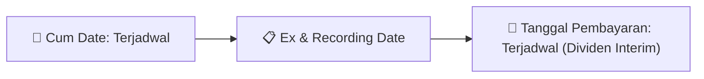
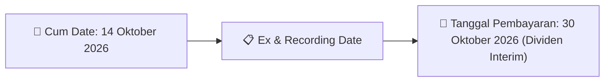
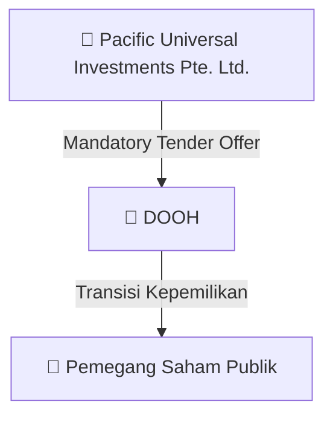
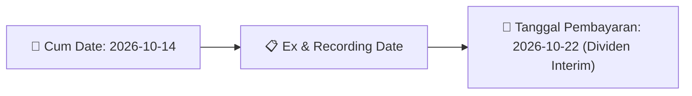

# Ikhtisar Akhir Pekan (Weekend Digest) - 2026-10-05

📅 **2026-10-05 (Weekend Digest)**

## 1. Radar Pasar & Sentimen Akhir Pekan (Executive Weekend Dashboard)
> [!NOTE]
> Terdeteksi sebanyak **156 pengumuman baru** dari 64 emiten pantauan pada (2026-10-05).

| Metric | Jumlah | Status Radar |
| :--- | :---: | :--- |
| **🟢 Sentimen Bullish / Positif** | `5` | [[Dividen Interim]], [[Mandatory Tender Offer]], Kinerja Positif |
| **⚪ Sentimen Netral / Routine** | `74` | [[Tanggapan Penjelasan Bursa]], [[RUPS]], [[Pendaftaran Unit]] |
| **🔴 Sentimen Bearish / Alert** | `0` | Sengketa Hukum, Defisit / Gugatan (Nihil hari ini) |
| **📄 [[Laporan Keuangan]] Baru** | `0` | Memicu Analisis Keuangan Otomatis |

> [!NOTE]
> Tidak dideteksi adanya publikasi laporan keuangan baru hari ini. Rangkuman per emiten secara terperinci tidak diperlukan.

---

## 2. Sorotan Utama & Watchlist Strategis (Strategic Watchlist)
#### 💰 Watchlist Dividen & Distribution
- **[[ASII]]**: Nama Emiten atau Perusahaan Publik = Astra International Tbk
- **[[ASII]]**: Kode Emiten = ASII
- **[[ASII]]**: Bidang Usaha = Perdagangan Otomotif
- **[[ASII]]**: Jenis Informasi atau Fakta Material = Pembagian dividen interim
- **[[ASII]]**: Tanggal Kejadian = 30 September 2026
- **[[ASII]]**: Informasi Lain = Sehubungan dengan program pembelian kembali saham (shares buyback) Perseroan yang sedang berlangsung, jumlah dividen interim yang dibagikan akan bergantung pada jumlah total saham yang berhak menerima dividen berdasarkan Daftar Pemegang Saham Perseroan pada Recording Date Dividen.

#### 🎯 Watchlist Penawaran Tender Wajib (MTO) & Strategis
- **[[DOOH]]**: Pengendali Baru = [[PT Sinergi Internasional Investama]]
- **[[DOOH]]**: Kepemilikan Saham Pengendali Baru Setelah Akuisisi = [[3.946.835.000 saham atau 51,00%]]
- **[[DOOH]]**: Alamat Pengendali Baru = [[Ruko Fatmawati Mas Blok B5 Kav 205, Jl. RS Fatmawati No. 20, Cilandak Barat, Jakarta]]
- **[[DOOH]]**: Telepon Pengendali Baru = [[0217659228]]
- **[[DOOH]]**: Jenis Usaha Pengendali Baru = [[Holding company (KBLI 64210)]]
- **[[DOOH]]**: Akta Pendirian Pengendali Baru = [[Akta Pendirian Nomor 6 tanggal 17 Juli 2026]]

#### 📈 Watchlist Konversi Waran & Potensi Dilusi
- **[[CSIS]]**: Nama Waran = CSIS-W
- **[[CSIS]]**: Total Saham Setelah Konversi = 1.829.804.594
- **[[CSIS]]**: Sisa Waran = 52,275,344
- **[[ISAP]]**: Nama Waran = ISAP-W
- **[[ISAP]]**: Total Saham Setelah Konversi = 4.020.378.112
- **[[ISAP]]**: Sisa Waran = 749.621.888

#### 👥 Watchlist Transaksi Orang Dalam & Kepemilikan Saham (Insider / Repo Moves)
- **[[IMPC]]**: Nama pemilik saham (SID) = TUNGGAL JAYA INVESTAMA
- **[[IMPC]]**: Anggota Direksi/Dewan Komisaris = Tidak
- **[[IMPC]]**: Kewarganegaraan = WNI
- **[[IMPC]]**: Emiten/Tbk = IMPC - IMPACK PRATAMA INDUSTRI Tbk, PT
- **[[IMPC]]**: Nomor laporan = LK/02102026/0013/1
- **[[IMPC]]**: Jumlah saham sebelum transaksi = 21.127.700.094,00 Unit
- **[[IMPC]]**: Hak suara sebelum transaksi = 38,48%
- **[[IMPC]]**: Jumlah saham setelah transaksi = 21.136.384.094,00 Unit

---

## 3. Matriks Pengumuman Pasar (Announcements Intelligence Table)
| Emiten | Sentimen | Jenis Pengumuman | Judul Pengumuman | Berkas |
| :--- | :---: | :--- | :--- | :--- |
| **[[TLKM]]** | ⚪ NEUTRAL | RUPS | Ringkasan RisalahRisalah RUPS | [Utama](file:///g:/My%20Drive/Model2/reports/raw/TLKM/20261002_TLKM_20261002_TLKM_Ringkasan RisalahRisalah RUPS_32162739.pdf) · [Lamp 1](file:///g:/My%20Drive/Model2/reports/raw/TLKM/20261002_TLKM_20261002_TLKM_Ringkasan RisalahRisalah RUPS_32162739_lamp1.pdf) · [Lamp 2](file:///g:/My%20Drive/Model2/reports/raw/TLKM/20261002_TLKM_20261002_TLKM_Ringkasan RisalahRisalah RUPS_32162739_lamp2.pdf) |
| **[[ASII]]** | 🟢 BULLISH | Dividen | Laporan Informasi dan Fakta Material | [Utama](file:///g:/My%20Drive/Model2/reports/raw/ASII/20261002_ASII_20261002_ASII_Laporan Informasi dan Fakta Material_32162625.pdf) |
| **[[ASII]]** | 🟢 BULLISH | Dividen | Jadwal Aksi Korporasi (Khusus Penyampaian Dividen Interim) | [Utama](file:///g:/My%20Drive/Model2/reports/raw/ASII/20261002_ASII_20261002_ASII_Jadwal Aksi Korporasi (Khusus Penyampaian Dividen Interim)_32162624.pdf) |
| **[[CSIS]]** | ⚪ NEUTRAL | Aksi Korporasi | Pencatatan Saham Tambahan dari Konversi | [Utama](file:///g:/My%20Drive/Model2/reports/raw/CSIS/20261002_CSIS_20261002_CSIS_Pencatatan Saham Tambahan dari Konversi_32162709.pdf) |
| **[[ISAP]]** | ⚪ NEUTRAL | Aksi Korporasi | Pencatatan Saham Tambahan dari Konversi | [Utama](file:///g:/My%20Drive/Model2/reports/raw/ISAP/20261002_ISAP_20261002_ISAP_Pencatatan Saham Tambahan dari Konversi_32162686.pdf) |
| **[[DOOH]]** | ⚪ NEUTRAL | Aksi Korporasi | Keterbukaan Informasi Tentang PengambilalihanPenawaran Tender WajibRefloat | [Utama](file:///g:/My%20Drive/Model2/reports/raw/DOOH/20261002_DOOH_20261002_DOOH_Keterbukaan Informasi Tentang PengambilalihanPenawaran Tender WajibRefloat_32162695.pdf) · [Lamp 1](file:///g:/My%20Drive/Model2/reports/raw/DOOH/20261002_DOOH_20261002_DOOH_Keterbukaan Informasi Tentang PengambilalihanPenawaran Tender WajibRefloat_32162695_lamp1.pdf) · [Lamp 2](file:///g:/My%20Drive/Model2/reports/raw/DOOH/20261002_DOOH_20261002_DOOH_Keterbukaan Informasi Tentang PengambilalihanPenawaran Tender WajibRefloat_32162695_lamp2.pdf) |
| **[[IMPC]]** | ⚪ NEUTRAL | Kepemilikan Saham (Insider) | LK-02102026-5970-00 | [Utama](file:///g:/My%20Drive/Model2/reports/raw/IMPC/20261002_IMPC_LK-02102026-5970-00.pdf) |
| **[[SRTG]]** | ⚪ NEUTRAL | Kepemilikan Saham (Insider) | LK-02102026-8239-00 | [Utama](file:///g:/My%20Drive/Model2/reports/raw/SRTG/20261002_SRTG_LK-02102026-8239-00.pdf) |
| **[[UVCR]]** | ⚪ NEUTRAL | Aksi Korporasi | Tanggapan atas Permintaan Penjelasan Bursa | [Utama](file:///g:/My%20Drive/Model2/reports/raw/UVCR/20261002_UVCR_20261002_UVCR_Tanggapan atas Permintaan Penjelasan Bursa_32162763.pdf) · [Lamp 1](file:///g:/My%20Drive/Model2/reports/raw/UVCR/20261002_UVCR_20261002_UVCR_Tanggapan atas Permintaan Penjelasan Bursa_32162763_lamp1.pdf) |
| **[[PIDL]]** | ⚪ NEUTRAL | Aksi Korporasi | Laporan Penggunaan Dana Hasil Penawaran Umum | [Utama](file:///g:/My%20Drive/Model2/reports/raw/PIDL/20261002_PIDL_20260923_PIDL_Laporan Penggunaan Dana Hasil Penawaran Umum_32150481.pdf) |
| **[[SMFP]]** | ⚪ NEUTRAL | Aksi Korporasi | Laporan Informasi dan Fakta Material | [Utama](file:///g:/My%20Drive/Model2/reports/raw/SMFP/20261002_SMFP_20261002_SMFP_Laporan Informasi dan Fakta Material_32162642.pdf) · [Lamp 1](file:///g:/My%20Drive/Model2/reports/raw/SMFP/20261002_SMFP_20261002_SMFP_Laporan Informasi dan Fakta Material_32162642_lamp1.pdf) |
| **[[CYBR]]** | ⚪ NEUTRAL | Aksi Korporasi | Pencatatan Saham Tambahan dari Konversi | [Utama](file:///g:/My%20Drive/Model2/reports/raw/CYBR/20261002_CYBR_20261002_CYBR_Pencatatan Saham Tambahan dari Konversi_32162676.pdf) |
| **[[DJPU]]** | ⚪ NEUTRAL | Aksi Korporasi | Pengumuman Jatuh Tempo Obligasi dan Sukuk | [Utama](file:///g:/My%20Drive/Model2/reports/raw/DJPU/20261002_DJPU_20261002_DJPU_Pengumuman Jatuh Tempo Obligasi dan Sukuk_32162651.pdf) |
| **[[PACK]]** | ⚪ NEUTRAL | Kepemilikan Saham (Insider) | LK-02102026-9618-00 | [Utama](file:///g:/My%20Drive/Model2/reports/raw/PACK/20261002_PACK_LK-02102026-9618-00.pdf) |
| **[[BSDE]]** | ⚪ NEUTRAL | Aksi Korporasi | Pembayaran KuponBagi HasilIjarahPokok | [Utama](file:///g:/My%20Drive/Model2/reports/raw/BSDE/20261002_BSDE_20261002_BSDE_Pembayaran KuponBagi HasilIjarahPokok_32162807.pdf) |
| **[[VISI]]** | ⚪ NEUTRAL | RUPS | Ringkasan RisalahRisalah RUPS | [Utama](file:///g:/My%20Drive/Model2/reports/raw/VISI/20261002_VISI_20261002_VISI_Ringkasan RisalahRisalah RUPS_32162693.pdf) · [Lamp 1](file:///g:/My%20Drive/Model2/reports/raw/VISI/20261002_VISI_20261002_VISI_Ringkasan RisalahRisalah RUPS_32162693_lamp1.pdf) · [Lamp 2](file:///g:/My%20Drive/Model2/reports/raw/VISI/20261002_VISI_20261002_VISI_Ringkasan RisalahRisalah RUPS_32162693_lamp2.pdf) |
| **[[BIPP]]** | ⚪ NEUTRAL | Kepemilikan Saham (Insider) | LK-02102026-5866-00 | [Utama](file:///g:/My%20Drive/Model2/reports/raw/BIPP/20261002_BIPP_LK-02102026-5866-00.pdf) |
| **[[MTLA]]** | ⚪ NEUTRAL | Kepemilikan Saham (Insider) | LK-02102026-4727-00 | [Utama](file:///g:/My%20Drive/Model2/reports/raw/MTLA/20261002_MTLA_LK-02102026-4727-00.pdf) |
| **[[BKSL]]** | ⚪ NEUTRAL | Kepemilikan Saham (Insider) | LK-02102026-7168-00 | [Utama](file:///g:/My%20Drive/Model2/reports/raw/BKSL/20261002_BKSL_LK-02102026-7168-00.pdf) |
| **[[FILM]]** | ⚪ NEUTRAL | Kepemilikan Saham (Insider) | LK-02102026-6592-00 | [Utama](file:///g:/My%20Drive/Model2/reports/raw/FILM/20261002_FILM_LK-02102026-6592-00.pdf) |
| **[[AMAR]]** | ⚪ NEUTRAL | RUPS | Ringkasan RisalahRisalah RUPS | [Utama](file:///g:/My%20Drive/Model2/reports/raw/AMAR/20261002_AMAR_20261002_AMAR_Ringkasan RisalahRisalah RUPS_32162740.pdf) · [Lamp 1](file:///g:/My%20Drive/Model2/reports/raw/AMAR/20261002_AMAR_20261002_AMAR_Ringkasan RisalahRisalah RUPS_32162740_lamp1.pdf) |
| **[[OBAT]]** | ⚪ NEUTRAL | Aksi Korporasi | Laporan Informasi dan Fakta Material | [Utama](file:///g:/My%20Drive/Model2/reports/raw/OBAT/20261002_OBAT_20261002_OBAT_Laporan Informasi dan Fakta Material_32162743.pdf) · [Lamp 1](file:///g:/My%20Drive/Model2/reports/raw/OBAT/20261002_OBAT_20261002_OBAT_Laporan Informasi dan Fakta Material_32162743_lamp1.pdf) |
| **[[PGEO]]** | ⚪ NEUTRAL | Aksi Korporasi | Pencatatan Saham Tambahan dari Konversi | [Utama](file:///g:/My%20Drive/Model2/reports/raw/PGEO/20261002_PGEO_20261002_PGEO_Pencatatan Saham Tambahan dari Konversi_32162665.pdf) |
| **[[SONA]]** | ⚪ NEUTRAL | Public Expose | Public Expose | [Utama](file:///g:/My%20Drive/Model2/reports/raw/SONA/20261002_SONA_20261002_SONA_Public Expose_32162797.pdf) |
| **[[BRMS]]** | ⚪ NEUTRAL | Kepemilikan Saham (Insider) | LK-02102026-3275-00 | [Utama](file:///g:/My%20Drive/Model2/reports/raw/BRMS/20261002_BRMS_LK-02102026-3275-00.pdf) |
| **[[PPGD]]** | ⚪ NEUTRAL | Aksi Korporasi | Pembayaran KuponBagi HasilIjarahPokok | [Utama](file:///g:/My%20Drive/Model2/reports/raw/PPGD/20261002_PPGD_20261002_PPGD_Pembayaran KuponBagi HasilIjarahPokok_32162688.pdf) · [Lamp 1](file:///g:/My%20Drive/Model2/reports/raw/PPGD/20261002_PPGD_20261002_PPGD_Pembayaran KuponBagi HasilIjarahPokok_32162690_lamp1.pdf) · [Lamp 1](file:///g:/My%20Drive/Model2/reports/raw/PPGD/20261002_PPGD_20261002_PPGD_Pembayaran KuponBagi HasilIjarahPokok_32162688_lamp1.pdf) |
| **[[PPGD]]** | ⚪ NEUTRAL | Aksi Korporasi | Laporan Penggunaan Dana Hasil Penawaran Umum | [Utama](file:///g:/My%20Drive/Model2/reports/raw/PPGD/20261002_PPGD_20261002_PPGD_Laporan Penggunaan Dana Hasil Penawaran Umum_32162664.pdf) |
| **[[EDGE]]** | 🟢 BULLISH | Aksi Korporasi | Pengumuman Bursa | [Utama](file:///g:/My%20Drive/Model2/reports/raw/EDGE/20261002_EDGE_20261002_EDGE_Pengumuman Bursa_32162680.pdf) · [Lamp 1](file:///g:/My%20Drive/Model2/reports/raw/EDGE/20261002_EDGE_20261002_EDGE_Pengumuman Bursa_32162680_lamp1.pdf) |
| **[[BFIN]]** | ⚪ NEUTRAL | Kepemilikan Saham (Insider) | LK-02102026-6540-00 | [Utama](file:///g:/My%20Drive/Model2/reports/raw/BFIN/20261002_BFIN_LK-02102026-6540-00.pdf) |
| **[[PRDA]]** | 🟢 BULLISH | Buyback | Laporan Informasi dan Fakta Material | [Utama](file:///g:/My%20Drive/Model2/reports/raw/PRDA/20261002_PRDA_20261002_PRDA_Laporan Informasi dan Fakta Material_32162794.pdf) · [Lamp 1](file:///g:/My%20Drive/Model2/reports/raw/PRDA/20261002_PRDA_20261002_PRDA_Laporan Informasi dan Fakta Material_32162794_lamp1.pdf) |
| **[[MDLN]]** | ⚪ NEUTRAL | Aksi Korporasi | Laporan Informasi dan Fakta Material | [Utama](file:///g:/My%20Drive/Model2/reports/raw/MDLN/20261002_MDLN_20261002_MDLN_Laporan Informasi dan Fakta Material_32162659.pdf) · [Lamp 2](file:///g:/My%20Drive/Model2/reports/raw/MDLN/20261002_MDLN_20261002_MDLN_Laporan Informasi dan Fakta Material_32162659_lamp2.pdf) |
| **[[TLDN]]** | 🟢 BULLISH | Dividen | Jadwal Aksi Korporasi (Khusus Penyampaian Dividen Interim) | [Utama](file:///g:/My%20Drive/Model2/reports/raw/TLDN/20261002_TLDN_20260929_TLDN_Jadwal Aksi Korporasi (Khusus Penyampaian Dividen Interim)_32161604.pdf) · [Lamp 2](file:///g:/My%20Drive/Model2/reports/raw/TLDN/20261002_TLDN_20261002_TLDN_Jadwal Aksi Korporasi (Khusus Penyampaian Dividen Interim)_32162766_lamp2.pdf) |
| **[[MPPA]]** | ⚪ NEUTRAL | Aksi Korporasi | Laporan Penggunaan Dana Hasil Penawaran Umum | [Utama](file:///g:/My%20Drive/Model2/reports/raw/MPPA/20261002_MPPA_20261002_MPPA_Laporan Penggunaan Dana Hasil Penawaran Umum_32162796.pdf) · [Lamp 1](file:///g:/My%20Drive/Model2/reports/raw/MPPA/20261002_MPPA_20261002_MPPA_Laporan Penggunaan Dana Hasil Penawaran Umum_32162796_lamp1.pdf) |
| **[[DRMA]]** | ⚪ NEUTRAL | Kepemilikan Saham (Insider) | LK-02102026-6079-00 | [Utama](file:///g:/My%20Drive/Model2/reports/raw/DRMA/20261002_DRMA_LK-02102026-6079-00.pdf) |
| **[[BSWD]]** | ⚪ NEUTRAL | Aksi Korporasi | Laporan Informasi dan Fakta Material | [Utama](file:///g:/My%20Drive/Model2/reports/raw/BSWD/20261002_BSWD_20261002_BSWD_Laporan Informasi dan Fakta Material_32162750.pdf) |
| **[[MDIY]]** | ⚪ NEUTRAL | Aksi Korporasi | Laporan Hasil Pelaksanaan Konversi ESOP MSOP | [Utama](file:///g:/My%20Drive/Model2/reports/raw/MDIY/20261002_MDIY_20261001_MDIY_Laporan Hasil Pelaksanaan Konversi ESOP MSOP_32162521.pdf) · [Lamp 1](file:///g:/My%20Drive/Model2/reports/raw/MDIY/20261002_MDIY_20261001_MDIY_Laporan Hasil Pelaksanaan Konversi ESOP MSOP_32162521_lamp1.pdf) |
| **[[AMRT]]** | ⚪ NEUTRAL | Aksi Korporasi | Tanggapan atas Permintaan Penjelasan Bursa | [Utama](file:///g:/My%20Drive/Model2/reports/raw/AMRT/20261002_AMRT_20261002_AMRT_Tanggapan atas Permintaan Penjelasan Bursa_32162646.pdf) · [Lamp 1](file:///g:/My%20Drive/Model2/reports/raw/AMRT/20261002_AMRT_20261002_AMRT_Tanggapan atas Permintaan Penjelasan Bursa_32162646_lamp1.pdf) |
| **[[APEX]]** | ⚪ NEUTRAL | Aksi Korporasi | Perubahan danatau Tambahan Keterbukaan Informasi terkait Aksi Korporasi | [Utama](file:///g:/My%20Drive/Model2/reports/raw/APEX/20261002_APEX_20261002_APEX_Perubahan danatau Tambahan Keterbukaan Informasi terkait Aksi Korporasi_32162677.pdf) · [Lamp 3](file:///g:/My%20Drive/Model2/reports/raw/APEX/20261002_APEX_20261002_APEX_Perubahan danatau Tambahan Keterbukaan Informasi terkait Aksi Korporasi_32162677_lamp3.pdf) · [Lamp 2](file:///g:/My%20Drive/Model2/reports/raw/APEX/20261002_APEX_20261002_APEX_Perubahan danatau Tambahan Keterbukaan Informasi terkait Aksi Korporasi_32162677_lamp2.pdf) |
| **[[ARKO]]** | ⚪ NEUTRAL | Kepemilikan Saham (Insider) | LK-02102026-6068-00 | [Utama](file:///g:/My%20Drive/Model2/reports/raw/ARKO/20261002_ARKO_LK-02102026-6068-00.pdf) |
| **[[ARKO]]** | ⚪ NEUTRAL | Aksi Korporasi | Tanggapan atas Permintaan Penjelasan Bursa | [Utama](file:///g:/My%20Drive/Model2/reports/raw/ARKO/20261002_ARKO_20261002_ARKO_Tanggapan atas Permintaan Penjelasan Bursa_32162748.pdf) |
| **[[PEGE]]** | ⚪ NEUTRAL | Kepemilikan Saham (Insider) | LK-02102026-0150-00 | [Utama](file:///g:/My%20Drive/Model2/reports/raw/PEGE/20261002_PEGE_LK-02102026-0150-00.pdf) |
| **[[SMAR]]** | ⚪ NEUTRAL | Aksi Korporasi | Tanggapan atas Permintaan Penjelasan Bursa | [Utama](file:///g:/My%20Drive/Model2/reports/raw/SMAR/20261002_SMAR_20261001_SMAR_Tanggapan atas Permintaan Penjelasan Bursa_32162532.pdf) |
| **[[MAXI]]** | ⚪ NEUTRAL | Aksi Korporasi | Tanggapan atas Permintaan Penjelasan Bursa | [Utama](file:///g:/My%20Drive/Model2/reports/raw/MAXI/20261002_MAXI_20261002_MAXI_Tanggapan atas Permintaan Penjelasan Bursa_32162828.pdf) · [Lamp 1](file:///g:/My%20Drive/Model2/reports/raw/MAXI/20261002_MAXI_20261002_MAXI_Tanggapan atas Permintaan Penjelasan Bursa_32162828_lamp1.pdf) |
| **[[AMMN]]** | ⚪ NEUTRAL | Aksi Korporasi | Tanggapan atas Permintaan Penjelasan Bursa | [Utama](file:///g:/My%20Drive/Model2/reports/raw/AMMN/20261002_AMMN_20261002_AMMN_Tanggapan atas Permintaan Penjelasan Bursa_32162708.pdf) · [Lamp 1](file:///g:/My%20Drive/Model2/reports/raw/AMMN/20261002_AMMN_20261002_AMMN_Tanggapan atas Permintaan Penjelasan Bursa_32162708_lamp1.pdf) |
| **[[ADHI]]** | ⚪ NEUTRAL | RUPS | Pemberitahuan RencanaPenyampaian PanggilanHasil RUPORUPSURUP EBA-SP | [Utama](file:///g:/My%20Drive/Model2/reports/raw/ADHI/20261002_ADHI_20261002_ADHI_Pemberitahuan RencanaPenyampaian PanggilanHasil RUPORUPSURUP EBA-SP_32162756.pdf) · [Lamp 1](file:///g:/My%20Drive/Model2/reports/raw/ADHI/20261002_ADHI_20261002_ADHI_Pemberitahuan RencanaPenyampaian PanggilanHasil RUPORUPSURUP EBA-SP_32162756_lamp1.pdf) |
| **[[ADHI]]** | ⚪ NEUTRAL | Aksi Korporasi | Laporan Informasi dan Fakta Material | [Utama](file:///g:/My%20Drive/Model2/reports/raw/ADHI/20261002_ADHI_20261002_ADHI_Laporan Informasi dan Fakta Material_32162691.pdf) · [Lamp 1](file:///g:/My%20Drive/Model2/reports/raw/ADHI/20261002_ADHI_20261002_ADHI_Laporan Informasi dan Fakta Material_32162692_lamp1.pdf) · [Lamp 1](file:///g:/My%20Drive/Model2/reports/raw/ADHI/20261002_ADHI_20261002_ADHI_Laporan Informasi dan Fakta Material_32162691_lamp1.pdf) |
| **[[ADHI]]** | ⚪ NEUTRAL | RUPS | Ringkasan RisalahRisalah RUPS | [Utama](file:///g:/My%20Drive/Model2/reports/raw/ADHI/20261002_ADHI_20261002_ADHI_Ringkasan RisalahRisalah RUPS_32162681.pdf) · [Lamp 1](file:///g:/My%20Drive/Model2/reports/raw/ADHI/20261002_ADHI_20261002_ADHI_Ringkasan RisalahRisalah RUPS_32162681_lamp1.pdf) |
| **[[IPTV]]** | ⚪ NEUTRAL | Aksi Korporasi | Tanggapan atas Permintaan Penjelasan Bursa | [Utama](file:///g:/My%20Drive/Model2/reports/raw/IPTV/20261002_IPTV_20261002_IPTV_Tanggapan atas Permintaan Penjelasan Bursa_32162784.pdf) |
| **[[AVIA]]** | ⚪ NEUTRAL | Aksi Korporasi | Laporan Informasi dan Fakta Material | [Utama](file:///g:/My%20Drive/Model2/reports/raw/AVIA/20261002_AVIA_20261002_AVIA_Laporan Informasi dan Fakta Material_32162640.pdf) · [Lamp 1](file:///g:/My%20Drive/Model2/reports/raw/AVIA/20261002_AVIA_20261002_AVIA_Laporan Informasi dan Fakta Material_32162640_lamp1.pdf) |
| **[[HIFI]]** | ⚪ NEUTRAL | Aksi Korporasi | Laporan Penggunaan Dana Hasil Penawaran Umum | [Utama](file:///g:/My%20Drive/Model2/reports/raw/HIFI/20261002_HIFI_20261002_HIFI_Laporan Penggunaan Dana Hasil Penawaran Umum_32162868.pdf) · [Lamp 3](file:///g:/My%20Drive/Model2/reports/raw/HIFI/20261002_HIFI_20261002_HIFI_Laporan Penggunaan Dana Hasil Penawaran Umum_32162868_lamp3.pdf) · [Lamp 2](file:///g:/My%20Drive/Model2/reports/raw/HIFI/20261002_HIFI_20261002_HIFI_Laporan Penggunaan Dana Hasil Penawaran Umum_32162868_lamp2.pdf) · [Lamp 4](file:///g:/My%20Drive/Model2/reports/raw/HIFI/20261002_HIFI_20261002_HIFI_Laporan Penggunaan Dana Hasil Penawaran Umum_32162868_lamp4.pdf) |
| **[[HIFI]]** | ⚪ NEUTRAL | Aksi Korporasi | Pembayaran KuponBagi HasilIjarahPokok | [Utama](file:///g:/My%20Drive/Model2/reports/raw/HIFI/20261002_HIFI_20261002_HIFI_Pembayaran KuponBagi HasilIjarahPokok_32162666.pdf) |
| **[[MICE]]** | ⚪ NEUTRAL | Kepemilikan Saham (Insider) | LK-02102026-9955-00 | [Utama](file:///g:/My%20Drive/Model2/reports/raw/MICE/20261002_MICE_LK-02102026-9955-00.pdf) |
| **[[YELO]]** | ⚪ NEUTRAL | RUPS | Pemanggilan RUPS | [Utama](file:///g:/My%20Drive/Model2/reports/raw/YELO/20261002_YELO_20261002_YELO_Pemanggilan RUPS_32162684.pdf) · [Lamp 1](file:///g:/My%20Drive/Model2/reports/raw/YELO/20261002_YELO_20261002_YELO_Pemanggilan RUPS_32162684_lamp1.pdf) · [Lamp 2](file:///g:/My%20Drive/Model2/reports/raw/YELO/20261002_YELO_20261002_YELO_Pemanggilan RUPS_32162684_lamp2.pdf) |
| **[[NAYZ]]** | ⚪ NEUTRAL | Aksi Korporasi | Keterbukaan Informasi Tentang PengambilalihanPenawaran Tender WajibRefloat | [Utama](file:///g:/My%20Drive/Model2/reports/raw/NAYZ/20261002_NAYZ_20261001_NAYZ_Keterbukaan Informasi Tentang PengambilalihanPenawaran Tender WajibRefloat_32162428.pdf) · [Lamp 1](file:///g:/My%20Drive/Model2/reports/raw/NAYZ/20261002_NAYZ_20261001_NAYZ_Keterbukaan Informasi Tentang PengambilalihanPenawaran Tender WajibRefloat_32162428_lamp1.pdf) · [Lamp 2](file:///g:/My%20Drive/Model2/reports/raw/NAYZ/20261002_NAYZ_20261001_NAYZ_Keterbukaan Informasi Tentang PengambilalihanPenawaran Tender WajibRefloat_32162428_lamp2.pdf) |
| **[[PRTL]]** | ⚪ NEUTRAL | Aksi Korporasi | Laporan Informasi dan Fakta Material | [Utama](file:///g:/My%20Drive/Model2/reports/raw/PRTL/20261002_PRTL_20261002_PRTL_Laporan Informasi dan Fakta Material_32162792.pdf) · [Lamp 2](file:///g:/My%20Drive/Model2/reports/raw/PRTL/20261002_PRTL_20261002_PRTL_Laporan Informasi dan Fakta Material_32162792_lamp2.pdf) · [Lamp 1](file:///g:/My%20Drive/Model2/reports/raw/PRTL/20261002_PRTL_20261002_PRTL_Laporan Informasi dan Fakta Material_32162792_lamp1.pdf) |
| **[[DMND]]** | ⚪ NEUTRAL | RUPS | Ringkasan RisalahRisalah RUPS | [Utama](file:///g:/My%20Drive/Model2/reports/raw/DMND/20261002_DMND_20261002_DMND_Ringkasan RisalahRisalah RUPS_32162777.pdf) · [Lamp 3](file:///g:/My%20Drive/Model2/reports/raw/DMND/20261002_DMND_20261002_DMND_Ringkasan RisalahRisalah RUPS_32162777_lamp3.pdf) · [Lamp 1](file:///g:/My%20Drive/Model2/reports/raw/DMND/20261002_DMND_20261002_DMND_Ringkasan RisalahRisalah RUPS_32162777_lamp1.pdf) |
| **[[FWCT]]** | ⚪ NEUTRAL | RUPS | Ringkasan RisalahRisalah RUPS | [Utama](file:///g:/My%20Drive/Model2/reports/raw/FWCT/20261002_FWCT_20261002_FWCT_Ringkasan RisalahRisalah RUPS_32162761.pdf) · [Lamp 4](file:///g:/My%20Drive/Model2/reports/raw/FWCT/20261002_FWCT_20261002_FWCT_Ringkasan RisalahRisalah RUPS_32162761_lamp4.pdf) · [Lamp 5](file:///g:/My%20Drive/Model2/reports/raw/FWCT/20261002_FWCT_20261002_FWCT_Ringkasan RisalahRisalah RUPS_32162761_lamp5.pdf) · [Lamp 2](file:///g:/My%20Drive/Model2/reports/raw/FWCT/20261002_FWCT_20261002_FWCT_Ringkasan RisalahRisalah RUPS_32162761_lamp2.pdf) · [Lamp 3](file:///g:/My%20Drive/Model2/reports/raw/FWCT/20261002_FWCT_20261002_FWCT_Ringkasan RisalahRisalah RUPS_32162761_lamp3.pdf) |
| **[[SOFN]]** | ⚪ NEUTRAL | Aksi Korporasi | Laporan Informasi dan Fakta Material | [Utama](file:///g:/My%20Drive/Model2/reports/raw/SOFN/20261002_SOFN_20261002_SOFN_Laporan Informasi dan Fakta Material_32162628.pdf) · [Lamp 1](file:///g:/My%20Drive/Model2/reports/raw/SOFN/20261002_SOFN_20261002_SOFN_Laporan Informasi dan Fakta Material_32162628_lamp1.pdf) |
| **[[ERAA]]** | ⚪ NEUTRAL | Kepemilikan Saham (Insider) | LK-02102026-4475-00 | [Utama](file:///g:/My%20Drive/Model2/reports/raw/ERAA/20261002_ERAA_LK-02102026-4475-00.pdf) |
| **[[ERAA]]** | ⚪ NEUTRAL | Kepemilikan Saham (Insider) | LK-02102026-4096-00 | [Utama](file:///g:/My%20Drive/Model2/reports/raw/ERAA/20261002_ERAA_LK-02102026-4096-00.pdf) |
| **[[ERAA]]** | ⚪ NEUTRAL | Kepemilikan Saham (Insider) | LK-02102026-2947-00 | [Utama](file:///g:/My%20Drive/Model2/reports/raw/ERAA/20261002_ERAA_LK-02102026-2947-00.pdf) |
| **[[ERAA]]** | ⚪ NEUTRAL | Kepemilikan Saham (Insider) | LK-02102026-8245-00 | [Utama](file:///g:/My%20Drive/Model2/reports/raw/ERAA/20261002_ERAA_LK-02102026-8245-00.pdf) |
| **[[ERAA]]** | ⚪ NEUTRAL | Kepemilikan Saham (Insider) | LK-02102026-5456-00 | [Utama](file:///g:/My%20Drive/Model2/reports/raw/ERAA/20261002_ERAA_LK-02102026-5456-00.pdf) |
| **[[ERAA]]** | ⚪ NEUTRAL | Kepemilikan Saham (Insider) | LK-02102026-9255-00 | [Utama](file:///g:/My%20Drive/Model2/reports/raw/ERAA/20261002_ERAA_LK-02102026-9255-00.pdf) |
| **[[ERAA]]** | ⚪ NEUTRAL | Kepemilikan Saham (Insider) | LK-02102026-6962-00 | [Utama](file:///g:/My%20Drive/Model2/reports/raw/ERAA/20261002_ERAA_LK-02102026-6962-00.pdf) |
| **[[LINK]]** | ⚪ NEUTRAL | RUPS | Pemanggilan RUPS | [Utama](file:///g:/My%20Drive/Model2/reports/raw/LINK/20261002_LINK_20261002_LINK_Pemanggilan RUPS_32162715.pdf) · [Lamp 1](file:///g:/My%20Drive/Model2/reports/raw/LINK/20261002_LINK_20261002_LINK_Pemanggilan RUPS_32162715_lamp1.pdf) |
| **[[RIGS]]** | ⚪ NEUTRAL | RUPS | Pengumuman RUPS | [Utama](file:///g:/My%20Drive/Model2/reports/raw/RIGS/20261002_RIGS_20261002_RIGS_Pengumuman RUPS_32162633.pdf) · [Lamp 2](file:///g:/My%20Drive/Model2/reports/raw/RIGS/20261002_RIGS_20261002_RIGS_Pengumuman RUPS_32162633_lamp2.pdf) |
| **[[SGER]]** | ⚪ NEUTRAL | Aksi Korporasi | Laporan Informasi dan Fakta Material | [Utama](file:///g:/My%20Drive/Model2/reports/raw/SGER/20261002_SGER_20261002_SGER_Laporan Informasi dan Fakta Material_32162798.pdf) · [Lamp 1](file:///g:/My%20Drive/Model2/reports/raw/SGER/20261002_SGER_20261002_SGER_Laporan Informasi dan Fakta Material_32162798_lamp1.pdf) |
| **[[LPPS]]** | ⚪ NEUTRAL | Aksi Korporasi | Tanggapan atas Permintaan Penjelasan Bursa | [Utama](file:///g:/My%20Drive/Model2/reports/raw/LPPS/20261002_LPPS_20261002_LPPS_Tanggapan atas Permintaan Penjelasan Bursa_32162749.pdf) |
| **[[WMUU]]** | ⚪ NEUTRAL | Aksi Korporasi | Tanggapan atas Permintaan Penjelasan Bursa | [Utama](file:///g:/My%20Drive/Model2/reports/raw/WMUU/20261002_WMUU_20261002_WMUU_Tanggapan atas Permintaan Penjelasan Bursa_32162751.pdf) |
| **[[CHEM]]** | ⚪ NEUTRAL | Aksi Korporasi | Tanggapan atas Permintaan Penjelasan Bursa | [Utama](file:///g:/My%20Drive/Model2/reports/raw/CHEM/20261002_CHEM_20261002_CHEM_Tanggapan atas Permintaan Penjelasan Bursa_32162661.pdf) · [Lamp 1](file:///g:/My%20Drive/Model2/reports/raw/CHEM/20261002_CHEM_20261002_CHEM_Tanggapan atas Permintaan Penjelasan Bursa_32162661_lamp1.pdf) |
| **[[BRIF]]** | ⚪ NEUTRAL | Aksi Korporasi | P.001 PenjelasanAsetLiabilitas2026 | [Utama](file:///g:/My%20Drive/Model2/reports/raw/BRIF/20260930_BRIF_P.001_PenjelasanAsetLiabilitas2026.pdf) |
| **[[BRIF]]** | ⚪ NEUTRAL | Aksi Korporasi | P.002 Surat Pengantar LK Jun 26 | [Utama](file:///g:/My%20Drive/Model2/reports/raw/BRIF/20260930_BRIF_P.002_Surat Pengantar LK Jun 26.pdf) |
| **[[BRIF]]** | ⚪ NEUTRAL | Aksi Korporasi | SPD LK Juni 2026 signed | [Utama](file:///g:/My%20Drive/Model2/reports/raw/BRIF/20260930_BRIF_SPD LK Juni 2026_signed.pdf) |
| **[[GIAA]]** | ⚪ NEUTRAL | Aksi Korporasi | Surat Pernyataan Direksi 30 Juni 2026 | [Utama](file:///g:/My%20Drive/Model2/reports/raw/GIAA/20260930_GIAA_Surat Pernyataan Direksi 30 Juni 2026.pdf) |
| **[[BRNA]]** | ⚪ NEUTRAL | Aksi Korporasi | Representation Letter | [Utama](file:///g:/My%20Drive/Model2/reports/raw/BRNA/20261001_BRNA_Representation Letter.pdf) |
| **[[ARTI]]** | ⚪ NEUTRAL | Aksi Korporasi | LKTT 2026 ARTI | [Utama](file:///g:/My%20Drive/Model2/reports/raw/ARTI/20261001_ARTI_LKTT 2026 ARTI.pdf) |
| **[[ARTI]]** | ⚪ NEUTRAL | Aksi Korporasi | Surat Pengantar LKTT 2026 ARTI | [Utama](file:///g:/My%20Drive/Model2/reports/raw/ARTI/20261001_ARTI_Surat Pengantar LKTT 2026 ARTI.pdf) |
| **[[BSSB]]** | ⚪ NEUTRAL | Aksi Korporasi | KAP 1 | [Utama](file:///g:/My%20Drive/Model2/reports/raw/BSSB/20261001_BSSB_KAP 1.pdf) |

---

## 4. Detail Informasi per Emiten (Grouped by Emiten)
### ⭐ 4.1. Detail Emiten Pantauan (Watchlist)

#### 🔵 [[TLKM]]
- **[RUPS]** [Ringkasan RisalahRisalah RUPS](file:///g:/My%20Drive/Model2/reports/raw/TLKM/20261002_TLKM_20261002_TLKM_Ringkasan RisalahRisalah RUPS_32162739.pdf) *(Attachment: [Lamp 1](file:///g:/My%20Drive/Model2/reports/raw/TLKM/20261002_TLKM_20261002_TLKM_Ringkasan RisalahRisalah RUPS_32162739_lamp1.pdf) · [Lamp 2](file:///g:/My%20Drive/Model2/reports/raw/TLKM/20261002_TLKM_20261002_TLKM_Ringkasan RisalahRisalah RUPS_32162739_lamp2.pdf))*
  - 📌 *Deskripsi*: PT Telkom Indonesia (Persero) Tbk (TLKM) menyelenggarakan RUPS Luar Biasa Tahun 2026 pada 30 September 2026. RUPS menyetujui rencana spin-off sebagian bisnis Wholesale Fiber Connectivity (Phase 2) kepada PT Telkom Infrastruktur Indonesia yang dimiliki 99,99%. Quorum terpenuhi dengan kehadiran 86.917.778.519 saham atau 88,1689481% dari total saham dengan hak suara setelah memperhitungkan saham treasury.
  - 📊 **Fakta Material**:
    - **Nama Emiten**: PT Telekomunikasi Indonesia Tbk (Persero)
    - **Kode Emiten**: TLKM
    - **Jenis RUPS**: RUPS Luar Biasa Tahun 2026
    - **Nomor Pengumuman**: Tel.90/LP 000/COP-M0000000/2026
    - **Hari/Tanggal RUPS**: Rabu, 30 September 2026
    - **Waktu RUPS**: 16.45 sampai 17.22 WIB
    - **Tempat RUPS**: Meeting Link (tidak dicantumkan dalam teks)
    - **Jumlah Saham Hadir**: 86.917.778.519 saham
    - **Persentase Saham Hadir**: 88,1689481%
    - **Total Saham dengan Hak Suara Setelah Treasury**: 98.580.940.800 saham
    - **Tanggal Daftar Pemegang Saham**: 7 September 2026
    - **Nomor Risalah**: 63b/IX/2026
    - **Tanggal Risalah**: 30 September 2026
    - **Notaris**: Titik Krisna Murti Wikaningsih Hastuti, S.H., M.Kn.
    - **Pihak Penghitung dan Validasi Suara**: PT Datindo Entrycom
    - **Agenda Pertama**: Persetujuan rencana Perseroan untuk melakukan Partial Spin-Off segmen bisnis Wholesale Fiber Connectivity (Phase 2) kepada PT Telkom Infrastruktur Indonesia
    - **Kepemilikan Saham PT Telkom Infrastruktur Indonesia**: 99,99%
    - **Hasil Voting Tidak Setuju**: 277.808.090 saham atau 0,3196217%
    - **Hasil Voting Abstain**: 426.783.977 saham atau 0,4910203%
    - **Hasil Voting Setuju**: 86.213.186.452 saham atau 99,1893579%
    - **Total Suara Mayoritas**: 86.639.970.429 suara atau 99,6803783%
    - **Keputusan Agenda Pertama**: Menyetujui tindakan Perseroan untuk melakukan spin-off sebagian segmen bisnis wholesale fiber connectivity (Phase 2) kepada PT Telkom Infrastruktur Indonesia, efektif setelah terpenuhinya seluruh persyaratan hukum yang berlaku.
    - **Komisaris Tidak Hadir**: Angga Raka Prabowo (Presiden Komisaris)
    - **Direktur Tidak Hadir**: Veranita Yosephine (Director of Enterprise & Business Service)
    - **Dasar Quorum**: Pasal 26 ayat (6) huruf a Anggaran Dasar dan Pasal 43 huruf a POJK No. 15/POJK.04/2020; Pasal 26 ayat (4) huruf a Anggaran Dasar

#### 🔵 [[ASII]]
- **[Dividen]** [Laporan Informasi dan Fakta Material](file:///g:/My%20Drive/Model2/reports/raw/ASII/20261002_ASII_20261002_ASII_Laporan Informasi dan Fakta Material_32162625.pdf)
  - 📌 *Deskripsi*: Astra International Tbk (ASII) menyampaikan Laporan Informasi atau Fakta Material terkait pembagian dividen interim. Tanggal kejadian adalah 30 September 2026. Jumlah dividen interim yang dibagikan akan bergantung pada jumlah total saham yang berhak menerima dividen berdasarkan Daftar Pemegang Saham Perseroan pada Recording Date Dividen, sehubungan dengan program pembelian kembali saham yang sedang berlangsung.
  - 📊 **Fakta Material**:
    - **Nama Emiten atau Perusahaan Publik**: Astra International Tbk
    - **Kode Emiten**: ASII
    - **Bidang Usaha**: Perdagangan Otomotif
    - **Jenis Informasi atau Fakta Material**: Pembagian dividen interim
    - **Tanggal Kejadian**: 30 September 2026
    - **Informasi Lain**: Sehubungan dengan program pembelian kembali saham (shares buyback) Perseroan yang sedang berlangsung, jumlah dividen interim yang dibagikan akan bergantung pada jumlah total saham yang berhak menerima dividen berdasarkan Daftar Pemegang Saham Perseroan pada Recording Date Dividen.
    - **Nama Pengirim**: Gita Tiffany Boer
    - **Jabatan Pengirim**: Astra International Tbk
    - **Tanggal dan Waktu Pelaporan**: 02-10-2026 17:10
    - **Lampiran**: Letter to OJK - KI Pembagian Dividen Interim 2026.pdf

- **[Dividen]** [Jadwal Aksi Korporasi (Khusus Penyampaian Dividen Interim)](file:///g:/My%20Drive/Model2/reports/raw/ASII/20261002_ASII_20261002_ASII_Jadwal Aksi Korporasi (Khusus Penyampaian Dividen Interim)_32162624.pdf)
  - 📌 *Deskripsi*: Astra International Tbk (ASII) melaporkan rencana pembagian dividen tunai interim untuk tahun buku 2026 sebesar IDR 98 per saham dengan total nilai dividen IDR 3.895.746.738.520. Jadwal pembayaran dividen ditetapkan pada 30 Oktober 2026, dengan tanggal Daftar Pemegang Saham yang berhak atas dividen pada 14 Oktober 2026. Jumlah dividen yang dibagikan dapat bergantung pada program buyback saham yang sedang berlangsung.
  - 📊 **Fakta Material**:
    - **Jenis aksi korporasi**: Dividen Tunai Interim
    - **Periode tahun buku**: 2026
    - **Nomor surat**: Leg/SRT-1192/AI/2026
    - **Tanggal keputusan Direksi disetujui Dewan Komisaris**: 31 Desember 2026
    - **Dividen per saham**: IDR 98
    - **Total nilai dividen**: IDR 3.895.746.738.520
    - **Tanggal Daftar Pemegang Saham (DPS) yang berhak atas dividen tunai**: 14 Oktober 2026
    - **Tanggal Cum Dividen di Pasar Reguler dan Pasar Negosiasi**: 12 Oktober 2026
    - **Tanggal Ex Dividen di Pasar Reguler dan Pasar Negosiasi**: 13 Oktober 2026
    - **Tanggal Cum Dividen di Pasar Tunai**: 14 Oktober 2026
    - **Tanggal Ex Dividen di Pasar Tunai**: 15 Oktober 2026
    - **Tanggal Pembayaran Dividen**: 30 Oktober 2026
    - **Laba bersih yang diatribusikan kepada entitas induk per 30 Juni 2026**: IDR 12.533.171.521.252
    - **Saldo laba ditahan yang tidak dibatasi penggunaannya per 30 Juni 2026**: IDR 219.331.720.803.269
    - **Total ekuitas per 30 Juni 2026**: IDR 289.844.537.308.431
    - **Catatan terkait buyback**: Jumlah dividen interim yang dibagikan bergantung pada jumlah total saham yang berhak menerima dividen berdasarkan Daftar Pemegang Saham pada Recording Date Dividen, sehubungan dengan program pembelian kembali saham yang sedang berlangsung.
    - **Nama pengirim**: Gita Tiffany Boer

---

### 📋 4.2. Detail Emiten Lain (Non-Watchlist)

#### 🔵 [[CSIS]]
- **[Aksi Korporasi]** [Pencatatan Saham Tambahan dari Konversi](file:///g:/My%20Drive/Model2/reports/raw/CSIS/20261002_CSIS_20261002_CSIS_Pencatatan Saham Tambahan dari Konversi_32162709.pdf)
  - 📌 *Deskripsi*: BEI mengumumkan pencatatan saham tambahan PT Cahayasakti Investindo Sukses Tbk (CSIS) dari konversi waran CSIS-W. Jumlah saham hasil konversi 6, total saham setelah konversi 1.829.804.594, sisa waran 52,275,344, dengan tanggal pencatatan dan perdagangan 05 Oktober 2026.
  - 📊 **Fakta Material**:
    - **Jenis Aksi Korporasi**: Konversi Waran
    - **Nama Waran**: CSIS-W
    - **Total Saham Setelah Konversi**: 1.829.804.594
    - **Sisa Waran**: 52,275,344
    - **Tanggal Pencatatan dan Perdagangan**: 05 Oktober 2026
    - **Papan Pencatatan**: Pengembangan

#### 🔵 [[ISAP]]
- **[Aksi Korporasi]** [Pencatatan Saham Tambahan dari Konversi](file:///g:/My%20Drive/Model2/reports/raw/ISAP/20261002_ISAP_20261002_ISAP_Pencatatan Saham Tambahan dari Konversi_32162686.pdf)
  - 📌 *Deskripsi*: PT Isra Presisi Indonesia Tbk (ISAP) mengumumkan pencatatan saham tambahan dari konversi waran ISAP-W. Jumlah waran yang dikonversi 59, jumlah saham hasil konversi 59, total saham setelah konversi 4.020.378.112, dan sisa waran 749.621.888. Pencatatan dan perdagangan dilakukan pada 5 Oktober 2026.
  - 📊 **Fakta Material**:
    - **Nama Waran**: ISAP-W
    - **Jenis Aksi Korporasi**: Konversi Waran
    - **Papan Pencatatan**: Akselerasi
    - **Total Saham Setelah Konversi**: 4.020.378.112
    - **Sisa Waran**: 749.621.888
    - **Tanggal Pencatatan dan Perdagangan**: 2026-10-05
    - **Tanggal Pengumuman**: 2026-10-02

#### 🔵 [[DOOH]]
- **[Aksi Korporasi]** [Keterbukaan Informasi Tentang PengambilalihanPenawaran Tender WajibRefloat](file:///g:/My%20Drive/Model2/reports/raw/DOOH/20261002_DOOH_20261002_DOOH_Keterbukaan Informasi Tentang PengambilalihanPenawaran Tender WajibRefloat_32162695.pdf) *(Attachment: [Lamp 1](file:///g:/My%20Drive/Model2/reports/raw/DOOH/20261002_DOOH_20261002_DOOH_Keterbukaan Informasi Tentang PengambilalihanPenawaran Tender WajibRefloat_32162695_lamp1.pdf) · [Lamp 2](file:///g:/My%20Drive/Model2/reports/raw/DOOH/20261002_DOOH_20261002_DOOH_Keterbukaan Informasi Tentang PengambilalihanPenawaran Tender WajibRefloat_32162695_lamp2.pdf))*
  - 📌 *Deskripsi*: PT Era Media Sejahtera Tbk (DOOH) menyampaikan keterbukaan informasi atas Penawaran Tender Wajib oleh pengendali baru PT Sinergi Internasional Investama. Pengambilalihan 3.946.835.000 saham (51,00%) dari PT Prambanan Investasi Sukses selesai pada 30 Juli 2026 dengan harga Rp50,00 per saham. Penawaran Tender Wajib dilakukan pada harga IDR 148 per saham untuk periode 05 Oktober 2026 sampai 03 November 2026.
  - 📊 **Fakta Material**:
    - **Nomor Surat**: 040/CORSEC/EMS/KI/X/2026
    - **Perihal**: Keterbukaan Informasi Tentang Penawaran Tender Wajib
    - **Pengendali Baru**: PT Sinergi Internasional Investama
    - **Pihak Penjual**: PT Prambanan Investasi Sukses
    - **Tanggal Penyelesaian Pengambilalihan**: 2026-07-30
    - **Jumlah Saham Diambilalih**: 3.946.835.000 saham
    - **Persentase Saham Diambilalih**: 51,00%
    - **Harga Transaksi Pengambilalihan**: Rp50,00 per saham
    - **Kepemilikan Saham Pengendali Baru Setelah Akuisisi**: 3.946.835.000 saham atau 51,00%
    - **Dasar Kewajiban Penawaran Tender**: POJK No. 9/2018
    - **Jumlah Saham yang Akan Dibeli dalam Penawaran Tender Wajib**: 2.624.548.624 saham
    - **Harga Penawaran Tender**: IDR 148 per saham
    - **Periode Penawaran Tender**: 05 Oktober 2026 s/d 03 November 2026
    - **Jumlah Seluruh Saham yang Diambil Alih**: 3.946.835.000 saham
    - **Total Kepemilikan Saham**: 3.946.835.000 saham
    - **Alamat Pengendali Baru**: Ruko Fatmawati Mas Blok B5 Kav 205, Jl. RS Fatmawati No. 20, Cilandak Barat, Jakarta
    - **Telepon Pengendali Baru**: 0217659228
    - **Jenis Usaha Pengendali Baru**: Holding company (KBLI 64210)
    - **Akta Pendirian Pengendali Baru**: Akta Pendirian Nomor 6 tanggal 17 Juli 2026
    - **Notaris Pendirian Pengendali Baru**: Mutiara Hafidzah, S.H., M.Kn., Notaris di Kabupaten Kuningan
    - **Pengesahan Badan Hukum Pengendali Baru**: Keputusan Menteri Hukum Republik Indonesia Nomor AHU-0056866.AH.01.01.TAHUN 2026 tanggal 20 Juli 2026
    - **Daftar Perseroan Pengendali Baru**: AHU-0167117.AH.01.11.TAHUN 2026 tanggal 20 Juli 2026
    - **Nama Pengirim**: Vicktor Aritonang
    - **Jabatan Pengirim**: Direktur Utama
    - **Perusahaan Pengirim**: PT Era Media Sejahtera Tbk
    - **Tanggal Pengiriman Keterbukaan Informasi**: 2026-10-02 12:07
    - **Lampiran**: 02.10.2026_SII_SP KI MTO.pdf; 02.10.2026_DOOH_KI Penawaran Tender Wajib..pdf

#### 🔵 [[IMPC]]
- **[Kepemilikan Saham (Insider)]** [LK-02102026-5970-00](file:///g:/My%20Drive/Model2/reports/raw/IMPC/20261002_IMPC_LK-02102026-5970-00.pdf)
  - 📌 *Deskripsi*: TUNGGAL JAYA INVESTAMA melaporkan perubahan kepemilikan saham IMPC melalui pembelian tidak langsung. Jumlah saham sebelum transaksi 21.127.700.094 unit (38,48%) menjadi 21.136.384.094 unit (38,49%) setelah transaksi. Total penambahan saham 8.684.000 unit melalui tiga transaksi pada 29 September, 30 September, dan 1 Oktober 2026.
  - 📊 **Fakta Material**:
    - **Nama pemilik saham (SID)**: TUNGGAL JAYA INVESTAMA
    - **Anggota Direksi/Dewan Komisaris**: Tidak
    - **Kewarganegaraan**: WNI
    - **Emiten/Tbk**: IMPC - IMPACK PRATAMA INDUSTRI Tbk, PT
    - **Nomor laporan**: LK/02102026/0013/1
    - **Jumlah saham sebelum transaksi**: 21.127.700.094,00 Unit
    - **Hak suara sebelum transaksi**: 38,48%
    - **Jumlah saham setelah transaksi**: 21.136.384.094,00 Unit
    - **Hak suara setelah transaksi**: 38,49%
    - **Total penambahan saham**: 8.684.000,00 Unit
    - **Transaksi 1 - Jenis**: Pembelian Tidak Langsung
    - **Transaksi 1 - Jumlah saham**: 1.714.700,00 Unit
    - **Transaksi 1 - Klasifikasi saham**: Saham Biasa
    - **Transaksi 1 - Harga**: Rp1.384,00
    - **Transaksi 1 - Tanggal**: 2026-09-29
    - **Transaksi 1 - Tujuan**: investasi
    - **Transaksi 2 - Jenis**: Pembelian Tidak Langsung
    - **Transaksi 2 - Jumlah saham**: 300.000,00 Unit
    - **Transaksi 2 - Klasifikasi saham**: Saham Biasa
    - **Transaksi 2 - Harga**: Rp1.410,00
    - **Transaksi 2 - Tanggal**: 2026-09-30
    - **Transaksi 2 - Tujuan**: investasi
    - **Transaksi 3 - Jenis**: Pembelian Tidak Langsung
    - **Transaksi 3 - Jumlah saham**: 6.669.300,00 Unit
    - **Transaksi 3 - Klasifikasi saham**: Saham Biasa
    - **Transaksi 3 - Harga**: Rp1.412,00
    - **Transaksi 3 - Tanggal**: 2026-10-01
    - **Transaksi 3 - Tujuan**: investasi

#### 🔵 [[SRTG]]
- **[Kepemilikan Saham (Insider)]** [LK-02102026-8239-00](file:///g:/My%20Drive/Model2/reports/raw/SRTG/20261002_SRTG_LK-02102026-8239-00.pdf)
  - 📌 *Deskripsi*: Edwin Soeryadjaya, Dewan Komisaris SRTG, melaporkan kepemilikan saham dan transaksi pembelian tidak langsung. Kepemilikan saham meningkat dari 4.878.651.390 unit (35,9654%) menjadi 4.879.590.290 unit (35,9724%).
  - 📊 **Fakta Material**:
    - **Nama**: EDWIN SOERYADJAYA
    - **Jabatan**: Dewan Komisaris
    - **Kewarganegaraan**: WNI
    - **Tbk**: SRTG - SARATOGA INVESTAMA SEDAYA Tbk, PT
    - **Nomor**: LK/02102026/0009/1
    - **Jumlah Saham Sebelum Transaksi**: 4.878.651.390,00 Unit
    - **Hak Suara Sebelum Transaksi**: 35,9654%
    - **Jumlah Saham Setelah Transaksi**: 4.879.590.290,00 Unit
    - **Hak Suara Setelah Transaksi**: 35,9724%
    - **Jenis Transaksi 1**: Pembelian Tidak Langsung
    - **Jumlah Saham 1**: 528.900,00 Unit
    - **Klasifikasi Saham 1**: Saham Biasa
    - **Harga 1**: Rp1.790,00
    - **Tanggal Transaksi 1**: 2026-09-30
    - **Tujuan Transaksi 1**: Investasi
    - **Jenis Transaksi 2**: Pembelian Tidak Langsung
    - **Jumlah Saham 2**: 410.000,00 Unit
    - **Klasifikasi Saham 2**: Saham Biasa
    - **Harga 2**: Rp1.766,00
    - **Tanggal Transaksi 2**: 2026-10-01
    - **Tujuan Transaksi 2**: Investasi

#### 🔵 [[UVCR]]
- **[Aksi Korporasi]** [Tanggapan atas Permintaan Penjelasan Bursa](file:///g:/My%20Drive/Model2/reports/raw/UVCR/20261002_UVCR_20261002_UVCR_Tanggapan atas Permintaan Penjelasan Bursa_32162763.pdf) *(Attachment: [Lamp 1](file:///g:/My%20Drive/Model2/reports/raw/UVCR/20261002_UVCR_20261002_UVCR_Tanggapan atas Permintaan Penjelasan Bursa_32162763_lamp1.pdf))*
  - 📌 *Deskripsi*: PT Trimegah Karya Pratama Tbk (UVCR) menyampaikan tanggapan atas permintaan penjelasan BEI terkait volatilitas transaksi efek. Perseroan menyatakan tidak mengetahui adanya informasi atau fakta material lain yang belum diungkapkan kepada publik selain rencana Penambahan Modal Tanpa Memberikan Hak Memesan Efek Terlebih Dahulu (PMTHMETD) maksimum 200.000.000 saham atau maksimum 9,99% dari saham ditempatkan dan disetor penuh. Perseroan akan menyelenggarakan RUPSLB pada 27 Oktober 2026 untuk menyetujui PMTHMETD dan perubahan Pasal 3 Anggaran Dasar terkait KBLI 2025. Pelaksanaan PMTHMETD ditargetkan sekitar 3 sampai 6 bulan sejak RUPSLB dan akan menambah saham tercatat di Bursa. Perseroan juga menyatakan tidak mengetahui aktivitas pemegang saham tertentu yang mempengaruhi pergerakan harga saham pada periode 24-28 September 2026, serta tidak memiliki rencana delisting atau go private dalam 3 bulan mendatang.
  - 📊 **Fakta Material**:
    - **Nomor surat Perseroan**: 002-II/SK/LGL/TKP/X/2026
    - **Nomor surat permintaan penjelasan BEI**: S-12552/BEI.PP2/09-2026
    - **Perihal permintaan BEI**: Permintaan penjelasan atas volatilitas transaksi efek
    - **Periode pergerakan harga saham yang disorot**: 24 s.d. 28 September 2026
    - **Pernyataan keterbukaan informasi material**: Perseroan tidak mengetahui adanya informasi atau fakta material lain yang dapat mempengaruhi nilai efek atau keputusan investasi pemodal yang belum diungkapkan kepada publik, selain informasi yang telah diungkapkan
    - **Tanggal pengumuman RUPSLB dan keterbukaan informasi PMTHMETD**: 18 September 2026
    - **Rencana PMTHMETD**: Sebanyak-banyaknya 200.000.000 saham atau sebanyak-banyaknya 9,99% dari jumlah saham yang telah ditempatkan dan disetor penuh
    - **Tanggal RUPSLB**: 27 Oktober 2026
    - **Mata acara RUPSLB**: Persetujuan pelaksanaan PMTHMETD sebanyak-banyaknya 200.000.000 saham; dan persetujuan perubahan Pasal 3 Anggaran Dasar mengenai Maksud dan Tujuan serta Kegiatan Usaha dalam rangka penyesuaian dengan KBLI Tahun 2025
    - **Target pelaksanaan PMTHMETD**: Sekitar 3 sampai dengan 6 bulan sejak RUPSLB, setelah persetujuan RUPSLB dan persetujuan pencatatan saham tambahan dari Bursa
    - **Dampak PMTHMETD terhadap pencatatan saham**: Bertambahnya jumlah saham Perseroan yang tercatat di Bursa sebanyak 200.000.000 saham atau maksimal 9,99% dari jumlah modal disetor
    - **Pemegang saham dengan kepemilikan 5% atau lebih**: TSM dengan kepemilikan 623.557.467 saham atau 31,18%
    - **Tanggal Daftar Pemegang Saham**: 31 Agustus 2026
    - **Biro Administrasi Efek**: PT Adimitra Jasa Korpora
    - **Pernyataan aktivitas pemegang saham tertentu**: Perseroan tidak mengetahui adanya aktivitas pemegang saham tertentu yang dapat mempengaruhi pergerakan harga saham pada periode 24 s.d. 28 September 2026
    - **Rencana delisting atau go private dalam 3 bulan**: Tidak ada
    - **Dasar regulasi yang dirujuk**: POJK Nomor 31/POJK.04/2015; POJK Nomor 4 Tahun 2024; Peraturan Nomor I-E Keputusan Direksi PT Bursa Efek Indonesia Nomor Kep-00087/BEI/12-2025

#### 🔵 [[PIDL]]
- **[Aksi Korporasi]** [Laporan Penggunaan Dana Hasil Penawaran Umum](file:///g:/My%20Drive/Model2/reports/raw/PIDL/20261002_PIDL_20260923_PIDL_Laporan Penggunaan Dana Hasil Penawaran Umum_32150481.pdf)
  - 📌 *Deskripsi*: PT Pindo Deli Pulp And Paper Mills (PIDL) melaporkan penggunaan dana hasil Penawaran Umum Obligasi Berkelanjutan II Tahap I Tahun 2026 dan Sukuk Mudharabah Berkelanjutan II Tahap I Tahun 2026. Dana obligasi sebesar Rp455.965.000.000 dengan hasil bersih Rp452.414.055.064 digunakan 99% untuk pembayaran utang dan 1% untuk modal kerja. Dana sukuk sebesar Rp487.455.000.000 dengan hasil bersih Rp484.380.612.151 digunakan 100% untuk modal kerja. Sisa dana kedua emisi adalah Rp0.
  - 📊 **Fakta Material**:
    - **Nomor Pengumuman**: 019/CRP/PD/X/2026
    - **Jenis Penawaran Umum Obligasi**: Obligasi Berkelanjutan II Pindo Deli Pulp And Paper Mills Tahap I Tahun 2026
    - **Tanggal Efektif Obligasi**: 2026-06-30
    - **Jumlah Hasil Penawaran Umum Obligasi**: 455.965.000.000
    - **Biaya Penawaran Umum Obligasi**: 3.550.944.936
    - **Hasil Realisasi Bersih Obligasi**: 452.414.055.064
    - **Rencana Penggunaan Dana Obligasi**: 452.414.055.064
    - **Realisasi Penggunaan Dana Obligasi**: 452.414.055.064
    - **Penggunaan Dana Obligasi - Pembayaran Utang**: 446.936.116.000 (99%)
    - **Penggunaan Dana Obligasi - Modal Kerja**: 5.477.939.064 (1%)
    - **Jenis Penawaran Umum Sukuk**: Sukuk Mudharabah Berkelanjutan II Pindo Deli Pulp And Paper Mills Tahap I Tahun 2026
    - **Tanggal Efektif Sukuk**: 2026-06-30
    - **Jumlah Hasil Penawaran Umum Sukuk**: 487.455.000.000
    - **Biaya Penawaran Umum Sukuk**: 3.074.387.849
    - **Hasil Realisasi Bersih Sukuk**: 484.380.612.151
    - **Rencana Penggunaan Dana Sukuk**: 484.380.612.151
    - **Realisasi Penggunaan Dana Sukuk**: 484.380.612.151
    - **Penggunaan Dana Sukuk - Modal Kerja**: 484.380.612.151 (100%)
    - **Rincian Biaya Obligasi - Underwriting Fee**: 458.725.526 (0,1006%)
    - **Rincian Biaya Obligasi - Management Fee**: 917.451.050 (0,2012%)
    - **Rincian Biaya Obligasi - Selling Fee**: 458.725.526 (0,1006%)
    - **Rincian Biaya Obligasi - Profesi Penunjang Pasar Modal**: 406.174.112 (0,0891%)
    - **Rincian Biaya Obligasi - Lembaga Penunjang Pasar Modal**: 356.014.656 (0,0781%)
    - **Rincian Biaya Obligasi - Biaya Lain-lain**: 953.854.066 (0,2092%)
    - **Rincian Biaya Sukuk - Underwriting Fee**: 469.537.549 (0,0963%)
    - **Rincian Biaya Sukuk - Management Fee**: 939.075.099 (0,1927%)
    - **Rincian Biaya Sukuk - Selling Fee**: 469.537.549 (0,0963%)
    - **Rincian Biaya Sukuk - Profesi Penunjang Pasar Modal**: 509.625.888 (0,1045%)
    - **Rincian Biaya Sukuk - Lembaga Penunjang Pasar Modal**: 331.816.464 (0,0681%)
    - **Rincian Biaya Sukuk - Biaya Lain-lain**: 354.795.300 (0,0728%)
    - **Nama Pengirim**: Kosim Sutiono
    - **Jabatan Pengirim**: Direktur
    - **Tanggal Pengiriman**: 2026-10-02 17:06

#### 🔵 [[SMFP]]
- **[Aksi Korporasi]** [Laporan Informasi dan Fakta Material](file:///g:/My%20Drive/Model2/reports/raw/SMFP/20261002_SMFP_20261002_SMFP_Laporan Informasi dan Fakta Material_32162642.pdf) *(Attachment: [Lamp 1](file:///g:/My%20Drive/Model2/reports/raw/SMFP/20261002_SMFP_20261002_SMFP_Laporan Informasi dan Fakta Material_32162642_lamp1.pdf))*
  - 📌 *Deskripsi*: PT Sarana Multigriya Finansial (Persero) menyampaikan kesiapan dana untuk melunasi pokok dan bunga Obligasi SMFP06CN2 dan SMFP07BCN7. Dana pelunasan telah disiapkan dan ditempatkan dalam bentuk deposito.
  - 📊 **Fakta Material**:
    - **Nomor Surat**: S-2361/DIR/SMF/X/2026
    - **Tanggal Surat**: 2 Oktober 2026
    - **Emiten**: PT Sarana Multigriya Finansial (Persero)
    - **Obligasi Pertama**: Obligasi Berkelanjutan VI Sarana Multigriya Finansial Tahap II Tahun 2021 (SMFP06CN2)
    - **Pokok Obligasi Pertama**: Rp2.800.000.000.000,-
    - **Bunga Obligasi Pertama**: Rp42.000.000.000,-
    - **Jatuh Tempo Obligasi Pertama**: 17 November 2026
    - **Obligasi Kedua**: Obligasi Berkelanjutan VII Sarana Multigriya Finansial Tahap VII Tahun 2024 Seri B (SMFP07BCN7)
    - **Pokok Obligasi Kedua**: Rp153.005.000.000,-
    - **Bunga Obligasi Kedua**: Rp2.486.331.250,-
    - **Jatuh Tempo Obligasi Kedua**: 26 November 2026
    - **Penempatan Dana**: Deposito
    - **Pihak Penandatangan**: Heliantopo (Plt. Direktur Bisnis) dan Hilman Asyrofi (Kepala Divisi Tresuri & Hubungan Investor)
    - **Tembusan**: Wali Amanat PT Bank Mandiri (Persero) Tbk, PT Kustodian Sentral Efek Indonesia, Kepala Eksekutif Pengawasan Pasar Modal Otoritas Jasa Keuangan

#### 🔵 [[CYBR]]
- **[Aksi Korporasi]** [Pencatatan Saham Tambahan dari Konversi](file:///g:/My%20Drive/Model2/reports/raw/CYBR/20261002_CYBR_20261002_CYBR_Pencatatan Saham Tambahan dari Konversi_32162676.pdf)
  - 📌 *Deskripsi*: PT ITSEC Asia Tbk. (CYBR) mengumumkan pencatatan saham tambahan dari konversi waran CYBR-W. Sebanyak 50 waran dikonversi menjadi 50 saham, dengan total saham setelah konversi 13.488.396.359 dan sisa waran 419.487.845. Saham hasil konversi dicatatkan dan diperdagangkan pada 05 Oktober 2026 di Papan Pengembangan.
  - 📊 **Fakta Material**:
    - **Nama Emiten**: PT ITSEC Asia Tbk. (CYBR)
    - **Nama Waran**: CYBR-W
    - **Total Saham Setelah Konversi**: 13.488.396.359
    - **Sisa Waran Setelah Konversi**: 419.487.845
    - **Tanggal Pencatatan dan Perdagangan**: 2026-10-05
    - **Papan Pencatatan**: Pengembangan

#### 🔵 [[DJPU]]
- **[Aksi Korporasi]** [Pengumuman Jatuh Tempo Obligasi dan Sukuk](file:///g:/My%20Drive/Model2/reports/raw/DJPU/20261002_DJPU_20261002_DJPU_Pengumuman Jatuh Tempo Obligasi dan Sukuk_32162651.pdf)
  - 📌 *Deskripsi*: PT Bursa Efek Indonesia mengumumkan bahwa Surat Perbendaharaan Negara Seri SPN01261003 akan jatuh tempo pada 03 Oktober 2026 dan tidak tercatat serta tidak dapat diperdagangkan lagi di Bursa Efek Indonesia mulai 05 Oktober 2026.
  - 📊 **Fakta Material**:
    - **Kode Seri SBN**: SPN01261003
    - **Nama Seri SBN**: Surat Perbendaharaan Negara Seri SPN01261003
    - **Nilai Seri Total SBN**: 1,000,000,000,000
    - **Tanggal Terbit**: 03 September 2026
    - **Tanggal Jatuh Tempo**: 03 Oktober 2026
    - **Tanggal Tidak Tercatat dan Tidak Dapat Diperdagangkan**: 05 Oktober 2026
    - **Pihak Pengumum**: PT Bursa Efek Indonesia
    - **Penandatangan**: Pande Made Kusuma Ari A dan Adi Pratomo Aryanto
    - **Tanggal dan Waktu Pengumuman**: 02-10-2026 16:57

#### 🔵 [[PACK]]
- **[Kepemilikan Saham (Insider)]** [LK-02102026-9618-00](file:///g:/My%20Drive/Model2/reports/raw/PACK/20261002_PACK_LK-02102026-9618-00.pdf)
  - 📌 *Deskripsi*: PT ECO ENERGI PERKASA melaporkan perubahan kepemilikan saham pada PACK - ABADI NUSANTARA HIJAU INVESTAMA Tbk, PT. Jumlah saham sebelum transaksi 13.135.904.682 unit dengan hak suara 38,51%, dan setelah transaksi menjadi 13.158.749.682 unit dengan hak suara 38,57%. Transaksi terkait Repurchase Agreement dengan pembelian tidak langsung atas 22.845.000 saham biasa pada harga Rp581,00 per saham, tanggal transaksi 30 September 2026, tujuan investasi, dan berstatus sebagai pengendali.
  - 📊 **Fakta Material**:
    - **Nama Pemilik Saham**: PT ECO ENERGI PERKASA
    - **Kewarganegaraan**: WNA
    - **Anggota Direksi/Dewan Komisaris**: Tidak
    - **Emiten**: PACK - ABADI NUSANTARA HIJAU INVESTAMA Tbk, PT
    - **Jumlah Saham Sebelum Transaksi**: 13.135.904.682,00 Unit
    - **Hak Suara Sebelum Transaksi**: 38,51%
    - **Jumlah Saham Setelah Transaksi**: 13.158.749.682,00 Unit
    - **Hak Suara Setelah Transaksi**: 38,57%
    - **Nomor Laporan**: LK/02102026/0002/1
    - **Jenis Transaksi**: Repurchase Agreement
    - **Status Kepemilikan**: Pembelian Tidak Langsung
    - **Jumlah Saham Transaksi**: 22.845.000,00 Unit
    - **Klasifikasi Saham**: Saham Biasa
    - **Harga**: Rp581,00
    - **Tanggal Transaksi**: 2026-09-30
    - **Tujuan Transaksi**: Investasi

#### 🔵 [[BSDE]]
- **[Aksi Korporasi]** [Pembayaran KuponBagi HasilIjarahPokok](file:///g:/My%20Drive/Model2/reports/raw/BSDE/20261002_BSDE_20261002_BSDE_Pembayaran KuponBagi HasilIjarahPokok_32162807.pdf)
  - 📌 *Deskripsi*: PT Bumi Serpong Damai Tbk (BSDE) mengumumkan pembayaran kupon ke-18 untuk Obligasi Berkelanjutan III Tahap I Tahun 2022 Seri B dan Sukuk Ijarah Berkelanjutan I Tahap I Tahun 2022 Seri B, dengan tingkat 7,75%, masing-masing sebesar IDR 4.897.031.250 dan IDR 2.644.687.500, jatuh tempo 7 Oktober 2026. Dana telah disetor ke rekening pembayaran PT Kustodian Sentral Efek Indonesia pada 2 Oktober 2026.
  - 📊 **Fakta Material**:
    - **Nomor Surat**: 093/IR-CS/BSD/X/2026
    - **Nama Emiten**: PT Bumi Serpong Damai Tbk
    - **Kode Emiten**: BSDE
    - **Nama Obligasi**: Obligasi Berkelanjutan III Bumi Serpong Damai Tahap I Tahun 2022 Seri B
    - **Tipe Kupon Obligasi**: Kupon ke-18
    - **Tingkat Bunga Obligasi**: 7,75%
    - **Mata Uang Obligasi**: IDR
    - **Nilai Nominal Obligasi**: IDR 4,897,031,250
    - **Tanggal Pembayaran Obligasi**: 2026-10-07
    - **Nama Sukuk**: Sukuk Ijarah Berkelanjutan I Bumi Serpong Damai Tahap I Tahun 2022 Seri B
    - **Tipe Kupon Sukuk**: Kupon ke-18
    - **Tingkat Bagi Hasil/Ijarah Sukuk**: 7,75%
    - **Mata Uang Sukuk**: IDR
    - **Nilai Nominal Sukuk**: IDR 2,644,687,500
    - **Tanggal Pembayaran Sukuk**: 2026-10-07
    - **Tanggal Penempatan Dana Pembayaran**: 2026-10-02
    - **Rekening Pembayaran**: PT Kustodian Sentral Efek Indonesia
    - **Penandatangan**: Ricardo Arif Dharmawan
    - **Jabatan Penandatangan**: Direksi

#### 🔵 [[VISI]]
- **[RUPS]** [Ringkasan RisalahRisalah RUPS](file:///g:/My%20Drive/Model2/reports/raw/VISI/20261002_VISI_20261002_VISI_Ringkasan RisalahRisalah RUPS_32162693.pdf) *(Attachment: [Lamp 1](file:///g:/My%20Drive/Model2/reports/raw/VISI/20261002_VISI_20261002_VISI_Ringkasan RisalahRisalah RUPS_32162693_lamp1.pdf) · [Lamp 2](file:///g:/My%20Drive/Model2/reports/raw/VISI/20261002_VISI_20261002_VISI_Ringkasan RisalahRisalah RUPS_32162693_lamp2.pdf))*
  - 📌 *Deskripsi*: PT Satu Visi Putra Tbk menyelenggarakan Rapat Umum Pemegang Saham Independen pada 30 September 2026. Rapat menyetujui rencana penambahan modal tanpa memberikan Hak Memesan Efek Terlebih Dahulu (PMTHMETD) dan perubahan Pasal 4 ayat (2) serta Pasal 4 ayat (3) Anggaran Dasar Perseroan. Rapat dihadiri pemegang saham independen dan kuasa yang mewakili 1.037.275.700 saham atau 88,41% dari total saham independen dengan hak suara sah. Seluruh pemegang saham independen yang hadir memberikan suara setuju, tanpa abstain maupun tidak setuju.
  - 📊 **Fakta Material**:
    - **Jenis Rapat**: Rapat Umum Pemegang Saham Independen
    - **Hari/Tanggal**: Rabu, 30 September 2026
    - **Waktu**: 09:27 – 09:47 WIB
    - **Tempat**: Function Hall Gedung Artha Graha Lantai LG
    - **Mata Acara Rapat**: Persetujuan pelaksanaan penambahan modal tanpa memberikan Hak Memesan Efek Terlebih Dahulu (PMTHMETD) dan perubahan Pasal 4 ayat (2) serta Pasal 4 ayat (3) Anggaran Dasar Perseroan
    - **Komisaris Utama/Komisaris Independen**: Tuan Uriep Budhi Prasetyo, MBA
    - **Komisaris**: Nyonya dr. Kartika Maria Okky Simanjuntak
    - **Direktur Utama**: Tuan David Dwiputra
    - **Direktur**: Tuan Hendra Budianto
    - **Pimpinan Rapat**: Bapak Uriep Budhi Prasetyo selaku Komisaris Utama/Komisaris Independen Perseroan
    - **Kehadiran Pemegang Saham**: 1.037.275.700 saham atau 88,41% dari 1.173.313.000 saham independen dengan hak suara sah
    - **Total Saham Independen dengan Hak Suara Sah**: 1.173.313.000 saham
    - **Persentase Kehadiran**: 88,41%
    - **Pengajuan Pertanyaan dan/atau Pendapat**: Tidak ada pemegang saham independen dan kuasa pemegang saham independen yang mengajukan pertanyaan dan/atau pendapat
    - **Mekanisme Pengambilan Keputusan**: Musyawarah untuk mufakat; jika tidak tercapai, dilakukan pemungutan suara
    - **Suara Blanko/Abstain**: Tidak ada
    - **Suara Tidak Setuju**: Tidak ada
    - **Suara Setuju**: Seluruh pemegang saham independen dan kuasa pemegang saham independen yang hadir memberikan suara setuju
    - **Keputusan Rapat**: Disetujui

#### 🔵 [[BIPP]]
- **[Kepemilikan Saham (Insider)]** [LK-02102026-5866-00](file:///g:/My%20Drive/Model2/reports/raw/BIPP/20261002_BIPP_LK-02102026-5866-00.pdf)
  - 📌 *Deskripsi*: Victoria Investama Tbk melaporkan perubahan kepemilikan saham pada Bhuwanatala Indah Permai Tbk (BIPP). Jumlah saham sebelum transaksi 573.267.000 unit (11,40%) dan setelah transaksi menjadi 433.267.000 unit (8,62%). Transaksi berupa penjualan tidak langsung sebanyak 140.000.000 saham biasa pada 1 Oktober 2026 dengan harga Rp60,00 per saham, dengan tujuan perubahan strategi portofolio.
  - 📊 **Fakta Material**:
    - **Nama Pelapor/Pemilik Saham**: VICTORIA INVESTAMA TBK
    - **Emiten**: BIPP - BHUWANATALA INDAH PERMAI Tbk, PT
    - **Nomor Laporan**: LK/02102026/0020/1
    - **Kewarganegaraan**: WNI
    - **Anggota Direksi/Dewan Komisaris**: Tidak
    - **Jumlah Saham Sebelum Transaksi**: 573.267.000,00 Unit
    - **Hak Suara Sebelum Transaksi**: 11,40%
    - **Jumlah Saham Setelah Transaksi**: 433.267.000,00 Unit
    - **Hak Suara Setelah Transaksi**: 8,62%
    - **Jenis Transaksi**: Penjualan
    - **Status Kepemilikan**: Tidak Langsung
    - **Jumlah Saham Transaksi**: 140.000.000,00 Unit
    - **Klasifikasi Saham**: Saham Biasa
    - **Harga Saham**: Rp60,00
    - **Tanggal Transaksi**: 2026-10-01
    - **Tujuan Transaksi**: Perubahan Strategi Portofolio

#### 🔵 [[MTLA]]
- **[Kepemilikan Saham (Insider)]** [LK-02102026-4727-00](file:///g:/My%20Drive/Model2/reports/raw/MTLA/20261002_MTLA_LK-02102026-4727-00.pdf)
  - 📌 *Deskripsi*: YULIE SEKURITAS INDONESIA TBK melaporkan kepemilikan saham pada MTLA - METROPOLITAN LAND Tbk. Jumlah saham sebelum transaksi 553.900.961 unit (7,24%) dan setelah transaksi 403.900.961 unit (5,28%). Terdapat transaksi penjualan tidak langsung sebanyak 150.000.000 saham biasa pada harga Rp690,00 per saham dengan tanggal transaksi 30 September 2026.
  - 📊 **Fakta Material**:
    - **Nama sesuai SID**: YULIE SEKURITAS INDONESIA TBK
    - **Anggota Direksi/Dewan Komisaris**: Tidak
    - **Kewarganegaraan**: WNI
    - **Emiten**: MTLA - METROPOLITAN LAND Tbk. PT
    - **Jumlah Saham Sebelum Transaksi**: 553.900.961,00 Unit
    - **Hak Suara Sebelum Transaksi**: 7,24%
    - **Jumlah Saham Setelah Transaksi**: 403.900.961,00 Unit
    - **Hak Suara Setelah Transaksi**: 5,28%
    - **Nomor Laporan**: LK/02102026/0011/1
    - **Jenis Transaksi**: Penjualan
    - **Status Kepemilikan**: Tidak Langsung
    - **Jumlah Saham (Unit)**: 150.000.000,00
    - **Klasifikasi Saham**: Saham Biasa
    - **Harga (Rp)**: 690,00
    - **Tanggal Transaksi**: 2026-09-30
    - **Tujuan Transaksi**: Penjualan Saham
    - **Keterangan Pengendali**: Tidak

#### 🔵 [[BKSL]]
- **[Kepemilikan Saham (Insider)]** [LK-02102026-7168-00](file:///g:/My%20Drive/Model2/reports/raw/BKSL/20261002_BKSL_LK-02102026-7168-00.pdf)
  - 📌 *Deskripsi*: SAMUEL SEKURITAS INDONESIA melaporkan perubahan kepemilikan saham BKSL (Sentul City Tbk) terkait transaksi Repurchase Agreement dengan tujuan pencairan repo. Jumlah saham sebelum transaksi 9.372.209.400 unit (5,59%), setelah transaksi 8.688.323.600 unit (5,18%). Transaksi penjualan 683.885.800 saham biasa pada harga Rp72,00 per saham tanggal 02 Oktober 2026.
  - 📊 **Fakta Material**:
    - **Nama (sesuai SID)**: SAMUEL SEKURITAS INDONESIA
    - **Jabatan**: Direksi
    - **Kewarganegaraan**: WNI
    - **Tbk**: BKSL - SENTUL CITY Tbk, PT
    - **Nomor Laporan**: LK/02102026/0017/1
    - **Jenis Transaksi**: Repurchase Agreement
    - **Status Kepemilikan**: Langsung
    - **Jumlah Saham Sebelum Transaksi**: 9.372.209.400,00 Unit
    - **Hak Suara Sebelum Transaksi**: 5,59%
    - **Jumlah Saham Setelah Transaksi**: 8.688.323.600,00 Unit
    - **Hak Suara Setelah Transaksi**: 5,18%
    - **Jumlah Saham Transaksi**: 683.885.800,00 Unit
    - **Klasifikasi Saham**: Saham Biasa
    - **Harga**: 72,00
    - **Tanggal Transaksi**: 2026-10-02
    - **Tujuan Transaksi**: PENCAIRAN REPO
    - **Pengendali**: Tidak

#### 🔵 [[FILM]]
- **[Kepemilikan Saham (Insider)]** [LK-02102026-6592-00](file:///g:/My%20Drive/Model2/reports/raw/FILM/20261002_FILM_LK-02102026-6592-00.pdf)
  - 📌 *Deskripsi*: SAMUEL SEKURITAS INDONESIA (Direksi) melaporkan perubahan kepemilikan saham FILM - MD ENTERTAINMENT Tbk, PT melalui transaksi Repurchase Agreement berupa penjualan 69.077.700 saham biasa pada harga Rp740,00 per saham pada 2 Oktober 2026. Kepemilikan turun dari 1.049.325.300 saham (9,64%) menjadi 980.247.600 saham (9,00%).
  - 📊 **Fakta Material**:
    - **Nama Pelapor**: SAMUEL SEKURITAS INDONESIA
    - **Jabatan**: Direksi
    - **Kewarganegaraan**: WNI
    - **Emiten**: FILM - MD ENTERTAINMENT Tbk, PT
    - **Jumlah Saham Sebelum Transaksi**: 1.049.325.300,00 Unit
    - **Hak Suara Sebelum Transaksi**: 9,64%
    - **Jumlah Saham Setelah Transaksi**: 980.247.600,00 Unit
    - **Hak Suara Setelah Transaksi**: 9,00%
    - **Nomor Laporan**: LK/02102026/0015/1
    - **Jenis Transaksi**: Repurchase Agreement
    - **Status Kepemilikan**: Langsung
    - **Jumlah Saham Transaksi**: 69.077.700,00 Unit
    - **Klasifikasi Saham**: Saham Biasa
    - **Harga**: 740,00
    - **Tanggal Transaksi**: 02-Okt-2026
    - **Tujuan Transaksi**: PENCAIRAN REPO
    - **Pengendali**: Tidak

#### 🔵 [[AMAR]]
- **[RUPS]** [Ringkasan RisalahRisalah RUPS](file:///g:/My%20Drive/Model2/reports/raw/AMAR/20261002_AMAR_20261002_AMAR_Ringkasan RisalahRisalah RUPS_32162740.pdf) *(Attachment: [Lamp 1](file:///g:/My%20Drive/Model2/reports/raw/AMAR/20261002_AMAR_20261002_AMAR_Ringkasan RisalahRisalah RUPS_32162740_lamp1.pdf))*
  - 📌 *Deskripsi*: PT Bank Amar Indonesia Tbk. menyelenggarakan RUPS Luar Biasa pada 30 September 2026 dengan kuorum kehadiran 82,63%. RUPS menyetujui pengunduran diri Thio Sucy sebagai Direktur Kepatuhan dan mengangkat Tjetjen Saputra sebagai Direktur Kepatuhan, efektif setelah persetujuan OJK. RUPS juga menegaskan susunan Direksi dan Dewan Komisaris Perseroan.
  - 📊 **Fakta Material**:
    - **Jenis RUPS**: Rapat Umum Pemegang Saham Luar Biasa
    - **Tanggal RUPS**: 30 September 2026
    - **Nomor Surat Perseroan**: 75/SRT-CS/X/2026
    - **Referensi Surat Sebelumnya**: 68/SRT-CS/IX/2026 tanggal 08 September 2026
    - **Kuorum Kehadiran**: 14.884.550.644 saham atau 82,63% dari seluruh saham dengan hak suara yang sah
    - **Agenda RUPS**: Perubahan susunan anggota Direksi dan/atau Dewan Komisaris Perseroan
    - **Hasil Keputusan Agenda 1**: Setuju 14.884.550.644 saham (100%), tidak setuju 0 (0%), abstain 2.800 (0,01%)
    - **Pengunduran Diri Direktur Kepatuhan**: Nyonya Thio Sucy mengundurkan diri dari jabatan Direktur Kepatuhan, efektif sejak ditutupnya Rapat
    - **Pengangkatan Direktur Kepatuhan**: Tuan Tjetjen Saputra diangkat sebagai Direktur Kepatuhan, efektif setelah persetujuan OJK atas Fit and Proper Test, masa jabatan sampai RUPST tahun 2029
    - **Direktur Utama**: Tuan/Mr. Vishal Tulsian
    - **Direktur**: Tuan/Mr. Abraham Christo Lumban Batu
    - **Direktur**: Tuan/Mr. Kevin Kane Wardhana
    - **Komisaris Utama**: Tuan/Mr. Navin Nahata
    - **Komisaris Independen**: Tuan/Mr. Insinyur Zainal Abidin Hasni, Master of Arts
    - **Komisaris Independen**: Nyonya/Mrs. Ratna Heimawaty Zain
    - **Pemberian Kuasa kepada Direksi**: Direksi diberi kuasa dan wewenang dengan hak substitusi untuk menuangkan keputusan RUPS ke dalam akta notaris dan menyampaikan pemberitahuan perubahan data Perseroan kepada pihak berwenang
    - **Tanggal Pelaporan Elektronik**: 02-10-2026 14:40

#### 🔵 [[OBAT]]
- **[Aksi Korporasi]** [Laporan Informasi dan Fakta Material](file:///g:/My%20Drive/Model2/reports/raw/OBAT/20261002_OBAT_20261002_OBAT_Laporan Informasi dan Fakta Material_32162743.pdf) *(Attachment: [Lamp 1](file:///g:/My%20Drive/Model2/reports/raw/OBAT/20261002_OBAT_20261002_OBAT_Laporan Informasi dan Fakta Material_32162743_lamp1.pdf))*
  - 📌 *Deskripsi*: PT Brigit Biofarmaka Teknologi Tbk (OBAT) melaporkan peningkatan modal pada entitas anaknya, PT Denbo Higienis Laboratoris, senilai Rp 5,4 miliar pada 30 September 2026. Penambahan modal ini ditujukan untuk tambahan modal kerja dan diharapkan memperkuat struktur permodalan serta kemampuan operasional Denbo. Transaksi tidak mengubah pengendalian Perseroan, dengan kepemilikan tetap sekitar 99,9% pada Denbo.
  - 📊 **Fakta Material**:
    - **Nomor Surat**: 045/IX/PR/2026
    - **Nama Emiten atau Perusahaan Publik**: PT Brigit Biofarmaka Teknologi Tbk
    - **Kode Emiten**: OBAT
    - **Bidang Usaha**: Bidang Maklon Herbal, Kosmetik, dan Minuman Fungsional dan Botanikal
    - **Tanggal Kejadian**: 30 September 2026
    - **Jenis Informasi atau Fakta Material**: Peningkatan Modal Perseroan atas kepemilikan pada Entitas Anak
    - **Entitas Anak**: PT Denbo Higienis Laboratoris
    - **Nilai Peningkatan Modal**: Rp 5,4 Miliar
    - **Tujuan Peningkatan Modal**: Tambahan modal kerja Entitas Anak
    - **Dampak yang Diharapkan**: Memperkuat struktur permodalan dan kemampuan operasional Denbo dalam menjalankan kegiatan usahanya
    - **Pengendalian Perseroan**: Transaksi tidak mengubah pengendalian Perseroan atas Denbo
    - **Kepemilikan Perseroan pada Denbo Setelah Transaksi**: Sekitar 99,9%
    - **Pengirim Laporan**: Is Heriyanto
    - **Jabatan Pengirim**: Direktur Utama
    - **Tanggal dan Waktu Pelaporan**: 02-10-2026 14:30
    - **Lampiran**: Surat Keterbukaan Penambahan Modal Denbo.pdf

#### 🔵 [[PGEO]]
- **[Aksi Korporasi]** [Pencatatan Saham Tambahan dari Konversi](file:///g:/My%20Drive/Model2/reports/raw/PGEO/20261002_PGEO_20261002_PGEO_Pencatatan Saham Tambahan dari Konversi_32162665.pdf)
  - 📌 *Deskripsi*: BEI mengumumkan pencatatan saham tambahan PGEO dari konversi ESOP/MSOP Tahap I sebanyak 762.885 saham dan Tahap III sebanyak 685.700 saham, dengan tanggal pencatatan dan perdagangan 5 Oktober 2026. Jumlah saham tercatat setelah pencatatan Tahap III menjadi 41.952.823.788 saham, dengan sisa ESOP/MSOP Tahap I 10.908.240 dan Tahap III 7.983.484.
  - 📊 **Fakta Material**:
    - **Jenis aksi korporasi**: Pencatatan saham tambahan dari konversi ESOP/MSOP
    - **Papan pencatatan**: Papan Pencatatan Utama
    - **ESOP/MSOP Tahap I - Jumlah saham**: 762.885
    - **ESOP/MSOP Tahap I - Tanggal pencatatan dan perdagangan**: 05 Oktober 2026
    - **ESOP/MSOP Tahap I - Jumlah saham setelah pencatatan**: 41.952.138.088
    - **ESOP/MSOP Tahap I - Sisa ESOP/MSOP**: 10.908.240
    - **ESOP/MSOP Tahap III - Jumlah saham**: 685.700
    - **ESOP/MSOP Tahap III - Tanggal pencatatan dan perdagangan**: 05 Oktober 2026
    - **ESOP/MSOP Tahap III - Jumlah saham setelah pencatatan**: 41.952.823.788
    - **ESOP/MSOP Tahap III - Sisa ESOP/MSOP**: 7.983.484

#### 🔵 [[SONA]]
- **[Public Expose]** [Public Expose](file:///g:/My%20Drive/Model2/reports/raw/SONA/20261002_SONA_20261002_SONA_Public Expose_32162797.pdf)
  - 📌 *Deskripsi*: SONA (Sona Topas Tourism Industry Tbk) melaporkan rencana Public Expose Insidentil secara sukarela atas permintaan OJK, yang akan diselenggarakan pada 6 Oktober 2026 pukul 14:00 melalui Zoom, dengan agenda informasi umum, kinerja keuangan, rencana bisnis, dan analisa manajemen atas pergerakan harga saham.
  - 📊 **Fakta Material**:
    - **Nomor Surat**: 062/STTI-X/2026
    - **Perihal**: Rencana Penyelenggaraan Public Expose Insidentil
    - **Jenis Public Expose**: Insidentil
    - **Latar Belakang**: Permintaan Otoritas Jasa Keuangan (OJK)
    - **Referensi Surat**: Peng-SPT-00197/BEI.WAS/09-2026
    - **Tempat**: https://zoom.us/j/91897775459
    - **Hari/Tanggal**: 06 Oktober 2026
    - **Waktu**: 14:00
    - **Agenda 1**: Informasi Umum Perseroan
    - **Agenda 2**: Kinerja Keuangan dan Kondisi Bisnis Terkini Perseroan
    - **Agenda 3**: Rencana Bisnis
    - **Agenda 4**: Analisa Manajemen Terkait dengan Pergerakan Harga Saham Perseroan
    - **Nama Pengirim**: Budi Setiawan
    - **Tanggal dan Waktu Pengiriman**: 02-10-2026 17:49
    - **Lampiran**: 062-Permohonan Pelaksanaan Pubex Insidentil.pdf

#### 🔵 [[BRMS]]
- **[Kepemilikan Saham (Insider)]** [LK-02102026-3275-00](file:///g:/My%20Drive/Model2/reports/raw/BRMS/20261002_BRMS_LK-02102026-3275-00.pdf)
  - 📌 *Deskripsi*: MUHAMMAD SULTHON, seorang Direksi BRMS - BUMI RESOURCES MINERALS TBK, PT, melaporkan kepemilikan sahamnya. Sebelum transaksi memiliki 220.500 unit saham, setelah transaksi menjadi 310.500 unit saham. Terdapat transaksi pembelian tidak langsung sebanyak 90.000 saham biasa pada harga Rp545,00 per saham dengan tanggal transaksi 02-Okt-2026 untuk tujuan investasi.
  - 📊 **Fakta Material**:
    - **Nama Pemilik Saham**: MUHAMMAD SULTHON
    - **Jabatan**: Direksi
    - **Kewarganegaraan**: WNI
    - **Emiten**: BRMS - BUMI RESOURCES MINERALS TBK, PT
    - **Nomor Laporan**: LK/02102026/0016/1
    - **Jumlah Saham Sebelum Transaksi**: 220.500,00 Unit
    - **Hak Suara Sebelum Transaksi**: 0,00%
    - **Jumlah Saham Setelah Transaksi**: 310.500,00 Unit
    - **Hak Suara Setelah Transaksi**: 0,00%
    - **Jenis Transaksi**: Repurchase Agreement
    - **Status Kepemilikan**: Pembelian Tidak Langsung
    - **Jumlah Saham Transaksi**: 90.000,00 Unit
    - **Klasifikasi Saham**: Saham Biasa
    - **Harga Saham**: Rp545,00
    - **Tanggal Transaksi**: 02-Okt-2026
    - **Tujuan Transaksi**: Investasi

#### 🔵 [[PPGD]]
- **[Aksi Korporasi]** [Pembayaran KuponBagi HasilIjarahPokok](file:///g:/My%20Drive/Model2/reports/raw/PPGD/20261002_PPGD_20261002_PPGD_Pembayaran KuponBagi HasilIjarahPokok_32162688.pdf) *(Attachment: [Lamp 1](file:///g:/My%20Drive/Model2/reports/raw/PPGD/20261002_PPGD_20261002_PPGD_Pembayaran KuponBagi HasilIjarahPokok_32162690_lamp1.pdf) · [Lamp 1](file:///g:/My%20Drive/Model2/reports/raw/PPGD/20261002_PPGD_20261002_PPGD_Pembayaran KuponBagi HasilIjarahPokok_32162688_lamp1.pdf))*
  - 📌 *Deskripsi*: PT Pegadaian (Persero) mengumumkan pembayaran kupon/bagi hasil untuk Obligasi Berwawasan Sosial Berkelanjutan I Pegadaian Tahap I Tahun 2024 Seri B dan Sukuk Mudharabah Berwawasan Sosial Berkelanjutan I Pegadaian Tahap I Tahun 2024 Seri B, dengan tingkat 6,65%, masing-masing sebesar IDR 499.664.375 dan IDR 1.662.547, jatuh tempo 2 Oktober 2026.
  - 📊 **Fakta Material**:
    - **Nomor Surat**: 2222/00013.00/2026
    - **Nama Emiten**: PT Pegadaian (Persero)
    - **Kode Emiten**: PPGD
    - **Subjek**: Information of Coupon
    - **Nama Obligasi**: Obligasi Berwawasan Sosial Berkelanjutan I Pegadaian Tahap I Tahun 2024 Seri B
    - **Tipe ke Obligasi**: Kupon 9
    - **Tingkat Bunga/Bagi Hasil/Ijarah Obligasi**: 6,65%
    - **Mata Uang Obligasi**: IDR
    - **Nilai Nominal Obligasi**: 499,664,375
    - **Tanggal Pembayaran Obligasi**: 02 Oktober 2026
    - **Nama Sukuk**: Sukuk Mudharabah Berwawasan Sosial Berkelanjutan I Pegadaian Tahap I Tahun 2024 Seri B
    - **Tipe ke Sukuk**: Kupon 9
    - **Tingkat Bunga/Bagi Hasil/Ijarah Sukuk**: 6,65%
    - **Mata Uang Sukuk**: IDR
    - **Nilai Nominal Sukuk**: 1,662,547
    - **Tanggal Pembayaran Sukuk**: 02 Oktober 2026
    - **Nama Pengirim**: PT Pegadaian (Persero)
    - **Penandatangan**: Dwi Hadi Atmaka
    - **Tanggal dan Waktu**: 02-10-2026 12:03
    - **Lampiran**: Lap Pembayaran Kupon Obligasi-Sukuk BKLJT_02102026.pdf
- **[Aksi Korporasi]** [Laporan Penggunaan Dana Hasil Penawaran Umum](file:///g:/My%20Drive/Model2/reports/raw/PPGD/20261002_PPGD_20261002_PPGD_Laporan Penggunaan Dana Hasil Penawaran Umum_32162664.pdf)
  - 📌 *Deskripsi*: PT Pegadaian (Persero) (PPGD) melaporkan penggunaan dana hasil Penawaran Umum Obligasi Berkelanjutan VII Pegadaian Tahap II Tahun 2026. Jumlah hasil penawaran umum IDR 1.912.460.000.000, biaya penawaran umum IDR 3.539.823.531, dan hasil realisasi bersih IDR 1.908.920.176.469. Dana digunakan seluruhnya untuk modal kerja sebesar 100% dengan sisa dana IDR 0.
  - 📊 **Fakta Material**:
    - **Nomor Pengumuman**: 2219/00013.00/2026
    - **Nama Emiten**: PT Pegadaian (Persero)
    - **Kode Emiten**: PPGD
    - **Jenis Penawaran Umum**: Obligasi/Sukuk
    - **Nama Emisi**: Obligasi Berkelanjutan VII Pegadaian Tahap II Tahun 2026
    - **Tanggal Efektif**: 2026-06-30
    - **Jumlah Hasil Penawaran Umum**: IDR 1.912.460.000.000
    - **Biaya Penawaran Umum**: IDR 3.539.823.531
    - **Hasil Realisasi Bersih**: IDR 1.908.920.176.469
    - **Rencana Penggunaan Dana Menurut Prospektus**: IDR 1.912.460.000.000
    - **Realisasi Penggunaan Dana Menurut Prospektus**: IDR 1.912.460.000.000
    - **Sisa Dana**: IDR 0
    - **Rincian Rencana Penggunaan Dana**: Modal Kerja IDR 1.908.920.176.469 (100%)
    - **Rincian Realisasi Penggunaan Dana**: Modal Kerja IDR 1.908.920.176.469 (100%)
    - **Biaya Underwriting Fee**: IDR 318.424.590 (0,0167%)
    - **Biaya Management Fee**: IDR 1.061.415.300 (0,0555%)
    - **Biaya Selling Fee**: IDR 318.424.590 (0,0167%)
    - **Biaya Jasa Profesi Penunjang Pasar Modal**: IDR 144.300.000 (0,0075%)
    - **Biaya Jasa Lembaga Penunjang Pasar Modal**: IDR 1.574.781.420 (0,0823%)
    - **Biaya Financial Advisory Fee**: IDR 0 (0%)
    - **Biaya Lain-lain yang Dapat Diatribusikan Langsung sebagai Biaya Emisi**: IDR 45.702.633 (0,0024%)
    - **Tanggal dan Waktu Pengumuman**: 2026-10-02 11:56
    - **Nama Pengirim**: Dwi Hadi Atmaka

#### 🔵 [[EDGE]]
- **[Aksi Korporasi]** [Pengumuman Bursa](file:///g:/My%20Drive/Model2/reports/raw/EDGE/20261002_EDGE_20261002_EDGE_Pengumuman Bursa_32162680.pdf) *(Attachment: [Lamp 1](file:///g:/My%20Drive/Model2/reports/raw/EDGE/20261002_EDGE_20261002_EDGE_Pengumuman Bursa_32162680_lamp1.pdf))*
  - 📌 *Deskripsi*: BEI mengumumkan pembukaan sementara suspensi perdagangan efek PT Indointernet Tbk (EDGE) hanya di Pasar Negosiasi untuk pelaksanaan crossing saham dalam rangka pengalihan saham hasil buyback go private dan voluntary delisting. Pembukaan dilakukan pada Sesi II Jumat, 2 Oktober 2026 pukul 14.00 WIB, dan suspensi akan diberlakukan kembali di seluruh pasar setelah transaksi selesai atau paling lambat pukul 14.15 WIB.
  - 📊 **Fakta Material**:
    - **Nomor Pengumuman**: Peng-UPT-00007/BEI.PP2/10-2026
    - **Emiten**: PT Indointernet Tbk (EDGE)
    - **Papan Pencatatan**: Pengembangan
    - **Tanggal Pengumuman**: 2 Oktober 2026
    - **Pasar yang Dibuka Sementara**: Pasar Negosiasi
    - **Waktu Pembukaan Sementara**: Sesi II Perdagangan Efek, Jumat, 2 Oktober 2026 pukul 14.00 WIB
    - **Waktu Suspensi Kembali**: Sesi II Perdagangan Efek, 2 Oktober 2026 setelah transaksi pengalihan saham selesai atau paling lambat pukul 14.15 WIB
    - **Tujuan Pembukaan Sementara**: Pelaksanaan transaksi crossing saham dalam rangka pengalihan saham hasil pelaksanaan Pembelian Kembali Saham (buyback) dalam rangka go private dan voluntary delisting Perseroan
    - **Pihak yang Ditunjuk**: PT Indo Premier Sekuritas
    - **Dasar Permohonan**: Surat PT Indointernet Tbk No. 055/Indonet-Corsec/Srt/IX/2026 tanggal 25 September 2026
    - **Konteks Tender**: Penyelesaian Masa Penawaran Tender Sukarela Tahap III
    - **Batasan Transaksi**: Transaksi lain selain transaksi crossing saham yang disebutkan tidak diperkenankan dilaksanakan pada masa pembukaan suspensi
    - **Penandatangan**: Adi Pratomo Aryanto; Pande Made Kusuma Ari A.

#### 🔵 [[BFIN]]
- **[Kepemilikan Saham (Insider)]** [LK-02102026-6540-00](file:///g:/My%20Drive/Model2/reports/raw/BFIN/20261002_BFIN_LK-02102026-6540-00.pdf)
  - 📌 *Deskripsi*: SUTADI, Direksi BFIN, melaporkan kepemilikan saham sebelum transaksi 22.000.000 unit (0,15%) dan setelah transaksi 23.500.000 unit (0,16%). Perubahan berasal dari pembelian tidak langsung 1.500.000 saham biasa pada 29 September 2026 hingga 1 Oktober 2026 dengan harga Rp900,00 sampai Rp930,00 per saham.
  - 📊 **Fakta Material**:
    - **Nama Pemilik**: SUTADI
    - **Jabatan**: Direksi
    - **Kewarganegaraan**: WNI
    - **Emiten**: BFIN - BFI FINANCE INDONESIA Tbk, PT
    - **Nomor Laporan**: LK/02102026/0001/1
    - **Jumlah Saham Sebelum Transaksi**: 22.000.000,00 Unit
    - **Hak Suara Sebelum Transaksi**: 0,15%
    - **Jumlah Saham Setelah Transaksi**: 23.500.000,00 Unit
    - **Hak Suara Setelah Transaksi**: 0,16%
    - **Jenis Transaksi**: Repurchase Agreement
    - **Status Kepemilikan**: Tidak Langsung
    - **Klasifikasi Saham**: Saham Biasa
    - **Tujuan Transaksi**: Investment
    - **Total Saham Dibeli**: 1.500.000,00 Unit
    - **Rentang Harga Transaksi**: Rp900,00 - Rp930,00
    - **Tanggal Transaksi**: 29-09-2026 s/d 01-10-2026
    - **Rincian Transaksi 1**: 500.000,00 Saham Biasa; Harga Rp930,00; Tanggal 29-09-2026; Tujuan Investment
    - **Rincian Transaksi 2**: 250.000,00 Saham Biasa; Harga Rp925,00; Tanggal 30-09-2026; Tujuan Investment
    - **Rincian Transaksi 3**: 250.000,00 Saham Biasa; Harga Rp920,00; Tanggal 30-09-2026; Tujuan Investment
    - **Rincian Transaksi 4**: 250.000,00 Saham Biasa; Harga Rp930,00; Tanggal 30-09-2026; Tujuan Investment
    - **Rincian Transaksi 5**: 250.000,00 Saham Biasa; Harga Rp900,00; Tanggal 01-10-2026; Tujuan Investment

#### 🔵 [[PRDA]]
- **[Buyback]** [Laporan Informasi dan Fakta Material](file:///g:/My%20Drive/Model2/reports/raw/PRDA/20261002_PRDA_20261002_PRDA_Laporan Informasi dan Fakta Material_32162794.pdf) *(Attachment: [Lamp 1](file:///g:/My%20Drive/Model2/reports/raw/PRDA/20261002_PRDA_20261002_PRDA_Laporan Informasi dan Fakta Material_32162794_lamp1.pdf))*
  - 📌 *Deskripsi*: PT Prodia Widyahusada Tbk (PRDA) melaporkan pelaksanaan pembelian kembali saham dalam kondisi pasar yang berfluktuasi secara signifikan. Laporan per 2 Oktober 2026 mencakup transaksi pembelian kembali saham dari 20 Agustus 2026 sampai 2 Oktober 2026, dengan pembelian terakhir sebanyak 538.800 saham pada harga rata-rata Rp2.846 dan sisa biaya pembelian kembali saham sebesar Rp107.536.774.647.
  - 📊 **Fakta Material**:
    - **Nomor surat laporan**: 141/CORSEC/EKS/X/2026
    - **Tanggal surat/laporan**: 2 Oktober 2026
    - **Referensi keterbukaan informasi rencana buyback**: 19 Agustus 2026
    - **Dasar hukum**: POJK No. 13 Tahun 2023 Pasal 12 ayat (1)
    - **Periode laporan pelaksanaan buyback**: 20 Agustus 2026 - 2 Oktober 2026
    - **Jumlah transaksi harian yang dilaporkan**: 32 transaksi
    - **Jumlah saham dibeli kembali pada 2 Oktober 2026**: 538.800 saham
    - **Harga rata-rata pembelian kembali pada 2 Oktober 2026**: Rp2.846
    - **Persentase saham dibeli kembali terhadap saham tercatat di BEI pada 2 Oktober 2026**: 0,06%
    - **Sisa biaya pembelian kembali saham per 2 Oktober 2026**: Rp107.536.774.647
    - **Total saham yang dibeli kembali berdasarkan tabel 20 Agustus 2026 - 2 Oktober 2026**: 15.449.300 saham

#### 🔵 [[MDLN]]
- **[Aksi Korporasi]** [Laporan Informasi dan Fakta Material](file:///g:/My%20Drive/Model2/reports/raw/MDLN/20261002_MDLN_20261002_MDLN_Laporan Informasi dan Fakta Material_32162659.pdf) *(Attachment: [Lamp 2](file:///g:/My%20Drive/Model2/reports/raw/MDLN/20261002_MDLN_20261002_MDLN_Laporan Informasi dan Fakta Material_32162659_lamp2.pdf))*
  - 📌 *Deskripsi*: PT Modernland Realty Tbk. (MDLN) menyampaikan keterbukaan informasi terkait transaksi material berupa Perubahan Notes sebagai tindak lanjut Scheme of Arrangement yang telah memperoleh sanction dari Pengadilan Tinggi Singapura. Pada 30 September 2026, Perseroan dan pihak terkait menandatangani berbagai perjanjian, termasuk Supplemental Indenture dan Amended and Restated Indenture. Perubahan Notes mencakup jumlah terutang US$289,809,953.21, jatuh tempo 30 Juni 2028, bunga 3% per tahun, skema pengalihan aset tanah, fasilitas pendanaan baru minimal US$34 juta, serta penghapusan Notes setelah pembayaran upfront fee dan pelaksanaan Pengalihan.
  - 📊 **Fakta Material**:
    - **Nomor Surat**: 046/MDLN-CORSEC/X/26
    - **Nama Emiten**: PT Modernland Realty Tbk.
    - **Bidang Usaha**: Real estat, konstruksi, instalasi dan klub golf
    - **Tanggal Kejadian**: 30 September 2026
    - **Jenis Informasi atau Fakta Material**: Keterbukaan Informasi kepada Para Pemegang Saham Terkait dengan Transaksi Material PT Modernland Realty Tbk.
    - **Peristiwa**: Penandatanganan berbagai perjanjian sehubungan dengan Perubahan Notes, termasuk Supplemental Indenture dan Amended and Restated Indenture, sebagai tindak lanjut Scheme of Arrangement yang telah memperoleh sanction dari Pengadilan Tinggi Singapura.
    - **Tanggal Efektif Perubahan Notes**: 30 September 2026
    - **Jumlah Terutang pada Tanggal Efektif**: US$289,809,953.21
    - **Jatuh Tempo Notes**: 30 Juni 2028
    - **Bunga per Tahun Notes**: 3% per tahun dalam bentuk tunai dan/atau payment in-kind dalam bentuk surat utang tambahan
    - **Upfront Fee kepada Pemegang Notes**: 5% dari total jumlah terutang
    - **Fasilitas Pendanaan Baru**: Setidaknya US$34 juta
    - **Batas Waktu Pengalihan**: Paling lambat 30 Desember 2026 atau tanggal lain yang disetujui Trustee
    - **Aset Terkait**: Hak atas tanah yang berlokasi di Jakarta Garden City, Modern Hill, dan Bekasi
    - **Perusahaan Penerima Pengalihan**: Perusahaan yang dibentuk untuk kepentingan para pemegang Notes
    - **Penghapusan Notes**: Notes akan dihapuskan seluruhnya setelah pembayaran upfront fee dan pelaksanaan Pengalihan serta pembayaran biaya transaksi
    - **Bunga Terakumulasi**: Bunga yang terakumulasi sejak tanggal efektif Perubahan Notes sampai Batas Waktu Pengalihan akan dihapuskan; bunga setelah Batas Waktu Pengalihan sampai tanggal penghapusan Notes tetap harus diselesaikan secara terpisah
    - **Penjualan Aset Terkait Sebelum Pengalihan**: Sebagian atau seluruh Aset Terkait dapat dijual kepada pihak ketiga oleh agen penjualan atau Perseroan; hasil bersih didistribusikan secara pro rata kepada pemegang Notes
    - **Jaminan Perusahaan dan Jaminan Aset**: Jaminan untuk Notes masih sama dan tidak mengalami perubahan, namun tidak ada persyaratan untuk menjaga rasio kecukupan jaminan
    - **Jaminan Fasilitas Pendanaan Baru**: Berasal dari sebagian hak atas tanah yang saat ini menjadi bagian dari jaminan hak tanggungan Notes (Jaminan Yang Dilepaskan)
    - **Pembatasan dalam Perubahan Notes**: Pada dasarnya serupa dengan Notes dengan penyesuaian; Perseroan berpendapat secara umum tidak ada pembatasan yang dapat merugikan hak-hak pemegang saham publik

#### 🔵 [[TLDN]]
- **[Dividen]** [Jadwal Aksi Korporasi (Khusus Penyampaian Dividen Interim)](file:///g:/My%20Drive/Model2/reports/raw/TLDN/20261002_TLDN_20260929_TLDN_Jadwal Aksi Korporasi (Khusus Penyampaian Dividen Interim)_32161604.pdf) *(Attachment: [Lamp 2](file:///g:/My%20Drive/Model2/reports/raw/TLDN/20261002_TLDN_20261002_TLDN_Jadwal Aksi Korporasi (Khusus Penyampaian Dividen Interim)_32162766_lamp2.pdf))*
  - 📌 *Deskripsi*: PT Teladan Prima Agro Tbk (TLDN) mengumumkan pembagian dividen tunai interim untuk tahun buku 2026 sebesar IDR 20 per saham dengan total nilai dividen IDR 258.930.604.000. Pembayaran dividen dijadwalkan pada 22 Oktober 2026, dengan tanggal DPS 14 Oktober 2026.
  - 📊 **Fakta Material**:
    - **Jenis dividen**: Dividen Tunai Interim
    - **Periode tahun buku**: 2026
    - **Nomor surat**: 123/TPA-Dir/X/2026
    - **Tanggal keputusan Direksi disetujui Dewan Komisaris**: 2026-10-01
    - **Tanggal dan waktu pelaporan**: 2026-10-02 14:17
    - **Total nilai dividen**: IDR 258.930.604.000
    - **Dividen per saham**: IDR 20
    - **Efek bersifat ekuitas selain saham yang dapat dikonversi menjadi saham**: Tidak
    - **Total nilai dividen sekurang-kurangnya**: IDR 258.930.604.000
    - **Total nilai dividen setinggi-tingginya**: IDR 258.930.604.000
    - **Tanggal Daftar Pemegang Saham (DPS) yang berhak atas dividen tunai**: 2026-10-14
    - **Tanggal Cum Dividen di Pasar Reguler dan Pasar Negosiasi**: 2026-10-12
    - **Tanggal Ex Dividen di Pasar Reguler dan Pasar Negosiasi**: 2026-10-13
    - **Tanggal Cum Dividen di Pasar Tunai**: 2026-10-14
    - **Tanggal Ex Dividen di Pasar Tunai**: 2026-10-15
    - **Tanggal Pembayaran Dividen**: 2026-10-22
    - **Laba bersih yang diatribusikan kepada entitas induk per 30 Juni 2026**: IDR 543.646.364 ribu
    - **Saldo laba ditahan yang tidak dibatasi penggunaannya per 30 Juni 2026**: IDR 2.247.086.379 ribu
    - **Total ekuitas per 30 Juni 2026**: IDR 3.691.646.963 ribu
    - **Nama pengirim**: Arya Wibisana
    - **Jabatan pengirim**: Corsec & Legal

#### 🔵 [[MPPA]]
- **[Aksi Korporasi]** [Laporan Penggunaan Dana Hasil Penawaran Umum](file:///g:/My%20Drive/Model2/reports/raw/MPPA/20261002_MPPA_20261002_MPPA_Laporan Penggunaan Dana Hasil Penawaran Umum_32162796.pdf) *(Attachment: [Lamp 1](file:///g:/My%20Drive/Model2/reports/raw/MPPA/20261002_MPPA_20261002_MPPA_Laporan Penggunaan Dana Hasil Penawaran Umum_32162796_lamp1.pdf))*
  - 📌 *Deskripsi*: MPPA melaporkan penggunaan dana hasil Penawaran Umum Terbatas (Right Issue) MPPA-R dengan tanggal efektif 17 Juni 2026. Jumlah hasil penawaran umum IDR 1.043.112.000.000, biaya penawaran umum IDR 6.216.000.000, dan hasil realisasi bersih IDR 1.036.895.000.000. Dana digunakan untuk pembelian aset IDR 780.000.000.000 (75,22%) dan modal kerja IDR 256.895.000.000 (24,78%). Sisa dana IDR 0.
  - 📊 **Fakta Material**:
    - **Nomor Pengumuman**: 084/X/2026-CSExt
    - **Jenis Penawaran Umum**: Right Issue
    - **Nama Emisi/Efek**: MPPA-R
    - **Tanggal Efektif/Listing Date**: 17 Juni 2026
    - **Jumlah Hasil Penawaran Umum**: IDR 1.043.112.000.000
    - **Biaya Penawaran Umum**: IDR 6.216.000.000
    - **Hasil Realisasi Bersih**: IDR 1.036.895.000.000
    - **Rencana Penggunaan Dana - Pembelian Aset**: IDR 780.000.000.000 (75,22%)
    - **Rencana Penggunaan Dana - Modal Kerja**: IDR 256.895.000.000 (24,78%)
    - **Realisasi Penggunaan Dana - Pembelian Aset**: IDR 780.000.000.000 (75,22%)
    - **Realisasi Penggunaan Dana - Modal Kerja**: IDR 256.895.000.000 (24,78%)
    - **Sisa Dana**: IDR 0
    - **Penempatan Sisa Dana**: Bank CIMB Niaga, tingkat bunga 3,25%, hubungan pihak ketiga
    - **Rincian Biaya - Underwriting Fee**: IDR 0
    - **Rincian Biaya - Management Fee**: IDR 0
    - **Rincian Biaya - Selling Fee**: IDR 0
    - **Rincian Biaya - Profesi Penunjang Pasar Modal**: IDR 4.133.000.000
    - **Rincian Biaya - Lembaga Penunjang Pasar Modal**: IDR 164.000.000
    - **Rincian Biaya - Financial Advisory Fee**: IDR 1.100.000.000
    - **Rincian Biaya - Lain-lain**: IDR 821.000.000
    - **Nama Pengirim**: Detryanti Putri
    - **Perusahaan**: Matahari Putra Prima Tbk
    - **Tanggal Pengiriman**: 02-10-2026 16:32

#### 🔵 [[DRMA]]
- **[Kepemilikan Saham (Insider)]** [LK-02102026-6079-00](file:///g:/My%20Drive/Model2/reports/raw/DRMA/20261002_DRMA_LK-02102026-6079-00.pdf)
  - 📌 *Deskripsi*: Noel Aelyo Laras Kusuma Negara, Dewan Komisaris DRMA - Dharma Polimetal Tbk, PT, melaporkan kepemilikan saham sebelum transaksi 79.650.000 unit (1,69%) dan setelah transaksi 79.525.000 unit (1,69%). Terdapat penjualan tidak langsung saham biasa sebanyak 125.000 unit pada 28-29 September 2026 dengan tujuan divestment.
  - 📊 **Fakta Material**:
    - **Nama Pelapor**: NOEL AELYO LARAS KUSUMA NEGARA
    - **Jabatan**: Dewan Komisaris
    - **Kewarganegaraan**: WNI
    - **Emiten**: DRMA - DHARMA POLIMETAL Tbk, PT
    - **Nomor Laporan**: LK/02102026/0005/1
    - **Jumlah Saham Sebelum Transaksi**: 79.650.000,00 Unit
    - **Hak Suara Sebelum Transaksi**: 1,69%
    - **Jumlah Saham Setelah Transaksi**: 79.525.000,00 Unit
    - **Hak Suara Setelah Transaksi**: 1,69%
    - **Transaksi 1 - Jenis Transaksi**: Penjualan Tidak Langsung
    - **Transaksi 1 - Jumlah Saham**: 85.000,00 Unit
    - **Transaksi 1 - Klasifikasi Saham**: Saham Biasa
    - **Transaksi 1 - Harga**: 925,00
    - **Transaksi 1 - Tanggal Transaksi**: 2026-09-28
    - **Transaksi 1 - Tujuan Transaksi**: Divestment
    - **Transaksi 2 - Jenis Transaksi**: Penjualan Tidak Langsung
    - **Transaksi 2 - Jumlah Saham**: 10.400,00 Unit
    - **Transaksi 2 - Klasifikasi Saham**: Saham Biasa
    - **Transaksi 2 - Harga**: 920,00
    - **Transaksi 2 - Tanggal Transaksi**: 2026-09-29
    - **Transaksi 2 - Tujuan Transaksi**: Divestment
    - **Transaksi 3 - Jenis Transaksi**: Penjualan Tidak Langsung
    - **Transaksi 3 - Jumlah Saham**: 29.600,00 Unit
    - **Transaksi 3 - Klasifikasi Saham**: Saham Biasa
    - **Transaksi 3 - Harga**: 915,00
    - **Transaksi 3 - Tanggal Transaksi**: 2026-09-29
    - **Transaksi 3 - Tujuan Transaksi**: Divestment

#### 🔵 [[BSWD]]
- **[Aksi Korporasi]** [Laporan Informasi dan Fakta Material](file:///g:/My%20Drive/Model2/reports/raw/BSWD/20261002_BSWD_20261002_BSWD_Laporan Informasi dan Fakta Material_32162750.pdf)
  - 📌 *Deskripsi*: Bank of India Indonesia Tbk (BSWD) melaporkan bahwa PT Fitch Rating Indonesia menetapkan Peringkat Perseroan A+(idn) dengan Outlook Positif berdasarkan surat No. 192/DIR/RATLTR/X/2026. Tidak disebutkan dampak material terhadap kegiatan operasional, hukum, kondisi keuangan, atau kelangsungan usaha.
  - 📊 **Fakta Material**:
    - **Nama Emiten atau Perusahaan Publik**: Bank of India Indonesia Tbk
    - **Kode Emiten**: BSWD
    - **Bidang Usaha**: Perbankan
    - **Tanggal Kejadian**: 01 Oktober 2026
    - **Jenis Informasi atau Fakta Material**: Informasi atau Fakta Material Lainnya
    - **Lembaga Pemeringkat**: PT Fitch Rating Indonesia
    - **Peringkat Perseroan**: A+(idn)
    - **Outlook**: Positif
    - **Nomor Surat Fitch Ratings Indonesia**: 192/DIR/RATLTR/X/2026
    - **Nama Pengirim**: Santoso Pribadi
    - **Jabatan Pengirim**: Kadiv. Accounting & Reporting
    - **Tanggal dan Waktu Pelaporan**: 02-10-2026 15:16
    - **Lampiran**: 1. Laporan Informasi atau Fakta Material.pdf; 2. Fitch Ratings (BOII).pdf
    - **Telepon**: 021-3500007
    - **Faksimili**: 021-3808178
    - **Alamat Surat Elektronik**: corporate@boiindonesia.co.id

#### 🔵 [[MDIY]]
- **[Aksi Korporasi]** [Laporan Hasil Pelaksanaan Konversi ESOP MSOP](file:///g:/My%20Drive/Model2/reports/raw/MDIY/20261002_MDIY_20261001_MDIY_Laporan Hasil Pelaksanaan Konversi ESOP MSOP_32162521.pdf) *(Attachment: [Lamp 1](file:///g:/My%20Drive/Model2/reports/raw/MDIY/20261002_MDIY_20261001_MDIY_Laporan Hasil Pelaksanaan Konversi ESOP MSOP_32162521_lamp1.pdf))*
  - 📌 *Deskripsi*: PT Daya Intiguna Yasa Tbk (MDIY) melaporkan hasil pelaksanaan konversi MESOP Tahap I. Jumlah yang telah dilaksanakan 0, harga pelaksanaan 1.650, sisa ESOP/MSOP yang belum dilaksanakan dan masih berlaku 80.923.000 dari total 127.098.000, dengan tanggal pelaksanaan 18 Agustus 2026.
  - 📊 **Fakta Material**:
    - **Jenis Tahapan**: MESOP Tahap I
    - **Harga Pelaksanaan**: 1.650
    - **Jumlah ESOP/MSOP yang belum dilaksanakan dan masih berlaku**: 80.923.000
    - **Total Jumlah ESOP/MSOP**: 127.098.000
    - **Tanggal Pelaksanaan**: 2026-08-18
    - **Tanggal RUPS**: 2024-08-07
    - **Batas waktu ESOP/MSOP**: 2029-08-06
    - **Nama Pengirim**: Janina Maia
    - **Tanggal dan Waktu Laporan**: 2026-10-02 16:39
    - **Lampiran**: MDIY_Hasil MESOP Tahap I - Periode II 2026.pdf

#### 🔵 [[AMRT]]
- **[Aksi Korporasi]** [Tanggapan atas Permintaan Penjelasan Bursa](file:///g:/My%20Drive/Model2/reports/raw/AMRT/20261002_AMRT_20261002_AMRT_Tanggapan atas Permintaan Penjelasan Bursa_32162646.pdf) *(Attachment: [Lamp 1](file:///g:/My%20Drive/Model2/reports/raw/AMRT/20261002_AMRT_20261002_AMRT_Tanggapan atas Permintaan Penjelasan Bursa_32162646_lamp1.pdf))*
  - 📌 *Deskripsi*: PT Sumber Alfaria Trijaya Tbk (AMRT) menanggapi surat BEI No. S-12632/BEI.PP2/10-2026 terkait pemberitaan media massa mengenai kebakaran salah satu gerai Alfamart di Jalan A. Yani, Kecamatan Gambut, Kabupaten Banjar, Kalimantan Selatan pada 29 September 2026 sekitar pukul 20.40 WITA. Perseroan menyatakan peristiwa diduga dipicu oleh seseorang yang melakukan pengancaman dan membakar area produk menggunakan insektisida aerosol dan korek api. Perseroan telah melaporkan kejadian ke Kepolisian pada 30 September 2026 sekitar pukul 02.00 WITA dan menyatakan peristiwa tersebut tidak menimbulkan dampak material terhadap kegiatan usaha dan operasional Perseroan secara keseluruhan.
  - 📊 **Fakta Material**:
    - **Nomor surat Perseroan**: 025/SAT/CS-BEV10-2026
    - **Nomor surat BEI**: S-12632/BEI.PP2/10-2026
    - **Tanggal surat BEI**: 2026-10-01
    - **Tanggal surat tanggapan Perseroan**: 2026-10-02
    - **Peristiwa**: Kebakaran pada salah satu gerai Alfamart
    - **Lokasi gerai**: Jalan A. Yani, Kecamatan Gambut, Kabupaten Banjar, Provinsi Kalimantan Selatan
    - **Waktu kejadian**: 29 September 2026 sekitar pukul 20.40 WITA
    - **Dugaan penyebab**: Seseorang datang untuk belanja kemudian melakukan tindakan pengancaman serta membakar area produk di dalam gerai dengan menggunakan insektisida aerosol (obat nyamuk semprot) dan korek api
    - **Pelaporan ke Kepolisian**: Laporan polisi di wilayah hukum Polsek Gambut/Polres Banjar pada 30 September 2026 sekitar pukul 02.00 WITA
    - **Dampak kerusakan**: Gerai Alfamart mengalami kebakaran dan menimbulkan kerusakan pada gerai beserta aset dan/atau barang yang berada di dalamnya
    - **Dampak terhadap bisnis dan operasional**: Tidak menimbulkan dampak material terhadap kegiatan usaha dan operasional Perseroan secara keseluruhan
    - **Status penanganan**: Masih dalam proses penyelidikan lebih lanjut oleh pihak Kepolisian

#### 🔵 [[APEX]]
- **[Aksi Korporasi]** [Perubahan danatau Tambahan Keterbukaan Informasi terkait Aksi Korporasi](file:///g:/My%20Drive/Model2/reports/raw/APEX/20261002_APEX_20261002_APEX_Perubahan danatau Tambahan Keterbukaan Informasi terkait Aksi Korporasi_32162677.pdf) *(Attachment: [Lamp 3](file:///g:/My%20Drive/Model2/reports/raw/APEX/20261002_APEX_20261002_APEX_Perubahan danatau Tambahan Keterbukaan Informasi terkait Aksi Korporasi_32162677_lamp3.pdf) · [Lamp 2](file:///g:/My%20Drive/Model2/reports/raw/APEX/20261002_APEX_20261002_APEX_Perubahan danatau Tambahan Keterbukaan Informasi terkait Aksi Korporasi_32162677_lamp2.pdf))*
  - 📌 *Deskripsi*: APEX menyampaikan keterbukaan informasi atas penambahan modal tanpa HMETD melalui pelunasan utang dan/atau konversi utang menjadi saham. RUPS diumumkan pada 31 Agustus 2026 dan keterbukaan informasi disampaikan pada 2 Oktober 2026 dengan tujuan memperbaiki posisi keuangan. Dilusi kepemilikan saham akibat konversi utang menjadi saham sebesar 5,789999961853027%. Konversi diperkirakan dilaksanakan pada 20 Oktober 2026 dengan harga pelaksanaan konversi per saham IDR 325.
  - 📊 **Fakta Material**:
    - **Nomor surat**: 272/DIR-X/2026
    - **Perihal**: Penambahan modal tanpa HMETD, Pelunasan Utang dan/atau Konversi Utang Menjadi Saham
    - **Tanggal pengumuman Rapat Umum Pemegang Saham**: 31 Agustus 2026
    - **Tanggal keterbukaan informasi**: 02 Oktober 2026
    - **Alasan dan tujuan**: Memperbaiki posisi keuangan
    - **Rencana penggunaan dana hasil penambahan modal tanpa HMETD**: Konversi Utang Menjadi Saham
    - **Dilusi kepemilikan saham akibat konversi utang menjadi saham**: 5,789999961853027%
    - **Modal dasar sebelum - jumlah saham**: 6,000,000,000
    - **Modal dasar sebelum - nilai nominal**: 500
    - **Modal dasar sebelum - total nilai nominal**: 3,000,000,000,000
    - **Modal dasar sesudah - jumlah saham**: 5,858,241,292
    - **Modal dasar sesudah - nilai nominal**: 500
    - **Modal dasar sesudah - total nilai nominal**: 2,929,120,646,000
    - **PT Aserra Capital (Seri A) sebelum - jumlah saham**: 1,897,730,677
    - **PT Aserra Capital (Seri A) sebelum - persentase**: 53.51%
    - **PT Aserra Capital (Seri A) sesudah - jumlah saham**: 1,897,730,677
    - **PT Aserra Capital (Seri A) sesudah - persentase**: 50.41%
    - **Standard Chartered Bank Singapore S/A Augusta Investment Pte.Ltd (Seri A) sebelum - jumlah saham**: 220,767,550
    - **Standard Chartered Bank Singapore S/A Augusta Investment Pte.Ltd (Seri A) sebelum - persentase**: 6.23%
    - **Standard Chartered Bank Singapore S/A Augusta Investment Pte.Ltd (Seri A) sesudah - jumlah saham**: 220,767,550
    - **Standard Chartered Bank Singapore S/A Augusta Investment Pte.Ltd (Seri A) sesudah - persentase**: 5.86%
    - **Eka Dharmajanto Kasih (Seri A) sebelum - jumlah saham**: 28,551,500
    - **Eka Dharmajanto Kasih (Seri A) sebelum - persentase**: 0.81%
    - **Eka Dharmajanto Kasih (Seri A) sesudah - jumlah saham**: 28,551,500
    - **Eka Dharmajanto Kasih (Seri A) sesudah - persentase**: 0.76%
    - **HSBC Bank PLC (Seri B) sesudah - jumlah saham**: 62,311,515
    - **HSBC Bank PLC (Seri B) sesudah - nilai nominal**: 325
    - **HSBC Bank PLC (Seri B) sesudah - total nilai nominal**: 20,251,242,375
    - **HSBC Bank PLC (Seri B) sesudah - persentase**: 1.66%
    - **The Hongkong and Shanghai Banking Corporation Limited (Seri B) sesudah - jumlah saham**: 155,778,802
    - **The Hongkong and Shanghai Banking Corporation Limited (Seri B) sesudah - nilai nominal**: 325
    - **The Hongkong and Shanghai Banking Corporation Limited (Seri B) sesudah - total nilai nominal**: 50,628,110,650
    - **The Hongkong and Shanghai Banking Corporation Limited (Seri B) sesudah - persentase**: 4.14%
    - **Masyarakat (Seri A) sebelum - jumlah saham**: 1,399,416,874
    - **Masyarakat (Seri A) sebelum - persentase**: 39.46%
    - **Masyarakat (Seri A) sesudah - jumlah saham**: 1,399,416,874
    - **Masyarakat (Seri A) sesudah - persentase**: 37.17%
    - **Keterangan mengenai kreditur**: The Hongkong and Shanghai Banking Corporation Limited
    - **Jenis kreditur**: Financial services
    - **Status afiliasi kreditur**: Tidak Afiliasi
    - **Perubahan pengendali**: Tidak
    - **Harga pelaksanaan konversi per saham**: IDR 325
    - **Dasar harga pelaksanaan konversi**: Paling sedikit 90% dari rata-rata harga penutupan saham selama 25 hari bursa berturut-turut di pasar reguler sebelum Permohonan Pencatatan
    - **Perkiraan tanggal pelaksanaan konversi utang dan penerbitan**: 20 Oktober 2026

#### 🔵 [[ARKO]]
- **[Kepemilikan Saham (Insider)]** [LK-02102026-6068-00](file:///g:/My%20Drive/Model2/reports/raw/ARKO/20261002_ARKO_LK-02102026-6068-00.pdf)
  - 📌 *Deskripsi*: ARYA PRADANA SETIADHARMA, Dewan Komisaris ARKORA HYDRO Tbk, PT (ARKO), melaporkan perubahan kepemilikan saham dari 1.725.000 unit (0,06%) menjadi 1.945.000 unit (0,07%). Perubahan berasal dari dua transaksi pembelian tidak langsung masing-masing 135.000 saham pada 30 September 2026 dan 85.000 saham pada 1 Oktober 2026.
  - 📊 **Fakta Material**:
    - **Nama Pelapor**: ARYA PRADANA SETIADHARMA
    - **Jabatan**: Dewan Komisaris
    - **Kewarganegaraan**: WNI
    - **Emiten**: ARKO - ARKORA HYDRO Tbk, PT
    - **Nomor Laporan**: LK/02102026/0012/1
    - **Jumlah Saham Sebelum Transaksi**: 1.725.000,00 Unit
    - **Hak Suara Sebelum Transaksi**: 0,06%
    - **Jumlah Saham Setelah Transaksi**: 1.945.000,00 Unit
    - **Hak Suara Setelah Transaksi**: 0,07%
    - **Transaksi 1 - Jenis Transaksi**: Pembelian
    - **Transaksi 1 - Status Kepemilikan**: Tidak Langsung
    - **Transaksi 1 - Jumlah Saham**: 135.000,00 Unit
    - **Transaksi 1 - Klasifikasi Saham**: Saham Biasa
    - **Transaksi 1 - Harga**: Rp3.307,00
    - **Transaksi 1 - Tanggal Transaksi**: 2026-09-30
    - **Transaksi 1 - Tujuan Transaksi**: Investasi
    - **Transaksi 2 - Jenis Transaksi**: Pembelian
    - **Transaksi 2 - Status Kepemilikan**: Tidak Langsung
    - **Transaksi 2 - Jumlah Saham**: 85.000,00 Unit
    - **Transaksi 2 - Klasifikasi Saham**: Saham Biasa
    - **Transaksi 2 - Harga**: Rp3.121,00
    - **Transaksi 2 - Tanggal Transaksi**: 2026-10-01
    - **Transaksi 2 - Tujuan Transaksi**: Investasi
    - **Keterangan Pengendali**: Tidak
- **[Aksi Korporasi]** [Tanggapan atas Permintaan Penjelasan Bursa](file:///g:/My%20Drive/Model2/reports/raw/ARKO/20261002_ARKO_20261002_ARKO_Tanggapan atas Permintaan Penjelasan Bursa_32162748.pdf)
  - 📌 *Deskripsi*: PT Arkora Hydro Tbk. (ARKO) menyampaikan tanggapan atas permintaan penjelasan BEI terkait volatilitas transaksi efek. Perseroan menyatakan tidak mengetahui adanya informasi atau fakta material yang dapat mempengaruhi nilai efek, harga efek, atau keputusan investasi pemodal yang belum diungkapkan kepada publik. Kegiatan usaha dan operasional Perseroan tetap berjalan baik, tidak mengetahui aktivitas pemegang saham tertentu yang dapat mempengaruhi harga efek, dan belum memiliki rencana tindakan korporasi dalam waktu dekat termasuk 3 bulan mendatang.
  - 📊 **Fakta Material**:
    - **Nomor Surat Tanggapan**: 350/08/CS-AH/X/2026
    - **Nomor Surat Permintaan Penjelasan BEI**: S-12581/BEI.PP2/09-2026
    - **Peraturan terkait**: POJK No. 31/POJK.04/2015 dan Peraturan Nomor I-E Keputusan Direksi PT Bursa Efek Indonesia Nomor Kep-00087/BEI/12-2025
    - **Status informasi atau fakta material**: Perseroan tidak mengetahui adanya informasi atau fakta material yang dapat mempengaruhi nilai efek Perseroan, harga Efek Perseroan, dan/atau keputusan investasi pemodal yang belum disampaikan kepada publik.
    - **Kondisi operasional**: Kegiatan usaha dan operasional Perseroan tetap berjalan dengan baik dan tidak terdapat kondisi atau kejadian material yang diketahui Perseroan yang dapat mempengaruhi nilai efek Perseroan dan belum disampaikan kepada publik.
    - **Aktivitas pemegang saham tertentu**: Perseroan tidak mengetahui adanya aktivitas dari pemegang saham tertentu yang dapat mempengaruhi harga Efek Perseroan.
    - **Rencana tindakan korporasi**: Perseroan belum memiliki rencana untuk melakukan tindakan korporasi dalam waktu dekat, termasuk dalam jangka waktu 3 bulan mendatang, yang dapat berakibat terhadap pencatatan saham Perseroan di Bursa.
    - **Informasi/fakta/kejadian penting lainnya**: Perseroan tidak mengetahui adanya informasi, fakta, atau kejadian penting lainnya yang bersifat material dan dapat mempengaruhi harga efek Perseroan maupun kelangsungan usaha Perseroan yang belum diungkapkan kepada publik.
    - **Pengirim**: Aldo Artoko, President Director PT Arkora Hydro Tbk.
    - **Tanggal dan waktu surat**: 2026-10-02 14:52

#### 🔵 [[PEGE]]
- **[Kepemilikan Saham (Insider)]** [LK-02102026-0150-00](file:///g:/My%20Drive/Model2/reports/raw/PEGE/20261002_PEGE_LK-02102026-0150-00.pdf)
  - 📌 *Deskripsi*: Optimus Vision Global Pte.Ltd melaporkan kepemilikan saham di PEGE (Panca Global Kapital Tbk, PT) sebagai Direksi. Kepemilikan saham meningkat dari 81.190.916 unit (2,15%) menjadi 191.778.774 unit (5,08%) melalui transaksi pembelian tidak langsung pada 28 September 2026.
  - 📊 **Fakta Material**:
    - **Nama Pemilik Saham**: OPTIMUS VISION GLOBAL PTE.LTD
    - **Jabatan**: Direksi
    - **Kewarganegaraan**: WNA
    - **Emiten**: PEGE - PANCA GLOBAL KAPITAL Tbk, PT
    - **Jumlah Saham Sebelum Transaksi**: 81.190.916,00 Unit
    - **Hak Suara Sebelum Transaksi**: 2,15%
    - **Jumlah Saham Setelah Transaksi**: 191.778.774,00 Unit
    - **Hak Suara Setelah Transaksi**: 5,08%
    - **Nomor Laporan**: LK/02102026/0010/1
    - **Jenis Transaksi**: Repurchase Agreement
    - **Transaksi 1 - Status Kepemilikan**: Tidak Langsung
    - **Transaksi 1 - Jumlah Saham**: 5.100,00 Unit
    - **Transaksi 1 - Klasifikasi Saham**: Saham Biasa
    - **Transaksi 1 - Harga**: Rp142,00
    - **Transaksi 1 - Tanggal Transaksi**: 2026-09-28
    - **Transaksi 1 - Tujuan Transaksi**: Pembelian
    - **Transaksi 2 - Status Kepemilikan**: Tidak Langsung
    - **Transaksi 2 - Jumlah Saham**: 105.263.158,00 Unit
    - **Transaksi 2 - Klasifikasi Saham**: Saham Biasa
    - **Transaksi 2 - Harga**: Rp190,00
    - **Transaksi 2 - Tanggal Transaksi**: 2026-09-28
    - **Transaksi 2 - Tujuan Transaksi**: Pembelian
    - **Pengendali**: Tidak

#### 🔵 [[SMAR]]
- **[Aksi Korporasi]** [Tanggapan atas Permintaan Penjelasan Bursa](file:///g:/My%20Drive/Model2/reports/raw/SMAR/20261002_SMAR_20261001_SMAR_Tanggapan atas Permintaan Penjelasan Bursa_32162532.pdf)
  - 📌 *Deskripsi*: PT Sinar Mas Agro Resources and Technology Tbk (SMAR) menyampaikan tanggapan atas permintaan penjelasan Bursa Efek Indonesia terkait volatilitas transaksi efek. Perseroan menyatakan tidak mengetahui adanya informasi atau fakta material yang dapat mempengaruhi nilai/harga efek atau keputusan investasi pemodal, tidak mengetahui aktivitas pemegang saham tertentu, belum memiliki rencana tindakan korporasi dalam waktu dekat, tidak memiliki informasi material lain yang belum diungkapkan, dan pemegang saham utama belum memiliki rencana perubahan kepemilikan saham.
  - 📊 **Fakta Material**:
    - **Nomor Surat Perseroan**: 092/SMART-IR/X/2026
    - **Nomor Surat Permintaan Penjelasan BEI**: S-12635/BEI.PP2/10-2026
    - **Perihal**: Penjelasan atas Volatilitas Transaksi
    - **Jawaban Poin 1**: Perseroan tidak mengetahui adanya informasi atau fakta material yang dapat mempengaruhi nilai efek Perseroan atau keputusan investasi pemodal sebagaimana diatur dalam POJK Nomor 31/POJK.04/2015.
    - **Jawaban Poin 2**: Perseroan tidak mengetahui adanya informasi atau fakta material yang dapat mempengaruhi harga efek Perseroan dan/atau keputusan investasi pemodal sebagaimana diatur dalam ketentuan III.2.1 Peraturan Nomor I-E Keputusan Direksi PT Bursa Efek Indonesia Nomor Kep-00087/BEI/12-2025.
    - **Jawaban Poin 3**: Perseroan tidak mengetahui adanya aktivitas dari pemegang saham tertentu sebagaimana diatur dalam Perubahan Kepemilikan Saham Perusahaan Terbuka dan Laporan Aktivitas Menjaminkan Saham Perusahaan Terbuka.
    - **Jawaban Poin 4**: Perseroan belum memiliki rencana untuk melakukan tindakan korporasi dalam waktu dekat yang akan berakibat terhadap pencatatan saham Perseroan di Bursa, paling tidak dalam 3 bulan mendatang.
    - **Jawaban Poin 5**: Hingga saat ini, tidak ada informasi/fakta/kejadian penting lainnya yang material dan dapat mempengaruhi harga efek Perseroan serta kelangsungan hidup Perseroan yang belum diungkapkan kepada publik.
    - **Jawaban Poin 6**: Hingga saat ini, pemegang saham utama belum memiliki rencana terkait perubahan kepemilikan sahamnya di Perseroan.
    - **Nama Pengirim**: Jimmy Pramono
    - **Jabatan Pengirim**: Tidak disebutkan
    - **Tanggal dan Waktu Pelaporan**: 02-10-2026 15:03
    - **Lampiran**: Srt BEI-Penjelasan Volatilitas Efek 021026.pdf

#### 🔵 [[MAXI]]
- **[Aksi Korporasi]** [Tanggapan atas Permintaan Penjelasan Bursa](file:///g:/My%20Drive/Model2/reports/raw/MAXI/20261002_MAXI_20261002_MAXI_Tanggapan atas Permintaan Penjelasan Bursa_32162828.pdf) *(Attachment: [Lamp 1](file:///g:/My%20Drive/Model2/reports/raw/MAXI/20261002_MAXI_20261002_MAXI_Tanggapan atas Permintaan Penjelasan Bursa_32162828_lamp1.pdf))*
  - 📌 *Deskripsi*: PT Maxindo Karya Anugerah Tbk (MAXI) menyampaikan tanggapan atas permintaan penjelasan Bursa Efek Indonesia terkait volatilitas transaksi efek. Perseroan menyatakan tidak mengetahui adanya informasi atau fakta material yang dapat mempengaruhi nilai/harga efek atau keputusan investasi pemodal, tidak mengetahui aktivitas pemegang saham tertentu, belum memiliki rencana tindakan korporasi dalam waktu dekat, dan pemegang saham utama tidak mempunyai rencana terkait kepemilikan sahamnya dalam waktu dekat.
  - 📊 **Fakta Material**:
    - **Nomor surat tanggapan**: 060/CORSEC/MAXI/X/2026
    - **Tanggal surat tanggapan**: 2026-10-02
    - **Nomor surat permintaan penjelasan BEI**: S-12636/BEI.PP2/10-2026
    - **Tanggal surat permintaan penjelasan BEI**: 2026-10-01
    - **Perihal**: Permintaan penjelasan atas volatilitas transaksi efek
    - **Jawaban poin 1**: Perseroan tidak mengetahui adanya informasi atau fakta material yang dapat mempengaruhi nilai efek Perusahaan
    - **Jawaban poin 2**: Perseroan tidak mengetahui adanya informasi atau fakta material yang dapat mempengaruhi nilai efek perusahaan
    - **Jawaban poin 3**: Perseroan tidak mempunyai informasi/fakta material yang dapat mempengaruhi harga efek Perseroan
    - **Jawaban poin 4**: Perseroan tidak mengetahui adanya aktivitas dari pemegang saham tertentu
    - **Jawaban poin 5**: Perseroan belum memiliki rencana untuk melakukan tindakan korporasi dalam waktu dekat
    - **Jawaban poin 6**: Pemegang saham tidak mempunyai rencana apapun dalam waktu dekat
    - **Nama pengirim**: Carolina Djaja
    - **Jabatan pengirim**: Direktur Keuangan
    - **Waktu pengiriman**: 2026-10-02 17:02

#### 🔵 [[AMMN]]
- **[Aksi Korporasi]** [Tanggapan atas Permintaan Penjelasan Bursa](file:///g:/My%20Drive/Model2/reports/raw/AMMN/20261002_AMMN_20261002_AMMN_Tanggapan atas Permintaan Penjelasan Bursa_32162708.pdf) *(Attachment: [Lamp 1](file:///g:/My%20Drive/Model2/reports/raw/AMMN/20261002_AMMN_20261002_AMMN_Tanggapan atas Permintaan Penjelasan Bursa_32162708_lamp1.pdf))*
  - 📌 *Deskripsi*: PT Amman Mineral Internasional Tbk. (AMMN) menyampaikan klarifikasi atas pemberitaan CNBC Indonesia berjudul 'Tersangka ke-5 Kasus Nikel CNI Ternyata Komisaris Amman Mineral'. Perseroan menyatakan proses hukum yang melibatkan Bapak M. Teguh Pamuji berkaitan dengan periode sebelum beliau diangkat sebagai Komisaris Perseroan pada tahun 2021 dan tidak terkait dengan Perseroan maupun kegiatan usaha dan operasional Perseroan. Perseroan juga menyatakan tidak ada informasi atau fakta material lain yang belum diungkapkan kepada publik.
  - 📊 **Fakta Material**:
    - **Nomor Surat Perseroan**: 082/AMI/X/2026
    - **Perihal**: Penjelasan atas Pemberitaan Media Massa
    - **Nomor Surat Permintaan Penjelasan BEI**: S-12623/BEI.PP2/10-2026
    - **Tanggal Surat Permintaan Penjelasan BEI**: 2026-10-01
    - **Media**: CNBC Indonesia
    - **Judul Berita**: Tersangka ke-5 Kasus Nikel CNI Ternyata Komisaris Amman Mineral
    - **Tanggal Berita**: 2026-09-29
    - **Pihak Terkait**: M. Teguh Pamuji
    - **Jabatan Pihak Terkait**: Komisaris Perseroan
    - **Tahun Pengangkatan sebagai Komisaris Perseroan**: 2021
    - **Klarifikasi Perseroan**: Proses hukum yang melibatkan Bapak M. Teguh Pamuji berkaitan dengan periode sebelum beliau diangkat sebagai Komisaris Perseroan pada tahun 2021.
    - **Dampak terhadap Perseroan**: Perkara tersebut tidak terkait dengan Perseroan maupun kegiatan usaha dan operasional Perseroan.
    - **Informasi Material Lain**: Tidak ada informasi atau fakta atau kejadian penting lainnya yang material dan dapat mempengaruhi kelangsungan hidup Perseroan serta harga saham Perseroan yang belum diungkapkan kepada publik.
    - **Pengirim**: Vemmy Febrianti
    - **Tanggal dan Waktu Penyampaian**: 2026-10-02 13:52
    - **Lampiran**: AMMN - Klarifikasi Pemberitaan Media Massa.pdf
    - **Regulasi yang Dirujuk**: POJK No. 31/POJK.04/2015; POJK No. 45 Tahun 2024; Keputusan Direksi BEI No. 00087/BEI/12-2025

#### 🔵 [[ADHI]]
- **[RUPS]** [Pemberitahuan RencanaPenyampaian PanggilanHasil RUPORUPSURUP EBA-SP](file:///g:/My%20Drive/Model2/reports/raw/ADHI/20261002_ADHI_20261002_ADHI_Pemberitahuan RencanaPenyampaian PanggilanHasil RUPORUPSURUP EBA-SP_32162756.pdf) *(Attachment: [Lamp 1](file:///g:/My%20Drive/Model2/reports/raw/ADHI/20261002_ADHI_20261002_ADHI_Pemberitahuan RencanaPenyampaian PanggilanHasil RUPORUPSURUP EBA-SP_32162756_lamp1.pdf))*
  - 📌 *Deskripsi*: PT Bank Mega Tbk selaku Wali Amanat mengumumkan rencana penyelenggaraan RUPO Obligasi Berkelanjutan III Adhi Karya Tahap III Tahun 2022 pada 30 Oktober 2026 di Jakarta. Panggilan RUPO akan dimuat dalam 1 surat kabar harian nasional pada 16 Oktober 2026. Pengumuman dibuat di Jakarta pada 2 Oktober 2026.
  - 📊 **Fakta Material**:
    - **Jenis rapat**: Rapat Umum Pemegang Obligasi (RUPO)
    - **Nama obligasi**: Obligasi Berkelanjutan III Adhi Karya Tahap III Tahun 2022
    - **Emiten**: PT Adhi Karya (Persero) Tbk
    - **Wali amanat**: PT Bank Mega Tbk
    - **Tanggal penyelenggaraan RUPO**: 2026-10-30
    - **Hari penyelenggaraan RUPO**: Jumat
    - **Tempat penyelenggaraan RUPO**: Jakarta
    - **Tanggal panggilan RUPO di surat kabar**: 2026-10-16
    - **Media publikasi panggilan**: 1 (satu) surat kabar harian yang berperedaran nasional
    - **Dasar hukum**: Perjanjian Perwaliamanatan dan Peraturan Otoritas Jasa Keuangan No. 20/POJK.04/2020 tentang Kontrak Perwaliamanatan Efek Bersifat Utang dan/atau Sukuk
    - **Tanggal pengumuman**: 2026-10-02
    - **Pihak yang mengumumkan**: PT Bank Mega Tbk selaku Wali Amanat
    - **Akta perwaliamanatan**: Akta No. 53, tanggal 22 April 2022, dibuat di hadapan Ashoya Ratam, S.H., M.Kn., Notaris di Kota Administrasi Jakarta Selatan
- **[Aksi Korporasi]** [Laporan Informasi dan Fakta Material](file:///g:/My%20Drive/Model2/reports/raw/ADHI/20261002_ADHI_20261002_ADHI_Laporan Informasi dan Fakta Material_32162691.pdf) *(Attachment: [Lamp 1](file:///g:/My%20Drive/Model2/reports/raw/ADHI/20261002_ADHI_20261002_ADHI_Laporan Informasi dan Fakta Material_32162692_lamp1.pdf) · [Lamp 1](file:///g:/My%20Drive/Model2/reports/raw/ADHI/20261002_ADHI_20261002_ADHI_Laporan Informasi dan Fakta Material_32162691_lamp1.pdf))*
  - 📌 *Deskripsi*: PT Adhi Karya (Persero) Tbk. (ADHI) menyampaikan Laporan Informasi atau Fakta Material terkait fokus pada bisnis inti konstruksi dan streamlining dua anak usaha melalui penandatanganan CSPA divestasi JMJ dan DTP. Uraian dan dampak kejadian tercantum dalam lampiran.
  - 📊 **Fakta Material**:
    - **Nomor Surat**: 441/SP-X/2026
    - **Tanggal Kejadian**: 30 September 2026
    - **Jenis Informasi atau Fakta Material**: Fokus pada Bisnis Inti Konstruksi, ADHI Karya Streamlining Dua Anak Usaha melalui Penandatanganan CSPA Divestasi JMJ dan DTP
    - **Uraian Informasi atau Fakta Material**: terlampir
    - **Dampak Kejadian**: terlampir
    - **Nama Pengirim**: PT Adhi Karya (Persero) Tbk. Siswanto
    - **Tanggal dan Waktu Penyampaian**: 02-10-2026 11:55
    - **Lampiran**: KI ADHI Streamlining Dua Anak Usaha.pdf
    - **Bidang Usaha**: Konstruksi
    - **Telepon**: 021-7975312
    - **Faksimili**: 021-7975311
    - **Alamat Surat Elektronik**: adhi@adhi.co.id
    - **Objek Divestasi**: JMJ dan DTP
- **[RUPS]** [Ringkasan RisalahRisalah RUPS](file:///g:/My%20Drive/Model2/reports/raw/ADHI/20261002_ADHI_20261002_ADHI_Ringkasan RisalahRisalah RUPS_32162681.pdf) *(Attachment: [Lamp 1](file:///g:/My%20Drive/Model2/reports/raw/ADHI/20261002_ADHI_20261002_ADHI_Ringkasan RisalahRisalah RUPS_32162681_lamp1.pdf))*
  - 📌 *Deskripsi*: PT ADHI KARYA (Persero) Tbk menyelenggarakan RUPS Luar Biasa (EGMS) yang menyetujui Proposal Restrukturisasi Perseroan serta penerimaan pinjaman bank dan/atau non-bank jangka menengah dan/atau panjang sebagai bagian dari langkah restrukturisasi. RUPS dihadiri pemegang saham yang mewakili 5.437.413.007 saham atau 64,67% dari total 8.407.608.979 saham dengan hak suara. Kedua agenda disetujui melalui musyawarah untuk mufakat, dengan hasil voting afirmatif dominan.
  - 📊 **Fakta Material**:
    - **Jenis RUPS**: Extraordinary General Meeting of Shareholders (EGMS) / RUPS Luar Biasa
    - **Penyelenggara**: PT ADHI KARYA (Persero) Tbk
    - **Tempat**: Auditorium, Lantai 16, ADHI Tower, Jalan M.T. Haryono Kav. 27, Jakarta Timur
    - **Waktu Mulai**: 14:37 WIB
    - **Tanggal Akta RUPS**: 30 September 2025
    - **Nomor Akta RUPS**: 193
    - **Notaris**: Rosida Rajagukguk-Siregar, S.H., M.Kn.
    - **Nomor Cover Note Notaris**: 192/NOT-RRS/CN/PT/IX/2026
    - **Kuorum Kehadiran - Jumlah Saham**: 5.437.413.007 saham
    - **Kuorum Kehadiran - Persentase**: 64,67%
    - **Total Saham dengan Hak Suara**: 8.407.608.979 saham
    - **Agenda Pertama**: Menyetujui Proposal Restrukturisasi yang diajukan Perseroan sebagai langkah strategis untuk memperbaiki kondisi dan kinerja internal Perseroan; memberikan kewenangan dan kuasa kepada pemegang saham Seri B terbanyak untuk memberikan persetujuan jika terjadi perubahan metode restrukturisasi.
    - **Agenda Kedua**: Menyetujui penerimaan pinjaman bank dan/atau non-bank jangka menengah dan/atau panjang sebagai salah satu langkah restrukturisasi; memberikan kewenangan kepada Direksi untuk mengambil semua tindakan yang diperlukan.
    - **Hasil Voting Agenda Pertama**: Abstain: 7.566.164; Negatif: 19.519.152; Afirmatif: 5.410.327.691; Total Afirmatif: 5.417.893.855
    - **Hasil Voting Agenda Kedua**: Abstain: 7.566.264; Negatif: 19.519.152; Afirmatif: 5.410.327.591; Total Afirmatif: 5.417.893.855
    - **Mekanisme Pengambilan Keputusan**: Musyawarah untuk mufakat; jika tidak tercapai, melalui voting.
    - **Pertanyaan Pemegang Saham Agenda Pertama**: Tidak ada
    - **Pertanyaan Pemegang Saham Agenda Kedua**: Tidak ada
    - **Dewan Komisaris**: Presiden Komisaris: Dody Usodo Hargo Suseno; Komisaris: Alexander Rubi Satyo Adi; Komisaris Independen: Erwin Moeslimin Singajuru, Elan Suherlan, Rustam Sofyan Sirait
    - **Direksi**: Direktur Utama: Moeharmein Zein Chainago; Direktur Keuangan: Bani Iqbal; Direktur Operasi I: Harimawan; Direktur Operasi II: Yan Arianto; Direktur Human Capital and Legal: Ki Syahgolang Permata; Direktur Business Portfolio and Risk: Rozi Sparta

#### 🔵 [[IPTV]]
- **[Aksi Korporasi]** [Tanggapan atas Permintaan Penjelasan Bursa](file:///g:/My%20Drive/Model2/reports/raw/IPTV/20261002_IPTV_20261002_IPTV_Tanggapan atas Permintaan Penjelasan Bursa_32162784.pdf)
  - 📌 *Deskripsi*: PT MNC Vision Networks Tbk. (IPTV) menyampaikan tanggapan atas permintaan penjelasan Bursa Efek Indonesia terkait volatilitas transaksi efek. Perseroan menyatakan tidak mengetahui adanya informasi atau fakta material yang dapat mempengaruhi nilai/harga efek maupun keputusan investasi pemodal, tidak mengetahui aktivitas pemegang saham tertentu, tidak memiliki rencana tindakan korporasi dalam waktu dekat, dan tidak memiliki informasi/fakta/kejadian penting material lain yang belum diungkapkan kepada publik.
  - 📊 **Fakta Material**:
    - **Nomor surat Perseroan**: 137-BEI/MVN-CS/EXT/X/2026
    - **Nomor surat permintaan penjelasan Bursa Efek Indonesia**: S-12551/BEI.PP2/09-2026
    - **Perihal**: Penjelasan atas Volatilitas Transaksi
    - **Tanggal surat/pelaporan**: 2026-10-02
    - **Pengetahuan atas informasi atau fakta material**: Perseroan tidak mengetahui adanya informasi atau fakta material yang dapat mempengaruhi nilai efek Perseroan maupun keputusan investasi pemodal.
    - **Pengetahuan atas informasi atau fakta material yang mempengaruhi harga Efek**: Perseroan tidak mengetahui adanya informasi atau fakta material yang dapat memengaruhi harga Efek Perseroan maupun keputusan investasi pemodal.
    - **Aktivitas pemegang saham tertentu**: Tidak terdapat pemberitahuan dari pemegang saham tertentu dan Perseroan tidak mengetahui adanya aktivitas pemegang saham tertentu.
    - **Rencana tindakan korporasi dalam waktu dekat**: Perseroan tidak memiliki rencana untuk melakukan tindakan korporasi dalam waktu dekat, termasuk rencana korporasi yang akan berakibat terhadap pencatatan saham Perseroan di Bursa.
    - **Informasi/fakta/kejadian penting material lainnya yang belum diungkapkan**: Tidak ada informasi/fakta/kejadian penting lainnya yang material dan dapat mempengaruhi harga efek Perseroan serta kelangsungan hidup Perseroan yang belum diungkapkan kepada publik.
    - **Pengirim**: Gadis Ratnasari J. Sjahrir
    - **Jabatan**: PT MNC Vision Networks Tbk.

#### 🔵 [[AVIA]]
- **[Aksi Korporasi]** [Laporan Informasi dan Fakta Material](file:///g:/My%20Drive/Model2/reports/raw/AVIA/20261002_AVIA_20261002_AVIA_Laporan Informasi dan Fakta Material_32162640.pdf) *(Attachment: [Lamp 1](file:///g:/My%20Drive/Model2/reports/raw/AVIA/20261002_AVIA_20261002_AVIA_Laporan Informasi dan Fakta Material_32162640_lamp1.pdf))*
  - 📌 *Deskripsi*: PT Avia Avian Tbk (Avian Brands) meraih S&P Global ESG Score 56 dari 100 dan berada di 87th percentile pada S&P Global Corporate Sustainability Assessment (CSA) 2026 untuk GICS Sector Materials dan ESG Score Industry CHM Chemicals. Skor ini melampaui rata-rata industri sebesar 33. Tahun 2026 merupakan pertama kalinya perusahaan menjalani assessment dengan penyampaian data dan dokumen secara lebih komprehensif. Kinerja kuat tercatat pada aspek etika bisnis, keselamatan dan kesehatan kerja, pengelolaan produk, serta materiality.
  - 📊 **Fakta Material**:
    - **Nama Perusahaan**: PT Avia Avian Tbk (Avian Brands)
    - **Tanggal Siaran Pers**: 02 Oktober 2026
    - **Nama Assessment**: S&P Global Corporate Sustainability Assessment (CSA) 2026
    - **Methodology Year**: 2026
    - **GICS Sector**: Materials
    - **ESG Score Industry**: CHM Chemicals
    - **S&P Global ESG Score**: 56 dari 100
    - **Peringkat Persentil**: 87th percentile
    - **Tahun Pertama Assessment Komprehensif**: 2026
    - **Aspek Kinerja Kuat**: Etika bisnis, keselamatan dan kesehatan kerja, pengelolaan produk, serta materiality
    - **Sustainability Manager**: Dodik Moerdijanto
    - **Pernyataan Kunci**: Assessment S&P Global dipandang sebagai benchmark eksternal untuk mengukur kematangan sistem sustainability perusahaan, bukan semata pencapaian skor.

#### 🔵 [[HIFI]]
- **[Aksi Korporasi]** [Laporan Penggunaan Dana Hasil Penawaran Umum](file:///g:/My%20Drive/Model2/reports/raw/HIFI/20261002_HIFI_20261002_HIFI_Laporan Penggunaan Dana Hasil Penawaran Umum_32162868.pdf) *(Attachment: [Lamp 3](file:///g:/My%20Drive/Model2/reports/raw/HIFI/20261002_HIFI_20261002_HIFI_Laporan Penggunaan Dana Hasil Penawaran Umum_32162868_lamp3.pdf) · [Lamp 2](file:///g:/My%20Drive/Model2/reports/raw/HIFI/20261002_HIFI_20261002_HIFI_Laporan Penggunaan Dana Hasil Penawaran Umum_32162868_lamp2.pdf) · [Lamp 4](file:///g:/My%20Drive/Model2/reports/raw/HIFI/20261002_HIFI_20261002_HIFI_Laporan Penggunaan Dana Hasil Penawaran Umum_32162868_lamp4.pdf))*
  - 📌 *Deskripsi*: PT Hino Finance Indonesia (HIFI) melaporkan penggunaan dana hasil Penawaran Umum Obligasi Berkelanjutan I Hino Finance Indonesia Tahap II Tahun 2026. Dana hasil penawaran umum sebesar Rp800.000.000.000 dengan hasil realisasi bersih Rp797.052.623.475. Seluruh dana telah digunakan sesuai rencana, dengan sisa dana Rp0. Penggunaan utama adalah pelunasan pokok Obligasi Berkelanjutan I Hino Finance Indonesia Tahap 1 Tahun 2025 Seri A sebesar Rp410.935.000.000 dan modal kerja sebesar Rp386.118.000.000.
  - 📊 **Fakta Material**:
    - **Nama Emiten**: PT Hino Finance Indonesia
    - **Kode Emiten**: HIFI
    - **Jenis Penawaran Umum**: Obligasi/Sukuk
    - **Nama Emisi**: Obligasi Berkelanjutan I Hino Finance Indonesia Tahap II Tahun 2026
    - **Tanggal Efektif**: 2026-02-11
    - **Mata Uang**: IDR
    - **Jumlah Hasil Penawaran Umum**: Rp800.000.000.000
    - **Biaya Penawaran Umum**: Rp2.947.376.525
    - **Hasil Realisasi Bersih**: Rp797.052.623.475
    - **Rencana Penggunaan Dana Menurut Prospektus**: Rp797.052.623.475
    - **Realisasi Penggunaan Dana Menurut Prospektus**: Rp797.052.623.475
    - **Sisa Dana**: Rp0
    - **Penggunaan Dana - Pelunasan Pokok Obligasi Berkelanjutan I Hino Finance Indonesia Tahap 1 Tahun 2025 Seri A**: Rp410.935.000.000 (51,5600013%)
    - **Penggunaan Dana - Modal Kerja**: Rp386.118.000.000 (48,4399986%)
    - **Biaya Penawaran Umum - Underwriting Fee**: Rp177.600.000 (0,022%)
    - **Biaya Penawaran Umum - Management Fee**: Rp1.332.000.000 (0,167%)
    - **Biaya Penawaran Umum - Selling Fee**: Rp177.600.000 (0,022%)
    - **Biaya Penawaran Umum - Profesi Penunjang Pasar Modal**: Rp338.550.000 (0,042%)
    - **Biaya Penawaran Umum - Lembaga Penunjang Pasar Modal**: Rp864.875.000 (0,108%)
    - **Biaya Penawaran Umum - Financial Advisory Fee**: Rp0 (0%)
    - **Biaya Penawaran Umum - Biaya Lain-lain**: Rp56.751.525 (0,007%)
    - **Penempatan Sisa Dana**: Rp0
    - **Hubungan dengan Perusahaan atas Penempatan Sisa Dana**: Pihak Ketiga
- **[Aksi Korporasi]** [Pembayaran KuponBagi HasilIjarahPokok](file:///g:/My%20Drive/Model2/reports/raw/HIFI/20261002_HIFI_20261002_HIFI_Pembayaran KuponBagi HasilIjarahPokok_32162666.pdf)
  - 📌 *Deskripsi*: PT Hino Finance Indonesia (HIFI) mengumumkan pembayaran kupon ke-9 untuk Obligasi III Hino Finance Indonesia Tahun 2024 Seri B dengan tingkat bunga 7,25% dan nilai nominal IDR 6.472.528.125, jatuh tempo 2 Oktober 2026.
  - 📊 **Fakta Material**:
    - **Nomor Surat**: 044/COS/X/2026
    - **Nama Emiten**: PT Hino Finance Indonesia
    - **Kode Emiten**: HIFI
    - **Nama Obligasi**: Obligasi III Hino Finance Indonesia Tahun 2024 Seri B
    - **Tipe**: Kupon
    - **Tingkat Bunga/Bagi Hasil/Ijarah**: 7,25%
    - **Mata Uang**: IDR
    - **Nilai Nominal**: 6,472,528,125
    - **Tanggal Pembayaran**: 2026-10-02
    - **Nama Penandatangan**: Anastasia Saraswati
    - **Alamat**: Indomobil Tower, Lt. 17
    - **Tanggal dan Waktu Pelaporan**: 2026-10-02 16:31
    - **Lampiran**: 044.COS.X.2026_Bunga Ke-9 Obligasi III Seri B.pdf

#### 🔵 [[MICE]]
- **[Kepemilikan Saham (Insider)]** [LK-02102026-9955-00](file:///g:/My%20Drive/Model2/reports/raw/MICE/20261002_MICE_LK-02102026-9955-00.pdf)
  - 📌 *Deskripsi*: SIWIE HONORIS melaporkan kepemilikan saham pada MICE - MULTI INDOCITRA Tbk, PT. Sebelum transaksi memiliki 1.960.300 unit saham dengan hak suara 0,3267%, dan setelah transaksi menjadi 2.060.300 unit saham dengan hak suara 0,3434%. Terdapat pembelian tidak langsung sebanyak 100.000 saham pada 30 September 2026 dengan harga Rp488,00 hingga Rp496,00 per saham.
  - 📊 **Fakta Material**:
    - **Nama Pelapor**: SIWIE HONORIS
    - **Anggota Direksi/Dewan Komisaris**: Tidak
    - **Kewarganegaraan**: WNI
    - **Emiten**: MICE - MULTI INDOCITRA Tbk, PT
    - **Nomor Laporan**: LK/02102026/0014/1
    - **Jenis Transaksi**: Repurchase Agreement
    - **Jumlah Saham Sebelum Transaksi**: 1.960.300,00 Unit
    - **Hak Suara Sebelum Transaksi**: 0,3267%
    - **Jumlah Saham Setelah Transaksi**: 2.060.300,00 Unit
    - **Hak Suara Setelah Transaksi**: 0,3434%
    - **Rincian Transaksi**: 5 transaksi pembelian tidak langsung masing-masing 20.000,00 saham biasa pada 30-Sep-2026 dengan harga Rp490,00; Rp492,00; Rp496,00; Rp488,00; dan Rp494,00
    - **Total Saham Dibeli**: 100.000,00 Unit
    - **Klasifikasi Saham**: Saham Biasa
    - **Tanggal Transaksi**: 2026-09-30
    - **Tujuan Transaksi**: Investasi

#### 🔵 [[YELO]]
- **[RUPS]** [Pemanggilan RUPS](file:///g:/My%20Drive/Model2/reports/raw/YELO/20261002_YELO_20261002_YELO_Pemanggilan RUPS_32162684.pdf) *(Attachment: [Lamp 1](file:///g:/My%20Drive/Model2/reports/raw/YELO/20261002_YELO_20261002_YELO_Pemanggilan RUPS_32162684_lamp1.pdf) · [Lamp 2](file:///g:/My%20Drive/Model2/reports/raw/YELO/20261002_YELO_20261002_YELO_Pemanggilan RUPS_32162684_lamp2.pdf))*
  - 📌 *Deskripsi*: PT Yelooo Integra Datanet Tbk. (YELO) menyampaikan pemanggilan RUPS Luar Biasa yang akan dilaksanakan pada 26 Oktober 2026 pukul 14:00 di Axa Tower Lantai 42, Jakarta Selatan. Agenda utama adalah persetujuan perubahan Pasal 4 Anggaran Dasar Perseroan sehubungan dengan peningkatan modal dasar dari Rp275.200.000.000 menjadi Rp765.109.762.000.
  - 📊 **Fakta Material**:
    - **Nomor Surat Pemanggilan**: 66/YLO-OJK/X/2026
    - **Referensi Surat Sebelumnya**: 62/YLO-OJK/IX/2026 tanggal 17 September 2026
    - **Jenis RUPS**: Rapat Umum Pemegang Saham Luar Biasa (RUPSLB)
    - **Hari/Tanggal/Waktu RUPS**: 26 Oktober 2026, 14:00
    - **Lokasi RUPS**: Axa Tower Lantai 42, Jl. Prof. DR. Satrio, Kuningan, Karet Kuningan, Kecamatan Setiabudi, Kota Jakarta Selatan, DKI Jakarta 12940
    - **Tanggal Daftar Pemegang Saham (Recording Date)**: 01 Oktober 2026
    - **Agenda RUPS**: Persetujuan perubahan Pasal 4 Anggaran Dasar Perseroan sehubungan dengan Peningkatan Modal Dasar Perseroan
    - **Modal Dasar Semula**: Rp275.200.000.000 terbagi atas 2.752.000.000 saham
    - **Modal Dasar Setelah Peningkatan**: Rp765.109.762.000 terbagi atas 7.651.097.620 saham
    - **Nama Pengirim**: Rosi Diani
    - **Jabatan Pengirim**: PT Yelooo Integra Datanet Tbk.
    - **Tanggal dan Waktu Pelaporan**: 02-10-2026 16:42
    - **Lampiran**: 1. PEMANGGILAN RUPSLB PT YELO - 26OKT EN.pdf; 2. PEMANGGILAN RUPSLB PT YELO - 26OKT.pdf

#### 🔵 [[NAYZ]]
- **[Aksi Korporasi]** [Keterbukaan Informasi Tentang PengambilalihanPenawaran Tender WajibRefloat](file:///g:/My%20Drive/Model2/reports/raw/NAYZ/20261002_NAYZ_20261001_NAYZ_Keterbukaan Informasi Tentang PengambilalihanPenawaran Tender WajibRefloat_32162428.pdf) *(Attachment: [Lamp 1](file:///g:/My%20Drive/Model2/reports/raw/NAYZ/20261002_NAYZ_20261001_NAYZ_Keterbukaan Informasi Tentang PengambilalihanPenawaran Tender WajibRefloat_32162428_lamp1.pdf) · [Lamp 2](file:///g:/My%20Drive/Model2/reports/raw/NAYZ/20261002_NAYZ_20261001_NAYZ_Keterbukaan Informasi Tentang PengambilalihanPenawaran Tender WajibRefloat_32162428_lamp2.pdf))*
  - 📌 *Deskripsi*: PT Hassana Boga Sejahtera Tbk (NAYZ) menyampaikan keterbukaan informasi atas Penawaran Tender Wajib oleh Saiko Consultancy Pte. Ltd. sebagai Pengendali Baru. Pengambilalihan saham dari AI dilakukan dalam 2 tahap: Tahap 1 sebanyak 750.000.000 lembar (29,41%) pada harga Rp23,5 yang telah dilaksanakan pada 19 Agustus 2026; Tahap 2 maksimum 250.000.000 lembar (maksimum 9,80%) pada harga Rp23,5 setelah Penawaran Tender Wajib selesai dan bersifat opsional. Penawaran Tender Wajib menawarkan harga IDR 75 per saham dengan periode 05 Oktober 2026 sampai 03 November 2026.
  - 📊 **Fakta Material**:
    - **Nomor surat**: 079/01/HBS/X/2026
    - **Nama emiten**: PT Hassana Boga Sejahtera Tbk
    - **Kode emiten**: NAYZ
    - **Perihal**: Keterbukaan Informasi Tentang Penawaran Tender Wajib
    - **Pengendali Baru**: Saiko Consultancy Pte. Ltd.
    - **Domisili Pengendali Baru**: Singapura
    - **Tanggal pendirian Pengendali Baru**: 8 Januari 2026
    - **Nomor perusahaan Pengendali Baru**: 202601181N
    - **Alamat Pengendali Baru**: 21 Bukit Batok Crescent #11-80, WCEGA Tower, Singapura 658065
    - **Telepon Pengendali Baru**: +65 9824 5813
    - **Email Pengendali Baru**: leongmark@saikoconsultancy.com
    - **Jenis usaha Pengendali Baru**: aktivitas konsultasi manajemen (SSIC 70201) dan aktivitas perusahaan holding lainnya (SSIC 64202)
    - **Dasar transaksi**: Perjanjian Jual-Beli Bersyarat (CSPA) antara AI dan Saiko
    - **Jumlah saham yang disepakati dijual**: maksimum 1.000.000.000 lembar atau setara 39,22% dari modal ditempatkan dan disetor penuh Perseroan
    - **Tahap 1 pengambilalihan**: 750.000.000 lembar (29,41%) pada harga Rp23,5, dilaksanakan pada 19 Agustus 2026
    - **Tahap 2 pengambilalihan**: maksimum 250.000.000 lembar (maksimum 9,80%) pada harga Rp23,5, dapat dilaksanakan setelah Penawaran Tender Wajib selesai dan bersifat opsional
    - **Pengumuman Pengambilalihan**: 20 Agustus 2026 melalui situs web BEI dan surat kabar Harian Ekonomi Neraca
    - **Harga Penawaran Tender**: IDR 75
    - **Periode Penawaran Tender**: 05 Oktober 2026 sampai 03 November 2026
    - **Jumlah saham yang akan dibeli dalam Penawaran Tender Wajib**: 1.169.011.482 lembar
    - **Jumlah saham yang dimiliki Pengendali Baru**: 750.000.000 lembar
    - **Total kepemilikan saham Pengendali Baru**: 750.000.000 lembar
    - **Tujuan Pengendalian**: pengembangan usaha Pengendali Baru, antara lain melalui inbreng dan/atau pengalihan saham perusahaan yang dimiliki Pengendali Baru dan/atau pihak lain yang ditunjuk kepada Perseroan, perubahan dan/atau penambahan kegiatan usaha, pengalihan bisnis termasuk aset Perseroan kepada AI dan/atau pihak lain yang ditunjuk AI, serta menerima penambahan modal
    - **Nama pengirim**: Dody Arifianto
    - **Jabatan pengirim**: Direktur Utama PT Hassana Boga Sejahtera Tbk
    - **Tanggal dan waktu penyampaian**: 02-10-2026 08:51

#### 🔵 [[PRTL]]
- **[Aksi Korporasi]** [Laporan Informasi dan Fakta Material](file:///g:/My%20Drive/Model2/reports/raw/PRTL/20261002_PRTL_20261002_PRTL_Laporan Informasi dan Fakta Material_32162792.pdf) *(Attachment: [Lamp 2](file:///g:/My%20Drive/Model2/reports/raw/PRTL/20261002_PRTL_20261002_PRTL_Laporan Informasi dan Fakta Material_32162792_lamp2.pdf) · [Lamp 1](file:///g:/My%20Drive/Model2/reports/raw/PRTL/20261002_PRTL_20261002_PRTL_Laporan Informasi dan Fakta Material_32162792_lamp1.pdf))*
  - 📌 *Deskripsi*: PT Profesional Telekomunikasi Indonesia (PRTL) menerbitkan Obligasi Berkelanjutan V Protelindo Tahap II Tahun 2026 dengan jumlah pokok Rp741.055.000.000, terdiri dari Seri A Rp602.855.000.000 dengan bunga tetap 7,55% per tahun dan tenor 3 tahun, serta Seri B Rp138.200.000.000 dengan bunga tetap 7,65% per tahun dan tenor 5 tahun. Penerbitan ini merupakan bagian dari Penawaran Umum Berkelanjutan Obligasi Berkelanjutan V dengan target dana Rp20.000.000.000.000.
  - 📊 **Fakta Material**:
    - **Nama Perseroan**: PT Profesional Telekomunikasi Indonesia
    - **Kegiatan Usaha Utama**: Bergerak dalam bidang konstruksi sentral telekomunikasi dan aktivitas perusahaan holding
    - **Kedudukan**: Kudus, Jawa Tengah
    - **Target Dana Penawaran Umum Berkelanjutan Obligasi Berkelanjutan V**: Rp20.000.000.000.000,00 (dua puluh triliun Rupiah)
    - **Obligasi Berkelanjutan V Protelindo Tahap I Tahun 2026**: Jumlah pokok Rp1.015.815.000.000,- (satu triliun lima belas miliar delapan ratus lima belas juta Rupiah)
    - **Obligasi Berkelanjutan V Protelindo Tahap II Tahun 2026**: Jumlah pokok Rp741.055.000.000,- (tujuh ratus empat puluh satu miliar lima puluh lima juta Rupiah)
    - **Jumlah Seri Obligasi Tahap II**: 2 seri, yaitu Seri A dan Seri B
    - **Harga Penawaran Obligasi**: 100% dari jumlah Pokok Obligasi untuk masing-masing seri
    - **Seri A - Jumlah Obligasi Ditawarkan**: Rp602.855.000.000,- (enam ratus dua miliar delapan ratus lima puluh lima juta Rupiah)
    - **Seri A - Tingkat Bunga Tetap**: 7,55% per tahun
    - **Seri A - Jangka Waktu**: 3 tahun terhitung sejak Tanggal Emisi
    - **Seri A - Jatuh Tempo**: 20 Oktober 2029
    - **Seri B - Jumlah Obligasi Ditawarkan**: Rp138.200.000.000,- (seratus tiga puluh delapan miliar dua ratus juta Rupiah)
    - **Seri B - Tingkat Bunga Tetap**: 7,65% per tahun
    - **Seri B - Jangka Waktu**: 5 tahun terhitung sejak Tanggal Emisi
    - **Seri B - Jatuh Tempo**: 20 Oktober 2031
    - **Metode Pembayaran Pokok Obligasi**: Dilakukan secara penuh (bullet payment) pada saat tanggal jatuh tempo
    - **Frekuensi Pembayaran Bunga Obligasi**: Setiap triwulan (3 bulan) sejak Tanggal Emisi
    - **Pembayaran Bunga Obligasi Pertama**: 20 Januari 2027
    - **Pembayaran Bunga Obligasi Terakhir Seri A**: 20 Oktober 2029
    - **Pembayaran Bunga Obligasi Terakhir Seri B**: 20 Oktober 2031
    - **Jaminan Obligasi**: Tidak dijamin dengan jaminan khusus berupa benda, pendapatan, atau aktiva lain milik Perseroan, serta tidak dijamin oleh pihak manapun
    - **Pembelian Kembali Obligasi (Buyback)**: Dapat dilakukan melalui bursa efek atau di luar bursa efek dan baru dapat dilakukan 1 tahun setelah Tanggal Penjatahan, dengan ketentuan dalam Perjanjian Perwaliamanatan

#### 🔵 [[DMND]]
- **[RUPS]** [Ringkasan RisalahRisalah RUPS](file:///g:/My%20Drive/Model2/reports/raw/DMND/20261002_DMND_20261002_DMND_Ringkasan RisalahRisalah RUPS_32162777.pdf) *(Attachment: [Lamp 3](file:///g:/My%20Drive/Model2/reports/raw/DMND/20261002_DMND_20261002_DMND_Ringkasan RisalahRisalah RUPS_32162777_lamp3.pdf) · [Lamp 1](file:///g:/My%20Drive/Model2/reports/raw/DMND/20261002_DMND_20261002_DMND_Ringkasan RisalahRisalah RUPS_32162777_lamp1.pdf))*
  - 📌 *Deskripsi*: PT Diamond Food Indonesia Tbk. (DMND) menyelenggarakan RUPS Luar Biasa pada 30 September 2026. RUPS dihadiri pemegang saham yang mewakili 8.396.529.475 saham atau 88,6799% dari seluruh saham dengan hak suara sah. Agenda 1 menyetujui pengangkatan kembali/perubahan susunan Dewan Komisaris, termasuk pengangkatan Leonard sebagai Komisaris Independen. Agenda 2 menyetujui perubahan Pasal 3 Anggaran Dasar Perseroan untuk penyesuaian dengan KBLI 2025.
  - 📊 **Fakta Material**:
    - **Jenis RUPS**: Rapat Umum Pemegang Saham Luar Biasa
    - **Tanggal RUPS**: 30 September 2026
    - **Kuorum kehadiran RUPS**: 8.396.529.475 saham atau 88,6799% dari seluruh saham dengan hak suara sah
    - **Agenda 1**: Persetujuan Pengangkatan Kembali / Perubahan Susunan Dewan Komisaris
    - **Hasil Agenda 1**: Setuju 100%
    - **Keputusan Agenda 1**: Menyetujui pengangkatan Bapak Leonard sebagai Komisaris Independen Perseroan dengan masa jabatan sejak ditutupnya Rapat sampai penutupan RUPS Tahunan tahun 2029
    - **Susunan Dewan Komisaris setelah RUPS - Komisaris Utama**: Chen Tsen Nan, masa jabatan sampai ditutupnya RUPS Tahunan tahun 2028
    - **Susunan Dewan Komisaris setelah RUPS - Komisaris Independen**: Lim Beng Lin, masa jabatan sampai ditutupnya RUPS Tahunan tahun 2028
    - **Susunan Dewan Komisaris setelah RUPS - Komisaris Independen**: C. Tedjo Endriyarto, masa jabatan sampai ditutupnya RUPS Tahunan tahun 2028
    - **Susunan Dewan Komisaris setelah RUPS - Komisaris Independen**: Istini Tatiek Siddharta, masa jabatan sampai ditutupnya RUPS Tahunan tahun 2028
    - **Susunan Dewan Komisaris setelah RUPS - Komisaris Independen**: Nakrin Narula, masa jabatan sampai ditutupnya RUPS Tahunan tahun 2029
    - **Susunan Dewan Komisaris setelah RUPS - Komisaris Independen**: Wu Qianfei, masa jabatan sampai ditutupnya RUPS Tahunan tahun 2029
    - **Susunan Dewan Komisaris setelah RUPS - Komisaris Independen**: Leonard, masa jabatan sampai ditutupnya RUPS Tahunan tahun 2029
    - **Agenda 2**: Persetujuan atas perubahan ketentuan Pasal 3 Anggaran Dasar Perseroan melalui Maksud dan Tujuan serta Kegiatan Usaha Perseroan dalam rangka penyesuaian dengan Klasifikasi Baku Lapangan Usaha Indonesia (KBLI) 2025
    - **Hasil Agenda 2**: Setuju 100%
    - **Keputusan Agenda 2**: Menyetujui perubahan Pasal 3 Anggaran Dasar Perseroan mengenai Maksud dan Tujuan serta Kegiatan Usaha Perseroan untuk penyesuaian dengan KBLI 2025
    - **Susunan Direksi - Direktur Utama**: Philip Min Lih Chen, periode 14 Juni 2024 sampai 14 Juni 2029
    - **Susunan Direksi - Direktur**: Ir. Widianto Juwono, periode 14 Juni 2024 sampai 14 Juni 2029
    - **Susunan Direksi - Direktur**: Troy Parwata, periode 13 Juni 2025 sampai 13 Juni 2029
    - **Susunan Dewan Komisaris - Komisaris Utama**: Chen Tsen Nan, periode 13 Juni 2025 sampai 13 Juni 2028
    - **Susunan Dewan Komisaris - Komisaris**: Lim Beng Lin, periode 13 Juni 2025 sampai 13 Juni 2028
    - **Susunan Dewan Komisaris - Komisaris**: C. Tedjo Endriyarto, periode 13 Juni 2025 sampai 13 Juni 2028
    - **Susunan Dewan Komisaris - Komisaris**: Wu Qianfei, periode 19 Juni 2026 sampai 19 Juni 20...

#### 🔵 [[FWCT]]
- **[RUPS]** [Ringkasan RisalahRisalah RUPS](file:///g:/My%20Drive/Model2/reports/raw/FWCT/20261002_FWCT_20261002_FWCT_Ringkasan RisalahRisalah RUPS_32162761.pdf) *(Attachment: [Lamp 4](file:///g:/My%20Drive/Model2/reports/raw/FWCT/20261002_FWCT_20261002_FWCT_Ringkasan RisalahRisalah RUPS_32162761_lamp4.pdf) · [Lamp 5](file:///g:/My%20Drive/Model2/reports/raw/FWCT/20261002_FWCT_20261002_FWCT_Ringkasan RisalahRisalah RUPS_32162761_lamp5.pdf) · [Lamp 2](file:///g:/My%20Drive/Model2/reports/raw/FWCT/20261002_FWCT_20261002_FWCT_Ringkasan RisalahRisalah RUPS_32162761_lamp2.pdf) · [Lamp 3](file:///g:/My%20Drive/Model2/reports/raw/FWCT/20261002_FWCT_20261002_FWCT_Ringkasan RisalahRisalah RUPS_32162761_lamp3.pdf))*
  - 📌 *Deskripsi*: PT Wijaya Cahaya Timber Tbk (FWCT) menyelenggarakan RUPS Luar Biasa secara elektronik pada 1 Oktober 2026. Rapat dihadiri pemegang saham yang mewakili 82,14% dari seluruh saham dengan hak suara sah. Mata acara tunggal mengenai perubahan Anggaran Dasar dalam rangka penyesuaian KBLI 2025 untuk memenuhi PP No. 28 Tahun 2025 disetujui dengan 99,999994% suara setuju.
  - 📊 **Fakta Material**:
    - **Nama Perseroan**: PT Wijaya Cahaya Timber Tbk
    - **Jenis Rapat**: Rapat Umum Pemegang Saham Luar Biasa (RUPSLB)
    - **Tanggal Rapat**: Kamis, 01 Oktober 2026
    - **Waktu Rapat**: 14.12 - 15.35 WIB
    - **Tempat Rapat**: Ruang Meeting 01, Puri Indah Financial Tower Lantai 27, Kota Jakarta Barat, DKI Jakarta - 11610
    - **Mekanisme Rapat**: Elektronik
    - **Pemimpin Rapat**: Erwin Kurnia Winenda selaku Presiden Komisaris merangkap Komisaris Independen
    - **Direktur Utama**: Budi Tjahjadi
    - **Notaris**: Dr. Sugih Haryati, S.H., M.Kn.
    - **Biro Administrasi Efek**: PT Adimitra Jasa Korpora, diwakili Sarah Phebryanti
    - **Kuorum Kehadiran - Jumlah Saham Hadir**: 1.612.496.000 lembar saham
    - **Kuorum Kehadiran - Persentase**: 82,14%
    - **Jumlah Seluruh Saham dengan Hak Suara Sah**: 1.963.000.000 lembar saham per 08 September 2026
    - **Mata Acara Rapat**: Perubahan Anggaran Dasar Perseroan dalam rangka Penyesuaian Klasifikasi Baku Lapangan Usaha Indonesia (KBLI) untuk memenuhi Peraturan Pemerintah Republik Indonesia Nomor 28 Tahun 2025 tentang Penyelenggaraan Perizinan Berusaha Berbasis Risiko
    - **Hasil Voting - Setuju**: 1.612.495.900 saham (99,999994%)
    - **Hasil Voting - Tidak Setuju**: 100 saham (0,000006%)
    - **Hasil Voting - Abstain**: 0 saham (0,000000%)
    - **Keputusan Rapat**: Menyetujui perubahan ketentuan Pasal 3 Anggaran Dasar Perseroan terkait penyesuaian KBLI 2025 dan memberikan kuasa serta wewenang penuh dengan hak substitusi kepada masing-masing anggota untuk melakukan tindakan yang diperlukan
    - **Tanggal Ringkasan Risalah**: 02 Oktober 2026

#### 🔵 [[SOFN]]
- **[Aksi Korporasi]** [Laporan Informasi dan Fakta Material](file:///g:/My%20Drive/Model2/reports/raw/SOFN/20261002_SOFN_20261002_SOFN_Laporan Informasi dan Fakta Material_32162628.pdf) *(Attachment: [Lamp 1](file:///g:/My%20Drive/Model2/reports/raw/SOFN/20261002_SOFN_20261002_SOFN_Laporan Informasi dan Fakta Material_32162628_lamp1.pdf))*
  - 📌 *Deskripsi*: PT Summit Oto Finance menyampaikan koreksi laporan informasi material terkait perubahan susunan Direksi dan Dewan Komisaris sehubungan dengan efektifnya penggabungan usaha dengan PT Oto Multiartha pada 1 Oktober 2026. Perusahaan menyatakan tidak ada dampak terhadap kegiatan operasional, hukum, kondisi keuangan, atau kelangsungan usaha.
  - 📊 **Fakta Material**:
    - **Nomor Surat**: 397/DIR-SOF/X/2026
    - **Jenis Informasi atau Fakta Material**: (Koreksi) Perubahan Anggota Direksi dan/atau Anggota Dewan Komisaris
    - **Tanggal Kejadian**: 01 Oktober 2026
    - **Tanggal Pelaporan**: 02-10-2026 08:28
    - **Efektif Penggabungan Usaha**: 01 Oktober 2026
    - **Perusahaan Penerima Penggabungan**: PT Summit Oto Finance
    - **Perusahaan yang Menggabungkan Diri**: PT Oto Multiartha
    - **Presiden Direktur**: Rusna
    - **Direktur**: Nobuhiro Moroo
    - **Direktur**: Kenji Okada
    - **Direktur**: Toshiyuki Mitsui
    - **Direktur**: Yanuar Pribadi
    - **Direktur**: Kemaludin Fajar
    - **Direktur**: Pieter Maruli Panjaitan
    - **Presiden Komisaris**: Keishi Iwamoto
    - **Komisaris**: Takanori Otsuka
    - **Komisaris Independen**: Murniaty Santoso
    - **Komisaris Independen**: Muliawan Gunadi Kartarahardja
    - **Komisaris Independen**: Doddy Susanto
    - **Dampak terhadap Kegiatan Operasional, Hukum, Kondisi Keuangan, atau Kelangsungan Usaha**: Tidak ada dampak
    - **Nama Pengirim**: Mulia Rahmat Aminuddin

#### 🔵 [[ERAA]]
- **[Kepemilikan Saham (Insider)]** [LK-02102026-4475-00](file:///g:/My%20Drive/Model2/reports/raw/ERAA/20261002_ERAA_LK-02102026-4475-00.pdf)
  - 📌 *Deskripsi*: Sintawati Halim, Direksi ERAA, melaporkan perubahan kepemilikan saham: sebelum transaksi 10.655.315 unit (0,07%) menjadi 13.810.631 unit (0,09%). Transaksi sebanyak 3.155.316 saham biasa terjadi pada 1 Oktober 2026 untuk Program MESOP.
  - 📊 **Fakta Material**:
    - **Nama Pelapor**: SINTAWATI HALIM
    - **Jabatan**: Direksi
    - **Kewarganegaraan**: WNI
    - **Emiten**: ERAA - ERAJAYA SWASEMBADA Tbk
    - **Nomor Laporan**: LK/02102026/0019/1
    - **Jumlah Saham Sebelum Transaksi**: 10.655.315,00 Unit
    - **Hak Suara Sebelum Transaksi**: 0,07%
    - **Jumlah Saham Setelah Transaksi**: 13.810.631,00 Unit
    - **Hak Suara Setelah Transaksi**: 0,09%
    - **Jenis Transaksi**: Repurchase Agreement
    - **Status Kepemilikan**: Langsung
    - **Jumlah Saham Transaksi**: 3.155.316,00 Unit
    - **Klasifikasi Saham**: Saham Biasa
    - **Tanggal Transaksi**: 2026-10-01
    - **Tujuan Transaksi**: Program MESOP
- **[Kepemilikan Saham (Insider)]** [LK-02102026-4096-00](file:///g:/My%20Drive/Model2/reports/raw/ERAA/20261002_ERAA_LK-02102026-4096-00.pdf)
  - 📌 *Deskripsi*: Budiarto Halim, Direksi ERAA, melaporkan kepemilikan sahamnya meningkat dari 8.493.306 unit (0,05%) menjadi 10.736.611 unit (0,07%) melalui transaksi 2.243.305 saham biasa pada 1 Oktober 2026 untuk Program MESOP.
  - 📊 **Fakta Material**:
    - **Nama**: BUDIARTO HALIM
    - **Jabatan**: Direksi
    - **Kewarganegaraan**: WNI
    - **Emiten**: ERAA - ERAJAYA SWASEMBADA Tbk
    - **Nomor Laporan**: LK/02102026/0018/1
    - **Jumlah Saham Sebelum Transaksi**: 8.493.306,00 Unit
    - **Hak Suara Sebelum Transaksi**: 0,05%
    - **Jumlah Saham Setelah Transaksi**: 10.736.611,00 Unit
    - **Hak Suara Setelah Transaksi**: 0,07%
    - **Jenis Transaksi**: Repurchase Agreement
    - **Status Kepemilikan**: Tidak Langsung
    - **Jumlah Saham Transaksi**: 2.243.305,00 Unit
    - **Klasifikasi Saham**: Saham Biasa
    - **Tanggal Transaksi**: 01-Okt-2026
    - **Tujuan Transaksi**: Program MESOP
- **[Kepemilikan Saham (Insider)]** [LK-02102026-2947-00](file:///g:/My%20Drive/Model2/reports/raw/ERAA/20261002_ERAA_LK-02102026-2947-00.pdf)
  - 📌 *Deskripsi*: Hasan Aula, Direksi ERAA (Erajaya Swasembada Tbk), melaporkan perubahan kepemilikan saham. Jumlah saham sebelum transaksi 7.741.987 unit (0,05% hak suara) menjadi 9.233.974 unit (0,06% hak suara). Terdapat penambahan 1.491.987 saham biasa dengan tanggal transaksi 01-Okt-2026 dan tujuan Program MESOP.
  - 📊 **Fakta Material**:
    - **Nama (sesuai SID)**: HASAN AULA
    - **Jabatan**: Direksi
    - **Kewarganegaraan**: WNI
    - **Tbk**: ERAA - ERAJAYA SWASEMBADA Tbk
    - **Jumlah Saham Sebelum Transaksi**: 7.741.987,00 Unit
    - **Hak Suara Sebelum Transaksi**: 0,05%
    - **Jumlah Saham Setelah Transaksi**: 9.233.974,00 Unit
    - **Hak Suara Setelah Transaksi**: 0,06%
    - **Nomor**: LK/02102026/0008/1
    - **Jenis Transaksi**: Repurchase Agreement
    - **Status Kepemilikan**: Tidak Langsung
    - **Jumlah Saham (Unit)**: 1.491.987,00
    - **Klasifikasi Saham**: Saham Biasa
    - **Tanggal Transaksi**: 01-Okt-2026
    - **Tujuan Transaksi**: Program MESOP
- **[Kepemilikan Saham (Insider)]** [LK-02102026-8245-00](file:///g:/My%20Drive/Model2/reports/raw/ERAA/20261002_ERAA_LK-02102026-8245-00.pdf)
  - 📌 *Deskripsi*: JOY WAHJUDI, Direksi ERAA (Erajaya Swasembada Tbk), melaporkan perubahan kepemilikan saham langsung. Jumlah saham sebelum transaksi 3.312.907 unit (0,02% hak suara) menjadi 5.217.412 unit (0,03% hak suara). Transaksi berupa 1.904.505 saham biasa pada 1 Oktober 2026 untuk Program MESOP.
  - 📊 **Fakta Material**:
    - **Nama pelapor**: JOY WAHJUDI
    - **Jabatan**: Direksi
    - **Kewarganegaraan**: WNI
    - **Emiten**: ERAA - ERAJAYA SWASEMBADA Tbk
    - **Nomor laporan**: LK/02102026/0007/1
    - **Jumlah saham sebelum transaksi**: 3.312.907,00 Unit
    - **Hak suara sebelum transaksi**: 0,02%
    - **Jumlah saham setelah transaksi**: 5.217.412,00 Unit
    - **Hak suara setelah transaksi**: 0,03%
    - **Jenis transaksi**: Repurchase Agreement
    - **Status kepemilikan**: Langsung
    - **Jumlah saham transaksi**: 1.904.505,00 Unit
    - **Klasifikasi saham**: Saham Biasa
    - **Tanggal transaksi**: 2026-10-01
    - **Tujuan transaksi**: Program MESOP
- **[Kepemilikan Saham (Insider)]** [LK-02102026-5456-00](file:///g:/My%20Drive/Model2/reports/raw/ERAA/20261002_ERAA_LK-02102026-5456-00.pdf)
  - 📌 *Deskripsi*: Djohan Sutanto, Direksi ERAA, melaporkan perubahan kepemilikan saham. Sebelum transaksi memiliki 1.775.590 unit saham dengan hak suara 0,01%, setelah transaksi menjadi 2.751.179 unit saham dengan hak suara 0,02%. Transaksi sebanyak 975.589 saham biasa dilakukan pada 01-Okt-2026 untuk Program MESOP.
  - 📊 **Fakta Material**:
    - **Nama pelapor**: DJOHAN SUTANTO
    - **Jabatan**: Direksi
    - **Kewarganegaraan**: WNI
    - **Emiten**: ERAA - ERAJAYA SWASEMBADA Tbk
    - **Jumlah saham sebelum transaksi**: 1.775.590,00 Unit
    - **Hak suara sebelum transaksi**: 0,01%
    - **Jumlah saham setelah transaksi**: 2.751.179,00 Unit
    - **Hak suara setelah transaksi**: 0,02%
    - **Nomor laporan**: LK/02102026/0006/1
    - **Jenis transaksi**: Repurchase Agreement
    - **Jumlah saham transaksi**: 975.589,00 Unit
    - **Klasifikasi saham**: Saham Biasa
    - **Tanggal transaksi**: 2026-10-01
    - **Tujuan transaksi**: Program MESOP
- **[Kepemilikan Saham (Insider)]** [LK-02102026-9255-00](file:///g:/My%20Drive/Model2/reports/raw/ERAA/20261002_ERAA_LK-02102026-9255-00.pdf)
  - 📌 *Deskripsi*: SIM CHEE PING, Direksi ERAA, melaporkan kepemilikan saham sebelum transaksi 7.433.425 unit dan setelah transaksi 8.616.848 unit. Perubahan sebesar 1.183.423 saham biasa terjadi pada 1 Oktober 2026 untuk Program MESOP.
  - 📊 **Fakta Material**:
    - **Nama Pelapor**: SIM CHEE PING
    - **Jabatan**: Direksi
    - **Kewarganegaraan**: WNA
    - **Emiten**: ERAA - ERAJAYA SWASEMBADA Tbk
    - **Nomor Laporan**: LK/02102026/0004/1
    - **Jenis Transaksi**: Repurchase Agreement
    - **Status Kepemilikan**: Tidak Langsung
    - **Jumlah Saham Sebelum Transaksi**: 7.433.425,00 Unit
    - **Hak Suara Sebelum Transaksi**: 0,05%
    - **Jumlah Saham Setelah Transaksi**: 8.616.848,00 Unit
    - **Hak Suara Setelah Transaksi**: 0,05%
    - **Jumlah Saham Transaksi**: 1.183.423,00 Unit
    - **Klasifikasi Saham**: Saham Biasa
    - **Tanggal Transaksi**: 2026-10-01
    - **Tujuan Transaksi**: Program MESOP
- **[Kepemilikan Saham (Insider)]** [LK-02102026-6962-00](file:///g:/My%20Drive/Model2/reports/raw/ERAA/20261002_ERAA_LK-02102026-6962-00.pdf)
  - 📌 *Deskripsi*: KIM JONG WOON, Direksi ERAA (ERAJAYA SWASEMBADA Tbk), melaporkan kepemilikan saham langsung. Sebelum transaksi 1.156.454 unit; setelah transaksi 2.312.907 unit. Transaksi 1.156.453 saham biasa pada 01-Okt-2026 dengan jenis Repurchase Agreement dan tujuan Program MESOP.
  - 📊 **Fakta Material**:
    - **Nama pelapor**: KIM JONG WOON
    - **Jabatan**: Direksi
    - **Kewarganegaraan**: WNA
    - **Emiten**: ERAA - ERAJAYA SWASEMBADA Tbk
    - **Nomor laporan**: LK/02102026/0003/1
    - **Jumlah saham sebelum transaksi**: 1.156.454,00 Unit
    - **Hak suara sebelum transaksi**: 0,01%
    - **Jumlah saham setelah transaksi**: 2.312.907,00 Unit
    - **Hak suara setelah transaksi**: 0,01%
    - **Jenis transaksi**: Repurchase Agreement
    - **Status kepemilikan**: Langsung
    - **Jumlah saham transaksi**: 1.156.453,00 Unit
    - **Klasifikasi saham**: Saham Biasa
    - **Tanggal transaksi**: 01-Okt-2026
    - **Tujuan transaksi**: Program MESOP

#### 🔵 [[LINK]]
- **[RUPS]** [Pemanggilan RUPS](file:///g:/My%20Drive/Model2/reports/raw/LINK/20261002_LINK_20261002_LINK_Pemanggilan RUPS_32162715.pdf) *(Attachment: [Lamp 1](file:///g:/My%20Drive/Model2/reports/raw/LINK/20261002_LINK_20261002_LINK_Pemanggilan RUPS_32162715_lamp1.pdf))*
  - 📌 *Deskripsi*: PT Link Net Tbk. (LINK) menyampaikan pemanggilan Rapat Umum Pemegang Saham Luar Biasa (RUPSLB) yang akan diselenggarakan pada 26 Oktober 2026 pukul 10:00 di The Westin Jakarta. Agenda tunggal RUPSLB adalah persetujuan atas perubahan susunan anggota Dewan Komisaris dan/atau Direksi Perseroan. Recording Date ditetapkan 01 Oktober 2026.
  - 📊 **Fakta Material**:
    - **Nomor Surat**: SB-077/CSL-LN/RUPS/X/2026
    - **Referensi Surat**: SB-071/CSL-LN/RUPS/IX/2026 tanggal 17 September 2026
    - **Jenis Rapat**: Rapat Umum Pemegang Saham Luar Biasa (RUPSLB)
    - **Hari/Tanggal/Waktu RUPS**: 26 Oktober 2026, 10:00
    - **Lokasi RUPS**: The Westin Jakarta, Jakarta 12910
    - **Recording Date / DPS**: 01 Oktober 2026
    - **Agenda RUPS**: Persetujuan atas perubahan susunan anggota Dewan Komisaris dan/atau Direksi Perseroan
    - **Pengirim**: PT Link Net Tbk. / Rininta Agustina Widya Pratika
    - **Tanggal dan Waktu Pelaporan**: 02-10-2026 15:49
    - **Lampiran**: 20261002LINK Pemanggilan RUPSLB 2026.pdf
    - **Alamat Perseroan**: Centennial Tower Lantai 26, Unit D, Jl. Jend. Gatot Subroto Kav. 24-25, Jakarta

#### 🔵 [[RIGS]]
- **[RUPS]** [Pengumuman RUPS](file:///g:/My%20Drive/Model2/reports/raw/RIGS/20261002_RIGS_20261002_RIGS_Pengumuman RUPS_32162633.pdf) *(Attachment: [Lamp 2](file:///g:/My%20Drive/Model2/reports/raw/RIGS/20261002_RIGS_20261002_RIGS_Pengumuman RUPS_32162633_lamp2.pdf))*
  - 📌 *Deskripsi*: Rig Tenders Tbk (RIGS) mengumumkan rencana penyelenggaraan Rapat Umum Pemegang Saham Tahunan (RUPST) untuk tahun buku yang berakhir 30 Juni 2026. RUPST dijadwalkan pada Selasa, 10 November 2026 pukul 09:00, dengan tanggal daftar pemegang saham yang berhak hadir 16 Oktober 2026, dan lokasi di Generali Tower, Gran Rubina Business Park, lantai 19 Unit C, Kawasan Rasuna.
  - 📊 **Fakta Material**:
    - **Nomor Surat**: 023/CS-RUPS/Ext/X/2026
    - **Jenis RUPS**: Rapat Umum Pemegang Saham Tahunan (RUPST)
    - **Tahun Buku Berakhir**: 30 Juni 2026
    - **Hari/Tanggal RUPS**: Selasa, 10 November 2026
    - **Waktu RUPS**: 09:00
    - **Tanggal Daftar Pemegang Saham (DPS)**: 16 Oktober 2026
    - **Lokasi RUPS**: Generali Tower, Gran Rubina Business Park 19th Floor Unit C, Kawasan Rasuna
    - **Referensi Surat Sebelumnya**: 019/CS-RUPS/Ext/IX/2026
    - **Tanggal Pelaporan/Pengumuman**: 02-10-2026
    - **Lampiran**: 1. RIGS - Pengumuman RUPST 2026.pdf; 2. RIGS - Upload Website.pdf

#### 🔵 [[SGER]]
- **[Aksi Korporasi]** [Laporan Informasi dan Fakta Material](file:///g:/My%20Drive/Model2/reports/raw/SGER/20261002_SGER_20261002_SGER_Laporan Informasi dan Fakta Material_32162798.pdf) *(Attachment: [Lamp 1](file:///g:/My%20Drive/Model2/reports/raw/SGER/20261002_SGER_20261002_SGER_Laporan Informasi dan Fakta Material_32162798_lamp1.pdf))*
  - 📌 *Deskripsi*: PT Sumber Global Energy Tbk. (SGER) menyampaikan Laporan Informasi atau Fakta Material terkait Laporan Kesiapan Dana Pelunasan Obligasi Berkelanjutan I Tahap II Tahun 2025 Seri A. Laporan disampaikan pada 2 Oktober 2026 oleh Welly Thomas sebagai President Director.
  - 📊 **Fakta Material**:
    - **Nomor Surat**: 396/SGE/X/2026
    - **Nama Emiten atau Perusahaan Publik**: PT Sumber Global Energy Tbk.
    - **Bidang Usaha**: Perdagangan Besar Bahan Bakar Padat, Cair, Gas, Energi Terbaru dan Terbarukan serta Pertambangan Logam
    - **Telepon**: 021-2500120
    - **Faksimili**: 021-2500243
    - **Alamat Surat Elektronik**: corsec@sumberglobalenergy.com
    - **Tanggal Kejadian**: 02 Oktober 2026
    - **Jenis Informasi atau Fakta Material**: Laporan Kesiapan Dana Pelunasan Obligasi PT Sumber Global Energy, Tbk
    - **Uraian Informasi atau Fakta Material**: Laporan Kesiapan Dana Pelunasan Obligasi Berkelanjutan I Tahap II Tahun 2025 Seri A PT Sumber Global Energy, Tbk.
    - **Alamat**: Graha BIP Lantai 2, Jalan Gatot Subroto Kav. 23, Jakarta Selatan 12930
    - **Nama Pengirim**: Welly Thomas
    - **Jabatan**: President Director
    - **Tanggal dan Waktu**: 02-10-2026 16:33
    - **Lampiran**: 396-SGE-X-2026.pdf

#### 🔵 [[LPPS]]
- **[Aksi Korporasi]** [Tanggapan atas Permintaan Penjelasan Bursa](file:///g:/My%20Drive/Model2/reports/raw/LPPS/20261002_LPPS_20261002_LPPS_Tanggapan atas Permintaan Penjelasan Bursa_32162749.pdf)
  - 📌 *Deskripsi*: PT Lenox Pasifik Investama Tbk (LPPS) menyampaikan tanggapan atas permintaan penjelasan Bursa Efek Indonesia terkait volatilitas transaksi efek. Perseroan menyatakan tidak mengetahui adanya informasi atau fakta material yang dapat mempengaruhi nilai efek perusahaan atau keputusan investasi pemodal, tidak mengetahui aktivitas pemegang saham tertentu, tidak memiliki rencana tindakan korporasi dalam waktu dekat termasuk 3 bulan mendatang, dan tidak ada informasi/fakta/kejadian penting material lain yang belum diungkapkan kepada publik.
  - 📊 **Fakta Material**:
    - **Nomor surat Perseroan**: 039/LPI/X/2026
    - **Nomor surat permintaan penjelasan BEI**: S-12555/BEI.PP2/09-2026
    - **Tanggal dan waktu pelaporan**: 2026-10-02 15:20
    - **Peraturan terkait keterbukaan informasi atau fakta material**: POJK Nomor 31/POJK.04/2015
    - **Ketentuan terkait informasi material dan keputusan investasi pemodal**: Ketentuan III.2.1 Peraturan Nomor I-E Keputusan Direksi PT Bursa Efek Indonesia Nomor Kep-00087/BEI/12-2025
    - **Pengetahuan Perseroan atas informasi atau fakta material yang dapat mempengaruhi nilai efek atau keputusan investasi pemodal**: Perseroan tidak mengetahui adanya informasi atau fakta material
    - **Pengetahuan Perseroan atas informasi atau fakta material yang dapat mempengaruhi harga Efek Perusahaan Tercatat dan/atau keputusan investasi pemodal**: Perseroan tidak mengetahui adanya informasi atau fakta material
    - **Pengetahuan Perseroan atas aktivitas pemegang saham tertentu terkait perubahan kepemilikan saham atau menjaminkan saham**: Perseroan tidak mengetahui adanya aktivitas dari pemegang saham tertentu
    - **Rencana tindakan korporasi dalam waktu dekat, termasuk 3 bulan mendatang**: Perseroan tidak memiliki rencana untuk melakukan tindakan korporasi dalam waktu dekat
    - **Informasi/fakta/kejadian penting material lain yang belum diungkapkan kepada publik**: Tidak ada
    - **Nama pengirim**: Aditya Budi Kurniawan
    - **Jabatan pengirim**: PT Lenox Pasifik Investama Tbk

#### 🔵 [[WMUU]]
- **[Aksi Korporasi]** [Tanggapan atas Permintaan Penjelasan Bursa](file:///g:/My%20Drive/Model2/reports/raw/WMUU/20261002_WMUU_20261002_WMUU_Tanggapan atas Permintaan Penjelasan Bursa_32162751.pdf)
  - 📌 *Deskripsi*: PT Widodo Makmur Unggas Tbk (WMUU) menanggapi permintaan penjelasan BEI terkait volatilitas transaksi efek. Perseroan menyatakan tidak mengetahui informasi/fakta material yang mempengaruhi nilai/harga efek atau keputusan investasi pemodal, tidak mengetahui aktivitas pemegang saham tertentu, dan tidak ada informasi material lain yang belum diungkapkan. Perseroan memiliki rencana Penawaran Umum Terbatas (PMHMETD/Right Issue) yang masih dalam proses, dan pemegang saham pengendali berencana mempertahankan kepemilikan serta mendukung aksi korporasi termasuk PMHMETD.
  - 📊 **Fakta Material**:
    - **Nomor Surat Perseroan**: 426/WMU-CS/X/2026
    - **Nomor Surat Permintaan BEI**: S-12638/BEI.PP1/10-2026
    - **Tanggal Surat Permintaan BEI**: 2026-10-01
    - **Perihal**: Penjelasan atas Volatilitas Transaksi
    - **Status Pengetahuan Informasi/Fakta Material**: Perseroan tidak mengetahui adanya informasi atau fakta material yang dapat mempengaruhi nilai Efek Perseroan atau keputusan investasi pemodal
    - **Status Pengetahuan Informasi/Fakta Material terhadap Harga Efek**: Perseroan tidak mengetahui adanya informasi atau fakta material yang dapat mempengaruhi harga Efek Perseroan dan/atau keputusan investasi pemodal
    - **Aktivitas Pemegang Saham Tertentu**: Perseroan tidak mengetahui adanya aktivitas dari pemegang saham tertentu
    - **Rencana Tindakan Korporasi**: Penawaran Umum Terbatas (PMHMETD/Right Issue), masih dalam proses
    - **Pengungkapan PMHMETD**: Telah diungkapkan kepada publik melalui IDXnet, situs web Bursa, dan situs web Perseroan
    - **Informasi/Fakta Material Lain**: Tidak terdapat informasi, fakta, atau kejadian penting lainnya yang bersifat material dan belum diungkapkan kepada publik
    - **Rencana Pemegang Saham Pengendali**: Tetap mempertahankan kepemilikan saham di Perseroan serta mendukung setiap aksi korporasi dan pengembangan usaha Perseroan, termasuk pelaksanaan PMHMETD
    - **Nama Pengirim**: Wahyu Andi Susilo
    - **Jabatan**: Direktur
    - **Tanggal dan Waktu Surat**: 2026-10-02 14:47
    - **Telepon**: (62 21) 8430 6787 / 88
    - **Fax**: (62 21) 8430 6790 / 91

#### 🔵 [[CHEM]]
- **[Aksi Korporasi]** [Tanggapan atas Permintaan Penjelasan Bursa](file:///g:/My%20Drive/Model2/reports/raw/CHEM/20261002_CHEM_20261002_CHEM_Tanggapan atas Permintaan Penjelasan Bursa_32162661.pdf) *(Attachment: [Lamp 1](file:///g:/My%20Drive/Model2/reports/raw/CHEM/20261002_CHEM_20261002_CHEM_Tanggapan atas Permintaan Penjelasan Bursa_32162661_lamp1.pdf))*
  - 📌 *Deskripsi*: PT ChemStar Indonesia, Tbk. menyampaikan tanggapan atas surat BEI nomor S-12556/BEI.PP2/09-2026 tanggal 30 September 2026 terkait volatilitas transaksi efek. Perseroan menyatakan tidak mengetahui adanya informasi atau fakta material yang dapat mempengaruhi nilai efek atau keputusan investasi pemodal, tidak mengetahui aktivitas pemegang saham tertentu, tidak memiliki rencana tindakan korporasi dalam waktu dekat, dan tidak ada informasi/fakta/kejadian penting lainnya yang material dan belum diungkapkan kepada publik.
  - 📊 **Fakta Material**:
    - **Nomor Surat Perseroan**: 039/CHEM-CORSEC/X/2026
    - **Tanggal Surat Perseroan**: 01 Oktober 2026
    - **Perihal**: Tanggapan atas Volatilitas Transaksi Efek
    - **Nomor Surat BEI**: S-12556/BEI.PP2/09-2026
    - **Tanggal Surat BEI**: 30 September 2026
    - **Penandatangan**: Wenty Akbar Rasjid
    - **Pengetahuan atas Informasi atau Fakta Material**: Perseroan tidak mengetahui adanya informasi atau fakta material yang dapat mempengaruhi nilai efek perusahaan atau keputusan investasi pemodal.
    - **Aktivitas Pemegang Saham Tertentu**: Perseroan tidak mengetahui adanya aktivitas dari pemegang saham tertentu sebagaimana diatur dalam POJK.
    - **Rencana Tindakan Korporasi dalam Waktu Dekat**: Perseroan tidak memiliki rencana untuk melakukan tindakan korporasi dalam waktu dekat, termasuk rencana korporasi yang akan berakibat terhadap pencatatan saham Perseroan di Bursa.
    - **Informasi/Fakta/Kejadian Penting Lainnya yang Material**: Tidak ada informasi/fakta/kejadian penting lainnya yang material dan dapat mempengaruhi harga efek Perseroan serta kelangsungan hidup Perseroan yang belum diungkapkan kepada publik.
    - **Rencana Pemegang Saham Utama**: Tidak dijelaskan secara rinci dalam dokumen; bagian tanggapan hanya menyebut 'Pemegang Saham'.

#### 🔵 [[BRIF]]
- **[Aksi Korporasi]** [P.001 PenjelasanAsetLiabilitas2026](file:///g:/My%20Drive/Model2/reports/raw/BRIF/20260930_BRIF_P.001_PenjelasanAsetLiabilitas2026.pdf)
  - 📌 *Deskripsi*: Tidak dapat mengekstrak fakta material karena teks mentah lampiran tidak tersedia atau tidak disertakan.
- **[Aksi Korporasi]** [P.002 Surat Pengantar LK Jun 26](file:///g:/My%20Drive/Model2/reports/raw/BRIF/20260930_BRIF_P.002_Surat Pengantar LK Jun 26.pdf)
  - 📌 *Deskripsi*: Tidak dapat dilakukan ekstraksi karena teks mentah lampiran tidak tersedia.
- **[Aksi Korporasi]** [SPD LK Juni 2026 signed](file:///g:/My%20Drive/Model2/reports/raw/BRIF/20260930_BRIF_SPD LK Juni 2026_signed.pdf)
  - 📌 *Deskripsi*: Tidak dapat mengekstrak informasi inti karena teks mentah lampiran tidak tersedia atau tidak disertakan.

#### 🔵 [[GIAA]]
- **[Aksi Korporasi]** [Surat Pernyataan Direksi 30 Juni 2026](file:///g:/My%20Drive/Model2/reports/raw/GIAA/20260930_GIAA_Surat Pernyataan Direksi 30 Juni 2026.pdf)
  - 📌 *Deskripsi*: Tidak dapat dilakukan ekstraksi karena teks mentah dokumen tidak tersedia/kosong.

#### 🔵 [[BRNA]]
- **[Aksi Korporasi]** [Representation Letter](file:///g:/My%20Drive/Model2/reports/raw/BRNA/20261001_BRNA_Representation Letter.pdf)
  - 📌 *Deskripsi*: Tidak dapat melakukan ekstraksi karena teks mentah lampiran tidak tersedia atau tidak terbaca.

#### 🔵 [[ARTI]]
- **[Aksi Korporasi]** [LKTT 2026 ARTI](file:///g:/My%20Drive/Model2/reports/raw/ARTI/20261001_ARTI_LKTT 2026 ARTI.pdf)
  - 📌 *Deskripsi*: Tidak tersedia teks mentah lampiran yang dapat diekstrak. Dokumen tidak dapat dianalisis lebih lanjut.
- **[Aksi Korporasi]** [Surat Pengantar LKTT 2026 ARTI](file:///g:/My%20Drive/Model2/reports/raw/ARTI/20261001_ARTI_Surat Pengantar LKTT 2026 ARTI.pdf)
  - 📌 *Deskripsi*: Tidak dapat mengekstrak fakta material karena teks mentah lampiran tidak tersedia.

#### 🔵 [[BSSB]]
- **[Aksi Korporasi]** [KAP 1](file:///g:/My%20Drive/Model2/reports/raw/BSSB/20261001_BSSB_KAP 1.pdf)
  - 📌 *Deskripsi*: Tidak dapat mengekstrak fakta material karena teks mentah dokumen tidak tersedia atau tidak memuat konten yang dapat dibaca.

---

## 5. Rekomendasi & Langkah Analisis Selanjutnya (Next Steps)
> [!TIP]
> **Instruksi Otomatis Swarm Agent**:
> 1. **Dividen Action**: Pantau *Recording Date & Payment Date* untuk emiten pembagi [[Dividen Interim]] (`[[TAPG]]`, `[[AMAR]]`).
> 2. **Tender Offer Action**: Pantau keterbukaan informasi lanjutan untuk `[[MAPI]]` terkait harga [[Mandatory Tender Offer]] oleh `[[Pacific Universal Investments Pte. Ltd.]]`.
> 3. **Financial Statement Deep-Dive**: Jika ada [[Laporan Keuangan]] baru di Section 1, jalankan agen `financial-summarizer-agent` untuk menghitung margin dan rasio valuasi.
