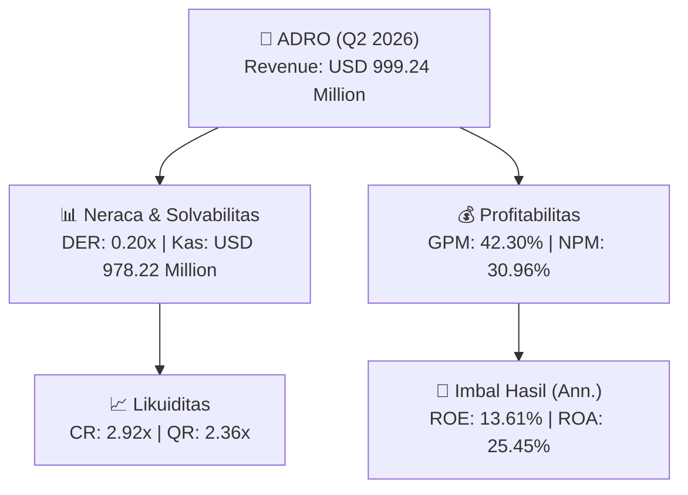
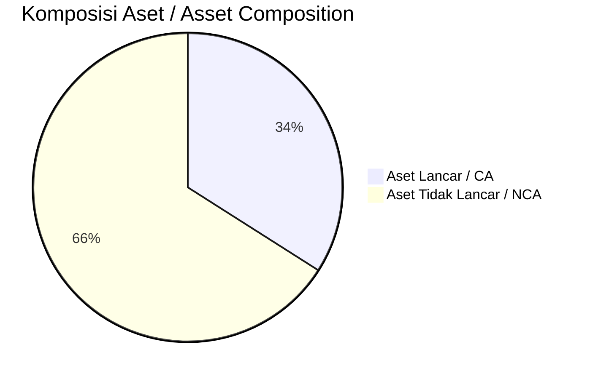
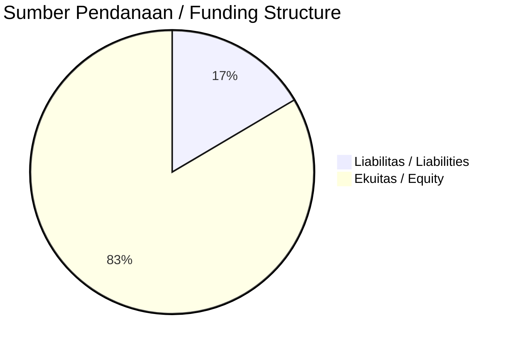

# 📈 Laporan Analisis Keuangan Mendalam: [[ADRO]] — Q2 2026

⬅️ [[knowledge-base/daily-digests/Daily_Digest_20260901|Kembali ke Daily Digest]] | 📅 **2026-09-01** | 🎛️ [[Dashboard|Ke Dashboard Utama]]

> [!IMPORTANT]
> Dokumen ini disusun oleh **Financial Summarizer Agent** untuk menganalisis kinerja keuangan, kesehatan neraca, profitabilitas, dan katalis sektor (Pertambangan) **Alamtri Resources Indonesia Tbk ([[ADRO]])** berdasarkan LK Q2 2026.

---

## 📌 1. Ikhtisar Kinerja Utama / Executive Performance Highlight
- **Emiten**: `[[ADRO]]` (Alamtri Resources Indonesia Tbk)
- **Sektor Usaha / Industry Sector**: `Pertambangan`
- **Periode Laporan / Reporting Period**: `Q2 2026`
- **Pendapatan Neto / Net Revenue**: `USD 999.24 Million` (**+16.50% 🟢 YoY** dari USD 857.69 Million)
- **Laba Bruto / Gross Profit**: `USD 422.68 Million` (**+48.69% 🟢 YoY**)
- **Laba (Rugi) Bersih / Net Income**: `USD 309.37 Million` (**+76.84% 🟢 YoY**)
- **Total Aset / Total Assets**: `USD 2.66 Billion` | **Total Ekuitas / Total Equity**: `USD 4.61 Billion`
- **EPS (Annualized)**: `2.00` | **BVPS**: `14.93`

---

## 📊 2. Laba Rugi Komparatif / Comparative Income Statement

| Pos Laba Rugi / Income Statement Item | Q2 2026 | Prior Period | YoY (%) |
| :--- | ---: | ---: | :---: |
| **Pendapatan Neto / Net Revenue** | `999.24M` | `857.69M` | **+16.50% 🟢** |
| **Beban Pokok / COGS** | `(576.56M)` | `(573.42M)` | +0.55% 🟢 |
| **Laba Bruto / Gross Profit** | `422.68M` | `284.27M` | **+48.69% 🟢** |
| **Beban Usaha / Operating Expenses** | `(54.58M)` | `(57.68M)` | -5.38% 🔴 |
| **Laba Operasional / EBIT** | `416.00M` | `248.82M` | +67.18% 🟢 |
| **Laba (Rugi) Bersih / Net Income** | **309.37M** | **174.94M** | **+76.84% 🟢** |

---

## 🏦 3. Neraca & Struktur Permodalan / Balance Sheet & Capital Structure

| Pos Neraca / Balance Sheet Item | Q2 2026 | Prior Year End | Δ YoY/YtD (%) | Catatan / Notes |
| :--- | ---: | ---: | :---: | :--- |
| **Aset Lancar / Current Assets** | `2.66B` | `2.21B` | +20.32% 🟢 | Kas: USD 978.22 Million |
| **Aset Tidak Lancar / Non-Current Assets** | `5.15B` | `4.61B` | +11.70% 🟢 | Aset Tetap & Operasional |
| **TOTAL ASET / TOTAL ASSETS** | **2.66B** | **2.21B** | **+20.32% 🟢** | |
| **Liabilitas Jk. Pendek / Current Liabilities** | `910.09M` | `860.88M` | +5.72% 🟢 | |
| **Liabilitas Jk. Panjang / Non-Current Liabilities** | `1.77B` | `952.16M` | +85.62% 🟢 | |
| **TOTAL LIABILITAS / TOTAL LIABILITIES** | **910.09M** | **860.88M** | **+5.72% 🟢** | |
| **TOTAL EKUITAS / TOTAL EQUITY** | **4.61B** | **4.49B** | **+2.76% 🟢** | |

---

## 💸 4. Laporan Arus Kas / Cash Flow Statement

| Komponen Arus Kas / Cash Flow Component | Q2 2026 | Prior Period | Δ YoY (%) |
| :--- | ---: | ---: | :---: |
| **Arus Kas Operasi / CFO** | `-42.92M` | `333.16M` | -112.88% 🔴 |
| **Arus Kas Investasi / CFI** | `48.59M` | `-162.08M` | +129.98% 🟢 |
| **Arus Kas Pendanaan / CFF** | `-52.61M` | `-505.75M` | +89.60% 🟢 |
| **Kenaikan (Penurunan) Kas Bersih** | `-46.94M` | `-334.67M` | +85.97% 🟢 |
| Belanja Modal / Capex | `(33.38M)` | `(358.08M)` | -90.68% 🔴 |
| Pembayaran Dividen / Dividends Paid | `(468.66M)` | `(518.66M)` | -9.64% 🔴 |
| **Free Cash Flow (CFO - Capex)** | **-76.30M** | **-24.92M** | **-206.18% 🔴** |

---

## 📈 Analisis Rasio Keuangan / Financial Ratio Analysis

| Kategori / Category | Metrik / Metric | Nilai / Value | Benchmark | Interpretasi / Interpretation |
| :--- | :--- | :---: | :---: | :--- |
| **🛡️ Likuiditas** | **Current Ratio** | `2.92x` | `> 1.0x` | Kemampuan bayar kewajiban jk. pendek |
| | **Quick Ratio** | `2.36x` | `> 0.8x` | Likuiditas tanpa persediaan |
| **📊 Profitabilitas** | **Gross Profit Margin (GPM)** | `42.30%` | - | Margin kotor operasional inti |
| | **Operating Profit Margin (OPM)** | `41.63%` | - | Efisiensi operasional |
| | **Net Profit Margin (NPM)** | `30.96%` | - | Konversi revenue ke laba bersih |
| **🎯 Imbal Hasil (Ann.)** | **Return on Equity (ROE)** | `13.61%` | - | Imbal hasil terhadap ekuitas |
| | **Return on Assets (ROA)** | `25.45%` | - | Produktivitas aset |
| **⚖️ Solvabilitas** | **Debt to Equity (DER)** | `0.20x` | `< 2.0x` | Leverage utang vs modal |
| | **Debt to Asset (DAR)** | `0.34x` | `< 0.7x` | Porsi aset didanai utang |

---

## 📐 Per Share Metrics

| Metrik / Metric | Nilai / Value | Keterangan / Notes |
| :--- | ---: | :--- |
| **EPS (Annualized)** | `USD 2.00` | Laba per saham (dianualisasi) |
| **BVPS** | `USD 14.93` | Nilai buku per saham |

---

## 🚀 Analisis Strategis & Karakteristik Sektor / Strategic Analysis: Pertambangan

Pada periode Q2 2026, **Alamtri Resources Indonesia Tbk ([[ADRO]])** membukukan total pendapatan sebesar **USD 999.24 Million** (+16.50% 🟢 YoY). Laba kotor tercatat **USD 422.68 Million** dengan GPM **42.30%**. Laba bersih sebesar **USD 309.37 Million** (+76.84% 🟢 YoY). Total aset **USD 2.66 Billion**, ekuitas **USD 4.61 Billion**, DER **0.20x**.

### 🔍 Indikator Kunci Sektor / Sector Key Indicators (Pertambangan)
- **Karakteristik Industri Tambang & Komoditas / Mining & Commodity**: Kinerja dipengaruhi oleh Average Selling Price (ASP), volume produksi/pengapalan, dan efisiensi Cash Cost per ton.
- **Profil Arus Kas / Cash Flow Profile**: Arus kas operasional yang solid menopang dividen berkala dan ekspansi hilirisasi / transisi energi.
- **Regulasi & ESG**: Kewajiban reklamasi, royalti pemerintah, dan komitmen keberlanjutan.

> [!NOTE]
> _Data Public Expose / Investor Presentation belum tersedia untuk emiten ini._

---

## 📋 Catatan Kunci Laporan Keuangan / Key Notes to Financial Statements

### 🔍 Opini Auditor / Auditor Opinion
- **Jenis Opini / Opinion Type**: `Reviu Terbatas / Limited Review`
- **KAP / Audit Firm**: `KAP Rintis, Jumadi, Rianto  Rekan`
- **Partner Audit**: `Firman Sababalat`
- **Tanggal Laporan / Report Date**: `2026-08-26`
- **Kesimpulan**: _kesimpulan reviu tidak terdapat hal yang menjadi perhatian yang menyebabkan laporan keuangan konsolidasian interim tidak menyajikan secara wajar, dalam semua hal yang material, berdasarkan Standar Akuntansi Keuangan di Indonesia_

---

## 💡 Catatan Strategis & Panduan Investor / Strategic Notes & Investor Guide

1. **Kesehatan Permodalan / Capital Health**: DER **0.20x**, CR **2.92x** — _sehat dan aman_.
2. **Katalis Pertumbuhan / Growth Catalysts**: Pantau realisasi pendapatan dan efisiensi operasional periode berikutnya.

---

## 🔗 Hubungan Note Terkait / Knowledge Graph Links
- [[knowledge-base/daily-digests/Daily_Digest_20260901|📄 Daily Digest 2026-09-01]]
- [[knowledge-base/trading-signals/Trading_Signals_20260901|🎯 Trading Signals]]
- [[Dashboard|🎛️ Kembali ke Dashboard Utama]]