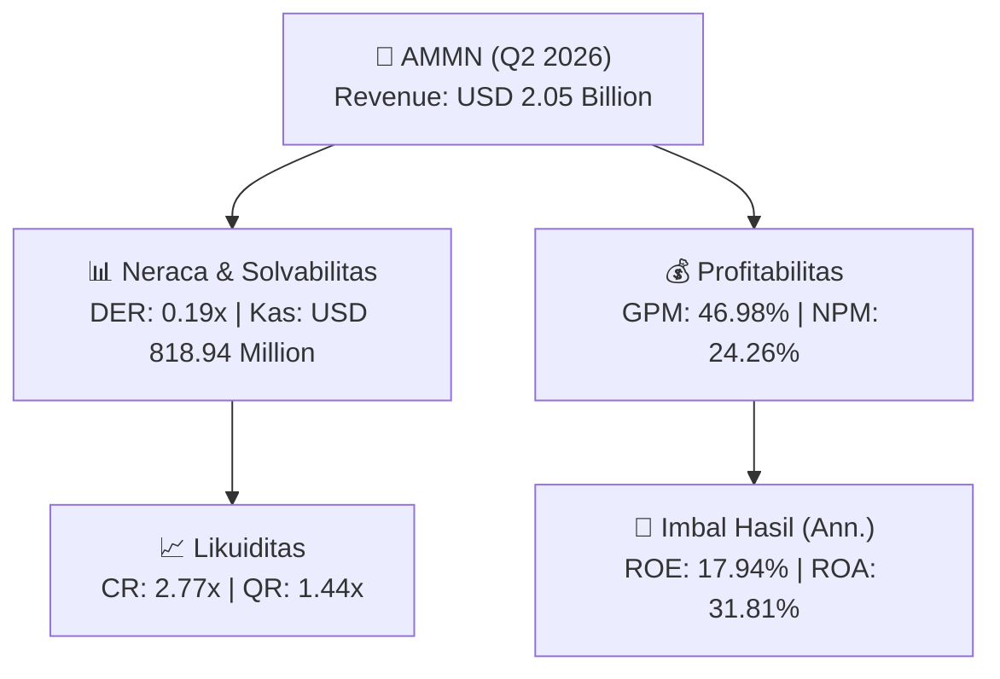
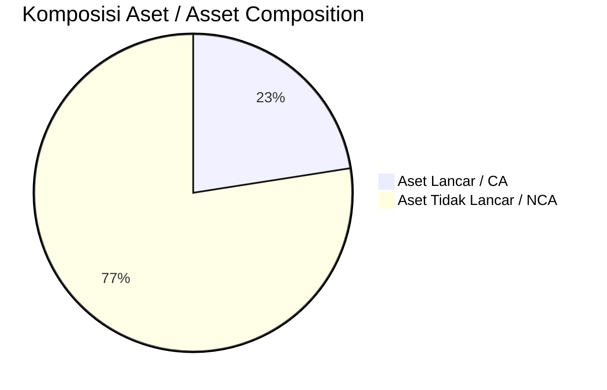
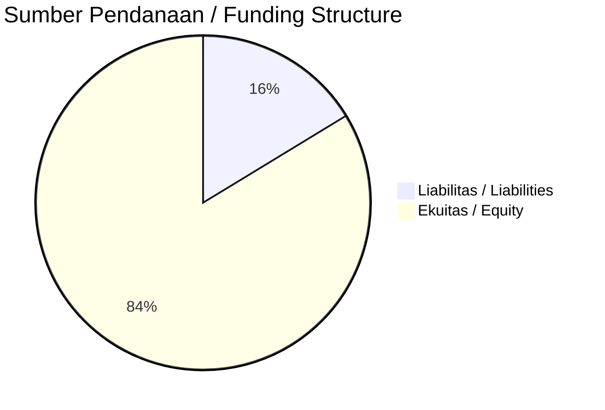

# 📈 Laporan Analisis Keuangan Mendalam: [[AMMN]] — Q2 2026

⬅️ [[knowledge-base/daily-digests/Daily_Digest_20260922|Kembali ke Daily Digest]] | 📅 **2026-09-22** | 🎛️ [[Dashboard|Ke Dashboard Utama]]

> [!IMPORTANT]
> Dokumen ini disusun oleh **Financial Summarizer Agent** untuk menganalisis kinerja keuangan, kesehatan neraca, profitabilitas, dan katalis sektor (Pertambangan) **PT Amman Mineral Internasional Tbk. ([[AMMN]])** berdasarkan LK Q2 2026.

---

## 📌 1. Ikhtisar Kinerja Utama / Executive Performance Highlight
- **Emiten**: `[[AMMN]]` (PT Amman Mineral Internasional Tbk.)
- **Sektor Usaha / Industry Sector**: `Pertambangan`
- **Periode Laporan / Reporting Period**: `Q2 2026`
- **Pendapatan Neto / Net Revenue**: `USD 2.05 Billion` (**+1024.02% 🟢 YoY** dari USD 182.59 Million)
- **Laba Bruto / Gross Profit**: `USD 964.15 Million` (**+1630.88% 🟢 YoY**)
- **Laba (Rugi) Bersih / Net Income**: `USD 497.93 Million` (**+434.81% 🟢 YoY**)
- **Total Aset / Total Assets**: `USD 3.11 Billion` | **Total Ekuitas / Total Equity**: `USD 5.77 Billion`
- **EPS (Annualized)**: `1.51` | **BVPS**: `8.75`

---

## 📊 2. Laba Rugi Komparatif / Comparative Income Statement

| Pos Laba Rugi / Income Statement Item | Q2 2026 | Prior Period | YoY (%) |
| :--- | ---: | ---: | :---: |
| **Pendapatan Neto / Net Revenue** | `2.05B` | `182.59M` | **+1024.02% 🟢** |
| **Beban Pokok / COGS** | `(1.09B)` | `(126.89M)` | +757.62% 🟢 |
| **Laba Bruto / Gross Profit** | `964.15M` | `55.70M` | **+1630.88% 🟢** |
| **Beban Usaha / Operating Expenses** | `(31.65M)` | `(63.24M)` | -49.94% 🔴 |
| **Laba Operasional / EBIT** | `695.08M` | `-191.54M` | +462.89% 🟢 |
| **Laba (Rugi) Bersih / Net Income** | **497.93M** | **-148.72M** | **+434.81% 🟢** |

---

## 🏦 3. Neraca & Struktur Permodalan / Balance Sheet & Capital Structure

| Pos Neraca / Balance Sheet Item | Q2 2026 | Prior Year End | Δ YoY/YtD (%) | Catatan / Notes |
| :--- | ---: | ---: | :---: | :--- |
| **Aset Lancar / Current Assets** | `3.11B` | `3.15B` | -1.39% 🔴 | Kas: USD 818.94 Million |
| **Aset Tidak Lancar / Non-Current Assets** | `10.69B` | `10.72B` | -0.24% 🔴 | Aset Tetap & Operasional |
| **TOTAL ASET / TOTAL ASSETS** | **3.11B** | **3.15B** | **-1.39% 🔴** | |
| **Liabilitas Jk. Pendek / Current Liabilities** | `1.12B` | `1.41B` | -20.50% 🔴 | |
| **Liabilitas Jk. Panjang / Non-Current Liabilities** | `6.82B` | `7.03B` | -3.01% 🔴 | |
| **TOTAL LIABILITAS / TOTAL LIABILITIES** | **1.12B** | **1.41B** | **-20.50% 🔴** | |
| **TOTAL EKUITAS / TOTAL EQUITY** | **5.77B** | **5.34B** | **+8.02% 🟢** | |

---

## 💸 4. Laporan Arus Kas / Cash Flow Statement

| Komponen Arus Kas / Cash Flow Component | Q2 2026 | Prior Period | Δ YoY (%) |
| :--- | ---: | ---: | :---: |
| **Arus Kas Operasi / CFO** | `762.62M` | `-643.59M` | +218.49% 🟢 |
| **Arus Kas Investasi / CFI** | `-130.03M` | `-719.06M` | +81.92% 🟢 |
| **Arus Kas Pendanaan / CFF** | `-462.44M` | `1.63B` | -128.34% 🔴 |
| **Kenaikan (Penurunan) Kas Bersih** | `170.14M` | `269.10M` | -36.77% 🔴 |
| Belanja Modal / Capex | `(102.05M)` | `(693.81M)` | -85.29% 🔴 |
| Pembayaran Dividen / Dividends Paid | `(-)` | `(-)` | - |
| **Free Cash Flow (CFO - Capex)** | **660.57M** | **-1.34B** | **+149.39% 🟢** |

---

## 📈 Analisis Rasio Keuangan / Financial Ratio Analysis

| Kategori / Category | Metrik / Metric | Nilai / Value | Benchmark | Interpretasi / Interpretation |
| :--- | :--- | :---: | :---: | :--- |
| **🛡️ Likuiditas** | **Current Ratio** | `2.77x` | `> 1.0x` | Kemampuan bayar kewajiban jk. pendek |
| | **Quick Ratio** | `1.44x` | `> 0.8x` | Likuiditas tanpa persediaan |
| **📊 Profitabilitas** | **Gross Profit Margin (GPM)** | `46.98%` | - | Margin kotor operasional inti |
| | **Operating Profit Margin (OPM)** | `33.87%` | - | Efisiensi operasional |
| | **Net Profit Margin (NPM)** | `24.26%` | - | Konversi revenue ke laba bersih |
| **🎯 Imbal Hasil (Ann.)** | **Return on Equity (ROE)** | `17.94%` | - | Imbal hasil terhadap ekuitas |
| | **Return on Assets (ROA)** | `31.81%` | - | Produktivitas aset |
| **⚖️ Solvabilitas** | **Debt to Equity (DER)** | `0.19x` | `< 2.0x` | Leverage utang vs modal |
| | **Debt to Asset (DAR)** | `0.36x` | `< 0.7x` | Porsi aset didanai utang |

---

## 📐 Per Share Metrics

| Metrik / Metric | Nilai / Value | Keterangan / Notes |
| :--- | ---: | :--- |
| **EPS (Annualized)** | `USD 1.51` | Laba per saham (dianualisasi) |
| **BVPS** | `USD 8.75` | Nilai buku per saham |

---

## 🚀 Analisis Strategis & Karakteristik Sektor / Strategic Analysis: Pertambangan

Pada periode Q2 2026, **PT Amman Mineral Internasional Tbk. ([[AMMN]])** membukukan total pendapatan sebesar **USD 2.05 Billion** (+1024.02% 🟢 YoY). Laba kotor tercatat **USD 964.15 Million** dengan GPM **46.98%**. Laba bersih sebesar **USD 497.93 Million** (+434.81% 🟢 YoY). Total aset **USD 3.11 Billion**, ekuitas **USD 5.77 Billion**, DER **0.19x**.

### 🔍 Indikator Kunci Sektor / Sector Key Indicators (Pertambangan)
- **Karakteristik Industri Tambang & Komoditas / Mining & Commodity**: Kinerja dipengaruhi oleh Average Selling Price (ASP), volume produksi/pengapalan, dan efisiensi Cash Cost per ton.
- **Profil Arus Kas / Cash Flow Profile**: Arus kas operasional yang solid menopang dividen berkala dan ekspansi hilirisasi / transisi energi.
- **Regulasi & ESG**: Kewajiban reklamasi, royalti pemerintah, dan komitmen keberlanjutan.

> [!NOTE]
> _Data Public Expose / Investor Presentation belum tersedia untuk emiten ini._

---

## 📋 Catatan Kunci Laporan Keuangan / Key Notes to Financial Statements

### 🔍 Opini Auditor / Auditor Opinion
- **Jenis Opini / Opinion Type**: `Wajar Tanpa Modifikasian / Unqualified`
- **KAP / Audit Firm**: `KAP Mirawati Sensi Idris`
- **Partner Audit**: `Yelly Warsono`
- **Tanggal Laporan / Report Date**: `2026-09-21`

---

## 💡 Catatan Strategis & Panduan Investor / Strategic Notes & Investor Guide

1. **Kesehatan Permodalan / Capital Health**: DER **0.19x**, CR **2.77x** — _sehat dan aman_.
2. **Katalis Pertumbuhan / Growth Catalysts**: Pantau realisasi pendapatan dan efisiensi operasional periode berikutnya.

---

## 🔗 Hubungan Note Terkait / Knowledge Graph Links
- [[knowledge-base/daily-digests/Daily_Digest_20260922|📄 Daily Digest 2026-09-22]]
- [[knowledge-base/trading-signals/Trading_Signals_20260922|🎯 Trading Signals]]
- [[Dashboard|🎛️ Kembali ke Dashboard Utama]]