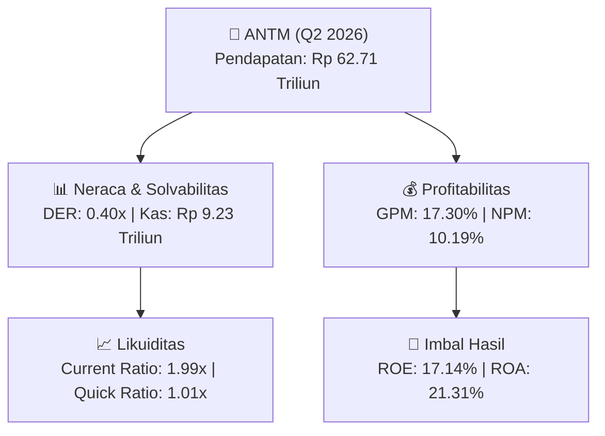

# 📈 Laporan Analisis Keuangan Mendalam: [[ANTM]] - Q2 2026

⬅️ [[knowledge-base/daily-digests/Daily_Digest_20260831|Kembali ke Daily Digest]] | 📅 **2026-08-31** | 🎛️ [[Dashboard|Ke Dashboard Utama]]

> [!IMPORTANT]
> Dokumen ini disusun secara khusus oleh **Financial Summarizer Agent** untuk menganalisis kinerja keuangan, **kesehatan neraca**, profitabilitas, dan **katalis sektor (Pertambangan)** **PT ANTAM (Persero) Tbk ([[ANTM]])** berdasarkan Laporan Keuangan Q2 2026.

---

## 📌 1. Ikhtisar Kinerja Utama (Executive Performance Highlight)
- **Emiten**: `[[ANTM]]` (PT ANTAM (Persero) Tbk)
- **Sektor Usaha**: `Pertambangan`
- **Periode Laporan**: `Q2 2026`
- **Pendapatan Neto (Revenue)**: `Rp 62.71 Triliun` (**+6.26% 🟢 YoY** dari Rp 59.02 Triliun)
- **Laba Bruto (Gross Profit)**: `Rp 10.85 Triliun` (**+31.72% 🟢 YoY**)
- **Laba (Rugi) Bersih**: `Rp 6.39 Triliun` (**+36.03% 🟢 YoY**)
- **Total Aset**: `Rp 29.98 Triliun` | **Total Ekuitas**: `Rp 37.27 Triliun`

---

## 📊 2. Matriks Laba Rugi Komparatif (Income Statement)

| Pos Laba Rugi Utama (Dalam Miliar Rp) | Periode Berjalan (Q2 2026) | Periode Komparatif Lalu | Pertumbuhan YoY (%) |
| :--- | :---: | :---: | :---: |
| **Pendapatan / Penjualan Neto** | `62714.28` | `59019.72` | **+6.26% 🟢** |
| **Beban Pokok Pendapatan (COGS)** | `(51863.25)` | `(50782.06)` | +2.13% 🟢 |
| **Laba Bruto (Gross Profit)** | `10851.03` | `8237.67` | **+31.72% 🟢** |
| **Beban Usaha / Operasional** | `(1477.78)` | `(1276.18)` | +15.80% 🟢 |
| **Laba Operasional (EBIT)** | `9002.58` | `6533.02` | +37.80% 🟢 |
| **Laba (Rugi) Bersih Periode Berjalan** | **6388.59** | **4696.37** | **+36.03% 🟢** |

---

## 🏦 3. Matriks Neraca & Struktur Permodalan (Balance Sheet)

| Pos Neraca Utama (Dalam Miliar Rp) | Q2 2026 | Posisi Akhir Tahun Lalu | Perubahan YoY / YtD (%) | Catatan Analis |
| :--- | :---: | :---: | :---: | :--- |
| **Aset Lancar** | `29981.63` | `23021.85` | +30.23% 🟢 | Kas: Rp 9.23 Triliun |
| **Aset Tidak Lancar** | `31291.24` | `29508.56` | +6.04% 🟢 | Aset Tetap & Operasional |
| **TOTAL ASET** | **29981.63** | **23021.85** | **+30.23% 🟢** | Basis Skala Usaha |
| **Liabilitas Jangka Pendek** | `15062.09` | `9682.94` | +55.55% 🟢 | Utang Usaha & Kewajiban Pendek |
| **Liabilitas Jangka Panjang** | `7679.26` | `6247.58` | +22.92% 🟢 | Kewajiban Jangka Panjang |
| **TOTAL LIABILITAS** | **15062.09** | **9682.94** | **+55.55% 🟢** | Struktur Utang Terkendali |
| **TOTAL EKUITAS** | **37270.01** | **35298.21** | **+5.59% 🟢** | Modal Bersih Pemegang Saham |

---

## 📈 4. Analisis Rasio Keuangan Utama (Financial Ratios)

| Kategori Rasio | Metrik Rasio | Nilai Rasio | Benchmark & Status | Interpretasi Analis |
| :--- | :--- | :---: | :---: | :--- |
| **🛡️ Likuiditas** | **Current Ratio** | `1.99x` | `> 1.0x` | Kemampuan melunasi kewajiban jangka pendek |
| | **Quick Ratio** | `1.01x` | `> 0.8x` | Likuiditas kas & piutang tanpa persediaan |
| **📊 Profitabilitas** | **Gross Profit Margin (GPM)** | `17.30%` | - | Margin kotor dari operasional inti |
| | **Net Profit Margin (NPM)** | `10.19%` | - | Efisiensi konversi omset ke laba bersih |
| | **Return on Equity (ROE)** | `17.14%` | - | Tingkat imbal hasil terhadap ekuitas |
| | **Return on Assets (ROA)** | `21.31%` | - | Produktivitas aset menghasilkan laba |
| **⚖️ Solvabilitas** | **Debt to Equity Ratio (DER)** | `0.40x` | `< 2.0x` | Struktur leverage utang terhadap modal |
| | **Debt to Asset Ratio (DAR)** | `0.50x` | `< 0.7x` | Porsi pendanaan aset dari kewajiban |

---

## 🚀 5. Analisis Strategis & Karakteristik Sektor: Pertambangan

Pada periode Q2 2026, **PT ANTAM (Persero) Tbk ([[ANTM]])** membukukan total pendapatan/penjualan sebesar **Rp 62.71 Triliun** (+6.26% 🟢 YoY). Laba kotor tercatat sebesar **Rp 10.85 Triliun** dengan Gross Profit Margin (GPM) sebesar **17.30%** dan laba bersih tahun berjalan sebesar **Rp 6.39 Triliun** (+36.03% 🟢 YoY).

Dari sisi neraca, perseroan memiliki total aset sebesar **Rp 29.98 Triliun** dengan ekuitas bersih **Rp 37.27 Triliun**. Rasio solvabilitas DER berada di level **0.40x**, menunjukkan struktur permodalan yang terkelola dengan rasio likuiditas Current Ratio sebesar **1.99x**.

### 🔍 Indikator Kunci Sektor (Pertambangan):
- **Karakteristik Industri Komoditas & Tambang**: Kinerja dipengaruhi oleh pergerakan Average Selling Price (ASP) komoditas global, volume produksi/pengapalan, dan efisiensi Cash Cost per ton.
- **Kekuatan Kas**: Profil arus kas operasional yang solid menopang pembagian dividen berkala dan ekspansi hilirisasi / transisi energi bersih.

---

## 💡 6. Catatan Strategis & Panduan Investor
1. **Kesehatan Permodalan**: Rasio DER tercatat **0.40x** dengan likuiditas Current Ratio **1.99x** (sehat dan aman).
2. **Katalis Pertumbuhan**: Pantau realisasi pendapatan semester berikutnya serta efisiensi beban usaha operasional.

---

## 🔗 Hubungan Note Terkait (Knowledge Graph)
- [[knowledge-base/daily-digests/Daily_Digest_20260831|📄 Daily Digest 2026-08-31]]
- [[knowledge-base/trading-signals/Trading_Signals_20260831|🎯 Trading Signals]]
- [[Dashboard|🎛️ Kembali ke Dashboard Utama]]
