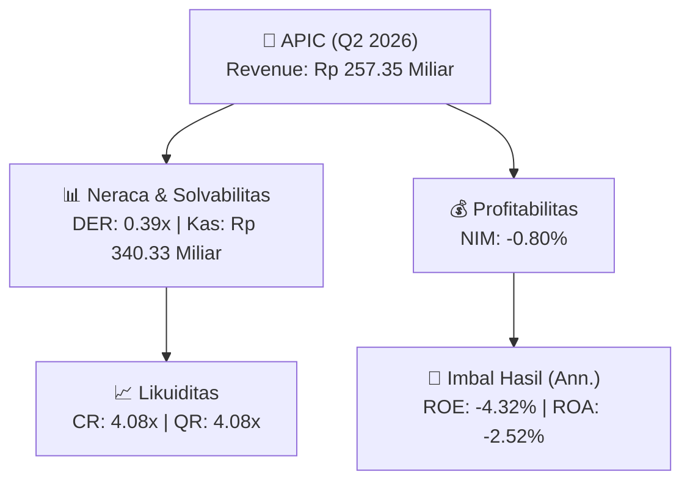
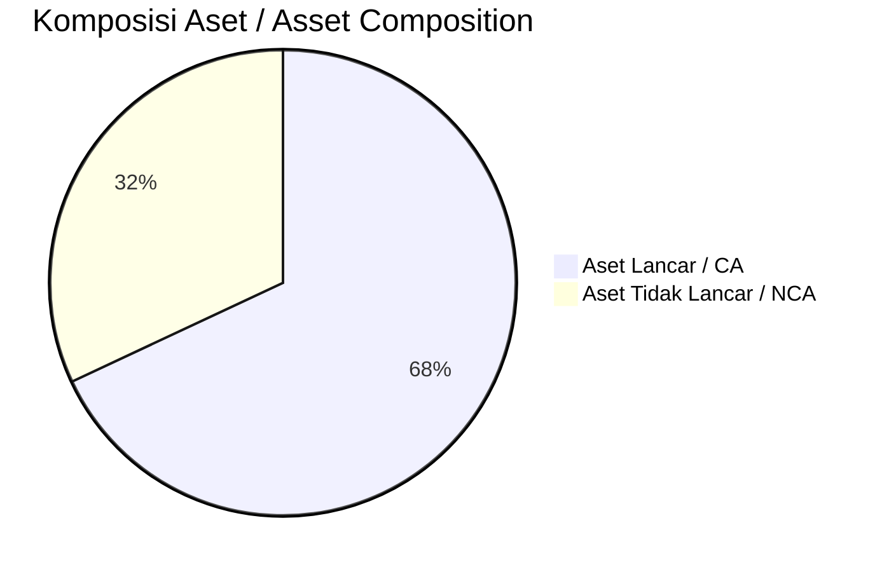
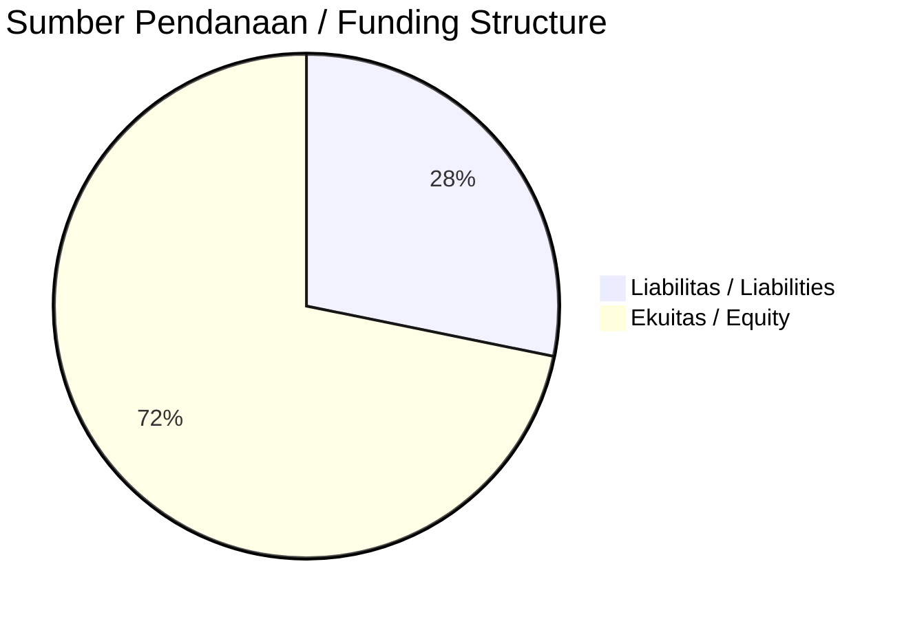

# 📈 Laporan Analisis Keuangan Mendalam: [[APIC]] — Q2 2026

⬅️ [[knowledge-base/daily-digests/Daily_Digest_20261002|Kembali ke Daily Digest]] | 📅 **2026-10-02** | 🎛️ [[Dashboard|Ke Dashboard Utama]]

> [!IMPORTANT]
> Dokumen ini disusun oleh **Financial Summarizer Agent** untuk menganalisis kinerja keuangan, kesehatan neraca, profitabilitas, dan katalis sektor (Multifinance & Perbankan) **PACIFIC STRATEGIC FINANCIAL Tbk ([[APIC]])** berdasarkan LK Q2 2026.

---

## 📌 1. Ikhtisar Kinerja Utama / Executive Performance Highlight
- **Emiten**: `[[APIC]]` (PACIFIC STRATEGIC FINANCIAL Tbk)
- **Sektor Usaha / Industry Sector**: `Multifinance & Perbankan`
- **Periode Laporan / Reporting Period**: `Q2 2026`
- **Pendapatan Usaha / Total Revenue**: `Rp 257.35 Miliar` (**-17.16% 🔴 YoY** dari Rp 310.67 Miliar)
- **Pendapatan Bunga / Interest Income**: `Rp 135.53 Miliar`
- **Laba (Rugi) Bersih / Net Income**: `Rp -74.13 Miliar` (**-616.91% 🔴 YoY**)
- **Total Aset / Total Assets**: `Rp 6.02 Triliun` | **Total Ekuitas / Total Equity**: `Rp 3.75 Triliun`
- **EPS (Annualized)**: `-0.12` | **BVPS**: `3.08`

---

## 📊 2. Laba Rugi Komparatif / Comparative Income Statement (Financial Sector)

| Pos Laba Rugi / Income Statement Item | Q2 2026 | Prior Period | YoY (%) |
| :--- | ---: | ---: | :---: |
| **Pendapatan Bunga / Interest Income** | `135.53B` | `177.01B` | -23.44% 🔴 |
| **Beban Bunga / Interest Expense** | `(159.70B)` | `(154.97B)` | +3.06% 🟢 |
| **Jumlah Pendapatan Usaha / Total Revenue** | `257.35B` | `310.67B` | -17.16% 🔴 |
| **Laba Sebelum Pajak / Profit Before Tax** | `-70.08B` | `21.50B` | -425.96% 🔴 |
| **Laba (Rugi) Bersih / Net Income** | **-74.13B** | **14.34B** | **-616.91% 🔴** |

---

## 🏦 3. Neraca & Struktur Permodalan / Balance Sheet & Capital Structure

| Pos Neraca / Balance Sheet Item | Q2 2026 | Prior Year End | Δ YoY/YtD (%) | Catatan / Notes |
| :--- | ---: | ---: | :---: | :--- |
| **Aset Lancar / Current Assets** | `6.02T` | `5.77T` | +4.27% 🟢 | Kas: Rp 340.33 Miliar |
| **Aset Tidak Lancar / Non-Current Assets** | `2.83T` | `2.75T` | +2.97% 🟢 | Aset Tetap & Operasional |
| **TOTAL ASET / TOTAL ASSETS** | **6.02T** | **5.77T** | **+4.27% 🟢** | |
| **Liabilitas Jk. Pendek / Current Liabilities** | `1.48T` | `1.74T` | -15.21% 🔴 | |
| **Liabilitas Jk. Panjang / Non-Current Liabilities** | `3.52T` | `3.56T` | -1.37% 🔴 | |
| **TOTAL LIABILITAS / TOTAL LIABILITIES** | **1.48T** | **1.74T** | **-15.21% 🔴** | |
| **TOTAL EKUITAS / TOTAL EQUITY** | **3.75T** | **3.11T** | **+20.53% 🟢** | |

---

## 💸 4. Laporan Arus Kas / Cash Flow Statement

| Komponen Arus Kas / Cash Flow Component | Q2 2026 | Prior Period | Δ YoY (%) |
| :--- | ---: | ---: | :---: |
| **Arus Kas Operasi / CFO** | `-344.27B` | `-529.45B` | +34.98% 🟢 |
| **Arus Kas Investasi / CFI** | `480.92B` | `621.83B` | -22.66% 🔴 |
| **Arus Kas Pendanaan / CFF** | `-62.86B` | `-72.17B` | +12.90% 🟢 |
| **Kenaikan (Penurunan) Kas Bersih** | `73.80B` | `20.21B` | +265.21% 🟢 |
| Belanja Modal / Capex | `(3.35B)` | `(0.00)` | - |
| Pembayaran Dividen / Dividends Paid | `(-)` | `(-)` | - |
| **Free Cash Flow (CFO - Capex)** | **-347.62B** | **-529.45B** | **+34.34% 🟢** |

---

## 📈 Analisis Rasio Keuangan / Financial Ratio Analysis

| Kategori / Category | Metrik / Metric | Nilai / Value | Benchmark | Interpretasi / Interpretation |
| :--- | :--- | :---: | :---: | :--- |
| **🛡️ Likuiditas** | **Current Ratio** | `4.08x` | `> 1.0x` | Kemampuan bayar kewajiban jk. pendek |
| | **Quick Ratio** | `4.08x` | `> 0.8x` | Likuiditas tanpa persediaan |
| **📊 Profitabilitas** | **Net Interest Margin (NIM)** | `-0.80%` | `> 3.0%` | Spread pendapatan bunga bersih |
| **🎯 Imbal Hasil (Ann.)** | **Return on Equity (ROE)** | `-4.32%` | - | Imbal hasil terhadap ekuitas |
| | **Return on Assets (ROA)** | `-2.52%` | - | Produktivitas aset |
| **⚖️ Solvabilitas** | **Debt to Equity (DER)** | `0.39x` | `< 2.0x` | Leverage utang vs modal |
| | **Debt to Asset (DAR)** | `0.25x` | `< 0.7x` | Porsi aset didanai utang |

---

## 📐 Per Share Metrics

| Metrik / Metric | Nilai / Value | Keterangan / Notes |
| :--- | ---: | :--- |
| **EPS (Annualized)** | `Rp -0.12` | Laba per saham (dianualisasi) |
| **BVPS** | `Rp 3.08` | Nilai buku per saham |

---

## 🚀 Analisis Strategis & Karakteristik Sektor / Strategic Analysis: Multifinance & Perbankan

Pada periode Q2 2026, **PACIFIC STRATEGIC FINANCIAL Tbk ([[APIC]])** membukukan total pendapatan sebesar **Rp 257.35 Miliar** (-17.16% 🔴 YoY). Laba bersih sebesar **Rp -74.13 Miliar** (-616.91% 🔴 YoY). Total aset **Rp 6.02 Triliun**, ekuitas **Rp 3.75 Triliun**, DER **0.39x**.

### 🔍 Indikator Kunci Sektor / Sector Key Indicators (Multifinance & Perbankan)
- **Karakteristik Industri Finansial / Financial Industry**: Kinerja ditopang oleh spread pendapatan bunga (NIM), hasil investasi, dan pengelolaan Cost of Funds.
- **Kualitas Aset / Asset Quality**: Pengawasan rasio NPL/NPF dan kecukupan pencadangan (PPAP) untuk menjaga stabilitas margin usaha.
- **Solvabilitas / Solvency**: Rasio kecukupan modal (CAR/RBC) ketat sesuai regulasi OJK.

> [!NOTE]
> _Data Public Expose / Investor Presentation belum tersedia untuk emiten ini._

---

## 📋 Catatan Kunci Laporan Keuangan / Key Notes to Financial Statements

### 🔍 Opini Auditor / Auditor Opinion
- **Jenis Opini / Opinion Type**: `Wajar Tanpa Modifikasian / Unqualified`
- **KAP / Audit Firm**: `KAP Andi Ruswandi Wisnu  Rekan`
- **Partner Audit**: `Andi Ruswandi`
- **Tanggal Laporan / Report Date**: `2026-09-29`

---

## 💡 Catatan Strategis & Panduan Investor / Strategic Notes & Investor Guide

1. **Kesehatan Permodalan / Capital Health**: DER **0.39x**, CR **4.08x** — _sehat dan aman_.
2. **Katalis Pertumbuhan / Growth Catalysts**: Pantau realisasi pendapatan dan efisiensi operasional periode berikutnya.
3. **Kualitas Aset Finansial**: Pantau tren NIM (**-0.80%**) dan kualitas portofolio kredit/pembiayaan.

---

## 🔗 Hubungan Note Terkait / Knowledge Graph Links
- [[knowledge-base/daily-digests/Daily_Digest_20261002|📄 Daily Digest 2026-10-02]]
- [[knowledge-base/trading-signals/Trading_Signals_20261002|🎯 Trading Signals]]
- [[Dashboard|🎛️ Kembali ke Dashboard Utama]]