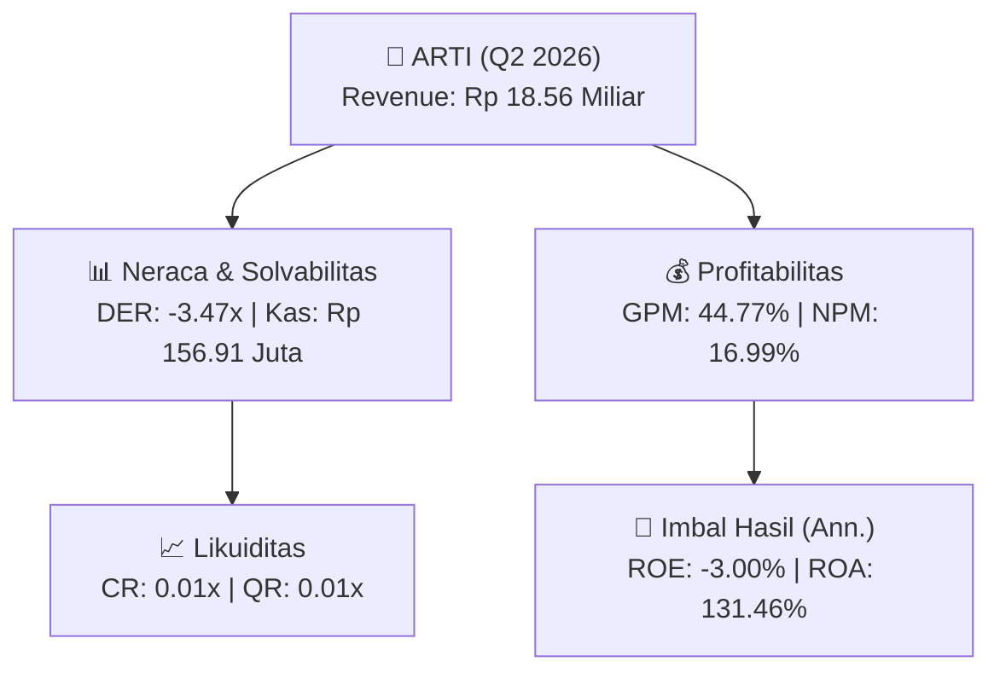
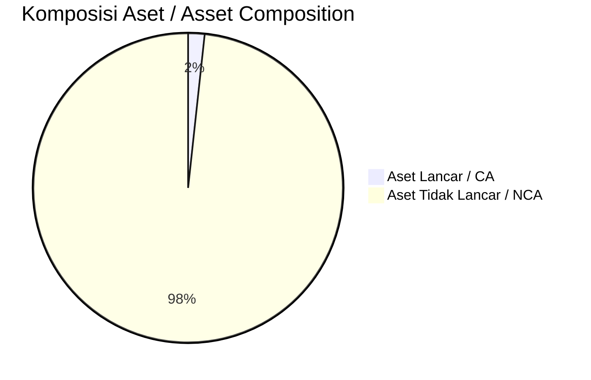
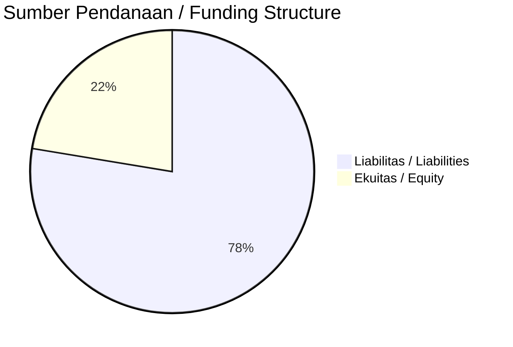

# 📈 Laporan Analisis Keuangan Mendalam: [[ARTI]] — Q2 2026

⬅️ [[knowledge-base/daily-digests/Daily_Digest_20261002|Kembali ke Daily Digest]] | 📅 **2026-10-02** | 🎛️ [[Dashboard|Ke Dashboard Utama]]

> [!IMPORTANT]
> Dokumen ini disusun oleh **Financial Summarizer Agent** untuk menganalisis kinerja keuangan, kesehatan neraca, profitabilitas, dan katalis sektor (Energi & Utilitas) **Ratu Prabu Energi Tbk ([[ARTI]])** berdasarkan LK Q2 2026.

---

## 📌 1. Ikhtisar Kinerja Utama / Executive Performance Highlight
- **Emiten**: `[[ARTI]]` (Ratu Prabu Energi Tbk)
- **Sektor Usaha / Industry Sector**: `Energi & Utilitas`
- **Periode Laporan / Reporting Period**: `Q2 2026`
- **Pendapatan Neto / Net Revenue**: `Rp 18.56 Miliar` (**+18861.29% 🟢 YoY** dari Rp 97.86 Juta)
- **Laba Bruto / Gross Profit**: `Rp 8.31 Miliar` (**+464.64% 🟢 YoY**)
- **Laba (Rugi) Bersih / Net Income**: `Rp 3.15 Miliar` (**+174.67% 🟢 YoY**)
- **Total Aset / Total Assets**: `Rp 9.09 Miliar` | **Total Ekuitas / Total Equity**: `Rp -209.28 Miliar`
- **EPS (Annualized)**: `0.00` | **BVPS**: `-0.15`

---

## 📊 2. Laba Rugi Komparatif / Comparative Income Statement

| Pos Laba Rugi / Income Statement Item | Q2 2026 | Prior Period | YoY (%) |
| :--- | ---: | ---: | :---: |
| **Pendapatan Neto / Net Revenue** | `18.56B` | `97.86M` | **+18861.29% 🟢** |
| **Beban Pokok / COGS** | `(10.25B)` | `(2.38B)` | +331.26% 🟢 |
| **Laba Bruto / Gross Profit** | `8.31B` | `-2.28B` | **+464.64% 🟢** |
| **Beban Usaha / Operating Expenses** | `(7.74B)` | `(2.08B)` | +271.31% 🟢 |
| **Laba Operasional / EBIT** | `3.03B` | `-4.34B` | +169.77% 🟢 |
| **Laba (Rugi) Bersih / Net Income** | **3.15B** | **-4.22B** | **+174.67% 🟢** |

---

## 🏦 3. Neraca & Struktur Permodalan / Balance Sheet & Capital Structure

| Pos Neraca / Balance Sheet Item | Q2 2026 | Prior Year End | Δ YoY/YtD (%) | Catatan / Notes |
| :--- | ---: | ---: | :---: | :--- |
| **Aset Lancar / Current Assets** | `9.09B` | `502.37M` | +1709.04% 🟢 | Kas: Rp 156.91 Juta |
| **Aset Tidak Lancar / Non-Current Assets** | `521.75B` | `529.46B` | -1.46% 🔴 | Aset Tetap & Operasional |
| **TOTAL ASET / TOTAL ASSETS** | **9.09B** | **502.37M** | **+1709.04% 🟢** | |
| **Liabilitas Jk. Pendek / Current Liabilities** | `725.84B` | `726.66B` | -0.11% 🔴 | |
| **Liabilitas Jk. Panjang / Non-Current Liabilities** | `8.02B` | `8.02B` | 0.00% ⚪ | |
| **TOTAL LIABILITAS / TOTAL LIABILITIES** | **725.84B** | **726.66B** | **-0.11% 🔴** | |
| **TOTAL EKUITAS / TOTAL EQUITY** | **-209.28B** | **-210.97B** | **+0.80% 🟢** | |

---

## 💸 4. Laporan Arus Kas / Cash Flow Statement

| Komponen Arus Kas / Cash Flow Component | Q2 2026 | Prior Period | Δ YoY (%) |
| :--- | ---: | ---: | :---: |
| **Arus Kas Operasi / CFO** | `-6.04B` | `-4.46B` | -35.35% 🔴 |
| **Arus Kas Investasi / CFI** | `-29.17M` | `-630.03M` | +95.37% 🟢 |
| **Arus Kas Pendanaan / CFF** | `6.11B` | `4.71B` | +29.55% 🟢 |
| **Kenaikan (Penurunan) Kas Bersih** | `33.94M` | `-381.23M` | +108.90% 🟢 |
| Belanja Modal / Capex | `(29.17M)` | `(630.03M)` | -95.37% 🔴 |
| Pembayaran Dividen / Dividends Paid | `(-)` | `(-)` | - |
| **Free Cash Flow (CFO - Capex)** | **-6.07B** | **-5.09B** | **-19.19% 🔴** |

---

## 📈 Analisis Rasio Keuangan / Financial Ratio Analysis

| Kategori / Category | Metrik / Metric | Nilai / Value | Benchmark | Interpretasi / Interpretation |
| :--- | :--- | :---: | :---: | :--- |
| **🛡️ Likuiditas** | **Current Ratio** | `0.01x` | `> 1.0x` | Kemampuan bayar kewajiban jk. pendek |
| | **Quick Ratio** | `0.01x` | `> 0.8x` | Likuiditas tanpa persediaan |
| **📊 Profitabilitas** | **Gross Profit Margin (GPM)** | `44.77%` | - | Margin kotor operasional inti |
| | **Operating Profit Margin (OPM)** | `16.33%` | - | Efisiensi operasional |
| | **Net Profit Margin (NPM)** | `16.99%` | - | Konversi revenue ke laba bersih |
| **🎯 Imbal Hasil (Ann.)** | **Return on Equity (ROE)** | `-3.00%` | - | Imbal hasil terhadap ekuitas |
| | **Return on Assets (ROA)** | `131.46%` | - | Produktivitas aset |
| **⚖️ Solvabilitas** | **Debt to Equity (DER)** | `-3.47x` | `< 2.0x` | Leverage utang vs modal |
| | **Debt to Asset (DAR)** | `79.87x` | `< 0.7x` | Porsi aset didanai utang |

---

## 📐 Per Share Metrics

| Metrik / Metric | Nilai / Value | Keterangan / Notes |
| :--- | ---: | :--- |
| **EPS (Annualized)** | `Rp 0.00` | Laba per saham (dianualisasi) |
| **BVPS** | `Rp -0.15` | Nilai buku per saham |

---

## 🚀 Analisis Strategis & Karakteristik Sektor / Strategic Analysis: Energi & Utilitas

Pada periode Q2 2026, **Ratu Prabu Energi Tbk ([[ARTI]])** membukukan total pendapatan sebesar **Rp 18.56 Miliar** (+18861.29% 🟢 YoY). Laba kotor tercatat **Rp 8.31 Miliar** dengan GPM **44.77%**. Laba bersih sebesar **Rp 3.15 Miliar** (+174.67% 🟢 YoY). Total aset **Rp 9.09 Miliar**, ekuitas **Rp -209.28 Miliar**, DER **-3.47x**.

### 🔍 Indikator Kunci Sektor / Sector Key Indicators (Energi & Utilitas)
- **Karakteristik Industri Tambang & Komoditas / Mining & Commodity**: Kinerja dipengaruhi oleh Average Selling Price (ASP), volume produksi/pengapalan, dan efisiensi Cash Cost per ton.
- **Profil Arus Kas / Cash Flow Profile**: Arus kas operasional yang solid menopang dividen berkala dan ekspansi hilirisasi / transisi energi.
- **Regulasi & ESG**: Kewajiban reklamasi, royalti pemerintah, dan komitmen keberlanjutan.

> [!NOTE]
> _Data Public Expose / Investor Presentation belum tersedia untuk emiten ini._

---

## 📋 Catatan Kunci Laporan Keuangan / Key Notes to Financial Statements

### 🔍 Opini Auditor / Auditor Opinion
- _Informasi opini auditor tidak tersedia._

---

## 💡 Catatan Strategis & Panduan Investor / Strategic Notes & Investor Guide

1. **Kesehatan Permodalan / Capital Health**: DER **-3.47x**, CR **0.01x** — _perlu dipantau secara disiplin_.
2. **Katalis Pertumbuhan / Growth Catalysts**: Pantau realisasi pendapatan dan efisiensi operasional periode berikutnya.

---

## 🔗 Hubungan Note Terkait / Knowledge Graph Links
- [[knowledge-base/daily-digests/Daily_Digest_20261002|📄 Daily Digest 2026-10-02]]
- [[knowledge-base/trading-signals/Trading_Signals_20261002|🎯 Trading Signals]]
- [[Dashboard|🎛️ Kembali ke Dashboard Utama]]