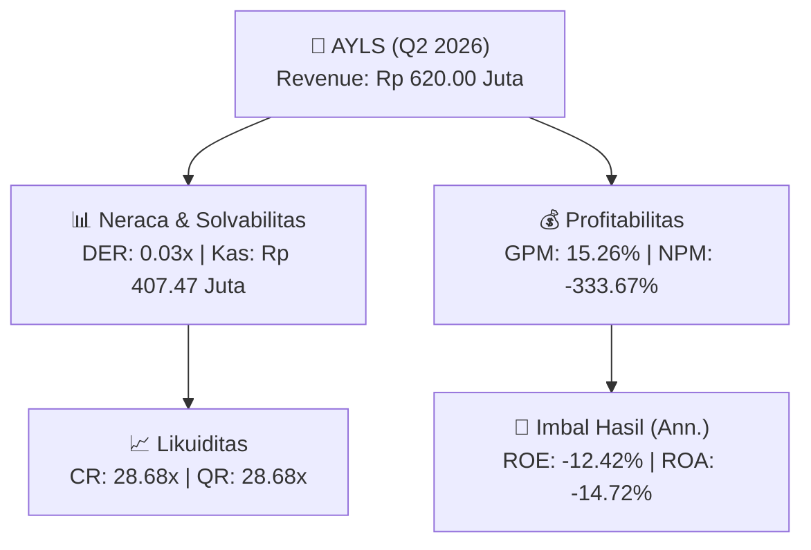
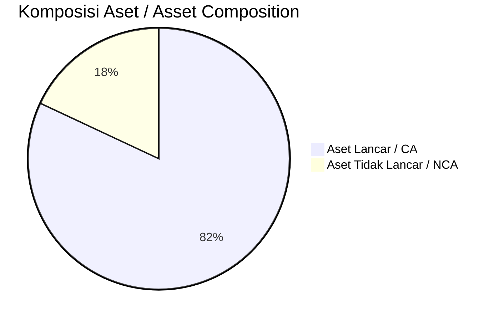
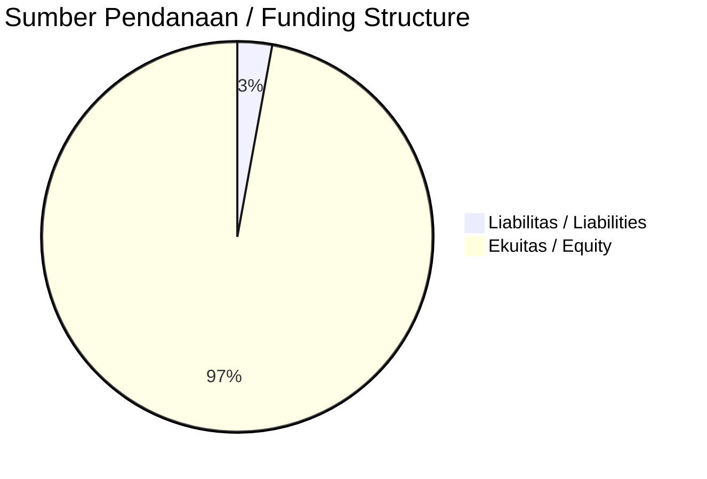

# 📈 Laporan Analisis Keuangan Mendalam: [[AYLS]] — Q2 2026

⬅️ [[knowledge-base/daily-digests/Daily_Digest_20260901|Kembali ke Daily Digest]] | 📅 **2026-09-01** | 🎛️ [[Dashboard|Ke Dashboard Utama]]

> [!IMPORTANT]
> Dokumen ini disusun oleh **Financial Summarizer Agent** untuk menganalisis kinerja keuangan, kesehatan neraca, profitabilitas, dan katalis sektor (General) **PT Arkayana Lestari Grup Tbk ([[AYLS]])** berdasarkan LK Q2 2026.

---

## 📌 1. Ikhtisar Kinerja Utama / Executive Performance Highlight
- **Emiten**: `[[AYLS]]` (PT Arkayana Lestari Grup Tbk)
- **Sektor Usaha / Industry Sector**: `General`
- **Periode Laporan / Reporting Period**: `Q2 2026`
- **Pendapatan Neto / Net Revenue**: `Rp 620.00 Juta` (**+10.82% 🟢 YoY** dari Rp 559.46 Juta)
- **Laba Bruto / Gross Profit**: `Rp 94.64 Juta` (**+8.83% 🟢 YoY**)
- **Laba (Rugi) Bersih / Net Income**: `Rp -2.07 Miliar` (**-90.94% 🔴 YoY**)
- **Total Aset / Total Assets**: `Rp 27.23 Miliar` | **Total Ekuitas / Total Equity**: `Rp 32.27 Miliar`
- **EPS (Annualized)**: `-0.10` | **BVPS**: `0.76`

---

## 📊 2. Laba Rugi Komparatif / Comparative Income Statement

| Pos Laba Rugi / Income Statement Item | Q2 2026 | Prior Period | YoY (%) |
| :--- | ---: | ---: | :---: |
| **Pendapatan Neto / Net Revenue** | `620.00M` | `559.46M` | **+10.82% 🟢** |
| **Beban Pokok / COGS** | `(525.36M)` | `(472.50M)` | +11.19% 🟢 |
| **Laba Bruto / Gross Profit** | `94.64M` | `86.96M` | **+8.83% 🟢** |
| **Beban Usaha / Operating Expenses** | `(2.62B)` | `(1.34B)` | +96.03% 🟢 |
| **Laba Operasional / EBIT** | `-2.38B` | `-1.25B` | -89.88% 🔴 |
| **Laba (Rugi) Bersih / Net Income** | **-2.07B** | **-1.08B** | **-90.94% 🔴** |

---

## 🏦 3. Neraca & Struktur Permodalan / Balance Sheet & Capital Structure

| Pos Neraca / Balance Sheet Item | Q2 2026 | Prior Year End | Δ YoY/YtD (%) | Catatan / Notes |
| :--- | ---: | ---: | :---: | :--- |
| **Aset Lancar / Current Assets** | `27.23B` | `28.99B` | -6.05% 🔴 | Kas: Rp 407.47 Juta |
| **Aset Tidak Lancar / Non-Current Assets** | `5.99B` | `5.50B` | +8.75% 🟢 | Aset Tetap & Operasional |
| **TOTAL ASET / TOTAL ASSETS** | **27.23B** | **28.99B** | **-6.05% 🔴** | |
| **Liabilitas Jk. Pendek / Current Liabilities** | `949.48M` | `1.17M` | +81374.77% 🟢 | |
| **Liabilitas Jk. Panjang / Non-Current Liabilities** | `0.00` | `152.43M` | -100.00% 🔴 | |
| **TOTAL LIABILITAS / TOTAL LIABILITIES** | **949.48M** | **1.17M** | **+81374.77% 🟢** | |
| **TOTAL EKUITAS / TOTAL EQUITY** | **32.27B** | **34.34B** | **-6.02% 🔴** | |

---

## 💸 4. Laporan Arus Kas / Cash Flow Statement

| Komponen Arus Kas / Cash Flow Component | Q2 2026 | Prior Period | Δ YoY (%) |
| :--- | ---: | ---: | :---: |
| **Arus Kas Operasi / CFO** | `-1.33B` | `-42.52M` | -3019.35% 🔴 |
| **Arus Kas Investasi / CFI** | `-` | `-` | - |
| **Arus Kas Pendanaan / CFF** | `653.40M` | `-` | - |
| **Kenaikan (Penurunan) Kas Bersih** | `-672.86M` | `-42.52M` | -1482.55% 🔴 |
| Belanja Modal / Capex | `(-)` | `(-)` | - |
| Pembayaran Dividen / Dividends Paid | `(-)` | `(-)` | - |
| **Free Cash Flow (CFO - Capex)** | **-** | **-** | **-** |

---

## 📈 Analisis Rasio Keuangan / Financial Ratio Analysis

| Kategori / Category | Metrik / Metric | Nilai / Value | Benchmark | Interpretasi / Interpretation |
| :--- | :--- | :---: | :---: | :--- |
| **🛡️ Likuiditas** | **Current Ratio** | `28.68x` | `> 1.0x` | Kemampuan bayar kewajiban jk. pendek |
| | **Quick Ratio** | `28.68x` | `> 0.8x` | Likuiditas tanpa persediaan |
| **📊 Profitabilitas** | **Gross Profit Margin (GPM)** | `15.26%` | - | Margin kotor operasional inti |
| | **Operating Profit Margin (OPM)** | `-383.27%` | - | Efisiensi operasional |
| | **Net Profit Margin (NPM)** | `-333.67%` | - | Konversi revenue ke laba bersih |
| **🎯 Imbal Hasil (Ann.)** | **Return on Equity (ROE)** | `-12.42%` | - | Imbal hasil terhadap ekuitas |
| | **Return on Assets (ROA)** | `-14.72%` | - | Produktivitas aset |
| **⚖️ Solvabilitas** | **Debt to Equity (DER)** | `0.03x` | `< 2.0x` | Leverage utang vs modal |
| | **Debt to Asset (DAR)** | `0.03x` | `< 0.7x` | Porsi aset didanai utang |

---

## 📐 Per Share Metrics

| Metrik / Metric | Nilai / Value | Keterangan / Notes |
| :--- | ---: | :--- |
| **EPS (Annualized)** | `Rp -0.10` | Laba per saham (dianualisasi) |
| **BVPS** | `Rp 0.76` | Nilai buku per saham |

---

## 🚀 Analisis Strategis & Karakteristik Sektor / Strategic Analysis: General

Pada periode Q2 2026, **PT Arkayana Lestari Grup Tbk ([[AYLS]])** membukukan total pendapatan sebesar **Rp 620.00 Juta** (+10.82% 🟢 YoY). Laba kotor tercatat **Rp 94.64 Juta** dengan GPM **15.26%**. Laba bersih sebesar **Rp -2.07 Miliar** (-90.94% 🔴 YoY). Total aset **Rp 27.23 Miliar**, ekuitas **Rp 32.27 Miliar**, DER **0.03x**.

### 🔍 Indikator Kunci Sektor / Sector Key Indicators (General)
- **Karakteristik Industri (General)**: Kinerja mencerminkan dinamika penyerapan pasar, utilisasi kapasitas produksi, dan efisiensi biaya pokok.
- **Faktor Penggerak**: Pertumbuhan organik, efisiensi operasional, dan ekspansi pasar.

> [!NOTE]
> _Data Public Expose / Investor Presentation belum tersedia untuk emiten ini._

---

## 📋 Catatan Kunci Laporan Keuangan / Key Notes to Financial Statements

### 🔍 Opini Auditor / Auditor Opinion
- _Informasi opini auditor tidak tersedia._

---

## 💡 Catatan Strategis & Panduan Investor / Strategic Notes & Investor Guide

1. **Kesehatan Permodalan / Capital Health**: DER **0.03x**, CR **28.68x** — _sehat dan aman_.
2. **Katalis Pertumbuhan / Growth Catalysts**: Pantau realisasi pendapatan dan efisiensi operasional periode berikutnya.

---

## 🔗 Hubungan Note Terkait / Knowledge Graph Links
- [[knowledge-base/daily-digests/Daily_Digest_20260901|📄 Daily Digest 2026-09-01]]
- [[knowledge-base/trading-signals/Trading_Signals_20260901|🎯 Trading Signals]]
- [[Dashboard|🎛️ Kembali ke Dashboard Utama]]