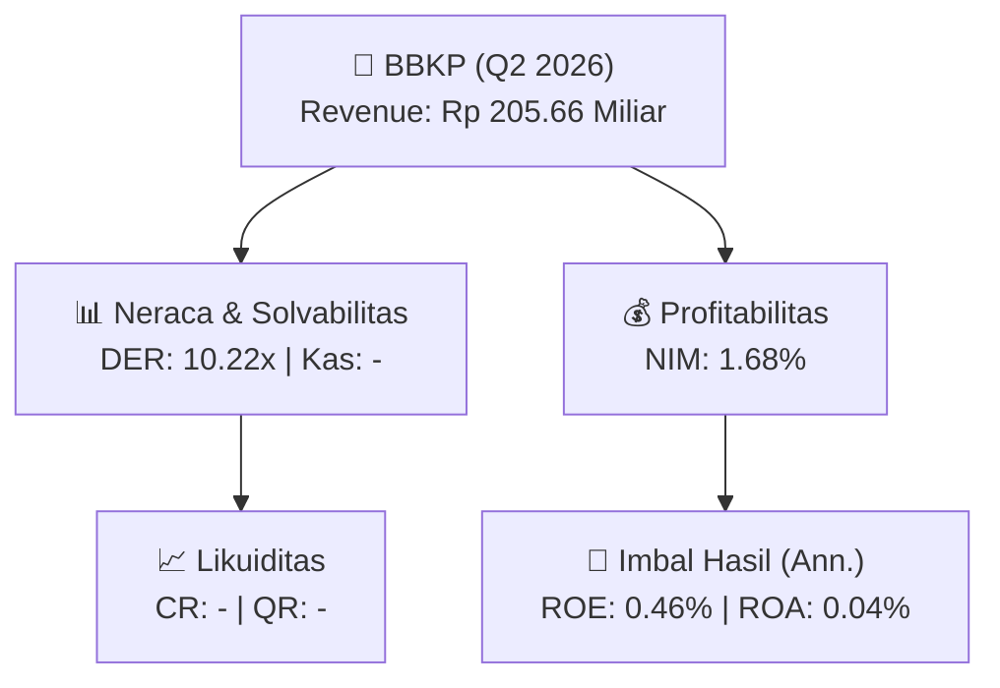
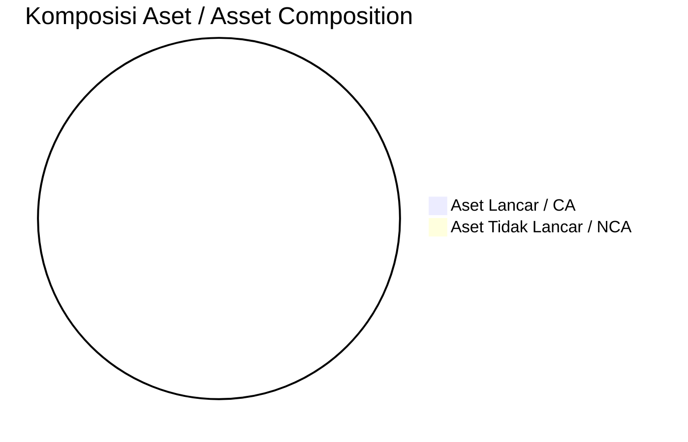
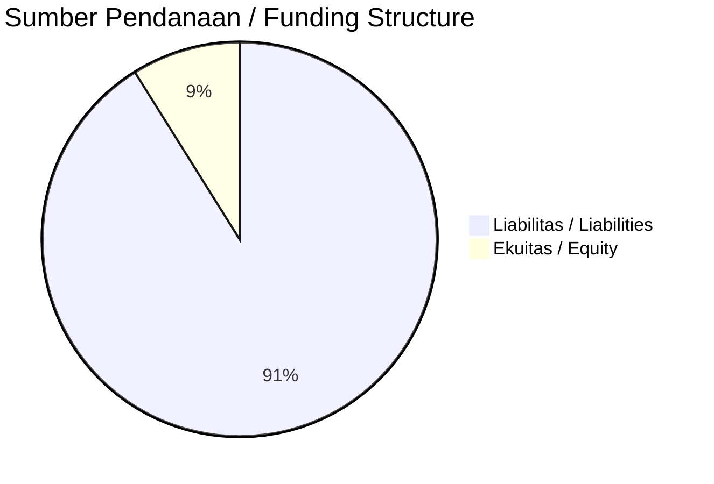

# 📈 Laporan Analisis Keuangan Mendalam: [[BBKP]] — Q2 2026

⬅️ [[knowledge-base/daily-digests/Daily_Digest_20260922|Kembali ke Daily Digest]] | 📅 **2026-09-22** | 🎛️ [[Dashboard|Ke Dashboard Utama]]

> [!IMPORTANT]
> Dokumen ini disusun oleh **Financial Summarizer Agent** untuk menganalisis kinerja keuangan, kesehatan neraca, profitabilitas, dan katalis sektor (Multifinance & Perbankan) **PT Bank KB Indonesia Tbk ([[BBKP]])** berdasarkan LK Q2 2026.

---

## 📌 1. Ikhtisar Kinerja Utama / Executive Performance Highlight
- **Emiten**: `[[BBKP]]` (PT Bank KB Indonesia Tbk)
- **Sektor Usaha / Industry Sector**: `Multifinance & Perbankan`
- **Periode Laporan / Reporting Period**: `Q2 2026`
- **Pendapatan Usaha / Total Revenue**: `Rp 205.66 Miliar` (**- YoY** dari Rp 0.00)
- **Pendapatan Bunga / Interest Income**: `Rp 2.74 Triliun`
- **Laba (Rugi) Bersih / Net Income**: `Rp 18.63 Miliar` (**-95.21% 🔴 YoY**)
- **Total Aset / Total Assets**: `Rp 93.01 Triliun` | **Total Ekuitas / Total Equity**: `Rp 8.29 Triliun`
- **EPS (Annualized)**: `0.00` | **BVPS**: `0.44`

---

## 📊 2. Laba Rugi Komparatif / Comparative Income Statement (Financial Sector)

| Pos Laba Rugi / Income Statement Item | Q2 2026 | Prior Period | YoY (%) |
| :--- | ---: | ---: | :---: |
| **Pendapatan Bunga / Interest Income** | `2.74T` | `2.68T` | +2.46% 🟢 |
| **Beban Bunga / Interest Expense** | `(1.96T)` | `(2.10T)` | -6.84% 🔴 |
| **Jumlah Pendapatan Usaha / Total Revenue** | `205.66B` | `0.00` | - |
| **Pencadangan / Provision (PPAP)** | `(-70.20B)` | `(8.43B)` | -933.18% 🔴 |
| **Beban Operasional / Operating Expenses** | `(412.55B)` | `(430.24B)` | -4.11% 🔴 |
| **Laba Sebelum Pajak / Profit Before Tax** | `19.69B` | `505.96B` | -96.11% 🔴 |
| **Laba (Rugi) Bersih / Net Income** | **18.63B** | **389.32B** | **-95.21% 🔴** |

---

## 🏦 3. Neraca & Struktur Permodalan / Balance Sheet & Capital Structure

| Pos Neraca / Balance Sheet Item | Q2 2026 | Prior Year End | Δ YoY/YtD (%) | Catatan / Notes |
| :--- | ---: | ---: | :---: | :--- |
| **Aset Lancar / Current Assets** | `-` | `-` | - | Kas: - |
| **Aset Tidak Lancar / Non-Current Assets** | `-` | `-` | - | Aset Tetap & Operasional |
| **TOTAL ASET / TOTAL ASSETS** | **93.01T** | **89.79T** | **+3.58% 🟢** | |
| **Liabilitas Jk. Pendek / Current Liabilities** | `-` | `-` | - | |
| **Liabilitas Jk. Panjang / Non-Current Liabilities** | `-` | `-` | - | |
| **TOTAL LIABILITAS / TOTAL LIABILITIES** | **84.75T** | **81.75T** | **+3.66% 🟢** | |
| **TOTAL EKUITAS / TOTAL EQUITY** | **8.29T** | **8.07T** | **+2.78% 🟢** | |

---

## 💸 4. Laporan Arus Kas / Cash Flow Statement

| Komponen Arus Kas / Cash Flow Component | Q2 2026 | Prior Period | Δ YoY (%) |
| :--- | ---: | ---: | :---: |
| **Arus Kas Operasi / CFO** | `-1.28T` | `-1.60T` | +19.93% 🟢 |
| **Arus Kas Investasi / CFI** | `-1.70T` | `3.07T` | -155.48% 🔴 |
| **Arus Kas Pendanaan / CFF** | `4.84T` | `239.64B` | +1920.21% 🟢 |
| **Kenaikan (Penurunan) Kas Bersih** | `1.86T` | `1.70T` | +8.89% 🟢 |
| Belanja Modal / Capex | `(-)` | `(-)` | - |
| Pembayaran Dividen / Dividends Paid | `(-)` | `(-)` | - |
| **Free Cash Flow (CFO - Capex)** | **-** | **-** | **-** |

---

## 📈 Analisis Rasio Keuangan / Financial Ratio Analysis

| Kategori / Category | Metrik / Metric | Nilai / Value | Benchmark | Interpretasi / Interpretation |
| :--- | :--- | :---: | :---: | :--- |
| **🛡️ Likuiditas** | **Current Ratio** | `-` | `> 1.0x` | Kemampuan bayar kewajiban jk. pendek |
| | **Quick Ratio** | `-` | `> 0.8x` | Likuiditas tanpa persediaan |
| **📊 Profitabilitas** | **Net Interest Margin (NIM)** | `1.68%` | `> 3.0%` | Spread pendapatan bunga bersih |
| | **BOPO / Cost-to-Income Ratio** | `200.60%` | `< 80%` | Efisiensi biaya operasional |
| **🎯 Imbal Hasil (Ann.)** | **Return on Equity (ROE)** | `0.46%` | - | Imbal hasil terhadap ekuitas |
| | **Return on Assets (ROA)** | `0.04%` | - | Produktivitas aset |
| **⚖️ Solvabilitas** | **Debt to Equity (DER)** | `10.22x` | `< 2.0x` | Leverage utang vs modal |
| | **Debt to Asset (DAR)** | `0.91x` | `< 0.7x` | Porsi aset didanai utang |

---

## 📐 Per Share Metrics

| Metrik / Metric | Nilai / Value | Keterangan / Notes |
| :--- | ---: | :--- |
| **EPS (Annualized)** | `Rp 0.00` | Laba per saham (dianualisasi) |
| **BVPS** | `Rp 0.44` | Nilai buku per saham |

---

## 🚀 Analisis Strategis & Karakteristik Sektor / Strategic Analysis: Multifinance & Perbankan

Pada periode Q2 2026, **PT Bank KB Indonesia Tbk ([[BBKP]])** membukukan total pendapatan sebesar **Rp 205.66 Miliar** (- YoY). Laba bersih sebesar **Rp 18.63 Miliar** (-95.21% 🔴 YoY). Total aset **Rp 93.01 Triliun**, ekuitas **Rp 8.29 Triliun**, DER **10.22x**.

### 🔍 Indikator Kunci Sektor / Sector Key Indicators (Multifinance & Perbankan)
- **Karakteristik Industri Finansial / Financial Industry**: Kinerja ditopang oleh spread pendapatan bunga (NIM), hasil investasi, dan pengelolaan Cost of Funds.
- **Kualitas Aset / Asset Quality**: Pengawasan rasio NPL/NPF dan kecukupan pencadangan (PPAP) untuk menjaga stabilitas margin usaha.
- **Solvabilitas / Solvency**: Rasio kecukupan modal (CAR/RBC) ketat sesuai regulasi OJK.

> [!NOTE]
> _Data Public Expose / Investor Presentation belum tersedia untuk emiten ini._

---

## 📋 Catatan Kunci Laporan Keuangan / Key Notes to Financial Statements

### 🔍 Opini Auditor / Auditor Opinion
- **Jenis Opini / Opinion Type**: `Wajar Tanpa Modifikasian / Unqualified`
- **KAP / Audit Firm**: `KAP Mirawati Sensi Idris`
- **Partner Audit**: `Fendri Sutejo`
- **Tanggal Laporan / Report Date**: `2026-06-30`

### 📝 Perjanjian & Kontrak Signifikan / Key Contracts & Agreements
- Kontrak Investasi Kolektif-Efek Beragun Aset (KIK-EBA): EBA Kelas A2 senilai Rp1 (nominal penuh) ditawarkan dengan nilai 91,1% dari nilai pokok EBA Kelas A2; tidak dicatat pada Bursa Efek Indonesia namun ditawarkan kepada calon pembeli dengan ketentuan pemegang EBA Kelas A2 mempunyai hak untuk dibayar terlebih dahulu.

### 🤝 Transaksi Pihak Berelasi / Related Party Transactions
- Hubungan pihak berelasi: KB Kookmin Bank Co., Ltd sebagai pemegang saham pengendali.
- PT Haka Sarana Investama dikendalikan/di bawah pengaruh signifikan salah satu pemegang saham utama Bank.
- PT Bosowa Berlian Motor dikendalikan/di bawah pengaruh signifikan salah satu pemegang saham utama Bank.

### ⚠️ Komitmen & Kontinjensi / Commitments & Contingencies
- Kontinjensi: Tagihan Kontinjensi - Pendapatan bunga dalam penyelesaian sebesar Rp3.823.550 juta pada 30 Juni 2026, Rp3.770.571 juta pada 31 Desember 2025, dan Rp5.123.131 juta pada 31 Desember 2024.
- Liabilitas Kontinjensi: Bank garansi (nilai tidak lengkap dalam teks yang diberikan).

---

## 💡 Catatan Strategis & Panduan Investor / Strategic Notes & Investor Guide

1. **Kesehatan Permodalan / Capital Health**: DER **10.22x**, CR **-** — _perlu dipantau secara disiplin_.
2. **Katalis Pertumbuhan / Growth Catalysts**: Pantau realisasi pendapatan dan efisiensi operasional periode berikutnya.
3. **Kualitas Aset Finansial**: Pantau tren NIM (**1.68%**) dan kualitas portofolio kredit/pembiayaan.

---

## 🔗 Hubungan Note Terkait / Knowledge Graph Links
- [[knowledge-base/daily-digests/Daily_Digest_20260922|📄 Daily Digest 2026-09-22]]
- [[knowledge-base/trading-signals/Trading_Signals_20260922|🎯 Trading Signals]]
- [[Dashboard|🎛️ Kembali ke Dashboard Utama]]