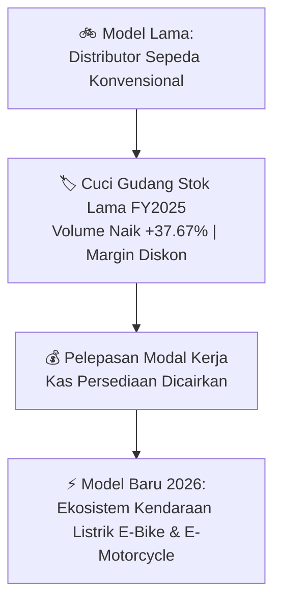

# 📈 Laporan Analisis Keuangan Mendalam: [[BIKE]] - FY 2025

⬅️ [[knowledge-base/daily-digests/Daily_Digest_20260804|Kembali ke Daily Digest]] | 📅 **2026-08-04** | 🎛️ [[Dashboard|Ke Dashboard Utama]]

> [!IMPORTANT]
> Dokumen ini disusun secara khusus oleh **Financial Summarizer Agent** untuk menganalisis kinerja keuangan, **proses transformasi bisnis (EV Pivot)**, kesehatan neraca, dan rasio efisiensi **PT Sepeda Bersama Indonesia Tbk ([[BIKE]])** berdasarkan Laporan Tahunan FY 2025.

---

## 📌 1. Ikhtisar Kinerja Utama (Executive Performance Highlight)
- **Emiten**: `[[BIKE]]` (PT Sepeda Bersama Indonesia Tbk)
- **Sektor Usaha**: Perdagangan Besar Sepeda, Sepeda Listrik (E-Bike), Motor Listrik & Peralatan Olahraga
- **Volume Penjualan Unit**: `358.915 Unit` (**+37,67% YoY** dari 260.697 unit di FY2024)
- **Penjualan Neto (Revenue)**: `Rp 347,98 Miliar` (**-9,93% YoY** dari Rp 386,35 Miliar di FY2024)
- **Laba Bruto (Gross Profit)**: `Rp 17,67 Miliar` (**-64,78% YoY** dari Rp 50,18 Miliar)
- **Laba (Rugi) Bersih**: `Rugi Bersih Rp 24,45 Miliar` (Akibat strategi diskon promosi cuci gudang persediaan lama demi pelepasan modal ke lini Kendaraan Listrik / EV).

---

## 🚀 2. Analisis Transformasi Bisnis & Pivoting Strategis (EV & Smart Mobility Pivot)

### 🧠 Konteks Strategis di Balik Kerugian FY2025:
1. **Bukan Kerapuhan Operasional, Melainkan Cuci Gudang Terencana (*Inventory Clearance*)**:
   - Meskipun nilai penjualan neto secara nominal turun -9,93% (menjadi Rp 347,98 Miliar), **volume unit fisik yang berhasil dijual justru melonjak pesat +37,67% (mencapai 358.915 unit)**.
   - Kerugian Rp 24,45 Miliar disebabkan oleh keputusan manajemen untuk melakukan **diskon agresif & program promosi** demi menghabiskan persediaan sepeda konvensional stok lama secara cepat.
2. **Reallokasi Modal Kerja ke Kendaraan Listrik (EV Pivot)**:
   - Pencairan persediaan (*inventory liquidation*) dilakukan untuk membebaskan modal kerja (*working capital reallocation*) demi membiayai pengalihan fokus bisnis penuh menuju segmen **Sepeda Listrik (E-Bike), Motor Listrik, serta Layanan Purna Jual & Suku Cadang EV** yang memiliki pertumbuhan margin lebih tinggi.
3. **Fondasi Pertumbuhan Masa Depan**:
   - Basis volume unit yang kuat (358 ribu unit) membuktikan penetrasi jaringan distribusi perseroan yang sangat luas (United Bike, Avand, Genio, EV Series), yang siap menjadi rantai pasok utama kendaraan listrik nasional.

---

## 📊 3. Matriks Laba Rugi Komparatif (Income Statement 3-Year Trend)

| Indikator Keuangan (Dalam Miliar Rp) | FY 2025 | FY 2024 | FY 2023 | Pertumbuhan YoY (%) |
| :--- | :---: | :---: | :---: | :---: |
| **Penjualan Neto (Sales)** | `347.98` | `386.35` | `430.28` | **-9.93%** 🔴 |
| **Beban Pokok Penjualan (COGS)** | `(330.31)` | `(336.17)` | `(385.42)` | -1.74% |
| **Laba Bruto (Gross Profit)** | `17.67` | `50.18` | `44.86` | **-64.78%** 🔴 |
| **Beban Penjualan & Pemasaran** | `(22.71)` | `(17.06)` | `(5.98)` | +33.11% |
| **Beban Umum & Administrasi** | `(18.71)` | `(14.79)` | `(11.02)` | +26.42% |
| **Laba (Rugi) Bersih Tahun Berjalan** | **(24.45)** | **12.60** | **15.80** | **-293.77%** 🔴 |

---

## 🏦 4. Matriks Neraca & Kesehatan Permodalan (Balance Sheet Analysis)

| Pos Neraca Utama (Dalam Miliar Rp) | FY 2025 | FY 2024 | FY 2023 | Catatan Analis |
| :--- | :---: | :---: | :---: | :--- |
| **Aset Lancar** | `294.93` | `330.80` | `254.83` | Didominasi Persediaan & Piutang |
| **Aset Tidak Lancar** | `10.07` | `3.52` | `2.39` | Penambahan Aset Tetap & Operasional EV |
| **TOTAL ASET** | **304.99** | **334.32** | **257.22** | **-8.77% YoY** |
| **Liabilitas Jangka Pendek** | `217.26` | `203.19` | `126.41` | Utang Usaha & Pinjaman Bank Pendek |
| **Liabilitas Jangka Panjang** | `3.04` | `2.53` | `2.09` | Imbalan Kerja & Kewajiban Sewa |
| **TOTAL LIABILITAS** | **220.30** | **205.72** | **128.49** | **+7.09% YoY** |
| **TOTAL EKUITAS** | **84.70** | **128.60** | **128.72** | **-34.14% YoY** |

---

## 📈 5. Analisis Rasio Keuangan Utama (Financial Ratios)
- 🛡️ **Likuiditas (Current Ratio)**: `1,36x` (Aset lancar Rp 294,93 M vs Liabilitas pendek Rp 217,26 M).
- ⚖️ **Solvabilitas / Leverage (DER)**: `2,60x` (260,09%). Tingkat utang tergolong *high leverage*.
- 📊 **Gross Profit Margin (GPM)**: `5,08%` (Tertekan dari 12,99% akibat promosi cuci gudang).
- 📉 **Net Profit Margin (NPM)**: `-7,03%`.
- 🔄 **Return on Equity (ROE)**: `-28,87%`.
- 🏛️ **Return on Assets (ROA)**: `-8,02%`.

---

## 💡 6. Catatan Strategis & Panduan Investor
1. **Monitoring Hasil Transformasi EV (2026+)**: Pantau apakah pembebasan modal persediaan di FY2025 berhasil mendorong pemulihan margin bruto di atas 10% dari penjualan sepeda & motor listrik di tahun 2026.
2. **Kesehatan Permodalan**: Tingkat DER 2,60x memerlukan disiplin pengelolaan arus kas operasional (*Cash Flow Management*) dan pengendalian utang jangka pendek.

---

## 🔗 Hubungan Note Terkait (Knowledge Graph)
- [[knowledge-base/valuations/Valuation_BIKE_20260804|📈 Laporan Valuasi & Fair Value [[BIKE]]]]
- [[knowledge-base/daily-digests/Daily_Digest_20260804|📄 Daily Digest 2026-08-04]]
- [[Dashboard|🎛️ Kembali ke Dashboard Utama]]
