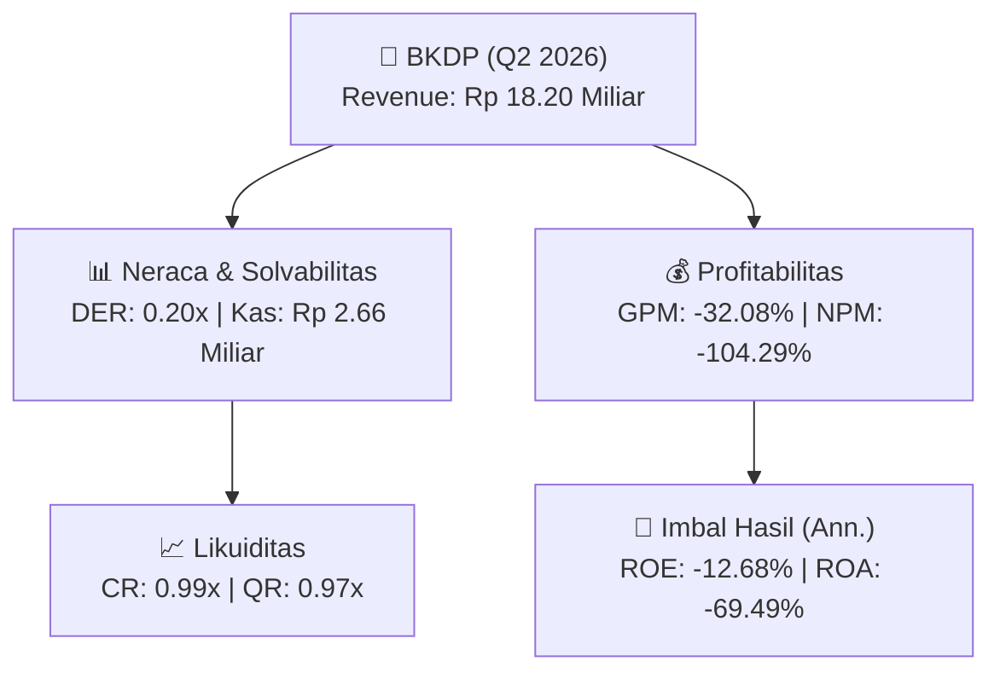
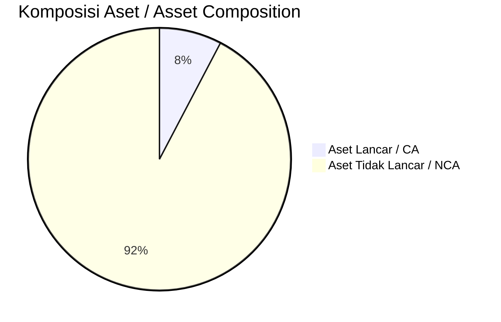
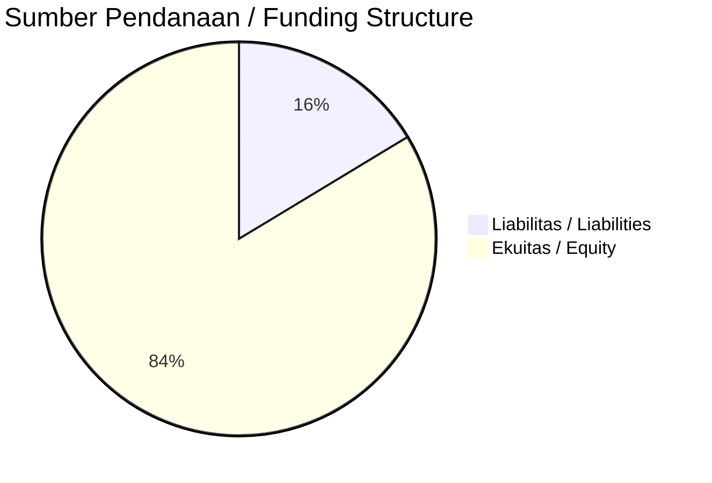

# 📈 Laporan Analisis Keuangan Mendalam: [[BKDP]] — Q2 2026

⬅️ [[knowledge-base/daily-digests/Daily_Digest_20260901|Kembali ke Daily Digest]] | 📅 **2026-09-01** | 🎛️ [[Dashboard|Ke Dashboard Utama]]

> [!IMPORTANT]
> Dokumen ini disusun oleh **Financial Summarizer Agent** untuk menganalisis kinerja keuangan, kesehatan neraca, profitabilitas, dan katalis sektor (Properti & Konstruksi) **Bukit Darmo Property Tbk ([[BKDP]])** berdasarkan LK Q2 2026.

---

## 📌 1. Ikhtisar Kinerja Utama / Executive Performance Highlight
- **Emiten**: `[[BKDP]]` (Bukit Darmo Property Tbk)
- **Sektor Usaha / Industry Sector**: `Properti & Konstruksi`
- **Periode Laporan / Reporting Period**: `Q2 2026`
- **Pendapatan Neto / Net Revenue**: `Rp 18.20 Miliar` (**+1.24% 🟢 YoY** dari Rp 17.98 Miliar)
- **Laba Bruto / Gross Profit**: `Rp -5.84 Miliar` (**-104.65% 🔴 YoY**)
- **Laba (Rugi) Bersih / Net Income**: `Rp -18.98 Miliar` (**-14.52% 🔴 YoY**)
- **Total Aset / Total Assets**: `Rp 56.00 Miliar` | **Total Ekuitas / Total Equity**: `Rp 290.06 Miliar`
- **EPS (Annualized)**: `-0.05` | **BVPS**: `0.36`

---

## 📊 2. Laba Rugi Komparatif / Comparative Income Statement

| Pos Laba Rugi / Income Statement Item | Q2 2026 | Prior Period | YoY (%) |
| :--- | ---: | ---: | :---: |
| **Pendapatan Neto / Net Revenue** | `18.20B` | `17.98B` | **+1.24% 🟢** |
| **Beban Pokok / COGS** | `(24.04B)` | `(20.83B)` | +15.41% 🟢 |
| **Laba Bruto / Gross Profit** | `-5.84B` | `-2.85B` | **-104.65% 🔴** |
| **Beban Usaha / Operating Expenses** | `(10.35B)` | `(11.50B)` | -9.93% 🔴 |
| **Laba Operasional / EBIT** | `-17.51B` | `-15.72B` | -11.39% 🔴 |
| **Laba (Rugi) Bersih / Net Income** | **-18.98B** | **-16.58B** | **-14.52% 🔴** |

---

## 🏦 3. Neraca & Struktur Permodalan / Balance Sheet & Capital Structure

| Pos Neraca / Balance Sheet Item | Q2 2026 | Prior Year End | Δ YoY/YtD (%) | Catatan / Notes |
| :--- | ---: | ---: | :---: | :--- |
| **Aset Lancar / Current Assets** | `56.00B` | `53.28B` | +5.10% 🟢 | Kas: Rp 2.66 Miliar |
| **Aset Tidak Lancar / Non-Current Assets** | `672.85B` | `680.63B` | -1.14% 🔴 | Aset Tetap & Operasional |
| **TOTAL ASET / TOTAL ASSETS** | **56.00B** | **53.28B** | **+5.10% 🟢** | |
| **Liabilitas Jk. Pendek / Current Liabilities** | `56.69B` | `57.72B` | -1.79% 🔴 | |
| **Liabilitas Jk. Panjang / Non-Current Liabilities** | `382.18B` | `367.22B` | +4.07% 🟢 | |
| **TOTAL LIABILITAS / TOTAL LIABILITIES** | **56.69B** | **57.72B** | **-1.79% 🔴** | |
| **TOTAL EKUITAS / TOTAL EQUITY** | **290.06B** | **309.05B** | **-6.14% 🔴** | |

---

## 💸 4. Laporan Arus Kas / Cash Flow Statement

| Komponen Arus Kas / Cash Flow Component | Q2 2026 | Prior Period | Δ YoY (%) |
| :--- | ---: | ---: | :---: |
| **Arus Kas Operasi / CFO** | `1.31B` | `-9.95B` | +113.22% 🟢 |
| **Arus Kas Investasi / CFI** | `-1.99B` | `-718.21M` | -176.42% 🔴 |
| **Arus Kas Pendanaan / CFF** | `-` | `9.04B` | - |
| **Kenaikan (Penurunan) Kas Bersih** | `-670.62M` | `-1.63B` | +58.77% 🟢 |
| Belanja Modal / Capex | `(-)` | `(4.50M)` | - |
| Pembayaran Dividen / Dividends Paid | `(-)` | `(-)` | - |
| **Free Cash Flow (CFO - Capex)** | **-** | **-9.95B** | **-** |

---

## 📈 Analisis Rasio Keuangan / Financial Ratio Analysis

| Kategori / Category | Metrik / Metric | Nilai / Value | Benchmark | Interpretasi / Interpretation |
| :--- | :--- | :---: | :---: | :--- |
| **🛡️ Likuiditas** | **Current Ratio** | `0.99x` | `> 1.0x` | Kemampuan bayar kewajiban jk. pendek |
| | **Quick Ratio** | `0.97x` | `> 0.8x` | Likuiditas tanpa persediaan |
| **📊 Profitabilitas** | **Gross Profit Margin (GPM)** | `-32.08%` | - | Margin kotor operasional inti |
| | **Operating Profit Margin (OPM)** | `-96.19%` | - | Efisiensi operasional |
| | **Net Profit Margin (NPM)** | `-104.29%` | - | Konversi revenue ke laba bersih |
| **🎯 Imbal Hasil (Ann.)** | **Return on Equity (ROE)** | `-12.68%` | - | Imbal hasil terhadap ekuitas |
| | **Return on Assets (ROA)** | `-69.49%` | - | Produktivitas aset |
| **⚖️ Solvabilitas** | **Debt to Equity (DER)** | `0.20x` | `< 2.0x` | Leverage utang vs modal |
| | **Debt to Asset (DAR)** | `1.01x` | `< 0.7x` | Porsi aset didanai utang |

---

## 📐 Per Share Metrics

| Metrik / Metric | Nilai / Value | Keterangan / Notes |
| :--- | ---: | :--- |
| **EPS (Annualized)** | `Rp -0.05` | Laba per saham (dianualisasi) |
| **BVPS** | `Rp 0.36` | Nilai buku per saham |

---

## 🚀 Analisis Strategis & Karakteristik Sektor / Strategic Analysis: Properti & Konstruksi

Pada periode Q2 2026, **Bukit Darmo Property Tbk ([[BKDP]])** membukukan total pendapatan sebesar **Rp 18.20 Miliar** (+1.24% 🟢 YoY). Laba kotor tercatat **Rp -5.84 Miliar** dengan GPM **-32.08%**. Laba bersih sebesar **Rp -18.98 Miliar** (-14.52% 🔴 YoY). Total aset **Rp 56.00 Miliar**, ekuitas **Rp 290.06 Miliar**, DER **0.20x**.

### 🔍 Indikator Kunci Sektor / Sector Key Indicators (Properti & Konstruksi)
- **Karakteristik Konstruksi & Properti**: Pertumbuhan bertumpu pada perolehan kontrak baru (Order Book) dan percepatan progres fisik proyek.
- **Modal Kerja**: Restrukturisasi liabilitas dan pengelolaan arus kas proyek.
- **Katalis**: Presales/marketing sales, groundbreaking proyek baru, dan penyerahan unit.

> [!NOTE]
> _Data Public Expose / Investor Presentation belum tersedia untuk emiten ini._

---

## 📋 Catatan Kunci Laporan Keuangan / Key Notes to Financial Statements

### 🔍 Opini Auditor / Auditor Opinion
- **Jenis Opini / Opinion Type**: `Reviu Terbatas / Limited Review`
- **KAP / Audit Firm**: `KAP Andi Ruswandi Wisnu  Rekan`
- **Partner Audit**: `Arum Meliana`
- **Tanggal Laporan / Report Date**: `2026-08-31`

---

## 💡 Catatan Strategis & Panduan Investor / Strategic Notes & Investor Guide

1. **Kesehatan Permodalan / Capital Health**: DER **0.20x**, CR **0.99x** — _perlu dipantau secara disiplin_.
2. **Katalis Pertumbuhan / Growth Catalysts**: Pantau realisasi pendapatan dan efisiensi operasional periode berikutnya.

---

## 🔗 Hubungan Note Terkait / Knowledge Graph Links
- [[knowledge-base/daily-digests/Daily_Digest_20260901|📄 Daily Digest 2026-09-01]]
- [[knowledge-base/trading-signals/Trading_Signals_20260901|🎯 Trading Signals]]
- [[Dashboard|🎛️ Kembali ke Dashboard Utama]]