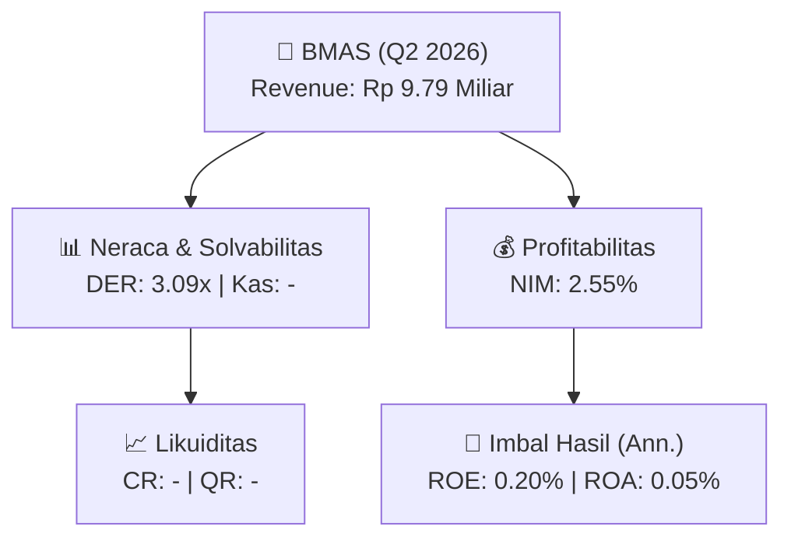
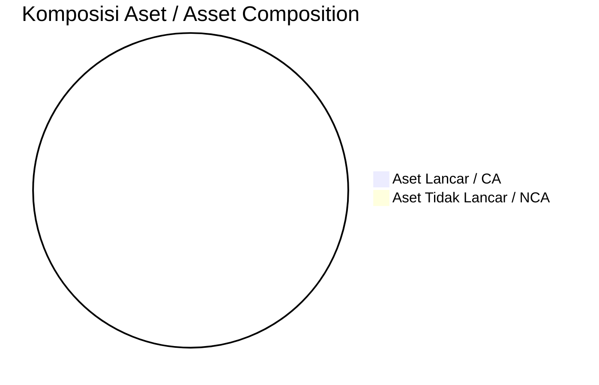
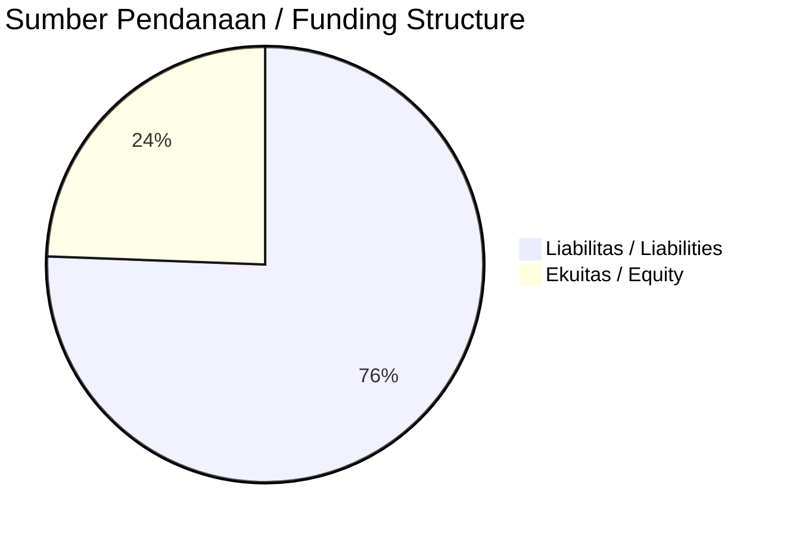

# 📈 Laporan Analisis Keuangan Mendalam: [[BMAS]] — Q2 2026

⬅️ [[knowledge-base/daily-digests/Daily_Digest_20260901|Kembali ke Daily Digest]] | 📅 **2026-09-01** | 🎛️ [[Dashboard|Ke Dashboard Utama]]

> [!IMPORTANT]
> Dokumen ini disusun oleh **Financial Summarizer Agent** untuk menganalisis kinerja keuangan, kesehatan neraca, profitabilitas, dan katalis sektor (Multifinance & Perbankan) **PT Bank Kasikorn Indonesia Tbk ([[BMAS]])** berdasarkan LK Q2 2026.

---

## 📌 1. Ikhtisar Kinerja Utama / Executive Performance Highlight
- **Emiten**: `[[BMAS]]` (PT Bank Kasikorn Indonesia Tbk)
- **Sektor Usaha / Industry Sector**: `Multifinance & Perbankan`
- **Periode Laporan / Reporting Period**: `Q2 2026`
- **Pendapatan Usaha / Total Revenue**: `Rp 9.79 Miliar` (**- YoY** dari -)
- **Pendapatan Bunga / Interest Income**: `Rp 690.44 Miliar`
- **Laba (Rugi) Bersih / Net Income**: `Rp 6.39 Miliar` (**-74.48% 🔴 YoY**)
- **Total Aset / Total Assets**: `Rp 26.60 Triliun` | **Total Ekuitas / Total Equity**: `Rp 6.50 Triliun`
- **EPS (Annualized)**: `0.01` | **BVPS**: `3.59`

---

## 📊 2. Laba Rugi Komparatif / Comparative Income Statement (Financial Sector)

| Pos Laba Rugi / Income Statement Item | Q2 2026 | Prior Period | YoY (%) |
| :--- | ---: | ---: | :---: |
| **Pendapatan Bunga / Interest Income** | `690.44B` | `772.75B` | -10.65% 🔴 |
| **Beban Bunga / Interest Expense** | `(351.81B)` | `(430.45B)` | -18.27% 🔴 |
| **Jumlah Pendapatan Usaha / Total Revenue** | `9.79B` | `-` | - |
| **Pencadangan / Provision (PPAP)** | `(-27.37B)` | `(43.52B)` | -162.90% 🔴 |
| **Beban Operasional / Operating Expenses** | `(385.31B)` | `(134.78B)` | +185.88% 🟢 |
| **Laba Sebelum Pajak / Profit Before Tax** | `11.28B` | `29.71B` | -62.02% 🔴 |
| **Laba (Rugi) Bersih / Net Income** | **6.39B** | **25.03B** | **-74.48% 🔴** |

---

## 🏦 3. Neraca & Struktur Permodalan / Balance Sheet & Capital Structure

| Pos Neraca / Balance Sheet Item | Q2 2026 | Prior Year End | Δ YoY/YtD (%) | Catatan / Notes |
| :--- | ---: | ---: | :---: | :--- |
| **Aset Lancar / Current Assets** | `-` | `-` | - | Kas: - |
| **Aset Tidak Lancar / Non-Current Assets** | `-` | `-` | - | Aset Tetap & Operasional |
| **TOTAL ASET / TOTAL ASSETS** | **26.60T** | **22.42T** | **+18.65% 🟢** | |
| **Liabilitas Jk. Pendek / Current Liabilities** | `-` | `-` | - | |
| **Liabilitas Jk. Panjang / Non-Current Liabilities** | `-` | `-` | - | |
| **TOTAL LIABILITAS / TOTAL LIABILITIES** | **20.10T** | **15.91T** | **+26.28% 🟢** | |
| **TOTAL EKUITAS / TOTAL EQUITY** | **6.50T** | **6.50T** | **-0.02% 🔴** | |

---

## 💸 4. Laporan Arus Kas / Cash Flow Statement

| Komponen Arus Kas / Cash Flow Component | Q2 2026 | Prior Period | Δ YoY (%) |
| :--- | ---: | ---: | :---: |
| **Arus Kas Operasi / CFO** | `-3.05T` | `2.65T` | -214.93% 🔴 |
| **Arus Kas Investasi / CFI** | `-2.23T` | `-2.13T` | -4.94% 🔴 |
| **Arus Kas Pendanaan / CFF** | `5.39T` | `0.00` | - |
| **Kenaikan (Penurunan) Kas Bersih** | `111.49B` | `527.92B` | -78.88% 🔴 |
| Belanja Modal / Capex | `(-)` | `(-)` | - |
| Pembayaran Dividen / Dividends Paid | `(0.00)` | `(-)` | - |
| **Free Cash Flow (CFO - Capex)** | **-** | **-** | **-** |

---

## 📈 Analisis Rasio Keuangan / Financial Ratio Analysis

| Kategori / Category | Metrik / Metric | Nilai / Value | Benchmark | Interpretasi / Interpretation |
| :--- | :--- | :---: | :---: | :--- |
| **🛡️ Likuiditas** | **Current Ratio** | `-` | `> 1.0x` | Kemampuan bayar kewajiban jk. pendek |
| | **Quick Ratio** | `-` | `> 0.8x` | Likuiditas tanpa persediaan |
| **📊 Profitabilitas** | **Net Interest Margin (NIM)** | `2.55%` | `> 3.0%` | Spread pendapatan bunga bersih |
| | **BOPO / Cost-to-Income Ratio** | `3935.42%` | `< 80%` | Efisiensi biaya operasional |
| **🎯 Imbal Hasil (Ann.)** | **Return on Equity (ROE)** | `0.20%` | - | Imbal hasil terhadap ekuitas |
| | **Return on Assets (ROA)** | `0.05%` | - | Produktivitas aset |
| **⚖️ Solvabilitas** | **Debt to Equity (DER)** | `3.09x` | `< 2.0x` | Leverage utang vs modal |
| | **Debt to Asset (DAR)** | `0.76x` | `< 0.7x` | Porsi aset didanai utang |

---

## 📐 Per Share Metrics

| Metrik / Metric | Nilai / Value | Keterangan / Notes |
| :--- | ---: | :--- |
| **EPS (Annualized)** | `Rp 0.01` | Laba per saham (dianualisasi) |
| **BVPS** | `Rp 3.59` | Nilai buku per saham |

---

## 🚀 Analisis Strategis & Karakteristik Sektor / Strategic Analysis: Multifinance & Perbankan

Pada periode Q2 2026, **PT Bank Kasikorn Indonesia Tbk ([[BMAS]])** membukukan total pendapatan sebesar **Rp 9.79 Miliar** (- YoY). Laba bersih sebesar **Rp 6.39 Miliar** (-74.48% 🔴 YoY). Total aset **Rp 26.60 Triliun**, ekuitas **Rp 6.50 Triliun**, DER **3.09x**.

### 🔍 Indikator Kunci Sektor / Sector Key Indicators (Multifinance & Perbankan)
- **Karakteristik Industri Finansial / Financial Industry**: Kinerja ditopang oleh spread pendapatan bunga (NIM), hasil investasi, dan pengelolaan Cost of Funds.
- **Kualitas Aset / Asset Quality**: Pengawasan rasio NPL/NPF dan kecukupan pencadangan (PPAP) untuk menjaga stabilitas margin usaha.
- **Solvabilitas / Solvency**: Rasio kecukupan modal (CAR/RBC) ketat sesuai regulasi OJK.

> [!NOTE]
> _Data Public Expose / Investor Presentation belum tersedia untuk emiten ini._

---

## 📋 Catatan Kunci Laporan Keuangan / Key Notes to Financial Statements

### 🔍 Opini Auditor / Auditor Opinion
- **Jenis Opini / Opinion Type**: `Wajar Tanpa Modifikasian / Unqualified`
- **KAP / Audit Firm**: `KAP Tanubrata, Sutanto, Fahmi, Bambang, dan Rekan`
- **Partner Audit**: `Sutomo`
- **Tanggal Laporan / Report Date**: `2026-08-31`

---

## 💡 Catatan Strategis & Panduan Investor / Strategic Notes & Investor Guide

1. **Kesehatan Permodalan / Capital Health**: DER **3.09x**, CR **-** — _perlu dipantau secara disiplin_.
2. **Katalis Pertumbuhan / Growth Catalysts**: Pantau realisasi pendapatan dan efisiensi operasional periode berikutnya.
3. **Kualitas Aset Finansial**: Pantau tren NIM (**2.55%**) dan kualitas portofolio kredit/pembiayaan.

---

## 🔗 Hubungan Note Terkait / Knowledge Graph Links
- [[knowledge-base/daily-digests/Daily_Digest_20260901|📄 Daily Digest 2026-09-01]]
- [[knowledge-base/trading-signals/Trading_Signals_20260901|🎯 Trading Signals]]
- [[Dashboard|🎛️ Kembali ke Dashboard Utama]]