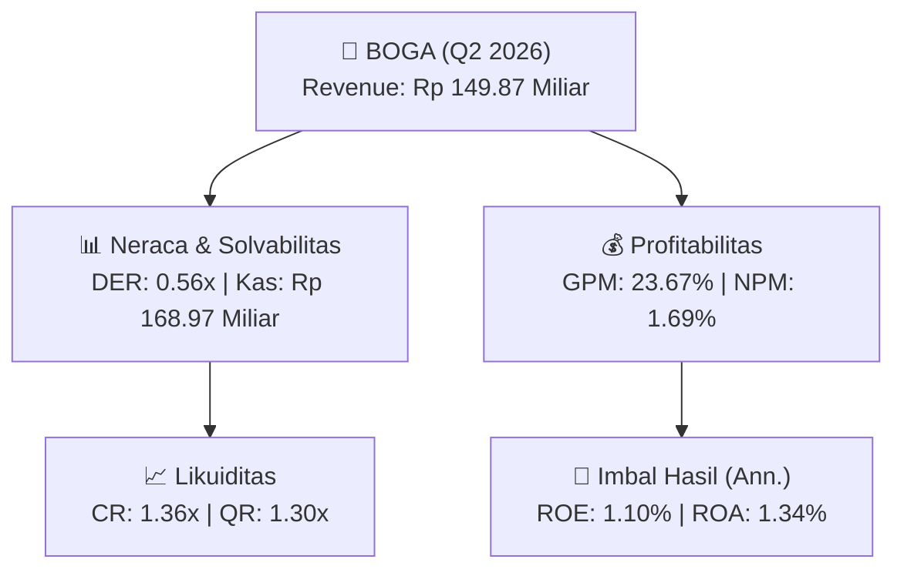
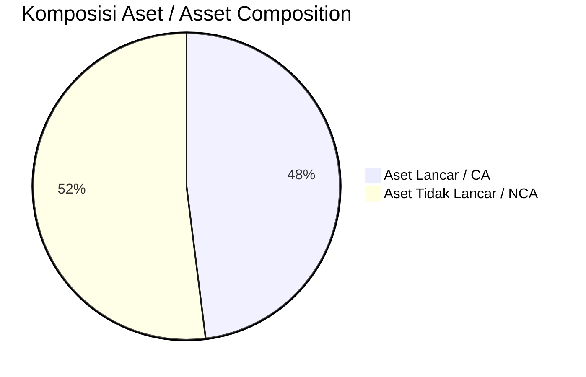
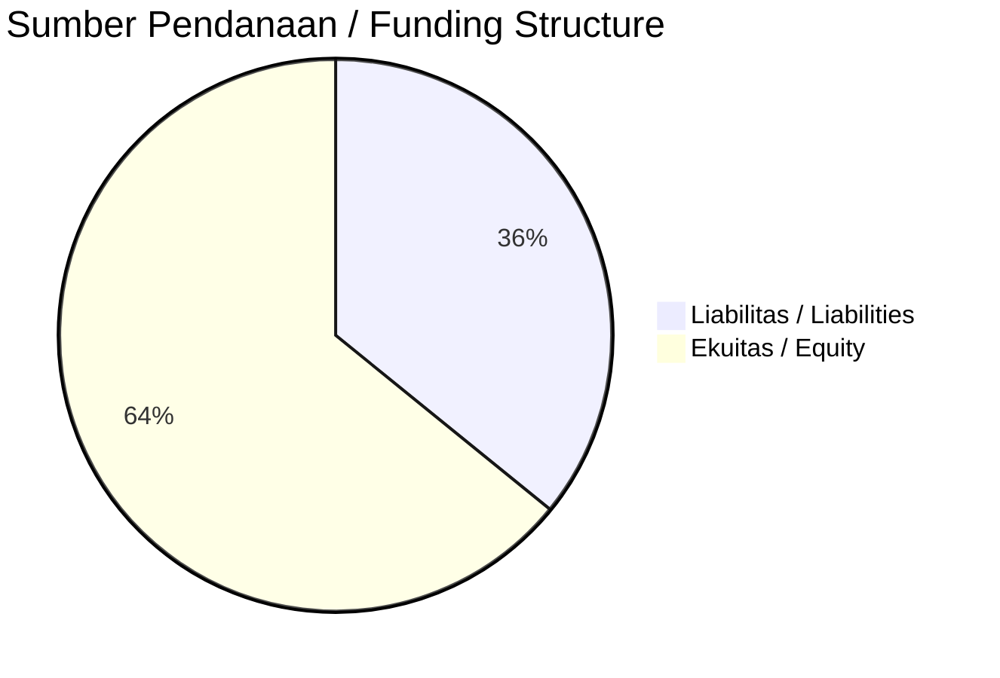

# 📈 Laporan Analisis Keuangan Mendalam: [[BOGA]] — Q2 2026

⬅️ [[knowledge-base/daily-digests/Daily_Digest_20261001|Kembali ke Daily Digest]] | 📅 **2026-10-01** | 🎛️ [[Dashboard|Ke Dashboard Utama]]

> [!IMPORTANT]
> Dokumen ini disusun oleh **Financial Summarizer Agent** untuk menganalisis kinerja keuangan, kesehatan neraca, profitabilitas, dan katalis sektor (Konsumer & Ritel) **PT Apollo Global Interactive Tbk ([[BOGA]])** berdasarkan LK Q2 2026.

---

## 📌 1. Ikhtisar Kinerja Utama / Executive Performance Highlight
- **Emiten**: `[[BOGA]]` (PT Apollo Global Interactive Tbk)
- **Sektor Usaha / Industry Sector**: `Konsumer & Ritel`
- **Periode Laporan / Reporting Period**: `Q2 2026`
- **Pendapatan Neto / Net Revenue**: `Rp 149.87 Miliar` (**-25.91% 🔴 YoY** dari Rp 202.29 Miliar)
- **Laba Bruto / Gross Profit**: `Rp 35.48 Miliar` (**+69.93% 🟢 YoY**)
- **Laba (Rugi) Bersih / Net Income**: `Rp 2.54 Miliar` (**-57.88% 🔴 YoY**)
- **Total Aset / Total Assets**: `Rp 353.97 Miliar` | **Total Ekuitas / Total Equity**: `Rp 463.89 Miliar`
- **EPS (Annualized)**: `0.01` | **BVPS**: `1.22`

---

## 📊 2. Laba Rugi Komparatif / Comparative Income Statement

| Pos Laba Rugi / Income Statement Item | Q2 2026 | Prior Period | YoY (%) |
| :--- | ---: | ---: | :---: |
| **Pendapatan Neto / Net Revenue** | `149.87B` | `202.29B` | **-25.91% 🔴** |
| **Beban Pokok / COGS** | `(114.39B)` | `(181.41B)` | -36.94% 🔴 |
| **Laba Bruto / Gross Profit** | `35.48B` | `20.88B` | **+69.93% 🟢** |
| **Beban Usaha / Operating Expenses** | `(19.50B)` | `(20.67B)` | -5.64% 🔴 |
| **Laba Operasional / EBIT** | `5.65B` | `9.95B` | -43.18% 🔴 |
| **Laba (Rugi) Bersih / Net Income** | **2.54B** | **6.02B** | **-57.88% 🔴** |

---

## 🏦 3. Neraca & Struktur Permodalan / Balance Sheet & Capital Structure

| Pos Neraca / Balance Sheet Item | Q2 2026 | Prior Year End | Δ YoY/YtD (%) | Catatan / Notes |
| :--- | ---: | ---: | :---: | :--- |
| **Aset Lancar / Current Assets** | `353.97B` | `400.47B` | -11.61% 🔴 | Kas: Rp 168.97 Miliar |
| **Aset Tidak Lancar / Non-Current Assets** | `383.47B` | `388.50B` | -1.29% 🔴 | Aset Tetap & Operasional |
| **TOTAL ASET / TOTAL ASSETS** | **353.97B** | **400.47B** | **-11.61% 🔴** | |
| **Liabilitas Jk. Pendek / Current Liabilities** | `259.49B` | `311.89B` | -16.80% 🔴 | |
| **Liabilitas Jk. Panjang / Non-Current Liabilities** | `13.90B` | `15.57B` | -10.75% 🔴 | |
| **TOTAL LIABILITAS / TOTAL LIABILITIES** | **259.49B** | **311.89B** | **-16.80% 🔴** | |
| **TOTAL EKUITAS / TOTAL EQUITY** | **463.89B** | **461.35B** | **+0.55% 🟢** | |

---

## 💸 4. Laporan Arus Kas / Cash Flow Statement

| Komponen Arus Kas / Cash Flow Component | Q2 2026 | Prior Period | Δ YoY (%) |
| :--- | ---: | ---: | :---: |
| **Arus Kas Operasi / CFO** | `11.29B` | `-8.92B` | +226.62% 🟢 |
| **Arus Kas Investasi / CFI** | `-1.94B` | `-1.19B` | -62.91% 🔴 |
| **Arus Kas Pendanaan / CFF** | `-29.20B` | `-10.83B` | -169.52% 🔴 |
| **Kenaikan (Penurunan) Kas Bersih** | `-19.85B` | `-20.94B` | +5.21% 🟢 |
| Belanja Modal / Capex | `(2.20B)` | `(1.19B)` | +84.61% 🟢 |
| Pembayaran Dividen / Dividends Paid | `(-)` | `(-)` | - |
| **Free Cash Flow (CFO - Capex)** | **9.09B** | **-10.11B** | **+189.89% 🟢** |

---

## 📈 Analisis Rasio Keuangan / Financial Ratio Analysis

| Kategori / Category | Metrik / Metric | Nilai / Value | Benchmark | Interpretasi / Interpretation |
| :--- | :--- | :---: | :---: | :--- |
| **🛡️ Likuiditas** | **Current Ratio** | `1.36x` | `> 1.0x` | Kemampuan bayar kewajiban jk. pendek |
| | **Quick Ratio** | `1.30x` | `> 0.8x` | Likuiditas tanpa persediaan |
| **📊 Profitabilitas** | **Gross Profit Margin (GPM)** | `23.67%` | - | Margin kotor operasional inti |
| | **Operating Profit Margin (OPM)** | `3.77%` | - | Efisiensi operasional |
| | **Net Profit Margin (NPM)** | `1.69%` | - | Konversi revenue ke laba bersih |
| **🎯 Imbal Hasil (Ann.)** | **Return on Equity (ROE)** | `1.10%` | - | Imbal hasil terhadap ekuitas |
| | **Return on Assets (ROA)** | `1.34%` | - | Produktivitas aset |
| **⚖️ Solvabilitas** | **Debt to Equity (DER)** | `0.56x` | `< 2.0x` | Leverage utang vs modal |
| | **Debt to Asset (DAR)** | `0.73x` | `< 0.7x` | Porsi aset didanai utang |

---

## 📐 Per Share Metrics

| Metrik / Metric | Nilai / Value | Keterangan / Notes |
| :--- | ---: | :--- |
| **EPS (Annualized)** | `Rp 0.01` | Laba per saham (dianualisasi) |
| **BVPS** | `Rp 1.22` | Nilai buku per saham |

---

## 🚀 Analisis Strategis & Karakteristik Sektor / Strategic Analysis: Konsumer & Ritel

Pada periode Q2 2026, **PT Apollo Global Interactive Tbk ([[BOGA]])** membukukan total pendapatan sebesar **Rp 149.87 Miliar** (-25.91% 🔴 YoY). Laba kotor tercatat **Rp 35.48 Miliar** dengan GPM **23.67%**. Laba bersih sebesar **Rp 2.54 Miliar** (-57.88% 🔴 YoY). Total aset **Rp 353.97 Miliar**, ekuitas **Rp 463.89 Miliar**, DER **0.56x**.

### 🔍 Indikator Kunci Sektor / Sector Key Indicators (Konsumer & Ritel)
- **Karakteristik Industri (Konsumer & Ritel)**: Kinerja mencerminkan dinamika penyerapan pasar, utilisasi kapasitas produksi, dan efisiensi biaya pokok.
- **Faktor Penggerak**: Pertumbuhan organik, efisiensi operasional, dan ekspansi pasar.

> [!NOTE]
> _Data Public Expose / Investor Presentation belum tersedia untuk emiten ini._

---

## 📋 Catatan Kunci Laporan Keuangan / Key Notes to Financial Statements

### 🔍 Opini Auditor / Auditor Opinion
- **Jenis Opini / Opinion Type**: `Wajar Tanpa Modifikasian / Unqualified`
- **KAP / Audit Firm**: `KAP Tanubrata, Sutanto, Fahmi, Bambang, dan Rekan`
- **Partner Audit**: `Mujiono`
- **Tanggal Laporan / Report Date**: `2026-09-30`

### 📝 Perjanjian & Kontrak Signifikan / Key Contracts & Agreements
- Fasilitas pinjaman dari PT Bank Bumi Arta Tbk (BBA) untuk PT Surya Anugerah Gempita (SAG) dan PT Bintang Perkasa Mobilindo (BPM) telah mengalami perubahan dan pelunasan.

---

## 💡 Catatan Strategis & Panduan Investor / Strategic Notes & Investor Guide

1. **Kesehatan Permodalan / Capital Health**: DER **0.56x**, CR **1.36x** — _sehat dan aman_.
2. **Katalis Pertumbuhan / Growth Catalysts**: Pantau realisasi pendapatan dan efisiensi operasional periode berikutnya.

---

## 🔗 Hubungan Note Terkait / Knowledge Graph Links
- [[knowledge-base/daily-digests/Daily_Digest_20261001|📄 Daily Digest 2026-10-01]]
- [[knowledge-base/trading-signals/Trading_Signals_20261001|🎯 Trading Signals]]
- [[Dashboard|🎛️ Kembali ke Dashboard Utama]]