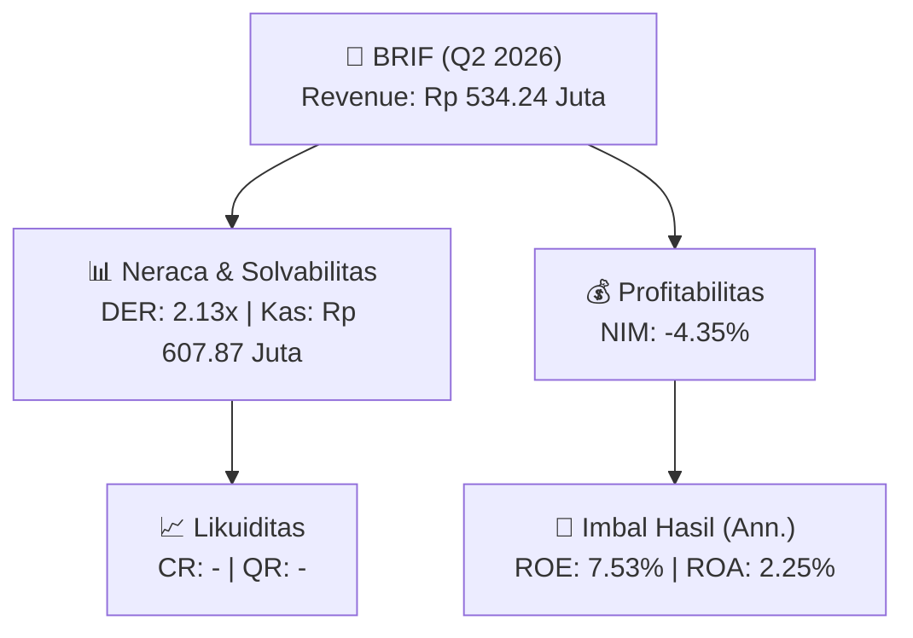
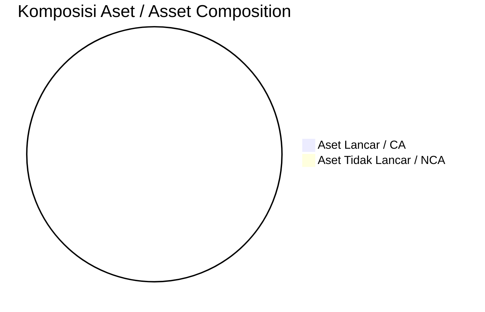
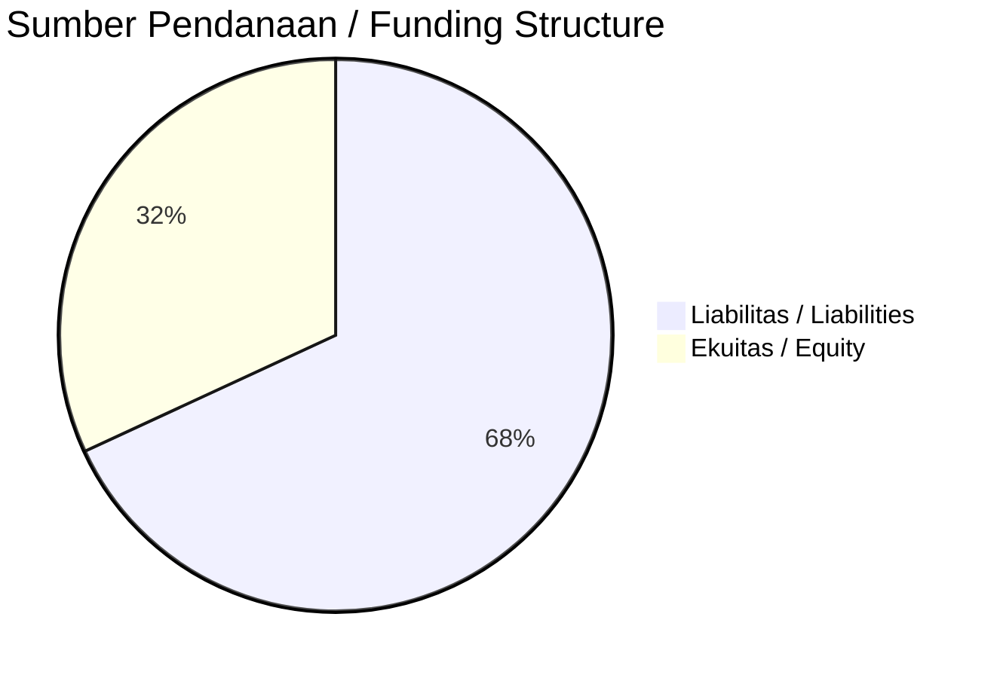

# 📈 Laporan Analisis Keuangan Mendalam: [[BRIF]] — Q2 2026

⬅️ [[knowledge-base/daily-digests/Daily_Digest_20261002|Kembali ke Daily Digest]] | 📅 **2026-10-02** | 🎛️ [[Dashboard|Ke Dashboard Utama]]

> [!IMPORTANT]
> Dokumen ini disusun oleh **Financial Summarizer Agent** untuk menganalisis kinerja keuangan, kesehatan neraca, profitabilitas, dan katalis sektor (Multifinance & Perbankan) **PT BRI Multifinance Indonesia ([[BRIF]])** berdasarkan LK Q2 2026.

---

## 📌 1. Ikhtisar Kinerja Utama / Executive Performance Highlight
- **Emiten**: `[[BRIF]]` (PT BRI Multifinance Indonesia)
- **Sektor Usaha / Industry Sector**: `Multifinance & Perbankan`
- **Periode Laporan / Reporting Period**: `Q2 2026`
- **Pendapatan Usaha / Total Revenue**: `Rp 534.24 Juta` (**-13.44% 🔴 YoY** dari Rp 617.21 Juta)
- **Pendapatan Bunga / Interest Income**: `Rp 988.45 Juta`
- **Laba (Rugi) Bersih / Net Income**: `Rp 58.19 Miliar` (**+77.45% 🟢 YoY**)
- **Total Aset / Total Assets**: `Rp 4.94 Triliun` | **Total Ekuitas / Total Equity**: `Rp 1.58 Triliun`
- **EPS (Annualized)**: `0.26` | **BVPS**: `3.50`

---

## 📊 2. Laba Rugi Komparatif / Comparative Income Statement (Financial Sector)

| Pos Laba Rugi / Income Statement Item | Q2 2026 | Prior Period | YoY (%) |
| :--- | ---: | ---: | :---: |
| **Pendapatan Bunga / Interest Income** | `988.45M` | `3.57B` | -72.34% 🔴 |
| **Beban Bunga / Interest Expense** | `(108.59B)` | `(184.10B)` | -41.02% 🔴 |
| **Jumlah Pendapatan Usaha / Total Revenue** | `534.24M` | `617.21M` | -13.44% 🔴 |
| **Pencadangan / Provision (PPAP)** | `(48.42B)` | `(102.08B)` | -52.57% 🔴 |
| **Beban Operasional / Operating Expenses** | `(56.28B)` | `(47.80B)` | +17.73% 🟢 |
| **Laba Sebelum Pajak / Profit Before Tax** | `76.18B` | `41.88B` | +81.89% 🟢 |
| **Laba (Rugi) Bersih / Net Income** | **58.19B** | **32.79B** | **+77.45% 🟢** |

---

## 🏦 3. Neraca & Struktur Permodalan / Balance Sheet & Capital Structure

| Pos Neraca / Balance Sheet Item | Q2 2026 | Prior Year End | Δ YoY/YtD (%) | Catatan / Notes |
| :--- | ---: | ---: | :---: | :--- |
| **Aset Lancar / Current Assets** | `-` | `-` | - | Kas: Rp 607.87 Juta |
| **Aset Tidak Lancar / Non-Current Assets** | `-` | `-` | - | Aset Tetap & Operasional |
| **TOTAL ASET / TOTAL ASSETS** | **4.94T** | **5.42T** | **-8.79% 🔴** | |
| **Liabilitas Jk. Pendek / Current Liabilities** | `-` | `-` | - | |
| **Liabilitas Jk. Panjang / Non-Current Liabilities** | `-` | `-` | - | |
| **TOTAL LIABILITAS / TOTAL LIABILITIES** | **3.37T** | **3.90T** | **-13.82% 🔴** | |
| **TOTAL EKUITAS / TOTAL EQUITY** | **1.58T** | **1.51T** | **+4.18% 🟢** | |

---

## 💸 4. Laporan Arus Kas / Cash Flow Statement

| Komponen Arus Kas / Cash Flow Component | Q2 2026 | Prior Period | Δ YoY (%) |
| :--- | ---: | ---: | :---: |
| **Arus Kas Operasi / CFO** | `740.25B` | `1.13T` | -34.57% 🔴 |
| **Arus Kas Investasi / CFI** | `-132.43B` | `-112.92B` | -17.28% 🔴 |
| **Arus Kas Pendanaan / CFF** | `-571.42B` | `-1.05T` | +45.82% 🟢 |
| **Kenaikan (Penurunan) Kas Bersih** | `36.40B` | `-36.18B` | +200.62% 🟢 |
| Belanja Modal / Capex | `(5.37B)` | `(5.86B)` | -8.38% 🔴 |
| Pembayaran Dividen / Dividends Paid | `(-)` | `(-)` | - |
| **Free Cash Flow (CFO - Capex)** | **734.88B** | **1.13T** | **-34.71% 🔴** |

---

## 📈 Analisis Rasio Keuangan / Financial Ratio Analysis

| Kategori / Category | Metrik / Metric | Nilai / Value | Benchmark | Interpretasi / Interpretation |
| :--- | :--- | :---: | :---: | :--- |
| **🛡️ Likuiditas** | **Current Ratio** | `-` | `> 1.0x` | Kemampuan bayar kewajiban jk. pendek |
| | **Quick Ratio** | `-` | `> 0.8x` | Likuiditas tanpa persediaan |
| **📊 Profitabilitas** | **Net Interest Margin (NIM)** | `-4.35%` | `> 3.0%` | Spread pendapatan bunga bersih |
| | **BOPO / Cost-to-Income Ratio** | `10533.58%` | `< 80%` | Efisiensi biaya operasional |
| **🎯 Imbal Hasil (Ann.)** | **Return on Equity (ROE)** | `7.53%` | - | Imbal hasil terhadap ekuitas |
| | **Return on Assets (ROA)** | `2.25%` | - | Produktivitas aset |
| **⚖️ Solvabilitas** | **Debt to Equity (DER)** | `2.13x` | `< 2.0x` | Leverage utang vs modal |
| | **Debt to Asset (DAR)** | `0.68x` | `< 0.7x` | Porsi aset didanai utang |

---

## 📐 Per Share Metrics

| Metrik / Metric | Nilai / Value | Keterangan / Notes |
| :--- | ---: | :--- |
| **EPS (Annualized)** | `Rp 0.26` | Laba per saham (dianualisasi) |
| **BVPS** | `Rp 3.50` | Nilai buku per saham |

---

## 🚀 Analisis Strategis & Karakteristik Sektor / Strategic Analysis: Multifinance & Perbankan

Pada periode Q2 2026, **PT BRI Multifinance Indonesia ([[BRIF]])** membukukan total pendapatan sebesar **Rp 534.24 Juta** (-13.44% 🔴 YoY). Laba bersih sebesar **Rp 58.19 Miliar** (+77.45% 🟢 YoY). Total aset **Rp 4.94 Triliun**, ekuitas **Rp 1.58 Triliun**, DER **2.13x**.

### 🔍 Indikator Kunci Sektor / Sector Key Indicators (Multifinance & Perbankan)
- **Karakteristik Industri Finansial / Financial Industry**: Kinerja ditopang oleh spread pendapatan bunga (NIM), hasil investasi, dan pengelolaan Cost of Funds.
- **Kualitas Aset / Asset Quality**: Pengawasan rasio NPL/NPF dan kecukupan pencadangan (PPAP) untuk menjaga stabilitas margin usaha.
- **Solvabilitas / Solvency**: Rasio kecukupan modal (CAR/RBC) ketat sesuai regulasi OJK.

> [!NOTE]
> _Data Public Expose / Investor Presentation belum tersedia untuk emiten ini._

---

## 📋 Catatan Kunci Laporan Keuangan / Key Notes to Financial Statements

### 🔍 Opini Auditor / Auditor Opinion
- **Jenis Opini / Opinion Type**: `Wajar Tanpa Modifikasian / Unqualified`
- **KAP / Audit Firm**: `KAP Purwanto Susanti dan Surja`
- **Partner Audit**: `Yasir`
- **Tanggal Laporan / Report Date**: `2026-09-30`

### 📝 Perjanjian & Kontrak Signifikan / Key Contracts & Agreements
- Perusahaan memiliki fasilitas utang bank yang belum ditarik pada tanggal 30 Juni 2026 dan 31 Desember 2025, antara lain dari PT Bank Rakyat Indonesia (Persero) Tbk berupa Kredit Jangka Pendek dengan Nomor Perjanjian 01, tanggal perjanjian 09 Februari, dan memiliki jatuh tempo fasilitas (jumlah fasilitas dan undrawn tidak lengkap dalam kutipan).

### 🤝 Transaksi Pihak Berelasi / Related Party Transactions
- Fasilitas pinjaman yang diterima dari PT Bank Rakyat Indonesia (Persero) Tbk dikategorikan sebagai pihak berelasi, berupa Kredit Jangka Pendek dengan Nomor Perjanjian 01, tanggal perjanjian 09 Februari, dan memiliki jatuh tempo fasilitas (jumlah fasilitas dan undrawn tidak lengkap dalam kutipan).

---

## 💡 Catatan Strategis & Panduan Investor / Strategic Notes & Investor Guide

1. **Kesehatan Permodalan / Capital Health**: DER **2.13x**, CR **-** — _perlu dipantau secara disiplin_.
2. **Katalis Pertumbuhan / Growth Catalysts**: Pantau realisasi pendapatan dan efisiensi operasional periode berikutnya.
3. **Kualitas Aset Finansial**: Pantau tren NIM (**-4.35%**) dan kualitas portofolio kredit/pembiayaan.

---

## 🔗 Hubungan Note Terkait / Knowledge Graph Links
- [[knowledge-base/daily-digests/Daily_Digest_20261002|📄 Daily Digest 2026-10-02]]
- [[knowledge-base/trading-signals/Trading_Signals_20261002|🎯 Trading Signals]]
- [[Dashboard|🎛️ Kembali ke Dashboard Utama]]