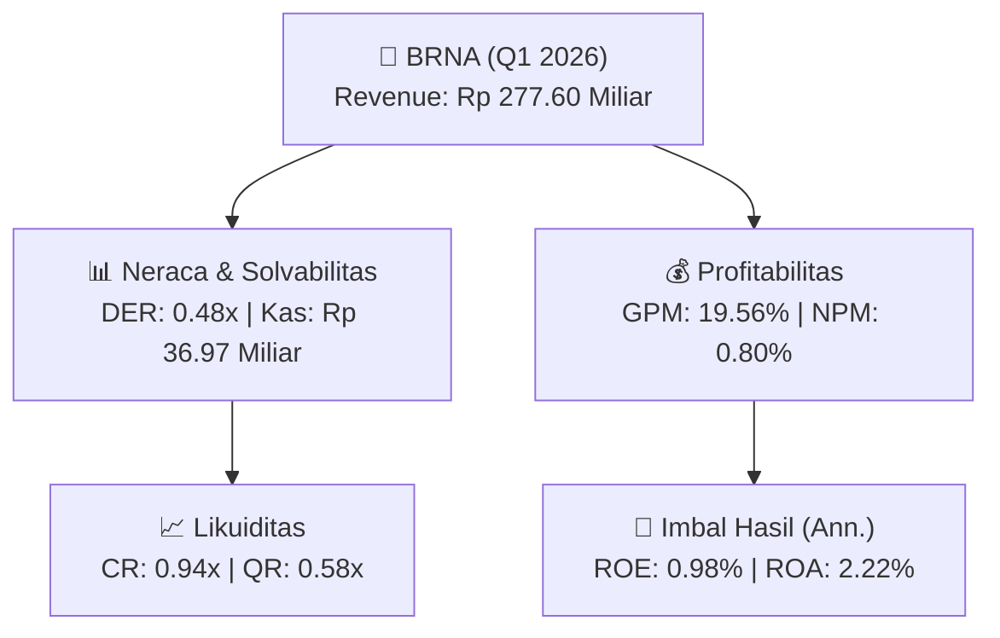

# 📈 Laporan Keuangan Interim: [[BRNA]] — Q1 2026

📅 **2026-10-02** | 🎛️ [[Dashboard|Ke Dashboard Utama]]

> [!NOTE]
> Laporan interim ringkas **Berlina Tbk ([[BRNA]])** — Sektor: General.

---

## 📌 1. Ikhtisar Kinerja Utama / Executive Performance Highlight
- **Emiten**: `[[BRNA]]` (Berlina Tbk)
- **Sektor Usaha / Industry Sector**: `General`
- **Periode Laporan / Reporting Period**: `Q1 2026`
- **Pendapatan Neto / Net Revenue**: `Rp 277.60 Miliar` (**+0.54% 🟢 YoY** dari Rp 276.12 Miliar)
- **Laba Bruto / Gross Profit**: `Rp 54.30 Miliar` (**+5.21% 🟢 YoY**)
- **Laba (Rugi) Bersih / Net Income**: `Rp 2.22 Miliar` (**-74.11% 🔴 YoY**)
- **Total Aset / Total Assets**: `Rp 412.26 Miliar` | **Total Ekuitas / Total Equity**: `Rp 910.05 Miliar`
- **EPS (Annualized)**: `0.18` | **BVPS**: `18.59`

---

## 📊 2. Laba Rugi Komparatif / Comparative Income Statement

| Pos Laba Rugi / Income Statement Item | Q1 2026 | Prior Period | YoY (%) |
| :--- | ---: | ---: | :---: |
| **Pendapatan Neto / Net Revenue** | `277.60B` | `276.12B` | **+0.54% 🟢** |
| **Beban Pokok / COGS** | `(223.30B)` | `(224.50B)` | -0.54% 🔴 |
| **Laba Bruto / Gross Profit** | `54.30B` | `51.61B` | **+5.21% 🟢** |
| **Beban Usaha / Operating Expenses** | `(12.23B)` | `(10.82B)` | +12.99% 🟢 |
| **Laba Operasional / EBIT** | `4.83B` | `9.75B` | -50.43% 🔴 |
| **Laba (Rugi) Bersih / Net Income** | **2.22B** | **8.59B** | **-74.11% 🔴** |

---

## 🏦 3. Neraca & Struktur Permodalan / Balance Sheet & Capital Structure

| Pos Neraca / Balance Sheet Item | Q1 2026 | Prior Year End | Δ YoY/YtD (%) | Catatan / Notes |
| :--- | ---: | ---: | :---: | :--- |
| **Aset Lancar / Current Assets** | `412.26B` | `390.19B` | +5.66% 🟢 | Kas: Rp 36.97 Miliar |
| **Aset Tidak Lancar / Non-Current Assets** | `1.85T` | `1.86T` | -0.66% 🔴 | Aset Tetap & Operasional |
| **TOTAL ASET / TOTAL ASSETS** | **412.26B** | **390.19B** | **+5.66% 🟢** | |
| **Liabilitas Jk. Pendek / Current Liabilities** | `438.82B` | `412.89B` | +6.28% 🟢 | |
| **Liabilitas Jk. Panjang / Non-Current Liabilities** | `802.53B` | `825.01B` | -2.73% 🔴 | |
| **TOTAL LIABILITAS / TOTAL LIABILITIES** | **438.82B** | **412.89B** | **+6.28% 🟢** | |
| **TOTAL EKUITAS / TOTAL EQUITY** | **910.05B** | **905.63B** | **+0.49% 🟢** | |

---

## 📈 Analisis Rasio Keuangan / Financial Ratio Analysis

| Kategori / Category | Metrik / Metric | Nilai / Value | Benchmark | Interpretasi / Interpretation |
| :--- | :--- | :---: | :---: | :--- |
| **🛡️ Likuiditas** | **Current Ratio** | `0.94x` | `> 1.0x` | Kemampuan bayar kewajiban jk. pendek |
| | **Quick Ratio** | `0.58x` | `> 0.8x` | Likuiditas tanpa persediaan |
| **📊 Profitabilitas** | **Gross Profit Margin (GPM)** | `19.56%` | - | Margin kotor operasional inti |
| | **Operating Profit Margin (OPM)** | `1.74%` | - | Efisiensi operasional |
| | **Net Profit Margin (NPM)** | `0.80%` | - | Konversi revenue ke laba bersih |
| **🎯 Imbal Hasil (Ann.)** | **Return on Equity (ROE)** | `0.98%` | - | Imbal hasil terhadap ekuitas |
| | **Return on Assets (ROA)** | `2.22%` | - | Produktivitas aset |
| **⚖️ Solvabilitas** | **Debt to Equity (DER)** | `0.48x` | `< 2.0x` | Leverage utang vs modal |
| | **Debt to Asset (DAR)** | `1.06x` | `< 0.7x` | Porsi aset didanai utang |

---

## 🔗 Hubungan Note Terkait / Knowledge Graph Links
- [[knowledge-base/daily-digests/Daily_Digest_20261002|📄 Daily Digest 2026-10-02]]
- [[knowledge-base/trading-signals/Trading_Signals_20261002|🎯 Trading Signals]]
- [[Dashboard|🎛️ Kembali ke Dashboard Utama]]