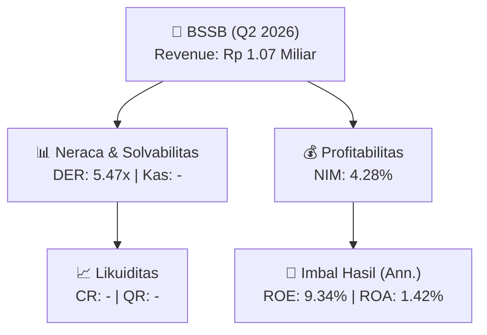
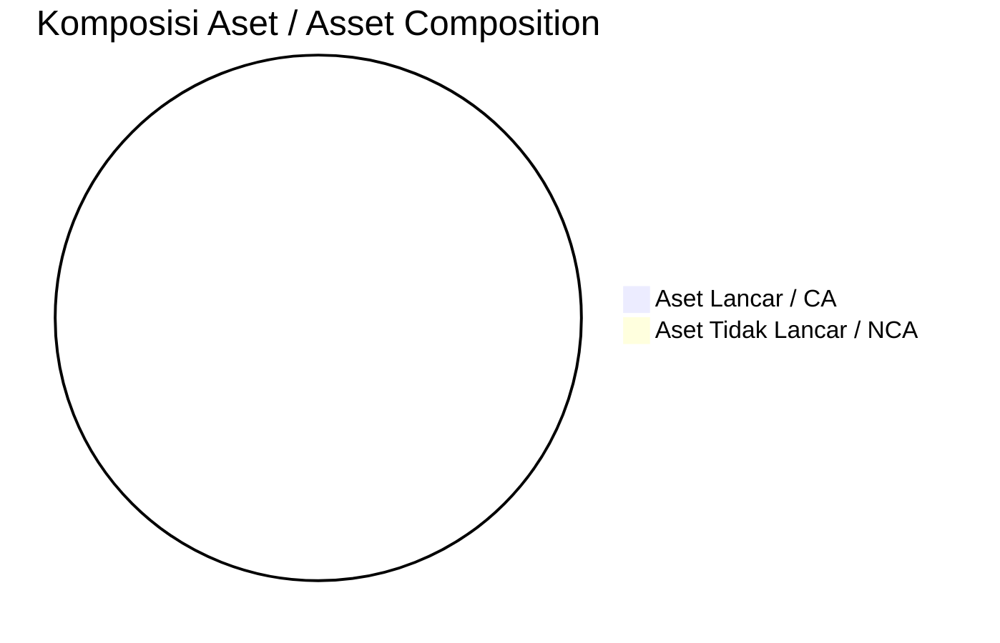
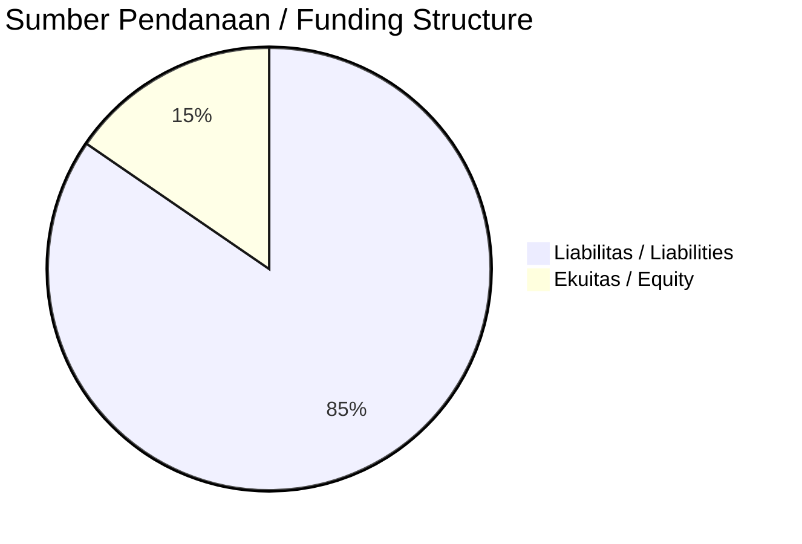

# 📈 Laporan Analisis Keuangan Mendalam: [[BSSB]] — Q2 2026

⬅️ [[knowledge-base/daily-digests/Daily_Digest_20261002|Kembali ke Daily Digest]] | 📅 **2026-10-02** | 🎛️ [[Dashboard|Ke Dashboard Utama]]

> [!IMPORTANT]
> Dokumen ini disusun oleh **Financial Summarizer Agent** untuk menganalisis kinerja keuangan, kesehatan neraca, profitabilitas, dan katalis sektor (Multifinance & Perbankan) **PT BPD Sulawesi Selatan Dan Sulawesi Barat ([[BSSB]])** berdasarkan LK Q2 2026.

---

## 📌 1. Ikhtisar Kinerja Utama / Executive Performance Highlight
- **Emiten**: `[[BSSB]]` (PT BPD Sulawesi Selatan Dan Sulawesi Barat)
- **Sektor Usaha / Industry Sector**: `Multifinance & Perbankan`
- **Periode Laporan / Reporting Period**: `Q2 2026`
- **Pendapatan Usaha / Total Revenue**: `Rp 1.07 Miliar` (**+1623.12% 🟢 YoY** dari Rp 62.23 Juta)
- **Pendapatan Bunga / Interest Income**: `Rp 1.24 Triliun`
- **Laba (Rugi) Bersih / Net Income**: `Rp 241.44 Miliar` (**-2.46% 🔴 YoY**)
- **Total Aset / Total Assets**: `Rp 34.83 Triliun` | **Total Ekuitas / Total Equity**: `Rp 5.06 Triliun`
- **EPS (Annualized)**: `0.22` | **BVPS**: `2.28`

---

## 📊 2. Laba Rugi Komparatif / Comparative Income Statement (Financial Sector)

| Pos Laba Rugi / Income Statement Item | Q2 2026 | Prior Period | YoY (%) |
| :--- | ---: | ---: | :---: |
| **Pendapatan Bunga / Interest Income** | `1.24T` | `1.32T` | -6.02% 🔴 |
| **Beban Bunga / Interest Expense** | `(499.12B)` | `(551.69B)` | -9.53% 🔴 |
| **Jumlah Pendapatan Usaha / Total Revenue** | `1.07B` | `62.23M` | +1623.12% 🟢 |
| **Pencadangan / Provision (PPAP)** | `(96.54B)` | `(95.75B)` | +0.82% 🟢 |
| **Beban Operasional / Operating Expenses** | `(468.08B)` | `(453.14B)` | +3.30% 🟢 |
| **Laba Sebelum Pajak / Profit Before Tax** | `314.13B` | `322.41B` | -2.57% 🔴 |
| **Laba (Rugi) Bersih / Net Income** | **241.44B** | **247.52B** | **-2.46% 🔴** |

---

## 🏦 3. Neraca & Struktur Permodalan / Balance Sheet & Capital Structure

| Pos Neraca / Balance Sheet Item | Q2 2026 | Prior Year End | Δ YoY/YtD (%) | Catatan / Notes |
| :--- | ---: | ---: | :---: | :--- |
| **Aset Lancar / Current Assets** | `-` | `-` | - | Kas: - |
| **Aset Tidak Lancar / Non-Current Assets** | `-` | `-` | - | Aset Tetap & Operasional |
| **TOTAL ASET / TOTAL ASSETS** | **34.83T** | **33.26T** | **+4.69% 🟢** | |
| **Liabilitas Jk. Pendek / Current Liabilities** | `-` | `-` | - | |
| **Liabilitas Jk. Panjang / Non-Current Liabilities** | `-` | `-` | - | |
| **TOTAL LIABILITAS / TOTAL LIABILITIES** | **27.68T** | **26.66T** | **+3.83% 🟢** | |
| **TOTAL EKUITAS / TOTAL EQUITY** | **5.06T** | **5.28T** | **-4.12% 🔴** | |

---

## 💸 4. Laporan Arus Kas / Cash Flow Statement

| Komponen Arus Kas / Cash Flow Component | Q2 2026 | Prior Period | Δ YoY (%) |
| :--- | ---: | ---: | :---: |
| **Arus Kas Operasi / CFO** | `3.77T` | `209.71B` | +1695.34% 🟢 |
| **Arus Kas Investasi / CFI** | `993.74B` | `-125.56B` | +891.43% 🟢 |
| **Arus Kas Pendanaan / CFF** | `-650.26B` | `-342.70B` | -89.75% 🔴 |
| **Kenaikan (Penurunan) Kas Bersih** | `4.11T` | `-258.55B` | +1689.07% 🟢 |
| Belanja Modal / Capex | `(-)` | `(-)` | - |
| Pembayaran Dividen / Dividends Paid | `(456.77B)` | `(428.33B)` | +6.64% 🟢 |
| **Free Cash Flow (CFO - Capex)** | **-** | **-** | **-** |

---

## 📈 Analisis Rasio Keuangan / Financial Ratio Analysis

| Kategori / Category | Metrik / Metric | Nilai / Value | Benchmark | Interpretasi / Interpretation |
| :--- | :--- | :---: | :---: | :--- |
| **🛡️ Likuiditas** | **Current Ratio** | `-` | `> 1.0x` | Kemampuan bayar kewajiban jk. pendek |
| | **Quick Ratio** | `-` | `> 0.8x` | Likuiditas tanpa persediaan |
| **📊 Profitabilitas** | **Net Interest Margin (NIM)** | `4.28%` | `> 3.0%` | Spread pendapatan bunga bersih |
| | **BOPO / Cost-to-Income Ratio** | `43648.41%` | `< 80%` | Efisiensi biaya operasional |
| **🎯 Imbal Hasil (Ann.)** | **Return on Equity (ROE)** | `9.34%` | - | Imbal hasil terhadap ekuitas |
| | **Return on Assets (ROA)** | `1.42%` | - | Produktivitas aset |
| **⚖️ Solvabilitas** | **Debt to Equity (DER)** | `5.47x` | `< 2.0x` | Leverage utang vs modal |
| | **Debt to Asset (DAR)** | `0.79x` | `< 0.7x` | Porsi aset didanai utang |

---

## 📐 Per Share Metrics

| Metrik / Metric | Nilai / Value | Keterangan / Notes |
| :--- | ---: | :--- |
| **EPS (Annualized)** | `Rp 0.22` | Laba per saham (dianualisasi) |
| **BVPS** | `Rp 2.28` | Nilai buku per saham |

---

## 🚀 Analisis Strategis & Karakteristik Sektor / Strategic Analysis: Multifinance & Perbankan

Pada periode Q2 2026, **PT BPD Sulawesi Selatan Dan Sulawesi Barat ([[BSSB]])** membukukan total pendapatan sebesar **Rp 1.07 Miliar** (+1623.12% 🟢 YoY). Laba bersih sebesar **Rp 241.44 Miliar** (-2.46% 🔴 YoY). Total aset **Rp 34.83 Triliun**, ekuitas **Rp 5.06 Triliun**, DER **5.47x**.

### 🔍 Indikator Kunci Sektor / Sector Key Indicators (Multifinance & Perbankan)
- **Karakteristik Industri Finansial / Financial Industry**: Kinerja ditopang oleh spread pendapatan bunga (NIM), hasil investasi, dan pengelolaan Cost of Funds.
- **Kualitas Aset / Asset Quality**: Pengawasan rasio NPL/NPF dan kecukupan pencadangan (PPAP) untuk menjaga stabilitas margin usaha.
- **Solvabilitas / Solvency**: Rasio kecukupan modal (CAR/RBC) ketat sesuai regulasi OJK.

> [!NOTE]
> _Data Public Expose / Investor Presentation belum tersedia untuk emiten ini._

---

## 📋 Catatan Kunci Laporan Keuangan / Key Notes to Financial Statements

### 🔍 Opini Auditor / Auditor Opinion
- **Jenis Opini / Opinion Type**: `Wajar Tanpa Modifikasian / Unqualified`
- **KAP / Audit Firm**: `KAP Hendrawinata Hanny Erwin  Sumargo`
- **Partner Audit**: `Zulbadri`
- **Tanggal Laporan / Report Date**: `2026-09-28`

---

## 💡 Catatan Strategis & Panduan Investor / Strategic Notes & Investor Guide

1. **Kesehatan Permodalan / Capital Health**: DER **5.47x**, CR **-** — _perlu dipantau secara disiplin_.
2. **Katalis Pertumbuhan / Growth Catalysts**: Pantau realisasi pendapatan dan efisiensi operasional periode berikutnya.
3. **Kualitas Aset Finansial**: Pantau tren NIM (**4.28%**) dan kualitas portofolio kredit/pembiayaan.

---

## 🔗 Hubungan Note Terkait / Knowledge Graph Links
- [[knowledge-base/daily-digests/Daily_Digest_20261002|📄 Daily Digest 2026-10-02]]
- [[knowledge-base/trading-signals/Trading_Signals_20261002|🎯 Trading Signals]]
- [[Dashboard|🎛️ Kembali ke Dashboard Utama]]