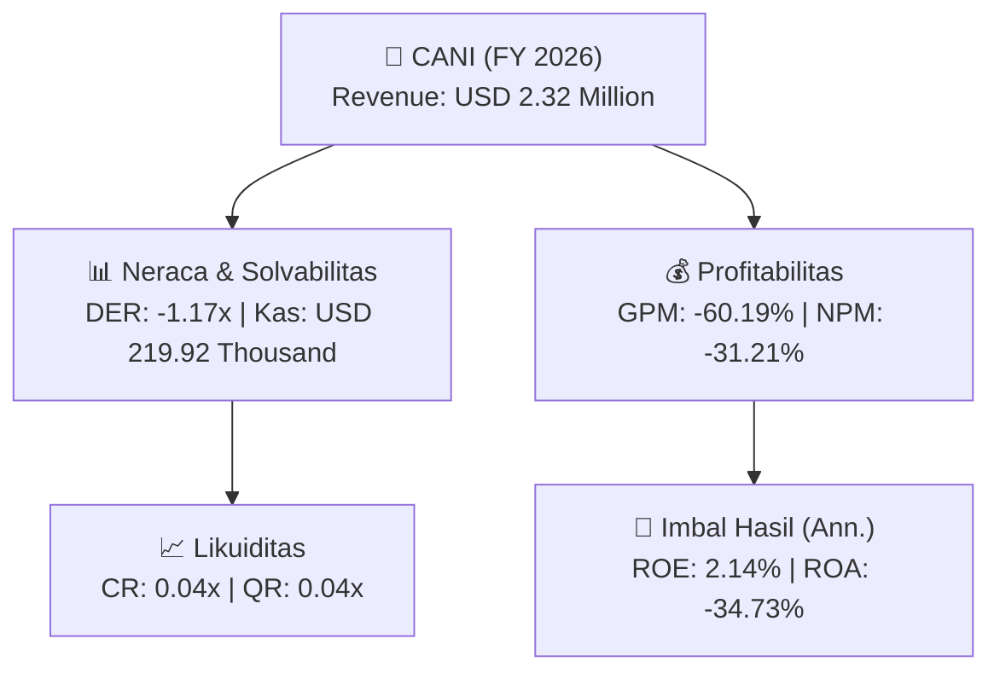
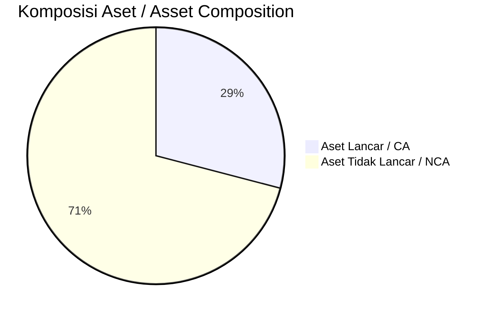
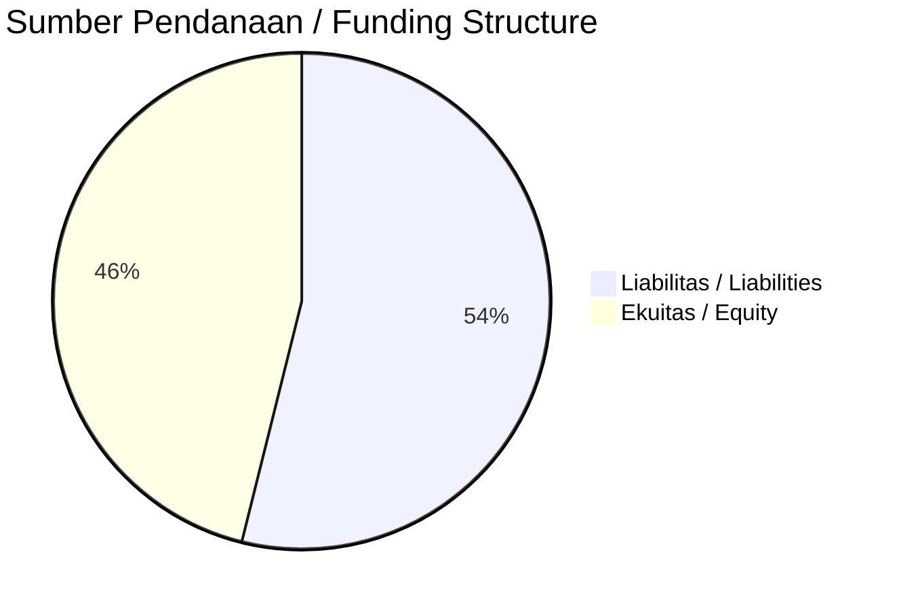

# 📈 Laporan Analisis Keuangan Tahunan Komprehensif: [[CANI]] — FY 2026

⬅️ [[knowledge-base/daily-digests/Daily_Digest_20261001|Kembali ke Daily Digest]] | 📅 **2026-10-01** | 🎛️ [[Dashboard|Ke Dashboard Utama]]

> [!IMPORTANT]
> Dokumen ini disusun oleh **Financial Summarizer Agent** untuk menganalisis kinerja keuangan, kesehatan neraca, profitabilitas, dan katalis sektor (Energi & Utilitas) **PT Capitol Nusantara Indonesia Tbk. ([[CANI]])** berdasarkan LK FY 2026.

---

## 📌 1. Ikhtisar Kinerja Utama / Executive Performance Highlight
- **Emiten**: `[[CANI]]` (PT Capitol Nusantara Indonesia Tbk.)
- **Sektor Usaha / Industry Sector**: `Energi & Utilitas`
- **Periode Laporan / Reporting Period**: `FY 2026`
- **Pendapatan Neto / Net Revenue**: `USD 2.32 Million` (**-29.83% 🔴 YoY** dari USD 3.31 Million)
- **Laba Bruto / Gross Profit**: `USD -1.40 Million` (**+20.65% 🟢 YoY**)
- **Laba (Rugi) Bersih / Net Income**: `USD -724.00 Thousand` (**+68.18% 🟢 YoY**)
- **Total Aset / Total Assets**: `USD 1.71 Million` | **Total Ekuitas / Total Equity**: `USD -34.25 Million`
- **EPS (Annualized)**: `-0.09` | **BVPS**: `-4.07`

---

## 📊 2. Laba Rugi Komparatif / Comparative Income Statement

| Pos Laba Rugi / Income Statement Item | FY 2026 | Prior Period | YoY (%) |
| :--- | ---: | ---: | :---: |
| **Pendapatan Neto / Net Revenue** | `2.32M` | `3.31M` | **-29.83% 🔴** |
| **Beban Pokok / COGS** | `(3.72M)` | `(5.07M)` | -26.64% 🔴 |
| **Laba Bruto / Gross Profit** | `-1.40M` | `-1.76M` | **+20.65% 🟢** |
| **Beban Usaha / Operating Expenses** | `(796.67K)` | `(506.83K)` | +57.19% 🟢 |
| **Laba Operasional / EBIT** | `-533.34K` | `-2.25M` | +76.28% 🟢 |
| **Laba (Rugi) Bersih / Net Income** | **-724.00K** | **-2.28M** | **+68.18% 🟢** |

---

## 🏦 3. Neraca & Struktur Permodalan / Balance Sheet & Capital Structure

| Pos Neraca / Balance Sheet Item | FY 2026 | Prior Year End | Δ YoY/YtD (%) | Catatan / Notes |
| :--- | ---: | ---: | :---: | :--- |
| **Aset Lancar / Current Assets** | `1.71M` | `2.46M` | -30.36% 🔴 | Kas: USD 219.92 Thousand |
| **Aset Tidak Lancar / Non-Current Assets** | `4.18M` | `6.61M` | -36.78% 🔴 | Aset Tetap & Operasional |
| **TOTAL ASET / TOTAL ASSETS** | **1.71M** | **2.46M** | **-30.36% 🔴** | |
| **Liabilitas Jk. Pendek / Current Liabilities** | `40.01M` | `42.47M` | -5.78% 🔴 | |
| **Liabilitas Jk. Panjang / Non-Current Liabilities** | `122.03K` | `121.70K` | +0.27% 🟢 | |
| **TOTAL LIABILITAS / TOTAL LIABILITIES** | **40.01M** | **42.47M** | **-5.78% 🔴** | |
| **TOTAL EKUITAS / TOTAL EQUITY** | **-34.25M** | **-33.53M** | **-2.15% 🔴** | |

---

## 💸 4. Laporan Arus Kas / Cash Flow Statement

| Komponen Arus Kas / Cash Flow Component | FY 2026 | Prior Period | Δ YoY (%) |
| :--- | ---: | ---: | :---: |
| **Arus Kas Operasi / CFO** | `805.17K` | `84.53K` | +852.50% 🟢 |
| **Arus Kas Investasi / CFI** | `1.70M` | `-` | - |
| **Arus Kas Pendanaan / CFF** | `-2.79M` | `-252.60K` | -1003.97% 🔴 |
| **Kenaikan (Penurunan) Kas Bersih** | `-283.93K` | `-168.07K` | -68.94% 🔴 |
| Belanja Modal / Capex | `(416.00)` | `(-)` | - |
| Pembayaran Dividen / Dividends Paid | `(-)` | `(-)` | - |
| **Free Cash Flow (CFO - Capex)** | **804.76K** | **-** | **-** |

---

## 📈 Analisis Rasio Keuangan / Financial Ratio Analysis

| Kategori / Category | Metrik / Metric | Nilai / Value | Benchmark | Interpretasi / Interpretation |
| :--- | :--- | :---: | :---: | :--- |
| **🛡️ Likuiditas** | **Current Ratio** | `0.04x` | `> 1.0x` | Kemampuan bayar kewajiban jk. pendek |
| | **Quick Ratio** | `0.04x` | `> 0.8x` | Likuiditas tanpa persediaan |
| **📊 Profitabilitas** | **Gross Profit Margin (GPM)** | `-60.19%` | - | Margin kotor operasional inti |
| | **Operating Profit Margin (OPM)** | `-22.99%` | - | Efisiensi operasional |
| | **Net Profit Margin (NPM)** | `-31.21%` | - | Konversi revenue ke laba bersih |
| **🎯 Imbal Hasil (Ann.)** | **Return on Equity (ROE)** | `2.14%` | - | Imbal hasil terhadap ekuitas |
| | **Return on Assets (ROA)** | `-34.73%` | - | Produktivitas aset |
| **⚖️ Solvabilitas** | **Debt to Equity (DER)** | `-1.17x` | `< 2.0x` | Leverage utang vs modal |
| | **Debt to Asset (DAR)** | `23.38x` | `< 0.7x` | Porsi aset didanai utang |

---

## 📐 Per Share Metrics

| Metrik / Metric | Nilai / Value | Keterangan / Notes |
| :--- | ---: | :--- |
| **EPS (Annualized)** | `USD -0.09` | Laba per saham (dianualisasi) |
| **BVPS** | `USD -4.07` | Nilai buku per saham |

---

## 🚀 Analisis Strategis & Karakteristik Sektor / Strategic Analysis: Energi & Utilitas

Pada periode FY 2026, **PT Capitol Nusantara Indonesia Tbk. ([[CANI]])** membukukan total pendapatan sebesar **USD 2.32 Million** (-29.83% 🔴 YoY). Laba kotor tercatat **USD -1.40 Million** dengan GPM **-60.19%**. Laba bersih sebesar **USD -724.00 Thousand** (+68.18% 🟢 YoY). Total aset **USD 1.71 Million**, ekuitas **USD -34.25 Million**, DER **-1.17x**.

### 🔍 Indikator Kunci Sektor / Sector Key Indicators (Energi & Utilitas)
- **Karakteristik Industri Tambang & Komoditas / Mining & Commodity**: Kinerja dipengaruhi oleh Average Selling Price (ASP), volume produksi/pengapalan, dan efisiensi Cash Cost per ton.
- **Profil Arus Kas / Cash Flow Profile**: Arus kas operasional yang solid menopang dividen berkala dan ekspansi hilirisasi / transisi energi.
- **Regulasi & ESG**: Kewajiban reklamasi, royalti pemerintah, dan komitmen keberlanjutan.

> [!NOTE]
> _Data Public Expose / Investor Presentation belum tersedia untuk emiten ini._

---

## 📋 Catatan Kunci Laporan Keuangan / Key Notes to Financial Statements

### 🔍 Opini Auditor / Auditor Opinion
- **Jenis Opini / Opinion Type**: `Tidak Memberikan Pendapat / Disclaimer`
- **KAP / Audit Firm**: `KAP Irwanto dan Rekan`
- **Partner Audit**: `Rudi Riady`
- **Tanggal Laporan / Report Date**: `2026-09-28`

### 🤝 Transaksi Pihak Berelasi / Related Party Transactions
- Utang non-usaha kepada pihak berelasi per 30 Juni 2026: PT ASL Shipyard Indonesia USD 11.147.947; PT Agus Suta Line USD 9.714.907; PT Cipta Nusantara Abadi USD 5.286.022; ASL Triaksa Offshore Pte. Ltd. USD 3.523.471; ASL Shipyard Pte. Ltd. USD 2.107.441; Lightmode Pte. Ltd. USD 2.042.735; ASL Marine Holding Ltd. USD 1.931.078; dan pihak berelasi lainnya (daftar terpotong).

---

## 💡 Catatan Strategis & Panduan Investor / Strategic Notes & Investor Guide

1. **Kesehatan Permodalan / Capital Health**: DER **-1.17x**, CR **0.04x** — _perlu dipantau secara disiplin_.
2. **Katalis Pertumbuhan / Growth Catalysts**: Pantau realisasi pendapatan dan efisiensi operasional periode berikutnya.

---

## 📊 Trend Multi-Tahun / Multi-Year Trend

> [!NOTE]
> _Tabel trend multi-tahun (3 tahun) akan tersedia setelah data historis FY sebelumnya diproses._

---
## 🔗 Hubungan Note Terkait / Knowledge Graph Links
- [[knowledge-base/daily-digests/Daily_Digest_20261001|📄 Daily Digest 2026-10-01]]
- [[knowledge-base/trading-signals/Trading_Signals_20261001|🎯 Trading Signals]]
- [[Dashboard|🎛️ Kembali ke Dashboard Utama]]