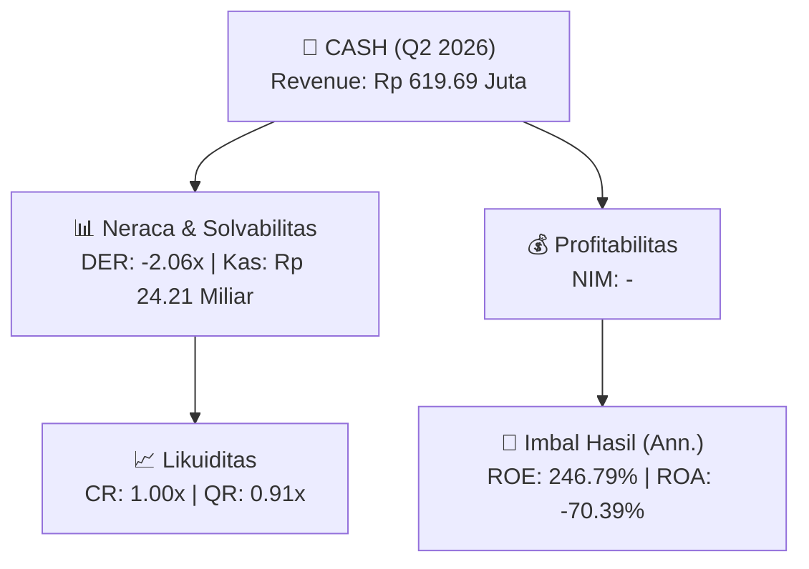
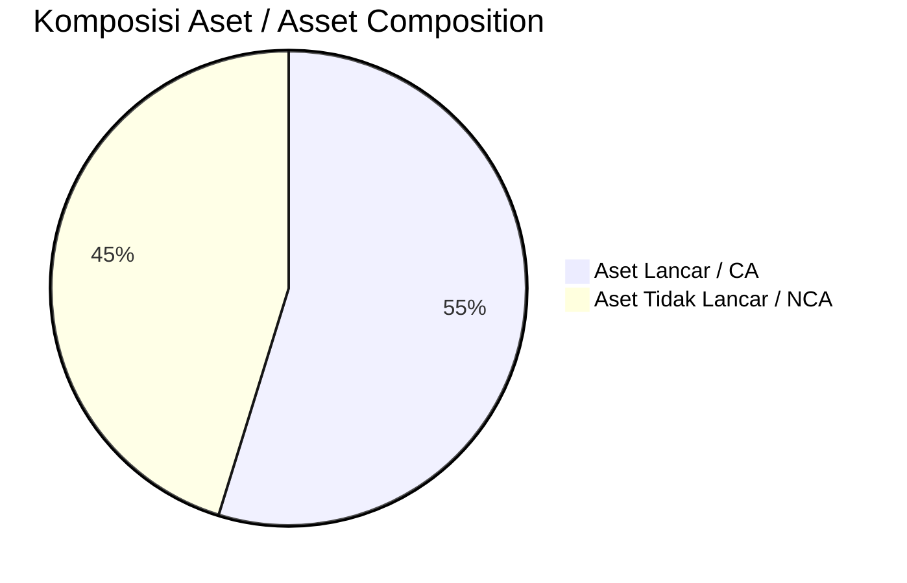
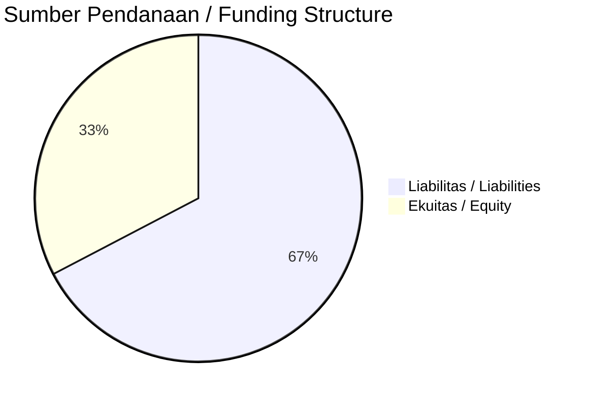

# 📈 Laporan Analisis Keuangan Mendalam: [[CASH]] — Q2 2026

⬅️ [[knowledge-base/daily-digests/Daily_Digest_20260901|Kembali ke Daily Digest]] | 📅 **2026-09-01** | 🎛️ [[Dashboard|Ke Dashboard Utama]]

> [!IMPORTANT]
> Dokumen ini disusun oleh **Financial Summarizer Agent** untuk menganalisis kinerja keuangan, kesehatan neraca, profitabilitas, dan katalis sektor (Multifinance & Perbankan) **PT Cashlez Worldwide Indonesia Tbk. ([[CASH]])** berdasarkan LK Q2 2026.

---

## 📌 1. Ikhtisar Kinerja Utama / Executive Performance Highlight
- **Emiten**: `[[CASH]]` (PT Cashlez Worldwide Indonesia Tbk.)
- **Sektor Usaha / Industry Sector**: `Multifinance & Perbankan`
- **Periode Laporan / Reporting Period**: `Q2 2026`
- **Pendapatan Usaha / Total Revenue**: `Rp 619.69 Juta` (**+808.02% 🟢 YoY** dari Rp 68.25 Juta)

- **Laba (Rugi) Bersih / Net Income**: `Rp -39.32 Miliar` (**-149.81% 🔴 YoY**)
- **Total Aset / Total Assets**: `Rp 105.61 Miliar` | **Total Ekuitas / Total Equity**: `Rp -51.24 Miliar`
- **EPS (Annualized)**: `-4.58` | **BVPS**: `-2.98`

---

## 📊 2. Laba Rugi Komparatif / Comparative Income Statement (Financial Sector)

| Pos Laba Rugi / Income Statement Item | Q2 2026 | Prior Period | YoY (%) |
| :--- | ---: | ---: | :---: |
| **Beban Bunga / Interest Expense** | `(7.15B)` | `(4.83B)` | +48.20% 🟢 |
| **Jumlah Pendapatan Usaha / Total Revenue** | `619.69M` | `68.25M` | +808.02% 🟢 |
| **Beban Operasional / Operating Expenses** | `(35.27B)` | `(25.15B)` | +40.23% 🟢 |
| **Laba Sebelum Pajak / Profit Before Tax** | `-24.53B` | `-15.13B` | -62.20% 🔴 |
| **Laba (Rugi) Bersih / Net Income** | **-39.32B** | **-15.74B** | **-149.81% 🔴** |

---

## 🏦 3. Neraca & Struktur Permodalan / Balance Sheet & Capital Structure

| Pos Neraca / Balance Sheet Item | Q2 2026 | Prior Year End | Δ YoY/YtD (%) | Catatan / Notes |
| :--- | ---: | ---: | :---: | :--- |
| **Aset Lancar / Current Assets** | `105.61B` | `117.84B` | -10.37% 🔴 | Kas: Rp 24.21 Miliar |
| **Aset Tidak Lancar / Non-Current Assets** | `87.26B` | `91.31B` | -4.44% 🔴 | Aset Tetap & Operasional |
| **TOTAL ASET / TOTAL ASSETS** | **105.61B** | **117.84B** | **-10.37% 🔴** | |
| **Liabilitas Jk. Pendek / Current Liabilities** | `105.57B` | `116.63B` | -9.48% 🔴 | |
| **Liabilitas Jk. Panjang / Non-Current Liabilities** | `124.91B` | `92.96B` | +34.37% 🟢 | |
| **TOTAL LIABILITAS / TOTAL LIABILITIES** | **105.57B** | **116.63B** | **-9.48% 🔴** | |
| **TOTAL EKUITAS / TOTAL EQUITY** | **-51.24B** | **-12.48B** | **-310.46% 🔴** | |

---

## 💸 4. Laporan Arus Kas / Cash Flow Statement

| Komponen Arus Kas / Cash Flow Component | Q2 2026 | Prior Period | Δ YoY (%) |
| :--- | ---: | ---: | :---: |
| **Arus Kas Operasi / CFO** | `-63.42B` | `-11.76B` | -439.52% 🔴 |
| **Arus Kas Investasi / CFI** | `-2.83B` | `-4.96B` | +43.01% 🟢 |
| **Arus Kas Pendanaan / CFF** | `18.44B` | `17.57B` | +4.96% 🟢 |
| **Kenaikan (Penurunan) Kas Bersih** | `-47.81B` | `853.09M` | -5704.05% 🔴 |
| Belanja Modal / Capex | `(1.80B)` | `(3.08B)` | -41.62% 🔴 |
| Pembayaran Dividen / Dividends Paid | `(-)` | `(-)` | - |
| **Free Cash Flow (CFO - Capex)** | **-65.22B** | **-14.84B** | **-339.55% 🔴** |

---

## 📈 Analisis Rasio Keuangan / Financial Ratio Analysis

| Kategori / Category | Metrik / Metric | Nilai / Value | Benchmark | Interpretasi / Interpretation |
| :--- | :--- | :---: | :---: | :--- |
| **🛡️ Likuiditas** | **Current Ratio** | `1.00x` | `> 1.0x` | Kemampuan bayar kewajiban jk. pendek |
| | **Quick Ratio** | `0.91x` | `> 0.8x` | Likuiditas tanpa persediaan |
| | **BOPO / Cost-to-Income Ratio** | `5691.26%` | `< 80%` | Efisiensi biaya operasional |
| **🎯 Imbal Hasil (Ann.)** | **Return on Equity (ROE)** | `246.79%` | - | Imbal hasil terhadap ekuitas |
| | **Return on Assets (ROA)** | `-70.39%` | - | Produktivitas aset |
| **⚖️ Solvabilitas** | **Debt to Equity (DER)** | `-2.06x` | `< 2.0x` | Leverage utang vs modal |
| | **Debt to Asset (DAR)** | `1.00x` | `< 0.7x` | Porsi aset didanai utang |

---

## 📐 Per Share Metrics

| Metrik / Metric | Nilai / Value | Keterangan / Notes |
| :--- | ---: | :--- |
| **EPS (Annualized)** | `Rp -4.58` | Laba per saham (dianualisasi) |
| **BVPS** | `Rp -2.98` | Nilai buku per saham |

---

## 🚀 Analisis Strategis & Karakteristik Sektor / Strategic Analysis: Multifinance & Perbankan

Pada periode Q2 2026, **PT Cashlez Worldwide Indonesia Tbk. ([[CASH]])** membukukan total pendapatan sebesar **Rp 619.69 Juta** (+808.02% 🟢 YoY). Laba bersih sebesar **Rp -39.32 Miliar** (-149.81% 🔴 YoY). Total aset **Rp 105.61 Miliar**, ekuitas **Rp -51.24 Miliar**, DER **-2.06x**.

### 🔍 Indikator Kunci Sektor / Sector Key Indicators (Multifinance & Perbankan)
- **Karakteristik Industri Finansial / Financial Industry**: Kinerja ditopang oleh spread pendapatan bunga (NIM), hasil investasi, dan pengelolaan Cost of Funds.
- **Kualitas Aset / Asset Quality**: Pengawasan rasio NPL/NPF dan kecukupan pencadangan (PPAP) untuk menjaga stabilitas margin usaha.
- **Solvabilitas / Solvency**: Rasio kecukupan modal (CAR/RBC) ketat sesuai regulasi OJK.

> [!NOTE]
> _Data Public Expose / Investor Presentation belum tersedia untuk emiten ini._

---

## 📋 Catatan Kunci Laporan Keuangan / Key Notes to Financial Statements

### 🔍 Opini Auditor / Auditor Opinion
- **Jenis Opini / Opinion Type**: `Reviu Terbatas / Limited Review`
- **KAP / Audit Firm**: `KAP Paul Hadiwinata, Hidajat, Arsono, Retno, Palilingan  Rekan`
- **Partner Audit**: `Heri Setianto`
- **Tanggal Laporan / Report Date**: `2026-08-27`

### 📝 Perjanjian & Kontrak Signifikan / Key Contracts & Agreements
- Perusahaan mengadakan perjanjian No. 01/PKS-CZ/LGL/I/2025 tanggal 3 Januari 2025 (rincian perjanjian tidak lengkap dalam teks).

### ⏩ Peristiwa Setelah Tanggal Pelaporan / Subsequent Events
- Rencana Penawaran Umum Terbatas I (PUT I) Dengan Hak Memesan Efek Terlebih Dahulu (HMETD) yang terjadi setelah tanggal pelaporan; penerbitan kembali laporan keuangan untuk mencerminkan pengungkapan tambahan terkait rencana tersebut.

### 🤝 Transaksi Pihak Berelasi / Related Party Transactions
- Terdapat transaksi pihak berelasi, antara lain bunga pinjaman pihak berelasi (Catatan 18) dan piutang lain-lain pihak berelasi (Catatan 7, Catatan 35).

---

## 💡 Catatan Strategis & Panduan Investor / Strategic Notes & Investor Guide

1. **Kesehatan Permodalan / Capital Health**: DER **-2.06x**, CR **1.00x** — _perlu dipantau secara disiplin_.
2. **Katalis Pertumbuhan / Growth Catalysts**: Pantau realisasi pendapatan dan efisiensi operasional periode berikutnya.
3. **Kualitas Aset Finansial**: Pantau tren NIM (**-**) dan kualitas portofolio kredit/pembiayaan.

---

## 🔗 Hubungan Note Terkait / Knowledge Graph Links
- [[knowledge-base/daily-digests/Daily_Digest_20260901|📄 Daily Digest 2026-09-01]]
- [[knowledge-base/trading-signals/Trading_Signals_20260901|🎯 Trading Signals]]
- [[Dashboard|🎛️ Kembali ke Dashboard Utama]]