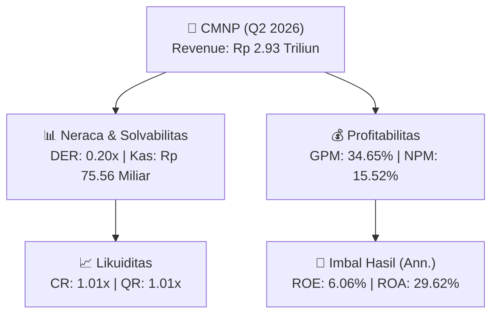
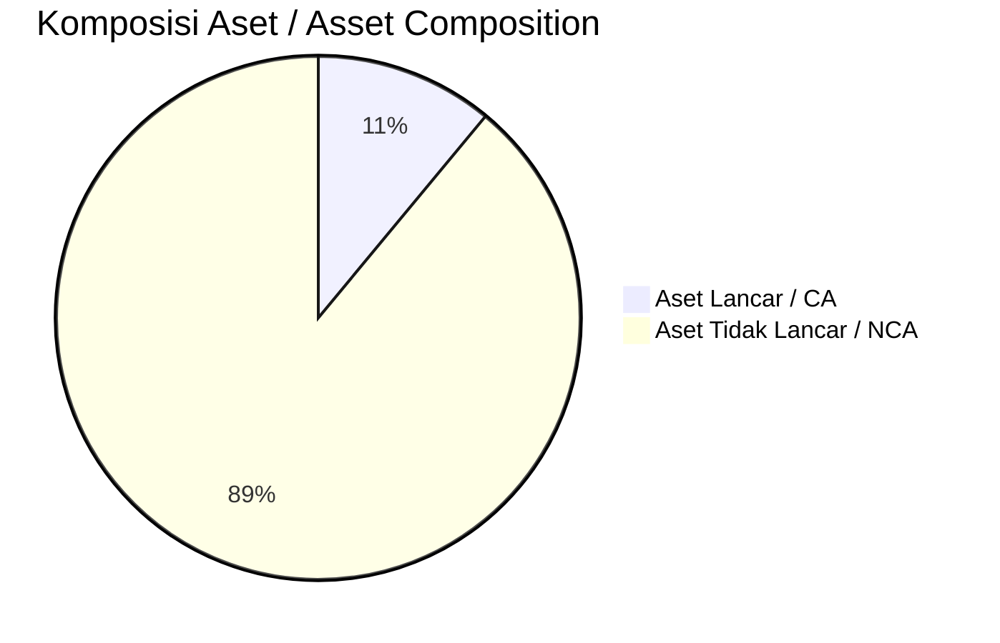
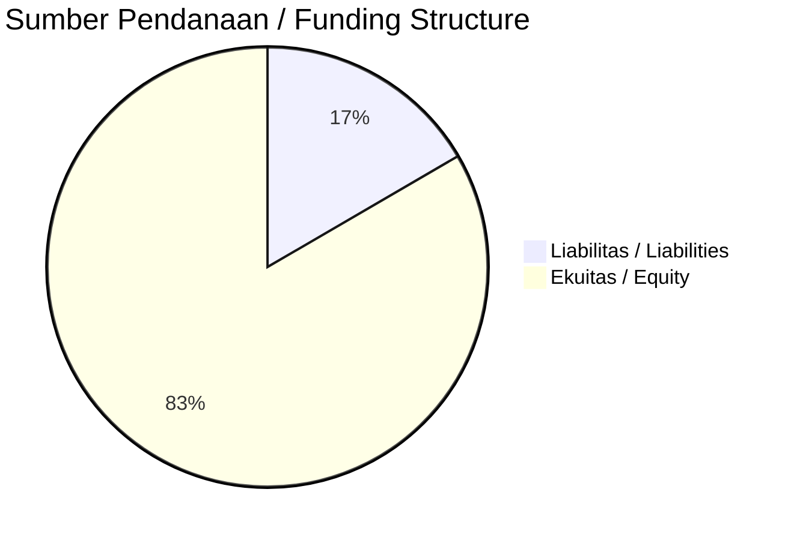

# 📈 Laporan Analisis Keuangan Mendalam: [[CMNP]] — Q2 2026

⬅️ [[knowledge-base/daily-digests/Daily_Digest_20260929|Kembali ke Daily Digest]] | 📅 **2026-09-29** | 🎛️ [[Dashboard|Ke Dashboard Utama]]

> [!IMPORTANT]
> Dokumen ini disusun oleh **Financial Summarizer Agent** untuk menganalisis kinerja keuangan, kesehatan neraca, profitabilitas, dan katalis sektor (Infrastruktur & Transportasi) **Citra Marga Nusaphala Persada Tbk ([[CMNP]])** berdasarkan LK Q2 2026.

---

## 📌 1. Ikhtisar Kinerja Utama / Executive Performance Highlight
- **Emiten**: `[[CMNP]]` (Citra Marga Nusaphala Persada Tbk)
- **Sektor Usaha / Industry Sector**: `Infrastruktur & Transportasi`
- **Periode Laporan / Reporting Period**: `Q2 2026`
- **Pendapatan Neto / Net Revenue**: `Rp 2.93 Triliun` (**+33.75% 🟢 YoY** dari Rp 2.19 Triliun)
- **Laba Bruto / Gross Profit**: `Rp 1.02 Triliun` (**+8.81% 🟢 YoY**)
- **Laba (Rugi) Bersih / Net Income**: `Rp 455.03 Miliar` (**-13.92% 🔴 YoY**)
- **Total Aset / Total Assets**: `Rp 3.06 Triliun` | **Total Ekuitas / Total Equity**: `Rp 15.24 Triliun`
- **EPS (Annualized)**: `0.27` | **BVPS**: `4.55`

---

## 📊 2. Laba Rugi Komparatif / Comparative Income Statement

| Pos Laba Rugi / Income Statement Item | Q2 2026 | Prior Period | YoY (%) |
| :--- | ---: | ---: | :---: |
| **Pendapatan Neto / Net Revenue** | `2.93T` | `2.19T` | **+33.75% 🟢** |
| **Beban Pokok / COGS** | `(1.92T)` | `(1.26T)` | +52.25% 🟢 |
| **Laba Bruto / Gross Profit** | `1.02T` | `933.71B` | **+8.81% 🟢** |
| **Beban Usaha / Operating Expenses** | `(88.37B)` | `(84.37B)` | +4.75% 🟢 |
| **Laba Operasional / EBIT** | `580.29B` | `594.12B` | -2.33% 🔴 |
| **Laba (Rugi) Bersih / Net Income** | **455.03B** | **528.58B** | **-13.92% 🔴** |

---

## 🏦 3. Neraca & Struktur Permodalan / Balance Sheet & Capital Structure

| Pos Neraca / Balance Sheet Item | Q2 2026 | Prior Year End | Δ YoY/YtD (%) | Catatan / Notes |
| :--- | ---: | ---: | :---: | :--- |
| **Aset Lancar / Current Assets** | `3.06T` | `3.09T` | -0.95% 🔴 | Kas: Rp 75.56 Miliar |
| **Aset Tidak Lancar / Non-Current Assets** | `24.71T` | `23.61T` | +4.69% 🟢 | Aset Tetap & Operasional |
| **TOTAL ASET / TOTAL ASSETS** | **3.06T** | **3.09T** | **-0.95% 🔴** | |
| **Liabilitas Jk. Pendek / Current Liabilities** | `3.03T` | `3.23T` | -6.07% 🔴 | |
| **Liabilitas Jk. Panjang / Non-Current Liabilities** | `7.84T` | `6.93T` | +13.13% 🟢 | |
| **TOTAL LIABILITAS / TOTAL LIABILITIES** | **3.03T** | **3.23T** | **-6.07% 🔴** | |
| **TOTAL EKUITAS / TOTAL EQUITY** | **15.24T** | **14.79T** | **+3.08% 🟢** | |

---

## 💸 4. Laporan Arus Kas / Cash Flow Statement

| Komponen Arus Kas / Cash Flow Component | Q2 2026 | Prior Period | Δ YoY (%) |
| :--- | ---: | ---: | :---: |
| **Arus Kas Operasi / CFO** | `895.85B` | `393.41B` | +127.71% 🟢 |
| **Arus Kas Investasi / CFI** | `-2.51T` | `159.04B` | -1677.40% 🔴 |
| **Arus Kas Pendanaan / CFF** | `543.74B` | `-182.91B` | +397.27% 🟢 |
| **Kenaikan (Penurunan) Kas Bersih** | `-1.07T` | `369.54B` | -389.31% 🔴 |
| Belanja Modal / Capex | `(6.28B)` | `(34.33B)` | -81.70% 🔴 |
| Pembayaran Dividen / Dividends Paid | `(-)` | `(-)` | - |
| **Free Cash Flow (CFO - Capex)** | **889.57B** | **359.09B** | **+147.73% 🟢** |

---

## 📈 Analisis Rasio Keuangan / Financial Ratio Analysis

| Kategori / Category | Metrik / Metric | Nilai / Value | Benchmark | Interpretasi / Interpretation |
| :--- | :--- | :---: | :---: | :--- |
| **🛡️ Likuiditas** | **Current Ratio** | `1.01x` | `> 1.0x` | Kemampuan bayar kewajiban jk. pendek |
| | **Quick Ratio** | `1.01x` | `> 0.8x` | Likuiditas tanpa persediaan |
| **📊 Profitabilitas** | **Gross Profit Margin (GPM)** | `34.65%` | - | Margin kotor operasional inti |
| | **Operating Profit Margin (OPM)** | `19.79%` | - | Efisiensi operasional |
| | **Net Profit Margin (NPM)** | `15.52%` | - | Konversi revenue ke laba bersih |
| **🎯 Imbal Hasil (Ann.)** | **Return on Equity (ROE)** | `6.06%` | - | Imbal hasil terhadap ekuitas |
| | **Return on Assets (ROA)** | `29.62%` | - | Produktivitas aset |
| **⚖️ Solvabilitas** | **Debt to Equity (DER)** | `0.20x` | `< 2.0x` | Leverage utang vs modal |
| | **Debt to Asset (DAR)** | `0.99x` | `< 0.7x` | Porsi aset didanai utang |

---

## 📐 Per Share Metrics

| Metrik / Metric | Nilai / Value | Keterangan / Notes |
| :--- | ---: | :--- |
| **EPS (Annualized)** | `Rp 0.27` | Laba per saham (dianualisasi) |
| **BVPS** | `Rp 4.55` | Nilai buku per saham |

---

## 🚀 Analisis Strategis & Karakteristik Sektor / Strategic Analysis: Infrastruktur & Transportasi

Pada periode Q2 2026, **Citra Marga Nusaphala Persada Tbk ([[CMNP]])** membukukan total pendapatan sebesar **Rp 2.93 Triliun** (+33.75% 🟢 YoY). Laba kotor tercatat **Rp 1.02 Triliun** dengan GPM **34.65%**. Laba bersih sebesar **Rp 455.03 Miliar** (-13.92% 🔴 YoY). Total aset **Rp 3.06 Triliun**, ekuitas **Rp 15.24 Triliun**, DER **0.20x**.

### 🔍 Indikator Kunci Sektor / Sector Key Indicators (Infrastruktur & Transportasi)
- **Karakteristik Infrastruktur & Transportasi**: Kinerja didorong oleh pertumbuhan volume Lalu Lintas Harian Rata-rata (LHR) dan penyesuaian tarif berkala.
- **Struktur Leverage / Leverage Structure**: Pengelolaan liabilitas jangka panjang yang terukur seiring masa konsesi.
- **Recurring Revenue**: Pendapatan tol/sewa/transport bersifat recurring dan predictable.

> [!NOTE]
> _Data Public Expose / Investor Presentation belum tersedia untuk emiten ini._

---

## 📋 Catatan Kunci Laporan Keuangan / Key Notes to Financial Statements

### 🔍 Opini Auditor / Auditor Opinion
- **Jenis Opini / Opinion Type**: `Wajar Tanpa Modifikasian / Unqualified`
- **KAP / Audit Firm**: `KAP Tanubrata, Sutanto, Fahmi, Bambang, dan Rekan`
- **Partner Audit**: `Sury Musu`
- **Tanggal Laporan / Report Date**: `2026-09-28`

### 📝 Perjanjian & Kontrak Signifikan / Key Contracts & Agreements
- Perjanjian konsesi jasa diatur dalam ISAK 112; infrastruktur tidak diakui sebagai aset tetap, melainkan hak dan kewajiban terkait perjanjian konsesi jasa (Catatan 2n).
- Berdasarkan Akta Notaris Rina Utami Djauhari, S.H. No. 26 tanggal 29 November 2021 tentang Amendemen III Perjanjian Pengusahaan ruas Cileunyi-Sumedang-Dawuan, Perusahaan setuju menyediakan dana talangan untuk pembebasan lahan terkait jalan tol (Catatan 6).
- Pada 1 Juni 2012, CMS menandatangani perjanjian pemanfaatan lahan untuk pipa (Catatan 40C).
- Pada 12 November 2025, Perusahaan mengadakan Perjanjian Pekerjaan Perbaikan Jembatan (Catatan 40U).

### 🤝 Transaksi Pihak Berelasi / Related Party Transactions
- Utang usaha kepada pihak berelasi sebesar Rp540.203.661 ribu pada 30 Juni 2026 (31 Desember 2025: Rp577.544.552 ribu; 31 Desember 2024: Rp616.368.237 ribu) (Catatan 17, 35).
- Beban akrual kepada pihak berelasi sebesar Rp19.305.098 ribu pada 30 Juni 2026 (31 Desember 2025: Rp19.305.098 ribu) (Catatan 18a, 35).
- Catatan 35 mengungkapkan saldo dan sifat transaksi pihak berelasi; rincian transaksi signifikan dengan pihak berelasi tersedia pada catatan tersebut.

### ⚠️ Komitmen & Kontinjensi / Commitments & Contingencies
- Catatan 40 mengungkapkan perjanjian penting dan ikatan yang berhubungan dengan Grup, antara lain perjanjian pemanfaatan lahan untuk pipa (1 Juni 2012) dan Perjanjian Pekerjaan Perbaikan Jembatan (12 November 2025).
- Perusahaan setuju menyediakan dana talangan untuk pembebasan lahan terkait Amendemen III Perjanjian Pengusahaan ruas Cileunyi-Sumedang-Dawuan (Akta No. 26 tanggal 29 November 2021).

---

## 💡 Catatan Strategis & Panduan Investor / Strategic Notes & Investor Guide

1. **Kesehatan Permodalan / Capital Health**: DER **0.20x**, CR **1.01x** — _perlu dipantau secara disiplin_.
2. **Katalis Pertumbuhan / Growth Catalysts**: Pantau realisasi pendapatan dan efisiensi operasional periode berikutnya.

---

## 🔗 Hubungan Note Terkait / Knowledge Graph Links
- [[knowledge-base/daily-digests/Daily_Digest_20260929|📄 Daily Digest 2026-09-29]]
- [[knowledge-base/trading-signals/Trading_Signals_20260929|🎯 Trading Signals]]
- [[Dashboard|🎛️ Kembali ke Dashboard Utama]]