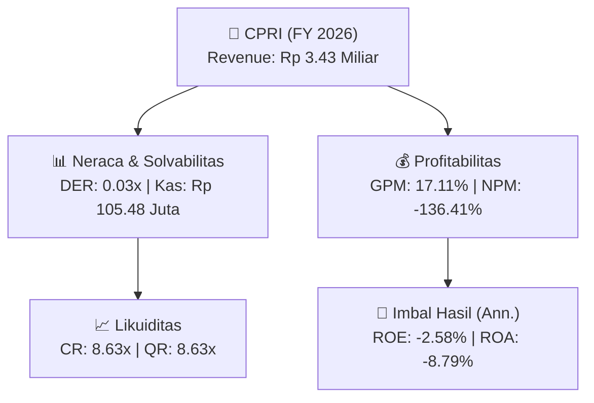
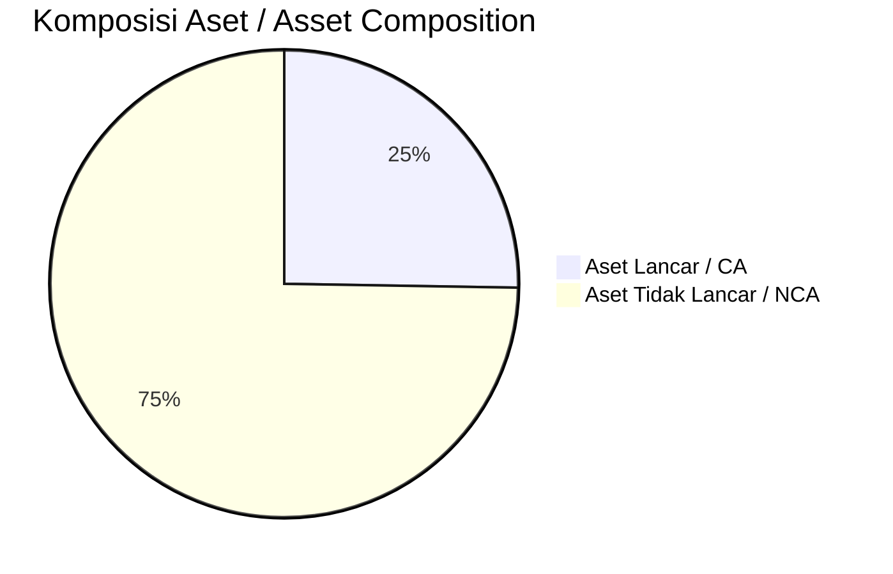
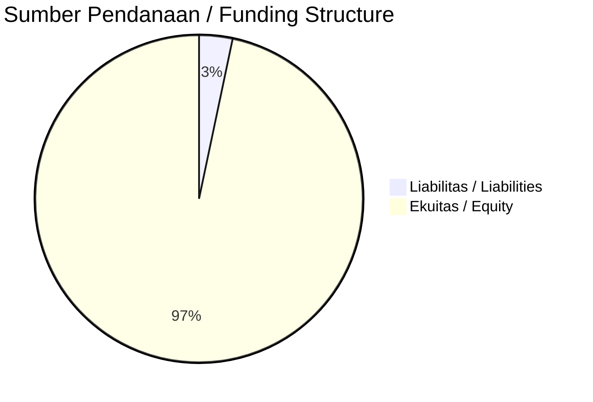

# 📈 Laporan Analisis Keuangan Tahunan Komprehensif: [[CPRI]] — FY 2026

⬅️ [[knowledge-base/daily-digests/Daily_Digest_20261007|Kembali ke Daily Digest]] | 📅 **2026-10-07** | 🎛️ [[Dashboard|Ke Dashboard Utama]]

> [!IMPORTANT]
> Dokumen ini disusun oleh **Financial Summarizer Agent** untuk menganalisis kinerja keuangan, kesehatan neraca, profitabilitas, dan katalis sektor (Properti & Konstruksi) **PT Capri Nusa Satu Properti Tbk. ([[CPRI]])** berdasarkan LK FY 2026.

---

## 📌 1. Ikhtisar Kinerja Utama / Executive Performance Highlight
- **Emiten**: `[[CPRI]]` (PT Capri Nusa Satu Properti Tbk.)
- **Sektor Usaha / Industry Sector**: `Properti & Konstruksi`
- **Periode Laporan / Reporting Period**: `FY 2026`
- **Pendapatan Neto / Net Revenue**: `Rp 3.43 Miliar` (**-3.52% 🔴 YoY** dari Rp 3.55 Miliar)
- **Laba Bruto / Gross Profit**: `Rp 586.53 Juta` (**+50.03% 🟢 YoY**)
- **Laba (Rugi) Bersih / Net Income**: `Rp -4.68 Miliar` (**-21.12% 🔴 YoY**)
- **Total Aset / Total Assets**: `Rp 52.68 Miliar` | **Total Ekuitas / Total Equity**: `Rp 179.25 Miliar`
- **EPS (Annualized)**: `-0.02` | **BVPS**: `0.74`

---

## 📊 2. Laba Rugi Komparatif / Comparative Income Statement

| Pos Laba Rugi / Income Statement Item | FY 2026 | Prior Period | YoY (%) |
| :--- | ---: | ---: | :---: |
| **Pendapatan Neto / Net Revenue** | `3.43B` | `3.55B` | **-3.52% 🔴** |
| **Beban Pokok / COGS** | `(2.84B)` | `(3.16B)` | -10.14% 🔴 |
| **Laba Bruto / Gross Profit** | `586.53M` | `390.95M` | **+50.03% 🟢** |
| **Beban Usaha / Operating Expenses** | `(4.57B)` | `(3.75B)` | +21.87% 🟢 |
| **Laba Operasional / EBIT** | `-3.98B` | `-3.61B` | -10.17% 🔴 |
| **Laba (Rugi) Bersih / Net Income** | **-4.68B** | **-3.86B** | **-21.12% 🔴** |

---

## 🏦 3. Neraca & Struktur Permodalan / Balance Sheet & Capital Structure

| Pos Neraca / Balance Sheet Item | FY 2026 | Prior Year End | Δ YoY/YtD (%) | Catatan / Notes |
| :--- | ---: | ---: | :---: | :--- |
| **Aset Lancar / Current Assets** | `52.68B` | `53.78B` | -2.05% 🔴 | Kas: Rp 105.48 Juta |
| **Aset Tidak Lancar / Non-Current Assets** | `155.81B` | `158.18B` | -1.50% 🔴 | Aset Tetap & Operasional |
| **TOTAL ASET / TOTAL ASSETS** | **52.68B** | **53.78B** | **-2.05% 🔴** | |
| **Liabilitas Jk. Pendek / Current Liabilities** | `6.10B` | `4.93B` | +23.81% 🟢 | |
| **Liabilitas Jk. Panjang / Non-Current Liabilities** | `22.67B` | `22.62B` | +0.25% 🟢 | |
| **TOTAL LIABILITAS / TOTAL LIABILITIES** | **6.10B** | **4.93B** | **+23.81% 🟢** | |
| **TOTAL EKUITAS / TOTAL EQUITY** | **179.25B** | **183.96B** | **-2.56% 🔴** | |

---

## 💸 4. Laporan Arus Kas / Cash Flow Statement

| Komponen Arus Kas / Cash Flow Component | FY 2026 | Prior Period | Δ YoY (%) |
| :--- | ---: | ---: | :---: |
| **Arus Kas Operasi / CFO** | `-1.99B` | `-710.23M` | -179.93% 🔴 |
| **Arus Kas Investasi / CFI** | `-` | `7.57B` | - |
| **Arus Kas Pendanaan / CFF** | `738.50M` | `-6.16B` | +111.99% 🟢 |
| **Kenaikan (Penurunan) Kas Bersih** | `-1.25B` | `699.89M` | -278.55% 🔴 |
| Belanja Modal / Capex | `(-)` | `(-)` | - |
| Pembayaran Dividen / Dividends Paid | `(-)` | `(-)` | - |
| **Free Cash Flow (CFO - Capex)** | **-** | **-** | **-** |

---

## 📈 Analisis Rasio Keuangan / Financial Ratio Analysis

| Kategori / Category | Metrik / Metric | Nilai / Value | Benchmark | Interpretasi / Interpretation |
| :--- | :--- | :---: | :---: | :--- |
| **🛡️ Likuiditas** | **Current Ratio** | `8.63x` | `> 1.0x` | Kemampuan bayar kewajiban jk. pendek |
| | **Quick Ratio** | `8.63x` | `> 0.8x` | Likuiditas tanpa persediaan |
| **📊 Profitabilitas** | **Gross Profit Margin (GPM)** | `17.11%` | - | Margin kotor operasional inti |
| | **Operating Profit Margin (OPM)** | `-116.06%` | - | Efisiensi operasional |
| | **Net Profit Margin (NPM)** | `-136.41%` | - | Konversi revenue ke laba bersih |
| **🎯 Imbal Hasil (Ann.)** | **Return on Equity (ROE)** | `-2.58%` | - | Imbal hasil terhadap ekuitas |
| | **Return on Assets (ROA)** | `-8.79%` | - | Produktivitas aset |
| **⚖️ Solvabilitas** | **Debt to Equity (DER)** | `0.03x` | `< 2.0x` | Leverage utang vs modal |
| | **Debt to Asset (DAR)** | `0.12x` | `< 0.7x` | Porsi aset didanai utang |

---

## 📐 Per Share Metrics

| Metrik / Metric | Nilai / Value | Keterangan / Notes |
| :--- | ---: | :--- |
| **EPS (Annualized)** | `Rp -0.02` | Laba per saham (dianualisasi) |
| **BVPS** | `Rp 0.74` | Nilai buku per saham |

---

## 🚀 Analisis Strategis & Karakteristik Sektor / Strategic Analysis: Properti & Konstruksi

Pada periode FY 2026, **PT Capri Nusa Satu Properti Tbk. ([[CPRI]])** membukukan total pendapatan sebesar **Rp 3.43 Miliar** (-3.52% 🔴 YoY). Laba kotor tercatat **Rp 586.53 Juta** dengan GPM **17.11%**. Laba bersih sebesar **Rp -4.68 Miliar** (-21.12% 🔴 YoY). Total aset **Rp 52.68 Miliar**, ekuitas **Rp 179.25 Miliar**, DER **0.03x**.

### 🔍 Indikator Kunci Sektor / Sector Key Indicators (Properti & Konstruksi)
- **Karakteristik Konstruksi & Properti**: Pertumbuhan bertumpu pada perolehan kontrak baru (Order Book) dan percepatan progres fisik proyek.
- **Modal Kerja**: Restrukturisasi liabilitas dan pengelolaan arus kas proyek.
- **Katalis**: Presales/marketing sales, groundbreaking proyek baru, dan penyerahan unit.

> [!NOTE]
> _Data Public Expose / Investor Presentation belum tersedia untuk emiten ini._

---

## 📋 Catatan Kunci Laporan Keuangan / Key Notes to Financial Statements

### 🔍 Opini Auditor / Auditor Opinion
- **Jenis Opini / Opinion Type**: `Wajar Tanpa Modifikasian / Unqualified`
- **KAP / Audit Firm**: `Kanaka Puradiredja, Suhartono`
- **Partner Audit**: `Harris Siregar`
- **Tanggal Laporan / Report Date**: `2026-05-05`

### 📝 Perjanjian & Kontrak Signifikan / Key Contracts & Agreements
- Perjanjian Jasa Konstruksi Resort No. 002/Legal/CNSD/2018 tanggal 14 September 2018 antara Entitas Anak dengan PT Disky Anugrah Jumanta untuk konstruksi pembangunan di Desa Pejukutan, Kecamatan Nusa Penida dengan harga disepakati Rp43.750.000.000.

### ⏩ Peristiwa Setelah Tanggal Pelaporan / Subsequent Events
- Sejak akhir tahun 2021 sampai dengan tanggal penyelesaian laporan, tingkat penyelesaian aset konstruksi resort masih sebesar 35%.

---

## 💡 Catatan Strategis & Panduan Investor / Strategic Notes & Investor Guide

1. **Kesehatan Permodalan / Capital Health**: DER **0.03x**, CR **8.63x** — _sehat dan aman_.
2. **Katalis Pertumbuhan / Growth Catalysts**: Pantau realisasi pendapatan dan efisiensi operasional periode berikutnya.

---

## 📊 Trend Multi-Tahun / Multi-Year Trend

> [!NOTE]
> _Tabel trend multi-tahun (3 tahun) akan tersedia setelah data historis FY sebelumnya diproses._

---
## 🔗 Hubungan Note Terkait / Knowledge Graph Links
- [[knowledge-base/daily-digests/Daily_Digest_20261007|📄 Daily Digest 2026-10-07]]
- [[knowledge-base/trading-signals/Trading_Signals_20261007|🎯 Trading Signals]]
- [[Dashboard|🎛️ Kembali ke Dashboard Utama]]