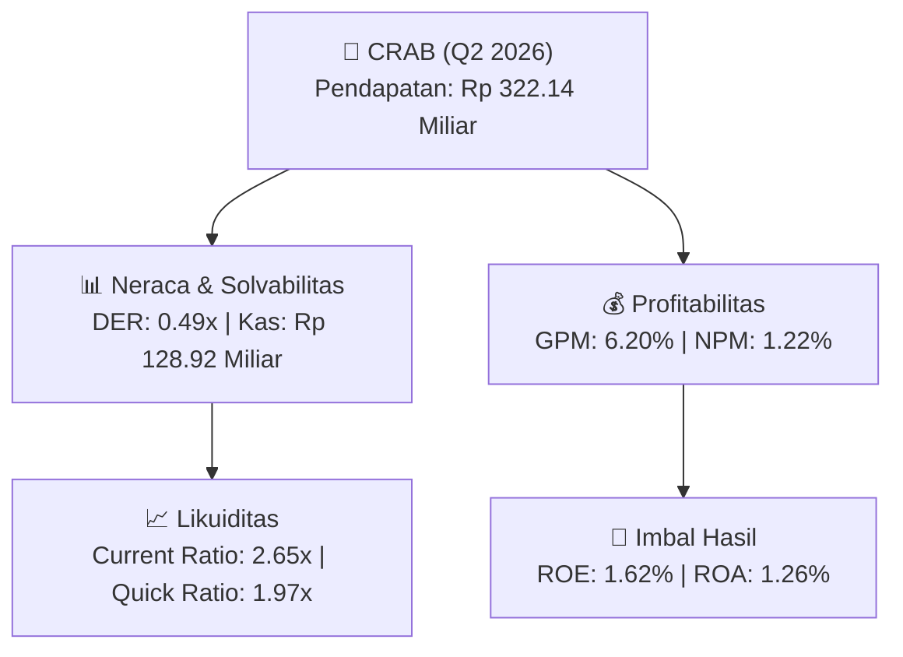

# 📈 Laporan Analisis Keuangan Mendalam: [[CRAB]] - Q2 2026

⬅️ [[knowledge-base/daily-digests/Daily_Digest_20260831|Kembali ke Daily Digest]] | 📅 **2026-08-31** | 🎛️ [[Dashboard|Ke Dashboard Utama]]

> [!IMPORTANT]
> Dokumen ini disusun secara khusus oleh **Financial Summarizer Agent** untuk menganalisis kinerja keuangan, **kesehatan neraca**, profitabilitas, dan **katalis sektor (Agrikultur)** **PT Toba Surimi Industries Tbk ([[CRAB]])** berdasarkan Laporan Keuangan Q2 2026.

---

## 📌 1. Ikhtisar Kinerja Utama (Executive Performance Highlight)
- **Emiten**: `[[CRAB]]` (PT Toba Surimi Industries Tbk)
- **Sektor Usaha**: `Agrikultur`
- **Periode Laporan**: `Q2 2026`
- **Pendapatan Neto (Revenue)**: `Rp 322.14 Miliar` (**+7.99% 🟢 YoY** dari Rp 298.29 Miliar)
- **Laba Bruto (Gross Profit)**: `Rp 19.98 Miliar` (**-45.02% 🔴 YoY**)
- **Laba (Rugi) Bersih**: `Rp 3.94 Miliar` (**-53.24% 🔴 YoY**)
- **Total Aset**: `Rp 313.46 Miliar` | **Total Ekuitas**: `Rp 242.56 Miliar`

---

## 📊 2. Matriks Laba Rugi Komparatif (Income Statement)

| Pos Laba Rugi Utama (Dalam Miliar Rp) | Periode Berjalan (Q2 2026) | Periode Komparatif Lalu | Pertumbuhan YoY (%) |
| :--- | :---: | :---: | :---: |
| **Pendapatan / Penjualan Neto** | `322.14` | `298.29` | **+7.99% 🟢** |
| **Beban Pokok Pendapatan (COGS)** | `(302.16)` | `(261.96)` | +15.35% 🟢 |
| **Laba Bruto (Gross Profit)** | `19.98` | `36.33` | **-45.02% 🔴** |
| **Beban Usaha / Operasional** | `(10.92)` | `(11.20)` | -2.49% 🔴 |
| **Laba Operasional (EBIT)** | `4.94` | `10.83` | -54.38% 🔴 |
| **Laba (Rugi) Bersih Periode Berjalan** | **3.94** | **8.43** | **-53.24% 🔴** |

---

## 🏦 3. Matriks Neraca & Struktur Permodalan (Balance Sheet)

| Pos Neraca Utama (Dalam Miliar Rp) | Q2 2026 | Posisi Akhir Tahun Lalu | Perubahan YoY / YtD (%) | Catatan Analis |
| :--- | :---: | :---: | :---: | :--- |
| **Aset Lancar** | `313.46` | `228.34` | +37.28% 🟢 | Kas: Rp 128.92 Miliar |
| **Aset Tidak Lancar** | `54.33` | `57.02` | -4.73% 🔴 | Aset Tetap & Operasional |
| **TOTAL ASET** | **313.46** | **228.34** | **+37.28% 🟢** | Basis Skala Usaha |
| **Liabilitas Jangka Pendek** | `118.19` | `39.70` | +197.68% 🟢 | Utang Usaha & Kewajiban Pendek |
| **Liabilitas Jangka Panjang** | `7.04` | `7.04` | -0.00% 🔴 | Kewajiban Jangka Panjang |
| **TOTAL LIABILITAS** | **118.19** | **39.70** | **+197.68% 🟢** | Struktur Utang Terkendali |
| **TOTAL EKUITAS** | **242.56** | **238.62** | **+1.65% 🟢** | Modal Bersih Pemegang Saham |

---

## 📈 4. Analisis Rasio Keuangan Utama (Financial Ratios)

| Kategori Rasio | Metrik Rasio | Nilai Rasio | Benchmark & Status | Interpretasi Analis |
| :--- | :--- | :---: | :---: | :--- |
| **🛡️ Likuiditas** | **Current Ratio** | `2.65x` | `> 1.0x` | Kemampuan melunasi kewajiban jangka pendek |
| | **Quick Ratio** | `1.97x` | `> 0.8x` | Likuiditas kas & piutang tanpa persediaan |
| **📊 Profitabilitas** | **Gross Profit Margin (GPM)** | `6.20%` | - | Margin kotor dari operasional inti |
| | **Net Profit Margin (NPM)** | `1.22%` | - | Efisiensi konversi omset ke laba bersih |
| | **Return on Equity (ROE)** | `1.62%` | - | Tingkat imbal hasil terhadap ekuitas |
| | **Return on Assets (ROA)** | `1.26%` | - | Produktivitas aset menghasilkan laba |
| **⚖️ Solvabilitas** | **Debt to Equity Ratio (DER)** | `0.49x` | `< 2.0x` | Struktur leverage utang terhadap modal |
| | **Debt to Asset Ratio (DAR)** | `0.38x` | `< 0.7x` | Porsi pendanaan aset dari kewajiban |

---

## 🚀 5. Analisis Strategis & Karakteristik Sektor: Agrikultur

Pada periode Q2 2026, **PT Toba Surimi Industries Tbk ([[CRAB]])** membukukan total pendapatan/penjualan sebesar **Rp 322.14 Miliar** (+7.99% 🟢 YoY). Laba kotor tercatat sebesar **Rp 19.98 Miliar** dengan Gross Profit Margin (GPM) sebesar **6.20%** dan laba bersih tahun berjalan sebesar **Rp 3.94 Miliar** (-53.24% 🔴 YoY).

Dari sisi neraca, perseroan memiliki total aset sebesar **Rp 313.46 Miliar** dengan ekuitas bersih **Rp 242.56 Miliar**. Rasio solvabilitas DER berada di level **0.49x**, menunjukkan struktur permodalan yang terkelola dengan rasio likuiditas Current Ratio sebesar **2.65x**.

### 🔍 Indikator Kunci Sektor (Agrikultur):
- **Karakteristik Industri Perkebunan & Sawit**: Dipengaruhi oleh pergerakan harga komoditas CPO global, rendemen minyak kelapa sawit (OER), dan umur tanaman perkebunan.
- **Efisiensi Produksi**: Pengendalian biaya pupuk, logistik perkebunan, dan pemeliharaan pabrik kelapa sawit (PKS).

---

## 💡 6. Catatan Strategis & Panduan Investor
1. **Kesehatan Permodalan**: Rasio DER tercatat **0.49x** dengan likuiditas Current Ratio **2.65x** (sehat dan aman).
2. **Katalis Pertumbuhan**: Pantau realisasi pendapatan semester berikutnya serta efisiensi beban usaha operasional.

---

## 🔗 Hubungan Note Terkait (Knowledge Graph)
- [[knowledge-base/daily-digests/Daily_Digest_20260831|📄 Daily Digest 2026-08-31]]
- [[knowledge-base/trading-signals/Trading_Signals_20260831|🎯 Trading Signals]]
- [[Dashboard|🎛️ Kembali ke Dashboard Utama]]
