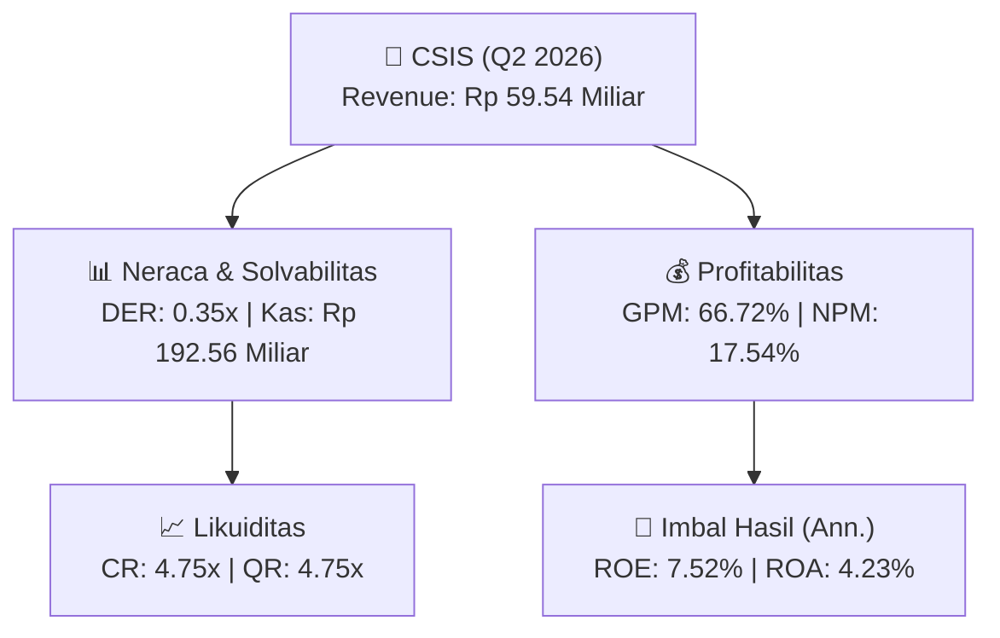
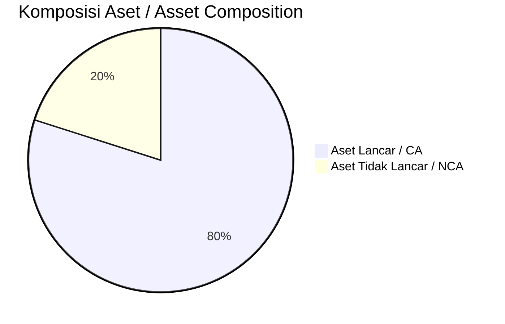
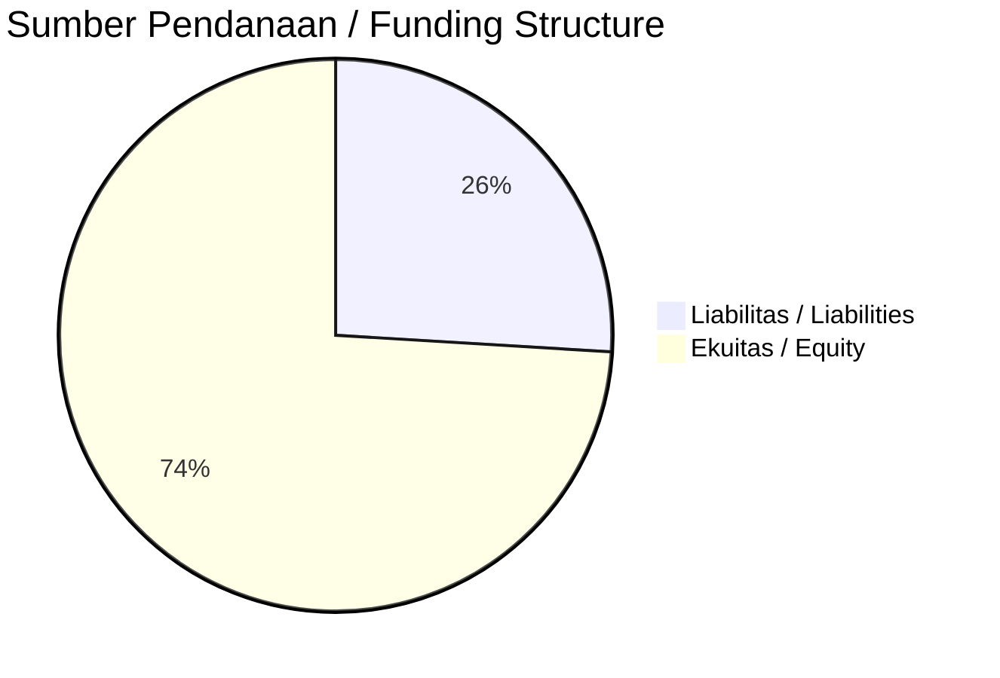

# 📈 Laporan Analisis Keuangan Mendalam: [[CSIS]] — Q2 2026

⬅️ [[knowledge-base/daily-digests/Daily_Digest_20260929|Kembali ke Daily Digest]] | 📅 **2026-09-29** | 🎛️ [[Dashboard|Ke Dashboard Utama]]

> [!IMPORTANT]
> Dokumen ini disusun oleh **Financial Summarizer Agent** untuk menganalisis kinerja keuangan, kesehatan neraca, profitabilitas, dan katalis sektor (Properti & Konstruksi) **PT Cahayasakti Investindo Sukses Tbk ([[CSIS]])** berdasarkan LK Q2 2026.

---

## 📌 1. Ikhtisar Kinerja Utama / Executive Performance Highlight
- **Emiten**: `[[CSIS]]` (PT Cahayasakti Investindo Sukses Tbk)
- **Sektor Usaha / Industry Sector**: `Properti & Konstruksi`
- **Periode Laporan / Reporting Period**: `Q2 2026`
- **Pendapatan Neto / Net Revenue**: `Rp 59.54 Miliar` (**-1.61% 🔴 YoY** dari Rp 60.51 Miliar)
- **Laba Bruto / Gross Profit**: `Rp 39.73 Miliar` (**+11.34% 🟢 YoY**)
- **Laba (Rugi) Bersih / Net Income**: `Rp 10.44 Miliar` (**-14.79% 🔴 YoY**)
- **Total Aset / Total Assets**: `Rp 587.86 Miliar` | **Total Ekuitas / Total Equity**: `Rp 352.06 Miliar`
- **EPS (Annualized)**: `0.11` | **BVPS**: `1.92`

---

## 📊 2. Laba Rugi Komparatif / Comparative Income Statement

| Pos Laba Rugi / Income Statement Item | Q2 2026 | Prior Period | YoY (%) |
| :--- | ---: | ---: | :---: |
| **Pendapatan Neto / Net Revenue** | `59.54B` | `60.51B` | **-1.61% 🔴** |
| **Beban Pokok / COGS** | `(19.81B)` | `(24.83B)` | -20.21% 🔴 |
| **Laba Bruto / Gross Profit** | `39.73B` | `35.68B` | **+11.34% 🟢** |
| **Beban Usaha / Operating Expenses** | `(13.08B)` | `(10.56B)` | +23.87% 🟢 |
| **Laba Operasional / EBIT** | `22.01B` | `25.39B` | -13.31% 🔴 |
| **Laba (Rugi) Bersih / Net Income** | **10.44B** | **12.26B** | **-14.79% 🔴** |

---

## 🏦 3. Neraca & Struktur Permodalan / Balance Sheet & Capital Structure

| Pos Neraca / Balance Sheet Item | Q2 2026 | Prior Year End | Δ YoY/YtD (%) | Catatan / Notes |
| :--- | ---: | ---: | :---: | :--- |
| **Aset Lancar / Current Assets** | `587.86B` | `400.83B` | +46.66% 🟢 | Kas: Rp 192.56 Miliar |
| **Aset Tidak Lancar / Non-Current Assets** | `147.83B` | `148.43B` | -0.41% 🔴 | Aset Tetap & Operasional |
| **TOTAL ASET / TOTAL ASSETS** | **587.86B** | **400.83B** | **+46.66% 🟢** | |
| **Liabilitas Jk. Pendek / Current Liabilities** | `123.74B` | `125.66B` | -1.53% 🔴 | |
| **Liabilitas Jk. Panjang / Non-Current Liabilities** | `38.71B` | `42.29B` | -8.46% 🔴 | |
| **TOTAL LIABILITAS / TOTAL LIABILITIES** | **123.74B** | **125.66B** | **-1.53% 🔴** | |
| **TOTAL EKUITAS / TOTAL EQUITY** | **352.06B** | **203.66B** | **+72.87% 🟢** | |

---

## 💸 4. Laporan Arus Kas / Cash Flow Statement

| Komponen Arus Kas / Cash Flow Component | Q2 2026 | Prior Period | Δ YoY (%) |
| :--- | ---: | ---: | :---: |
| **Arus Kas Operasi / CFO** | `-2.79B` | `13.64B` | -120.42% 🔴 |
| **Arus Kas Investasi / CFI** | `-7.06B` | `-615.28M` | -1048.07% 🔴 |
| **Arus Kas Pendanaan / CFF** | `193.10B` | `-11.24B` | +1817.27% 🟢 |
| **Kenaikan (Penurunan) Kas Bersih** | `183.25B` | `1.78B` | +10181.89% 🟢 |
| Belanja Modal / Capex | `(2.29B)` | `(1.04B)` | +119.67% 🟢 |
| Pembayaran Dividen / Dividends Paid | `(5.70B)` | `(-)` | - |
| **Free Cash Flow (CFO - Capex)** | **-5.07B** | **12.60B** | **-140.26% 🔴** |

---

## 📈 Analisis Rasio Keuangan / Financial Ratio Analysis

| Kategori / Category | Metrik / Metric | Nilai / Value | Benchmark | Interpretasi / Interpretation |
| :--- | :--- | :---: | :---: | :--- |
| **🛡️ Likuiditas** | **Current Ratio** | `4.75x` | `> 1.0x` | Kemampuan bayar kewajiban jk. pendek |
| | **Quick Ratio** | `4.75x` | `> 0.8x` | Likuiditas tanpa persediaan |
| **📊 Profitabilitas** | **Gross Profit Margin (GPM)** | `66.72%` | - | Margin kotor operasional inti |
| | **Operating Profit Margin (OPM)** | `36.97%` | - | Efisiensi operasional |
| | **Net Profit Margin (NPM)** | `17.54%` | - | Konversi revenue ke laba bersih |
| **🎯 Imbal Hasil (Ann.)** | **Return on Equity (ROE)** | `7.52%` | - | Imbal hasil terhadap ekuitas |
| | **Return on Assets (ROA)** | `4.23%` | - | Produktivitas aset |
| **⚖️ Solvabilitas** | **Debt to Equity (DER)** | `0.35x` | `< 2.0x` | Leverage utang vs modal |
| | **Debt to Asset (DAR)** | `0.21x` | `< 0.7x` | Porsi aset didanai utang |

---

## 📐 Per Share Metrics

| Metrik / Metric | Nilai / Value | Keterangan / Notes |
| :--- | ---: | :--- |
| **EPS (Annualized)** | `Rp 0.11` | Laba per saham (dianualisasi) |
| **BVPS** | `Rp 1.92` | Nilai buku per saham |

---

## 🚀 Analisis Strategis & Karakteristik Sektor / Strategic Analysis: Properti & Konstruksi

Pada periode Q2 2026, **PT Cahayasakti Investindo Sukses Tbk ([[CSIS]])** membukukan total pendapatan sebesar **Rp 59.54 Miliar** (-1.61% 🔴 YoY). Laba kotor tercatat **Rp 39.73 Miliar** dengan GPM **66.72%**. Laba bersih sebesar **Rp 10.44 Miliar** (-14.79% 🔴 YoY). Total aset **Rp 587.86 Miliar**, ekuitas **Rp 352.06 Miliar**, DER **0.35x**.

### 🔍 Indikator Kunci Sektor / Sector Key Indicators (Properti & Konstruksi)
- **Karakteristik Konstruksi & Properti**: Pertumbuhan bertumpu pada perolehan kontrak baru (Order Book) dan percepatan progres fisik proyek.
- **Modal Kerja**: Restrukturisasi liabilitas dan pengelolaan arus kas proyek.
- **Katalis**: Presales/marketing sales, groundbreaking proyek baru, dan penyerahan unit.

> [!NOTE]
> _Data Public Expose / Investor Presentation belum tersedia untuk emiten ini._

---

## 📋 Catatan Kunci Laporan Keuangan / Key Notes to Financial Statements

### 🔍 Opini Auditor / Auditor Opinion
- **Jenis Opini / Opinion Type**: `Wajar Tanpa Modifikasian / Unqualified`
- **KAP / Audit Firm**: `KAP Tanubrata, Sutanto, Fahmi, Bambang, dan Rekan`
- **Partner Audit**: `Martinus Arifin`
- **Tanggal Laporan / Report Date**: `2026-09-29`

### 📝 Perjanjian & Kontrak Signifikan / Key Contracts & Agreements
- Perjanjian Pinjam Meminjam tanggal 6 April 2026 antara Perusahaan dan PT Furnimart Mebelindo Sakti (terkait piutang lain-lain Rp3.500.000.000).
- Perjanjian sewa lahan kavling di kawasan industri Sentul dengan PT Cisarua Mountain Dairy Tbk tanggal 22 Januari 2026 untuk pemanfaatan lahan 366 m2 atas sebagian SHGB No.230/Sentul, jangka waktu 9 tahun dari 17 Maret 2026 sampai 17 Maret 2035, nilai sewa Rp677.100.000.

### 🤝 Transaksi Pihak Berelasi / Related Party Transactions
- Piutang lain-lain kepada PT Furnimart Mebelindo Sakti sebesar Rp3.500.000.000 pada 30 Juni 2026 (0,48% dari total aset); tidak ada pada 31 Desember 2025.
- Pendapatan bunga dari PT Furnimart Mebelindo Sakti sebesar Rp79.793.716 untuk periode enam bulan yang berakhir 30 Juni 2026 (1,65% dari total pendapatan lain-lain).

### ⚠️ Komitmen & Kontinjensi / Commitments & Contingencies
- Komitmen sewa lahan: perjanjian tanggal 22 Januari 2026 dengan PT Cisarua Mountain Dairy Tbk untuk pemanfaatan lahan 366 m2 di kawasan industri Sentul, jangka waktu 9 tahun (17 Maret 2026–17 Maret 2035), nilai Rp677.100.000.

---

## 💡 Catatan Strategis & Panduan Investor / Strategic Notes & Investor Guide

1. **Kesehatan Permodalan / Capital Health**: DER **0.35x**, CR **4.75x** — _sehat dan aman_.
2. **Katalis Pertumbuhan / Growth Catalysts**: Pantau realisasi pendapatan dan efisiensi operasional periode berikutnya.

---

## 🔗 Hubungan Note Terkait / Knowledge Graph Links
- [[knowledge-base/daily-digests/Daily_Digest_20260929|📄 Daily Digest 2026-09-29]]
- [[knowledge-base/trading-signals/Trading_Signals_20260929|🎯 Trading Signals]]
- [[Dashboard|🎛️ Kembali ke Dashboard Utama]]