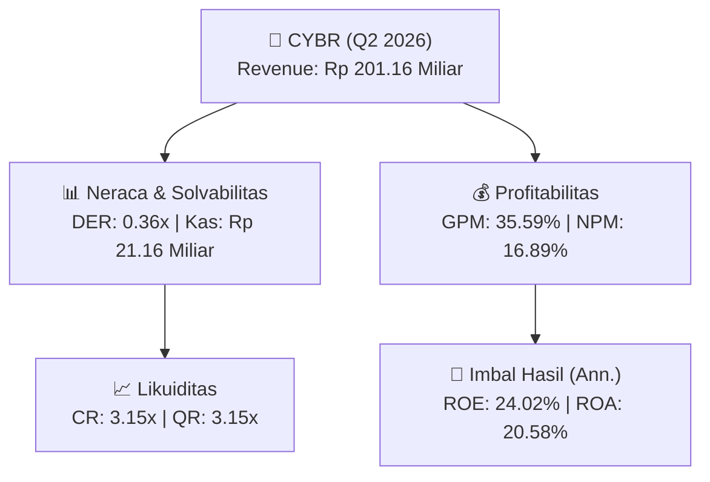
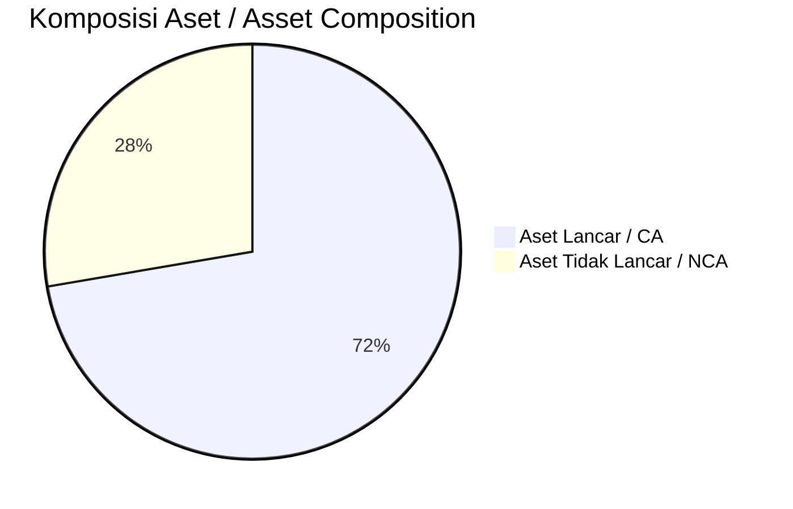
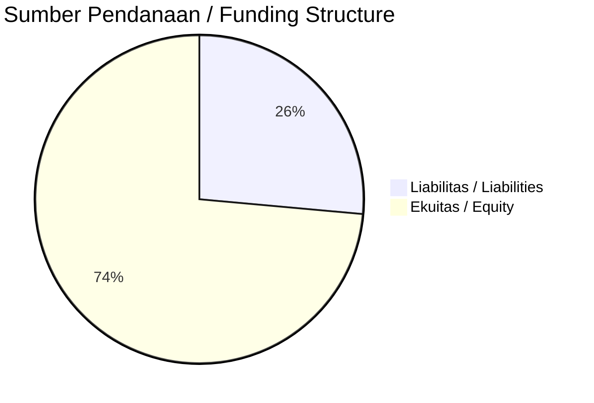

# 📈 Laporan Analisis Keuangan Mendalam: [[CYBR]] — Q2 2026

⬅️ [[knowledge-base/daily-digests/Daily_Digest_20260901|Kembali ke Daily Digest]] | 📅 **2026-09-01** | 🎛️ [[Dashboard|Ke Dashboard Utama]]

> [!IMPORTANT]
> Dokumen ini disusun oleh **Financial Summarizer Agent** untuk menganalisis kinerja keuangan, kesehatan neraca, profitabilitas, dan katalis sektor (Telekomunikasi & Teknologi) **PT ITSEC Asia Tbk. ([[CYBR]])** berdasarkan LK Q2 2026.

---

## 📌 1. Ikhtisar Kinerja Utama / Executive Performance Highlight
- **Emiten**: `[[CYBR]]` (PT ITSEC Asia Tbk.)
- **Sektor Usaha / Industry Sector**: `Telekomunikasi & Teknologi`
- **Periode Laporan / Reporting Period**: `Q2 2026`
- **Pendapatan Neto / Net Revenue**: `Rp 201.16 Miliar` (**-12.71% 🔴 YoY** dari Rp 230.45 Miliar)
- **Laba Bruto / Gross Profit**: `Rp 71.59 Miliar` (**-40.38% 🔴 YoY**)
- **Laba (Rugi) Bersih / Net Income**: `Rp 33.97 Miliar` (**-7.56% 🔴 YoY**)
- **Total Aset / Total Assets**: `Rp 351.06 Miliar` | **Total Ekuitas / Total Equity**: `Rp 310.76 Miliar`
- **EPS (Annualized)**: `0.40` | **BVPS**: `1.85`

---

## 📊 2. Laba Rugi Komparatif / Comparative Income Statement

| Pos Laba Rugi / Income Statement Item |     Q2 2026 | Prior Period |    YoY (%)     |
| :------------------------------------ | ----------: | -----------: | :------------: |
| **Pendapatan Neto / Net Revenue**     |   `201.16B` |    `230.45B` | **-12.71% 🔴** |
| **Beban Pokok / COGS**                | `(129.57B)` |  `(110.37B)` |   +17.40% 🟢   |
| **Laba Bruto / Gross Profit**         |    `71.59B` |    `120.08B` | **-40.38% 🔴** |
| **Beban Usaha / Operating Expenses**  |  `(79.00B)` |   `(71.37B)` |   +10.69% 🟢   |
| **Laba Operasional / EBIT**           |     `5.42B` |     `41.81B` |   -87.03% 🔴   |
| **Laba (Rugi) Bersih / Net Income**   |  **33.97B** |   **36.75B** | **-7.56% 🔴**  |

---

## 🏦 3. Neraca & Struktur Permodalan / Balance Sheet & Capital Structure

| Pos Neraca / Balance Sheet Item | Q2 2026 | Prior Year End | Δ YoY/YtD (%) | Catatan / Notes |
| :--- | ---: | ---: | :---: | :--- |
| **Aset Lancar / Current Assets** | `351.06B` | `309.01B` | +13.61% 🟢 | Kas: Rp 21.16 Miliar |
| **Aset Tidak Lancar / Non-Current Assets** | `134.36B` | `107.48B` | +25.01% 🟢 | Aset Tetap & Operasional |
| **TOTAL ASET / TOTAL ASSETS** | **351.06B** | **309.01B** | **+13.61% 🟢** | |
| **Liabilitas Jk. Pendek / Current Liabilities** | `111.52B` | `101.44B` | +9.94% 🟢 | |
| **Liabilitas Jk. Panjang / Non-Current Liabilities** | `61.48B` | `58.83B` | +4.52% 🟢 | |
| **TOTAL LIABILITAS / TOTAL LIABILITIES** | **111.52B** | **101.44B** | **+9.94% 🟢** | |
| **TOTAL EKUITAS / TOTAL EQUITY** | **310.76B** | **254.95B** | **+21.89% 🟢** | |

---

## 💸 4. Laporan Arus Kas / Cash Flow Statement

| Komponen Arus Kas / Cash Flow Component | Q2 2026 | Prior Period | Δ YoY (%) |
| :--- | ---: | ---: | :---: |
| **Arus Kas Operasi / CFO** | `13.40B` | `-11.99B` | +211.80% 🟢 |
| **Arus Kas Investasi / CFI** | `-32.86B` | `-13.32B` | -146.75% 🔴 |
| **Arus Kas Pendanaan / CFF** | `22.65B` | `54.77B` | -58.64% 🔴 |
| **Kenaikan (Penurunan) Kas Bersih** | `3.19B` | `29.46B` | -89.16% 🔴 |
| Belanja Modal / Capex | `(6.89B)` | `(4.28B)` | +60.95% 🟢 |
| Pembayaran Dividen / Dividends Paid | `(-)` | `(-)` | - |
| **Free Cash Flow (CFO - Capex)** | **6.51B** | **-16.27B** | **+140.03% 🟢** |

---

## 📈 Analisis Rasio Keuangan / Financial Ratio Analysis

| Kategori / Category | Metrik / Metric | Nilai / Value | Benchmark | Interpretasi / Interpretation |
| :--- | :--- | :---: | :---: | :--- |
| **🛡️ Likuiditas** | **Current Ratio** | `3.15x` | `> 1.0x` | Kemampuan bayar kewajiban jk. pendek |
| | **Quick Ratio** | `3.15x` | `> 0.8x` | Likuiditas tanpa persediaan |
| **📊 Profitabilitas** | **Gross Profit Margin (GPM)** | `35.59%` | - | Margin kotor operasional inti |
| | **Operating Profit Margin (OPM)** | `2.69%` | - | Efisiensi operasional |
| | **Net Profit Margin (NPM)** | `16.89%` | - | Konversi revenue ke laba bersih |
| **🎯 Imbal Hasil (Ann.)** | **Return on Equity (ROE)** | `24.02%` | - | Imbal hasil terhadap ekuitas |
| | **Return on Assets (ROA)** | `20.58%` | - | Produktivitas aset |
| **⚖️ Solvabilitas** | **Debt to Equity (DER)** | `0.36x` | `< 2.0x` | Leverage utang vs modal |
| | **Debt to Asset (DAR)** | `0.32x` | `< 0.7x` | Porsi aset didanai utang |

---

## 📐 Per Share Metrics

| Metrik / Metric | Nilai / Value | Keterangan / Notes |
| :--- | ---: | :--- |
| **EPS (Annualized)** | `Rp 0.40` | Laba per saham (dianualisasi) |
| **BVPS** | `Rp 1.85` | Nilai buku per saham |

---

## 🚀 Analisis Strategis & Karakteristik Sektor / Strategic Analysis: Telekomunikasi & Teknologi

Pada periode Q2 2026, **PT ITSEC Asia Tbk. ([[CYBR]])** membukukan total pendapatan sebesar **Rp 201.16 Miliar** (-12.71% 🔴 YoY). Laba kotor tercatat **Rp 71.59 Miliar** dengan GPM **35.59%**. Laba bersih sebesar **Rp 33.97 Miliar** (-7.56% 🔴 YoY). Total aset **Rp 351.06 Miliar**, ekuitas **Rp 310.76 Miliar**, DER **0.36x**.

### 🔍 Indikator Kunci Sektor / Sector Key Indicators (Telekomunikasi & Teknologi)
- **Karakteristik Industri IT & Cybersecurity**: Stabilitas margin kotor tinggi (GPM: **35.59%**), beban terbesar pada remunerasi tenaga ahli.
- **Model Pendapatan**: Managed Security Services (MSSP), lisensi software, dan integrasi enterprise (project-based).
- **Working Capital**: DSO dan pengelolaan piutang B2B kritis untuk likuiditas.

> [!NOTE]
> _Data Public Expose / Investor Presentation belum tersedia untuk emiten ini._

---

## 📋 Catatan Kunci Laporan Keuangan / Key Notes to Financial Statements

### 🔍 Opini Auditor / Auditor Opinion
- **Jenis Opini / Opinion Type**: `Reviu Terbatas / Limited Review`
- **KAP / Audit Firm**: `KAP Morhan Dan Rekan`
- **Partner Audit**: `Morhan Tirtonadi`
- **Tanggal Laporan / Report Date**: `2026-08-28`

---

## 💡 Catatan Strategis & Panduan Investor / Strategic Notes & Investor Guide

1. **Kesehatan Permodalan / Capital Health**: DER **0.36x**, CR **3.15x** — _sehat dan aman_.
2. **Katalis Pertumbuhan / Growth Catalysts**: Pantau realisasi pendapatan dan efisiensi operasional periode berikutnya.

---

## 🔗 Hubungan Note Terkait / Knowledge Graph Links
- [[knowledge-base/daily-digests/Daily_Digest_20260901|📄 Daily Digest 2026-09-01]]
- [[knowledge-base/trading-signals/Trading_Signals_20260901|🎯 Trading Signals]]
- [[Dashboard|🎛️ Kembali ke Dashboard Utama]]