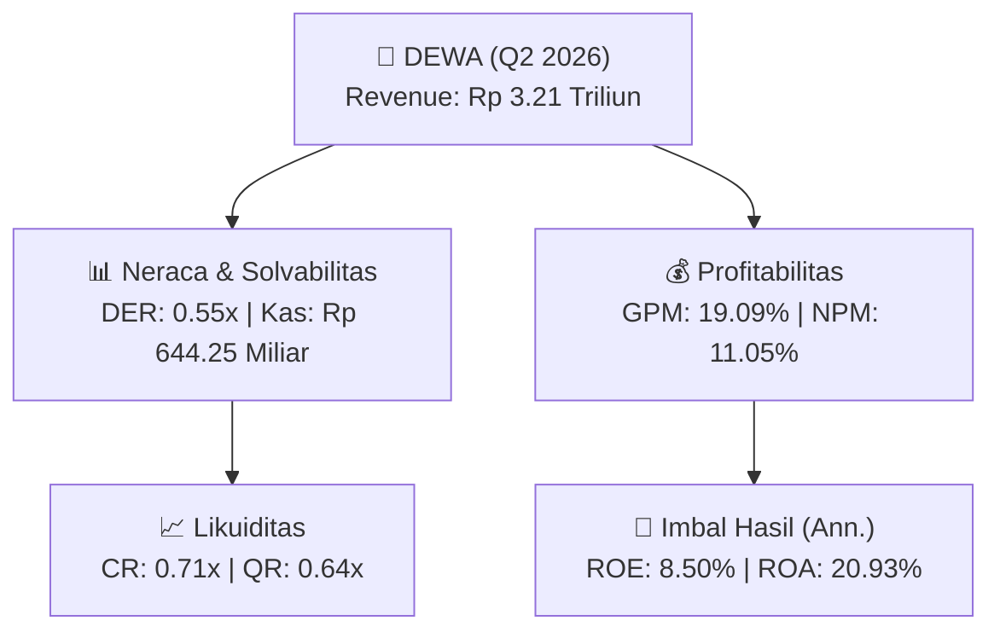
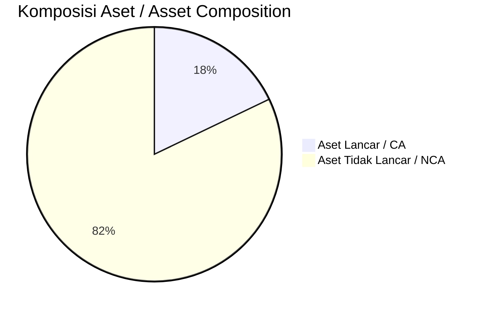
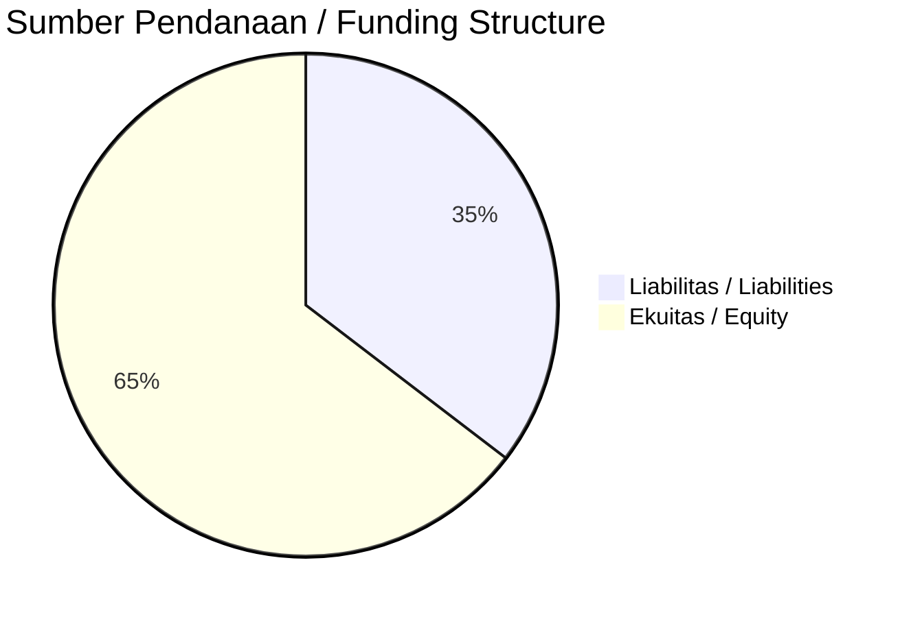

# 📈 Laporan Analisis Keuangan Mendalam: [[DEWA]] — Q2 2026

⬅️ [[knowledge-base/daily-digests/Daily_Digest_20261008|Kembali ke Daily Digest]] | 📅 **2026-10-08** | 🎛️ [[Dashboard|Ke Dashboard Utama]]

> [!IMPORTANT]
> Dokumen ini disusun oleh **Financial Summarizer Agent** untuk menganalisis kinerja keuangan, kesehatan neraca, profitabilitas, dan katalis sektor (Energi & Utilitas) **Darma Henwa Tbk ([[DEWA]])** berdasarkan LK Q2 2026.

---

## 📌 1. Ikhtisar Kinerja Utama / Executive Performance Highlight
- **Emiten**: `[[DEWA]]` (Darma Henwa Tbk)
- **Sektor Usaha / Industry Sector**: `Energi & Utilitas`
- **Periode Laporan / Reporting Period**: `Q2 2026`
- **Pendapatan Neto / Net Revenue**: `Rp 3.21 Triliun` (**+3.13% 🟢 YoY** dari Rp 3.11 Triliun)
- **Laba Bruto / Gross Profit**: `Rp 612.16 Miliar` (**+23.45% 🟢 YoY**)
- **Laba (Rugi) Bersih / Net Income**: `Rp 354.28 Miliar` (**+89.01% 🟢 YoY**)
- **Total Aset / Total Assets**: `Rp 3.15 Triliun` | **Total Ekuitas / Total Equity**: `Rp 8.10 Triliun`
- **EPS (Annualized)**: `0.23` | **BVPS**: `2.59`

---

## 📊 2. Laba Rugi Komparatif / Comparative Income Statement

| Pos Laba Rugi / Income Statement Item | Q2 2026 | Prior Period | YoY (%) |
| :--- | ---: | ---: | :---: |
| **Pendapatan Neto / Net Revenue** | `3.21T` | `3.11T` | **+3.13% 🟢** |
| **Beban Pokok / COGS** | `(2.59T)` | `(2.61T)` | -0.73% 🔴 |
| **Laba Bruto / Gross Profit** | `612.16B` | `495.87B` | **+23.45% 🟢** |
| **Beban Usaha / Operating Expenses** | `(202.50B)` | `(128.09B)` | +58.09% 🟢 |
| **Laba Operasional / EBIT** | `464.10B` | `246.40B` | +88.35% 🟢 |
| **Laba (Rugi) Bersih / Net Income** | **354.28B** | **187.44B** | **+89.01% 🟢** |

---

## 🏦 3. Neraca & Struktur Permodalan / Balance Sheet & Capital Structure

| Pos Neraca / Balance Sheet Item | Q2 2026 | Prior Year End | Δ YoY/YtD (%) | Catatan / Notes |
| :--- | ---: | ---: | :---: | :--- |
| **Aset Lancar / Current Assets** | `3.15T` | `3.62T` | -12.93% 🔴 | Kas: Rp 644.25 Miliar |
| **Aset Tidak Lancar / Non-Current Assets** | `14.47T` | `13.12T` | +10.37% 🟢 | Aset Tetap & Operasional |
| **TOTAL ASET / TOTAL ASSETS** | **3.15T** | **3.62T** | **-12.93% 🔴** | |
| **Liabilitas Jk. Pendek / Current Liabilities** | `4.44T` | `3.14T` | +41.38% 🟢 | |
| **Liabilitas Jk. Panjang / Non-Current Liabilities** | `5.08T` | `5.01T` | +1.46% 🟢 | |
| **TOTAL LIABILITAS / TOTAL LIABILITIES** | **4.44T** | **3.14T** | **+41.38% 🟢** | |
| **TOTAL EKUITAS / TOTAL EQUITY** | **8.10T** | **8.58T** | **-5.60% 🔴** | |

---

## 💸 4. Laporan Arus Kas / Cash Flow Statement

| Komponen Arus Kas / Cash Flow Component | Q2 2026 | Prior Period | Δ YoY (%) |
| :--- | ---: | ---: | :---: |
| **Arus Kas Operasi / CFO** | `658.64B` | `1.04T` | -36.78% 🔴 |
| **Arus Kas Investasi / CFI** | `-1.47T` | `-1.17T` | -25.83% 🔴 |
| **Arus Kas Pendanaan / CFF** | `-133.67B` | `412.84B` | -132.38% 🔴 |
| **Kenaikan (Penurunan) Kas Bersih** | `-946.38B` | `285.33B` | -431.68% 🔴 |
| Belanja Modal / Capex | `(1.10T)` | `(1.20T)` | -8.59% 🔴 |
| Pembayaran Dividen / Dividends Paid | `(-)` | `(-)` | - |
| **Free Cash Flow (CFO - Capex)** | **-437.47B** | **-157.26B** | **-178.18% 🔴** |

---

## 📈 Analisis Rasio Keuangan / Financial Ratio Analysis

| Kategori / Category | Metrik / Metric | Nilai / Value | Benchmark | Interpretasi / Interpretation |
| :--- | :--- | :---: | :---: | :--- |
| **🛡️ Likuiditas** | **Current Ratio** | `0.71x` | `> 1.0x` | Kemampuan bayar kewajiban jk. pendek |
| | **Quick Ratio** | `0.64x` | `> 0.8x` | Likuiditas tanpa persediaan |
| **📊 Profitabilitas** | **Gross Profit Margin (GPM)** | `19.09%` | - | Margin kotor operasional inti |
| | **Operating Profit Margin (OPM)** | `14.48%` | - | Efisiensi operasional |
| | **Net Profit Margin (NPM)** | `11.05%` | - | Konversi revenue ke laba bersih |
| **🎯 Imbal Hasil (Ann.)** | **Return on Equity (ROE)** | `8.50%` | - | Imbal hasil terhadap ekuitas |
| | **Return on Assets (ROA)** | `20.93%` | - | Produktivitas aset |
| **⚖️ Solvabilitas** | **Debt to Equity (DER)** | `0.55x` | `< 2.0x` | Leverage utang vs modal |
| | **Debt to Asset (DAR)** | `1.41x` | `< 0.7x` | Porsi aset didanai utang |

---

## 📐 Per Share Metrics

| Metrik / Metric | Nilai / Value | Keterangan / Notes |
| :--- | ---: | :--- |
| **EPS (Annualized)** | `Rp 0.23` | Laba per saham (dianualisasi) |
| **BVPS** | `Rp 2.59` | Nilai buku per saham |

---

## 🚀 Analisis Strategis & Karakteristik Sektor / Strategic Analysis: Energi & Utilitas

Pada periode Q2 2026, **Darma Henwa Tbk ([[DEWA]])** membukukan total pendapatan sebesar **Rp 3.21 Triliun** (+3.13% 🟢 YoY). Laba kotor tercatat **Rp 612.16 Miliar** dengan GPM **19.09%**. Laba bersih sebesar **Rp 354.28 Miliar** (+89.01% 🟢 YoY). Total aset **Rp 3.15 Triliun**, ekuitas **Rp 8.10 Triliun**, DER **0.55x**.

### 🔍 Indikator Kunci Sektor / Sector Key Indicators (Energi & Utilitas)
- **Karakteristik Industri Tambang & Komoditas / Mining & Commodity**: Kinerja dipengaruhi oleh Average Selling Price (ASP), volume produksi/pengapalan, dan efisiensi Cash Cost per ton.
- **Profil Arus Kas / Cash Flow Profile**: Arus kas operasional yang solid menopang dividen berkala dan ekspansi hilirisasi / transisi energi.
- **Regulasi & ESG**: Kewajiban reklamasi, royalti pemerintah, dan komitmen keberlanjutan.

> [!NOTE]
> _Data Public Expose / Investor Presentation belum tersedia untuk emiten ini._

---

## 📋 Catatan Kunci Laporan Keuangan / Key Notes to Financial Statements

### 🔍 Opini Auditor / Auditor Opinion
- **Jenis Opini / Opinion Type**: `Wajar Tanpa Modifikasian / Unqualified`
- **KAP / Audit Firm**: `KAP Paul Hadiwinata, Hidajat, Arsono, Retno, Palilingan  Rekan`
- **Partner Audit**: `Friso Palilingan`
- **Tanggal Laporan / Report Date**: `2026-10-05`

### 📝 Perjanjian & Kontrak Signifikan / Key Contracts & Agreements
- Pinjaman Bank Sindikasi dijamin dengan piutang usaha senilai Rp 400.000.000, persediaan senilai Rp 100.000.000, dan mesin dan peralatan senilai Rp 625.000.000.
- Pada 29 September 2025, PT Bank Amar Indonesia Tbk, PT Bank ICBC Indonesia, dan PT Bank IBK Indonesia Tbk berpartisipasi dalam fasilitas kredit sindikasi melalui tambahan komitmen sebesar Rp 150.000.000.

### ⚠️ Komitmen & Kontinjensi / Commitments & Contingencies
- Tambahan komitmen fasilitas kredit sindikasi dari PT Bank Amar Indonesia Tbk, PT Bank ICBC Indonesia, dan PT Bank IBK Indonesia Tbk sebesar Rp 150.000.000 pada 29 September 2025.

---

## 💡 Catatan Strategis & Panduan Investor / Strategic Notes & Investor Guide

1. **Kesehatan Permodalan / Capital Health**: DER **0.55x**, CR **0.71x** — _perlu dipantau secara disiplin_.
2. **Katalis Pertumbuhan / Growth Catalysts**: Pantau realisasi pendapatan dan efisiensi operasional periode berikutnya.

---

## 🔗 Hubungan Note Terkait / Knowledge Graph Links
- [[knowledge-base/daily-digests/Daily_Digest_20261008|📄 Daily Digest 2026-10-08]]
- [[knowledge-base/trading-signals/Trading_Signals_20261008|🎯 Trading Signals]]
- [[Dashboard|🎛️ Kembali ke Dashboard Utama]]