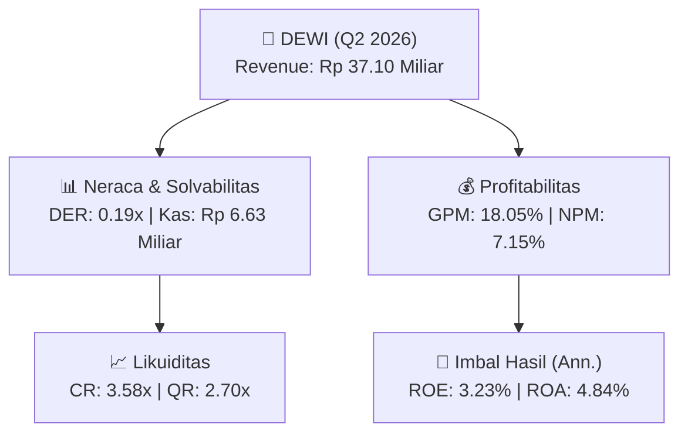
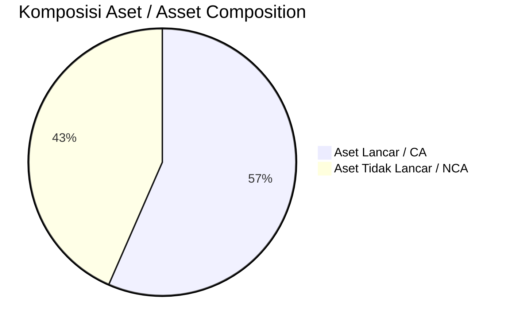
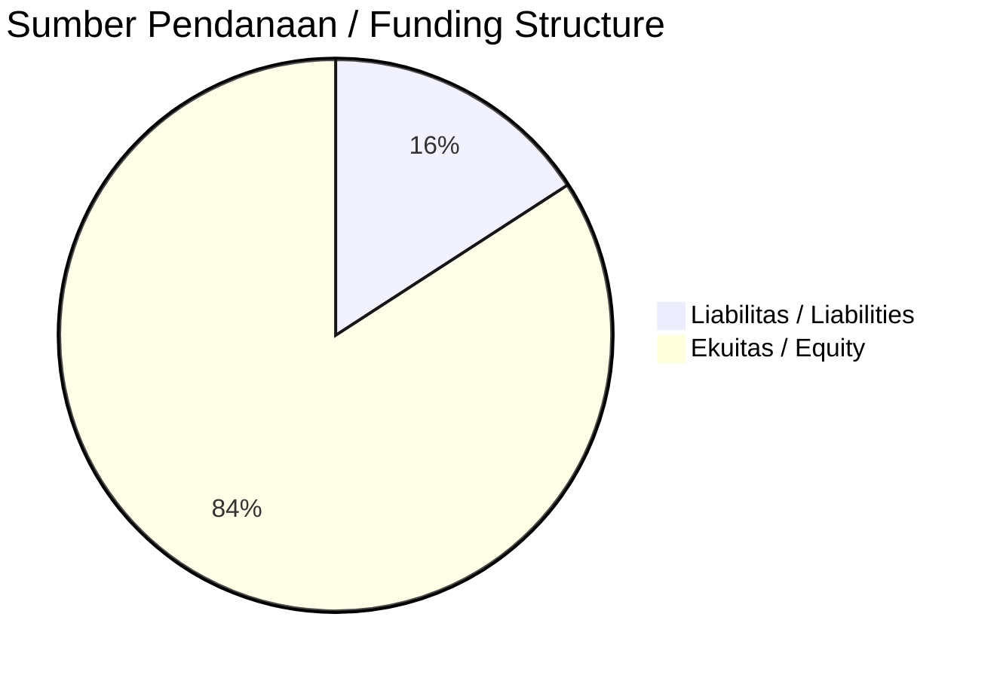

# 📈 Laporan Analisis Keuangan Mendalam: [[DEWI]] — Q2 2026

⬅️ [[knowledge-base/daily-digests/Daily_Digest_20260901|Kembali ke Daily Digest]] | 📅 **2026-09-01** | 🎛️ [[Dashboard|Ke Dashboard Utama]]

> [!IMPORTANT]
> Dokumen ini disusun oleh **Financial Summarizer Agent** untuk menganalisis kinerja keuangan, kesehatan neraca, profitabilitas, dan katalis sektor (Agrikultur) **PT Dewi Shri Farmindo Tbk ([[DEWI]])** berdasarkan LK Q2 2026.

---

## 📌 1. Ikhtisar Kinerja Utama / Executive Performance Highlight
- **Emiten**: `[[DEWI]]` (PT Dewi Shri Farmindo Tbk)
- **Sektor Usaha / Industry Sector**: `Agrikultur`
- **Periode Laporan / Reporting Period**: `Q2 2026`
- **Pendapatan Neto / Net Revenue**: `Rp 37.10 Miliar` (**+44.88% 🟢 YoY** dari Rp 25.61 Miliar)
- **Laba Bruto / Gross Profit**: `Rp 6.70 Miliar` (**+17.69% 🟢 YoY**)
- **Laba (Rugi) Bersih / Net Income**: `Rp 2.65 Miliar` (**+42.61% 🟢 YoY**)
- **Total Aset / Total Assets**: `Rp 111.77 Miliar` | **Total Ekuitas / Total Equity**: `Rp 165.66 Miliar`
- **EPS (Annualized)**: `0.05` | **BVPS**: `1.66`

---

## 📊 2. Laba Rugi Komparatif / Comparative Income Statement

| Pos Laba Rugi / Income Statement Item | Q2 2026 | Prior Period | YoY (%) |
| :--- | ---: | ---: | :---: |
| **Pendapatan Neto / Net Revenue** | `37.10B` | `25.61B` | **+44.88% 🟢** |
| **Beban Pokok / COGS** | `(30.41B)` | `(19.92B)` | +52.65% 🟢 |
| **Laba Bruto / Gross Profit** | `6.70B` | `5.69B` | **+17.69% 🟢** |
| **Beban Usaha / Operating Expenses** | `(3.04B)` | `(2.68B)` | +13.77% 🟢 |
| **Laba Operasional / EBIT** | `3.06B` | `2.30B` | +33.21% 🟢 |
| **Laba (Rugi) Bersih / Net Income** | **2.65B** | **1.86B** | **+42.61% 🟢** |

---

## 🏦 3. Neraca & Struktur Permodalan / Balance Sheet & Capital Structure

| Pos Neraca / Balance Sheet Item | Q2 2026 | Prior Year End | Δ YoY/YtD (%) | Catatan / Notes |
| :--- | ---: | ---: | :---: | :--- |
| **Aset Lancar / Current Assets** | `111.77B` | `107.12B` | +4.34% 🟢 | Kas: Rp 6.63 Miliar |
| **Aset Tidak Lancar / Non-Current Assets** | `85.81B` | `75.30B` | +13.96% 🟢 | Aset Tetap & Operasional |
| **TOTAL ASET / TOTAL ASSETS** | **111.77B** | **107.12B** | **+4.34% 🟢** | |
| **Liabilitas Jk. Pendek / Current Liabilities** | `31.22B` | `8.09B` | +285.70% 🟢 | |
| **Liabilitas Jk. Panjang / Non-Current Liabilities** | `703.40M` | `11.32B` | -93.79% 🔴 | |
| **TOTAL LIABILITAS / TOTAL LIABILITIES** | **31.22B** | **8.09B** | **+285.70% 🟢** | |
| **TOTAL EKUITAS / TOTAL EQUITY** | **165.66B** | **163.01B** | **+1.63% 🟢** | |

---

## 💸 4. Laporan Arus Kas / Cash Flow Statement

| Komponen Arus Kas / Cash Flow Component | Q2 2026 | Prior Period | Δ YoY (%) |
| :--- | ---: | ---: | :---: |
| **Arus Kas Operasi / CFO** | `-3.66B` | `-3.95B` | +7.40% 🟢 |
| **Arus Kas Investasi / CFI** | `-16.74B` | `0.00` | - |
| **Arus Kas Pendanaan / CFF** | `12.58B` | `2.53B` | +397.72% 🟢 |
| **Kenaikan (Penurunan) Kas Bersih** | `-7.82B` | `-1.43B` | -448.33% 🔴 |
| Belanja Modal / Capex | `(10.74B)` | `(0.00)` | - |
| Pembayaran Dividen / Dividends Paid | `(-)` | `(-)` | - |
| **Free Cash Flow (CFO - Capex)** | **-14.40B** | **-3.95B** | **-264.21% 🔴** |

---

## 📈 Analisis Rasio Keuangan / Financial Ratio Analysis

| Kategori / Category | Metrik / Metric | Nilai / Value | Benchmark | Interpretasi / Interpretation |
| :--- | :--- | :---: | :---: | :--- |
| **🛡️ Likuiditas** | **Current Ratio** | `3.58x` | `> 1.0x` | Kemampuan bayar kewajiban jk. pendek |
| | **Quick Ratio** | `2.70x` | `> 0.8x` | Likuiditas tanpa persediaan |
| **📊 Profitabilitas** | **Gross Profit Margin (GPM)** | `18.05%` | - | Margin kotor operasional inti |
| | **Operating Profit Margin (OPM)** | `8.24%` | - | Efisiensi operasional |
| | **Net Profit Margin (NPM)** | `7.15%` | - | Konversi revenue ke laba bersih |
| **🎯 Imbal Hasil (Ann.)** | **Return on Equity (ROE)** | `3.23%` | - | Imbal hasil terhadap ekuitas |
| | **Return on Assets (ROA)** | `4.84%` | - | Produktivitas aset |
| **⚖️ Solvabilitas** | **Debt to Equity (DER)** | `0.19x` | `< 2.0x` | Leverage utang vs modal |
| | **Debt to Asset (DAR)** | `0.28x` | `< 0.7x` | Porsi aset didanai utang |

---

## 📐 Per Share Metrics

| Metrik / Metric | Nilai / Value | Keterangan / Notes |
| :--- | ---: | :--- |
| **EPS (Annualized)** | `Rp 0.05` | Laba per saham (dianualisasi) |
| **BVPS** | `Rp 1.66` | Nilai buku per saham |

---

## 🚀 Analisis Strategis & Karakteristik Sektor / Strategic Analysis: Agrikultur

Pada periode Q2 2026, **PT Dewi Shri Farmindo Tbk ([[DEWI]])** membukukan total pendapatan sebesar **Rp 37.10 Miliar** (+44.88% 🟢 YoY). Laba kotor tercatat **Rp 6.70 Miliar** dengan GPM **18.05%**. Laba bersih sebesar **Rp 2.65 Miliar** (+42.61% 🟢 YoY). Total aset **Rp 111.77 Miliar**, ekuitas **Rp 165.66 Miliar**, DER **0.19x**.

### 🔍 Indikator Kunci Sektor / Sector Key Indicators (Agrikultur)
- **Karakteristik Perkebunan & Agribisnis**: Dipengaruhi harga CPO/komoditas global, Oil Extraction Rate (OER), dan umur tanaman.
- **Efisiensi Produksi**: Pengendalian biaya pupuk, logistik, dan pemeliharaan PKS.
- **Siklus Musiman**: Produksi TBS mengikuti pola musiman curah hujan.

> [!NOTE]
> _Data Public Expose / Investor Presentation belum tersedia untuk emiten ini._

---

## 📋 Catatan Kunci Laporan Keuangan / Key Notes to Financial Statements

### 🔍 Opini Auditor / Auditor Opinion
- **Jenis Opini / Opinion Type**: `Wajar Tanpa Modifikasian / Unqualified`
- **KAP / Audit Firm**: `KAP Jojo Sunarjo  Rekan`
- **Partner Audit**: `Mario Zulfa Nasution`
- **Tanggal Laporan / Report Date**: `2026-08-27`

---

## 💡 Catatan Strategis & Panduan Investor / Strategic Notes & Investor Guide

1. **Kesehatan Permodalan / Capital Health**: DER **0.19x**, CR **3.58x** — _sehat dan aman_.
2. **Katalis Pertumbuhan / Growth Catalysts**: Pantau realisasi pendapatan dan efisiensi operasional periode berikutnya.

---

## 🔗 Hubungan Note Terkait / Knowledge Graph Links
- [[knowledge-base/daily-digests/Daily_Digest_20260901|📄 Daily Digest 2026-09-01]]
- [[knowledge-base/trading-signals/Trading_Signals_20260901|🎯 Trading Signals]]
- [[Dashboard|🎛️ Kembali ke Dashboard Utama]]