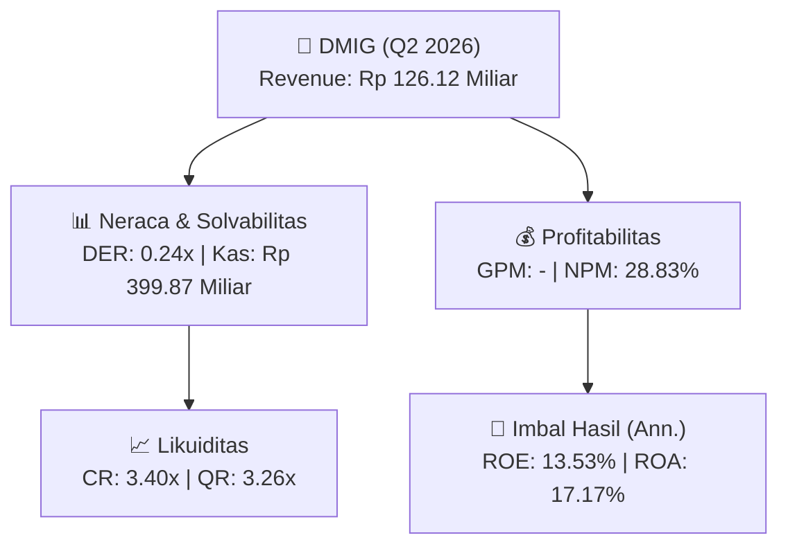
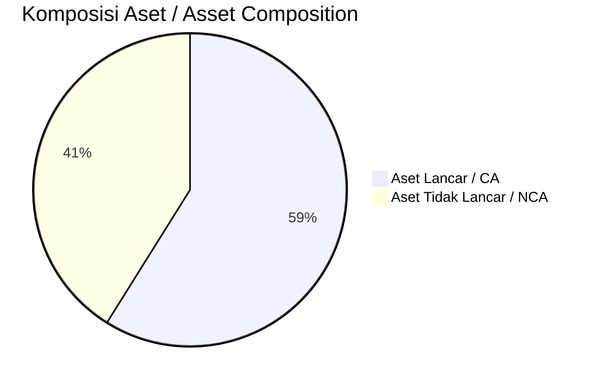
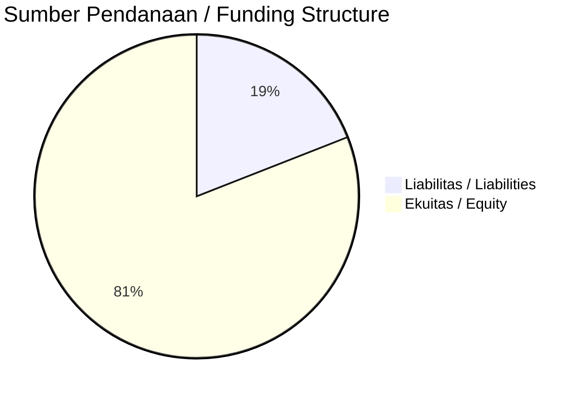

# 📈 Laporan Analisis Keuangan Mendalam: [[DMIG]] — Q2 2026

⬅️ [[knowledge-base/daily-digests/Daily_Digest_20261001|Kembali ke Daily Digest]] | 📅 **2026-10-01** | 🎛️ [[Dashboard|Ke Dashboard Utama]]

> [!IMPORTANT]
> Dokumen ini disusun oleh **Financial Summarizer Agent** untuk menganalisis kinerja keuangan, kesehatan neraca, profitabilitas, dan katalis sektor (Konsumer & Ritel) **PT Damai Indah Golf Tbk ([[DMIG]])** berdasarkan LK Q2 2026.

---

## 📌 1. Ikhtisar Kinerja Utama / Executive Performance Highlight
- **Emiten**: `[[DMIG]]` (PT Damai Indah Golf Tbk)
- **Sektor Usaha / Industry Sector**: `Konsumer & Ritel`
- **Periode Laporan / Reporting Period**: `Q2 2026`
- **Pendapatan Neto / Net Revenue**: `Rp 126.12 Miliar` (**+2.13% 🟢 YoY** dari Rp 123.49 Miliar)

- **Laba (Rugi) Bersih / Net Income**: `Rp 36.36 Miliar` (**+13.85% 🟢 YoY**)
- **Total Aset / Total Assets**: `Rp 429.83 Miliar` | **Total Ekuitas / Total Equity**: `Rp 537.19 Miliar`
- **EPS (Annualized)**: `1.16` | **BVPS**: `8.55`

---

## 📊 2. Laba Rugi Komparatif / Comparative Income Statement

| Pos Laba Rugi / Income Statement Item | Q2 2026 | Prior Period | YoY (%) |
| :--- | ---: | ---: | :---: |
| **Pendapatan Neto / Net Revenue** | `126.12B` | `123.49B` | **+2.13% 🟢** |
| **Beban Pokok / COGS** | `(-)` | `(-)` | - |
| **Laba Bruto / Gross Profit** | `-` | `-` | **-** |
| **Beban Usaha / Operating Expenses** | `(-)` | `(-)` | - |
| **Laba Operasional / EBIT** | `43.66B` | `38.98B` | +12.02% 🟢 |
| **Laba (Rugi) Bersih / Net Income** | **36.36B** | **31.94B** | **+13.85% 🟢** |

---

## 🏦 3. Neraca & Struktur Permodalan / Balance Sheet & Capital Structure

| Pos Neraca / Balance Sheet Item | Q2 2026 | Prior Year End | Δ YoY/YtD (%) | Catatan / Notes |
| :--- | ---: | ---: | :---: | :--- |
| **Aset Lancar / Current Assets** | `429.83B` | `417.08B` | +3.06% 🟢 | Kas: Rp 399.87 Miliar |
| **Aset Tidak Lancar / Non-Current Assets** | `299.91B` | `302.60B` | -0.89% 🔴 | Aset Tetap & Operasional |
| **TOTAL ASET / TOTAL ASSETS** | **429.83B** | **417.08B** | **+3.06% 🟢** | |
| **Liabilitas Jk. Pendek / Current Liabilities** | `126.54B` | `127.09B` | -0.43% 🔴 | |
| **Liabilitas Jk. Panjang / Non-Current Liabilities** | `66.01B` | `54.34B` | +21.47% 🟢 | |
| **TOTAL LIABILITAS / TOTAL LIABILITIES** | **126.54B** | **127.09B** | **-0.43% 🔴** | |
| **TOTAL EKUITAS / TOTAL EQUITY** | **537.19B** | **538.25B** | **-0.20% 🔴** | |

---

## 💸 4. Laporan Arus Kas / Cash Flow Statement

| Komponen Arus Kas / Cash Flow Component | Q2 2026 | Prior Period | Δ YoY (%) |
| :--- | ---: | ---: | :---: |
| **Arus Kas Operasi / CFO** | `54.78B` | `36.48B` | +50.17% 🟢 |
| **Arus Kas Investasi / CFI** | `-8.83B` | `-17.07B` | +48.25% 🟢 |
| **Arus Kas Pendanaan / CFF** | `-27.26B` | `-23.07B` | -18.15% 🔴 |
| **Kenaikan (Penurunan) Kas Bersih** | `18.69B` | `-3.66B` | +610.05% 🟢 |
| Belanja Modal / Capex | `(8.84B)` | `(17.62B)` | -49.86% 🔴 |
| Pembayaran Dividen / Dividends Paid | `(27.26B)` | `(23.07B)` | +18.15% 🟢 |
| **Free Cash Flow (CFO - Capex)** | **45.94B** | **18.86B** | **+143.66% 🟢** |

---

## 📈 Analisis Rasio Keuangan / Financial Ratio Analysis

| Kategori / Category | Metrik / Metric | Nilai / Value | Benchmark | Interpretasi / Interpretation |
| :--- | :--- | :---: | :---: | :--- |
| **🛡️ Likuiditas** | **Current Ratio** | `3.40x` | `> 1.0x` | Kemampuan bayar kewajiban jk. pendek |
| | **Quick Ratio** | `3.26x` | `> 0.8x` | Likuiditas tanpa persediaan |
| **📊 Profitabilitas** | **Gross Profit Margin (GPM)** | `-` | - | Margin kotor operasional inti |
| | **Operating Profit Margin (OPM)** | `34.62%` | - | Efisiensi operasional |
| | **Net Profit Margin (NPM)** | `28.83%` | - | Konversi revenue ke laba bersih |
| **🎯 Imbal Hasil (Ann.)** | **Return on Equity (ROE)** | `13.53%` | - | Imbal hasil terhadap ekuitas |
| | **Return on Assets (ROA)** | `17.17%` | - | Produktivitas aset |
| **⚖️ Solvabilitas** | **Debt to Equity (DER)** | `0.24x` | `< 2.0x` | Leverage utang vs modal |
| | **Debt to Asset (DAR)** | `0.29x` | `< 0.7x` | Porsi aset didanai utang |

---

## 📐 Per Share Metrics

| Metrik / Metric | Nilai / Value | Keterangan / Notes |
| :--- | ---: | :--- |
| **EPS (Annualized)** | `Rp 1.16` | Laba per saham (dianualisasi) |
| **BVPS** | `Rp 8.55` | Nilai buku per saham |

---

## 🚀 Analisis Strategis & Karakteristik Sektor / Strategic Analysis: Konsumer & Ritel

Pada periode Q2 2026, **PT Damai Indah Golf Tbk ([[DMIG]])** membukukan total pendapatan sebesar **Rp 126.12 Miliar** (+2.13% 🟢 YoY). Laba kotor tercatat **-** dengan GPM **-**. Laba bersih sebesar **Rp 36.36 Miliar** (+13.85% 🟢 YoY). Total aset **Rp 429.83 Miliar**, ekuitas **Rp 537.19 Miliar**, DER **0.24x**.

### 🔍 Indikator Kunci Sektor / Sector Key Indicators (Konsumer & Ritel)
- **Karakteristik Industri (Konsumer & Ritel)**: Kinerja mencerminkan dinamika penyerapan pasar, utilisasi kapasitas produksi, dan efisiensi biaya pokok.
- **Faktor Penggerak**: Pertumbuhan organik, efisiensi operasional, dan ekspansi pasar.

> [!NOTE]
> _Data Public Expose / Investor Presentation belum tersedia untuk emiten ini._

---

## 📋 Catatan Kunci Laporan Keuangan / Key Notes to Financial Statements

### 🔍 Opini Auditor / Auditor Opinion
- **Jenis Opini / Opinion Type**: `Wajar Tanpa Modifikasian / Unqualified`
- **KAP / Audit Firm**: `KAP Tjahjadi  Tamara`
- **Partner Audit**: `Roy Tamara`
- **Tanggal Laporan / Report Date**: `2026-09-28`

---

## 💡 Catatan Strategis & Panduan Investor / Strategic Notes & Investor Guide

1. **Kesehatan Permodalan / Capital Health**: DER **0.24x**, CR **3.40x** — _sehat dan aman_.
2. **Katalis Pertumbuhan / Growth Catalysts**: Pantau realisasi pendapatan dan efisiensi operasional periode berikutnya.

---

## 🔗 Hubungan Note Terkait / Knowledge Graph Links
- [[knowledge-base/daily-digests/Daily_Digest_20261001|📄 Daily Digest 2026-10-01]]
- [[knowledge-base/trading-signals/Trading_Signals_20261001|🎯 Trading Signals]]
- [[Dashboard|🎛️ Kembali ke Dashboard Utama]]