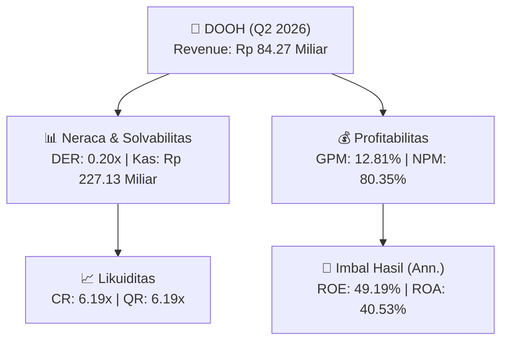
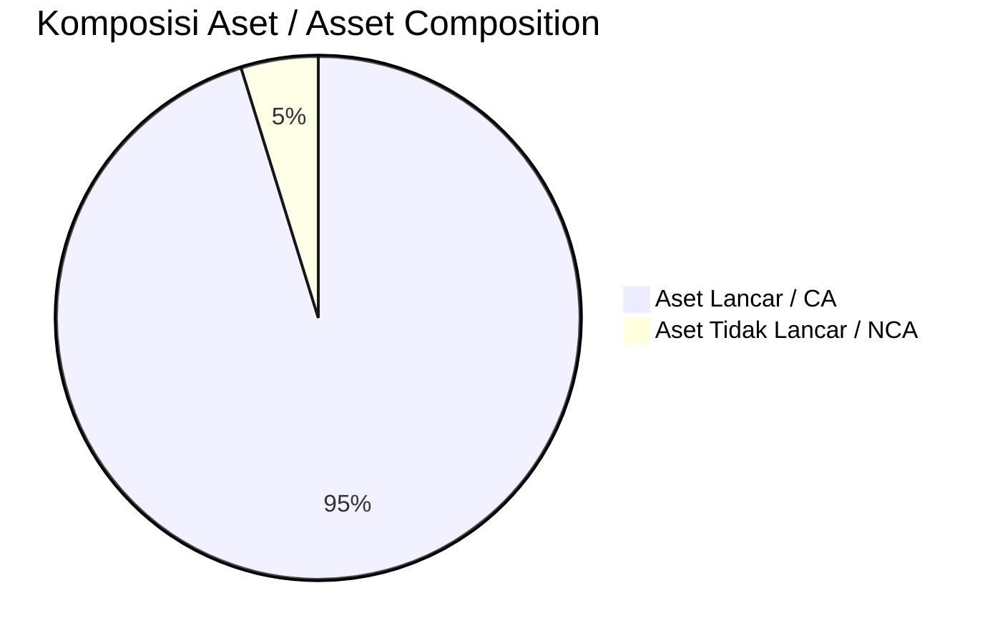
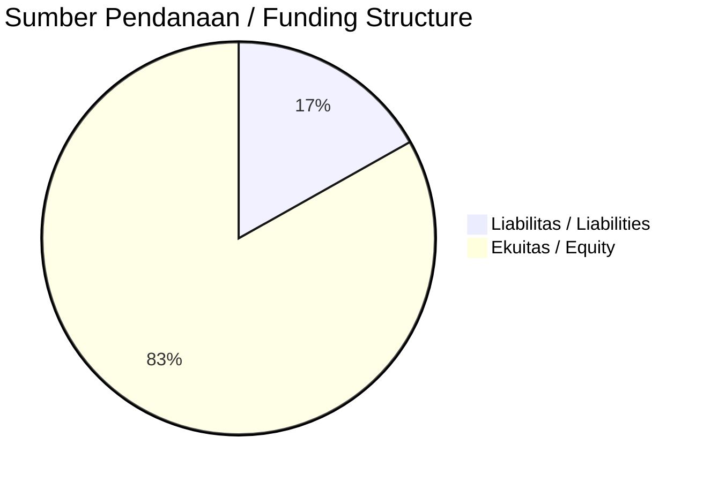

# 📈 Laporan Analisis Keuangan Mendalam: [[DOOH]] — Q2 2026

⬅️ [[knowledge-base/daily-digests/Daily_Digest_20260901|Kembali ke Daily Digest]] | 📅 **2026-09-01** | 🎛️ [[Dashboard|Ke Dashboard Utama]]

> [!IMPORTANT]
> Dokumen ini disusun oleh **Financial Summarizer Agent** untuk menganalisis kinerja keuangan, kesehatan neraca, profitabilitas, dan katalis sektor (General) **PT Era Media Sejahtera Tbk ([[DOOH]])** berdasarkan LK Q2 2026.

---

## 📌 1. Ikhtisar Kinerja Utama / Executive Performance Highlight
- **Emiten**: `[[DOOH]]` (PT Era Media Sejahtera Tbk)
- **Sektor Usaha / Industry Sector**: `General`
- **Periode Laporan / Reporting Period**: `Q2 2026`
- **Pendapatan Neto / Net Revenue**: `Rp 84.27 Miliar` (**+14.68% 🟢 YoY** dari Rp 73.49 Miliar)
- **Laba Bruto / Gross Profit**: `Rp 10.79 Miliar` (**-59.79% 🔴 YoY**)
- **Laba (Rugi) Bersih / Net Income**: `Rp 67.71 Miliar` (**+977.02% 🟢 YoY**)
- **Total Aset / Total Assets**: `Rp 387.14 Miliar` | **Total Ekuitas / Total Equity**: `Rp 309.53 Miliar`
- **EPS (Annualized)**: `1.75` | **BVPS**: `4.00`

---

## 📊 2. Laba Rugi Komparatif / Comparative Income Statement

| Pos Laba Rugi / Income Statement Item | Q2 2026 | Prior Period | YoY (%) |
| :--- | ---: | ---: | :---: |
| **Pendapatan Neto / Net Revenue** | `84.27B` | `73.49B` | **+14.68% 🟢** |
| **Beban Pokok / COGS** | `(73.48B)` | `(46.64B)` | +57.53% 🟢 |
| **Laba Bruto / Gross Profit** | `10.79B` | `26.84B` | **-59.79% 🔴** |
| **Beban Usaha / Operating Expenses** | `(23.44B)` | `(18.52B)` | +26.57% 🟢 |
| **Laba Operasional / EBIT** | `79.58B` | `8.08B` | +884.62% 🟢 |
| **Laba (Rugi) Bersih / Net Income** | **67.71B** | **6.29B** | **+977.02% 🟢** |

---

## 🏦 3. Neraca & Struktur Permodalan / Balance Sheet & Capital Structure

| Pos Neraca / Balance Sheet Item | Q2 2026 | Prior Year End | Δ YoY/YtD (%) | Catatan / Notes |
| :--- | ---: | ---: | :---: | :--- |
| **Aset Lancar / Current Assets** | `387.14B` | `281.03B` | +37.76% 🟢 | Kas: Rp 227.13 Miliar |
| **Aset Tidak Lancar / Non-Current Assets** | `19.37B` | `64.94B` | -70.17% 🔴 | Aset Tetap & Operasional |
| **TOTAL ASET / TOTAL ASSETS** | **387.14B** | **281.03B** | **+37.76% 🟢** | |
| **Liabilitas Jk. Pendek / Current Liabilities** | `62.56B` | `58.38B` | +7.16% 🟢 | |
| **Liabilitas Jk. Panjang / Non-Current Liabilities** | `34.41B` | `39.15B` | -12.11% 🔴 | |
| **TOTAL LIABILITAS / TOTAL LIABILITIES** | **62.56B** | **58.38B** | **+7.16% 🟢** | |
| **TOTAL EKUITAS / TOTAL EQUITY** | **309.53B** | **241.11B** | **+28.38% 🟢** | |

---

## 💸 4. Laporan Arus Kas / Cash Flow Statement

| Komponen Arus Kas / Cash Flow Component | Q2 2026 | Prior Period | Δ YoY (%) |
| :--- | ---: | ---: | :---: |
| **Arus Kas Operasi / CFO** | `138.94B` | `-9.26B` | +1600.34% 🟢 |
| **Arus Kas Investasi / CFI** | `-26.19B` | `-15.68B` | -66.99% 🔴 |
| **Arus Kas Pendanaan / CFF** | `-8.58B` | `27.39B` | -131.34% 🔴 |
| **Kenaikan (Penurunan) Kas Bersih** | `104.17B` | `2.45B` | +4152.52% 🟢 |
| Belanja Modal / Capex | `(12.00M)` | `(4.88B)` | -99.75% 🔴 |
| Pembayaran Dividen / Dividends Paid | `(-)` | `(-)` | - |
| **Free Cash Flow (CFO - Capex)** | **138.92B** | **-14.14B** | **+1082.31% 🟢** |

---

## 📈 Analisis Rasio Keuangan / Financial Ratio Analysis

| Kategori / Category | Metrik / Metric | Nilai / Value | Benchmark | Interpretasi / Interpretation |
| :--- | :--- | :---: | :---: | :--- |
| **🛡️ Likuiditas** | **Current Ratio** | `6.19x` | `> 1.0x` | Kemampuan bayar kewajiban jk. pendek |
| | **Quick Ratio** | `6.19x` | `> 0.8x` | Likuiditas tanpa persediaan |
| **📊 Profitabilitas** | **Gross Profit Margin (GPM)** | `12.81%` | - | Margin kotor operasional inti |
| | **Operating Profit Margin (OPM)** | `94.43%` | - | Efisiensi operasional |
| | **Net Profit Margin (NPM)** | `80.35%` | - | Konversi revenue ke laba bersih |
| **🎯 Imbal Hasil (Ann.)** | **Return on Equity (ROE)** | `49.19%` | - | Imbal hasil terhadap ekuitas |
| | **Return on Assets (ROA)** | `40.53%` | - | Produktivitas aset |
| **⚖️ Solvabilitas** | **Debt to Equity (DER)** | `0.20x` | `< 2.0x` | Leverage utang vs modal |
| | **Debt to Asset (DAR)** | `0.16x` | `< 0.7x` | Porsi aset didanai utang |

---

## 📐 Per Share Metrics

| Metrik / Metric | Nilai / Value | Keterangan / Notes |
| :--- | ---: | :--- |
| **EPS (Annualized)** | `Rp 1.75` | Laba per saham (dianualisasi) |
| **BVPS** | `Rp 4.00` | Nilai buku per saham |

---

## 🚀 Analisis Strategis & Karakteristik Sektor / Strategic Analysis: General

Pada periode Q2 2026, **PT Era Media Sejahtera Tbk ([[DOOH]])** membukukan total pendapatan sebesar **Rp 84.27 Miliar** (+14.68% 🟢 YoY). Laba kotor tercatat **Rp 10.79 Miliar** dengan GPM **12.81%**. Laba bersih sebesar **Rp 67.71 Miliar** (+977.02% 🟢 YoY). Total aset **Rp 387.14 Miliar**, ekuitas **Rp 309.53 Miliar**, DER **0.20x**.

### 🔍 Indikator Kunci Sektor / Sector Key Indicators (General)
- **Karakteristik Industri (General)**: Kinerja mencerminkan dinamika penyerapan pasar, utilisasi kapasitas produksi, dan efisiensi biaya pokok.
- **Faktor Penggerak**: Pertumbuhan organik, efisiensi operasional, dan ekspansi pasar.

### 📋 Data Operasional dari Public Expose / Operational Data from Public Expose
> Sumber: `DOOH_Public_Expose_20260827.md`

- ****Nama Perseroan****: `PT Era Media Sejahtera Tbk`
- ****Kode Emiten****: `DOOH`
- ****Nomor Surat****: `024/CORSEC/EMS/PUBEX.I/VIII/2026`
- ****Tanggal Surat****: `27 Agustus 2026`
- ****Perihal****: `Pemberitahuan Rencana Penyelenggaraan Paparan Publik Insidentil (Public Expose) PT Era Media Sejahtera Tbk`
- ****Hari/Tanggal Public Expose****: `Jumat, 4 September 2026`
- ****Waktu Public Expose****: `15.00 WIB - Selesai`
- ****Sarana Media Elektronik****: `Zoom Meeting`
- ****Link Zoom****: `https://us06web.zoom.us/j/82678336401?pwd=ImT1jJ6Q43mNLRheWr2FIsSzQGdTxm.1`
- ****Meeting ID****: `826 7833 6401`

---

## 📋 Catatan Kunci Laporan Keuangan / Key Notes to Financial Statements

### 🔍 Opini Auditor / Auditor Opinion
- **Jenis Opini / Opinion Type**: `Reviu Terbatas / Limited Review`
- **KAP / Audit Firm**: `KAP Anwar  Rekan`
- **Partner Audit**: `Patricia`
- **Tanggal Laporan / Report Date**: `2026-08-26`

---

## 💡 Catatan Strategis & Panduan Investor / Strategic Notes & Investor Guide

1. **Kesehatan Permodalan / Capital Health**: DER **0.20x**, CR **6.19x** — _sehat dan aman_.
2. **Katalis Pertumbuhan / Growth Catalysts**: Pantau realisasi pendapatan dan efisiensi operasional periode berikutnya.

---

## 🔗 Hubungan Note Terkait / Knowledge Graph Links
- [[knowledge-base/daily-digests/Daily_Digest_20260901|📄 Daily Digest 2026-09-01]]
- [[knowledge-base/trading-signals/Trading_Signals_20260901|🎯 Trading Signals]]
- [[Dashboard|🎛️ Kembali ke Dashboard Utama]]