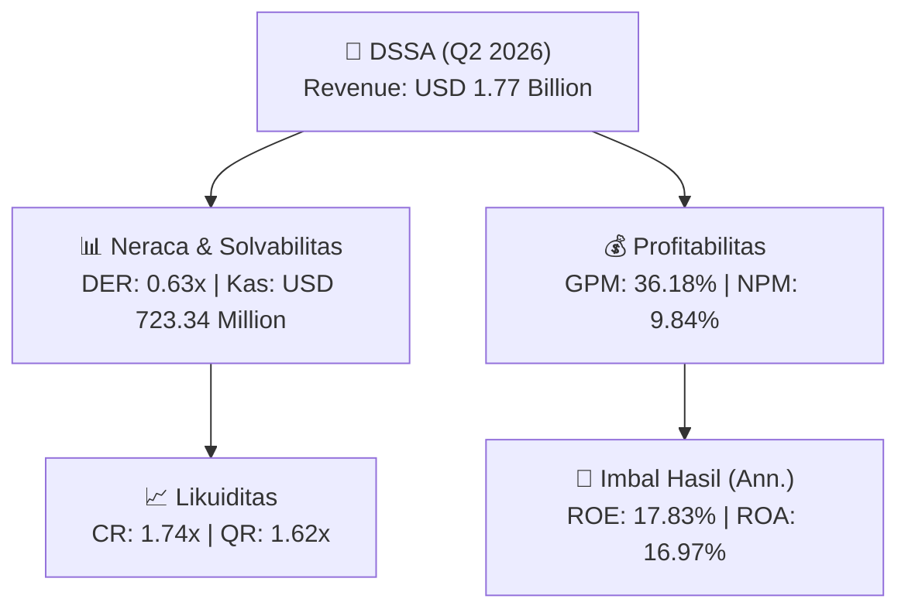
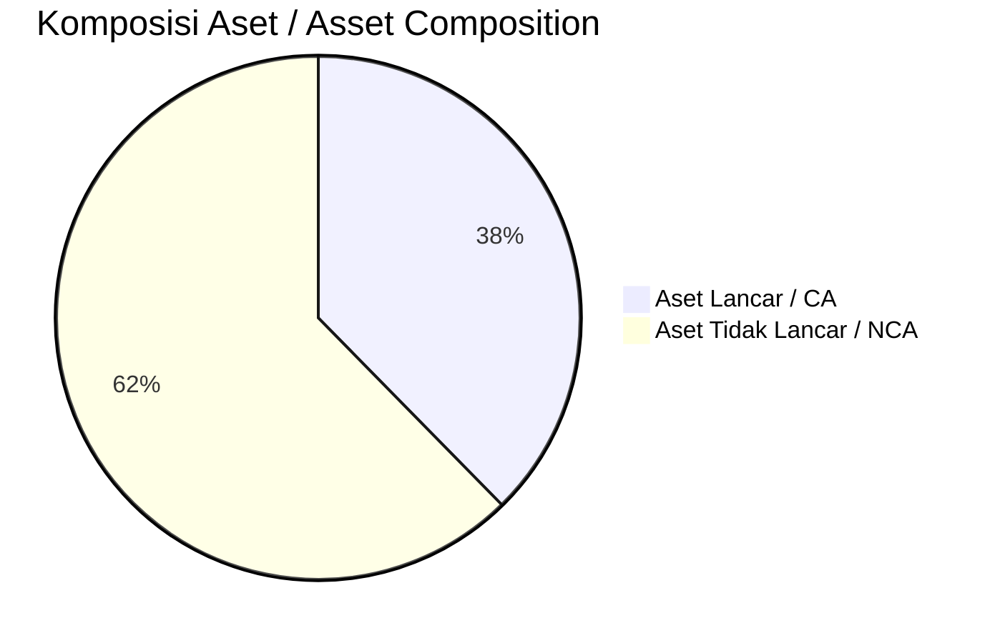
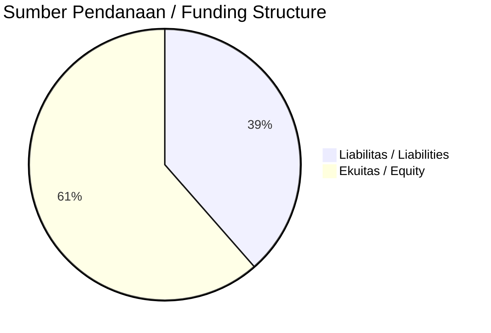

# 📈 Laporan Analisis Keuangan Mendalam: [[DSSA]] — Q2 2026

⬅️ [[knowledge-base/daily-digests/Daily_Digest_20261001|Kembali ke Daily Digest]] | 📅 **2026-10-01** | 🎛️ [[Dashboard|Ke Dashboard Utama]]

> [!IMPORTANT]
> Dokumen ini disusun oleh **Financial Summarizer Agent** untuk menganalisis kinerja keuangan, kesehatan neraca, profitabilitas, dan katalis sektor (Pertambangan) **Dian Swastatika Sentosa Tbk ([[DSSA]])** berdasarkan LK Q2 2026.

---

## 📌 1. Ikhtisar Kinerja Utama / Executive Performance Highlight
- **Emiten**: `[[DSSA]]` (Dian Swastatika Sentosa Tbk)
- **Sektor Usaha / Industry Sector**: `Pertambangan`
- **Periode Laporan / Reporting Period**: `Q2 2026`
- **Pendapatan Neto / Net Revenue**: `USD 1.77 Billion` (**+33.98% 🟢 YoY** dari USD 1.32 Billion)
- **Laba Bruto / Gross Profit**: `USD 641.23 Million` (**+33.69% 🟢 YoY**)
- **Laba (Rugi) Bersih / Net Income**: `USD 174.36 Million` (**+79.59% 🟢 YoY**)
- **Total Aset / Total Assets**: `USD 2.29 Billion` | **Total Ekuitas / Total Equity**: `USD 2.09 Billion`
- **EPS (Annualized)**: `4.81` | **BVPS**: `28.88`

---

## 📊 2. Laba Rugi Komparatif / Comparative Income Statement

| Pos Laba Rugi / Income Statement Item | Q2 2026 | Prior Period | YoY (%) |
| :--- | ---: | ---: | :---: |
| **Pendapatan Neto / Net Revenue** | `1.77B` | `1.32B` | **+33.98% 🟢** |
| **Beban Pokok / COGS** | `(1.13B)` | `(843.34M)` | +34.14% 🟢 |
| **Laba Bruto / Gross Profit** | `641.23M` | `479.66M` | **+33.69% 🟢** |
| **Beban Usaha / Operating Expenses** | `(120.62M)` | `(107.20M)` | +12.52% 🟢 |
| **Laba Operasional / EBIT** | `361.95M` | `221.98M` | +63.06% 🟢 |
| **Laba (Rugi) Bersih / Net Income** | **174.36M** | **97.09M** | **+79.59% 🟢** |

---

## 🏦 3. Neraca & Struktur Permodalan / Balance Sheet & Capital Structure

| Pos Neraca / Balance Sheet Item | Q2 2026 | Prior Year End | Δ YoY/YtD (%) | Catatan / Notes |
| :--- | ---: | ---: | :---: | :--- |
| **Aset Lancar / Current Assets** | `2.29B` | `1.82B` | +25.64% 🟢 | Kas: USD 723.34 Million |
| **Aset Tidak Lancar / Non-Current Assets** | `3.79B` | `2.59B` | +46.04% 🟢 | Aset Tetap & Operasional |
| **TOTAL ASET / TOTAL ASSETS** | **2.29B** | **1.82B** | **+25.64% 🟢** | |
| **Liabilitas Jk. Pendek / Current Liabilities** | `1.31B` | `826.08M` | +58.84% 🟢 | |
| **Liabilitas Jk. Panjang / Non-Current Liabilities** | `1.72B` | `1.33B` | +29.26% 🟢 | |
| **TOTAL LIABILITAS / TOTAL LIABILITIES** | **1.31B** | **826.08M** | **+58.84% 🟢** | |
| **TOTAL EKUITAS / TOTAL EQUITY** | **2.09B** | **1.82B** | **+15.25% 🟢** | |

---

## 💸 4. Laporan Arus Kas / Cash Flow Statement

| Komponen Arus Kas / Cash Flow Component | Q2 2026 | Prior Period | Δ YoY (%) |
| :--- | ---: | ---: | :---: |
| **Arus Kas Operasi / CFO** | `226.62M` | `257.19M` | -11.89% 🔴 |
| **Arus Kas Investasi / CFI** | `-4.44M` | `-608.05M` | +99.27% 🟢 |
| **Arus Kas Pendanaan / CFF** | `97.46M` | `-72.15M` | +235.07% 🟢 |
| **Kenaikan (Penurunan) Kas Bersih** | `319.64M` | `-423.01M` | +175.56% 🟢 |
| Belanja Modal / Capex | `(174.06M)` | `(215.63M)` | -19.28% 🔴 |
| Pembayaran Dividen / Dividends Paid | `(39.20M)` | `(104.89M)` | -62.63% 🔴 |
| **Free Cash Flow (CFO - Capex)** | **52.56M** | **41.56M** | **+26.47% 🟢** |

---

## 📈 Analisis Rasio Keuangan / Financial Ratio Analysis

| Kategori / Category | Metrik / Metric | Nilai / Value | Benchmark | Interpretasi / Interpretation |
| :--- | :--- | :---: | :---: | :--- |
| **🛡️ Likuiditas** | **Current Ratio** | `1.74x` | `> 1.0x` | Kemampuan bayar kewajiban jk. pendek |
| | **Quick Ratio** | `1.62x` | `> 0.8x` | Likuiditas tanpa persediaan |
| **📊 Profitabilitas** | **Gross Profit Margin (GPM)** | `36.18%` | - | Margin kotor operasional inti |
| | **Operating Profit Margin (OPM)** | `20.42%` | - | Efisiensi operasional |
| | **Net Profit Margin (NPM)** | `9.84%` | - | Konversi revenue ke laba bersih |
| **🎯 Imbal Hasil (Ann.)** | **Return on Equity (ROE)** | `17.83%` | - | Imbal hasil terhadap ekuitas |
| | **Return on Assets (ROA)** | `16.97%` | - | Produktivitas aset |
| **⚖️ Solvabilitas** | **Debt to Equity (DER)** | `0.63x` | `< 2.0x` | Leverage utang vs modal |
| | **Debt to Asset (DAR)** | `0.57x` | `< 0.7x` | Porsi aset didanai utang |

---

## 📐 Per Share Metrics

| Metrik / Metric | Nilai / Value | Keterangan / Notes |
| :--- | ---: | :--- |
| **EPS (Annualized)** | `USD 4.81` | Laba per saham (dianualisasi) |
| **BVPS** | `USD 28.88` | Nilai buku per saham |

---

## 🚀 Analisis Strategis & Karakteristik Sektor / Strategic Analysis: Pertambangan

Pada periode Q2 2026, **Dian Swastatika Sentosa Tbk ([[DSSA]])** membukukan total pendapatan sebesar **USD 1.77 Billion** (+33.98% 🟢 YoY). Laba kotor tercatat **USD 641.23 Million** dengan GPM **36.18%**. Laba bersih sebesar **USD 174.36 Million** (+79.59% 🟢 YoY). Total aset **USD 2.29 Billion**, ekuitas **USD 2.09 Billion**, DER **0.63x**.

### 🔍 Indikator Kunci Sektor / Sector Key Indicators (Pertambangan)
- **Karakteristik Industri Tambang & Komoditas / Mining & Commodity**: Kinerja dipengaruhi oleh Average Selling Price (ASP), volume produksi/pengapalan, dan efisiensi Cash Cost per ton.
- **Profil Arus Kas / Cash Flow Profile**: Arus kas operasional yang solid menopang dividen berkala dan ekspansi hilirisasi / transisi energi.
- **Regulasi & ESG**: Kewajiban reklamasi, royalti pemerintah, dan komitmen keberlanjutan.

> [!NOTE]
> _Data Public Expose / Investor Presentation belum tersedia untuk emiten ini._

---

## 📋 Catatan Kunci Laporan Keuangan / Key Notes to Financial Statements

### 🔍 Opini Auditor / Auditor Opinion
- **Jenis Opini / Opinion Type**: `Wajar Tanpa Modifikasian / Unqualified`
- **KAP / Audit Firm**: `KAP Mirawati Sensi Idris`
- **Partner Audit**: `Leo Susanto`
- **Tanggal Laporan / Report Date**: `2026-09-28`

### 📝 Perjanjian & Kontrak Signifikan / Key Contracts & Agreements
- Pada tanggal 19 Februari 2024, BORNEO dan BSL, entitas-entitas anak, menandatangani perjanjian kredit modal kerja dengan Eximbank dengan jumlah fasilitas masing-masing sebesar US$5.000.000 dan US$2.500.000. Fasilitas tersebut memiliki jangka waktu 12 bulan.
- Berdasarkan Adendum I pada tanggal 31 Agustus 2026, EMR menandatangani tambahan fasilitas kredit dengan plafon sampai dengan Rp4.000.000.000.000. Pada tanggal 30 Juni 2026 dan 31 Desember 2025, saldo pinjaman yang terutang masing-masing sebesar Rp2.000.000.000.000 (setara US$112.007.168) dan Rp2.000.000.000.000 (setara US$119.175.307).

### ⏩ Peristiwa Setelah Tanggal Pelaporan / Subsequent Events
- Berdasarkan Adendum I pada tanggal 31 Agustus 2026, EMR menandatangani tambahan fasilitas kredit dengan plafon sampai dengan Rp4.000.000.000.000.

---

## 💡 Catatan Strategis & Panduan Investor / Strategic Notes & Investor Guide

1. **Kesehatan Permodalan / Capital Health**: DER **0.63x**, CR **1.74x** — _sehat dan aman_.
2. **Katalis Pertumbuhan / Growth Catalysts**: Pantau realisasi pendapatan dan efisiensi operasional periode berikutnya.

---

## 🔗 Hubungan Note Terkait / Knowledge Graph Links
- [[knowledge-base/daily-digests/Daily_Digest_20261001|📄 Daily Digest 2026-10-01]]
- [[knowledge-base/trading-signals/Trading_Signals_20261001|🎯 Trading Signals]]
- [[Dashboard|🎛️ Kembali ke Dashboard Utama]]