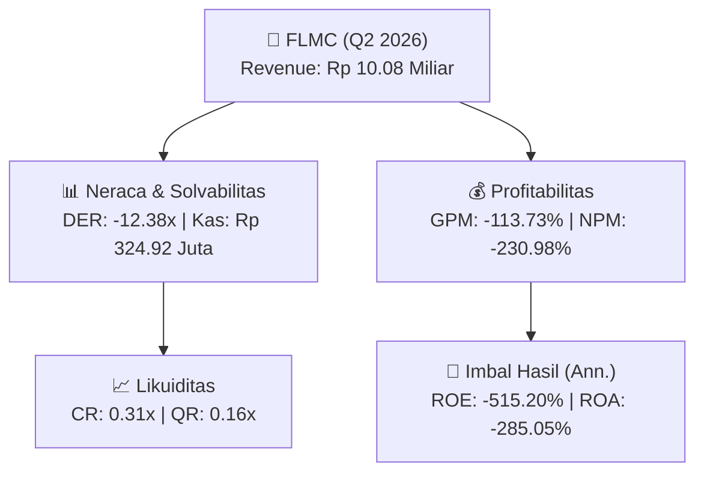
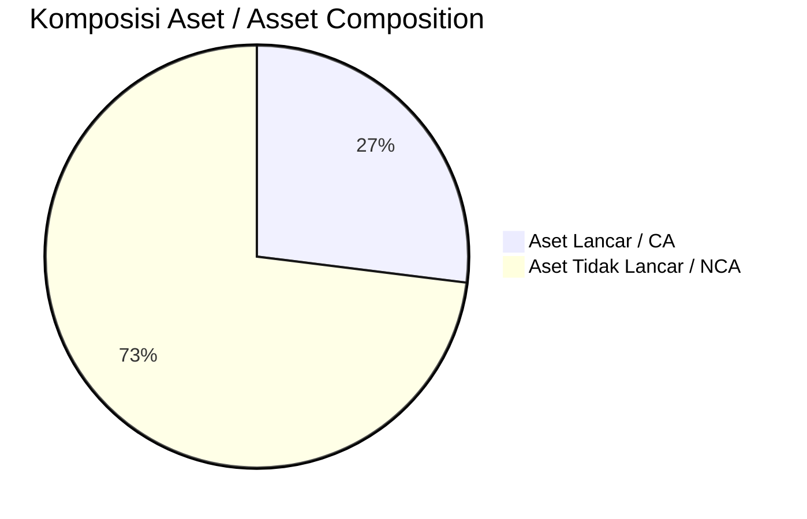
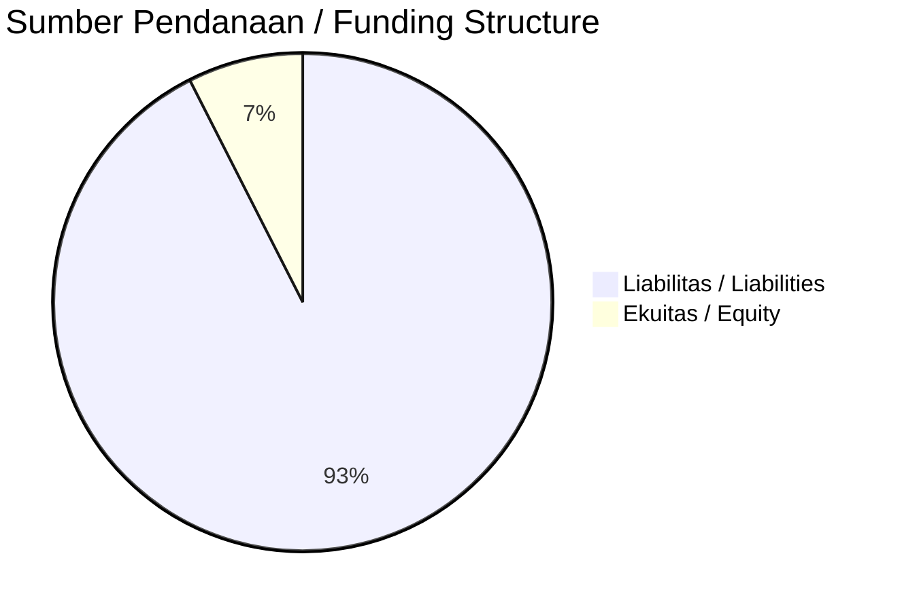

# 📈 Laporan Analisis Keuangan Mendalam: [[FLMC]] — Q2 2026

⬅️ [[knowledge-base/daily-digests/Daily_Digest_20261006|Kembali ke Daily Digest]] | 📅 **2026-10-06** | 🎛️ [[Dashboard|Ke Dashboard Utama]]

> [!IMPORTANT]
> Dokumen ini disusun oleh **Financial Summarizer Agent** untuk menganalisis kinerja keuangan, kesehatan neraca, profitabilitas, dan katalis sektor (Konsumer & Ritel) **PT Falmaco Nonwoven Industri Tbk ([[FLMC]])** berdasarkan LK Q2 2026.

---

## 📌 1. Ikhtisar Kinerja Utama / Executive Performance Highlight
- **Emiten**: `[[FLMC]]` (PT Falmaco Nonwoven Industri Tbk)
- **Sektor Usaha / Industry Sector**: `Konsumer & Ritel`
- **Periode Laporan / Reporting Period**: `Q2 2026`
- **Pendapatan Neto / Net Revenue**: `Rp 10.08 Miliar` (**+10.37% 🟢 YoY** dari Rp 9.13 Miliar)
- **Laba Bruto / Gross Profit**: `Rp -11.46 Miliar` (**-298.29% 🔴 YoY**)
- **Laba (Rugi) Bersih / Net Income**: `Rp -23.27 Miliar` (**-678.49% 🔴 YoY**)
- **Total Aset / Total Assets**: `Rp 10.02 Miliar` | **Total Ekuitas / Total Equity**: `Rp -2.59 Miliar`
- **EPS (Annualized)**: `-0.74` | **BVPS**: `-0.04`

---

## 📊 2. Laba Rugi Komparatif / Comparative Income Statement

| Pos Laba Rugi / Income Statement Item | Q2 2026 | Prior Period | YoY (%) |
| :--- | ---: | ---: | :---: |
| **Pendapatan Neto / Net Revenue** | `10.08B` | `9.13B` | **+10.37% 🟢** |
| **Beban Pokok / COGS** | `(21.53B)` | `(12.01B)` | +79.36% 🟢 |
| **Laba Bruto / Gross Profit** | `-11.46B` | `-2.88B` | **-298.29% 🔴** |
| **Beban Usaha / Operating Expenses** | `(10.75B)` | `(4.60B)` | +133.86% 🟢 |
| **Laba Operasional / EBIT** | `-22.65B` | `-3.05B` | -643.42% 🔴 |
| **Laba (Rugi) Bersih / Net Income** | **-23.27B** | **-2.99B** | **-678.49% 🔴** |

---

## 🏦 3. Neraca & Struktur Permodalan / Balance Sheet & Capital Structure

| Pos Neraca / Balance Sheet Item | Q2 2026 | Prior Year End | Δ YoY/YtD (%) | Catatan / Notes |
| :--- | ---: | ---: | :---: | :--- |
| **Aset Lancar / Current Assets** | `10.02B` | `22.64B` | -55.76% 🔴 | Kas: Rp 324.92 Juta |
| **Aset Tidak Lancar / Non-Current Assets** | `27.12B` | `32.49B` | -16.52% 🔴 | Aset Tetap & Operasional |
| **TOTAL ASET / TOTAL ASSETS** | **10.02B** | **22.64B** | **-55.76% 🔴** | |
| **Liabilitas Jk. Pendek / Current Liabilities** | `32.10B` | `26.41B` | +21.52% 🟢 | |
| **Liabilitas Jk. Panjang / Non-Current Liabilities** | `7.63B` | `8.05B` | -5.22% 🔴 | |
| **TOTAL LIABILITAS / TOTAL LIABILITIES** | **32.10B** | **26.41B** | **+21.52% 🟢** | |
| **TOTAL EKUITAS / TOTAL EQUITY** | **-2.59B** | **20.66B** | **-112.55% 🔴** | |

---

## 💸 4. Laporan Arus Kas / Cash Flow Statement

| Komponen Arus Kas / Cash Flow Component | Q2 2026 | Prior Period | Δ YoY (%) |
| :--- | ---: | ---: | :---: |
| **Arus Kas Operasi / CFO** | `913.75M` | `-463.04M` | +297.34% 🟢 |
| **Arus Kas Investasi / CFI** | `-` | `438.91M` | - |
| **Arus Kas Pendanaan / CFF** | `-671.75M` | `2.56M` | -26363.81% 🔴 |
| **Kenaikan (Penurunan) Kas Bersih** | `242.00M` | `-21.57M` | +1222.17% 🟢 |
| Belanja Modal / Capex | `(-)` | `(-)` | - |
| Pembayaran Dividen / Dividends Paid | `(-)` | `(-)` | - |
| **Free Cash Flow (CFO - Capex)** | **-** | **-** | **-** |

---

## 📈 Analisis Rasio Keuangan / Financial Ratio Analysis

| Kategori / Category | Metrik / Metric | Nilai / Value | Benchmark | Interpretasi / Interpretation |
| :--- | :--- | :---: | :---: | :--- |
| **🛡️ Likuiditas** | **Current Ratio** | `0.31x` | `> 1.0x` | Kemampuan bayar kewajiban jk. pendek |
| | **Quick Ratio** | `0.16x` | `> 0.8x` | Likuiditas tanpa persediaan |
| **📊 Profitabilitas** | **Gross Profit Margin (GPM)** | `-113.73%` | - | Margin kotor operasional inti |
| | **Operating Profit Margin (OPM)** | `-224.78%` | - | Efisiensi operasional |
| | **Net Profit Margin (NPM)** | `-230.98%` | - | Konversi revenue ke laba bersih |
| **🎯 Imbal Hasil (Ann.)** | **Return on Equity (ROE)** | `-515.20%` | - | Imbal hasil terhadap ekuitas |
| | **Return on Assets (ROA)** | `-285.05%` | - | Produktivitas aset |
| **⚖️ Solvabilitas** | **Debt to Equity (DER)** | `-12.38x` | `< 2.0x` | Leverage utang vs modal |
| | **Debt to Asset (DAR)** | `3.20x` | `< 0.7x` | Porsi aset didanai utang |

---

## 📐 Per Share Metrics

| Metrik / Metric | Nilai / Value | Keterangan / Notes |
| :--- | ---: | :--- |
| **EPS (Annualized)** | `Rp -0.74` | Laba per saham (dianualisasi) |
| **BVPS** | `Rp -0.04` | Nilai buku per saham |

---

## 🚀 Analisis Strategis & Karakteristik Sektor / Strategic Analysis: Konsumer & Ritel

Pada periode Q2 2026, **PT Falmaco Nonwoven Industri Tbk ([[FLMC]])** membukukan total pendapatan sebesar **Rp 10.08 Miliar** (+10.37% 🟢 YoY). Laba kotor tercatat **Rp -11.46 Miliar** dengan GPM **-113.73%**. Laba bersih sebesar **Rp -23.27 Miliar** (-678.49% 🔴 YoY). Total aset **Rp 10.02 Miliar**, ekuitas **Rp -2.59 Miliar**, DER **-12.38x**.

### 🔍 Indikator Kunci Sektor / Sector Key Indicators (Konsumer & Ritel)
- **Karakteristik Industri (Konsumer & Ritel)**: Kinerja mencerminkan dinamika penyerapan pasar, utilisasi kapasitas produksi, dan efisiensi biaya pokok.
- **Faktor Penggerak**: Pertumbuhan organik, efisiensi operasional, dan ekspansi pasar.

> [!NOTE]
> _Data Public Expose / Investor Presentation belum tersedia untuk emiten ini._

---

## 📋 Catatan Kunci Laporan Keuangan / Key Notes to Financial Statements

### 🔍 Opini Auditor / Auditor Opinion
- **Jenis Opini / Opinion Type**: `Wajar Tanpa Modifikasian / Unqualified`
- **KAP / Audit Firm**: `KAP Heru Saleh Marzuki  Rekan`
- **Partner Audit**: `M. Saleh`
- **Tanggal Laporan / Report Date**: `2026-09-03`

### 🤝 Transaksi Pihak Berelasi / Related Party Transactions
- Catatan 26 mengungkapkan sifat dan transaksi dengan pihak-pihak berelasi; rincian saldo dan transaksi tidak tersedia dalam teks yang diberikan.

---

## 💡 Catatan Strategis & Panduan Investor / Strategic Notes & Investor Guide

1. **Kesehatan Permodalan / Capital Health**: DER **-12.38x**, CR **0.31x** — _perlu dipantau secara disiplin_.
2. **Katalis Pertumbuhan / Growth Catalysts**: Pantau realisasi pendapatan dan efisiensi operasional periode berikutnya.

---

## 🔗 Hubungan Note Terkait / Knowledge Graph Links
- [[knowledge-base/daily-digests/Daily_Digest_20261006|📄 Daily Digest 2026-10-06]]
- [[knowledge-base/trading-signals/Trading_Signals_20261006|🎯 Trading Signals]]
- [[Dashboard|🎛️ Kembali ke Dashboard Utama]]