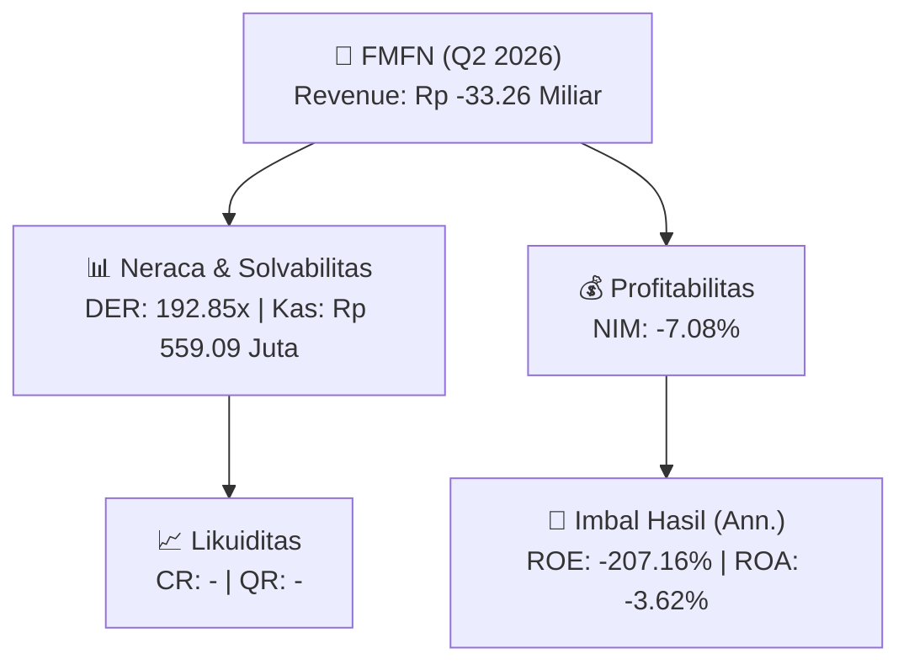
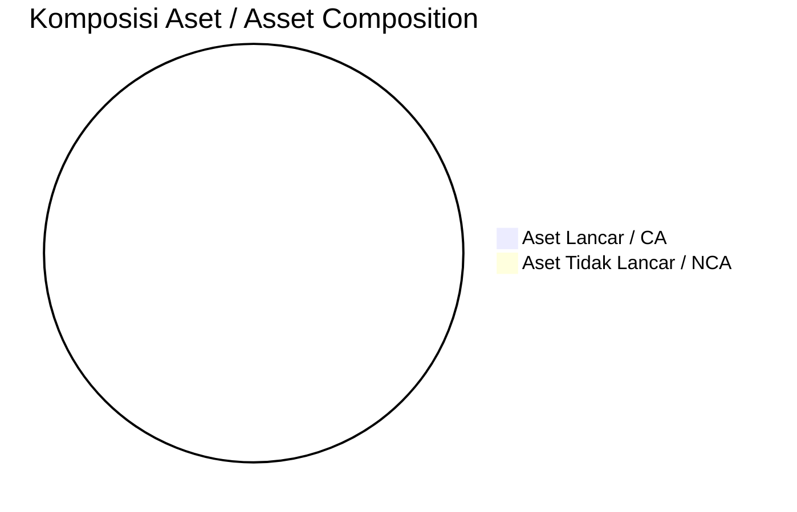
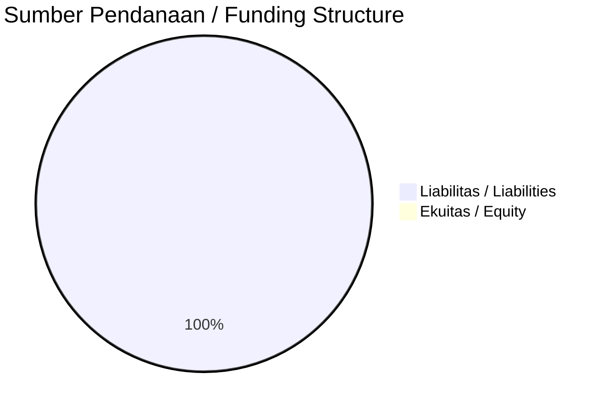

# 📈 Laporan Analisis Keuangan Mendalam: [[FMFN]] — Q2 2026

⬅️ [[knowledge-base/daily-digests/Daily_Digest_20260930|Kembali ke Daily Digest]] | 📅 **2026-09-30** | 🎛️ [[Dashboard|Ke Dashboard Utama]]

> [!IMPORTANT]
> Dokumen ini disusun oleh **Financial Summarizer Agent** untuk menganalisis kinerja keuangan, kesehatan neraca, profitabilitas, dan katalis sektor (Multifinance & Perbankan) **PT KB Finansia Multi Finance ([[FMFN]])** berdasarkan LK Q2 2026.

---

## 📌 1. Ikhtisar Kinerja Utama / Executive Performance Highlight
- **Emiten**: `[[FMFN]]` (PT KB Finansia Multi Finance)
- **Sektor Usaha / Industry Sector**: `Multifinance & Perbankan`
- **Periode Laporan / Reporting Period**: `Q2 2026`
- **Pendapatan Usaha / Total Revenue**: `Rp -33.26 Miliar` (**-1416.16% 🔴 YoY** dari Rp 2.53 Miliar)
- **Pendapatan Bunga / Interest Income**: `Rp 471.91 Juta`
- **Laba (Rugi) Bersih / Net Income**: `Rp -76.09 Miliar` (**+76.18% 🟢 YoY**)
- **Total Aset / Total Assets**: `Rp 3.64 Triliun` | **Total Ekuitas / Total Equity**: `Rp 18.78 Miliar`
- **EPS (Annualized)**: `-0.36` | **BVPS**: `0.04`

---

## 📊 2. Laba Rugi Komparatif / Comparative Income Statement (Financial Sector)

| Pos Laba Rugi / Income Statement Item | Q2 2026 | Prior Period | YoY (%) |
| :--- | ---: | ---: | :---: |
| **Pendapatan Bunga / Interest Income** | `471.91M` | `868.47M` | -45.66% 🔴 |
| **Beban Bunga / Interest Expense** | `(129.46B)` | `(227.07B)` | -42.99% 🔴 |
| **Jumlah Pendapatan Usaha / Total Revenue** | `-33.26B` | `2.53B` | -1416.16% 🔴 |
| **Beban Operasional / Operating Expenses** | `(136.47B)` | `(139.40B)` | -2.10% 🔴 |
| **Laba Sebelum Pajak / Profit Before Tax** | `-90.41B` | `-406.62B` | +77.77% 🟢 |
| **Laba (Rugi) Bersih / Net Income** | **-76.09B** | **-319.40B** | **+76.18% 🟢** |

---

## 🏦 3. Neraca & Struktur Permodalan / Balance Sheet & Capital Structure

| Pos Neraca / Balance Sheet Item | Q2 2026 | Prior Year End | Δ YoY/YtD (%) | Catatan / Notes |
| :--- | ---: | ---: | :---: | :--- |
| **Aset Lancar / Current Assets** | `-` | `-` | - | Kas: Rp 559.09 Juta |
| **Aset Tidak Lancar / Non-Current Assets** | `-` | `0.00` | - | Aset Tetap & Operasional |
| **TOTAL ASET / TOTAL ASSETS** | **3.64T** | **4.76T** | **-23.49% 🔴** | |
| **Liabilitas Jk. Pendek / Current Liabilities** | `-` | `-` | - | |
| **Liabilitas Jk. Panjang / Non-Current Liabilities** | `-` | `-` | - | |
| **TOTAL LIABILITAS / TOTAL LIABILITIES** | **3.62T** | **4.63T** | **-21.78% 🔴** | |
| **TOTAL EKUITAS / TOTAL EQUITY** | **18.78B** | **128.14B** | **-85.34% 🔴** | |

---

## 💸 4. Laporan Arus Kas / Cash Flow Statement

| Komponen Arus Kas / Cash Flow Component | Q2 2026 | Prior Period | Δ YoY (%) |
| :--- | ---: | ---: | :---: |
| **Arus Kas Operasi / CFO** | `902.89B` | `968.82B` | -6.81% 🔴 |
| **Arus Kas Investasi / CFI** | `-18.07B` | `-44.91B` | +59.77% 🟢 |
| **Arus Kas Pendanaan / CFF** | `-929.90B` | `-1.04T` | +10.29% 🟢 |
| **Kenaikan (Penurunan) Kas Bersih** | `-45.08B` | `-112.70B` | +60.00% 🟢 |
| Belanja Modal / Capex | `(23.65B)` | `(10.08B)` | +134.71% 🟢 |
| Pembayaran Dividen / Dividends Paid | `(-)` | `(0.00)` | - |
| **Free Cash Flow (CFO - Capex)** | **879.24B** | **958.74B** | **-8.29% 🔴** |

---

## 📈 Analisis Rasio Keuangan / Financial Ratio Analysis

| Kategori / Category | Metrik / Metric | Nilai / Value | Benchmark | Interpretasi / Interpretation |
| :--- | :--- | :---: | :---: | :--- |
| **🛡️ Likuiditas** | **Current Ratio** | `-` | `> 1.0x` | Kemampuan bayar kewajiban jk. pendek |
| | **Quick Ratio** | `-` | `> 0.8x` | Likuiditas tanpa persediaan |
| **📊 Profitabilitas** | **Net Interest Margin (NIM)** | `-7.08%` | `> 3.0%` | Spread pendapatan bunga bersih |
| | **BOPO / Cost-to-Income Ratio** | `410.30%` | `< 80%` | Efisiensi biaya operasional |
| **🎯 Imbal Hasil (Ann.)** | **Return on Equity (ROE)** | `-207.16%` | - | Imbal hasil terhadap ekuitas |
| | **Return on Assets (ROA)** | `-3.62%` | - | Produktivitas aset |
| **⚖️ Solvabilitas** | **Debt to Equity (DER)** | `192.85x` | `< 2.0x` | Leverage utang vs modal |
| | **Debt to Asset (DAR)** | `0.99x` | `< 0.7x` | Porsi aset didanai utang |

---

## 📐 Per Share Metrics

| Metrik / Metric | Nilai / Value | Keterangan / Notes |
| :--- | ---: | :--- |
| **EPS (Annualized)** | `Rp -0.36` | Laba per saham (dianualisasi) |
| **BVPS** | `Rp 0.04` | Nilai buku per saham |

---

## 🚀 Analisis Strategis & Karakteristik Sektor / Strategic Analysis: Multifinance & Perbankan

Pada periode Q2 2026, **PT KB Finansia Multi Finance ([[FMFN]])** membukukan total pendapatan sebesar **Rp -33.26 Miliar** (-1416.16% 🔴 YoY). Laba bersih sebesar **Rp -76.09 Miliar** (+76.18% 🟢 YoY). Total aset **Rp 3.64 Triliun**, ekuitas **Rp 18.78 Miliar**, DER **192.85x**.

### 🔍 Indikator Kunci Sektor / Sector Key Indicators (Multifinance & Perbankan)
- **Karakteristik Industri Finansial / Financial Industry**: Kinerja ditopang oleh spread pendapatan bunga (NIM), hasil investasi, dan pengelolaan Cost of Funds.
- **Kualitas Aset / Asset Quality**: Pengawasan rasio NPL/NPF dan kecukupan pencadangan (PPAP) untuk menjaga stabilitas margin usaha.
- **Solvabilitas / Solvency**: Rasio kecukupan modal (CAR/RBC) ketat sesuai regulasi OJK.

> [!NOTE]
> _Data Public Expose / Investor Presentation belum tersedia untuk emiten ini._

---

## 📋 Catatan Kunci Laporan Keuangan / Key Notes to Financial Statements

### 🔍 Opini Auditor / Auditor Opinion
- **Jenis Opini / Opinion Type**: `Wajar Tanpa Modifikasian / Unqualified`
- **KAP / Audit Firm**: `MIRAWATI SENSI IDRIS`
- **Partner Audit**: `Denny Susanto`
- **Tanggal Laporan / Report Date**: `2026-09-25`
- **Kesimpulan**: _-_

### 📝 Perjanjian & Kontrak Signifikan / Key Contracts & Agreements
- Pada tanggal 27 Juni 2026, Perusahaan melunasi pokok dan bunga Obligasi II KB Finansia Multi Finance Tahun 2023 - Seri B dengan nilai pokok Rp500.000.000.000 secara penuh pada saat jatuh tempo.
- Pada tanggal 17 Desember 2024, Perusahaan menerbitkan Obligasi Berkelanjutan I KB Finansia Multi Finance Tahap I Tahun 2024.
- Catatan 33 mengungkapkan Perjanjian Penting dan Komitmen, antara lain dengan PT Bank SMBC Indonesia Tbk yang dimulai pada tanggal 13 Desember 2018 (teks selanjutnya tidak lengkap dalam kutipan).

### 🤝 Transaksi Pihak Berelasi / Related Party Transactions
- KB Kookmin Card Corp (pemegang saham): beban yang masih harus dibayar, beban umum dan administrasi, obligasi perpetual yang dapat dikonversikan, laba ditahan.
- PT Finansia Pacifica Raya (pemegang saham): aset hak-guna.
- PT Kookmin Best Insurance Indonesia (perusahaan asosiasi): piutang lain-lain, utang lain-lain, dan pendapatan pembiayaan.

### ⚠️ Komitmen & Kontinjensi / Commitments & Contingencies
- Pada tanggal 30 Juni 2026 dan 31 Desember 2025, tidak terdapat komitmen kontraktual dalam perolehan aset tetap.
- Pada tanggal 30 Juni 2026 dan 31 Desember 2025, tidak terdapat beban bunga pinjaman yang dikapitalisasi sebagai aset tetap.
- Seluruh aset tetap, kecuali tanah, telah diasuransikan terhadap risiko kerugian kebakaran, pencurian, dan risiko kerugian lainnya (all risks) kepada perusahaan asuransi pihak ketiga.

---

## 💡 Catatan Strategis & Panduan Investor / Strategic Notes & Investor Guide

1. **Kesehatan Permodalan / Capital Health**: DER **192.85x**, CR **-** — _perlu dipantau secara disiplin_.
2. **Katalis Pertumbuhan / Growth Catalysts**: Pantau realisasi pendapatan dan efisiensi operasional periode berikutnya.
3. **Kualitas Aset Finansial**: Pantau tren NIM (**-7.08%**) dan kualitas portofolio kredit/pembiayaan.

---

## 🔗 Hubungan Note Terkait / Knowledge Graph Links
- [[knowledge-base/daily-digests/Daily_Digest_20260930|📄 Daily Digest 2026-09-30]]
- [[knowledge-base/trading-signals/Trading_Signals_20260930|🎯 Trading Signals]]
- [[Dashboard|🎛️ Kembali ke Dashboard Utama]]