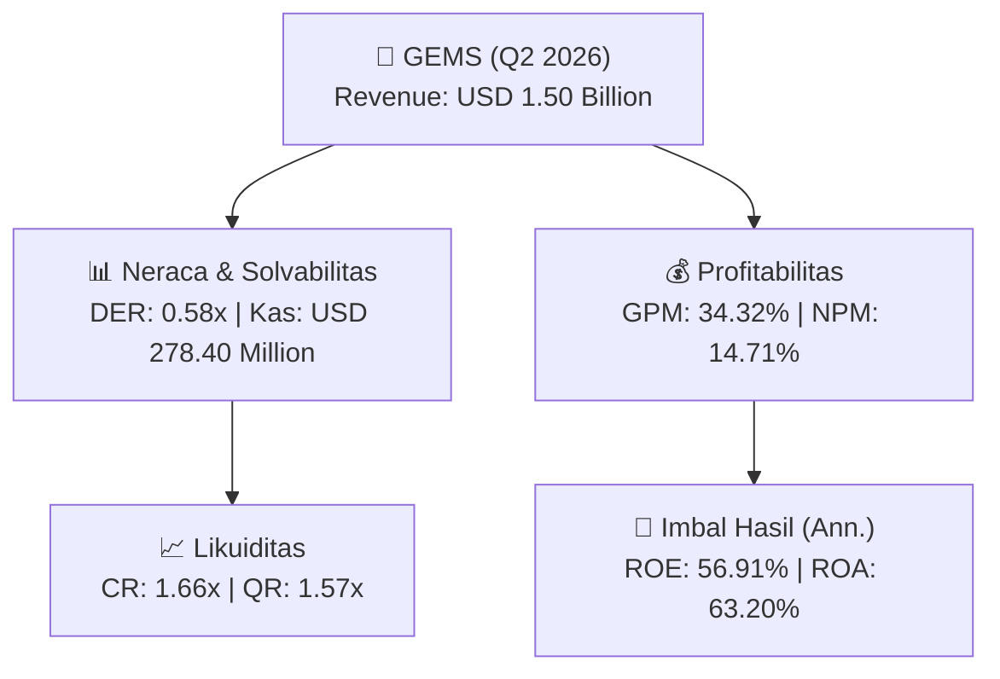
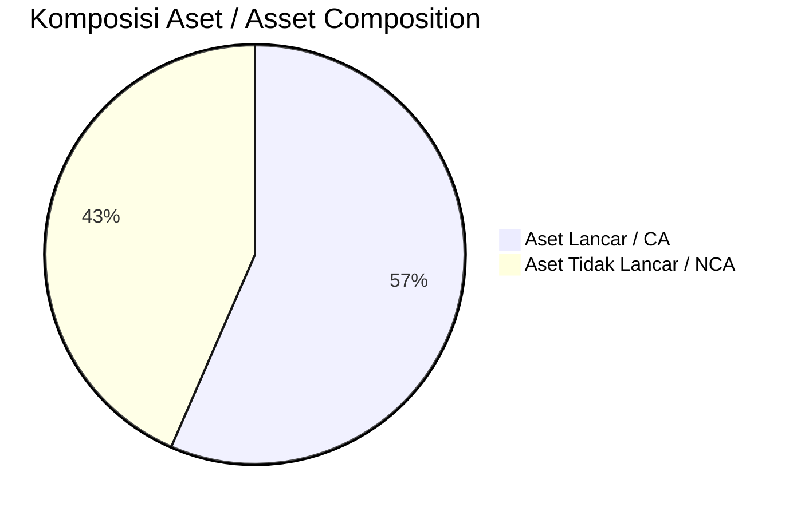
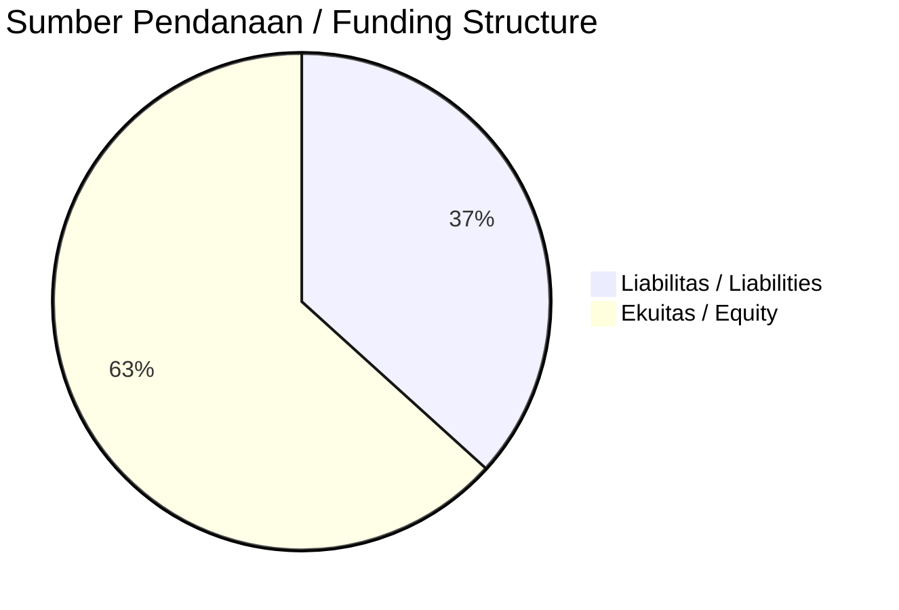

# 📈 Laporan Analisis Keuangan Mendalam: [[GEMS]] — Q2 2026

⬅️ [[knowledge-base/daily-digests/Daily_Digest_20260929|Kembali ke Daily Digest]] | 📅 **2026-09-29** | 🎛️ [[Dashboard|Ke Dashboard Utama]]

> [!IMPORTANT]
> Dokumen ini disusun oleh **Financial Summarizer Agent** untuk menganalisis kinerja keuangan, kesehatan neraca, profitabilitas, dan katalis sektor (Energi & Utilitas) **Golden Energy Mines Tbk ([[GEMS]])** berdasarkan LK Q2 2026.

---

## 📌 1. Ikhtisar Kinerja Utama / Executive Performance Highlight
- **Emiten**: `[[GEMS]]` (Golden Energy Mines Tbk)
- **Sektor Usaha / Industry Sector**: `Energi & Utilitas`
- **Periode Laporan / Reporting Period**: `Q2 2026`
- **Pendapatan Neto / Net Revenue**: `USD 1.50 Billion` (**+30.66% 🟢 YoY** dari USD 1.14 Billion)
- **Laba Bruto / Gross Profit**: `USD 513.22 Million` (**+27.96% 🟢 YoY**)
- **Laba (Rugi) Bersih / Net Income**: `USD 219.96 Million` (**+45.03% 🟢 YoY**)
- **Total Aset / Total Assets**: `USD 810.08 Million` | **Total Ekuitas / Total Equity**: `USD 843.59 Million`
- **EPS (Annualized)**: `6.76` | **BVPS**: `12.97`

---

## 📊 2. Laba Rugi Komparatif / Comparative Income Statement

| Pos Laba Rugi / Income Statement Item | Q2 2026 | Prior Period | YoY (%) |
| :--- | ---: | ---: | :---: |
| **Pendapatan Neto / Net Revenue** | `1.50B` | `1.14B` | **+30.66% 🟢** |
| **Beban Pokok / COGS** | `(982.06M)` | `(743.33M)` | +32.12% 🟢 |
| **Laba Bruto / Gross Profit** | `513.22M` | `401.08M` | **+27.96% 🟢** |
| **Beban Usaha / Operating Expenses** | `(68.81M)` | `(76.59M)` | -10.15% 🔴 |
| **Laba Operasional / EBIT** | `290.49M` | `199.09M` | +45.91% 🟢 |
| **Laba (Rugi) Bersih / Net Income** | **219.96M** | **151.67M** | **+45.03% 🟢** |

---

## 🏦 3. Neraca & Struktur Permodalan / Balance Sheet & Capital Structure

| Pos Neraca / Balance Sheet Item | Q2 2026 | Prior Year End | Δ YoY/YtD (%) | Catatan / Notes |
| :--- | ---: | ---: | :---: | :--- |
| **Aset Lancar / Current Assets** | `810.08M` | `582.04M` | +39.18% 🟢 | Kas: USD 278.40 Million |
| **Aset Tidak Lancar / Non-Current Assets** | `623.05M` | `614.56M` | +1.38% 🟢 | Aset Tetap & Operasional |
| **TOTAL ASET / TOTAL ASSETS** | **810.08M** | **582.04M** | **+39.18% 🟢** | |
| **Liabilitas Jk. Pendek / Current Liabilities** | `488.93M` | `387.85M` | +26.06% 🟢 | |
| **Liabilitas Jk. Panjang / Non-Current Liabilities** | `91.50M` | `100.17M` | -8.65% 🔴 | |
| **TOTAL LIABILITAS / TOTAL LIABILITIES** | **488.93M** | **387.85M** | **+26.06% 🟢** | |
| **TOTAL EKUITAS / TOTAL EQUITY** | **843.59M** | **702.54M** | **+20.08% 🟢** | |

---

## 💸 4. Laporan Arus Kas / Cash Flow Statement

| Komponen Arus Kas / Cash Flow Component | Q2 2026 | Prior Period | Δ YoY (%) |
| :--- | ---: | ---: | :---: |
| **Arus Kas Operasi / CFO** | `256.61M` | `165.49M` | +55.07% 🟢 |
| **Arus Kas Investasi / CFI** | `-13.19M` | `-16.40M` | +19.60% 🟢 |
| **Arus Kas Pendanaan / CFF** | `-78.96M` | `-363.08M` | +78.25% 🟢 |
| **Kenaikan (Penurunan) Kas Bersih** | `164.47M` | `-213.99M` | +176.86% 🟢 |
| Belanja Modal / Capex | `(11.27M)` | `(6.27M)` | +79.86% 🟢 |
| Pembayaran Dividen / Dividends Paid | `(81.56M)` | `(214.08M)` | -61.90% 🔴 |
| **Free Cash Flow (CFO - Capex)** | **245.34M** | **159.22M** | **+54.09% 🟢** |

---

## 📈 Analisis Rasio Keuangan / Financial Ratio Analysis

| Kategori / Category | Metrik / Metric | Nilai / Value | Benchmark | Interpretasi / Interpretation |
| :--- | :--- | :---: | :---: | :--- |
| **🛡️ Likuiditas** | **Current Ratio** | `1.66x` | `> 1.0x` | Kemampuan bayar kewajiban jk. pendek |
| | **Quick Ratio** | `1.57x` | `> 0.8x` | Likuiditas tanpa persediaan |
| **📊 Profitabilitas** | **Gross Profit Margin (GPM)** | `34.32%` | - | Margin kotor operasional inti |
| | **Operating Profit Margin (OPM)** | `19.43%` | - | Efisiensi operasional |
| | **Net Profit Margin (NPM)** | `14.71%` | - | Konversi revenue ke laba bersih |
| **🎯 Imbal Hasil (Ann.)** | **Return on Equity (ROE)** | `56.91%` | - | Imbal hasil terhadap ekuitas |
| | **Return on Assets (ROA)** | `63.20%` | - | Produktivitas aset |
| **⚖️ Solvabilitas** | **Debt to Equity (DER)** | `0.58x` | `< 2.0x` | Leverage utang vs modal |
| | **Debt to Asset (DAR)** | `0.60x` | `< 0.7x` | Porsi aset didanai utang |

---

## 📐 Per Share Metrics

| Metrik / Metric | Nilai / Value | Keterangan / Notes |
| :--- | ---: | :--- |
| **EPS (Annualized)** | `USD 6.76` | Laba per saham (dianualisasi) |
| **BVPS** | `USD 12.97` | Nilai buku per saham |

---

## 🚀 Analisis Strategis & Karakteristik Sektor / Strategic Analysis: Energi & Utilitas

Pada periode Q2 2026, **Golden Energy Mines Tbk ([[GEMS]])** membukukan total pendapatan sebesar **USD 1.50 Billion** (+30.66% 🟢 YoY). Laba kotor tercatat **USD 513.22 Million** dengan GPM **34.32%**. Laba bersih sebesar **USD 219.96 Million** (+45.03% 🟢 YoY). Total aset **USD 810.08 Million**, ekuitas **USD 843.59 Million**, DER **0.58x**.

### 🔍 Indikator Kunci Sektor / Sector Key Indicators (Energi & Utilitas)
- **Karakteristik Industri Tambang & Komoditas / Mining & Commodity**: Kinerja dipengaruhi oleh Average Selling Price (ASP), volume produksi/pengapalan, dan efisiensi Cash Cost per ton.
- **Profil Arus Kas / Cash Flow Profile**: Arus kas operasional yang solid menopang dividen berkala dan ekspansi hilirisasi / transisi energi.
- **Regulasi & ESG**: Kewajiban reklamasi, royalti pemerintah, dan komitmen keberlanjutan.

> [!NOTE]
> _Data Public Expose / Investor Presentation belum tersedia untuk emiten ini._

---

## 📋 Catatan Kunci Laporan Keuangan / Key Notes to Financial Statements

### 🔍 Opini Auditor / Auditor Opinion
- **Jenis Opini / Opinion Type**: `Wajar Tanpa Modifikasian / Unqualified`
- **KAP / Audit Firm**: `KAP Mirawati Sensi Idris`
- **Partner Audit**: `Maria Leckzinska`
- **Tanggal Laporan / Report Date**: `2026-09-25`

### 📝 Perjanjian & Kontrak Signifikan / Key Contracts & Agreements
- BORNEO memiliki Perjanjian Kerjasama Pengusaha Pertambangan Batubara (PKP2B)/Coal Contract of Work (CCoW) dengan Pemerintah Republik Indonesia yang mewajibkan BORNEO membagi 13,5% dari produksi batubara kepada Pemerintah Republik Indonesia.

### 🤝 Transaksi Pihak Berelasi / Related Party Transactions
- BSL memiliki pertanggungan asuransi pada PT Asuransi Sinarmas (pihak berelasi, Catatan 35) dengan nilai pertanggungan IDR 190.000.000.000 pada 30 Juni 2026 dan 31 Desember 2025.

### ⚠️ Komitmen & Kontinjensi / Commitments & Contingencies
- BORNEO memiliki komitmen royalti berdasarkan PKP2B/CCoW untuk membagi 13,5% produksi batubara kepada Pemerintah Republik Indonesia.

---

## 💡 Catatan Strategis & Panduan Investor / Strategic Notes & Investor Guide

1. **Kesehatan Permodalan / Capital Health**: DER **0.58x**, CR **1.66x** — _sehat dan aman_.
2. **Katalis Pertumbuhan / Growth Catalysts**: Pantau realisasi pendapatan dan efisiensi operasional periode berikutnya.

---

## 🔗 Hubungan Note Terkait / Knowledge Graph Links
- [[knowledge-base/daily-digests/Daily_Digest_20260929|📄 Daily Digest 2026-09-29]]
- [[knowledge-base/trading-signals/Trading_Signals_20260929|🎯 Trading Signals]]
- [[Dashboard|🎛️ Kembali ke Dashboard Utama]]