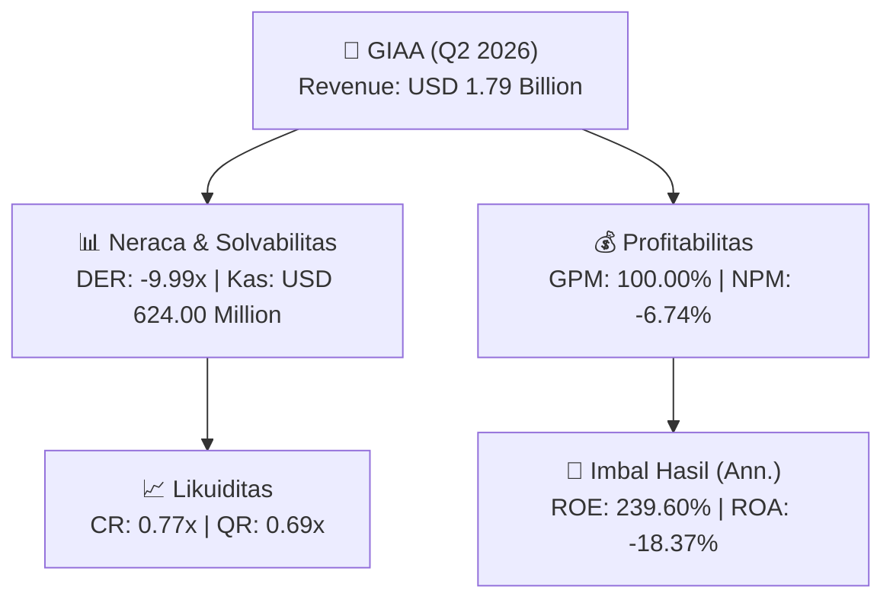
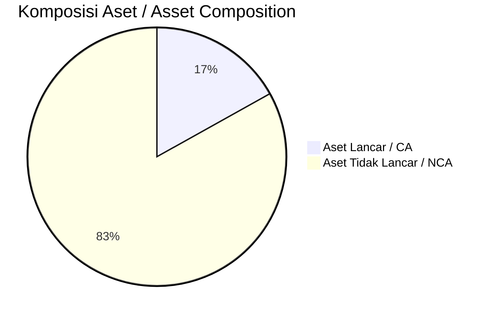
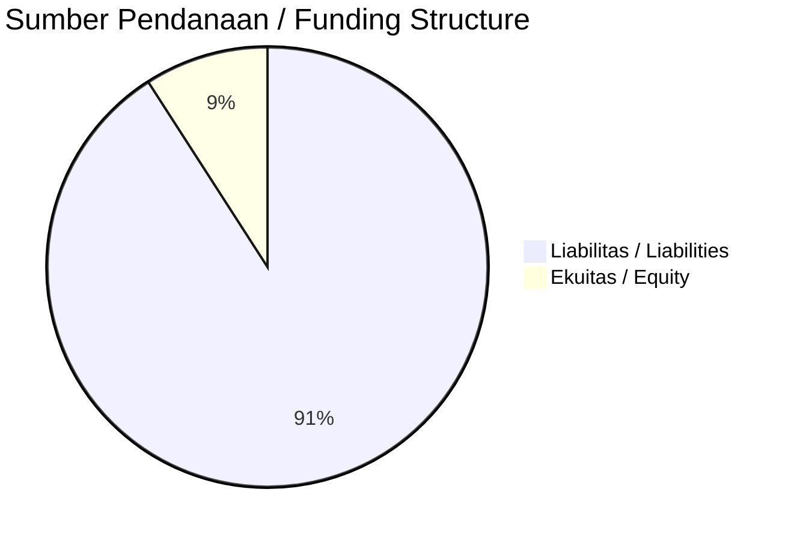

# 📈 Laporan Analisis Keuangan Mendalam: [[GIAA]] — Q2 2026

⬅️ [[knowledge-base/daily-digests/Daily_Digest_20261002|Kembali ke Daily Digest]] | 📅 **2026-10-02** | 🎛️ [[Dashboard|Ke Dashboard Utama]]

> [!IMPORTANT]
> Dokumen ini disusun oleh **Financial Summarizer Agent** untuk menganalisis kinerja keuangan, kesehatan neraca, profitabilitas, dan katalis sektor (Infrastruktur & Transportasi) **Garuda Indonesia (Persero) Tbk ([[GIAA]])** berdasarkan LK Q2 2026.

---

## 📌 1. Ikhtisar Kinerja Utama / Executive Performance Highlight
- **Emiten**: `[[GIAA]]` (Garuda Indonesia (Persero) Tbk)
- **Sektor Usaha / Industry Sector**: `Infrastruktur & Transportasi`
- **Periode Laporan / Reporting Period**: `Q2 2026`
- **Pendapatan Neto / Net Revenue**: `USD 1.79 Billion` (**+15.96% 🟢 YoY** dari USD 1.55 Billion)
- **Laba Bruto / Gross Profit**: `USD 1.79 Billion` (**+15.96% 🟢 YoY**)
- **Laba (Rugi) Bersih / Net Income**: `USD -121.00 Million` (**+18.24% 🟢 YoY**)
- **Total Aset / Total Assets**: `USD 1.25 Billion` | **Total Ekuitas / Total Equity**: `USD -162.00 Million`
- **EPS (Annualized)**: `-0.07` | **BVPS**: `-0.05`

---

## 📊 2. Laba Rugi Komparatif / Comparative Income Statement

| Pos Laba Rugi / Income Statement Item | Q2 2026 | Prior Period | YoY (%) |
| :--- | ---: | ---: | :---: |
| **Pendapatan Neto / Net Revenue** | `1.79B` | `1.55B` | **+15.96% 🟢** |
| **Beban Pokok / COGS** | `(-)` | `(-)` | - |
| **Laba Bruto / Gross Profit** | `1.79B` | `1.55B` | **+15.96% 🟢** |
| **Beban Usaha / Operating Expenses** | `(48.00M)` | `(97.00M)` | -50.52% 🔴 |
| **Laba Operasional / EBIT** | `-130.00M` | `-168.00M` | +22.62% 🟢 |
| **Laba (Rugi) Bersih / Net Income** | **-121.00M** | **-148.00M** | **+18.24% 🟢** |

---

## 🏦 3. Neraca & Struktur Permodalan / Balance Sheet & Capital Structure

| Pos Neraca / Balance Sheet Item | Q2 2026 | Prior Year End | Δ YoY/YtD (%) | Catatan / Notes |
| :--- | ---: | ---: | :---: | :--- |
| **Aset Lancar / Current Assets** | `1.25B` | `1.39B` | -10.30% 🔴 | Kas: USD 624.00 Million |
| **Aset Tidak Lancar / Non-Current Assets** | `6.13B` | `6.23B` | -1.68% 🔴 | Aset Tetap & Operasional |
| **TOTAL ASET / TOTAL ASSETS** | **1.25B** | **1.39B** | **-10.30% 🔴** | |
| **Liabilitas Jk. Pendek / Current Liabilities** | `1.62B` | `1.37B` | +18.43% 🟢 | |
| **Liabilitas Jk. Panjang / Non-Current Liabilities** | `5.81B` | `6.21B` | -6.50% 🔴 | |
| **TOTAL LIABILITAS / TOTAL LIABILITIES** | **1.62B** | **1.37B** | **+18.43% 🟢** | |
| **TOTAL EKUITAS / TOTAL EQUITY** | **-162.00M** | **-40.00M** | **-305.00% 🔴** | |

---

## 💸 4. Laporan Arus Kas / Cash Flow Statement

| Komponen Arus Kas / Cash Flow Component | Q2 2026 | Prior Period | Δ YoY (%) |
| :--- | ---: | ---: | :---: |
| **Arus Kas Operasi / CFO** | `253.00M` | `303.00M` | -16.50% 🔴 |
| **Arus Kas Investasi / CFI** | `-382.00M` | `-181.00M` | -111.05% 🔴 |
| **Arus Kas Pendanaan / CFF** | `-162.00M` | `-128.00M` | -26.56% 🔴 |
| **Kenaikan (Penurunan) Kas Bersih** | `-291.00M` | `-6.00M` | -4750.00% 🔴 |
| Belanja Modal / Capex | `(31.00M)` | `(4.00M)` | +675.00% 🟢 |
| Pembayaran Dividen / Dividends Paid | `(-)` | `(-)` | - |
| **Free Cash Flow (CFO - Capex)** | **222.00M** | **299.00M** | **-25.75% 🔴** |

---

## 📈 Analisis Rasio Keuangan / Financial Ratio Analysis

| Kategori / Category | Metrik / Metric | Nilai / Value | Benchmark | Interpretasi / Interpretation |
| :--- | :--- | :---: | :---: | :--- |
| **🛡️ Likuiditas** | **Current Ratio** | `0.77x` | `> 1.0x` | Kemampuan bayar kewajiban jk. pendek |
| | **Quick Ratio** | `0.69x` | `> 0.8x` | Likuiditas tanpa persediaan |
| **📊 Profitabilitas** | **Gross Profit Margin (GPM)** | `100.00%` | - | Margin kotor operasional inti |
| | **Operating Profit Margin (OPM)** | `-7.24%` | - | Efisiensi operasional |
| | **Net Profit Margin (NPM)** | `-6.74%` | - | Konversi revenue ke laba bersih |
| **🎯 Imbal Hasil (Ann.)** | **Return on Equity (ROE)** | `239.60%` | - | Imbal hasil terhadap ekuitas |
| | **Return on Assets (ROA)** | `-18.37%` | - | Produktivitas aset |
| **⚖️ Solvabilitas** | **Debt to Equity (DER)** | `-9.99x` | `< 2.0x` | Leverage utang vs modal |
| | **Debt to Asset (DAR)** | `1.30x` | `< 0.7x` | Porsi aset didanai utang |

---

## 📐 Per Share Metrics

| Metrik / Metric | Nilai / Value | Keterangan / Notes |
| :--- | ---: | :--- |
| **EPS (Annualized)** | `USD -0.07` | Laba per saham (dianualisasi) |
| **BVPS** | `USD -0.05` | Nilai buku per saham |

---

## 🚀 Analisis Strategis & Karakteristik Sektor / Strategic Analysis: Infrastruktur & Transportasi

Pada periode Q2 2026, **Garuda Indonesia (Persero) Tbk ([[GIAA]])** membukukan total pendapatan sebesar **USD 1.79 Billion** (+15.96% 🟢 YoY). Laba kotor tercatat **USD 1.79 Billion** dengan GPM **100.00%**. Laba bersih sebesar **USD -121.00 Million** (+18.24% 🟢 YoY). Total aset **USD 1.25 Billion**, ekuitas **USD -162.00 Million**, DER **-9.99x**.

### 🔍 Indikator Kunci Sektor / Sector Key Indicators (Infrastruktur & Transportasi)
- **Karakteristik Infrastruktur & Transportasi**: Kinerja didorong oleh pertumbuhan volume Lalu Lintas Harian Rata-rata (LHR) dan penyesuaian tarif berkala.
- **Struktur Leverage / Leverage Structure**: Pengelolaan liabilitas jangka panjang yang terukur seiring masa konsesi.
- **Recurring Revenue**: Pendapatan tol/sewa/transport bersifat recurring dan predictable.

> [!NOTE]
> _Data Public Expose / Investor Presentation belum tersedia untuk emiten ini._

---

## 📋 Catatan Kunci Laporan Keuangan / Key Notes to Financial Statements

### 🔍 Opini Auditor / Auditor Opinion
- **Jenis Opini / Opinion Type**: `Wajar Tanpa Modifikasian / Unqualified`
- **KAP / Audit Firm**: `KAP Purwanto Susanti dan Surja`
- **Partner Audit**: `Dedy Lesmana`
- **Tanggal Laporan / Report Date**: `2026-09-29`

### 📝 Perjanjian & Kontrak Signifikan / Key Contracts & Agreements
- Pada 8 Desember 2023, CI menandatangani perjanjian restrukturisasi utang dengan PT Pertamina (Persero) sebesar USD226,14 juta (terdiri atas Rp3,41 triliun dan USD5,08 juta), jangka waktu 15 tahun, bunga 5,5% per tahun. Selisih USD33,94 juta antara nilai wajar dan nilai tercatat utang direstrukturisasi diakui sebagai pendapatan keuangan.
- Pada 22 Juni 2018, Perusahaan menandatangani perjanjian dengan Kontrak Investasi Kolektif Efek Beragun Aset Mandiri GIAA01 (KIK EBA Mandiri GIAA01) untuk menerbitkan efek beragun aset atas pendapatan penjualan tiket penerbangan rute Jeddah dan Madinah selama lima tahun dengan nilai aset Rp2.650 miliar dan nilai penerbitan Rp2.000 miliar. KIK didirikan berdasarkan Akta No. 4 tanggal 3 Mei 2018, diubah dengan Akta No. 49 tanggal 22 Juni 2018, dengan PT Mandiri Manajemen Investasi sebagai Manajer Investasi.

### ⚠️ Komitmen & Kontinjensi / Commitments & Contingencies
- Ketidakpastian kewajiban perpajakan: Grup tidak dapat menentukan secara pasti jumlah utang pajak kini atau masa mendatang atau jumlah klaim restitusi pajak yang dapat terpulihkan karena proses pemeriksaan yang masih berlangsung atau negosiasi dengan otoritas perpajakan.
- Pada 9 November 2018, CI menandatangani perjanjian kerja sama operasi dengan PT Sriwijaya Air (Catatan 45 Ikatan).

---

## 💡 Catatan Strategis & Panduan Investor / Strategic Notes & Investor Guide

1. **Kesehatan Permodalan / Capital Health**: DER **-9.99x**, CR **0.77x** — _perlu dipantau secara disiplin_.
2. **Katalis Pertumbuhan / Growth Catalysts**: Pantau realisasi pendapatan dan efisiensi operasional periode berikutnya.

---

## 🔗 Hubungan Note Terkait / Knowledge Graph Links
- [[knowledge-base/daily-digests/Daily_Digest_20261002|📄 Daily Digest 2026-10-02]]
- [[knowledge-base/trading-signals/Trading_Signals_20261002|🎯 Trading Signals]]
- [[Dashboard|🎛️ Kembali ke Dashboard Utama]]