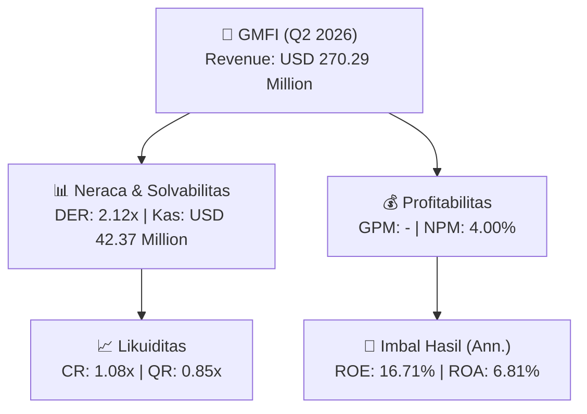
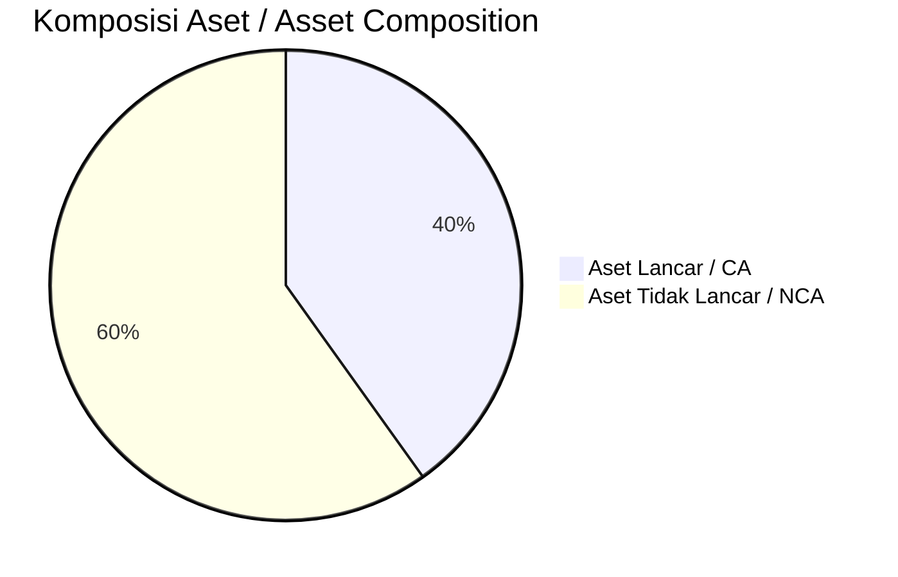
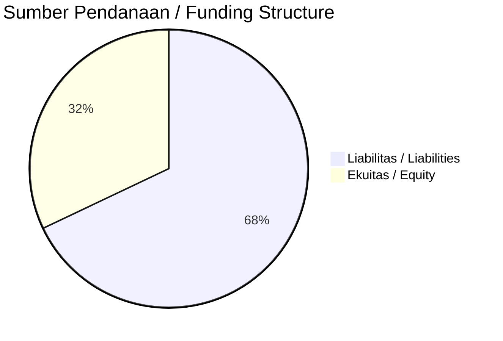

# 📈 Laporan Analisis Keuangan Mendalam: [[GMFI]] — Q2 2026

⬅️ [[knowledge-base/daily-digests/Daily_Digest_20260917|Kembali ke Daily Digest]] | 📅 **2026-09-17** | 🎛️ [[Dashboard|Ke Dashboard Utama]]

> [!IMPORTANT]
> Dokumen ini disusun oleh **Financial Summarizer Agent** untuk menganalisis kinerja keuangan, kesehatan neraca, profitabilitas, dan katalis sektor (Infrastruktur & Transportasi) **PT Garuda Maintenance Facility Aero Asia Tbk. ([[GMFI]])** berdasarkan LK Q2 2026.

---

## 📌 1. Ikhtisar Kinerja Utama / Executive Performance Highlight
- **Emiten**: `[[GMFI]]` (PT Garuda Maintenance Facility Aero Asia Tbk.)
- **Sektor Usaha / Industry Sector**: `Infrastruktur & Transportasi`
- **Periode Laporan / Reporting Period**: `Q2 2026`
- **Pendapatan Neto / Net Revenue**: `USD 270.29 Million` (**+51.04% 🟢 YoY** dari USD 178.96 Million)

- **Laba (Rugi) Bersih / Net Income**: `USD 10.81 Million` (**+23.46% 🟢 YoY**)
- **Total Aset / Total Assets**: `USD 331.69 Million` | **Total Ekuitas / Total Equity**: `USD 144.43 Million`
- **EPS (Annualized)**: `0.06` | **BVPS**: `0.40`

---

## 📊 2. Laba Rugi Komparatif / Comparative Income Statement

| Pos Laba Rugi / Income Statement Item | Q2 2026 | Prior Period | YoY (%) |
| :--- | ---: | ---: | :---: |
| **Pendapatan Neto / Net Revenue** | `270.29M` | `178.96M` | **+51.04% 🟢** |
| **Beban Pokok / COGS** | `(-)` | `(-)` | - |
| **Laba Bruto / Gross Profit** | `-` | `-` | **-** |
| **Beban Usaha / Operating Expenses** | `(-)` | `(-)` | - |
| **Laba Operasional / EBIT** | `11.83M` | `9.92M` | +19.28% 🟢 |
| **Laba (Rugi) Bersih / Net Income** | **10.81M** | **8.76M** | **+23.46% 🟢** |

---

## 🏦 3. Neraca & Struktur Permodalan / Balance Sheet & Capital Structure

| Pos Neraca / Balance Sheet Item | Q2 2026 | Prior Year End | Δ YoY/YtD (%) | Catatan / Notes |
| :--- | ---: | ---: | :---: | :--- |
| **Aset Lancar / Current Assets** | `331.69M` | `303.89M` | +9.15% 🟢 | Kas: USD 42.37 Million |
| **Aset Tidak Lancar / Non-Current Assets** | `494.81M` | `509.09M` | -2.80% 🔴 | Aset Tetap & Operasional |
| **TOTAL ASET / TOTAL ASSETS** | **331.69M** | **303.89M** | **+9.15% 🟢** | |
| **Liabilitas Jk. Pendek / Current Liabilities** | `305.81M` | `305.22M` | +0.19% 🟢 | |
| **Liabilitas Jk. Panjang / Non-Current Liabilities** | `376.06M` | `393.19M` | -4.36% 🔴 | |
| **TOTAL LIABILITAS / TOTAL LIABILITIES** | **305.81M** | **305.22M** | **+0.19% 🟢** | |
| **TOTAL EKUITAS / TOTAL EQUITY** | **144.43M** | **114.39M** | **+26.27% 🟢** | |

---

## 💸 4. Laporan Arus Kas / Cash Flow Statement

| Komponen Arus Kas / Cash Flow Component | Q2 2026 | Prior Period | Δ YoY (%) |
| :--- | ---: | ---: | :---: |
| **Arus Kas Operasi / CFO** | `6.96M` | `12.29M` | -43.39% 🔴 |
| **Arus Kas Investasi / CFI** | `-8.97M` | `-2.32M` | -286.90% 🔴 |
| **Arus Kas Pendanaan / CFF** | `5.31M` | `-14.38M` | +136.95% 🟢 |
| **Kenaikan (Penurunan) Kas Bersih** | `3.30M` | `-4.41M` | +174.80% 🟢 |
| Belanja Modal / Capex | `(2.64M)` | `(1.85M)` | +42.53% 🟢 |
| Pembayaran Dividen / Dividends Paid | `(-)` | `(-)` | - |
| **Free Cash Flow (CFO - Capex)** | **4.32M** | **10.44M** | **-58.64% 🔴** |

---

## 📈 Analisis Rasio Keuangan / Financial Ratio Analysis

| Kategori / Category | Metrik / Metric | Nilai / Value | Benchmark | Interpretasi / Interpretation |
| :--- | :--- | :---: | :---: | :--- |
| **🛡️ Likuiditas** | **Current Ratio** | `1.08x` | `> 1.0x` | Kemampuan bayar kewajiban jk. pendek |
| | **Quick Ratio** | `0.85x` | `> 0.8x` | Likuiditas tanpa persediaan |
| **📊 Profitabilitas** | **Gross Profit Margin (GPM)** | `-` | - | Margin kotor operasional inti |
| | **Operating Profit Margin (OPM)** | `4.38%` | - | Efisiensi operasional |
| | **Net Profit Margin (NPM)** | `4.00%` | - | Konversi revenue ke laba bersih |
| **🎯 Imbal Hasil (Ann.)** | **Return on Equity (ROE)** | `16.71%` | - | Imbal hasil terhadap ekuitas |
| | **Return on Assets (ROA)** | `6.81%` | - | Produktivitas aset |
| **⚖️ Solvabilitas** | **Debt to Equity (DER)** | `2.12x` | `< 2.0x` | Leverage utang vs modal |
| | **Debt to Asset (DAR)** | `0.92x` | `< 0.7x` | Porsi aset didanai utang |

---

## 📐 Per Share Metrics

| Metrik / Metric | Nilai / Value | Keterangan / Notes |
| :--- | ---: | :--- |
| **EPS (Annualized)** | `USD 0.06` | Laba per saham (dianualisasi) |
| **BVPS** | `USD 0.40` | Nilai buku per saham |

---

## 🚀 Analisis Strategis & Karakteristik Sektor / Strategic Analysis: Infrastruktur & Transportasi

Pada periode Q2 2026, **PT Garuda Maintenance Facility Aero Asia Tbk. ([[GMFI]])** membukukan total pendapatan sebesar **USD 270.29 Million** (+51.04% 🟢 YoY). Laba kotor tercatat **-** dengan GPM **-**. Laba bersih sebesar **USD 10.81 Million** (+23.46% 🟢 YoY). Total aset **USD 331.69 Million**, ekuitas **USD 144.43 Million**, DER **2.12x**.

### 🔍 Indikator Kunci Sektor / Sector Key Indicators (Infrastruktur & Transportasi)
- **Karakteristik Infrastruktur & Transportasi**: Kinerja didorong oleh pertumbuhan volume Lalu Lintas Harian Rata-rata (LHR) dan penyesuaian tarif berkala.
- **Struktur Leverage / Leverage Structure**: Pengelolaan liabilitas jangka panjang yang terukur seiring masa konsesi.
- **Recurring Revenue**: Pendapatan tol/sewa/transport bersifat recurring dan predictable.

> [!NOTE]
> _Data Public Expose / Investor Presentation belum tersedia untuk emiten ini._

---

## 📋 Catatan Kunci Laporan Keuangan / Key Notes to Financial Statements

### 🔍 Opini Auditor / Auditor Opinion
- **Jenis Opini / Opinion Type**: `Wajar Tanpa Modifikasian / Unqualified`
- **KAP / Audit Firm**: `KAP Rintis, Jumadi, Rianto  Rekan`
- **Partner Audit**: `Ika Gunawan`
- **Tanggal Laporan / Report Date**: `2026-09-07`
- **Kesimpulan**: _-_

### 📝 Perjanjian & Kontrak Signifikan / Key Contracts & Agreements
- Perjanjian sewa Hangar Garuda ditandatangani pada 27 Maret 2003 dengan Garuda untuk penggunaan bangunan seluas 140.026,5 m² dengan biaya kontribusi Rp730.034.078 per bulan.

### 🤝 Transaksi Pihak Berelasi / Related Party Transactions
- Pendapatan dari pihak berelasi adalah 69,66% dan 67,58% dari jumlah pendapatan pada periode enam bulan yang berakhir pada tanggal 30 Juni 2026 dan 2025, serta 72,65% dan 78,01% untuk tahun-tahun yang berakhir pada tanggal 31 Desember 2025 dan 2024.

---

## 💡 Catatan Strategis & Panduan Investor / Strategic Notes & Investor Guide

1. **Kesehatan Permodalan / Capital Health**: DER **2.12x**, CR **1.08x** — _perlu dipantau secara disiplin_.
2. **Katalis Pertumbuhan / Growth Catalysts**: Pantau realisasi pendapatan dan efisiensi operasional periode berikutnya.

---

## 🔗 Hubungan Note Terkait / Knowledge Graph Links
- [[knowledge-base/daily-digests/Daily_Digest_20260917|📄 Daily Digest 2026-09-17]]
- [[knowledge-base/trading-signals/Trading_Signals_20260917|🎯 Trading Signals]]
- [[Dashboard|🎛️ Kembali ke Dashboard Utama]]