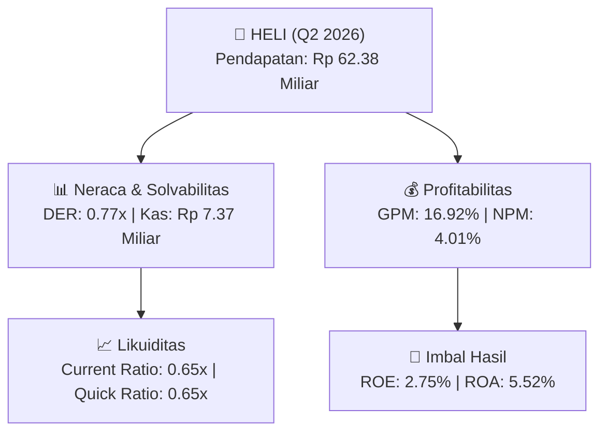

# 📈 Laporan Analisis Keuangan Mendalam: [[HELI]] - Q2 2026

⬅️ [[knowledge-base/daily-digests/Daily_Digest_20260831|Kembali ke Daily Digest]] | 📅 **2026-08-31** | 🎛️ [[Dashboard|Ke Dashboard Utama]]

> [!IMPORTANT]
> Dokumen ini disusun secara khusus oleh **Financial Summarizer Agent** untuk menganalisis kinerja keuangan, **kesehatan neraca**, profitabilitas, dan **katalis sektor (Infrastruktur & Transportasi)** **PT Jaya Trishindo Tbk ([[HELI]])** berdasarkan Laporan Keuangan Q2 2026.

---

## 📌 1. Ikhtisar Kinerja Utama (Executive Performance Highlight)
- **Emiten**: `[[HELI]]` (PT Jaya Trishindo Tbk)
- **Sektor Usaha**: `Infrastruktur & Transportasi`
- **Periode Laporan**: `Q2 2026`
- **Pendapatan Neto (Revenue)**: `Rp 62.38 Miliar` (**+4.31% 🟢 YoY** dari Rp 59.80 Miliar)
- **Laba Bruto (Gross Profit)**: `Rp 10.55 Miliar` (**-7.89% 🔴 YoY**)
- **Laba (Rugi) Bersih**: `Rp 2.50 Miliar` (**-10.23% 🔴 YoY**)
- **Total Aset**: `Rp 45.34 Miliar` | **Total Ekuitas**: `Rp 91.12 Miliar`

---

## 📊 2. Matriks Laba Rugi Komparatif (Income Statement)

| Pos Laba Rugi Utama (Dalam Miliar Rp) | Periode Berjalan (Q2 2026) | Periode Komparatif Lalu | Pertumbuhan YoY (%) |
| :--- | :---: | :---: | :---: |
| **Pendapatan / Penjualan Neto** | `62.38` | `59.80` | **+4.31% 🟢** |
| **Beban Pokok Pendapatan (COGS)** | `(51.82)` | `(48.34)` | +7.21% 🟢 |
| **Laba Bruto (Gross Profit)** | `10.55` | `11.46` | **-7.89% 🔴** |
| **Beban Usaha / Operasional** | `(5.05)` | `(2.82)` | +78.93% 🟢 |
| **Laba Operasional (EBIT)** | `2.52` | `2.74` | -8.20% 🔴 |
| **Laba (Rugi) Bersih Periode Berjalan** | **2.50** | **2.79** | **-10.23% 🔴** |

---

## 🏦 3. Matriks Neraca & Struktur Permodalan (Balance Sheet)

| Pos Neraca Utama (Dalam Miliar Rp) | Q2 2026 | Posisi Akhir Tahun Lalu | Perubahan YoY / YtD (%) | Catatan Analis |
| :--- | :---: | :---: | :---: | :--- |
| **Aset Lancar** | `45.34` | `53.78` | -15.69% 🔴 | Kas: Rp 7.37 Miliar |
| **Aset Tidak Lancar** | `145.95` | `141.29` | +3.30% 🟢 | Aset Tetap & Operasional |
| **TOTAL ASET** | **45.34** | **53.78** | **-15.69% 🔴** | Basis Skala Usaha |
| **Liabilitas Jangka Pendek** | `69.72` | `78.36` | -11.02% 🔴 | Utang Usaha & Kewajiban Pendek |
| **Liabilitas Jangka Panjang** | `29.83` | `27.49` | +8.49% 🟢 | Kewajiban Jangka Panjang |
| **TOTAL LIABILITAS** | **69.72** | **78.36** | **-11.02% 🔴** | Struktur Utang Terkendali |
| **TOTAL EKUITAS** | **91.12** | **88.61** | **+2.83% 🟢** | Modal Bersih Pemegang Saham |

---

## 📈 4. Analisis Rasio Keuangan Utama (Financial Ratios)

| Kategori Rasio | Metrik Rasio | Nilai Rasio | Benchmark & Status | Interpretasi Analis |
| :--- | :--- | :---: | :---: | :--- |
| **🛡️ Likuiditas** | **Current Ratio** | `0.65x` | `> 1.0x` | Kemampuan melunasi kewajiban jangka pendek |
| | **Quick Ratio** | `0.65x` | `> 0.8x` | Likuiditas kas & piutang tanpa persediaan |
| **📊 Profitabilitas** | **Gross Profit Margin (GPM)** | `16.92%` | - | Margin kotor dari operasional inti |
| | **Net Profit Margin (NPM)** | `4.01%` | - | Efisiensi konversi omset ke laba bersih |
| | **Return on Equity (ROE)** | `2.75%` | - | Tingkat imbal hasil terhadap ekuitas |
| | **Return on Assets (ROA)** | `5.52%` | - | Produktivitas aset menghasilkan laba |
| **⚖️ Solvabilitas** | **Debt to Equity Ratio (DER)** | `0.77x` | `< 2.0x` | Struktur leverage utang terhadap modal |
| | **Debt to Asset Ratio (DAR)** | `1.54x` | `< 0.7x` | Porsi pendanaan aset dari kewajiban |

---

## 🚀 5. Analisis Strategis & Karakteristik Sektor: Infrastruktur & Transportasi

Pada periode Q2 2026, **PT Jaya Trishindo Tbk ([[HELI]])** membukukan total pendapatan/penjualan sebesar **Rp 62.38 Miliar** (+4.31% 🟢 YoY). Laba kotor tercatat sebesar **Rp 10.55 Miliar** dengan Gross Profit Margin (GPM) sebesar **16.92%** dan laba bersih tahun berjalan sebesar **Rp 2.50 Miliar** (-10.23% 🔴 YoY).

Dari sisi neraca, perseroan memiliki total aset sebesar **Rp 45.34 Miliar** dengan ekuitas bersih **Rp 91.12 Miliar**. Rasio solvabilitas DER berada di level **0.77x**, menunjukkan struktur permodalan yang terkelola dengan rasio likuiditas Current Ratio sebesar **0.65x**.

### 🔍 Indikator Kunci Sektor (Infrastruktur & Transportasi):
- **Karakteristik Industri Infrastruktur & Jalan Tol**: Kinerja didorong oleh pertumbuhan volume lalu lintas harian transaksi (LHR) dan penyesuaian tarif tol berkala.
- **Struktur Leverage**: Memerlukan pengelolaan liabilitas jangka panjang yang terukur seiring masa konsesi hak pengusahaan jalan tol.

---

## 💡 6. Catatan Strategis & Panduan Investor
1. **Kesehatan Permodalan**: Rasio DER tercatat **0.77x** dengan likuiditas Current Ratio **0.65x** (perlu dipantau secara disiplin).
2. **Katalis Pertumbuhan**: Pantau realisasi pendapatan semester berikutnya serta efisiensi beban usaha operasional.

---

## 🔗 Hubungan Note Terkait (Knowledge Graph)
- [[knowledge-base/daily-digests/Daily_Digest_20260831|📄 Daily Digest 2026-08-31]]
- [[knowledge-base/trading-signals/Trading_Signals_20260831|🎯 Trading Signals]]
- [[Dashboard|🎛️ Kembali ke Dashboard Utama]]
