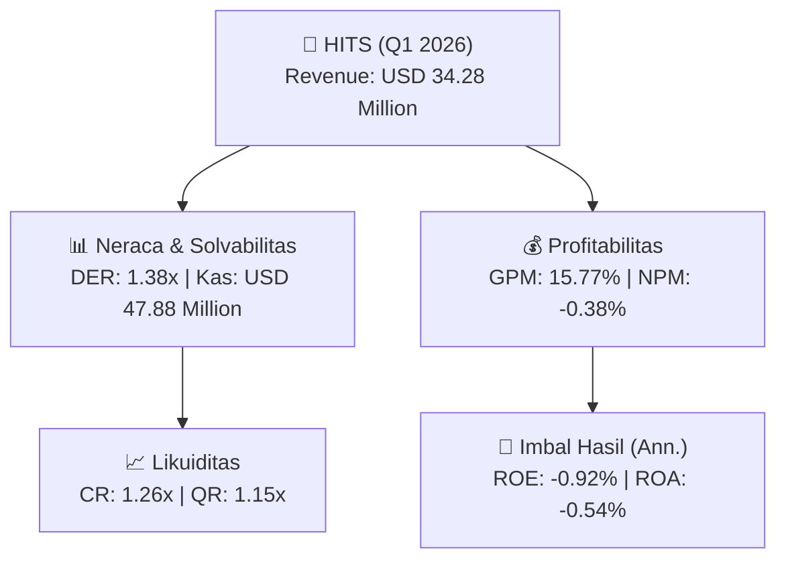

# 📈 Laporan Keuangan Interim: [[HITS]] — Q1 2026

📅 **2026-10-07** | 🎛️ [[Dashboard|Ke Dashboard Utama]]

> [!NOTE]
> Laporan interim ringkas **Humpuss Intermoda Transportasi Tbk ([[HITS]])** — Sektor: Energi & Utilitas.

---

## 📌 1. Ikhtisar Kinerja Utama / Executive Performance Highlight
- **Emiten**: `[[HITS]]` (Humpuss Intermoda Transportasi Tbk)
- **Sektor Usaha / Industry Sector**: `Energi & Utilitas`
- **Periode Laporan / Reporting Period**: `Q1 2026`
- **Pendapatan Neto / Net Revenue**: `USD 34.28 Million` (**-0.44% 🔴 YoY** dari USD 34.43 Million)
- **Laba Bruto / Gross Profit**: `USD 5.41 Million` (**-37.08% 🔴 YoY**)
- **Laba (Rugi) Bersih / Net Income**: `USD -131.35 Thousand` (**-104.47% 🔴 YoY**)
- **Total Aset / Total Assets**: `USD 99.53 Million` | **Total Ekuitas / Total Equity**: `USD 57.54 Million`
- **EPS (Annualized)**: `-0.01` | **BVPS**: `0.60`

---

## 📊 2. Laba Rugi Komparatif / Comparative Income Statement

| Pos Laba Rugi / Income Statement Item | Q1 2026 | Prior Period | YoY (%) |
| :--- | ---: | ---: | :---: |
| **Pendapatan Neto / Net Revenue** | `34.28M` | `34.43M` | **-0.44% 🔴** |
| **Beban Pokok / COGS** | `(28.88M)` | `(25.84M)` | +11.73% 🟢 |
| **Laba Bruto / Gross Profit** | `5.41M` | `8.59M` | **-37.08% 🔴** |
| **Beban Usaha / Operating Expenses** | `(3.46M)` | `(3.37M)` | +2.49% 🟢 |
| **Laba Operasional / EBIT** | `643.18K` | `3.68M` | -82.54% 🔴 |
| **Laba (Rugi) Bersih / Net Income** | **-131.35K** | **2.94M** | **-104.47% 🔴** |

---

## 🏦 3. Neraca & Struktur Permodalan / Balance Sheet & Capital Structure

| Pos Neraca / Balance Sheet Item | Q1 2026 | Prior Year End | Δ YoY/YtD (%) | Catatan / Notes |
| :--- | ---: | ---: | :---: | :--- |
| **Aset Lancar / Current Assets** | `99.53M` | `94.17M` | +5.69% 🟢 | Kas: USD 47.88 Million |
| **Aset Tidak Lancar / Non-Current Assets** | `241.33M` | `241.35M` | -0.01% 🔴 | Aset Tetap & Operasional |
| **TOTAL ASET / TOTAL ASSETS** | **99.53M** | **94.17M** | **+5.69% 🟢** | |
| **Liabilitas Jk. Pendek / Current Liabilities** | `79.20M` | `86.57M` | -8.52% 🔴 | |
| **Liabilitas Jk. Panjang / Non-Current Liabilities** | `156.62M` | `145.30M` | +7.79% 🟢 | |
| **TOTAL LIABILITAS / TOTAL LIABILITIES** | **79.20M** | **86.57M** | **-8.52% 🔴** | |
| **TOTAL EKUITAS / TOTAL EQUITY** | **57.54M** | **56.60M** | **+1.67% 🟢** | |

---

## 📈 Analisis Rasio Keuangan / Financial Ratio Analysis

| Kategori / Category | Metrik / Metric | Nilai / Value | Benchmark | Interpretasi / Interpretation |
| :--- | :--- | :---: | :---: | :--- |
| **🛡️ Likuiditas** | **Current Ratio** | `1.26x` | `> 1.0x` | Kemampuan bayar kewajiban jk. pendek |
| | **Quick Ratio** | `1.15x` | `> 0.8x` | Likuiditas tanpa persediaan |
| **📊 Profitabilitas** | **Gross Profit Margin (GPM)** | `15.77%` | - | Margin kotor operasional inti |
| | **Operating Profit Margin (OPM)** | `1.88%` | - | Efisiensi operasional |
| | **Net Profit Margin (NPM)** | `-0.38%` | - | Konversi revenue ke laba bersih |
| **🎯 Imbal Hasil (Ann.)** | **Return on Equity (ROE)** | `-0.92%` | - | Imbal hasil terhadap ekuitas |
| | **Return on Assets (ROA)** | `-0.54%` | - | Produktivitas aset |
| **⚖️ Solvabilitas** | **Debt to Equity (DER)** | `1.38x` | `< 2.0x` | Leverage utang vs modal |
| | **Debt to Asset (DAR)** | `0.80x` | `< 0.7x` | Porsi aset didanai utang |

---

## 🔗 Hubungan Note Terkait / Knowledge Graph Links
- [[knowledge-base/daily-digests/Daily_Digest_20261007|📄 Daily Digest 2026-10-07]]
- [[knowledge-base/trading-signals/Trading_Signals_20261007|🎯 Trading Signals]]
- [[Dashboard|🎛️ Kembali ke Dashboard Utama]]